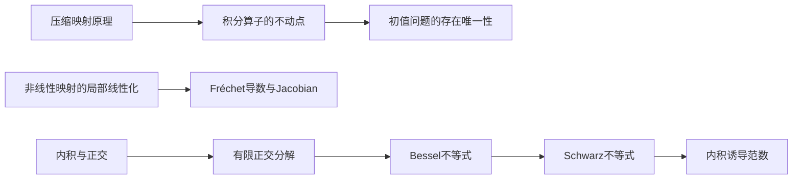
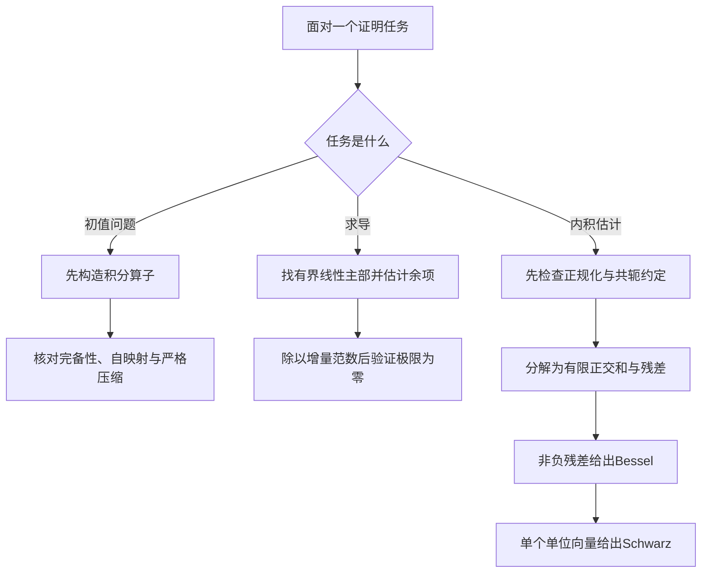

---
subject:
- 泛函分析
type: lecture
class_no: 9
date: '2026-10-27'
teacher: 邓志亮
source:
- 腾讯会议录制（常微分方程与内积空间讲座）
- '[[03_Sources/Courses/泛函分析/课堂笔记/raw/2026-10-27-常微分方程与内积空间讲座-297728-逐字稿]]'
- '[[03_Sources/Courses/泛函分析/课堂笔记/raw/2026-10-27-常微分方程与内积空间讲座-297728-纪要]]'
- '[[03_Sources/Courses/泛函分析/泛函分析(第2版) (江泽坚, 孙善利) (z-library.sk, 1lib.sk, z-li/泛函分析(第2版) (江泽坚, 孙善利) (z-library.sk, 1lib.sk, z-li]]'
meeting_code: null
start_time: '2026-10-27T14:30:50+08:00'
aliases:
- 2026-10-27 第9节 压缩映射应用、Fréchet导数与内积空间
schema_version: 2
time: '2026-10-27T21:50:26+08:00'
tags: []
legacy_status: 已完成
legacy_topics:
- '[[01_Knowledge/不动点]]'
- '[[01_Knowledge/范数]]'
- '[[01_Knowledge/度量空间]]'
status: not done
polish_status: done
lecture_date: '2026-10-27'
---

# 2026-10-27 第9节 压缩映射应用、Fréchet导数与内积空间

> [!info] 范围与课次
> 本次从常微分方程初值问题讲到Fréchet导数，再进入内积空间、有限正交分解、Bessel与Schwarz不等式。按[[课表]]及[[03_Sources/Courses/泛函分析/课堂笔记/README|连续课堂索引]]，承接10月23日第8节，本次为第9节；已纠正自动归档的“第11节”。“已完成”指本次确认范围的整理完成，不代表学习掌握。
> 未发现本次独立配套PPT；用本地教材第一章§9、第二章§1核对定义与证明。原始逐字稿和纪要保留。标为“补充解释”的内容用于补足条件、辨析转写或收尾推导。

## 一、本课问题与阅读路线

本课解决三个问题：怎样用不动点证明微分方程有唯一解？函数的“导数”在无穷维时是什么？有了内积，怎样把向量分成相互正交的部分并控制系数大小？

必要先修：

- [[01_Knowledge/不动点]]：$Tx=x$ 表示一次映射后不变；压缩映射原理还需要**非空完备空间、自映射、严格小于1的压缩常数**。
- [[01_Knowledge/度量空间]]与[[01_Knowledge/范数]]：在连续函数空间用上确界范数测量整条曲线的误差。
- 有界线性算子：对所有增量统一满足 $\|Lh\|\le C\|h\|$；它是导数的候选对象。

先读二、三掌握第一章收尾，再读四至六建立内积空间的证明链。反问题应用只需理解“未知函数也可以是输入”，无需提前掌握具体PDE模型。

## 二、用压缩映射处理常微分方程初值问题

### 1. 把导数方程变为积分方程

课堂00:00—00:14讨论
$$
x'(t)=f(t,x(t)),\qquad x(t_0)=x_0.
$$
积分后为
$$
x(t)=x_0+\int_{t_0}^{t}f(s,x(s))\,ds.
$$
因此令
$$
(Tx)(t)=x_0+\int_{t_0}^{t}f(s,x(s))\,ds,
$$
求解转化为求 $T$ 的不动点。

> 一句话来说：把“每一点的变化率”改写成“整条曲线必须满足的更新规则”。

当 $f$ 连续时，积分方程的连续解实际上可微，由微积分基本定理满足原方程及初值；不能把两种表述的等价性只当作形式移项。

### 2. 教材带形区域版本：检查三个条件

按教材定理9.3，设 $f$ 在
$$
\{(t,u):|t-t_0|<\delta,\ u\in\mathbb R\}
$$
上连续，且对所有该区域的 $t,u,v$，
$$
|f(t,u)-f(t,v)|\le K|u-v|,\qquad K>0.
$$
取 $0<\beta<\min\{\delta,1/K\}$，令
$$
X=C([t_0-\beta,t_0+\beta]),\qquad
\|x\|_\infty=\max_t|x(t)|.
$$

1. $X$ 是非空完备的赋范空间。
2. $x$ 连续使 $f(s,x(s))$ 连续，故 $Tx\in X$；带形区域在第二变量上没有额外边界，因此确为自映射。
3. 利用Lipschitz条件，
$$
\begin{aligned}
|(Tx)(t)-(Ty)(t)|
&\le \left|\int_{t_0}^{t}K|x(s)-y(s)|\,ds\right|\\
&\le K|t-t_0|\|x-y\|_\infty,\\
\|Tx-Ty\|_\infty&\le K\beta\|x-y\|_\infty.
\end{aligned}
$$

由于 $q=K\beta<1$，由压缩映射原理得到唯一不动点，即该区间上的唯一解。从任意连续初始函数出发的Picard迭代
$$
x_{k+1}(t)=x_0+\int_{t_0}^{t}f(s,x_k(s))\,ds
$$
在上述范数下收敛到该解。

**补充解释：若只给矩形邻域。** 若 $f$ 仅定义在 $|t-t_0|\le a,\ |u-x_0|\le b$，则不能直接在整个 $C$ 空间套用。设 $M=\max|f|$，改用闭集
$$
B=\{x\in C([t_0-\beta,t_0+\beta]):\|x-x_0\|_\infty\le b\},
$$
并同时选 $\beta\le a,\ \beta M\le b,\ K\beta<1$。第二个条件保证 $T(B)\subseteq B$；第三个保证压缩。$B$ 为完备空间的闭子集。此时得到的是这个邻域内的局部解，不能省去“不出界”的检查。

### 3. 自测（新编）

若 $K=2$，只选 $\beta=1/2$，上述压缩证明成立吗？矩形版本还需检查什么？

> [!hint]-
> 分别计算压缩常数与曲线偏离初值的上界。

> [!solution]-
> $K\beta=1$，没有严格压缩，不能由这条估计调用压缩映射原理。应取 $\beta<1/2$，并在矩形版本核对 $\beta\le a$ 和 $\beta M\le b$。这不等于断言原方程没有唯一解，只是当前证明条件不足。

## 三、Fréchet导数：统一控制所有方向的线性主部

### 1. 定义与唯一性

课堂约00:21起；教材第一章定义9.2。设 $X,Y$ 为Banach空间，$\Omega\subset X$ 为开集，$A:\Omega\to Y$。若存在有界线性算子 $L:X\to Y$ 满足
$$
\lim_{\substack{\|h\|\to0\\h\ne0}}
\frac{\|A(x+h)-A(x)-Lh\|_Y}{\|h\|_X}=0,
$$
则称 $A$ 在 $x$ 处Fréchet可微，记 $A'(x)=L$。

> 一句话来说：用同一个有界线性算子近似附近所有小增量，剩余误差比增量小一阶。

$A'(x)$ 是算子；$A'(x)h$ 才是作用在增量 $h$ 上的向量。小量写法为
$$
A(x+h)=A(x)+A'(x)h+o(\|h\|).
$$
开集保证足够小的增量仍在定义域内。

**补充解释：唯一性证明。** 若 $L_1,L_2$ 都满足定义，则 $\|(L_1-L_2)h\|=o(\|h\|)$。固定 $v\ne0$，代 $h=tv$ 并令 $t\to0$，得到 $\|(L_1-L_2)v\|/\|v\|=0$。因此二者在每个 $v$ 上相等。

### 2. 两个课堂例子

**有界线性算子。** 若 $T:X\to Y$ 有界线性，
$$
T(x+h)-Tx-Th=0,
$$
故 $T'(x)=T$，与点 $x$ 无关。不要把 $Tx$ 误写为导数。

**有限维连续偏导映射。** 若 $\varphi:\Omega\subset\mathbb R^n\to\mathbb R^m$ 的各分量在 $x$ 的邻域具有连续偏导，则
$$
\varphi(x+h)-\varphi(x)=J_\varphi(x)h+o(\|h\|),
\qquad
J_\varphi(x)=\left(\frac{\partial\varphi_i}{\partial x_j}(x)\right)_{m\times n}.
$$
每个分量的一阶展开给出一行；有限个余项合起来仍是 $o(\|h\|)$。课堂使用 $m=n$ 的情形，这里写出一般矩阵维数作为补充解释。

若 $m=1$，才可写 $A'(x)h=\nabla A(x)\cdot h$。向量值映射一般应称Jacobian矩阵，不能一律叫梯度。

### 3. 与方向导数的边界

**补充辨析：** 对固定 $v$，Fréchet可微推出
$$
\lim_{t\to0}\frac{A(x+tv)-A(x)}t=A'(x)v.
$$
反过来，仅各方向极限存在，甚至组成线性映射，也不足以保证对所有小增量的统一余项估计。因此不能把Fréchet可微直接定义成“每个方向可微”。连续偏导是有限维可微的常用充分条件，不是必要条件。

### 4. 课堂应用动机与命名核对

课堂00:14—00:20提到迭代优化；形如
$$
x_{k+1}=x_k-\alpha_k\nabla f(x_k)
$$
的是梯度下降形式。**补充辨析：** 通常的Newton步还涉及Hessian或导数算子的求逆；不能因转写出现“牛顿”就把上述式子当作Newton法，也不能无条件宣称收敛到全局最小点。

00:39—00:42以反问题说明：输入可以是区域上的未知系数函数，输出是由正问题得到的观测数据；Fréchet导数描述函数扰动怎样影响数据。逐字稿不足以确定具体PDE、边界条件及观测算子，本节不补造教师未给出的模型。

### 5. 自测（新编）

设 $A:\mathbb R^2\to\mathbb R^2$，$A(u,v)=(u^2,uv)$，求 $A'(a,b)h$，并说明为何它不是一个标量。

> [!hint]-
> 逐分量展开 $A(a+h_1,b+h_2)$，把一次项集中。

> [!solution]-
> $A'(a,b)h=(2ah_1,bh_1+ah_2)$，矩阵为 $\begin{pmatrix}2a&0\\b&a\end{pmatrix}$。余项 $(h_1^2,h_1h_2)=O(\|h\|^2)$，除以 $\|h\|$ 后趋零。导数是从 $\mathbb R^2$ 到 $\mathbb R^2$ 的线性算子。

## 四、内积给出长度与正交

课堂00:43以后从线性结构、拓扑和范数转向能表达角度的内积。按本课及教材，复内积取**第一变量线性、第二变量共轭线性**：
$$
(x,x)\ge0,\quad (x,x)=0\iff x=0,
$$
$$
(\alpha x+\beta y,z)=\alpha(x,z)+\beta(y,z),
\qquad (x,y)=\overline{(y,x)}.
$$
由此 $(x,\alpha y+\beta z)=\bar\alpha(x,y)+\bar\beta(x,z)$。实内积中共轭退化为恒等。

> 一句话来说：内积既能产生长度，也能区分“沿同一方向”和“相互垂直”。

定义 $x\perp y\iff(x,y)=0$；正规正交集满足
$$
(e_j,e_k)=\delta_{jk},
$$
其中 $\delta_{jk}$ 为Kronecker符号，不是Dirac函数。

定义 $\|x\|=\sqrt{(x,x)}$。正定性立即得到；齐次性由
$$
\|\alpha x\|^2=(\alpha x,\alpha x)=|\alpha|^2\|x\|^2
$$
得到。三角不等式留到Schwarz之后证明，避免循环论证。

若 $x\perp y$，直接展开可得勾股关系
$$
\|x+y\|^2=\|x\|^2+\|y\|^2.
$$

## 五、有限正交分解与Bessel不等式

### 1. 先构造系数，再验证残差正交

课堂约01:09起。设 $\{e_1,\ldots,e_N\}$ 是内积空间中的有限正规正交集，$x$ 为任意向量，令
$$
c_k=(x,e_k),\qquad s_N=\sum_{k=1}^Nc_ke_k,\qquad r_N=x-s_N.
$$
对任意 $j\le N$，
$$
(r_N,e_j)=(x,e_j)-\sum_{k=1}^N(x,e_k)(e_k,e_j)=0.
$$
于是 $r_N\perp s_N$，且 $\|s_N\|^2=\sum_{k=1}^N|c_k|^2$，所以
$$
\boxed{\|x\|^2=\sum_{k=1}^N|(x,e_k)|^2+\|r_N\|^2}.
$$

> 一句话来说：向量的平方长度等于已捕获的正交坐标能量加上残差能量。

### 2. Bessel的条件与等号

残差平方非负，立即得到
$$
\sum_{k=1}^N|(x,e_k)|^2\le\|x\|^2.
$$
有限等号成立当且仅当 $r_N=0$，即 $x\in\operatorname{span}\{e_1,\ldots,e_N\}$。不要求整个空间是有限维，也不要求正规正交集已经是基。

**补充解释：无限情形。** 对可数正规正交列，每个部分和均有同一上界，因此非负项级数满足
$$
\sum_{k=1}^{\infty}|(x,e_k)|^2\le\|x\|^2.
$$
不能从“有正规正交列”直接删掉残差并写 $x=\sum_{k=1}^\infty(x,e_k)e_k$。在Hilbert空间中，若 $x$ 属于该列的闭线性张成，才得到该向量的范数收敛展开与Parseval等式；对所有向量成立需要该系完备。这些是边界说明，不是把后续理论全部算作本课已讲。

### 3. Legendre例子的使用边界

课堂01:19左右以Legendre多项式说明函数也可以组成正交系。**补充解释：** 在 $L^2[-1,1]$ 取 $(f,g)=\int_{-1}^1f(t)\overline{g(t)}\,dt$，常用Legendre多项式满足
$$
\int_{-1}^1P_j(t)P_k(t)\,dt=\frac{2}{2k+1}\delta_{jk},
\qquad e_k=\sqrt{\frac{2k+1}{2}}P_k.
$$
标准 $P_k$ 是正交而非都已单位化；使用上式系数公式前须正规化。这里明确归一化约定，未将原转写中模糊的无限展开说成无条件恒等式。

## 六、由Bessel到Schwarz，再完成范数证明

对任意 $x,y$，若 $y=0$ 则结论显然；若 $y\ne0$，只取单位向量 $e=y/\|y\|$，由一项Bessel，
$$
\left|\left(x,\frac y{\|y\|}\right)\right|^2\le\|x\|^2
\quad\Longrightarrow\quad
|(x,y)|\le\|x\|\|y\|.
$$

> 一句话来说：一个方向上的坐标不能超过向量的总长度。

**补充解释：等号。** 当 $y\ne0$ 时，一项Bessel等号等价于 $x$ 在 $y$ 的张成中；包含零向量的情形，等号条件可统一为 $x,y$ 线性相关。

课堂约01:25末尾进行三角不等式收尾，按教材补足为
$$
\begin{aligned}
\|x+y\|^2
&=\|x\|^2+2\operatorname{Re}(x,y)+\|y\|^2\\
&\le\|x\|^2+2|(x,y)|+\|y\|^2\\
&\le(\|x\|+\|y\|)^2.
\end{aligned}
$$
两侧非负，开方得到 $\|x+y\|\le\|x\|+\|y\|$。至此内积确实诱导范数；“内积空间”本身尚不保证完备，完备者才称Hilbert空间（补充术语提示）。

### 自测（新编）

在 $\mathbb R^3$ 取 $e_1=(1,0,0),e_2=(0,1,0)$，$x=(1,2,3)$，求 $s_2,r_2$ 并检查能量恒等式。Bessel能否取等号？

> [!hint]-
> 用坐标内积求系数，检查未被选中方向上的分量。

> [!solution]-
> $s_2=(1,2,0)$，$r_2=(0,0,3)$，$\|x\|^2=14=1+4+9$。Bessel左侧为5，小于14；正规正交集并非覆盖 $x$，因此不能去掉残差。

## 七、判定与方法选择

## 八、核心公式速查

| 问题 | 公式 | 条件提醒 |
|---|---|---|
| 积分算子压缩 | $\|Tx-Ty\|_\infty\le K\beta\|x-y\|_\infty$ | 完备、自映射且 $K\beta<1$ |
| Fréchet可微 | $A(x+h)-A(x)=Lh+o(\|h\|)$ | $L$ 有界线性，统一控制小增量 |
| 内积诱导长度 | $\|x\|^2=(x,x)$ | 正定性与共轭约定 |
| 有限正交分解 | $\|x\|^2=\sum\lvert(x,e_k)\rvert^2+\|r_N\|^2$ | 有限正规正交集 |
| Bessel | $\sum\lvert(x,e_k)\rvert^2\le\|x\|^2$ | 等号须检查残差 |
| Schwarz | $\lvert(x,y)\rvert\le\|x\|\|y\|$ | 任意内积空间向量 |

## 九、易错点与注意事项

> [!warning] 本次核对出的关键边界
> 不能用 $K\beta=1$ 当严格压缩；局部矩形版本还要保证自映射。
> Fréchet导数是算子，逐方向可微不能替代其定义；一般向量值映射的导数为Jacobian。
> 本课内积第一变量线性，系数为 $(x,e_k)$。有限正交分解适用于无限维空间；无限展开等号需要附加条件。

## 十、课堂疑惑与解答

当日“每日疑惑/2026-10-27.md”未生成，没有可提取的个人疑惑。以上辨析来自源资料核对，不冒充个人提问或教师逐字回答。

## 十一、作业、来源与后续

- 本次逐字稿没有可可靠定位的题号与完整编程作业要求；反问题应用中的口头片段不足以认定正式作业。待获得题设后再补录。
- 自测为补充练习，不是教师布置，也未记录为已掌握。
- [[03_Sources/Courses/泛函分析/课堂笔记/raw/2026-10-27-常微分方程与内积空间讲座-297728-逐字稿|逐字稿]]：00:00—00:14初值问题；00:21—00:39导数；00:55—01:25内积与不等式。
- [[03_Sources/Courses/泛函分析/课堂笔记/raw/2026-10-27-常微分方程与内积空间讲座-297728-纪要|纪要]]：用于定位主线，数学条件以逐字稿和教材核对为准。
- [[03_Sources/Courses/泛函分析/泛函分析(第2版) (江泽坚, 孙善利) (z-library.sk, 1lib.sk, z-li/泛函分析(第2版) (江泽坚, 孙善利) (z-library.sk, 1lib.sk, z-li|教材]]：第一章§9定理9.3、定义9.2和例3—4；第二章§1定理1.1及其两个推论、定理1.2，为完整证明和纠错依据。
- [[03_Sources/Courses/泛函分析/课堂笔记/README|课堂索引]]：衔接前课压缩映射及后续Hilbert空间内容。
