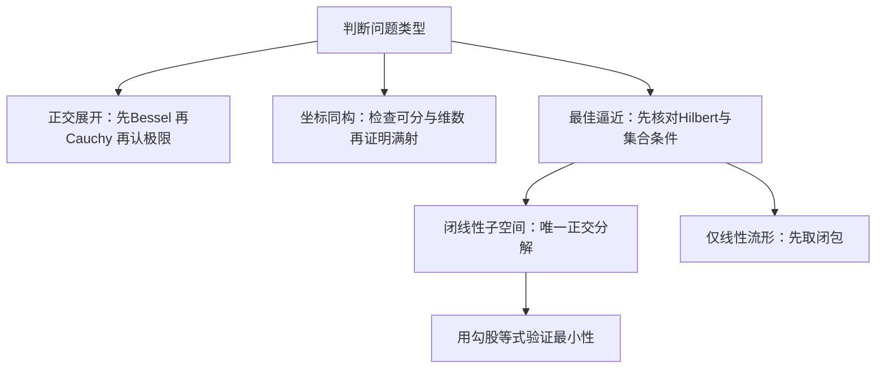

# 2026-11-03 第11节 泛函分析：正交展开、坐标同构与投影

> [!info] 范围与记号
> 依据本节逐字稿、纪要及江泽坚、孙善利《泛函分析》第2版第二章§2、§3整理。内积对第一变量线性、第二变量共轭线性，记为$(x,y)$。课表教师邓志亮；录音账号名不作为教师身份依据。本地未发现本课PPT或演示代码。下列补足前提、证明步骤及自测不冒充教师逐字原话。

## 一、问题与先修路线

问题：无限维空间能否像欧式空间那样用正交坐标描述，并唯一求出点在子空间上的最近点？先修是内积连续性、Bessel不等式、完备性与正规正交基。基意味着闭线性张成等于整个空间，不是仅仅“向量两两正交”。回看 [[03_Sources/Courses/泛函分析/课堂笔记/2026-10-27-第9节-常微分方程与内积空间讲座|内积空间先修]]。

## 二、正交展开：先证明收敛，再辨认极限（00:00–30:56）

设$H$为Hilbert空间，$\{e_\alpha\}_{\alpha\in A}$为正规正交基，$c_\alpha=(x,e_\alpha)$。则

$$
x=\sum_{\alpha\in A}c_\alpha e_\alpha,\qquad
\|x\|^2=\sum_{\alpha\in A}|c_\alpha|^2.
$$

求和具有范数意义，非零项至多可数，级数无条件收敛。$A$本身可以不可数；每个固定$x$使用一个可数支撑，换$x$时支撑可以变，不能因此认定整个空间可分。

> 一句话来说：单个向量只需要可数多个非零正交坐标，整个空间却可能需要不可数多个基向量。

### 1. 非零系数为什么可数

**按课堂思路补全严格证明**：对每个正整数$n$，令$A_n=\{\alpha:|c_\alpha|\ge1/n\}$。若它有任意多不同元素，取其中$N$个，由Bessel不等式

$$
N/n^2\le\sum_{\alpha\in F}|c_\alpha|^2\le\|x\|^2
$$

得到$N\le n^2\|x\|^2$，故$A_n$有限。非零系数支撑恰为$\bigcup_{n\ge1}A_n$，所以至多可数；$x=0$情形直接成立。

### 2. 收敛存在不等于已经知道极限是谁

枚举非零系数为$c_{\alpha_j}$，令$s_N=\sum_{j=1}^N c_{\alpha_j}e_{\alpha_j}$。正交性给出

$$
\|s_N-s_M\|^2=\sum_{j=M+1}^N|c_{\alpha_j}|^2\to0.
$$

平方和由Bessel控制，故是Cauchy列；$H$完备，存在$y\in H$使$s_N\to y$。接下来分别检查：若$e_\alpha$出现在枚举中，内积连续性给$(y,e_\alpha)=c_\alpha$；若未出现，则每个部分和与它正交，且$c_\alpha=0$，仍有$(y,e_\alpha)=0$。因此$x-y$与全部基向量正交，基的完备性迫使$x-y=0$。

**无条件收敛的补充说明**：选有限集合$F$使其外系数平方和小于$\varepsilon^2$。任何有限尾项的范数平方均不超过这份尾和，因此重排后仍收敛到$x$；不是直接把实数级数的绝对收敛判据照搬到向量级数。

### 3. Parseval及能量解释

由正交分解

$$
\|x\|^2=\sum_{j=1}^N|c_{\alpha_j}|^2+\|x-s_N\|^2
$$

令$N\to\infty$得到等式。它把有限维“长度平方等于坐标平方和”推广到Hilbert空间；信号范数可解释为能量，但抽象向量不等于一个脱离基选择的坐标表。

> [!warning] 等式成立的关键是完整基
> 任意正规正交集一般只保证Bessel不等式。Parseval不限于可分空间；可分性只是使整组基可用自然数枚举。坐标依赖所选的基。

## 三、可分Hilbert空间的坐标模型（31:48–52:31）

**补足维数条件**：无限维可分Hilbert空间$H$与同一标量域上的$\ell^2$线性等距、保内积同构；$d$维空间对应$\mathbb F^d$，不能把有限维也说成与无限维$\ell^2$双射同构。

取可数正规正交基，定义$Ux=((x,e_n))_{n\ge1}$。证明依次是：

1. Parseval保证$Ux\in\ell^2$，内积对第一变量线性保证$U$线性。
2. 将$x,y$都按基展开，先对有限部分和计算，再由连续性取极限：

$$
(Ux,Uy)_{\ell^2}=\sum_n(x,e_n)\overline{(y,e_n)}=(x,y)_H.
$$

该数项级数的绝对收敛由Cauchy–Schwarz保证。由此$\|Ux\|_2=\|x\|$，$Ux=0$推出$x=0$，故单射。

3. 满射不能仅凭“系数看起来像序列”认定。给定$a=(a_n)\in\ell^2$，有限和$x_N=\sum_{n=1}^N a_ne_n$满足

$$
\|x_N-x_M\|^2=\sum_{n=M+1}^N|a_n|^2\to0.
$$

完备性给$x_N\to x$，内积连续性给$(x,e_n)=a_n$，所以$Ux=a$。

> 一句话来说：抽象空间中的一个元素与它的一串坐标不是同一对象，但通过选基可建立保持全部内积结构的对应。

## 四、正交补与投影定理（52:31–01:13:09）

对线性流形$M\subset H$，定义$M^\perp=\{z:(z,m)=0,\ \forall m\in M\}$。它总是闭线性子空间：线性由内积运算得出，若$z_n\to z$且每个$z_n\perp M$，则$(z,m)=\lim_n(z_n,m)=0$。$M\cap M^\perp=\{0\}$，因为其中向量与自己正交。

### 定理与完整证明

若$M$为**闭线性子空间**，每个$x\in H$唯一分解为

$$
x=P_Mx+z,\qquad P_Mx\in M,\quad z\in M^\perp.
$$

教材本节“子空间”按其闭性语境使用；为了避免与仅代数封闭的“线性流形”混淆，这里显式写“闭”。

证明：$M=\{0\}$直接成立；其余取$M$的正规正交基$\{f_\alpha\}$。用前述可数支撑、Cauchy尾和构造$y=\sum_\alpha(x,f_\alpha)f_\alpha$，闭性保证极限$y$仍在$M$。对每个$f_\alpha$有$(x-y,f_\alpha)=0$，由$M$中基的稠密张成及连续性，$x-y$与整个$M$正交，故存在分解。若$x=y_1+z_1=y_2+z_2$，则$y_1-y_2=z_2-z_1\in M\cap M^\perp$，只能为零，故唯一。

> 一句话来说：闭线性子空间上的投影，把向量拆成“子空间内部分”与“垂直剩余”。

### 最佳逼近的几何意义

对任意$m\in M$，$x-m=z+(P_Mx-m)$两项正交，故

$$
\|x-m\|^2=\|z\|^2+\|P_Mx-m\|^2\ge\|z\|^2.
$$

当且仅当$m=P_Mx$取等号，故投影是唯一最佳逼近。若$x\notin M$，$z\ne0$提供新的垂直方向，这是有限维Gram–Schmidt正交化的推广。

## 五、条件失去后会怎样（57:32–01:20:15）

课堂三组对照须分开理解：

- 欧式平面开单位圆盘不含边界，外点到它的距离下确界可以不达到，说明缺少闭性会出问题；它不是线性子空间反例。
- 单位圆周到圆心的所有点同距，虽闭但不凸，最佳点不唯一；闭性单独不够。
- $\mathbb R^2$取最大范数，$M$为$x$轴，$p=(0,1)$：$\|p-(t,0)\|_\infty=\max(|t|,1)$。最小距离为1，所有$|t|\le1$均为最佳点。该空间是Banach空间，但此范数不来自内积，不能套用Hilbert投影唯一性。

**补充解释**：闭线性子空间是本定理的充分条件，不是所有集合有唯一最近点的必要条件。Hilbert空间的非空闭凸集也有唯一最近点，但一般没有这里线性正交补的分解形式。

## 六、二次正交补等于闭包（01:21:18–01:33:29）

对线性流形$M$，

$$
\boxed{(M^\perp)^\perp=\overline M.}
$$

证明：按定义$M\subset(M^\perp)^\perp$，右边闭，故$\overline M\subset(M^\perp)^\perp$。由内积连续性，$(\overline M)^\perp=M^\perp$。反向，任取$x\in(M^\perp)^\perp$，对闭子空间$\overline M$投影，写$x=y+z$，$y\in\overline M,z\in M^\perp$。因为$x\perp M^\perp$且$y\perp z$，有$0=(x,z)=\|z\|^2$，故$x=y\in\overline M$。

这也说明不闭的$M$不可直接省略闭包。录音末尾仅引入Fréchet–Riesz表现定理的名称和后续话题，完整陈述与证明不计入本节已讲内容。

## 七、决策与速查

| 结论 | 必要的使用前提 |
|---|---|
| $x=\sum(x,e_\alpha)e_\alpha$、Parseval | 完备Hilbert空间与完整正规正交基 |
| $H\cong\ell^2$ | 无限维、可分、同一标量域 |
| $H=M\oplus M^\perp$ | $M$闭且线性 |
| $M^\perp$闭 | 内积连续性，无需$M$先闭 |
| $(M^\perp)^\perp=\overline M$ | $M$为线性流形 |

## 八、自测（新编）与学习提醒

1. 在$\ell^2$中，设$a_n=2^{-n}$。计算$\|a\|^2$、前$N$个坐标截断的误差平方，并说明为何截断序列的极限在$\ell^2$中存在。

> [!hint]- 提示
> 使用等比级数与尾和，不要把误差范数和其平方混同。

> [!solution]- 解析
> $\|a\|^2=\sum_{n\ge1}4^{-n}=1/3$，尾和$\sum_{n>N}4^{-n}=4^{-N}/3$。截断序列是Cauchy列，完备性保证收敛，极限即$a$。

2. 在欧式$\mathbb R^2$中，将$x=(2,1)$投影到$M=\operatorname{span}\{(1,1)\}$，写出正交分解及距离。

> [!hint]- 提示
> 先单位化基向量，再用$(x,e)e$，最后验证剩余与$(1,1)$垂直。

> [!solution]- 解析
> $P_Mx=(3/2,3/2)$，剩余$(1/2,-1/2)$，距离$1/\sqrt2$。剩余与基向量内积为零；勾股式保证它比其他候选点更近。

> [!warning] 易错点
> 不可数基不表示每个向量有不可数个非零系数；等距单射不自动满射；复内积第二变量须带共轭；不闭的子空间不一定有最佳点；普通Banach空间不能照搬正交投影结论。老师鼓励不要因暂时听不懂放弃，教材中的几何图景应与证明一起理解，不能据笔记完成就判定已经掌握。

## 九、课堂疑惑与解答、上一课缺失范围

当日日计划不存在，没有提取或虚构个人问答。开头00:00:29明确回顾“上一次”讲过正规正交基存在性及Zorn证明；本次仅据此为10月30日缺失记录回填这一可确认主题，仍无法认定上一课其他内容、例题和作业已完整恢复。

## 十、来源

- [[03_Sources/Courses/泛函分析/课堂笔记/raw/2026-11-03-希尔伯特空间定理授课-080448-逐字稿|逐字稿]]：证明路线、课堂对照例及教学范围。
- [[03_Sources/Courses/泛函分析/课堂笔记/raw/2026-11-03-希尔伯特空间定理授课-080448-纪要|纪要]]：仅辅助定位，有限维限制、闭性及Parseval适用范围已校正。
- [[03_Sources/Courses/泛函分析/泛函分析(第2版) (江泽坚, 孙善利) (z-library.sk, 1lib.sk, z-li/泛函分析(第2版) (江泽坚, 孙善利) (z-library.sk, 1lib.sk, z-li]]：第二章§2定理2.2、2.3及坐标同构推论，§3射影定理和命题3.1。以语义确认位置，避免与其他章节同号定理混淆。
