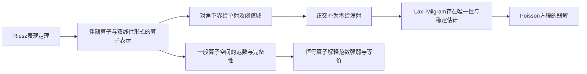
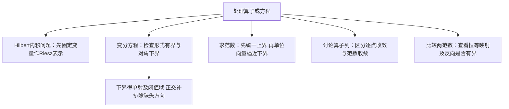

# 2026-11-10 第13节 泛函分析：伴随算子、Lax–Milgram定理与算子空间

> [!info] 来源与整理边界
> 本文完整读取本次逐字稿与纪要，以本地江泽坚、孙善利《泛函分析》第2版第二章§3–4、第三章§1校核公式。内积对第一变量线性、第二变量共轭线性。本节录音账号名不作为教师身份依据。转写中的“拉普拉斯定理”“拉格朗日定理”在此处均按上下文和教材校正为Lax–Milgram定理；原始文件保持不变。证明的中间步骤、PDE条件说明及新编自测均为整理时的补足，不冒充教师逐字原话。

## 一、本节解决的问题与阅读路线

主问题：怎样把一个变分方程的存在唯一性，变成有界线性算子的可逆性？先用Riesz表现定理定义伴随，再用“定量下界 → 单射、闭值域 → 满射”完成Lax–Milgram证明，随后把它用于零边值Poisson方程。后半节进入一般赋范空间上的算子范数、完备性和范数等价。

最小先修：Hilbert空间是完备内积空间；连续线性泛函是取标量值的有界线性映射；闭线性子空间才能使用正交分解。投影与二次正交补回看 [[03_Sources/Courses/泛函分析/课堂笔记/2026-11-03-第11节-希尔伯特空间定理授课|第11节]]。Riesz表现定理为：对每个连续线性泛函$l$，存在唯一$z_l\in H$满足$l(x)=(x,z_l)$，且$\|l\|=\|z_l\|$。复数情形$l\mapsto z_l$共轭线性，不是线性。

## 二、伴随算子怎样从Riesz定理产生（01:45–08:34）

设$T\in L(H_1,H_2)$，即$T:H_1\to H_2$有界且线性。固定$y\in H_2$，定义

$$
f_y(x)=(Tx,y)_{H_2},\qquad x\in H_1.
$$

它关于$x$线性，并由Cauchy–Schwarz和算子有界性满足

$$
|f_y(x)|\le\|Tx\|\|y\|\le\|T\|\|x\|\|y\|.
$$

Riesz定理给唯一$\widehat y\in H_1$使$f_y(x)=(x,\widehat y)_{H_1}$。定义$T^*y=\widehat y$，得到

$$
\boxed{(Tx,y)_{H_2}=(x,T^*y)_{H_1}},\qquad T^*:H_2\to H_1.
$$

这就是Hilbert共轭算子，也称伴随算子。注意映射方向反过来。课堂要求掌握“固定第二变量 → 有界线性泛函 → Riesz唯一表示 → 定义新算子”的流程，不只背最后公式。

**补全线性与有界性的验证**：将$\alpha y+\beta z$代入公式，两边第二变量都共轭线性，得到

$$
(x,T^*(\alpha y+\beta z))=(x,\alpha T^*y+\beta T^*z).
$$

唯一性给$T^*(\alpha y+\beta z)=\alpha T^*y+\beta T^*z$。又$\|T^*y\|=\|f_y\|\le\|T\|\|y\|$，故它确实有界。

> 一句话来说：伴随算子把内积一侧的作用转移到另一侧，同时反转定义域和值域。

有限维核对：在正规正交坐标下，$T^*$的矩阵是$\overline A^{\mathsf T}$；实数情形退化为转置。这里必须保留“正规正交坐标”和复共轭，不能泛称任意基下都是普通转置。

## 三、伴随的运算规则与范数（08:34–20:02）

在$L(H)$中逐点定义加法、数乘，乘法是复合$(ST)x=S(Tx)$。零算子是加法零元；恒等算子$I$是复合的单位元。这两个角色不能混淆。一般$L(H_1,H_2)$只谈加法和数乘，不能不检查空间是否匹配就复合两个元素。

课堂所列性质经教材定理4.1核对为

$$
\begin{gathered}
(S+T)^*=S^*+T^*,\qquad (ST)^*=T^*S^*,\qquad T^{**}=T,\\
(\alpha T)^*=\overline\alpha T^*,\qquad I^*=I,\\
(T^*)^{-1}=(T^{-1})^*\quad\text{当 }T\text{ 有界可逆时},\qquad
\|T^*\|=\|T\|.
\end{gathered}
$$

**按定义逐项验证**：加法由$(Sx+Tx,y)=(x,(S^*+T^*)y)$；复合由$(STx,y)=(Tx,S^*y)=(x,T^*S^*y)$，因此次序倒转。由共轭对称性，$(T^*x,y)=\overline{(y,T^*x)}=\overline{(Ty,x)}=(x,Ty)$，故$T^{**}=T$。数乘时$\alpha(x,T^*y)=(x,\overline\alpha T^*y)$，所以伴随对标量共轭。$I^*=I$由内积公式直接得到；对$TT^{-1}=T^{-1}T=I$取伴随，得到$(T^{-1})^*$是$T^*$的双侧逆。

范数等式的核心是Hilbert空间中的对偶范数公式

$$
\|z\|=\sup_{\|y\|\le1}|(z,y)|.
$$

上界来自Cauchy–Schwarz；$z\ne0$时取$y=z/\|z\|$达到等号；$z=0$直接成立。因此

$$
\begin{aligned}
\|T\|&=\sup_{\|x\|\le1}\sup_{\|y\|\le1}|(Tx,y)|\\
&=\sup_{\|y\|\le1}\sup_{\|x\|\le1}|(x,T^*y)|=\|T^*\|.
\end{aligned}
$$

两个上确界只是对同一个乘积集合取上确界，可以交换；这里没有交换极限的步骤。

> 一句话来说：伴随保持算子范数，对复合反序，对复标量取共轭。

## 四、零空间、值域与正交补（20:02–23:54）

设$A\in L(H_1,H_2)$，记

$$
N(A)=\{x\in H_1:Ax=0\},\qquad R(A)=\{Ax:x\in H_1\}.
$$

$N(A)$是闭线性子空间，因为它是连续映射下闭集$\{0\}$的原像。值域$R(A)$是线性流形，**不保证闭**。四个关系是

$$
\begin{gathered}
N(A)=R(A^*)^\perp,\qquad N(A^*)=R(A)^\perp,\\
\overline{R(A)}=N(A^*)^\perp,\qquad
\overline{R(A^*)}=N(A)^\perp.
\end{gathered}
$$

证明第一式只需把成员关系变成内积条件：

$$
Ax=0\iff (Ax,y)=0\ \forall y\in H_2
\iff(x,A^*y)=0\ \forall y\in H_2
\iff x\in R(A^*)^\perp.
$$

将$A$换为$A^*$并用$A^{**}=A$，得到第二式；对前两式再取正交补，用$(M^\perp)^\perp=\overline M$得到后两式。

> 一句话来说：一个算子“看不见”的方向，正是另一个伴随值域的垂直方向。

> [!warning] 闭包不可凭记忆删去
> “正交补闭、零空间闭”是记忆线索，却不能推出一般值域也闭。只有另有闭值域依据时，后两式才可去掉闭包。

## 五、Lax–Milgram：把变分方程变成可逆性问题（23:54–51:34）

### 1. 定理的准确版本

设$H$为Hilbert空间，$B:H\times H\to\mathbb C$第一变量线性、第二变量共轭线性，且存在$C>0,r>0$使

$$
|B(f,g)|\le C\|f\|\|g\|,\qquad
\boxed{|B(f,f)|\ge r\|f\|^2}\quad(f,g\in H).
$$

则对任意有界线性泛函$l\in H^*$，存在唯一$g_0\in H$满足

$$
\boxed{B(f,g_0)=l(f)\quad\forall f\in H},\qquad
\boxed{\|g_0\|\le r^{-1}\|l\|}.
$$

这里未知量在第二位置，测试变量$f$在第一位置，与本教材记号一致。实数情形用双线性形式。**校核说明**：教材第二章定理4.3采用绝对值对角下界；纪要写$B(u,u)\ge c\|u\|^2$遗漏了复数值时的含义。另一常见版本用$\operatorname{Re}B(u,u)\ge c\|u\|^2$，它足以推出此处条件，但本文不擅自替换课堂所用版本。

> 一句话来说：有界性保证方程有意义，对角下界排除退化，二者给出每个右端对应唯一且稳定的解。

### 2. 两次表示把方程变成$T^*g_0=z_l$

由有界共轭双线性形式的表示定理，存在唯一$T\in L(H)$使

$$
B(f,g)=(Tf,g)=(f,T^*g).
$$

由Riesz定理，$l(f)=(f,z_l)$且$\|z_l\|=\|l\|$。因此

$$
B(f,g_0)=l(f)\ \forall f
\iff (f,T^*g_0-z_l)=0\ \forall f
\iff T^*g_0=z_l.
$$

最后一步可取$f=T^*g_0-z_l$。问题现在变成：$T^*$是不是$H$到$H$的双射？课堂强调，证明应围绕这个目标组织，而非机械记忆长段文字。

### 3. 定量下界先给出单射

由对角条件和Cauchy–Schwarz，

$$
r\|f\|^2\le|B(f,f)|=|(f,T^*f)|\le\|f\|\|T^*f\|.
$$

$f\ne0$时约去$\|f\|$，$f=0$另行显然成立，于是

$$
\|T^*f\|\ge r\|f\|.
$$

若$T^*f=0$，则$f=0$，故单射。此时逆只定义在$R(T^*)$上，尚不能说它定义在整个$H$上。

### 4. 闭值域：先找到原像列的极限

这是课堂补讲教材“一句话带过”的重点。设$u_n\in R(T^*)$且$u_n\to u$。取$v_n\in H$使$u_n=T^*v_n$，则

$$
r\|v_n-v_m\|\le\|T^*(v_n-v_m)\|=\|u_n-u_m\|\to0.
$$

所以$(v_n)$是Cauchy列。$H$完备给$v_n\to v\in H$；$T^*$有界所以连续，因而

$$
u=\lim_n u_n=\lim_n T^*v_n=T^*v\in R(T^*).
$$

这证明值域闭。注意用了两种不同条件：**下界把像列的Cauchy性传回原像，完备性给原像极限，连续性再把极限送回去**。

### 5. 满射：排除遗漏的正交方向

若$R(T^*)\ne H$，由闭子空间投影定理存在非零$\varphi\in R(T^*)^\perp$。特别地$T^*\varphi\in R(T^*)$，故

$$
0=|(\varphi,T^*\varphi)|=|B(\varphi,\varphi)|\ge r\|\varphi\|^2,
$$

矛盾。于是$R(T^*)=H$。这一步是“闭且正交补为零”共同推出满射，单射或闭性单独均不够。

### 6. 写回解与稳定性

因此$g_0=(T^*)^{-1}z_l$存在且唯一，且

$$
r\|g_0\|\le\|T^*g_0\|=\|z_l\|=\|l\|.
$$

**补充解释**：两个右端$l_1,l_2$对应解$g_1,g_2$时，同一证明给$\|g_1-g_2\|\le r^{-1}\|l_1-l_2\|$，这才是“稳定”的定量含义。

### 7. 算子可逆的推论（51:34–53:20）

若$A\in L(H)$，且其形式$a(u,v)=(Au,v)$**另外满足**

$$
|(Au,u)|\ge r\|u\|^2\quad\forall u\in H,
$$

则$A$有界可逆，且$\|A^{-1}\|\le1/r$。沿前述证明先得$A^*$双射及逆有界，再由伴随的逆公式得到$A=(A^*)^*$有界可逆；也可直接对$A$重复下界、闭值域、正交补论证。

> [!warning] 纪要中的条件需要纠正
> 任意有界算子确实可构造有界形式$(Au,v)$，但该形式不会自动满足对角下界，例如$A=0$立刻反驳。课堂此处对应教材的**带下界假设的可逆性推论**。

## 六、Poisson零边值问题：先改变“解”的含义（00:18–01:45、53:20–58:27）

课堂开头继续讨论梯度形式从$C_0^1(\Omega)$扩张到$H_0^1(\Omega)$；后段回到教材第二章§4例2的Dirichlet问题。以下按教材恢复完整公式，补足定理使用条件。

考虑有界区域$\Omega\subset\mathbb R^2$、$F\in L^2(\Omega)$，求

$$
-\Delta u=F\quad\text{在 }\Omega\text{ 内},\qquad u|_{\partial\Omega}=0.
$$

本例先采用实值函数。对足够光滑的$u$和零边界测试函数$v$，Green公式给

$$
\int_\Omega(-\Delta u)v
=\int_\Omega\nabla u\cdot\nabla v
-\int_{\partial\Omega}\frac{\partial u}{\partial n}v
=\int_\Omega\nabla u\cdot\nabla v.
$$

其中边界项因$v$的零边界而消失。更稳妥地可先取$v\in C_c^\infty(\Omega)$，此时无需先为粗糙边界写经典边界积分。记

$$
a(u,v)=\int_\Omega\nabla u\cdot\nabla v,\qquad
L(v)=\int_\Omega Fv.
$$

以$\|u\|_1^2=\|u\|_{L^2}^2+\|\nabla u\|_{L^2}^2$完成$C_0^1(\Omega)$得到$H_0^1(\Omega)$。教材用$C_0^1$作稠密类；通常也可用$C_c^\infty$定义。其元素的一阶导数按弱导数理解。Cauchy–Schwarz给

$$
|a(u,v)|\le\|\nabla u\|_2\|\nabla v\|_2\le\|u\|_1\|v\|_1,
$$

所以$a$由稠密性唯一连续扩张到整个$H_0^1$。具体地取$u_n\to u,v_n\to v$的稠密类近似，由上界和收敛列有界性证明$a(u_n,v_n)$有极限且与近似选择无关。

**弱解定义**：$u\in H_0^1(\Omega)$且

$$
\boxed{a(u,v)=L(v)\quad\forall v\in H_0^1(\Omega)}.
$$

此时只需要一阶弱导数，无需先要求$u\in C^2$。$H_0^1$中的零边界由闭包定义编码；适当边界正则性下可以用零迹解释，不能对任意元素未经说明写点态边界值。课堂提到数值实现中可用折线近似：合适的连续分片线性函数可以属于$H_0^1$，却未必有经典二阶导数。这是弱形式对有限元有用的原因，不代表任意折线都满足方程。

### 必须实际检查的两个条件

1. **右端连续**：$H_0^1\subset L^2$，而$\|v\|_2\le\|v\|_1$，故$|L(v)|\le\|F\|_2\|v\|_1$。右端虽为$L^2$内积，却是以$v\in H_0^1$为自变量的连续泛函。
2. **对角下界**：仅有$a(u,u)=\|\nabla u\|_2^2$还不等于完整$H^1$范数。**补充解释（教材已用Friedrichs不等式，录音未完整展开）**：有界区域的$H_0^1$满足$\|u\|_2^2\le C_P^2\|\nabla u\|_2^2$，所以

$$
a(u,u)\ge\frac{1}{1+C_P^2}\|u\|_1^2.
$$

Poincaré–Friedrichs估计可先对稠密类沿包围$\Omega$的矩形一个坐标方向使用微积分基本定理和Cauchy–Schwarz，再连续扩张；不是从“有界双线性”直接推出。教材写$a(u,u)\ge\chi\|u\|_2^2$时，对应常数为$r=\chi/(1+\chi)$。

由于本例$a$实对称，教材未知量在第二位置的Lax–Milgram结论可交换变量，得到唯一弱解及

$$
\|u\|_1\le(1+C_P^2)\|F\|_2.
$$

**教材算子表达的补充展开**：在$H_0^1$的内积$(\cdot,\cdot)_1$下定义$J$与$K$使$a(u,v)=(Ju,v)_1$、$(v,F)_{L^2}=(v,KF)_1$；弱方程等价于$Ju=KF$。下界保证$J$有界可逆，所以$u=J^{-1}KF$。一般弱解未必是经典解；反向获得$C^2$正则性需要额外条件，不能称两种解无条件等价。

> 一句话来说：先用积分把二阶微分方程降到一阶弱导数，再在完备空间检查有界与下界，才有存在唯一性。

## 七、一般有界线性算子空间与范数（58:27–01:06:20）

课堂回顾空间结构的逐层加强：线性空间先给加法、数乘；度量引入极限，但还需运算连续才成为相容的线性度量空间；范数给一种相容距离$d(x,y)=\|x-y\|$；内积再给正交几何。Hilbert与Banach还分别加上完备性。这些空间是为了明确映射的定义域、值域及连续性的含义。

对赋范空间$X,Y$，$L(X,Y)$是全体有界线性算子。对$X\ne\{0\}$，算子范数有三个等价表达

$$
\|T\|=\sup_{\|x\|=1}\|Tx\|
=\sup_{\|x\|\le1}\|Tx\|
=\sup_{x\ne0}\frac{\|Tx\|}{\|x\|}.
$$

等价性来自把非零$x$归一化。它也是使$\|Tx\|\le M\|x\|$对所有$x$成立的最小$M\ge0$。零定义域时全部算子为零，范数定义为零。

它确实满足范数公理：非负性显然；$\|T\|=0$迫使每个$Tx=0$；$\|\alpha T\|=|\alpha|\|T\|$来自齐次性；三角不等式为

$$
\begin{aligned}
\|S+T\|&=\sup_{\|x\|\le1}\|Sx+Tx\|\\
&\le\sup_{\|x\|\le1}(\|Sx\|+\|Tx\|)\le\|S\|+\|T\|.
\end{aligned}
$$

最后是“不大于各上确界之和”，一般不是等号，例如$S=-T\ne0$。

> 一句话来说：算子范数是这个映射能把输入长度放大的最大比例，最大应理解为上确界。

## 八、课堂例题：序列乘子范数（01:06:20–01:16:00）

给定有界复数列$(\alpha_n)$，在$\ell^1$上定义

$$
T(x_1,x_2,\ldots)=(\alpha_1x_1,\alpha_2x_2,\ldots),\qquad
M=\sup_n|\alpha_n|.
$$

这是第三章习题2的坐标乘子模型。坐标分配律直接给$T(ax+by)=aTx+bTy$。且

$$
\|Tx\|_1=\sum_n|\alpha_nx_n|\le M\sum_n|x_n|=M\|x\|_1,
$$

同时验证了$Tx\in\ell^1$和$\|T\|\le M$。反向，取第$n$个标准向量$e_n$，则$\|e_n\|_1=1$、$\|Te_n\|_1=|\alpha_n|$，故$\|T\|\ge|\alpha_n|$对每个$n$成立，取上确界得

$$
\boxed{\|T\|=\sup_n|\alpha_n|}.
$$

录音中还出现第$n$位置取$\overline{\alpha_n}/|\alpha_n|$、其余为零的选择（$\alpha_n\ne0$）；它把该输出坐标变为$|\alpha_n|$，同样得到下界。对本例只看范数时$e_n$已足够；$\alpha_n=0$时不要除以零。

> [!warning] 上确界不一定由某个向量达到
> 课堂和纪要强调“找元素达到上界”，正确用法是找到一组单位向量给所有坐标下界，再取上确界；不要求存在某个$n$满足$|\alpha_n|=M$。例如$\alpha_n=1-1/(n+1)$时$\|T\|=1$，对每个非零$x\in\ell^1$却都有$\|Tx\|_1<\|x\|_1$。

## 九、为何只需值域空间完备（01:16:00–01:28:33）

**定理**：若$X$为赋范空间、$Y$为Banach空间，则$L(X,Y)$按算子范数是Banach空间，不要求$X$完备。

设$(T_n)$为算子范数Cauchy列。证明按三步走：

1. 对每个固定$x$，$\|T_nx-T_mx\|\le\|T_n-T_m\|\|x\|$，故$(T_nx)$在$Y$中是Cauchy列。由$Y$完备，定义$Tx=\lim_nT_nx$。
2. 线性由$T_n(ax+by)=aT_nx+bT_ny$取极限及极限唯一性得到。Cauchy列$(T_n)$有界，设$\sup_n\|T_n\|\le M$，则$\|Tx\|=\lim_n\|T_nx\|\le M\|x\|$，因此$T\in L(X,Y)$。
3. **还必须证明算子范数收敛**。任取$\varepsilon>0$，存在$N$使$n,m\ge N$时$\|T_n-T_m\|<\varepsilon$。固定$n\ge N$及任意$x$，让$m\to\infty$得到$\|(T_n-T)x\|\le\varepsilon\|x\|$，再对单位球取上确界，得$\|T_n-T\|\le\varepsilon$。

最后一步靠对$x$统一的Cauchy估计，不是仅凭逐点收敛。**教材校核**：本地OCR在该证明末尾直接把$\sup$与$\lim$交换；本文使用上述统一估计补足依据，不把未经证明的交换当成通用法则。

> 一句话来说：先在每个输入上借$Y$的完备性造出极限，再证明所有输入由同一误差常数控制。

特别地，取$Y=\mathbb R$或$\mathbb C$，得到任意赋范空间的连续对偶$X^*$都是Banach空间。课堂以此联系前面讲过的泛函完备性。

## 十、复合与Banach代数（01:28:33–01:29:55）

若$B\in L(X,Y)$、$A\in L(Y,Z)$，则$AB\in L(X,Z)$，并且

$$
\|ABx\|\le\|A\|\|Bx\|\le\|A\|\|B\|\|x\|,
\qquad\boxed{\|AB\|\le\|A\|\|B\|}.
$$

对同一空间上的$A$反复使用即得$\|A^n\|\le\|A\|^n$。复合满足结合律，并与加法、数乘相容，一般不交换；$X$为Banach空间时，完备的$L(X)$与复合构成Banach代数（非零$X$上单位为$I$）。一般$L(X,Y)$中，两个算子未必能相互复合。

## 十一、范数的强弱与等价（01:29:55–01:34:27）

同一线性空间$X$上有两个范数$\|\cdot\|_1,\|\cdot\|_2$。若对每个序列

$$
\|x_n\|_1\to0\Longrightarrow\|x_n\|_2\to0,
$$

称第一范数强于第二范数。若互相强于，则称两范数等价。这里“强于”允许两者等价，不是严格强于。

考察恒等映射$I:(X,\|\cdot\|_1)\to(X,\|\cdot\|_2)$。序列条件即$I$在零点连续；对线性映射，零点连续等价于处处连续，再等价于有界，故

$$
\|\cdot\|_1\text{强于}\|\cdot\|_2
\iff\exists C>0,\ \|x\|_2\le C\|x\|_1\quad\forall x.
$$

双向使用得到等价判据

$$
\boxed{\exists r_1,r_2>0:\quad r_1\|x\|_1\le\|x\|_2\le r_2\|x\|_1\quad\forall x\in X}.
$$

**补全证明细节**：零点连续给$\delta>0$使$\|z\|_1<\delta$时$\|z\|_2<1$。对$x\ne0$取$z=\delta x/(2\|x\|_1)$，得$\|x\|_2\le(2/\delta)\|x\|_1$。反向由不等式直接传递趋零序列。双向有界说明恒等映射及其逆都连续，故两范数诱导同一拓扑。

> 一句话来说：强范数里的小误差保证弱范数里的小误差；等价范数能以固定常数双向控制。

## 十二、使用前的决策与速查

| 问题 | 关键条件或公式 |
|---|---|
| 伴随定义 | $(Tx,y)=(x,T^*y)$，注意方向 |
| 值域正交关系 | $\overline{R(A)}=N(A^*)^\perp$，保留闭包 |
| 变分方程解的估计 | $\Vert g_0\Vert\le r^{-1}\Vert l\Vert$，须有对角下界 |
| 弱Poisson问题 | $H_0^1$、右端连续、Poincaré–Friedrichs下界 |
| 乘子范数 | $\Vert T\Vert=\sup_n\vert\alpha_n\vert$，不要求达到上确界 |
| 算子空间完备 | $Y$完备即可，另证算子范数收敛 |
| 范数等价 | 两个正的常数给双向不等式 |

## 十三、自测（新编）

1. 在$\mathbb C^2$的标准内积下，取$A=\begin{pmatrix}1&i\\0&2\end{pmatrix}$。求$A^*$与$(iA)^*$，并对$x=(0,1),y=(1,0)$检验伴随定义。

> [!hint]- 提示
> 矩阵先共轭再转置，标量$i$也要共轭。

> [!solution]- 解析
> $A^*=\begin{pmatrix}1&0\\-i&2\end{pmatrix}$，$(iA)^*=-iA^*$。$Ax=(i,2)$，所以$(Ax,y)=i$；$A^*y=(1,-i)$，故$(x,A^*y)=\overline{-i}=i$。

2. 若只知道线性算子$S$满足$\|Sx\|\ge r\|x\|$，为什么仍不能直接写$S^{-1}:H\to H$？给出一个Hilbert空间反例。

> [!hint]- 提示
> 在$\ell^2$上考虑把所有坐标向右移一位的算子。

> [!solution]- 解析
> $S(x_1,x_2,\ldots)=(0,x_1,x_2,\ldots)$是等距单射，值域是首坐标为零的闭子空间，不能得到$e_1$。逆只定义在$R(S)$上；Lax–Milgram证明另用对角条件排除正交补。

3. 令$\alpha_n=1-1/(n+1)$，求$\ell^1$乘子$T$的范数，并判断是否存在单位$x$达到该范数。

> [!hint]- 提示
> 先用$e_n$逼近；再逐项比较$\sum\alpha_n|x_n|$与$\sum|x_n|$。

> [!solution]- 解析
> 范数为1。任何非零$x$至少有一个非零坐标，每个$\alpha_n<1$，故$\sum(1-\alpha_n)|x_n|>0$，从而$\|Tx\|_1<\|x\|_1$。不存在达到范数的单位向量。

4. 在有限支撑序列空间$c_{00}$上比较$\|\cdot\|_1$与$\|\cdot\|_\infty$。哪一个强于另一个？是否等价？

> [!hint]- 提示
> 一个方向使用最大项不超过总和；另一方向取前$N$项均为$1/N$的序列。

> [!solution]- 解析
> $\|x\|_\infty\le\|x\|_1$，所以第一范数强于最大范数。取$x^{(N)}=(1/N,\ldots,1/N,0,\ldots)$，前$N$项非零，则$\|x^{(N)}\|_\infty=1/N\to0$，$\|x^{(N)}\|_1=1$。反向不成立，两者不等价。

## 十四、课堂要求、疑惑与未确认项

- 课堂要求：能自行写出伴随定义流程；按“算子方程究竟要解什么”理解Lax–Milgram证明；能补齐闭值域的Cauchy列细节；掌握范数上下界与恒等算子的论证。
- 逐字稿未给出可核实的新作业题号或提交要求，不把教材关联习题自动称为布置作业。乘子例对应第三章习题2，仅作为题源核对。
- 原笔记仅为待润色占位，没有额外个人批注或问答。末尾01:35以后缺少可辨认的数学陈述，不补造下课前内容。
- 11月6日第12节缺失记录只能部分回填：本次明确回顾此前有界形式的表示及PDE梯度形式，并不能确定上一课的完整范围、证明和作业。详见 [[00_Inbox/课堂录音/缺失记录/泛函分析/2026-11-06-第12节-缺少逐字稿|第12节缺失记录]]。

## 十五、真实来源

- [[03_Sources/Courses/泛函分析/课堂笔记/raw/2026-11-10-泛函分析与PDE基础讲座-409472-逐字稿|本次完整逐字稿]]：教学范围、证明推进、课堂例题与学习要求；关键位置已在标题标注。
- [[03_Sources/Courses/泛函分析/课堂笔记/raw/2026-11-10-泛函分析与PDE基础讲座-409472-纪要|本次纪要]]：辅助定位，形式下界、可逆性推论与范数达到性已独立校核。
- [[03_Sources/Courses/泛函分析/泛函分析(第2版) (江泽坚, 孙善利) (z-library.sk, 1lib.sk, z-li/泛函分析(第2版) (江泽坚, 孙善利) (z-library.sk, 1lib.sk, z-li|本地教材]]：第二章§3定理3.2–3.3及例2、§4定理4.1–4.3与Dirichlet例2；第三章§1命题1.1–1.4、第三章习题2。

## 课堂疑惑与解答

本日对应日计划不存在，未补造个人问题或回答记录。
