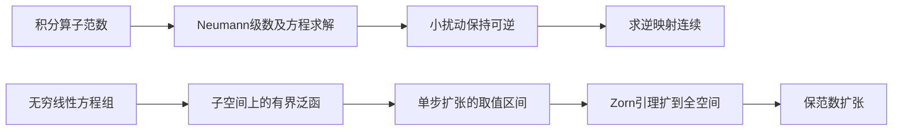

# 2026-11-17 第15节 泛函分析：算子求逆的稳定性与泛函扩张

> [!info] 本节范围与资料边界
> 完整读取本次逐字稿及纪要。本节开头补完积分算子范数的下界，随后证明有界可逆元集合的开性与求逆映射连续性，再从无穷方程组引出实Banach扩张定理，证明包括单步扩张与Zorn极大元两部分。录音约01:18提及1938年的复扩张，约01:19引出保范数的Hahn–Banach定理，但没有可辨认的复情形完整证明。以下明确标出的补充解释用于补足记号、条件或推导，不算教师逐字讲授。没有发现独立配套课件，数学核对采用本地教材第三章§1—§2。

## 一、问题与必要先修

本课的两条主线是：一个能求逆的算子受到小扰动后还能求逆吗？只在子空间定义的线性泛函，怎样保持控制条件延伸到整个空间？

- 算子范数：$\|A\|=\sup_{\|x\|\le1}\|Ax\|$，且$\|AB\|\le\|A\|\|B\|$。乘法表示复合，次序不能交换。
- Banach空间上的Neumann级数：$\|B\|<1$时，$(I-B)^{-1}=\sum_{n=0}^{\infty}B^n$，收敛是**算子范数收敛**。这里严格小于1。
- Hilbert空间的表现定理：每个连续线性泛函唯一写为$F(z)=(z,x_0)$。本课程复内积采用**第一变量线性、第二变量共轭线性**，因此$z\mapsto(z,x_0)$线性。
- “线性流形”指线性子空间，不默认闭；Zorn引理说，非空偏序集中每条链有上界，就存在极大元。

算子范数与完备性的前课推导可回看[[03_Sources/Courses/泛函分析/课堂笔记/2026-11-10-第13节-泛函分析与PDE基础讲座|第13节]]；内积约定及正交分解可回看[[03_Sources/Courses/泛函分析/课堂笔记/2026-11-03-第11节-希尔伯特空间定理授课|第11节]]。

## 二、补完积分算子的范数：怎样构造接近上界的连续函数

课堂00:00:01—00:10:02承接上次遗留例子。设$K\in C([0,1]^2)$，在带上确界范数的$C[0,1]$上定义
$$
(Af)(x)=\int_0^1K(x,y)f(y)\,dy,\qquad
M=\max_{x\in[0,1]}\int_0^1|K(x,y)|\,dy.
$$
结论是$\boxed{\|A\|=M}$。

> 一句话来说：积分核绝对值沿每一行的积分，其最大值就是这个算子可能达到的最大放大倍数。

**先证上界。** 由三角不等式，$|(Af)(x)|\le\|f\|_\infty\int_0^1|K(x,y)|dy$，取$x$的最大值得$\|Af\|_\infty\le M\|f\|_\infty$，所以$\|A\|\le M$。核连续保证积分结果连续，因此$A$确实把$C[0,1]$映到自身。

**难点是下界：最理想的函数可能不连续。** 取使行积分达到$M$的$x_0$。为使积分中不发生抵消，定义
$$
h(y)=\begin{cases}
\overline{K(x_0,y)}/|K(x_0,y)|,&K(x_0,y)\ne0,\\
0,&K(x_0,y)=0.
\end{cases}
$$
则$|h|\le1$、$K(x_0,y)h(y)=|K(x_0,y)|$，故$\int K(x_0,y)h(y)dy=M$。实核时就是通常的符号函数。**补充解释：** 复核必须取共轭相位，不能直接用$K/|K|$。而且$h$只保证可测，不能直接当作$C[0,1]$的测试函数。

课堂用Lusin定理处理这个障碍：任给$\delta>0$，可以找到$f\in C[0,1]$，$\|f\|_\infty\le1$，使
$$
E=\{y:f(y)\ne h(y)\},\qquad m(E)<\delta.
$$
**补充解释：** Lusin先给出大测度闭集上连续的限制；再连续延拓并截到闭单位圆盘，得到上述全区间连续且模不超过1的版本。它不是说原函数本来连续。

令$C=\max_{x,y}|K(x,y)|$。因$|f-h|\le2$，
$$
\begin{aligned}
|(Af)(x_0)|
&=\left|M+\int_0^1K(x_0,y)(f(y)-h(y))dy\right|\\
&\ge M-\left|\int_EK(x_0,y)(f(y)-h(y))dy\right|\\
&\ge M-2C\,m(E)>M-2C\delta.
\end{aligned}
$$
若$C=0$，算子为零，结论显然；否则取$\delta=\varepsilon/(2C)$，就有$\|A\|\ge\|Af\|_\infty>M-\varepsilon$。由$\varepsilon>0$任意，$\|A\|\ge M$，与上界合并即得等式。

课堂强调的是“任意接近上界”这条证明路线；这不意味着必有一个连续单位向量使范数恰好达到上界。

## 三、积分方程、Neumann展开与误差

### 1. Fredholm与Volterra，以及第一类和第二类

课堂约00:10—00:13回顾：Fredholm积分固定上下限，例如$Af(x)=\int_0^1K(x,y)f(y)dy$；Volterra积分具有变上限，例如
$$
(Vf)(x)=\int_a^xK(x,y)f(y)dy.
$$
第一类方程形如$Af=g$，第二类形如$f-Af=g$。二者不能只按“有没有积分”来区分；第二类含未知函数本身这一项。

对于$(I-A)f=g$，若$X=C[0,1]$且$M=\|A\|<1$，则
$$
f=(I-A)^{-1}g=\sum_{n=0}^{\infty}A^ng
$$
是每个$g\in X$对应的唯一解。这是充分条件，$M\ge1$时不能据此断言没有唯一解。

> [!warning] 对纪要的条件校正
> 纪要出现“核积分最大值小于等于一即可”，这里应为严格小于1。取$A=I$便知$\|A\|=1$时$I-A$可能不可逆。

### 2. 级数截断如何控制误差

课堂00:32:10—00:33:29强调反复迭代带来快速衰减。**补充解释：完整的几何尾项估计**，令$q=\|A\|<1$，用$N+1$项
$$
f_N=\sum_{n=0}^{N}A^ng,
$$
则
$$
\boxed{\|f-f_N\|\le\frac{q^{N+1}}{1-q}\|g\|.}
$$
理由是对余下的每一项使用$\|A^ng\|\le q^n\|g\|$再求等比级数。这里$q$是算子范数或其小于1的上界，不要与下段的核上界$\mu$混用。

当$q=1/2$时，平方、立方分别是$1/4,1/8$；截到$N=2$、$N=3$时，上述误差界分别为$\|g\|/4,\|g\|/8$。因此“两三次就很小”只能理解为课堂对快速衰减的直观提示，是否达到所需精度还取决于容差及$\|g\|$。

### 3. Volterra的更强结构（教材核对与补充解释）

课堂明确提到上次还讨论了Volterra算子的幂，但未重算。教材例3：若$K$在$[a,b]^2$连续，$\mu=\max|K|$，则归纳得到
$$
|(V^nf)(x)|\le\mu^n\|f\|_\infty\frac{(x-a)^n}{n!},\qquad
\|V^n\|\le\frac{[\mu(b-a)]^n}{n!}.
$$
归纳步是将$n$次估计代回$V(V^nf)$并积分$(y-a)^n$。故$\sum V^n$按算子范数收敛，利用$(I-V)\sum_{n=0}^{N}V^n=I-V^{N+1}$得到逆。这里即使$\|V\|$没有小于1，仍可由阶乘估计求解；其截断误差可用$\|g\|\sum_{n>N}[\mu(b-a)]^n/n!$控制。这与前面的普通几何界是两条不同的估计。

## 四、有界可逆算子是开集，求逆关于算子连续

课堂00:13:13—00:31左右；对应教材第三章§1命题1.6。设$X$为Banach空间，$GL(X)$是$L(X)$中全体有界可逆算子的集合。

> 一句话来说：已经可逆的算子在足够小的扰动下仍可逆，而且逆算子的变化也能定量控制。

### 1. 把扰动变成“恒等算子减去小算子”

固定$A_0\in GL(X)$，令
$$
B=A_0^{-1}(A_0-A),\qquad A=A_0(I-B).
$$
若$\|A-A_0\|<1/\|A_0^{-1}\|$，则$\|B\|\le\|A_0^{-1}\|\|A_0-A\|<1$，Neumann定理给出
$$
A^{-1}=(I-B)^{-1}A_0^{-1}=\sum_{n=0}^{\infty}B^nA_0^{-1}.
$$
乘积的逆次序必须反过来。于是以每个$A_0$为中心都有一个包含于$GL(X)$的开球，故$GL(X)$为开集。这就是老师把“充分小邻域内仍可逆”翻译成拓扑语言的步骤。

### 2. 抽出零次项，再估计差

$B^0=I$，所以
$$
A^{-1}-A_0^{-1}=\sum_{n=1}^{\infty}B^nA_0^{-1}.
$$
取范数并用等比级数，
$$
\begin{aligned}
\|A^{-1}-A_0^{-1}\|
&\le\frac{\|B\|\|A_0^{-1}\|}{1-\|B\|}\\
&\le\frac{\|A_0^{-1}\|^2}{1-\|A_0^{-1}\|\|A-A_0\|}\|A-A_0\|.
\end{aligned}
$$
为使“常数乘扰动”中的常数固定，进一步限定$\|A-A_0\|\le1/(2\|A_0^{-1}\|)$，则
$$
\|A^{-1}-A_0^{-1}\|\le2\|A_0^{-1}\|^2\|A-A_0\|\longrightarrow0.
$$
这证明映射$A\mapsto A^{-1}$在每个$A_0$处连续。它与“固定一个$A$后，$A^{-1}$作为$X\to X$的有界算子是连续的”是两个层次的陈述。

## 五、为何需要扩张泛函：无穷线性方程组

课堂00:36:35起转入第三章§2，以Schmidt的方程组为动机。在$\ell^2$中给定线性无关向量$\alpha_n$与复数$c_n$，求$x_0$使
$$
(\alpha_n,x_0)=c_n,\qquad n\ge1.
$$
教材及课堂所用的充分条件是：存在常数$M>0$，对所有有限组复系数$\lambda_1,\ldots,\lambda_N$都有
$$
\left|\sum_{k=1}^{N}\lambda_kc_k\right|
\le M\left\|\sum_{k=1}^{N}\lambda_k\alpha_k\right\|.
$$
这不是只要求每一个$c_n$分别有界，而是要求**所有有限线性组合**统一受控制。

在$G=\operatorname{span}\{\alpha_n:n\ge1\}$上定义
$$
f\left(\sum_{k=1}^{N}\lambda_k\alpha_k\right)=\sum_{k=1}^{N}\lambda_kc_k.
$$
线性无关保证定义无歧义（即使去掉独立性，所给不等式也足以保证这一点）；它显然线性，且$|f(z)|\le M\|z\|$，故有界。若能把$f$扩成$\ell^2$上的有界线性泛函$F$，表现定理便给出唯一的代表向量$x_0$，于是
$$
(\alpha_n,x_0)=F(\alpha_n)=f(\alpha_n)=c_n.
$$
这就获得方程组解的**存在性**。

**补充解释：不要误判唯一性。** 表现定理保证的是对固定$F$的代表向量唯一；扩张$F$可能不唯一，所以不能由此断言原方程组唯一可解。任意两解之差属于$G^\perp$。已有解时，解唯一当且仅当$\overline G=\ell^2$。例如仅取$\alpha_n=e_{2n}$，约束只决定偶数坐标，奇数坐标仍可改变。老师用“基底可能漏掉一些方向”提示的正是定义域可能尚非整个空间。

## 六、实Banach扩张定理：条件是什么

课堂00:49:47—01:19。设$X$是**实线性空间**，$G\subset X$为线性流形，$f:G\to\mathbb R$实线性；设$p:X\to\mathbb R$满足
$$
p(x+y)\le p(x)+p(y),\qquad p(tx)=tp(x)\quad(t\ge0),
$$
且$f(x)\le p(x)$对$x\in G$成立。则存在实线性$F:X\to\mathbb R$，满足
$$
F|_G=f,\qquad F(x)\le p(x)\quad(x\in X).
$$

> 一句话来说：只要原泛函被同一个次线性函数压住，就能在不突破这个上界的前提下扩到整个空间。

这里$p$叫**次线性泛函**：只要求正齐次与次可加，不要求$p(-x)=p(x)$、非负或连续，因而不应直接称为半范数。本定理不要求$G$闭，也不要求$X$有范数或完备。

## 七、证明第一步：给新方向的值找到非空区间

若$G=X$已无须扩张；否则取$x_0\notin G$，令$G_1=G+\mathbb Rx_0$。每个元素唯一写为$x+\lambda x_0$，其中$x\in G$。任一线性扩张必具有形式
$$
f_1(x+\lambda x_0)=f(x)+\lambda r_0,\qquad r_0=f_1(x_0).
$$
因此唯一自由度就是$r_0$。要保留控制条件，须使
$$
f(x)+\lambda r_0\le p(x+\lambda x_0)\quad(\lambda\in\mathbb R,x\in G).
$$

- 当$\lambda=0$，这是原来的假设。
- 当$\lambda>0$，利用$p$正齐次与$f$线性，除以$\lambda$并令$u=x/\lambda$，得到$r_0\le p(x_0+u)-f(u)$，对所有$u\in G$成立。
- 当$\lambda<0$，令$t=-\lambda>0$，除以$t$后移项，令$v=x/t$，得到$r_0\ge f(v)-p(v-x_0)$，对所有$v\in G$成立。

所以所需条件等价于
$$
L:=\sup_{v\in G}\{f(v)-p(v-x_0)\}\le r_0\le
U:=\inf_{u\in G}\{p(u+x_0)-f(u)\}.
$$
关键是验证$L\le U$。任意$u,v\in G$，
$$
f(u)+f(v)=f(u+v)\le p(u+v)
\le p(u+x_0)+p(v-x_0),
$$
于是每一个左端候选$f(v)-p(v-x_0)$都不超过每一个右端候选$p(u+x_0)-f(u)$。取上、下确界即得$L\le U$。二者是有限实数：取$u=0$给出所有左端的共同有限上界$p(x_0)$，取$v=0$给出所有右端的共同有限下界$-p(-x_0)$，且候选集合本身非空。

取任意$r_0\in[L,U]$，上面逐步变形可反向验证$f_1\le p$，从而完成从$G$到$G_1$的扩张。

> [!warning] 教材转写的符号核对
> 本地教材在写$r_0$取值区间的一行将下界中的$-x_0$写成了$+x_0$，与其前面的式(2.5)及$\lambda<0$推导不一致。这里使用$f(v)-p(v-x_0)$；不能照抄该行OCR。负数倍只能先提出正因子$|\lambda|$，不可把正齐次当成任意实数齐次。

## 八、证明第二步：为什么最终能到整个空间

课堂约01:13:58—01:18:07。收集所有满足控制条件的扩张$(D,g)$：$D$是包含$G$的线性子空间，$g:D\to\mathbb R$线性，$g|_G=f$且$g\le p$。以**延拓关系**定义偏序：
$$
(D_1,g_1)\preceq(D_2,g_2)
\iff D_1\subseteq D_2\ \text{且}\ g_2|_{D_1}=g_1.
$$
仅比较定义域包含还不够，必须比较共同定义域上的值是否一致。该偏序集非空，因为原来的$(G,f)$就在其中。

对任意非空链$\mathcal C$，取$D=\bigcup_{(D_i,g_i)\in\mathcal C}D_i$并定义$h(x)=g_i(x)$，只要$x\in D_i$。由于链中的任意两项可比较，这个定义无歧义。对$x,y\in D$，能选一个链成员的定义域同时包含它们，故$D$线性、$h$线性；同时$h|_G=f$、$h\le p$。于是$(D,h)$是链的上界。空链也有上界$(G,f)$。

Zorn引理给出极大扩张$(D_*,F)$。若$D_*\ne X$，取$x_0\notin D_*$，用第七节的单步扩张就能严格扩大其定义域，违背极大性。因此$D_*=X$，实扩张定理得证。

**补充解释：** 任意空间可能有不可数多个方向，所以“反复加一个向量”不是已经完成全空间扩张的证明；Zorn引理承担这一步。极大也不意味着扩张唯一。

## 九、复扩张与保范数形式：本节讲到哪里

课堂末尾提到1938年的复版本，继而引出赋范空间上的连续线性泛函保范数扩张。可确认本节完整证明的是上面的实控制形式，下面按教材补足准确陈述与两者关系。

**复控制形式（教材补充陈述）。** 若$X$是复线性空间、$G$是复子空间、$f$复线性，$p$为半范数，即$p(x+y)\le p(x)+p(y)$、$p(\alpha x)=|\alpha|p(x)$，且$|f|\le p$于$G$，则可扩张为复线性$F$，满足$|F|\le p$于$X$。不能对复数直接写$F(x)\le p(x)$。

**补充解释：复形式的证明桥梁。** 对$u=\operatorname{Re}f$应用实扩张，得实线性$U\le p$，定义$F(x)=U(x)-iU(ix)$。它在$G$上等于$f$，且$F(ix)=iF(x)$，故复线性。取单位复数$\eta$使$\eta F(x)=|F(x)|$，则$|F(x)|=U(\eta x)\le p(\eta x)=p(x)$。这部分用于说明为何实证明能服务于前面的复$\ell^2$例子，不冒充录音中的完整板书。

**Hahn–Banach保范数扩张。** 若$X$为实或复赋范空间，$f\in G^*$，则存在$F\in X^*$满足
$$
F|_G=f,\qquad\boxed{\|F\|=\|f\|_G}.
$$
**补充解释：** 取$p(x)=\|f\|_G\|x\|$，由相应控制形式得到$|F(x)|\le\|f\|_G\|x\|$（实情形同时对$x,-x$用上界），故$\|F\|\le\|f\|_G$；限制回$G$得反向不等式。$X$无须完备，$G$无须闭。

课堂称泛函分析有“两大基石”。根据本节转换到扩张定理的上下文，应理解为Hahn–Banach定理与Baire纲定理这两条基础路线。纪要把开映射、闭图像及Baire混成了两项，不能据此认定本节讲完开映射或闭图像定理。后两者是Baire路线的重要结果，本节未证明。

## 十、自测（新编）

1. 若$\|A_0^{-1}\|=4$、$\|A-A_0\|=1/16$，能否保证$A$可逆？按本课公式估计逆的差。

> [!hint]- 提示
> 先算乘积是否严格小于1，再代入有分母的估计。

> [!solution]- 解析
> $4/16=1/4<1$，可保证可逆；$\|A^{-1}-A_0^{-1}\|\le16(1/16)/(1-1/4)=4/3$。这是上界，不代表实际差一定等于它。

2. 在$\mathbb R^2$中令$p(x,y)=|x|+|y|$，$G=\mathbb R(1,0)$，$f(t,0)=t$。所有保留$p$控制的线性扩张是什么？是否唯一？

> [!hint]- 提示
> 只需确定新方向$(0,1)$上的取值，再分别代入正、负方向。

> [!solution]- 解析
> 所有扩张形如$F(x,y)=x+ry$，取$(0,1)$及$(0,-1)$得$-1\le r\le1$。反过来$|r|\le1$保证$F(x,y)\le|x|+|y|$。扩张不唯一。

3. 若只知道$\alpha_n$线性无关，能否断言第五节的方程解唯一？缺少什么条件？

> [!hint]- 提示
> 比较线性无关与闭线性张成等于全空间，并考虑未被约束的方向。

> [!solution]- 解析
> 不能。还须$\overline{\operatorname{span}\{\alpha_n\}}=\ell^2$，才能由所有齐次约束为零推出向量为零。偶数坐标例子给出直接反例。

## 十一、课堂疑惑与解答

当日daily不存在，未发现可归属于个人的疑惑或作答记录，因此不补造“我问过什么”或教师对个人提问的回答。本笔记中的严格小于1、次线性与半范数的区别、复共轭约定及唯一性边界，均为资料核对与补充解释；新编自测尚无个人作答，不标记为已掌握。

## 十二、课堂强调、作业与历史缺失边界

- 老师用求逆证明提醒：先明确目标是控制$\|A^{-1}-A_0^{-1}\|$，再把级数零次项拿出；不能没有方向地展开公式。
- 约00:33—00:36鼓励学生以超越老师为学习目标，反思学习投入。落实到本课，可尝试独立写出扰动分解和扩张取值区间，而非只看结果。
- 本节没有可靠可辨认的正式作业题号；老师提到教材例3和迭代误差，保留为阅读练习线索，不将新编题冒充作业。
- 11月13日第14节原始记录未找到。本节00:11:41明确“上一次遗留的例子”，并提到上次另讲过Volterra算子的幂；00:13:13接着讲本节最后命题。结合11月10日已进入算子范数、乘积及等价范数，可部分确认第14节涉及积分算子范数例子、Neumann求逆及积分方程/Volterra幂的应用，无法恢复完整课堂顺序、全部证明和作业。不得把今日补完的Lusin下界证明记成上次已完整讲完。
- 11月6日第12节：11月10日开头与00:26:41等处的扩张、双线性形式回顾不足以确定上一整节的边界，保留缺失，不凭教材章节猜测。
- 10月30日第10节：11月3日00:00:29明确回顾上次讲正规正交基存在性及Zorn证明，只能支持这一主题的部分回填；不把之后的正交展开、射影或表现定理自动移到该日。

## 十三、来源与校验

- [[03_Sources/Courses/泛函分析/课堂笔记/raw/2026-11-17-泛函分析算子与泛函扩张讲座-438528-逐字稿|本次逐字稿]]：完整教学范围、课堂证明路线、回顾及强调。
- [[03_Sources/Courses/泛函分析/课堂笔记/raw/2026-11-17-泛函分析算子与泛函扩张讲座-438528-纪要|本次纪要]]：辅助定位；严格不等式、误差、次线性、唯一性及两大基石按正文核正。
- [[03_Sources/Courses/泛函分析/泛函分析(第2版) (江泽坚, 孙善利) (z-library.sk, 1lib.sk, z-li/泛函分析(第2版) (江泽坚, 孙善利) (z-library.sk, 1lib.sk, z-li|江泽坚、孙善利《泛函分析》第2版]]：第三章§1积分算子例1、Neumann定理1.1与例2—3、命题1.6；§2例1与定理2.1—2.3。核对完整条件及扩张证明，区间下界已按前后推导纠正。
- [[03_Sources/Courses/泛函分析/课堂笔记/raw/2026-11-10-泛函分析与PDE基础讲座-409472-逐字稿|11月10日逐字稿]]与[[03_Sources/Courses/泛函分析/课堂笔记/raw/2026-11-03-希尔伯特空间定理授课-080448-逐字稿|11月3日逐字稿]]：仅用于前后课范围与明确回顾的交叉核查。
- [Technion：Orr Shalit的Hahn–Banach讲义](https://oshalit.net.technion.ac.il/2012/11/02/advanced-analysis-notes-6-banach-spaces-basics-the-hahn-banach-theorems/)：外部辅助核验实次线性控制形式与保范数扩张，不作为课堂来源替代本地教材。
