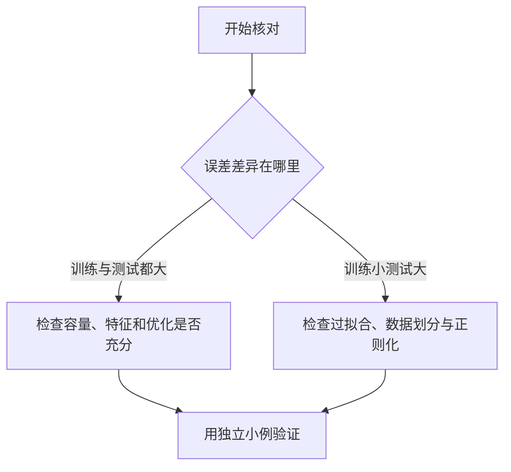

---
subject:
- 深度学习
type: lecture
class_no: 2
date: '2026-09-02'
source:
- Chapter2.pdf；腾讯会议录制（含 3 段录音）
- '[[03_Sources/Courses/深度学习/课堂笔记/raw/2026-09-02-机器学习基础概念与模型构建教学-037184-逐字稿]]'
- '[[03_Sources/Courses/深度学习/课堂笔记/raw/2026-09-02-机器学习基础概念与模型构建教学-037184-纪要]]'
- '[[03_Sources/Courses/深度学习/课堂笔记/raw/2026-09-02-20260902录音文件(2)-320192-逐字稿]]'
- '[[03_Sources/Courses/深度学习/课堂笔记/raw/2026-09-02-ASR音频转录测试-455040-逐字稿]]'
- '[[03_Sources/Courses/深度学习/PPT/Chapter2/Chapter2]]'
meeting_code: null
start_time: '2026-09-02T08:36:06+08:00'
courseware:
- Chapter2
demo_code:
- 课程/深度学习/演示代码/Chapter2.py
reprocessed_on: '2026-10-22'
tags:
- 模型容量
aliases:
- 2026-09-02 第2节 机器学习基础概念与模型构建
schema_version: 2
time: "2026-10-14T20:49:51+08:00"
legacy_status: 已完成
legacy_topics:
- 数据集
- 特征编码
- 学习器
- 模型容量
- 泛化
- 欠拟合
- 过拟合
status: not done
polish_status: done
lecture_date: '2026-09-02'
---

# 2026-09-02 第2节 机器学习基础概念与模型构建

## 资料来源

- 配套课件：[[03_Sources/Courses/深度学习/PPT/Chapter2/Chapter2|Chapter 2：机器学习基础]]
- 课件 PDF：[[03_Sources/Courses/深度学习/PPT/Chapter2.pdf]]
- 主录音：[[03_Sources/Courses/深度学习/课堂笔记/raw/2026-09-02-机器学习基础概念与模型构建教学-037184-逐字稿|逐字稿]]、[[03_Sources/Courses/深度学习/课堂笔记/raw/2026-09-02-机器学习基础概念与模型构建教学-037184-纪要|纪要]]
- 补充录音：[[03_Sources/Courses/深度学习/课堂笔记/raw/2026-09-02-20260902录音文件(2)-320192-逐字稿|录音 2]]、[[03_Sources/Courses/深度学习/课堂笔记/raw/2026-09-02-ASR音频转录测试-455040-逐字稿|ASR 测试]]

> [!note] 素材说明
> 三段录音中主录音可提取有效内容，其余两段较短且识别质量有限。本笔记以主录音和 Chapter 2 课件交叉整理，不从无法辨认的片段推断知识点。

## 课件与代码阅读路线

> [!info] 2026-10-22重整依据
> 课件：[[03_Sources/Courses/深度学习/PPT/Chapter2/Chapter2|Chapter2]]。演示：[[03_Sources/Courses/深度学习/演示代码/Chapter2.py|Chapter2.py]]。 保留原录音、个人疑惑及正确推导；新增解释与自测不冒充教师原话。

先修与路线：先读样本与假设空间，再区分训练MSE、RMSE和独立测试；代码对应后续第3节实践，不据文件名倒推本日演示。

## 一、本节课核心脉络

本节课回答四个基础问题：机器学习在学什么、数据怎样表示、模型为什么需要参数化、怎样判断训练出来的模型是否真的有效。

## 二、样本、特征与标签

一个监督学习样本通常写成 $(x_n,y_n)$：

- $x_n\in\mathbb{R}^{d}$ 是第 $n$ 个样本的特征向量。
- $x_n$ 的每个分量称为一个特征。
- $y_n$ 是标签；回归标签为连续值，分类标签通常为类别编号或编码向量。
- 全部样本组成数据集 $\mathcal D=\{(x_n,y_n)\}_{n=1}^{N}$。

### 不同模态怎样进入模型

- **表格数据**：每列可对应年龄、温度、尺寸等特征，需处理量纲、缺失值和类别变量。
- **图像**：转换为像素张量，形状常包含通道、高度和宽度。
- **文本**：先分词或切分为 token，再映射为离散编号与连续向量表示。

> 一句话来说：模型只能处理数值张量，所谓特征工程或表示学习，就是把现实对象转换为保留任务信息的数值表示。

## 三、模型是对未知函数的近似

假设现实中存在未知映射 $y=f(x)$。机器学习用带参数的函数 $\hat f(x;\theta)$ 去近似它。所有允许的 $\hat f$ 构成假设空间，参数 $\theta$ 由训练数据确定。

例如，线性回归的假设空间为

$$
\hat f(x;w,b)=w^{\mathsf T}x+b,
$$

多项式回归则可写为

$$
\hat f(x;w)=\sum_{k=0}^{P}w_kx^k.
$$

模型的结构由人选择，具体参数由数据训练。二者不能混淆：把多项式次数从 3 改成 9 是改变模型容量，调整某个系数则是在同一结构内改变参数。

## 四、模型容量

模型容量描述一个函数族能够有效表示多大范围的关系。常数函数、一次多项式、三次多项式直到更一般的连续函数，表示能力逐步增强。

![[04_Assets/Images/Courses/深度学习/PPT/Chapter2/images/b6fb29949cc761c6c6fbb3329a64029a6b4736d9b593f74d355b6f736f49f86e.jpg|620]]

*图：函数类的嵌套关系。模型容量提高意味着候选函数更多，但训练和泛化也更难控制。*

容量太小会**欠拟合**：模型连训练数据中的主要规律都无法表达；容量太大则可能**过拟合**：模型不仅拟合规律，还追随采样噪声。

## 五、训练、损失与优化

训练通过最小化损失确定参数。以平方损失为例：

$$
L(\theta)=\frac{1}{N}\sum_{n=1}^{N}\left(\hat f(x_n;\theta)-y_n\right)^2.
$$

求解该最小化问题的计算方法称为优化器，例如梯度下降或拟牛顿法。训练误差描述模型在训练集上的拟合程度，但不能单独评价模型好坏。

## 六、测试集与泛化

训练完成后，要在未参与参数拟合的新样本上计算测试误差。训练误差与测试误差之间的差异称为泛化差距。

| 现象 | 训练误差 | 测试误差 | 可能原因 |
|:--|:--:|:--:|:--|
| 欠拟合 | 高 | 高 | 模型容量不足或训练不充分 |
| 合理拟合 | 较低 | 较低 | 容量与数据复杂度匹配 |
| 过拟合 | 很低 | 高 | 容量过大、数据过少或噪声较强 |

![[04_Assets/Images/Courses/深度学习/PPT/Chapter2/images/839ca23bc94afc5f86236efaac5f06fc3b3aafe01dce51e2970bfcfad5defac2.jpg|430]]
![[04_Assets/Images/Courses/深度学习/PPT/Chapter2/images/f84235769664904907f2fc1e94bd574508a13b1c1a9917978e05a090ff3113c4.jpg|430]]

*图：容量合适时曲线抓住主要规律；容量过高时边界处可能出现剧烈振荡。*

## 七、分类问题的数学结构

分类同样是函数映射问题，只是输出空间为有限类别。例如手写数字识别可表示为

$$
f:\mathbb{R}^{d}\to\{0,1,\ldots,9\}.
$$

实际模型通常先输出每个类别的分数或概率，再选择最大者作为预测类别。整数标签只是类别编码，不表示类别之间存在大小关系。

## 八、建模流程

1. 明确任务：回归、分类还是其他任务。
2. 确定每个样本的输入、输出及形状。
3. 划分训练集、验证集和测试集，防止数据泄漏。
4. 选择模型结构与容量。
5. 定义与任务匹配的损失函数。
6. 训练参数，并记录训练与验证误差。
7. 在测试集上做最终评价，分析失败样本。

## 九、易错点与课后思考

> [!warning] 易错点
> - 类别编号是编码，不是有实际距离的连续数值。
> - 模型容量越大，训练误差通常不会更差，但测试误差可能变差。
> - 验证集用于选择模型，测试集不应反复参与调参。
> - 数据预处理应只用训练集统计量，避免把测试信息泄漏给模型。

思考：为什么同一个模型面对文本、图像和表格数据时，需要不同的输入编码？为什么“训练集表现最好”的模型不一定是最终模型？

## 课件例题与代码的相同点、不同点

Chapter2 的九点例题以 $f(x)=1/(x^2+x+1)$ 比较不同次数；演示代码的目标却是 $\sin(2\pi x)$，使用100个训练点、20个测试点和7次多项式。两个实验不能共用一张“运行结果表”。

平方损失与误差的口径应明确：

$$
\mathrm{MSE}=\frac1N\sum_n(\hat y_n-y_n)^2,\qquad
\mathrm{RMSE}=\sqrt{\mathrm{MSE}}.
$$

[[03_Sources/Courses/深度学习/演示代码/Chapter2.py|代码]]最后打印的 Test error 开了平方根，因此是RMSE，而不是MSE。次数7对应8个系数；模型容量由次数控制，不由输出小数位数控制。

课件也出现监督／无监督的区分：是否有标签，和采用何种学习器，是两个独立维度。多项式、固定基的Fourier展开和有限元形函数都可以对系数线性；不能把“线性结构”误读为“图像是一条直线”。

> 一句话来说：比较误差前，先统一目标函数、采样方式、损失定义和数据集。

### 自测（新编）

两个测试残差为1、3。求MSE与RMSE；若训练MSE为1，能直接与测试RMSE相减当作同口径泛化差距吗？

> [!hint]- 提示
> 先平方求平均，再决定是否开根号。

> [!solution]- 解析
> MSE为5，RMSE为 $\sqrt5$。不能直接把不同口径相减，应统一用MSE或RMSE，并说明泛化差距采用有符号差还是绝对差。

## 判定流程与核心公式速查

| 对象 | 公式或规则 |
|---|---|
| 经验风险 | $L=N^{-1}\sum_n\ell(\hat f(x_n),y_n)$ |
| 同口径差距 | $\vert E_{\rm test}-E_{\rm train}\vert$ |

## 课堂导航

- 上一节：[[03_Sources/Courses/深度学习/课堂笔记/2026-08-31-第1节-转写_电子科大王君豪的快速会议|第1节 深度学习导论与课程准备]]
- 后续课程：[[03_Sources/Courses/深度学习/课堂笔记/2026-09-07-第3节-机器学习基础与NumPy实操讲座|第3节 模型容量、NumPy 与神经元]]
- 上级索引：[[03_Sources/Courses/深度学习/课堂笔记/README|深度学习课堂笔记]]
