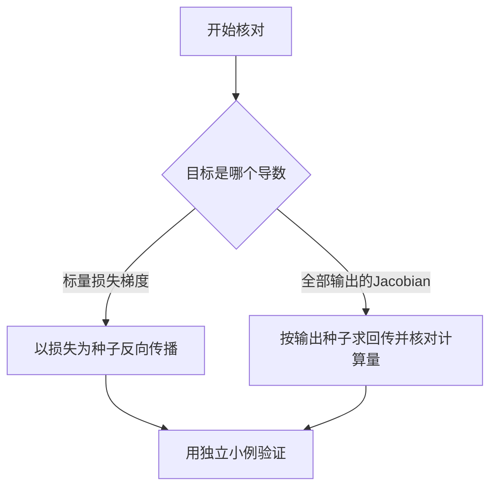

---
subject:
- 深度学习
type: lecture
class_no: 5
date: '2026-09-14'
source:
- Chapter3.pdf；腾讯会议录制（神经网络反向传播算法推导与复杂度分析讲座）
- '[[03_Sources/Courses/深度学习/课堂笔记/raw/2026-09-14-神经网络反向传播算法推导与复杂度分析讲座-881792-逐字稿]]'
- '[[03_Sources/Courses/深度学习/课堂笔记/raw/2026-09-14-神经网络反向传播算法推导与复杂度分析讲座-881792-纪要]]'
- '[[03_Sources/Courses/深度学习/PPT/Chapter3/Chapter3]]'
meeting_code: null
start_time: '2026-09-14T10:28:40+08:00'
courseware:
- Chapter3
- Chapter3(1)
demo_code:
- 课程/深度学习/演示代码/Chapter4(1).py
reprocessed_on: '2026-10-22'
tags:
- 反向传播
- 链式法则
- 损失函数
aliases:
- 2026-09-14 第5节 反向传播、梯度计算与复杂度
schema_version: 2
time: "2026-10-14T20:49:51+08:00"
legacy_status: 已完成
legacy_topics:
- 前向传播
- 反向传播
- 链式法则
- 参数梯度
- 有限差分
- 计算复杂度
- 向量输出
- 损失函数
status: not done
polish_status: done
lecture_date: '2026-09-14'
---

# 2026-09-14 第5节 反向传播、梯度计算与复杂度

## 资料来源

- 配套课件：[[03_Sources/Courses/深度学习/PPT/Chapter3/Chapter3|Chapter 3：前馈神经网络]]
- 课件 PDF：[[03_Sources/Courses/深度学习/PPT/Chapter3.pdf]]
- 原始逐字稿：[[03_Sources/Courses/深度学习/课堂笔记/raw/2026-09-14-神经网络反向传播算法推导与复杂度分析讲座-881792-逐字稿.md]]
- 智能纪要：[[03_Sources/Courses/深度学习/课堂笔记/raw/2026-09-14-神经网络反向传播算法推导与复杂度分析讲座-881792-纪要.md]]
- 开始时间：2026-09-14 10:28

## 课件与代码阅读路线

> [!info] 2026-10-22重整依据
> 课件：[[03_Sources/Courses/深度学习/PPT/Chapter3/Chapter3|Chapter3]]、[[03_Sources/Courses/深度学习/PPT/Chapter3(1)/Chapter3(1)|Chapter3(1)]]。演示：[[03_Sources/Courses/深度学习/演示代码/Chapter4(1).py|Chapter4(1).py]]。 保留原录音、个人疑惑及正确推导；新增解释与自测不冒充教师原话。

先修与路线：先回看第4节补全中的层宽与参数形状，再读反向量递推；最后用第4章演示的自动微分核对一个数值梯度。

## 一、本节课核心脉络

本节课从训练需要的“参数梯度”出发，先明确求的是参数取具体值时的导数数值，而不是展开庞大的导函数；随后引入中间变量 $q^\ell$ 和反向变量 $p^\ell$，把链式法则整理成可逐层计算的反向传播；最后比较前向与反向的复杂度，并说明向量输出为何在接上标量损失后只需一次反向传播。

## 二、参数变化不一定唯一决定网络函数

多项式在固定基下的系数表示是唯一的：改变任一系数通常就改变函数。神经网络不同，其非线性和网络结构会带来参数冗余。例如，若某层激活在相关输入上输出常量，则该层之前的一些参数改变可能不影响最终输出；交换功能相同的隐藏神经元并同步交换相邻权重，也可能表示同一个函数。

因此参数到函数的映射通常不是一一对应的，多组参数可能实现相同或近似相同的函数。这会使优化问题具有对称性和非唯一解，但并不妨碍我们在当前参数点计算梯度。

## 三、复杂度估计必须保留输入与输出维度

考虑从 $\mathbb R^d$ 到 $\mathbb R^{d'}$ 的全连接网络，含 $L$ 个隐藏层，每层宽度约为 $M$。一次前向传播的主要计算复杂度为

$$
O\!\left(dM+(L-1)M^2+d'M\right).
$$

中间隐藏层的矩阵乘法贡献 $(L-1)M^2$，首层和末层分别贡献 $dM$ 与 $d'M$。课堂特别强调不能因为 $L$、$M$ 看起来很大就省略 $d$、$d'$：工业任务的输入或输出维度也可能达到很大规模，复杂度表达式应保留所有可能占主导的项。

## 四、训练真正需要什么导数

设网络为 $f(x;\theta)$，$\theta$ 包含全部权重和偏置。基于梯度的训练需要计算

$$
\nabla_\theta L(\theta),
$$

而课堂推导先从标量网络输出 $y=f(x;\theta)$ 入手，计算当前输入和当前参数下的 $\partial y/\partial\theta$。

这里要区分：

- **导函数表达式**：把参数保留为符号，得到完整的函数公式。
- **导数值**：输入和参数都已给定，只求该点处的一组数值。

反向传播的目标是高效得到后一种结果，最终输出的是与参数同形状的梯度数组，而不是把深层复合函数完全展开。

### 有限差分的作用

若只会前向计算，可以用

$$
\frac{\partial y}{\partial \theta_k}
\approx
\frac{f(x;\theta+h e_k)-f(x;\theta-h e_k)}{2h}
$$

近似检查某个参数的导数。有限差分直观且适合做**梯度校验**，但每检查一个参数都要重复前向计算，参数很多时成本极高，并会受到步长和浮点舍入误差影响，不能替代大规模训练中的反向传播。

## 五、前向传播：反向计算的必要准备

令 $y^0=x$。第 $\ell$ 层的仿射输入与激活输出为

$$
q^\ell=W^\ell y^{\ell-1}+b^\ell,
\qquad
y^\ell=\sigma^\ell(q^\ell).
$$

课堂反复强调：**反向传播开始前必须先做一次前向传播，并保存各层的 $q^\ell$ 与 $y^\ell$。** 后面的激活函数导数需要 $q^\ell$，权重梯度需要上一层输出 $y^{\ell-1}$；若不缓存，就只能在反向阶段重复计算。

![[04_Assets/Images/Courses/深度学习/PPT/Chapter3/images/de914ff1c1882bad39714938470099b7fd48a377579d711a05b6a3dda00a21b9.jpg|620]]

*图：前向传播保存中间量，反向传播沿相反方向传递导数。*

## 六、反向传播的核心变量

先考虑标量输出 $y$，定义

$$
p_i^\ell:=\frac{\partial y}{\partial q_i^\ell}.
$$

$p^\ell$ 表示最终输出对第 $\ell$ 层激活前变量的敏感度。引入它后，同一个中间导数只需计算一次，再被该层的权重梯度、偏置梯度和上一层反向递推共同复用。

### 1. 输出层

若标量输出写为

$$
y=\sigma^{L+1}(q^{L+1}),
$$

则

$$
p^{L+1}=(\sigma^{L+1})'(q^{L+1}).
$$

若 $q^{L+1}=W^{L+1}y^L+b^{L+1}$，则参数梯度由链式法则直接得到：

$$
\frac{\partial y}{\partial W^{L+1}}
=p^{L+1}(y^L)^{\mathsf T},
\qquad
\frac{\partial y}{\partial b^{L+1}}=p^{L+1}.
$$

### 2. 隐藏层递推

对 $\ell=L,L-1,\ldots,1$，下一层的每个节点都可能形成一条到最终输出的路径，因此各条路径的链式法则贡献要相加。向量形式为

$$
p^\ell=
\left((W^{\ell+1})^{\mathsf T}p^{\ell+1}\right)
\odot (\sigma^\ell)'(q^\ell),
$$

其中 $\odot$ 表示逐元素乘法。得到 $p^\ell$ 后，立即有

$$
\frac{\partial y}{\partial W^\ell}
=p^\ell(y^{\ell-1})^{\mathsf T},
\qquad
\frac{\partial y}{\partial b^\ell}=p^\ell.
$$

第一层只需把 $y^0$ 换成输入 $x$。若还需要输出对输入的导数，则

$$
\nabla_x y=(W^1)^{\mathsf T}p^1.
$$

> 一句话来说：反向传播就是把“输出对当前层的敏感度”从后向前传递，并在每层顺手形成权重与偏置的梯度。

## 七、怎样从链式法则理解网络路径

对标准全连接分层网络，矩阵递推自动完成“沿所有路径求乘积再相加”。对带跳连、分支或不规则连接的前馈网络，同一原则仍成立：

1. 找到目标参数到标量输出的所有有向路径。
2. 每条路径上的局部导数相乘。
3. 不同路径的贡献相加。

这也是计算图自动微分的基础。实现时不应手工展开所有长公式，而应让每个算子只提供局部导数，并按图的反向拓扑顺序累积梯度。

## 八、前向与反向传播的计算量

对标量输出、宽度约为 $M$ 的全连接网络，一次反向传播的主要复杂度与前向传播同阶：

$$
O\!\left(dM+(L-1)M^2+M\right).
$$

反向阶段虽然要求出大量参数梯度，但矩阵乘法会同时生成整层结果，不需要对每个参数单独运行一次网络。代码通常只对层数写一个反向循环，层内运算用矩阵和向量完成。

> [!warning] “同阶”不等于完全没有额外代价
> 完整训练步骤至少包含一次前向传播和一次反向传播，还需保存或重算中间量。因此总时间常是前向推理的若干倍，并额外占用激活缓存。

## 九、向量输出、Jacobian 与标量损失

若 $f:\mathbb R^d\to\mathbb R^{d'}$ 输出向量，要求全部输出对全部参数的偏导，相当于构造完整 Jacobian。前向缓存可以共享，但反向模式通常需要以每个输出分量为种子分别回传，成本随 $d'$ 增长。

实际训练并不直接构造这个完整 Jacobian，而是优化标量损失。例如均方误差

$$
L(\theta)=\frac{1}{N}\sum_{n=1}^N
\left\Vert f(x_n;\theta)-t_n\right\Vert_2^2.
$$

可以把“网络输出减目标、逐元素平方、求和和样本聚合”看成接在原网络后的固定计算层。最终 $L$ 是标量，因此从 $L$ 出发进行一次反向传播，就能通过链式法则得到所有参数的 $\nabla_\theta L$，无需显式生成每个输出分量的完整参数 Jacobian。

## 十、易错点与后续

> [!warning] 易错点
> - 反向传播不是跳过前向传播；必须先计算并保存所需的中间变量。
> - $p^\ell$ 是最终标量输出对 $q^\ell$ 的导数，不是激活函数自身的导数。
> - 一条路径对应局部导数的乘积，多条路径的贡献必须相加。
> - 权重梯度是反向量与上一层激活的外积，转置方向要由维度检查。
> - 完整向量输出 Jacobian 与标量损失梯度不是同一任务；训练通常计算后者。
> - 有限差分主要用于小规模梯度校验，不适合逐参数训练。

- 后续将把反向传播得到的损失梯度用于梯度下降等优化方法。
- 实现时先记录每层张量形状，再检查 $W^\ell y^{\ell-1}$、$p^\ell(y^{\ell-1})^{\mathsf T}$ 的维度是否一致。
- 可用少量参数做中心差分校验，比较解析梯度与数值梯度的相对误差。

## 从手推反向传播到自动微分（补充解释）

Chapter3(1) 相比 Chapter3 补充了向量输出Jacobian与标量损失梯度的辨析，已与正文第九节相互核对；两份并非不同授课章节。代码中没有单独的 Chapter3.py；[[03_Sources/Courses/深度学习/演示代码/Chapter4(1).py|Chapter4(1).py]]是后续自动微分的落地参照，不冒称本节已有完整演示。

用单隐藏神经元检验外积／链式法则：

$$
z=wx+b,\quad h=\mathrm{ReLU}(z),\quad
\hat y=ah+c,\quad \ell=(\hat y-t)^2.
$$

取 $x=2,w=1,b=0,a=3,c=0,t=1$，有 $z=2,h=2,\hat y=6,\ell=25$。由输出误差逐层回传，

$$
\frac{\partial\ell}{\partial a}=20,\quad
\frac{\partial\ell}{\partial c}=10,\quad
\frac{\partial\ell}{\partial w}=60,\quad
\frac{\partial\ell}{\partial b}=30.
$$

例如 $\partial\ell/\partial w=2(6-1)\cdot3\cdot1\cdot2$。ReLU跳点外可用中心差分核对；在不可导点不要求左右差分与框架约定完全相同。

| 第 $\ell$ 层对象 | 形状 |
|---|---|
| $W^\ell$ | $M_\ell\times M_{\ell-1}$ |
| $p^\ell$ | $M_\ell\times1$ |
| $p^\ell(y^{\ell-1})^{\mathsf T}$ | $M_\ell\times M_{\ell-1}$，与权重同形 |

> 一句话来说：先核对一个能手算的梯度，再信任大网络中的一次backward。

### 自测（新编）

在上述例子中只把目标改成 $t=6$，四个参数梯度如何改变？有限差分为什么仍不是高效训练方案？

> [!hint]- 提示
> 所有梯度都含同一个输出误差因子。

> [!solution]- 解析
> 残差变为0，四个梯度都为0。有限差分要逐参数重新前向，参数多时远比复用中间导数昂贵。

## 判定流程与核心公式速查

| 对象 | 公式或规则 |
|---|---|
| 权重梯度 | $p^\ell(y^{\ell-1})^{\mathsf T}$ |
| 偏置梯度 | $p^\ell$ |
| 反向量递推 | $((W^{\ell+1})^{\mathsf T}p^{\ell+1})\odot(\sigma^\ell)'(q^\ell)$ |

## 课堂导航

- 上一节：[[03_Sources/Courses/深度学习/课堂笔记/2026-09-07-第3节-机器学习基础与NumPy实操讲座|第3节 模型容量、NumPy 与神经元]]
- 上级索引：[[03_Sources/Courses/深度学习/课堂笔记/README|深度学习课堂笔记]]
