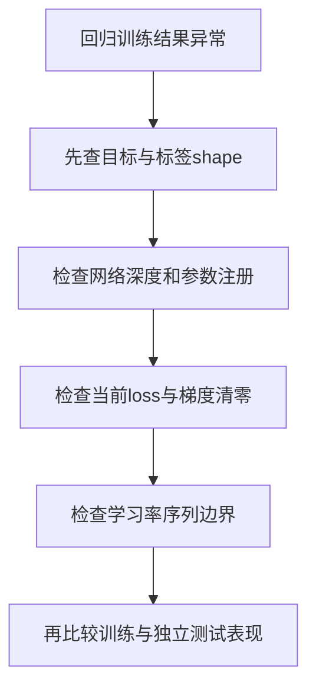

---
subject:
- 深度学习
type: lecture
class_no: 9
date: '2026-09-28'
teacher: 顾水奇
source:
- 课表核对（未发现逐字稿或课堂录音资料）
- '[[03_Sources/Courses/深度学习/课堂笔记/raw/2026-10-12-深度学习编程与分类模型宣讲-586304-逐字稿]]'
meeting_code: null
start_time: '2026-09-28T10:20:00+08:00'
reprocessed_on: '2026-10-22'
completion_status: 部分知识补全（非逐字稿，分课边界待确认）
tags:
- 课堂边界待确认
aliases:
- 2026-09-28 第9节 课堂内容待补
schema_version: 2
time: "2026-10-14T20:49:51+08:00"
legacy_status: 缺少逐字稿
legacy_topics:
- 回归实现（共享区间补全）
- 课堂边界待确认
status: not done
polish_status: not done
lecture_date: '2026-09-28'
---

# 2026-09-28 第9节 课堂内容待补

> [!warning] 缺少逐字稿
> 根据 [[课表|2026—2027 学年第一学期课表]]，本课程于 2026-09-28（星期一、第 5 周）第 3—4 节上课，教师为顾水奇。截至 2026-09-29 本次检查，课程目录及全库均未发现能够与该课次可靠匹配的逐字稿、纪要或课堂录音资料。

## 缺失记录

- 课程：深度学习
- 日期与时间：2026-09-28 10:20—11:55
- 预计课次：第 9 节
- 判断依据：课表规定第 1—12 周星期一第 3—4 节、星期三第 1—2 节上课；上一记录为 2026-09-23 第 8 节，因此本次为第 9 节。
- 已检查：本课程课堂笔记、raw 目录，以及全库 2026-09-28 的逐字稿和纪要文件。
- 当前结果：已补入第9—10节共享缺失区间的回归实现知识，但不能可靠确定两天的分课边界、教师讲解、例题或课堂要求。

## 后续补全规则

后续出现本课程的新课堂记录时，先比较本节前后课堂笔记、对应课件与教师明确的章节进度。只补全能够可靠还原的知识内容，并标注“根据课件及前后课程补全（非逐字稿）”及具体依据；无法可靠还原的部分继续保留待补标记。

## 根据课件及前后课程补全（非逐字稿）

> [!info] 第9—10节共享缺失区间，不能按天强行切分
> [[03_Sources/Courses/深度学习/课堂笔记/2026-09-23-第8节-深度学习模型训练与正则化讲座|第8节]]已介绍回归训练与网络实现；[[03_Sources/Courses/深度学习/课堂笔记/raw/2026-10-12-深度学习编程与分类模型宣讲-586304-逐字稿|第11节录音]]00:05:58起明确回顾“上次”生成训练／测试集并定义三层宽10的Sequential网络。结合[[03_Sources/Courses/深度学习/PPT/Chapter5 (1)/Chapter5 (1)|第五章]]与[[03_Sources/Courses/深度学习/演示代码/Chapter5.py|Chapter5.py]]，可以补入这个缺失区间中的回归实现知识，但不能确定9月28日与30日各讲了哪些段落。本段为两课共用资料补全，不声称第9节讲完全文。

### 学习路线

先看第8节的采样与正则化，沿“数据—网络—损失—优化—评估”读下面内容，再去第11节衔接分类；代码中未实现的功能不当成已经演示。

### 可可靠还原的回归模型

原演示取 $d=5$、目标 $f(x)=(1+\sum_{j=1}^5x_j^2)^{-1}$、定义域 $[-1,1]^5$。训练输入为 $10000\times5$，标签为长度10000；测试集1000点独立生成，代码没有添加观测噪声。

三层宽10的网络把输入依次变为 $N\times10$、$N\times10$、$N\times1$；两隐藏层使用ReLU，末层为标量回归输出。对应181个参数。网络输出先去掉末尾长度1的维度，再计算

$$
L(\theta)=\frac1N\sum_{n=1}^N\left(\phi(x_n;\theta)-y_n\right)^2.
$$

若不对齐 $(N,1)$ 与 $(N,)$，广播会形成 $N\times N$ 的两两差矩阵，而非逐样本残差。

> 一句话来说：拟合目标、网络结构与损失只是数学模型；正确的shape把这个模型落实为程序。

### 训练及原脚本问题

原脚本以Adam迭代，每一步重置梯度、反向传播、更新参数，并在新参数下重算下一步loss；5000项学习率从 $10^{-2}$ 线性降至 $10^{-4}$。它使用全批梯度，没有自动切分batch，也没有显式加入L1/L2、早停或验证集。

比较架构为 $(L,M)=(3,10),(3,20),(5,10)$，参数数分别181、561、401。只能在控制采样、初始化和训练预算后比较效果，不能凭宽度、深度断言谁必然最佳。

> [!warning] 原文件保留，问题单独标注
> 五层分支range(N_iteration+1)与5000项lrseq不一致，n=5000会越界。应同步循环次数与序列长度；本次未直接修改教师演示代码。不能将原脚本语法通过说成三组训练全部成功。完整架构和参数表见[[03_Sources/Courses/深度学习/课堂笔记/2026-09-23-第8节-深度学习模型训练与正则化讲座#第五章回归课件与Chapter5.py的完整对应|第8节代码对照]]。

### 判定与速查

| 对象 | 此演示的取值 |
|---|---|
| 目标 | $(1+\sum_jx_j^2)^{-1}$ |
| 输入／输出 | 5维／1维 |
| 损失 | 全批MSE，无开方 |
| 训练／测试样本 | 10000／1000 |
| 随机种子 | torch.manual_seed(2) |
| 仍缺失 | 两次课的实际分界、教师例题、强调及作业 |

### 自测（新编）

把三层宽10网络的输入维数从5改为2，其余结构不变。参数量减少多少？输出形状是否改变？

> [!hint]- 提示
> 只有第一层的权重输入列数改变。

> [!solution]- 解析
> 减少 $10(5-2)=30$ 个参数，变为151；每个样本的输出仍为1维，批量输出仍为 $(N,1)$。

## 课堂导航

- 上一节：[[03_Sources/Courses/深度学习/课堂笔记/2026-09-23-第8节-深度学习模型训练与正则化讲座|第8节 模型训练、正则化与 PyTorch 网络实现]]
- 上级索引：[[03_Sources/Courses/深度学习/课堂笔记/README|深度学习课堂笔记]]

