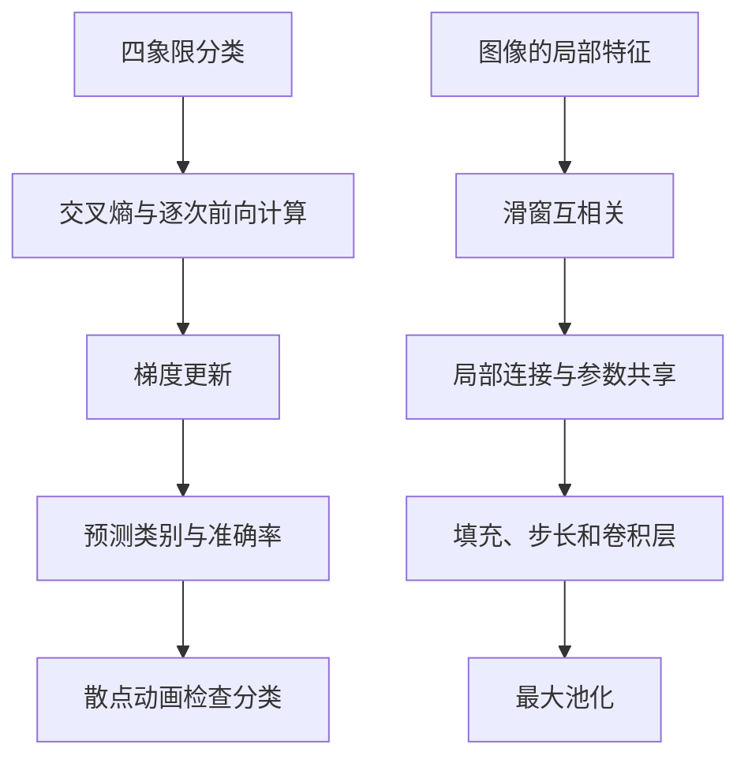
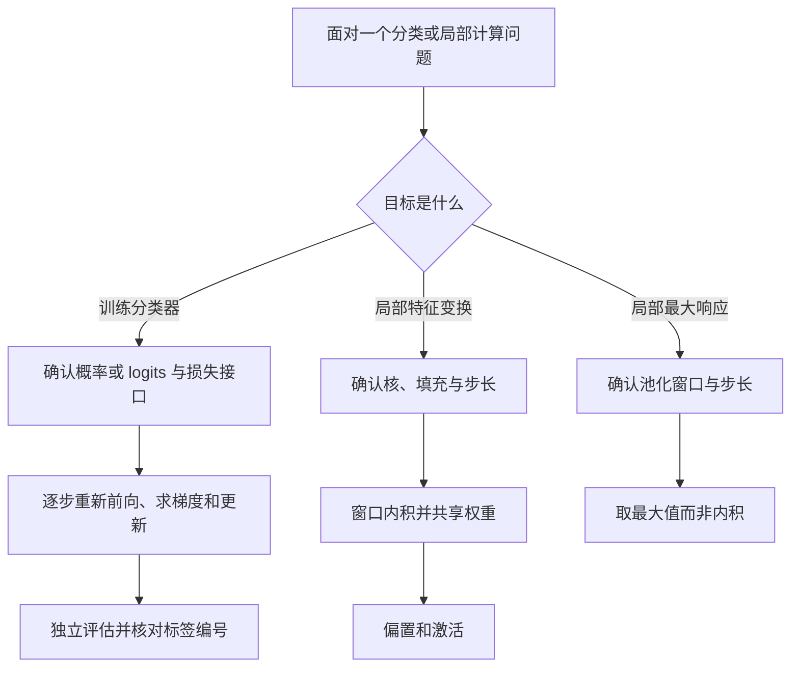

---
subject:
- 深度学习
type: lecture
class_no: 13
date: '2026-10-19'
source:
- 腾讯会议录制（神经网络与卷积网络课程宣讲）
- Chapter6.pdf（分类模型课件及其源 MD）
- '[[03_Sources/Courses/深度学习/课堂笔记/raw/2026-10-19-神经网络与卷积网络课程宣讲-500096-逐字稿]]'
- '[[03_Sources/Courses/深度学习/课堂笔记/raw/2026-10-19-神经网络与卷积网络课程宣讲-500096-纪要]]'
- '[[03_Sources/Courses/深度学习/PPT/Chapter6/Chapter6]]'
meeting_code: null
start_time: '2026-10-19T10:21:29+08:00'
courseware:
- Chapter6
demo_code:
- 课程/深度学习/演示代码/Chapter6.py
reprocessed_on: '2026-10-22'
tags:
- 交叉熵
aliases:
- 2026-10-19 第13节 分类模型训练评估与卷积网络入门
schema_version: 2
time: "2026-10-20T19:43:13+08:00"
legacy_status: 已完成
legacy_topics:
- 交叉熵
- 动态计算图
- 分类准确率
- 分类可视化
- 互相关
- 参数共享
- 平移等变
- 填充与步长
- 最大池化
status: not done
polish_status: done
lecture_date: '2026-10-19'
---

# 2026-10-19 第13节 分类模型训练评估与卷积网络入门

## 课程信息与来源边界

- 时间：2026-10-19，课表第 3—4 节；录音自 10:21:29 开始。
- 原始记录：[[03_Sources/Courses/深度学习/课堂笔记/raw/2026-10-19-神经网络与卷积网络课程宣讲-500096-逐字稿|逐字稿]]、[[03_Sources/Courses/深度学习/课堂笔记/raw/2026-10-19-神经网络与卷积网络课程宣讲-500096-纪要|智能纪要]]。下文时间戳均为录音相对时间。
- 匹配课件：[[03_Sources/Courses/深度学习/PPT/Chapter6/Chapter6|第六章 分类模型源 MD]]及[[03_Sources/Courses/深度学习/PPT/Chapter6.pdf|原 PDF]]；用于核对四象限分类、交叉熵和准确率。本地尚未找到本次卷积网络部分的对应课件，不以分类课件冒充卷积课件。
- 课次：承接 [[03_Sources/Courses/深度学习/课堂笔记/2026-10-14-第12节-神经网络分类模型代码编写|10 月 14 日第12节]]，本次为第13节；沿用前次已核对的国庆假期扣除口径，纠正自动占位的“第15节”。10 月 16 日停课不影响本课程星期一、三的排课。
- 身份边界：录音账户名称不等于授课教师姓名。课表与课件署名有差异，未据转写擅自修改课表。

> [!info] 本次整理范围
> 课堂主线为分类程序收尾（00:00—44:57）和卷积、池化入门（约54:11—01:32:09）。中后段混入数理统计题讨论及课间旁谈；01:42 后关于补课、论文和 PPT 汇报的对话无法可靠归属本课程，不列为教师通知。逐字稿与纪要原文均保留。
> 新增推导、程序整理、边界说明及自测均作相应标注；“已完成”指本次可确认课堂内容已整理，不表示资料齐全或已经掌握。

## 课件与代码阅读路线

> [!info] 2026-10-22重整依据
> 课件：[[03_Sources/Courses/深度学习/PPT/Chapter6/Chapter6|Chapter6]]。演示：[[03_Sources/Courses/深度学习/演示代码/Chapter6.py|Chapter6.py]]。 保留原录音、个人疑惑及正确推导；新增解释与自测不冒充教师原话。

先修与路线：沿用本课已有分层路线：先检查分类损失、更新与准确率，再学习互相关与池化；四象限程序不能作为卷积网络实现的证据。

## 一、本次课核心脉络

本次解决两个问题：怎样确认分类网络真的学会了分类？怎样在保留图像局部结构的同时减少参数？

必要先修：网络输出是概率向量；one-hot 标签只有真实类别对应分量为 1；梯度下降更新参数而反向传播计算梯度。不熟悉时先回看[[03_Sources/Courses/深度学习/课堂笔记/2026-10-14-第12节-神经网络分类模型代码编写|上一课的数据形状、网络定义与训练循环]]。



阅读路线：先走通“损失—更新—评估”，再学习“互相关—特殊矩阵—卷积层”，最后用池化区分计算方式。

## 二、训练循环为什么要重算损失（核心）

来源：逐字稿 00:00—10:27；分类公式由 Chapter6 校正。

设训练样本为 $x^{(n)}\in\mathbb R^2$，类别 $y^{(n)}\in\{1,2,3,4\}$，one-hot 标签为 $v^{(n)}\in\mathbb R^4$。网络输出 $p^{(n)}=\phi_\theta(x^{(n)})$ 是四维概率向量。训练目标为

$$
L(\theta)
=-\frac1N\sum_{n=1}^N\sum_{j=1}^4v_j^{(n)}\log p_j^{(n)}
=-\frac1N\sum_{n=1}^N\log p_{y^{(n)}}^{(n)}.
$$

第二个等号来自 one-hot 标签仅选中真实类别。对一个样本而言，提高真实类别的预测概率，就会降低负对数损失。

> 一句话来说：交叉熵衡量模型给真实类别的概率够不够高，而非只检查最大分量的下标。

批量输出和 one-hot 标签都是 $N\times4$ 张量；先沿类别维求和得到 $N$ 个样本损失，再取平均得到一个**零维标量张量**。纪要称“一维张量数值”不够准确。

课堂区分了数学公式与框架执行：

$$
\theta_{k+1}=\theta_k-\eta_k\nabla L(\theta_k).
$$

若已有解析梯度，更新公式不要求额外输出 $L(\theta_k)$；但常规 PyTorch 训练要在当前参数上重新前向计算，建立这一步的计算图，再反向求导。不能在参数更新后反复使用原来的 loss，冒充新参数处的梯度。保留旧图也不等于重新计算新参数处的目标。

**代码整理（依据课堂流程，非逐字抄录）**：以下片段接续上一课已定义的 net、optimizer、X_train 和 one-hot 标签 Y_train；net 输出概率。

```python
for step in range(num_steps):
    optimizer.zero_grad()
    probabilities = net(X_train)
    loss = -(Y_train * probabilities.log()).sum(dim=1).mean()
    loss.backward()
    optimizer.step()
```

课堂提及迭代中调整学习率；本次由新上传的Chapter6.py补足为5000项、从 $10^{-4}$ 到 $10^{-6}$ 的线性衰减。录音本身未能恢复该表达式，代码依据与口述依据分别保留。

> [!warning] 补充解释：数值稳定与框架语义
> 上面是数学公式的直接实现，极端概率可能下溢为 0。实际实现可让网络输出未归一化 logits，再用 CrossEntropyLoss，并把 1—4 标签减一为 0—3。不要把已 softmax 的概率当 logits 再送入该损失。
> 动态图和输入要求分别见 [PyTorch 自动求导说明](https://docs.pytorch.org/docs/stable/notes/autograd.html)、[CrossEntropyLoss 文档](https://docs.pytorch.org/docs/stable/generated/torch.nn.CrossEntropyLoss.html)。这些用于校正实现语义，不是新增教师要求。

### 自测（新编）：损失计算的维度

两个样本的真实类别分别为 1、3，网络概率分别是 $(0.7,0.1,0.1,0.1)$、$(0.1,0.2,0.6,0.1)$。写出批量交叉熵，并说明逐行求和前后与最终的张量形状。

> [!hint]- 提示
> 每行 one-hot 内积只保留真实类别的对数概率；最后对两个样本取平均。

> [!solution]- 解析
> 概率矩阵与 one-hot 矩阵都是 $2\times4$；逐元素相乘后形状不变，沿 dim=1 求和得到长度为 2 的向量，mean 得到零维张量。
> $L=-(\log0.7+\log0.6)/2=-\log(0.42)/2\approx0.4338$。

## 三、从概率矩阵得到准确率与动画（核心）

来源：逐字稿 10:45—44:57；课件“测试和准确率”“演示”。

### 1. 最大值与最大值位置不是一回事

对 $M$ 个测试点，网络输出 $P\in\mathbb R^{M\times4}$；第 $n$ 行是该点的四类概率。逐行取最大元素的**位置**，得到预测类别：

$$
\hat y^{(n)}=1+\operatorname*{arg\,max}_{j\in\{0,1,2,3\}}P_{n,j}.
$$

这里加一仅因为课堂标签从 1 开始。torch.max(P, dim=1) 同时返回最大值 values 和下标 indices；分类取 indices，不取 values。

$$
\operatorname{Acc}
=\frac1M\sum_{n=1}^M\mathbf1_{\{\hat y^{(n)}=y_{\mathrm{test}}^{(n)}\}}.
$$

> 一句话来说：先按每行最大的概率选类，再用预测与真实标签逐元素比较，统计正确比例。

**代码整理**：y_test 须为长度 $M$ 的整数标签向量，而不是 $M\times4$ 的 one-hot 矩阵，避免意外广播。

```python
with torch.no_grad():
    probabilities = net(X_test)
    predicted = probabilities.max(dim=1).indices + 1
    accuracy = (predicted == y_test).float().mean().item()
```

课堂演示约每 100 次迭代观察一次训练损失与测试准确率；深度为 3、宽度为 10 的网络训练约 5000 次，展示的准确率约 96%、交叉熵约 0.4。这是当次运行现象，不是保证可复现的标准结果。初始准确率不必恰好等于 25%，有限样本与随机初始化都会影响实际值。

### 2. 损失与准确率为何不能按数值大小互相替代

准确率只看最大分量选出的类别；交叉熵还看真实类别的概率大小。不能拿分类交叉熵 0.4 与回归均方误差 $10^{-4}$ 直接比较“哪个好”。

**补充解释**：交叉熵没有“一般只能降到 0.01”的硬下限，也不保证准确率随每一步单调上升。训练、验证与最终测试集应明确分工；若用同一测试集反复选参数，会削弱其独立评估作用。课堂演示的监视方式不等于完整实验规范。

### 3. 用布尔掩码观察预测分区

课堂按**预测类别**筛选测试点，而不是按真实标签上色；否则只能看数据本身的分布，不能观察模型的分类过程。

**代码整理（接续上述预测结果）**：

```python
points = X_test.detach().cpu().numpy()
labels = predicted.detach().cpu().numpy()
plt.cla()
for cls, color in zip(range(1, 5), ["red", "blue", "green", "orange"]):
    mask = labels == cls
    plt.scatter(points[mask, 0], points[mask, 1], s=6, c=color)
plt.pause(0.5)
```

代码置于每 100 次迭代的显示分支中，可看到预测分区由混杂逐渐接近四个象限。程序片段假定已导入 torch、Matplotlib，并已完成上一课的数据与网络定义，不是独立可运行脚本。

**补充解释**：detach 返回与自动求导图分离的张量视图，不会“清空全程序的计算图”；cpu 将数据移到 CPU；numpy 转为 NumPy 数组。对原本就在 CPU 且不求导的数据，未必每一步都必需。

## 四、互相关为何仍是线性映射（核心）

来源：逐字稿约 54:11—01:14:07。卷积课件未上传，以下用清晰记号重写课堂说明；具体板书数字受旁谈和转写干扰，不伪造原矩阵。

### 1. 滑动窗口的局部内积

令输入 $X\in\mathbb R^{H\times W}$，核 $K\in\mathbb R^{r\times s}$。步长为 1、无填充时，

$$
Y_{p,q}
=\sum_{i=1}^{r}\sum_{j=1}^{s}K_{i,j}X_{p+i-1,q+j-1},
\quad
Y\in\mathbb R^{(H-r+1)\times(W-s+1)}.
$$

先取与核同尺寸的局部窗口，再逐项相乘求和，得到输出一个元素。网络中常把这种**不翻转核**的互相关操作称为卷积；不要与数学卷积的核翻转约定混淆。

> 一句话来说：互相关就是用同一个小窗口规则，扫描输入的不同位置。

### 2. 拉直后等于一个特殊矩阵乘法

课堂将 $3\times3$ 输入、$2\times2$ 核和 $2\times2$ 输出拉直为 9 维与 4 维向量。固定核时，存在 $4\times9$ 矩阵 $\widehat K$，使

$$
\operatorname{vec}(Y)=\widehat K\operatorname{vec}(X).
$$

**补充解释：按行拉直时的完整展开**。设核为 $\left(\begin{smallmatrix}a&b\\c&d\end{smallmatrix}\right)$，则

$$
\widehat K=
\begin{pmatrix}
a&b&0&c&d&0&0&0&0\\
0&a&b&0&c&d&0&0&0\\
0&0&0&a&b&0&c&d&0\\
0&0&0&0&a&b&0&c&d
\end{pmatrix}.
$$

每行表示一个输出位置：大量零体现**局部连接**；同一组 $a,b,c,d$ 在不同行重复，体现**参数共享**。这里“线性”指固定 $K$ 后对输入 $X$ 线性；若同时把 $K$ 与 $X$ 都视为变量，不能合称为线性映射。

> 一句话来说：卷积不是抛开矩阵乘法，而是给权重矩阵施加稀疏与重复使用参数的结构约束。

同样的 $9\to4$ 全连接线性层有 36 个独立权重，而此单通道卷积只有 4 个核权重；若计偏置，全连接通常再有 4 个偏置，卷积一个输出通道共享 1 个偏置。比较只针对该例的同一输入输出规模，不泛化成所有网络的总参数量。

### 自测（新编）：用同一核计算四个输出

取 $X=\left(\begin{smallmatrix}1&2&3\\4&5&6\\7&8&9\end{smallmatrix}\right)$、$K=\left(\begin{smallmatrix}1&0\\0&-1\end{smallmatrix}\right)$。无填充、步长为 1，求输出；再判断它是否使用了 16 个独立核参数。

> [!hint]- 提示
> 每个窗口的输出等于左上角减右下角；位置改变不会新增核参数。

> [!solution]- 解析
> 四个输出分别为 $1-5$、$2-6$、$4-8$、$5-9$，所以 $Y=\left(\begin{smallmatrix}-4&-4\\-4&-4\end{smallmatrix}\right)$。
> 每个输出都用了四个核位置，但全部共享同一组核权重，只有 4 个核参数；“连接次数”不是“独立参数个数”。

## 五、平移、填充、步长与卷积层（重点辨析）

来源：逐字稿 01:14:37—01:29:33。

### 1. 平移等变，不是平移不变

课堂比较“先平移输入再互相关”和“先互相关再平移输出”。理想无限网格、固定核、单位步长下，记平移算子为 $T_\delta$、互相关算子为 $C_K$，有

$$
C_K(T_\delta X)=T_\delta(C_KX).
$$

**补充解释**：这叫等变——输入移动，输出相应移动，而非输出完全不变。有限图像的裁切、零填充边界和大于 1 的步长会限制该等式的适用范围；不能从课堂示意图推出任意边界和任意平移都精确成立。

### 2. 填充改变输入边界，步长改变采样间隔

课堂例：$3\times3$ 输入与 $2\times2$ 核直接互相关，输出 $2\times2$；在输入上方与左侧各补一行、列零，变成 $4\times4$，输出回到 $3\times3$。这是特定核尺寸下的**非对称填充例**，不是所有卷积都应只补左侧和上侧。

课堂还展示了 $4\times4$ 输入、$2\times2$ 核、横纵步长均为 2 的扫描，输出为 $2\times2$。

**补充解释：统一尺寸公式**。无膨胀时，设上下填充量为 $p_t,p_b$，左右为 $p_l,p_r$，纵横步长为 $u,v$，则

$$
H_{\rm out}=\left\lfloor\frac{H+p_t+p_b-r}{u}\right\rfloor+1,
\qquad
W_{\rm out}=\left\lfloor\frac{W+p_l+p_r-s}{v}\right\rfloor+1.
$$

### 3. 卷积层还包括偏置与激活

课堂以单通道表述：

$$
X^{(\ell)}
=\sigma\!\left(C_{K^{(\ell)}}(X^{(\ell-1)})+
b^{(\ell)}\mathbf1\right).
$$

$K^{(\ell)}$ 是核，$b^{(\ell)}$ 是加到该输出通道每个位置的标量，$\sigma$ 逐元素作用。互相关部分对输入线性；加偏置后为仿射变换，再加非线性激活后通常不再是线性映射。

> 一句话来说：卷积层是在局部共享权重的计算上，加偏置并施加激活，不能只把整层称为线性运算。

## 六、最大池化与卷积有什么不同

来源：逐字稿 01:29:44—01:32:09。

最大池化同样滑动局部窗口，但把“乘权求和”改成“取窗口内最大值”。设窗口为 $r\times s$、步长为 $u,v$，不填充，以零起始下标写为

$$
Y_{p,q}
=\max_{\substack{0\le i<r\\0\le j<s}}X_{pu+i,qv+j}.
$$

> 一句话来说：最大池化保留窗口中最强的响应；它通常没有待训练核权重，也不是线性算子。

是否缩小空间尺寸取决于窗口、步长与填充；不能仅因出现“池化”就认定尺寸一定减半。

### 自测（新编）：尺寸与池化

对第四节自测中的 $3\times3$ 输入，使用 $2\times2$ 最大池化窗口、步长 1、不填充，求输出。若先在上方和左侧补零，输出尺寸又是多少？与同尺寸卷积的运算有何不同？

> [!hint]- 提示
> 先按窗口选最大值，再独立计算可放置窗口的数量；填充只改边界，不把取最大值变成乘权求和。

> [!solution]- 解析
> 未填充输出为 $\left(\begin{smallmatrix}5&6\\8&9\end{smallmatrix}\right)$，尺寸 $2\times2$。指定补零后输入变为 $4\times4$，步长仍为 1，输出尺寸为 $3\times3$。
> 卷积窗口做权重内积，最大池化做取最大值；两者虽然扫描位置类似，但运算及参数性质不同。

## 七、判定与操作流程



## 八、核心公式速查表

| 内容 | 公式或规则 | 条件与用途 |
|:--|:--|:--|
| one-hot 交叉熵 | $L=-N^{-1}\sum_n\log p_{y^{(n)}}^{(n)}$ | 输出为类别概率 |
| 分类准确率 | $M^{-1}\sum_n\mathbf1_{\{\hat y^{(n)}=y^{(n)}\}}$ | 预测、真实标签形状相同 |
| 互相关矩阵表达 | $\operatorname{vec}(Y)=\widehat K\operatorname{vec}(X)$ | 固定核、统一拉直顺序 |
| 输出高度 | $\lfloor(H+p_t+p_b-r)/u\rfloor+1$ | 无膨胀，宽度同理 |
| 单通道卷积层 | $\sigma(C_K(X)+b\mathbf1)$ | 偏置空间共享 |

## 九、易错点与注意事项

> [!warning] 本课重点边界
> - max 的数值不是类别下标；dim=1 是逐行选类；加一只适用于课堂的 1—4 标签。
> - 损失接近 0 与准确率高不是同一命题，更不能跨损失类型比较绝对大小。
> - detach 不会清空全部计算图；重复使用旧 loss 不能替代新一步的前向计算。
> - 卷积的平移等变不等于分类结果的平移不变。
> - “局部连接”与“参数共享”是两个不同约束；前者本身不推出后者。
> - 无法辨认的板书数字不还原为所谓“老师原例”；旁谈中的课程要求不写成正式通知。

## 十、课堂疑惑与解答及待查

本次检查未发现当日计划文件“每日疑惑/2026-10-19.md”，没有可提取、去重并回写的当日疑惑；未代建日计划，也未把新编自测冒充用户提问。

- 待补资料：本课卷积、池化部分的对应课件；收到后核对板书数值、原图和多通道范围。
- 既往缺课核对：已检查 9 月 9 日、28 日、30 日占位记录。本次重整后，第4节已补入前馈网络必要衔接，第9、10节共同缺失区间补入回归实现知识，仍保留课堂边界未确认的状态；不将本课分类内容倒填为旧课实录。
- 学习自测尚未获得实际作答，不标记“已掌握”。

## 十一、相关知识点链接与作业练习

- [[03_Sources/Courses/深度学习/课堂笔记/2026-10-14-第12节-神经网络分类模型代码编写|上一课]]：补齐四象限数据、标签和动态深度网络定义。
- [[03_Sources/Courses/深度学习/PPT/Chapter6/Chapter6|分类课件]]：查概率向量、交叉熵、softmax、准确率的定义；本笔记只引用本次相关范围，不表示重写了整章。
- [[03_Sources/Courses/深度学习/课堂笔记/README|课堂笔记索引]]：查看缺失课次与后续衔接。

本次可确认的练习线索：复现训练、逐行分类与动画；课堂约 49:29—54:11 曾邀请用简短表达式实现分类标签，但混合转写无法恢复完整题面和评分条件，不补写加分承诺。

**学习建议（补充，非教师新布置）**：独立完成本笔记三道自测，手算一个局部内积，再比较按真实标签与按预测标签着色的图。本文未擅自新增或改写 Homework02、Homework03。

## 新上传演示代码与本课的对应、边界

[[03_Sources/Courses/深度学习/演示代码/Chapter6.py|Chapter6.py]]准确对应本课前半的分类收尾：四象限数据、L=3／5的全连接网络、5000项线性学习率、交叉熵、indices+1准确率，以及按预测类别画图。源代码的颜色顺序为red、green、blue、orange；正文zip中的颜色只是整理示例，着色必须与类别解释保持一致。

原脚本已有明确学习率：从 $10^{-4}$ 到 $10^{-6}$ 线性衰减。仅凭录音未能恢复该表达式的旧说明，现由演示代码补足，不把它伪称为逐字稿原句。原程序每次迭代计算测试预测，每100次迭代才显示；这与“只每100次评估一次”不同。

训练损失、准确率和图像作用不同：损失参与反传，准确率描述离散预测，散点图帮助检查分区。训练中反复查看的测试集实质参与了开发观察，最终研究评估仍应留独立数据。

> [!warning] 卷积资料仍缺失
> 此脚本没有Conv2d、MaxPool2d或卷积网络；第六章课件也仍是分类模型，不是本课后半卷积课件。保留原笔记的录音来源、互相关公式、矩阵展开和池化自测，不把全连接代码移植成“教师的CNN演示”。

> 一句话来说：一份代码只能支撑它实际实现的内容，不能因同一天提到卷积就把分类代码称为CNN。

### 自测（新编）

若四象限分类准确率很高，能否由此验证本课给出的互相关矩阵展开正确？需要另做什么检查？

> [!hint]- 提示
> 检查分类网络里是否真的调用互相关或卷积。

> [!solution]- 解析
> 不能。Chapter6.py只实现全连接分类。互相关应另用小矩阵手算或独立的窗口运算与展开矩阵相乘比较；本课原有卷积自测提供了这样的入口。
