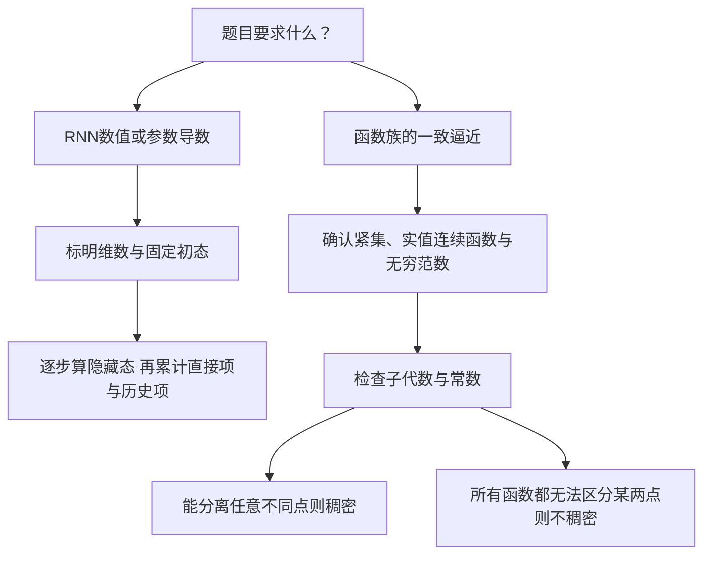

# 2026-11-02 第18节 深度学习：RNN求导、门控与函数逼近

> [!info] 来源与范围
> 本节录制10:23:52–11:57:08，依据完整逐字稿、纪要及本地讲义 §2.1.1 整理。录音开头已进入RNN展开的讨论，因此不能假装本节完整讲授了此前全部RNN导入内容。下列为理解与验算补全的数学表达式统一注明；录音夹杂的闲谈、无法确认的评分比例不当作课程规则。
> 本地 Chapter7 是CNN，演示脚本目前止于 Chapter6 分类；未找到本次RNN及门控专章课件或对应代码，不能把旧分类脚本写成本课RNN演示。教材/课件原有图片相对目录保持原位。

## 一、阅读路线与必要先修

本节回答两个问题：同一组参数反复使用时怎样求导？神经网络“能够逼近”究竟是哪一种数学承诺？

先修提醒：链式法则必须累计所有依赖路径；Softmax把实向量变为概率向量；一致收敛要求误差对整个定义域同时变小。可回看 [[03_Sources/Courses/深度学习/课堂笔记/2026-09-14-第5节-神经网络反向传播算法推导与复杂度分析讲座|反向传播先修]] 和 [[03_Sources/Courses/深度学习/课堂笔记/2026-10-12-第11节-深度学习编程与分类模型宣讲|分类损失先修]]。

## 二、RNN：计算深度增长，参数组数保持不变（02:18–12:58）

为消除转写中大小写混淆，统一写成

$$
q_t=Wh_{t-1}+Ux_t+b,\qquad h_t=\sigma(q_t),\qquad y_t=Vh_t+c.
$$

这是依据录音口述整理的记号：$x_t\in\mathbb R^d$、$h_t,q_t,b\in\mathbb R^m$、$y_t,c\in\mathbb R^p$，

$$
W\in\mathbb R^{m\times m},\quad U\in\mathbb R^{m\times d},\quad V\in\mathbb R^{p\times m}.
$$

$h_0$给定，$\sigma$逐分量作用；输出矩阵记为$V$，避免与隐藏态偏置$b$混淆。待训练的是$W,U,b,V,c$五组数组，不是只有五个标量。总参数个数为$m^2+md+m+pm+p$，不随展开步数$T$增长；本式把$h_0$视为固定值。

将$h_2=\sigma(W\sigma(Wh_0+Ux_1+b)+Ux_2+b)$展开，可见$W,U,b$出现多次。$T$步计算约有$T$次隐藏态非线性复合，但每次使用同一份参数。它是时间展开后的深计算图，不能直接等同于每层参数独立的普通深层网络。

> 一句话来说：步数越长，需要经过的计算越多，但共享参数不会因此自动变成多套。

**补充解释**：自然语言输入可以先用整数编号表示，但送入模型通常还需合适的向量表示。不能将口述“一个字”机械理解成所有自然语言模型的输入维数都等于1。

## 三、多步求导：不能漏掉共享参数的历史路径（12:58–28:43）

下面按录音的逐步链式法则补全。假定激活在所算点可微；若使用ReLU等分段函数，折点须另按约定处理。

### 1. 第一步的分量公式

因为$h_0$与训练参数无关，$h_{1,k}=\sigma(q_{1,k})$给出

$$
\frac{\partial h_{1,k}}{\partial W_{ij}}
=\sigma'(q_{1,k})\delta_{ki}h_{0,j},\qquad
\frac{\partial h_{1,k}}{\partial U_{ij}}
=\sigma'(q_{1,k})\delta_{ki}x_{1,j},\qquad
\frac{\partial h_{1,k}}{\partial b_i}
=\sigma'(q_{1,k})\delta_{ki}.
$$

$\delta_{ki}$是Kronecker符号，同下标时为1，否则为0。$h_1$不依赖输出参数$V,c$。这是第一步某个分量对某一行参数的局部依赖，**不表示RNN隐藏态整体是稀疏连接**；稠密$W$会在后续步传播其他行参数的影响，纪要的“稀疏连接”不能不加限制地照搬。

### 2. 后续步的递推公式

对$t\ge2$，$h_{t-1}$本身已经依赖参数。于是

$$
\frac{\partial h_{t,k}}{\partial W_{ij}}
=\sigma'(q_{t,k})\left(\delta_{ki}h_{t-1,j}
+\sum_{\ell=1}^m W_{k\ell}\frac{\partial h_{t-1,\ell}}{\partial W_{ij}}\right),
$$

$$
\frac{\partial h_{t,k}}{\partial U_{ij}}
=\sigma'(q_{t,k})\left(\delta_{ki}x_{t,j}
+\sum_{\ell=1}^m W_{k\ell}\frac{\partial h_{t-1,\ell}}{\partial U_{ij}}\right),
$$

$$
\frac{\partial h_{t,k}}{\partial b_i}
=\sigma'(q_{t,k})\left(\delta_{ki}
+\sum_{\ell=1}^m W_{k\ell}\frac{\partial h_{t-1,\ell}}{\partial b_i}\right).
$$

括号内第一项是本次直接使用参数产生的导数，第二项是经历史隐藏态传来的导数。每步先算$q_t,h_t$，再利用前一步已有的导数，最后得到输出导数。对$\theta\in\{W_{ij},U_{ij},b_i\}$，

$$
\frac{\partial y_{t,k}}{\partial\theta}
=\sum_{\ell=1}^m V_{k\ell}\frac{\partial h_{t,\ell}}{\partial\theta},\quad
\frac{\partial y_{t,k}}{\partial V_{ij}}=\delta_{ki}h_{t,j},\quad
\frac{\partial y_{t,k}}{\partial c_i}=\delta_{ki}.
$$

> 一句话来说：共享参数每次出现都可能贡献导数，不能把前一步隐藏态一律当常数。

**补充解释**：以上是按时间递推参数敏感度，便于手算；实现训练时也可对展开图做反向模式的BPTT，累计同一参数的各次贡献。两者不应混称为同一种计算顺序。老师提示考试可能只展开两三步，重点理解链式法则，并非仅背符号。

## 四、序列样本、移位标签与损失（28:43–50:06）

第$n$个样本是一整段序列，写成$(x^{(n)}_1,\ldots,x^{(n)}_{S_n})$及标签$(z^{(n)}_1,\ldots,z^{(n)}_{S_n})$。不同样本的长度$S_n$可以不同。本节讨论每步输出、输入输出等长的模型，并非所有序列任务都必须等长。

课堂用长文本说明：不必把十万字一本书作为单条训练序列，可切成10字或20字等短片段。输入为$(x_1,\ldots,x_{10})$时，下一字预测标签为$(x_2,\ldots,x_{11})$。训练时输入真实前文，生成时需把当前结果继续反馈；二者的数据使用方式有区别（补充解释）。

本节的基本经验损失是

$$
L_n(\theta)=\sum_{t=1}^{S_n}\ell(y_t^{(n)}(\theta),z_t^{(n)}),\qquad
L(\theta)=\frac1N\sum_{n=1}^N L_n(\theta).
$$

可按时间步或样本加权，但权重的含义和归一化必须说明。**补充解释**：上述“样本平均、样本内求和”会使长序列拥有更多项；按总有效token数平均是另一个目标，不能默默互换。

分类时$y_t=Vh_t+c$是logits，令

$$
p_{t,j}=\frac{e^{y_{t,j}}}{\sum_k e^{y_{t,k}}},\qquad
\ell_t=-\sum_j z_{t,j}\log p_{t,j}.
$$

one-hot标签对应真实类别$r$时即$-\log p_{t,r}$。本节采用交叉熵；“概率向量绝不能用平方误差”不是一般数学禁令。代码若使用接收logits的交叉熵接口，不应先重复Softmax；本节未找到相应RNN代码，未执行或验证教师训练实验。

## 五、长依赖困难与门控（52:48–01:06:41）

隐藏态递推的局部Jacobian为$J_t=\operatorname{diag}(\sigma'(q_t))W$。**补充解释**：跨许多步的导数含矩阵乘积$J_t\cdots J_{s+1}$，可能衰减或放大。参数共享本身不保证没有梯度消失/爆炸，序列切短也不等于必然解决长期依赖。

### 1. GRU：复位门与更新门

依据录音补全的一种约定为

$$
r_t=\operatorname{sigmoid}(W_rh_{t-1}+U_rx_t+b_r),\qquad
z_t=\operatorname{sigmoid}(W_zh_{t-1}+U_zx_t+b_z),
$$

$$
\widetilde h_t=\sigma\bigl(W(r_t\odot h_{t-1})+Ux_t+b\bigr),\qquad
h_t=z_t\odot h_{t-1}+(1-z_t)\odot\widetilde h_t.
$$

$\odot$表示同形向量逐元素乘法；此小节$z_t$是门，与上节样本标签的$z_t^{(n)}$不同。$r_t$控制候选态读取多少旧信息；按此约定，$z_t$靠近1保留旧态，靠近0采用候选态。各门有自己的训练参数，时间上仍共享。Sigmoid把门的各分量限制在$(0,1)$。

> 一句话来说：门是由数据和旧隐藏态计算出的可训练开关，不是人工固定的单个常数。

不同教材或实现可能交换$z_t$与$1-z_t$的命名，复位门与矩阵乘法的先后也有不同变体，比较公式时须按定义核对；上式不宣称与未定位的教师代码逐行一致。

### 2. LSTM：额外维护记忆状态

录音介绍遗忘门、输入门、输出门及额外状态。统一用$s_t$表示记忆、$h_t$表示隐藏输出，按口述补全为

$$
f_t=\operatorname{sigmoid}(W_fh_{t-1}+U_fx_t+b_f),\quad
i_t=\operatorname{sigmoid}(W_ih_{t-1}+U_ix_t+b_i),\quad
o_t=\operatorname{sigmoid}(W_oh_{t-1}+U_ox_t+b_o),
$$

$$
g_t=\tanh(W_gh_{t-1}+U_gx_t+b_g),\quad
s_t=f_t\odot s_{t-1}+i_t\odot g_t,\quad h_t=o_t\odot\tanh(s_t).
$$

遗忘门筛选旧记忆，输入门写入候选，输出门控制对外呈现。LSTM全称是**Long Short-Term Memory（长短期记忆）**。加法状态通路有利于保留信息，但门控并非无条件消除所有训练困难。老师介绍这些结构及经验改造思路，没有给出本节训练效果的定量比较。

## 六、从网络表达式转到逼近问题（01:11:13–01:21:39）

标量值浅层网络可写成

$$
\phi(x)=a_0+\sum_{j=1}^M a_j\sigma(w_j^\top x+b_j).
$$

$x\in\mathbb R^d$，$w_j\in\mathbb R^d$，$a_j,b_j$为实数；一维输入时$w_j^\top x$成为普通乘法。讨论网络类时$M$允许随所需精度改变，不是固定宽度$M$就自动满足所有逼近要求。

设$K\subset\mathbb R^d$为非空紧集，$C(K)$为实值连续函数空间，

$$
\|f\|_\infty=\max_{x\in K}|f(x)|.
$$

连续性及紧性保证最大值存在。$\mathcal A\subset C(K)$稠密的意思是

$$
\forall f\in C(K),\ \forall\varepsilon>0,\ \exists\phi\in\mathcal A:
\|f-\phi\|_\infty<\varepsilon,
$$

等价于$\inf_{\phi\in\mathcal A}\|f-\phi\|_\infty=0$，也可取$\varepsilon_n\to0$构造一致收敛逼近序列。$\inf=0$不代表某个有限网络必须精确达到零误差。

> 一句话来说：逼近能力说明模型类中存在足够好的函数，不保证训练算法一定找得到，也不保证有限训练集上的低误差带来泛化。

## 七、Stone–Weierstrass：三件事都要检查（01:17:56–01:30:56）

### 子代数与分离点

非空$\mathcal A\subset C(K)$若对加法、实数数乘和逐点乘法封闭，就是这里的实子代数。前两条使它成为线性子空间，第三条是额外要求。

$\mathcal A$能**分离点**，指对任意$x\ne y$（都在$K$），存在某个$f\in\mathcal A$使$f(x)\ne f(y)$。这个$f$可依赖所选的两个点，不要求一开始指定一个函数同时分开所有点。

### 定理的准确前提

对非空紧集$K\subset\mathbb R^d$，设$\mathcal A$是实值$C(K)$的子代数，且包含非零常数函数，则

$$
\boxed{\mathcal A\text{在}C(K)\text{中稠密}
\quad\Longleftrightarrow\quad\mathcal A\text{能分离}K\text{中的点}.}
$$

含某个非零常数$\alpha$，经数乘$1/\alpha$即可得到常数1，继而得到所有常数。前提中的“实值”不能省略后随意套入复函数版本。老师说明本节列结论及应用，不要求证明定理本身；本地讲义§2.1.1可核对完整陈述。

### 课堂例1：所有有限次数多项式

$\mathcal P([a,b])$允许次数任意大但每个元素次数有限。相加、数乘、相乘仍是多项式，含常数1；$p(x)=x$分离任意不同点。因此在$C([a,b])$中稠密，得到Weierstrass多项式逼近结论。

**转写校正**：不能把“所有有限次数”读成“统一固定最高次数”。固定次数上界$M>0$的多项式一般不对乘法封闭，例如$x^M\cdot x^M=x^{2M}$。

### 课堂例2：有限三角和为什么在闭区间上不稠密

令$\mathcal F$为所有有限和$a_0+\sum_{k=1}^M(a_k\cos kx+b_k\sin kx)$构成的集合，$M$可变。积化和差公式保证乘法封闭，且含常数；但所有$g\in\mathcal F$都有$g(0)=g(2\pi)$，不能分开闭区间的两个端点，所以不稠密于$C([0,2\pi])$。

**补充验证**：对目标$f(x)=x$，若$g(0)=g(2\pi)=c$，则$2\pi\le |c|+|2\pi-c|\le2\|f-g\|_\infty$，故一致误差至少为$\pi$。不能据此否定傅里叶逼近在周期连续函数空间或其他范数中的成立。

### 浅层网络如何应用：必须检查激活函数

录音末尾提到正弦、指数激活，本地讲义给出一维紧区间上的说明。对任意有限宽度之并所成的网络类，常数项与有限求和保证线性组合封闭；还要证明乘法封闭及分离点。

- 指数激活：$e^{wx+b}e^{vx+c}=e^{(w+v)x+b+c}$，乘积仍在同类有限和内；$e^x$严格单调，能分离点。
- 正弦激活：积化和差后可将余弦写成平移后的正弦；对$x_1\ne x_2$，$\sin(\pi(x-x_1)/(2(x_2-x_1)))$在两点取0和1，因此分离点。

这些是依据讲义补全的验证，不是任意激活都能直接套子代数定理。比如ReLU网络有限和通常是分段线性函数，其乘积未必仍属同一浅层网络类；不能把上述证明原样搬过去。

## 八、方法选择与速查

| 核心对象 | 公式或条件 | 最容易遗漏 |
|---|---|---|
| RNN前向 | $h_t=\sigma(Wh_{t-1}+Ux_t+b)$ | 跨步共享参数 |
| 共享参数导数 | 当前直接项＋历史导数链 | $h_0$固定，但$h_{t-1}$通常不固定 |
| 序列目标 | $N^{-1}\sum_n\sum_t\ell_t^{(n)}$ | 长度及归一化约定 |
| 门控 | 同形逐元素权重，门值在$(0,1)$ | 更新门命名约定 |
| 一致逼近 | $\inf_\phi\|f-\phi\|_\infty=0$ | 存在性不等于可训练性 |
| 实Stone–Weierstrass | 子代数、含常数、分离点 | 少任一前提不能直接套用 |

## 九、自测与课堂提示

### 自测（新编）1

标量RNN取恒等激活，$h_0=1$，$U=1,b=0,x_1=2,x_2=3,W=2$。求$h_2$以及$\partial h_2/\partial W$。反思只求“本步直接项”会漏多少。

> [!hint]- 提示
> 先把$W$保留成变量，写出$h_1=W+2$、$h_2=W(W+2)+3$。

> [!solution]- 解析
> $h_1=4,h_2=11$；导数为$2W+2=6$。递推写法是$h_1+W\,\partial h_1/\partial W=4+2=6$；若误把$h_1$当常数，只得到4。

### 自测（新编）2

在$K=[-1,1]$上，全体偶多项式能否一致逼近每个连续函数？写出不能逼近$f(x)=x$的误差下界。

> [!hint]- 提示
> 检查$-1$与1是否可分离；再用端点误差的三角不等式。

> [!solution]- 解析
> 它是含常数的子代数，但不能分离$-1$和1。若两端值都为$c$，则$2\le|-1-c|+|1-c|\le2\|f-g\|_\infty$，误差至少1，故不稠密于整个$C([-1,1])$。

> [!warning] 考试及学习边界
> 老师提示关注两三步RNN手算、LSTM全称及用定理检查函数族；没有清晰可确认的新作业题号。录音提及机考文字题及第9、10章理论部分，但具体分值、安排转写不完整，不能用同学聊天替代正式考试通知。未经实际作答，不标记“已掌握”。

## 十、课堂疑惑与解答、缺失课次回查

今日每日疑惑文件不存在，未新增虚构个人问题。回查了9月9日、9月28/30日、10月21/26/28日缺失记录：当前录音证明此前已进入RNN，但不能确定CNN收尾、RNN导入分别落在哪次课，因此不把通用知识重复追加为各缺失课的已还原内容，原待补范围继续保留。

课次核对：按当前课表，10月10日调休按周三计入，10月1—7日停课不计，11月2日累计排课为第18次；保留本文件第18节。旧索引在10月12日后采用了未计入该次补课的编号，造成与10月28日“第16节”不连续。此处明确口径差异，未批量重编号或推定10月10日已实际授课。

## 十一、来源与衔接

- [[03_Sources/Courses/深度学习/课堂笔记/raw/2026-11-02-深度学习理论与RNN原理授课-122112-逐字稿|逐字稿]]：RNN、门控及理论讲授的主要依据；保留原文不修改。
- [[03_Sources/Courses/深度学习/课堂笔记/raw/2026-11-02-深度学习理论与RNN原理授课-122112-纪要|纪要]]：辅助定位，参数组数、局部连接及逼近范围均按数学定义校正。
- [[03_Sources/Courses/深度学习/PPT/deep_learning_handout (1)/deep_learning_handout (1)#2.1.1 Stone-Weierstrass’ theorem|本地讲义§2.1.1]]：定理、有限三角和/多项式及正弦、指数网络的验证。其后更一般激活函数逼近证明不在本节确认范围。
- [[03_Sources/Courses/深度学习/课堂笔记/README|课程索引]]：记录后续RNN课件、演示代码及缺失课补传入口。
