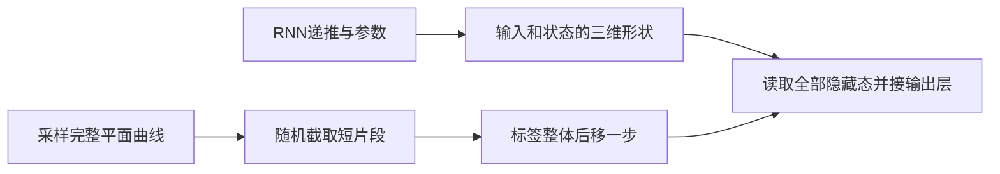

# 2026-11-09 第20节 深度学习：RNN接口、曲线采样与序列数据构造

> [!info] 来源与确认范围
> 录制时间为10:22:11–12:09:44，共1小时47分33秒，录制文件ID为2119616512150728704。按完整逐字稿整理：00:00–05:31为考试说明；06:02–29:17讲RNN接口；30:16–01:32:31讲平面曲线数据与片段构造，其间夹有闲谈；01:34:49以后主要是同学聊天。自动转写把不同声音统一标成录制账号，不能据此认定每句话都是教师发言。
> 本次录音确认到训练数据的构建与画图检查，没有记录完整的模型训练、参数保存加载实现或生成动画结果。补充解释、语法校正与新编自测在下文分别标明，不能当作教师原话或已完成实验。

## 一、先抓住本课的两个问题

1. 数学上一步一步计算的隐藏态，怎样装进PyTorch要求的三维张量？
2. 一条平面曲线怎样变成“当前片段预测后移一位片段”的训练样本？

必要先修是递推式、行列向量、数组切片和链式法则。最小提醒：$h_t$同时依赖当前输入$x_t$与前一步状态$h_{t-1}$；训练标签是希望模型输出的目标，与输入可以有相同形状而表示不同时间。可回看[[03_Sources/Courses/深度学习/课堂笔记/2026-11-02-第18节-深度学习理论与RNN原理授课|11月2日的RNN递推、求导与序列标签]]。



阅读时先核对形状表，再理解广播，最后独立检查切片边界。课堂演示里“一个数据点”往往指一整条序列；它与平面上的一个二维点不是同一个层次。

## 二、`nn.RNN`定义了什么（06:02–14:21）

> 一句话来说：`nn.RNN`负责递推隐藏态，任务所需的输出映射还要另接。

### 1. 数学递推与程序接口

沿用课堂记号，单层RNN的基本形式是

$$
h_t=\sigma(Wh_{t-1}+Ux_t+b),\qquad y_t=Vh_t+c.
$$

其中$x_t\in\mathbb R^d$是当前输入，$h_t\in\mathbb R^M$是隐藏态，$W\in\mathbb R^{M\times M}$、$U\in\mathbb R^{M\times d}$为状态与输入的权重；$V,c$把隐藏态转为任务输出。时间推进时反复使用同一组参数。

课堂以`torch.nn.RNN(10, 20)`为例：第一个参数是输入维数$d=10$，第二个是隐藏维数$M=20$，顺序不能反。课程只讨论单层、单向情形；`num_layers=1`，默认非线性为`tanh`，也可指定`nonlinearity="relu"`；`bias`控制是否使用偏置。

**补充解释（术语校正）**：`num_layers`指堆叠的循环层数。它与序列时间步数不同；“每个时间步出现几次非线性”只是课堂直观说明，不能作为任意模型层数的通用定义。转写中“layer等于零”的语句与上下文明显不符，单层应为1。隐藏维数20大于输入维数10是本例选择，并非RNN必须满足$M>d$。

### 2. 为什么出现转置和两个偏置

课堂强调，代码文档按行向量批处理书写，而板书采用列向量。把一批输入按行存放时，可写为

$$
H_t=\sigma\left(X_tW_{ih}^{\mathsf T}+b_{ih}
                  +H_{t-1}W_{hh}^{\mathsf T}+b_{hh}\right).
$$

$X_t$的每行是一个样本的输入，$H_t$每行是相应隐藏态。其转置形式与板书递推等价；单层RNN的两个偏置在函数表达上可合并成一个$b$，但程序将它们保存成两个独立参数。这里的左右乘约定针对该接口的表达，不意味着PyTorch禁止矩阵乘列向量。[接口公式与参数定义](https://docs.pytorch.org/docs/stable/generated/torch.nn.RNN.html)

### 3. 隐藏态不等于最终任务输出

`rnn`本身没有定义$y_t=Vh_t+c$。例如需要每步输出二维坐标时，应在隐藏态后接`nn.Linear(M, 2)`。这是对课堂13:20处说明的规范写法；不把RNN返回变量名`output`误解为任务标签的预测值。

## 三、三维张量：每一维到底是什么（14:21–27:18）

课堂示例取序列长度$T=5$、样本数$N=3$、输入维数$d=10$、隐藏维数$M=20$。默认`batch_first=False`。

| 对象 | 默认形状 | 逐维含义 | 课堂示例 |
|---|---|---|---|
| `x_batch` | `(T, N, d)` | 时间、样本、输入分量 | `(5, 3, 10)` |
| `h0` | `(1, N, M)` | 循环层、样本、隐藏分量 | `(1, 3, 20)` |
| `output` | `(T, N, M)` | 时间、样本、隐藏分量 | `(5, 3, 20)` |
| `h_n` | `(1, N, M)` | 循环层、样本、末步隐藏分量 | `(1, 3, 20)` |

**按课堂数值整理的最小代码**（变量名规范化，不是已获取的原始演示脚本）：

```python
import torch
from torch import nn

rnn = nn.RNN(input_size=10, hidden_size=20, num_layers=1)
x_batch = torch.randn(5, 3, 10)
h0 = torch.randn(1, 3, 20)
output, h_n = rnn(x_batch, h0)
```

逐步理解：先指定每步输入与隐藏态的长度；再生成3条各含5步的输入序列；每条序列配一个长度20的初始状态；最后一次调用沿时间完成5次递推。

### 1. 为什么`h0`开头的1不能省

初始状态没有时间轴，但有循环层轴。对本课的单层、单向、有批次输入，`h0`应为`(1, N, M)`，不能用`(N, M)`代替。`x_batch`与`h0`的样本数必须相等，且相同样本索引表示同一条序列与其初态。

**补充解释**：全零初态也可以；随机初态不是唯一方案。多层时第一维会改变，多向时还包含方向数，均超出本课单层演示。

### 2. 怎样取出某一步某个样本的状态

若数学时间$t=1,\ldots,5$，Python样本索引`n=0,1,2`，则

```python
h_t_of_sample_n = output[t - 1, n, :]
last_states = output[-1, :, :]
last_states_again = h_n[0, :, :]
```

后两者在本课单层单向设置中对应同一批末步状态，形状均为`(3, 20)`。但整个`h_n`形状为`(1, 3, 20)`，不应直接声称它与`output[-1]`形状相同。若数学上把样本也从1编号，则第$n$个样本的Python索引应为`n-1`。

### 3. `batch_first=True`能改什么

课堂提到可将样本轴放前面，此时输入和全部输出状态的形状改为`(N, T, d)`、`(N, T, M)`。**补充校正**：`h0`和`h_n`仍保留`(1, N, M)`，不能跟着交换。刚入门时可先固定使用默认布局，减少混淆。[形状与`batch_first`说明](https://docs.pytorch.org/docs/stable/generated/torch.nn.RNN.html)

## 四、读取参数以及GRU、LSTM的接口边界（27:42–29:17）

单层RNN可读取四组参数，其属性名需准确拼写：

| 属性 | 形状 | 对应含义 |
|---|---|---|
| `rnn.weight_ih_l0` | `(M, d)` | 输入到隐藏态的权重 |
| `rnn.weight_hh_l0` | `(M, M)` | 前一隐藏态到当前隐藏态的权重 |
| `rnn.bias_ih_l0` | `(M,)` | 输入侧偏置 |
| `rnn.bias_hh_l0` | `(M,)` | 状态侧偏置 |

课堂指出GRU和LSTM属于同类序列模型，可沿用输入序列与隐藏维数的组织思路。**补充校正**：不能把“换类名就完全一样”当作严格规则，尤其LSTM还有细胞状态$c_t$，初态和返回状态成对组织为`(h0, c0)`、`(h_n, c_n)`。本节没有重新推导门控公式。[LSTM官方接口](https://docs.pytorch.org/docs/stable/generated/torch.nn.LSTM.html)

## 五、任务设定：让模型生成平面上的曲线（30:16–42:21）

> 一句话来说：先用有公式的曲线制造训练数据，再让模型学习点与下一点的关系；训练后的生成阶段不直接调用原曲线公式。

课堂选择平面曲线而不直接做自然语言生成，是为了减少数据获取与训练负担。这里的“光滑曲线”在显示结果上是密集离散点列形成的视觉效果，有限个输出点本身不构成对连续曲线光滑性的数学证明。

完整资料集包含$N$条点列，每条有$n_t=120$个二维点，故输入分量$d=2$；课堂以$N=10000$条为例。写成

$$
P^{(n)}=(p_0^{(n)},p_1^{(n)},\ldots,p_{n_t-1}^{(n)}),
\qquad p_i^{(n)}\in\mathbb R^2.
$$

将整条120步序列直接展开，会增加训练链条的长度与开销，所以先截取长度$S$的短片段，例如$S=10$。120个时间步不等于`num_layers=120`；本节RNN仍可只有一个循环层。

课堂没有采用过于简单、只向一个方向弯曲的抛物线示例，而选三角函数产生形态更多的封闭曲线。每条曲线随机设置尺度、频率和角度或相位等参数，得到多样的点列。

> [!warning] 曲线原式没有完整转写
> 45:26–54:25涉及极坐标函数、四组参数及取值范围，但精确径向函数没有进入可核实文本，参数符号也有混淆。可确认的是采用极坐标、三角函数、随机整数频率与连续参数；转写提到0.1到0.9、角度平移和2至6附近的整数取样，但不能把这些片段拼成唯一原公式。未找到对应RNN课件或原始演示脚本，因此下文保留一般径向函数，不伪造教师代码。

准备工作（34:40–37:06）包括数值计算、PyTorch与绘图；`time`用于动画帧之间暂停，`os`用于检查参数文件等。教师提出首次训练后保存参数、以后读取以免反复训练的目标，并提及CPU/GPU设备选择和运算时间差异。录音未覆盖相应保存加载代码；动画实现明确不作本段考试要求，不把这些准备说明写成实验已跑通。

## 六、极坐标采样与广播：最容易写错的部分（45:26–01:21:06）

### 1. 等角度采样与去重端点

对一条曲线的径向函数$\rho_n(\theta)$，直角坐标为

$$
p^{(n)}(\theta)=\bigl(\rho_n(\theta)\cos\theta,
                          \rho_n(\theta)\sin\theta\bigr).
$$

课堂先均分$[0,2\pi]$，再丢掉与起点重合的最后一个角度：

```python
theta = np.linspace(0, 2 * np.pi, nt + 1)
theta = theta[:nt]
```

这里`np`代表NumPy，`nt=120`。**补充解释**：这等价于`np.linspace(0, 2*np.pi, nt, endpoint=False)`。等角度间隔一般不等于等弧长；本课采用的是便于实现的等角度取样。画图时首末采样点不重复，曲线的封闭性来自周期函数，不是数组里多放一个相同点。

### 2. 让每个角度与每条曲线的参数组合

目标数组`points`形状为`(nt, N, 2)`：时间在前，曲线样本在中，最后一维放横纵坐标。设`k`、`phase`各为长度$N$的一维数组；需要组合为$nt\times N$，每列对应一条曲线，每行对应一个角度。

**补充解释（将课堂外积与广播讨论写准确）**：

```python
angles = theta[:, None] * k[None, :] + phase[None, :]
```

`theta[:, None]`是`(nt, 1)`，`k[None, :]`是`(1, N)`，逐元素乘法经过广播产生`(nt, N)`；`np.outer(theta, k)`也能得到所需外积。长度`nt`与长度`N`的两个一维数组直接相乘，不能表达全部两两组合，即使碰巧长度相等也只会逐元素配对。

课堂01:07:57–01:13:07反复检查广播方向并修正口头表述。准确规则是：`(nt, N)`矩阵加长度`N`的参数数组，相当于给每一行加同一条参数向量；从曲线角度看，第$n$列所有时间点都加该曲线的`phase[n]`。因此“同一个数组加到每行”与“每列加自己的常数”是同一件事。[NumPy广播规则](https://numpy.org/doc/stable/user/basics.broadcasting.html)

### 3. 转成直角坐标时还要补一个轴

假定已按真实径向公式得到`rho.shape == (nt, N)`，则按课堂逻辑整理的坐标填充方式是：

```python
points = np.zeros((nt, N, 2))
points[:, :, 0] = rho * np.cos(theta)[:, None]
points[:, :, 1] = rho * np.sin(theta)[:, None]
```

这段表达的是**通用坐标转换**，`rho`需由原曲线公式给出，不能当成完整的数据生成脚本。01:14:52–01:17:26的课堂修正对应把长度`nt`的三角函数值变为`(nt, 1)`，使它沿曲线轴广播。单纯对一维数组写`.T`不会产生这个新轴；可用`reshape(-1, 1)`。

画图检查时，第`n`条完整曲线应取`points[:, n, 0]`、`points[:, n, 1]`。课堂展示若干条、约前10条曲线，不要求把10000条全部叠画。检查重点是频率和形状确有变化、横纵坐标对应正确、时间次序没有被交换。

## 七、从完整点列构造训练样本（01:23:08–01:32:31）

> 一句话来说：输入给当前位置，标签给下一位置，长度相同但整体错开一步。

对第$n$条曲线选起点$j$，输入和标签分别为

$$
X^{(n)}=(p_j^{(n)},\ldots,p_{j+S-1}^{(n)}),\qquad
Y^{(n)}=(p_{j+1}^{(n)},\ldots,p_{j+S}^{(n)}).
$$

所以`x_train`与`y_train`形状均为`(S, N, 2)`。一条完整曲线本例抽一个片段；也可以抽更多片段，但那会改变样本数量，不能仍机械沿用原来的$N$。

**按课堂逻辑整理、含边界校正的代码**：

```python
x_train = torch.zeros((S, N, 2), dtype=torch.float32)
y_train = torch.zeros((S, N, 2), dtype=torch.float32)
for n in range(N):
    j = np.random.randint(0, nt - S)
    x_train[:, n, :] = torch.tensor(
        points[j:j + S, n, :], dtype=torch.float32)
    y_train[:, n, :] = torch.tensor(
        points[j + 1:j + S + 1, n, :], dtype=torch.float32)
```

该段以已获得`points`、`S<nt`以及NumPy/PyTorch已导入为前提；它展示构造逻辑，不代表取到了原始源码。课堂使用NumPy生成点列、PyTorch存训练张量，因此赋值时需要相应转换。**补充解释**：显式给出浮点类型可避免输入与网络参数类型不一致；若使用其他设备，也需保证输入与模型设备相同。

### 起点的最大值为什么还要少1

标签最后访问$p_{j+S}^{(n)}$，合法最大索引为$nt-1$，所以

$$
0\le j\le nt-S-1.
$$

Python随机整数接口的上界不取到，因此用`np.random.randint(0, nt-S)`。课堂“零到nt减S”的口语要按这一半开区间理解，不能把`nt-S`也当作可取起点。否则标签会少一个点。

### 用图检查切片

课堂画前10个输入片段，每种颜色表示一个序列样本；它们是从完整封闭曲线截下的小段，不应要求每段都封闭。Tensor用于绘图时，如有设备或梯度记录，可先转为`x_train.detach().cpu().numpy()`，再按`[:, n, 0]`与`[:, n, 1]`取横纵坐标（此转换写法为补充解释）。

本次录音在此结束正式教学。下一步才是建立带二维输出层的模型、选择损失并训练，以及用输出反馈进行生成；不能用这些合理后续步骤倒填成本课已演示内容。

## 八、自测（新编）

### 1. 形状诊断

默认布局下，`rnn=nn.RNN(2, 8)`，输入是4条各10步的曲线片段。写出输入、初态、`output`、`h_n`的形状。若要预测每步二维位置，应怎样处理`output`？

> [!hint]- 提示
> 分开标出时间、样本、特征；输出层应作用于最后一维。

> [!solution]- 解析
> 依次为`(10,4,2)`、`(1,4,8)`、`(10,4,8)`、`(1,4,8)`。接`nn.Linear(8,2)`后预测形状为`(10,4,2)`，才能与后移一步的二维标签比较。不能直接把8维隐藏态与2维坐标逐项计算误差。

### 2. 广播与索引边界

取`nt=120`、`N=3`、`S=10`。`rho`为`(120,3)`，`theta`为`(120,)`，为何不能直接写`rho*np.cos(theta)`？随机起点最大可取多少？

> [!hint]- 提示
> 广播从末尾轴对齐；再检查标签最后一个下标。

> [!solution]- 解析
> 尾轴3与120不相容，需把三角函数值改成`(120,1)`。起点最大为109，此时输入访问109至118，标签访问110至119。若取110，标签需要访问120而越界；切片通常不会报越界错误，而会返回过短数组，在赋值时暴露形状不匹配。

## 九、考试说明、来源冲突与待查

### 录音中能确认的考试说明

开头00:00–05:31说明：本次考试时长60分钟，每人从题库随机抽一道题；可能要求自行生成数据集，应复习课堂讲过的数据构造与网络编程。转写还出现下午2点、3点等时间片段，并说后续会放到网站上，具体到场安排不能据此定稿。

课堂中途46:01有“21号”“四道题选一”的交流，尾部还有结课、笔试、小作文、AI评分等同学讨论；这些保留为录音线索，不能当作已经发布的日期、抽题机制、分值或允许使用AI的规则。纪要将其概括为“允许AI辅助、沾边即可得分”，缺乏教师正式说明的证据，故不采纳为考试要求。

本地[[03_Sources/Courses/深度学习/PPT/2026深度学习第一次上机考试规则与命令表v1.1 (1)/2026深度学习第一次上机考试规则与命令表v1.1 (1)|第一次上机考试规则与命令表]]写的是30分钟、闭卷、一道编程题等。它标题限定为“第一次上机”，不能覆盖成本次60分钟考试，也不能由聊天反推它已取消。当前按本次课堂原记录保留60分钟，具体日期、场地、可携带资料和考试工具权限仍以对应正式通知为准。

### 材料缺口与前后课衔接

- 本地[[03_Sources/Courses/深度学习/PPT/Chapter7/Chapter7|Chapter7]]是卷积神经网络，[[03_Sources/Courses/深度学习/演示代码/Chapter6.py|Chapter6.py]]是分类演示。它们不能作为本节RNN曲线代码的直接证据；本次仅用于辨别文件内容，没有执行原脚本。
- 尚缺RNN专章课件与本次曲线生成演示代码，故径向函数原式、各随机参数的精确范围、模型隐藏维数与训练设置无法恢复。没有伪造源代码、训练损失或生成效果。
- 11月2日已讨论RNN求导、序列标签及门控；11月9日讲接口与曲线数据，但没有可靠指明11月4日整课内容。不能将本节概念追溯为11月4日已讲内容，也不能据章节顺序重建第19节。
- 本节未确认新的作业题号；上面的两题均为新编自测，不是教师布置作业。

### 原始材料回链

- [[03_Sources/Courses/深度学习/课堂笔记/raw/2026-11-09-循环神经网络编程与考试安排宣讲-728704-逐字稿|本节逐字稿]]：核对教学、时间戳、考试说明与非教学谈话的依据。
- [[03_Sources/Courses/深度学习/课堂笔记/raw/2026-11-09-循环神经网络编程与考试安排宣讲-728704-纪要|本节智能纪要]]：仅作辅助定位，关于AI与评分的总结已按逐字稿重新辨别。
- [[03_Sources/Courses/深度学习/课堂笔记/README|课堂笔记索引]]：查看已归档课次与前后衔接。

## 课堂疑惑与解答

本日对应日计划不存在，未补造个人问题或回答记录。
