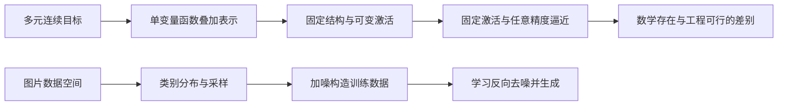
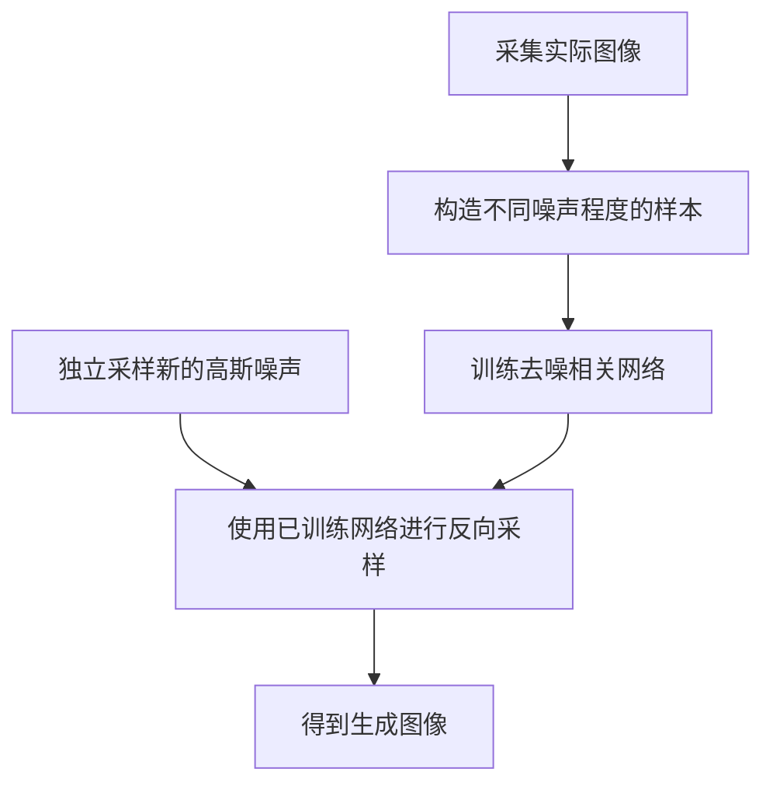
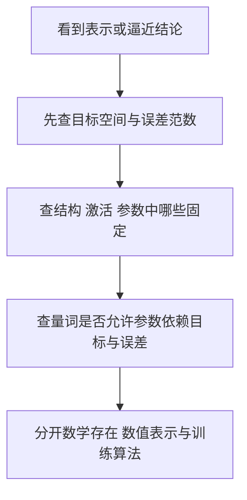

# 2026-11-16 第22节 深度学习：函数表示、固定架构逼近与扩散模型入门

> [!info] 本节范围与来源边界
> 本节以今日逐字稿中可辨认的教师讲解为主：00:00–36:00为神经网络表示与逼近，37:17起转入第十一章扩散模型，最后可确认的教学在01:33:13。录制实际延续至12:40，后半段主要为学生交谈，不能把整段录制时长视为授课时长。全稿都被转写工具标成同一发言人，这个账号标签不能用于判定谁在说话；中间也有学生闲聊覆盖教师声音。
> 公式依据本地讲义对应内容复核，必要勘误与新增说明明确标出。今日原始纪要中的“明天／周四汇报”“两次小作业、一个大作业和期末考试”“经济学项目答辩”不能确认属于本课教师通知，不据此建立待办。

## 一、本次课要解决什么问题

前半节的问题是：一个复杂的多元连续函数，能否由少量单变量函数拼起来？如果能，究竟固定的是网络结构、激活函数，还是参数个数？后半节的问题是：生成一张新图片，数学上到底是在做什么？为什么学会去噪能够帮助生成？

必要先修提醒：

- 仿射层为 $z=Wx+b$，再逐坐标施加非线性激活。要区分输入维数、每层神经元数、隐藏层数及输出层。
- $C([0,1]^d)$ 表示单位立方体上的连续实值函数；$\|g\|_\infty=\max_{x\in[0,1]^d}|g(x)|$ 衡量最坏点误差。“任意小正误差”与“某个网络误差恰为零”不同。
- 概率分布给不同结果赋予非负权重，总概率为1；采样是在这个分布下随机取一次结果。后文会重新区分随机变量和样本值，不假定已经熟悉扩散记号。

本地[[03_Sources/Courses/深度学习/PPT/deep_learning_handout (1)/deep_learning_handout (1)#2.4.3 Kolmogorov-Arnold-Sprecher theorem|讲义2.4.3]]、[[03_Sources/Courses/深度学习/PPT/deep_learning_handout (1)/deep_learning_handout (1)#2.4.4 Exact learning with fixed activation and finite parameters|讲义2.4.4]]分别对应前半节的表示定理与有限参数逼近。教师口述采用第十章、定理10.6／10.7等编号；本地英文讲义采用2.22／2.23／2.24，按内容对应，不把编号强行等同。

## 二、Kolmogorov表示：多元函数由单变量函数叠加

来源：逐字稿00:00–06:08；本地讲义定理2.22、式(2.101)–(2.102)。

> 一句话来说：复杂的变量耦合可以被转移到若干单变量函数及其嵌套中，而不必直接写成一个不可拆的多元表达式。

对固定整数 $d\ge2$，存在一组只依赖维数的单调单变量函数 $\psi_{ij}$，使任意 $f\in C([0,1]^d)$ 都可表示为

$$
f(x_1,\ldots,x_d)=\sum_{j=1}^{2d+1}\chi_j\!\left(\sum_{i=1}^{d}\psi_{ij}(x_i)\right).
$$

这里 $i$ 编号输入变量，$j$ 编号外层分支；$\psi_{ij}$ 是内层单变量函数，$\chi_j$ 是外层连续单变量函数。教师反复提醒看量词顺序：先选好 $d$，再存在一组内函数，随后才“对任意 $f$”。因此内函数可以与目标 $f$ 无关，而外函数一般随 $f$ 改变。

课堂以 $f(x)=x_1x_2\cdots x_d$ 说明：即使变量之间以乘法紧密耦合，也不妨碍存在上述表示。这里的“分离变量”是这种叠加表示，不意味着原函数本身一定等于几个一元函数的乘积，也不意味着所有重积分都可直接拆成积分乘积（后两点为补充解释）。

### 二维情形怎样画成网络

取 $d=2$，有5个外分支：

$$
f(x_1,x_2)=\sum_{j=1}^{5}\chi_j\bigl(\psi_{1j}(x_1)+\psi_{2j}(x_2)\bigr).
$$

把计算逐层列出：

1. 输入层是 $x_1,x_2$。
2. 第一隐藏层有 $2\times5=10$ 个单变量输出：每个分支分别计算 $\psi_{1j}(x_1)$ 和 $\psi_{2j}(x_2)$。每个节点只接收一个输入，非全连接。
3. 第二隐藏层有5个节点：第 $j$ 个节点把对应的两个输出相加，再作用 $\chi_j$。
4. 输出层把5个结果相加。

在这个直接表示图中，已有边的权重全部为1，偏置为0；缺失边若用矩阵表示则系数为0。逐字稿05:14中“所有系数都是零”与紧随其后的“一乘……”及讲义图冲突，按上下文校为已有边权重1。不能由“边权重都是1”推断网络只有加法，非线性已经包含在 $\psi_{ij}$、$\chi_j$ 中。

> [!warning] 连续性与本课转写的区别
> 02:25、06:38附近转写对“哪个函数连续”有混淆。本地定理2.22明确写外函数 $\chi_j$ 连续；对内函数该条表述只明确写单调。本笔记沿用可核对的这一版本，不把“外函数不要求连续”作为结论。更强版本与本课口述的关系须看对应原版课件，不能仅由口语错字决定。

## 三、Sprecher改进：各分支共用函数，但平移与系数有结构

来源：06:38–10:24；讲义定理2.23、式(2.103)。

> 一句话来说：可以进一步共用同一个内函数和同一个外函数，代价是把分支差别放到平移、幂次权重与偏置中。

讲义表述为：给定 $d\ge2$，存在仅依赖 $d$ 的单调递增单变量函数 $\psi$，满足 $\psi([0,1])=[0,1]$；对任意 $\delta>0$，存在有理数 $\epsilon\in(0,\delta)$ 和常数 $\rho$，使任意连续目标 $f$ 都能写成

$$
f(x_1,\ldots,x_d)=\sum_{j=1}^{2d+1}
\chi\!\left(\sum_{i=1}^{d}\rho^i\psi(x_i+(j-1)\epsilon)+j-1\right),
$$

其中 $\chi$ 为随 $f$ 选择的连续单变量函数。$\delta$ 控制允许选取的平移量上限，不是最终逼近误差；此处为表示等式。$\rho,\epsilon$ 在“对任意 $f$”之前选择，所以不能从此定理说它们必须随每个目标变化。

注意 $\psi([0,1])=[0,1]$ 是映射性质，不能据此断言其整个定义域只有 $[0,1]$；式中还有平移输入 $x_i+(j-1)\epsilon$。本地摘录未完整展开延拓细节，这里不额外编造一个定义域条件。

二维展开可统一记成

$$
f(x_1,x_2)=\sum_{k=0}^{4}
\chi\bigl(\rho\psi(x_1+k\epsilon)+\rho^2\psi(x_2+k\epsilon)+k\bigr).
$$

第一个分支 $k=0$ 不平移；其余4个分支依次平移 $\epsilon,2\epsilon,3\epsilon,4\epsilon$，第二层相应加 $1,2,3,4$。直接画成网络仍是 $2\to10\to5\to1$：第一层复制输入后平移并作用 $\psi$；第二层分别以 $\rho,\rho^2$ 加权、加分支偏置并作用同一个 $\chi$；输出求和。因此14:05附近“第一隐藏层宽度是 $d$”只能看成对每个分支的局部描述，整层并列展开的节点数是 $d(2d+1)$，不是 $d$。

### “知道结构”不等于“知道能直接运行的函数”

10:47–17:34讨论了实现障碍：定理告诉我们 $\psi,\chi,\rho,\epsilon$ 存在，却没有因此给出可以直接写入程序的全部具体值或函数表达式。尤其 $\chi$ 随目标变化，换一个学习任务，要处理的函数也会变化。

课堂把这一思路联系到Kolmogorov–Arnold网络（KAN）：与事先指定ReLU、主要学习权重偏置的普通网络比较，可以把学习对象转向单变量函数。这里保留的是课堂的动机说明，不能把这个固定二隐藏层的存在性表示图当成所有实际KAN实现的统一架构定义。

### 怎样把未知函数变成可训练的数字

教师给了两种编码思路（16:08–17:34）：

- 在已知定义域上选100个点，把这些点的函数值存成长度100的向量；训练向量后，用约定方法恢复函数。
- 采用多项式等基函数展开，把展开系数作为训练变量。

**补充解释**：100个采样值本身不能唯一确定任意连续函数，还需约定插值或函数族；100次多项式一般有101个系数 $a_0,\ldots,a_{100}$。有限维编码引入了近似与分辨率限制，不能据表示定理直接保证某个固定网格或固定次数多项式精确恢复任意目标。课堂这里只讲编码原理，没有给出KAN训练脚本、样条节点设置或实测结果。

18:06教师评价这类网络的实际应用效果一般、工程采用有限。这是课堂判断，不能扩写为经过调查证实的“所有商业公司都不用KAN”。

## 四、固定宽度、深度和激活，仍能达到任意小误差吗

来源：19:03–28:11、31:16–35:58；本地讲义2.4.4。这一段比较了三种把表达能力放在哪里的方式。

| 路线 | 固定或预先指定的部分 | 为提升逼近能力而变化的部分 |
|---|---|---|
| 常见通用逼近思路 | 指定激活类型 | 增加宽度或深度，并选择权重偏置 |
| 前面的KAS表示 | 两层嵌套及分支数 | 选择合适的单变量函数，尤其随目标改变的外函数 |
| 本节特殊EUAF构造 | 指定维数后固定网络规模与激活 | 调整有限个实参数的值 |

> 一句话来说：有限个实参数也能通过非线性参数化产生稠密函数族，但这与一个固定的有限维线性空间不同。

### 为什么固定次数多项式做不到

教师用固定10次多项式作对照（21:39）。$\mathcal P_{10}$ 是有限维线性空间，在 $C([0,1])$ 的一致范数下为闭子空间；若连续目标 $f\notin\mathcal P_{10}$，则它到这个空间有严格正距离。改变11个系数无法把误差无限压低。若想对任意连续目标达到任意小误差，一般需要提高次数。

**补充解释**：原因是“固定有限维线性空间”，不能只用“参数有限”作理由。神经网络对其参数的依赖是非线性的，前者的结论不能不加论证地搬过来。

### 本节使用的特殊激活

先定义周期为2的三角波

$$
\sigma_1(t)=\left|t-2\left\lfloor\frac{t+1}{2}\right\rfloor\right|,
$$

它在 $[-1,1]$ 上等于 $|t|$，然后周期延拓。再定义softsign函数

$$
\sigma_2(t)=\frac{t}{|t|+1}.
$$

将二者拼接为

$$
\sigma(t)=\begin{cases}
\sigma_1(t),&t\ge0,\\
\sigma_2(t),&t<0.
\end{cases}
$$

非负半轴呈三角波；负半轴趋向渐近线 $-1$，在0处连续接上。这是本节的特殊构造，不能随意换成普通ReLU还沿用同样的固定规模结论。

### 准确结论与层数口径

对固定输入维数 $d\ge1$，取宽度

$$
M=36d(2d+1).
$$

存在具有上述激活、11个隐藏层的固定架构，使任意 $f\in C([0,1]^d)$ 和任意 $\eta>0$ 都有相应的参数 $\theta$，满足

$$
\max_{x\in[0,1]^d}|\phi(x;\theta)-f(x)|<\eta.
$$

这里参数取值随 $f,\eta$ 改变，规模不随误差要求扩大。类似地，对 $1\le p<\infty$ 和 $g\in L^p([0,1]^d)$，可以令 $\|\phi-g\|_p<\eta$。课堂25:55只简短提及另一种范数版本；这些准确条件按本地讲义补齐，不将 $L^p$ 误差小直接写成一致误差小。

> [!warning] 已核实的两处表述边界
> 1. 课堂口述“深度12”，本地讲义先以 $L+1$ 计深度、又有“depth 11”的文字混用。对照[原论文的架构定义与定理1](https://www.jmlr.org/papers/volume23/21-1404/21-1404.pdf)，其depth 11指11个隐藏层；连同线性输出层，共12个仿射变换。本笔记明确计数，避免将11、12看成不同定理。
> 2. 这是任意精度逼近：$\inf_\theta\|\phi_\theta-f\|_\infty=0$，不能交换量词，改成存在一组参数使所有误差要求同时成立，也不能直接写成每个连续函数都被某个网络精确表示。讲义后文另有特定分类函数的精确表示结果，本课录音没有明确展开它，不纳入本次授课范围。

### 理论可表示为什么仍可能不好用

28:11教师举例说，为追求精度，权重偏置可能出现 $10^{1000}$、$10^{10000}$ 等极端量级；这些是说明数量级障碍的课堂举例，不是该定理给出的必要增长公式。非常大的数涉及溢出，极小数可能下溢，不同数量级混合还会丢失有效数字；增加存储字长也有代价。固定“参数个数”不等于固定“存储和计算精度”。

31:16–35:58还有一个直观问题：一条零宽度轨迹在单位正方形中碰边反射，能否靠近任意目标点？学生／教师讨论45度方向只能重复某些轨迹，而选无理斜率如 $\sqrt2$ 可产生不断接近不同点的轨迹。教师用“可能要跑很远”类比参数变得极大。

**补充解释与边界**：这里应理解为轨迹的稠密性直觉，不能写成有限长度或零宽度直线实际覆盖正方形的每一点。该讨论帮助理解精度可能付出很大代价，不替代EUAF定理的完整证明。录音未给出这一定理完整证明，本节只整理结论与课堂直觉，完整论证可查上述原论文。

## 五、为什么图片生成是分布学习和采样

来源：37:17–42:46、48:24–01:12:33、01:14:22–01:19:50。

教师说明第十一章为本次课程新增内容，自己也在学习相关技术，因此希望谨慎写讲义。38:34强调这部分对理解生成式模型、相关面试有用，并说考试不一定涉及；这不是已发布的考试范围，也不把录音中的行业普及程度判断当作本笔记要证明的事实。

> 一句话来说：模型希望学到一类数据如何分布，再从学到的分布产生新样本。

42:46先给出科普图景：对猫图片不断加噪，再学会去噪，得到同类型的新图片。48:24又补充，训练应来自一批实际数据，不能把一个孤立样本当作充分的类别规律。52:23强调生成希望产生新的结果；但“生成样本绝不可能与训练样本完全相同”并不是数学保证（补充边界）。

53:41–55:35教师特别纠正：“神经网络直接学习一张图片／几张图片”不够准确。具体网络是在整个生成方案中学习某个函数；整体目标是建模这类图片背后的分布。后面的DDPM只给入门解释，没有在本课推导完整损失或训练代码。

### 课堂例子：3乘3二值图像空间有多大

把每张图片记为 $x\in\{0,1\}^{3\times3}$，按课堂约定0表示白色、1表示黑色。9个像素各有2种选择，因此

$$
\mathcal X=\{0,1\}^{3\times3},\qquad |\mathcal X|=2^9=512.
$$

不管用什么算法生成这类图片，结果总是512个矩阵之一。图像种类虽然有限，算法仍需决定取出哪个结果，以及各结果出现的概率。

57:47起教师在投影上给出不同形状的“数字1”，请同学举手判断。一个较认可的形状约60%举手，另一个较短的形状约20%；位置偏到边缘也会影响判断。01:18:03又用斜写的1、不同写法的7说明：同一自然语言类别内，各种具体图像的认可程度可以不同。原始材料未提供投影截图，不据此画出未见的精确像素矩阵。

### 从评分归一化到离散分布

用 $s(x)\ge0$ 表示课堂设想的认可评分，若 $Z=\sum_{u\in\mathcal X}s(u)>0$，则可以定义

$$
p(x)=\frac{s(x)}{Z},\qquad
p(x)\ge0,\qquad\sum_{x\in\mathcal X}p(x)=1.
$$

课堂01:04:54**假设**总分为10：评分0.6的图片对应概率 $0.6/10=0.06$，评分0.2的图片对应0.02；不是说实际512张图已经测得总分10。完全不像该类别的图片可取零分，所以概率要求是非负，不是每张必须严格正。

**补充解释**：对每张图询问“它像不像数字1”的举手比例，首先是图像给定时的认可评分，并不自动等于图片给定类别下的概率。课堂通过对全空间评分归一化，构造了一个便于理解采样的示意分布；真实模型的训练分布还依赖采集方式、标注和建模选择，不能把这套投票规则当作生成模型唯一的概率定义。

### 已知分布时，生成就是采样

01:06:34–01:08:33说明：如果所有图片及其概率都已知，就可按概率抽取一张交给用户，重复生成就是再抽一次。概率6%表示重复采样很多次时该图出现的频率倾向，不是每次都抽它。课堂以低概率、低认可度的图片解释某次结果不理想；“高概率必然最精美”并非普遍定理（补充边界）。

难点在于分布未知，图像空间又太大，无法靠逐张列举、逐张存概率来解决。

### 有限不等于能枚举：RGB图片的数量

对固定高宽 $H,W$ 的8位RGB图片，每个像素有3个通道，每通道256种取值，故

$$
|\mathcal X|=256^{3HW}=2^{24HW}.
$$

例如固定1920乘1080，数量为 $2^{49\,766\,400}$。若限定分辨率不超过这个上限、通道和位深仍固定，允许的尺寸也只有有限多种，全部图像仍有限，但数量巨大。

01:11:12教师提出一个思想实验：把所有图像存下来并标好关键词，接到提示词后查找、按概率取图。数学上有限可列，不代表有现实存储和计算方案；这正是需要紧凑建模而非穷举表格的动机。

### 真实数据分布和训练集经验分布

01:15:26–01:16:18讨论只能收集10万、100万等有限样本，不会得到整个空间。训练集有自己的经验分布，与希望学习的分布有差异。教师以“100万张动物图片中猫占1%”说明频率。

**补充解释**：猫占1%是类别频率，不能直接当作每张猫图片的概率。对图像样本 $x^{(1)},\ldots,x^{(N)}$，经验分布可写成

$$
\widehat P_N=\frac1N\sum_{n=1}^{N}\delta_{x^{(n)}},
$$

其中 $\delta_x$ 是集中在 $x$ 的单位概率质量；重复样本的质量叠加。若独立同分布采样且采集具有代表性，增大样本量有助于经验频率接近目标概率；有系统采样偏差时，数据量增加本身不能保证偏差消失。

## 六、看懂扩散模型前，先分清概率符号

来源：01:13:03、01:19:50–01:23:40。

教师用掷骰子区分随机变量和样本：实验前用 $X$ 表示未知结果，某次掷出3得到样本值 $x=3$。**补充解释**：随机变量严格说是从样本空间映到数值空间的函数，不只是一个字母；这里的大写／小写约定帮助读懂公式。

离散时间随机过程是按 $t$ 编号的一族随机变量 $(X_t)_{t=0}^{T}$，可类比“实数之于数列”：数列由实数组成，随机过程由随机变量组成。本课把时间步当整数编号；一般随机过程也可以用连续时间指标（后一点为补充）。

教师特别强调条件概率的竖线。例如

$$
P(X_t=1\mid X_{t-1}=0)=0.3
$$

是“已知前一步结果为0时，下一步结果为1的条件概率为0.3”。扩散文献常简写 $q(x_t\mid x_{t-1})$：在离散情形可理解为 $P(X_t=x_t\mid X_{t-1}=x_{t-1})$ 对应的概率质量；在连续情形通常是条件**密度**，不是取到一个精确点的正概率（补充解释）。竖线右侧给定条件，左侧是所关心的结果或变量值，不能读成除法或两个量的乘积。

## 七、DDPM：加噪构造任务，学习去噪后从噪声生成

来源：01:23:40–01:33:13，另参42:46、49:28。DDPM全称为Denoising Diffusion Probabilistic Models，即去噪扩散概率模型。

### 课堂能够确认的主线

- 正向过程从实际数据逐步扰动到近似纯噪声，训练利用这些不同噪声程度的数据学习相关函数。
- 反向生成使用训练好的网络，从纯噪声出发逐步得到清晰图片。
- **生成起点不必是某一张真实训练图片加噪后留下来的末态。**01:26:54–01:28:20教师反复说明，可以独立随机生成新的高斯噪声作为起点。
- 01:33:13用逐步从噪声变出人脸的示意说明反向链。录音没有足够信息恢复具体人脸图或完整反向公式。

### 补充校正：不能把正向链本身说成可训练网络

教师把过程类比为“正向用于训练、反向用于测试”。为了避免混淆，应理解为：训练阶段利用加噪数据学习反向所需的函数；生成阶段使用学好的模型。在经典DDPM设定中，正向加噪规则固定，学习发生在反向模型的参数上。反向生成也不是通常意义上的测试集评估。[DDPM原论文第2节及训练、采样算法](https://arxiv.org/pdf/2006.11239)是此处校正依据。

为看清49:28所说“不能只是一张图加上噪声”的含义，可补充一个标准正向步骤：

$$
x_t=\sqrt{1-\beta_t}\,x_{t-1}+\sqrt{\beta_t}\,\varepsilon_t,
\qquad\varepsilon_t\sim\mathcal N(0,I),\quad0<\beta_t<1.
$$

既衰减信号，也加入规定强度噪声；合适日程下末态近似标准高斯。反向采样从 $x_T\sim\mathcal N(0,I)$ 开始，借助学习的条件分布逐步采样至 $x_0$。这些公式用于澄清课堂直觉，不冒充本节已经板书推导。

### 什么叫“高斯噪声图片”

01:28:20–01:31:21教师解释：它不是把高斯密度曲线画在图片里，而是像素随机取值的规律近似高斯，画出来才呈现噪点。课堂用0至255灰度与128附近最常见的柱状图作直观例子。

**补充解释**：标准DDPM常在连续归一化坐标上取标准高斯向量，显示时才转换灰度范围。有限的8位整数像素不能严格服从未截断连续高斯；中间值约128的离散柱状图只是一种显示层示意，不是所有DDPM噪声都固定均值128。图像数据文件空间的有限性与连续噪声潜变量空间，也要分别理解。

## 八、计算自测（新编）

### 1. 读量词与数节点

在二维Sprecher公式中，若同一套内函数、平移和系数已选好，把目标 $f$ 换成另一个连续函数时，哪个函数一般需要重新选？直接按本节计算图展开，两隐藏层分别有几个节点？

> [!hint]- 提示
> 看“对任意 $f$”出现在什么位置；把5个分支各自需要的两个一元计算全部数出来。

> [!solution]- 解析
> 外函数 $\chi$ 一般需重选，内函数和定理所允许预先选取的结构量可与目标无关。两层分别为10和5个节点。共享函数表达式不意味着不同输入只需一次求值。

### 2. 固定规模结论究竟承诺了什么

计算 $d=2$ 时EUAF定理的宽度。若误差从 $10^{-3}$ 降到 $10^{-9}$，定理是否要求增加宽度？能否推出有一组参数使误差为零、且普通浮点梯度下降一定找得到？

> [!hint]- 提示
> 分开“规模”“参数值”“逼近下确界”“优化算法”。

> [!solution]- 解析
> $M=36\times2\times5=360$。定理不要求随这个精度变化增加宽度，但参数可以变化。任意小误差不推出存在误差为零的参数，也未保证浮点表示稳定或某个优化算法收敛到所需参数。

### 3. 归一化与图像计数

只保留3个候选图，评分为0.6、0.2、0.2。写出归一化概率；若分别独立采样100次，第一个图的期望次数是多少？一个2乘2的8位RGB图像空间有多少元素？

> [!hint]- 提示
> 先求评分总和；图像有4个位置、每处3个8位通道。

> [!solution]- 解析
> 总分为1，概率为0.6、0.2、0.2，第一个图的期望次数为60。这里仅有3个候选，因此与课堂“全部图总分假设10”对应的6%不同。图像数为 $256^{12}=2^{96}$，有限但已经极大。

### 4. 判断生成的输入条件

已经训练完DDPM，只保存了模型参数，没有保留某张猫图片逐步加噪得到的末态。能否开始新的生成？高斯噪声图片是否必须画成钟形曲线？

> [!hint]- 提示
> 分清随机分布、一次样本和显示形状。

> [!solution]- 解析
> 可以独立采样新的 $x_T\sim\mathcal N(0,I)$，再做反向采样。钟形描述的是取值的概率密度，不要求某次噪声图像的二维外观是钟形。

## 九、公式速查、易错点与本节收尾

| 对象 | 核心关系或条件 |
|---|---|
| KAS表示 | $f=\sum_{j=1}^{2d+1}\chi_j(\sum_i\psi_{ij}(x_i))$ |
| 二维直接表示图 | $2\to10\to5\to1$，非全连接，已有边权重1 |
| 固定规模特殊激活逼近 | $M=36d(2d+1)$，11隐藏层，任意给定正误差可逼近 |
| 有限图像空间 | 二值 $2^{HW}$；8位RGB $256^{3HW}$ |
| 评分归一化 | $p(x)=s(x)/\sum_us(u)$，总分必须正 |
| 条件概率 | $P(X_t=a\mid X_{t-1}=b)$，右侧为给定条件 |
| 新生成的噪声起点 | 独立采样 $x_T\sim\mathcal N(0,I)$ |

> [!warning] 复习时优先检查
> 不能把“有限参数”当成“有限维线性空间”；不能把任意精度逼近当作某个网络精确表示；共享激活不等于只有一个计算节点；数据空间有限不等于可实际穷举；像某类别的认可评分不自动等于类别内图像概率；正向加噪本身不是必须学习的神经网络；反向生成也不是找回某张训练原图。

检查一个结论时，可以沿下面的顺序判断：

### 作业、疑惑与待补

- 未从今日可辨认教师讲解确认新的作业题号、截止时间或正式考核安排。上面自测均为新编，不是教师作业。
- 今日每日计划不存在，不虚构用户课堂疑惑、回答或掌握程度。
- 第十一章专用课件、本节投影图片与完整板书未在现有本地课件中找到；本节按实际逐字稿覆盖，未把DDPM完整理论或代码补写成本课已经讲完。
- 已检查[[03_Sources/Courses/深度学习/演示代码/Chapter8_generate_curves.py|曲线生成代码]]：它是RNN曲线数据、训练和输出反馈生成，不是KAN或DDPM代码。本节没有可靠证据表明教师运行了该脚本，不把代码中的训练设置移植进今天的授课内容。
- 今日没有明确指明11月11日、11月4日或更早缺失课次的具体回顾。开头已经讲到表示定理只能确认本次起点，不能推定上一课讲完第十章哪些内容。旧第4节、第9—10节的部分重建继续保留原分课边界；第14、15节与Inbox第16、19、21节也不据章节顺序填满。

### 原始资料与核对入口

- [[03_Sources/Courses/深度学习/课堂笔记/raw/2026-11-16-神经网络逼近与扩散模型讲座-925760-逐字稿|今日逐字稿]]：所有课堂时间戳、额外解释、例子与授课边界的主依据。
- [[03_Sources/Courses/深度学习/课堂笔记/raw/2026-11-16-神经网络逼近与扩散模型讲座-925760-纪要|今日智能纪要]]：辅助定位，课程考核和项目待办已按原始语境排除。
- [[03_Sources/Courses/深度学习/PPT/deep_learning_handout (1)/deep_learning_handout (1)|英文讲义2.4.3–2.4.4]]：公式、量词、网络展开与特殊激活的本地核对依据，编号不同于课堂口述。
- [[03_Sources/Courses/深度学习/课堂笔记/README|课程索引]]：前后课次与缺失资料入口；相关旧占位保持待补，不因今天讲到后续内容而视为重建完成。

## 课堂疑惑与解答

今日对应每日计划不存在，没有可追溯的个人疑惑或实际作答。上文关于量词、层宽、稠密与精确表示、条件概率和高斯噪声的说明，属于课堂问题整理或明确标记的补充解释，不作为用户已经提出的问题；自测未作答，不标记已掌握。
