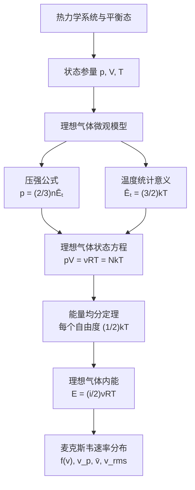
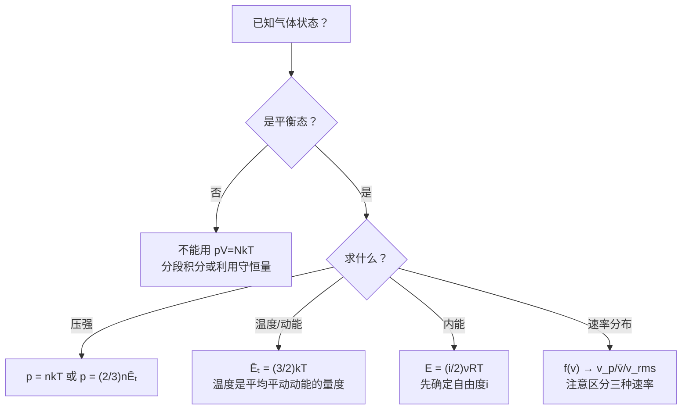

---
subject:
- 大学物理
source:
- 大学物理II-热学-统计物理初步.md
type: review
tags:
- 平衡态
- 状态参量
- 热力学第零定律
- 理想气体状态方程
- 自由度
- 能量均分定理
- 理想气体内能
- 麦克斯韦速率分布
- 最概然速率
- 平均速率
- 方均根速率
aliases:
- 第7章 统计物理初步 — 知识点梳理
schema_version: 2
time: "2026-08-31T11:44:20+08:00"
legacy_topics:
- 热力学系统
- 平衡态
- 状态参量
- 热力学第零定律
- 理想气体模型
- 理想气体状态方程
- 压强统计意义
- 温度统计意义
- 自由度
- 能量均分定理
- 理想气体内能
- 麦克斯韦速率分布
- 最概然速率
- 平均速率
- 方均根速率
status: not done
---

# 第7章 统计物理初步 — 知识点梳理

## 一、本章核心脉络

统计物理从**微观**角度研究热运动。核心思路：**微观粒子的无规则运动 → 统计平均 → 宏观性质**。

> 逻辑链：从"每个分子的运动是随机的"出发 → 大量分子的集体行为有确定规律 → 压强是碰撞的统计平均 → 温度是动能的量度 → 能量均分决定内能 → 速率分布给出统计特征值。

---

## 二、热力学系统与平衡态

### 2.1 热力学系统的分类

| 系统类型 | 能量交换 | 质量交换 |
|----------|:---:|:---:|
| **孤立系统** | ✗ | ✗ |
| **封闭系统** | ✓ | ✗ |
| **开放系统** | ✓ | ✓ |

> 一句话来说：孤立系统 = 完全与世界隔绝；封闭系统 = 能传热但物质出不去；开放系统 = 什么都挡不住。

### 2.2 平衡态

**平衡态**：孤立系统经过足够长时间后达到的宏观性质不随时间变化、内部无宏观流动的状态。

| | 定态 | 平衡态 |
|------|------|------|
| 宏观性质不变 | ✓ | ✓ |
| 内部无宏观流动 | 不一定 | ✓ |
| 关系 | 平衡态一定是定态 | 定态不一定是平衡态 |

> [!warning] 对平衡态的理解
> 1. 平衡态是**动态平衡**——微观运动不停，宏观性质不变
> 2. 平衡态下状态参量才有确定意义（p, V, T 处处相同且不随时间变化）
> 3. 开放/封闭系统也可达到平衡态（此时可视为等效孤立系统）

### 2.3 状态参量

| 分类 | 含义 | 例子 |
|------|------|------|
| **广延量** | 与系统大小成正比，可累加 | 体积 V、质量 M、内能 E |
| **强度量** | 与系统大小无关，不可累加 | 压强 p、温度 T |

大学物理主要处理**简单系统（p-V 系统）**：只需 p、V、T 就可确定平衡态。

### 2.4 热力学第零定律

> 如果 A 与 C 热平衡，B 与 C 热平衡 → 则 A 与 B 也热平衡。

→ 温度的定义基础：处于热平衡的系统具有相同的**温度**。

---

## 三、理想气体的微观模型与状态方程

### 3.1 理想气体微观模型

1. 分子本身体积可忽略（分子间距离 >> 分子尺度）
2. 除碰撞瞬间外，分子间无相互作用力
3. 分子之间、分子与器壁之间为**完全弹性碰撞**
4. 统计假设：$\overline{v_x^2} = \overline{v_y^2} = \overline{v_z^2} = \frac{1}{3}\overline{v^2}$

> 一句话来说：理想气体 = 极小的、互不干扰的、弹性碰撞的小球。气体越稀薄越接近这个模型。

### 3.2 理想气体状态方程

$$pV = \frac{M}{M_{mol}} RT = \nu RT$$

引入玻尔兹曼常量 $k = R/N_A = 1.38 \times 10^{-23} \text{ J/K}$：

$$pV = NkT \quad \text{或} \quad p = nkT$$

其中 $n = N/V$ 为分子数密度。

> [!warning] 状态方程的适用条件
> 1. 仅适用于**平衡态**
> 2. 非平衡态不能用整个系统的 p、V、T 代入状态方程（如例题7-3加热金属管）

---

## 四、压强和温度的统计意义（核心）

### 4.1 压强的微观本质

压强是大量分子碰撞器壁的统计平均效果。

**推导思路**：取速度为 $\vec{v}_i$ 的一类分子 → 计算单位时间碰撞单位面积器壁的分子数 $n_i v_{ix}$ → 每次碰撞冲量 $2mv_{ix}$ → 对所有速度求和 → 利用统计假设。

**理想气体压强公式**：

$$p = \frac{1}{3} n m \overline{v^2} = \frac{2}{3} n \bar{E}_t$$

其中 $\bar{E}_t = \frac{1}{2} m \overline{v^2}$ 为分子的**平均平动动能**。

> 一句话来说：压强 = 大量分子不断撞击器壁的平均效果。分子越多、动能越大 → 压强越大。

### 4.2 温度的统计意义

联立 $p = nkT$ 和 $p = \frac{2}{3} n \bar{E}_t$：

$$\bar{E}_t = \frac{3}{2} kT$$

> **温度是分子平均平动动能的量度。** 温度只对大量分子有意义——单个分子没有温度。

---

## 五、能量按自由度均分定理（核心）

### 5.1 自由度

确定物体空间位置所需的**独立坐标数目**。

| 分子类型 | 平动 t | 转动 r | 振动 s | 总自由度 i = t+r+2s |
|----------|:---:|:---:|:---:|:---:|
| 单原子 | 3 | 0 | 0 | 3 |
| 刚性双原子 | 3 | 2 | 0 | 5 |
| 非刚性双原子 | 3 | 2 | 1 | 7 |
| 刚性多原子 (n≥3) | 3 | 3 | 0 | 6 |

> [!hint] 自由度判断技巧
> 刚性双原子 = 2×3（每个原子3个自由度）- 1（距离约束）= 5

### 5.2 能量均分定理

> 理想气体在平衡态时，分子在每个自由度上的**平均动能**都相等，均为 $\frac{1}{2}kT$。

- 平均平动动能：$\frac{t}{2}kT$
- 平均转动动能：$\frac{r}{2}kT$
- 平均振动动能：$\frac{s}{2}kT$
- 平均振动势能：$\frac{s}{2}kT$（振动势能与动能相等）

**分子平均总能量**：

$$\bar{\varepsilon} = \frac{t + r + 2s}{2} kT = \frac{i}{2} kT$$

> 一句话来说：能量就像被"均匀分配"到每个自由度上——每个能装能量的"抽屉"里都恰好有 $\frac{1}{2}kT$。

### 5.3 理想气体的内能

$$E = \frac{M}{M_{mol}} \frac{i}{2} RT = \frac{i}{2} pV$$

> [!warning] 内能是状态函数，只与温度有关（对理想气体）。

---

## 六、麦克斯韦速率分布律（难点）

### 6.1 速率分布函数

在速率区间 $v \to v+dv$ 内的分子数：

$$dN = N f(v) \, dv$$

**麦克斯韦速率分布函数**：

$$f(v) = 4\pi \left(\frac{m}{2\pi kT}\right)^{3/2} v^2 e^{-\frac{mv^2}{2kT}}$$

**物理意义**：$f(v)$ 表示在速率 $v$ 附近**单位速率区间**内的分子数占总分子数的比例（概率密度）。

> 一句话来说：$f(v)dv$ 就是分子速率落在 $[v, v+dv]$ 这个小窗口里的概率。

### 6.2 分布曲线的特征

- 速率从 0 到 ∞
- 很小和很大速率的分子都很少
- **中等速率**的分子最多
- **归一化条件**：$\int_0^\infty f(v) dv = 1$（总概率为1）

温度升高 → 曲线峰值右移、高度降低、变宽。

### 6.3 三种统计速率

| 速率 | 公式 | 用途 |
|------|------|------|
| **最概然速率** $v_p$ | $\sqrt{\frac{2kT}{m}} = \sqrt{\frac{2RT}{M_{mol}}}$ | 分布函数的极大值点 |
| **平均速率** $\bar{v}$ | $\sqrt{\frac{8kT}{\pi m}} = \sqrt{\frac{8RT}{\pi M_{mol}}}$ | 计算平均自由程等 |
| **方均根速率** $v_{rms}$ | $\sqrt{\frac{3kT}{m}} = \sqrt{\frac{3RT}{M_{mol}}}$ | 计算平均动能 |

**大小关系**：$v_p < \bar{v} < v_{rms}$，比值 $v_p : \bar{v} : v_{rms} = 1 : 1.128 : 1.225$

> [!hint] 记忆技巧
> 三个速率都正比于 $\sqrt{T/M}$——温度越高越快，分子越重越慢。
> 比较大小：$v_{rms} > \bar{v} > v_p$（方均根最大，最概然最小）

---

## 判定/决策流程

---

## 核心公式速查表

| 公式 | 含义 |
|------|------|
| $pV = \nu RT = NkT$ | 理想气体状态方程 |
| $p = nkT$ | 压强与分子数密度的关系 |
| $p = \frac{2}{3}n\bar{E}_t$ | 压强公式（统计） |
| $\bar{E}_t = \frac{3}{2}kT$ | 平均平动动能 |
| $\bar{\varepsilon} = \frac{i}{2}kT$ | 分子平均总能量 |
| $E = \frac{i}{2}\nu RT = \frac{i}{2}pV$ | 理想气体内能 |
| $f(v) = 4\pi(\frac{m}{2\pi kT})^{3/2} v^2 e^{-mv^2/2kT}$ | 麦克斯韦速率分布 |
| $v_p = \sqrt{2RT/M_{mol}}$ | 最概然速率 |
| $\bar{v} = \sqrt{8RT/\pi M_{mol}}$ | 平均速率 |
| $v_{rms} = \sqrt{3RT/M_{mol}}$ | 方均根速率 |

---

## 易错点与注意事项

> [!warning] 常见错误
> 1. **状态方程只适用于平衡态**——非平衡态不能直接用 $pV = \nu RT$（如加热金属管两端温度不同）
> 2. **温度只对大量分子有意义**——单个分子没有温度概念
> 3. **振动自由度贡献双倍**：$i = t + r + 2s$（因为振动有动能+势能），不是 $t + r + s$
> 4. **三种速率不要搞混**：$v_{rms} > \bar{v} > v_p$，计算动能用 $v_{rms}$，计算碰撞频率用 $\bar{v}$
> 5. 刚性分子在常温下不考虑振动自由度
> 6. 内能 $E = \frac{i}{2}pV$ 只对理想气体成立

---

## 相关知识点链接

- [[../课件/MD/大学物理II-热学-热力学]] — 热力学宏观理论（第一、第二定律、熵）
- [[../../知识点汇集/07-统计物理初步-知识汇集]] — 复习用的清单式知识汇集
- 前置知识：力学中的自由度概念、质点运动学

---

## 作业与练习

> 习题文件位于 [[../习题库/07-统计物理初步/README|第7章习题库]]。

- [[../习题库/07-统计物理初步/习题7-1|习题7-1]]：估算标准状态下每立方厘米空气分子数
- [[../习题库/07-统计物理初步/习题7-2|习题7-2]]：氧气瓶使用天数计算
- [[../习题库/07-统计物理初步/习题7-3|习题7-3]]：非均匀温度场中气体压强计算
- [[../习题库/07-统计物理初步/习题7-4|习题7-4]]：混合气体的平均平动动能和温度
- [[../习题库/07-统计物理初步/习题7-5|习题7-5]]：不同气体在相同温压下的比较
- [[../习题库/07-统计物理初步/习题7-6|习题7-6]]：单原子理想气体单位体积内能
- [[../习题库/07-统计物理初步/习题7-7|习题7-7]]：混合气体中各组分质量计算
- [[../习题库/07-统计物理初步/习题7-8|习题7-8]]：隔板移除后混合气体的平衡压强和温度
- [[../习题库/07-统计物理初步/习题7-9|习题7-9]]：速率区间内分子的平均速率

## 可复用知识条目

本章涉及以下独立条目；后续补充与跨课程应用统一维护在条目中。

### 概念入口

- [[01_Knowledge/内能|内能]]
- [[01_Knowledge/平衡态|平衡态]]
- [[01_Knowledge/温度|温度]]
- [[01_Knowledge/熵|熵]]
- [[01_Knowledge/理想气体|理想气体]]

### 知识点入口

- [[01_Knowledge/三种统计速率|三种统计速率]]
- [[01_Knowledge/压强和温度的统计意义|压强和温度的统计意义]]
- [[01_Knowledge/理想气体状态方程|理想气体状态方程]]
- [[01_Knowledge/能量均分定理|能量均分定理]]
- [[01_Knowledge/麦克斯韦速率分布|麦克斯韦速率分布]]
