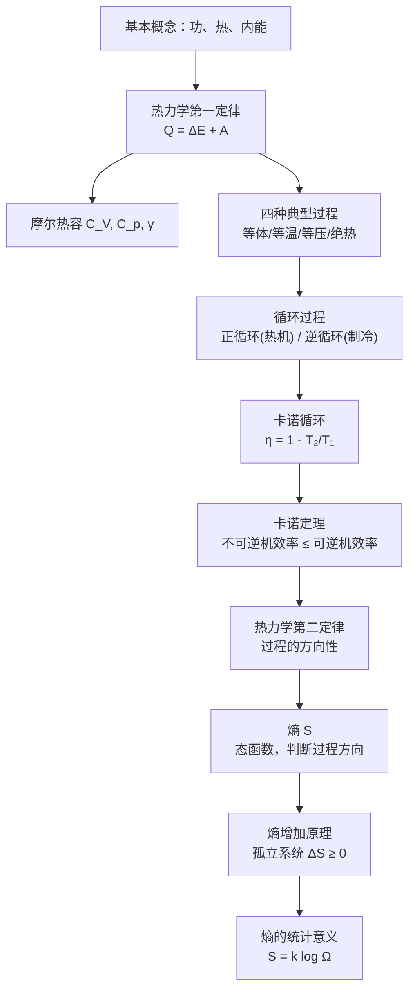
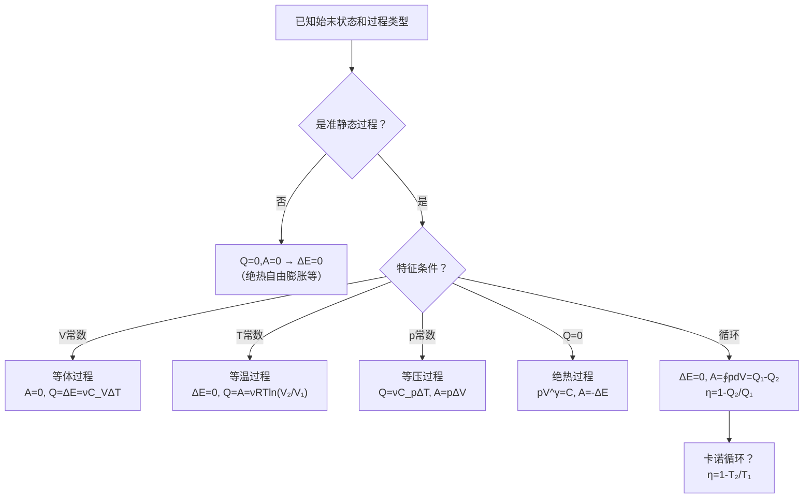

---
subject:
- 大学物理
source:
- 大学物理II-热学-热力学.md
type: review
tags:
- 热力学第一定律
- 摩尔热容
- 等体过程
- 等温过程
- 等压过程
- 绝热过程
- 循环过程
- 卡诺循环
- 热机效率
- 卡诺定理
- 热力学第二定律
- 熵
- 熵增加原理
aliases:
- 第8章 热力学基础 — 知识点梳理
schema_version: 2
time: "2026-08-31T11:44:20+08:00"
legacy_topics:
- 热力学第一定律
- 摩尔热容
- 等体过程
- 等温过程
- 等压过程
- 绝热过程
- 循环过程
- 卡诺循环
- 热机效率
- 卡诺定理
- 热力学第二定律
- 熵
- 熵增加原理
status: not done
---

# 第8章 热力学基础 — 知识点梳理

## 一、本章核心脉络

热力学从**宏观**角度研究热运动的规律。核心问题是：**能量如何转化？过程向什么方向进行？能进行到什么限度？**



> 逻辑链：第一定律说**能量守恒**（能不能做）→ 第二定律说**过程有方向**（做了会怎样）→ 熵给出了**方向性的定量判据**。

---

## 二、热力学基本概念（了解即可）

### 2.1 热力学过程

| 概念 | 定义 |
|------|------|
| **热力学过程** | 系统状态随时间变化 |
| **准静态过程** | 每个中间态都可近似为平衡态的过程 |
| **非静态过程** | 中间态为非平衡态，不能用状态参量描述 |
| **弛豫时间 τ** | 从平衡态破坏到新平衡态建立所需的时间 |

> 一句话来说：准静态过程就是"变得足够慢"，慢到每一步都来得及重新建立平衡。

### 2.2 功和热

| | 功 A | 热 Q |
|------|------|------|
| **本质** | 有规则运动能量 → 无规则运动能量 | 无规则运动能量之间的转换 |
| **联系** | 与宏观位移相联系 | 与温度差相联系 |
| **共同点** | 都是**过程量**（与路径有关） | 都是**过程量**（与路径有关） |

### 2.3 准静态过程中体积功的计算

微小过程气体对外作的元功：$\delta A = p S \cdot dx = p dV$

有限过程：$A = \int_{V_1}^{V_2} p \, dV$

- 膨胀（$dV > 0$）：$A > 0$，气体对外做**正功**
- 压缩（$dV < 0$）：$A < 0$，气体对外做**负功**（外界对气体做正功）
- 在 p-V 图上，**功 = 曲线下的面积**

> 一句话来说：p-V 图上过程曲线下面那块面积，就是气体对外做的功——面积越大，做功越多。

### 2.4 理想气体的内能

$$E = \frac{M}{M_{mol}} \frac{i}{2} RT = \frac{i}{2} pV$$

内能是**状态函数**（由 p, V, T 确定），与过程无关。只与温度有关（对理想气体）。

---

## 三、热力学第一定律（本章核心）

### 3.1 定律表述

$$Q = E_2 - E_1 + A$$

对微小过程：$dQ = dE + dA$

对微小**准静态**过程：$dQ = \frac{M}{M_{mol}} \frac{i}{2} R \, dT + p \, dV$

> 一句话来说：系统吸收的热量，一部分用来增加内能，一部分用来对外做功——能量不会凭空产生或消失。

**符号约定**（以系统为对象，以热机为模型）：

| 量 | 正 | 负 |
|----|----|----|
| Q | 系统吸热 | 系统放热 |
| A | 系统对外做功 | 外界对系统做功 |
| ΔE | 内能增加 | 内能减少 |

> [!warning] 重要
> 热力学第一定律在**准静态和非准静态过程中都成立**。但只有在准静态过程中才能用 $A = \int p \, dV$ 计算功。

---

## 四、摩尔热容与比热容比

### 4.1 摩尔热容定义

一摩尔物质温度升高 1K 所吸收的热量：

$$C = \frac{dQ}{dT}$$

> 一句话来说：热容就是"每升高一度要吸多少热"——不同的过程答案不同。

### 4.2 定体摩尔热容 $C_V$

体积不变（$dV = 0$）：

$$C_V = \frac{i}{2} R$$

| 气体类型 | $C_V$ |
|----------|-------|
| 单原子分子 | $\frac{3}{2}R$ |
| 刚性双原子分子 | $\frac{5}{2}R$ |
| 刚性多原子分子 | $\frac{6}{2}R = 3R$ |

### 4.3 定压摩尔热容 $C_p$

压强不变，气体膨胀对外做功，需要多吸收热量：

$$C_p = C_V + R = \frac{i+2}{2} R$$

> 直观理解：等压过程中气体一边升温一边膨胀，比等体过程多需要 $R = 8.31 \text{ J/(mol·K)}$ 的热量来对外做功。

### 4.4 比热容比（绝热系数）

$$\gamma = \frac{C_p}{C_V} = \frac{i+2}{i}$$

| 气体类型 | $\gamma$ |
|----------|----------|
| 单原子 | $5/3 \approx 1.67$ |
| 刚性双原子 | $7/5 = 1.40$ |
| 刚性多原子 | $8/6 \approx 1.33$ |

> [!warning] 注意
> 实际气体的热容和热容比都是**温度的函数**，以上是理想气体的经典结果。

---

## 五、四种典型准静态过程（本章核心）

引入 $C_V$ 后，热力学第一定律写为：

$$dQ = \frac{M}{M_{mol}} C_V \, dT + p \, dV$$

### 5.1 对比总表

|          | 等体                 | 等温                          | 等压                 | 绝热                              |
| -------- | ------------------ | --------------------------- | ------------------ | ------------------------------- |
| **特征**   | $V$ = 常数           | $T$ = 常数                    | $p$ = 常数           | $Q = 0$                         |
| **过程方程** | $p/T = C$          | $pV = C$                    | $V/T = C$          | $pV^\gamma = C$                 |
| **ΔE**   | $\nu C_V \Delta T$ | $0$                         | $\nu C_V \Delta T$ | $\nu C_V \Delta T$              |
| **A**    | $0$                | $\nu RT \ln\frac{V_2}{V_1}$ | $p(V_2-V_1)$       | $-\Delta E = -\nu C_V \Delta T$ |
| **Q**    | $\nu C_V \Delta T$ | $A$                         | $\nu C_p \Delta T$ | $0$                             |
| **热容**   | $C_V$              | $\infty$                    | $C_p$              | $0$                             |

### 5.2 绝热过程详析（难点）

**过程方程的推导**：

由 $dQ = 0$，热力学第一定律 → $dE = -dA$ → $\nu C_V \, dT = -p \, dV$

结合状态方程 $pV = \nu RT$ 微分 → $p \, dV + V \, dp = \nu R \, dT$

消去 $dT$，并利用 $C_p = C_V + R$ 和 $\gamma = C_p/C_V$，得：

$$\gamma \frac{dV}{V} + \frac{dp}{p} = 0 \quad\Rightarrow\quad pV^\gamma = \text{常数}$$

等价形式：$TV^{\gamma-1} = C$，$p^{\gamma-1}T^{-\gamma} = C$

> 一句话来说：绝热膨胀时，压强下降有两个原因——体积增大 + 温度降低。所以绝热线比等温线**更陡**。

**绝热线 vs 等温线**：

| | 等温线斜率 | 绝热线斜率 |
|------|------|------|
| $\frac{dp}{dV}$ | $-\frac{p}{V}$ | $-\gamma \frac{p}{V}$ |

因为 $\gamma > 1$，绝热线比等温线更陡。

> [!warning] 绝热自由膨胀 ≠ 绝热准静态过程
> 绝热自由膨胀（如气体向真空膨胀）是**非准静态过程**，不能用 $pV^\gamma = C$！此时 $Q=0$，$A=0$，故 $\Delta E = 0$，温度不变。

---

## 六、循环过程与热机效率（核心）

### 6.1 循环过程

系统经过一系列过程后回到初始状态。在 p-V 图上是一条**闭合曲线**。

- 循环一周：$\Delta E = 0$，故 $Q_1 - Q_2 = A$
- 闭合曲线包围的**面积 = 净功**

### 6.2 正循环（热机）

**效率**：

$$\eta = \frac{A}{Q_1} = 1 - \frac{Q_2}{Q_1}$$

其中 $Q_1$ = 总吸热，$Q_2$ = 总放热（取绝对值）。

### 6.3 逆循环（制冷机）

**制冷系数**：

$$\omega = \frac{Q_2}{A} = \frac{Q_2}{Q_1 - Q_2}$$

> 一句话来说：热机效率 = 输出的功 ÷ 投入的热；制冷系数 = 从冷库抽走的热 ÷ 消耗的功。

---

## 七、卡诺循环与卡诺定理（难点）

### 7.1 卡诺循环

理想循环，由两个等温过程和两个绝热过程组成：

```
a → b: 等温膨胀（T₁，吸热 Q₁）
b → c: 绝热膨胀（T₁ → T₂）
c → d: 等温压缩（T₂，放热 Q₂）
d → a: 绝热压缩（T₂ → T₁）
```

**卡诺热机效率**：

$$\eta = 1 - \frac{T_2}{T_1}$$

> 一句话来说：卡诺热机的效率只取决于两个热源的温度——高温越高、低温越低，效率越高。与工作物质无关！

**卡诺制冷系数**：

$$\varepsilon = \frac{Q_2}{A} = \frac{T_2}{T_1 - T_2}$$

### 7.2 可逆过程与不可逆过程

| 可逆过程 | 不可逆过程 |
|----------|------------|
| 系统和外界都能完全复原 | 不能完全复原 |
| 一定是准静态过程 | 非准静态过程一定不可逆 |
| 理想过程 | 实际过程（有摩擦、散热等） |

> [!warning] 关键关系
> 可逆过程 ⇒ 准静态过程，但准静态过程 ⇏ 可逆过程（如存在摩擦的准静态过程不可逆）。

### 7.3 卡诺定理

1. 在 $T_1$、$T_2$ 之间工作的一切**可逆热机**，效率相等：$\eta = 1 - T_2/T_1$（与工作物质无关）
2. 在 $T_1$、$T_2$ 之间工作的一切**不可逆热机**，效率不可能高于可逆机：$\eta < 1 - T_2/T_1$

合并：$\eta \leq 1 - \dfrac{T_2}{T_1}$

> 证明思路（反证法）：假设存在效率更高的热机 → 将其与逆循环的卡诺制冷机联合 → 热量自动从低温传到高温 → 违反热力学第二定律。

---

## 八、热力学第二定律

### 8.1 两种经典表述

| 表述 | 内容 | 指向 |
|------|------|------|
| **克劳修斯表述** | 热量不能**自动**地从低温物体传向高温物体 | 热传递的单向性 |
| **开尔文表述** | 不可能制成一种循环动作的热机，只从**单一热源**吸热，使之完全变成有用功而**不产生其他影响** | 热功转化的不可逆性 |

> 一句话来说：第一定律说能量不能凭空产生，第二定律说就算能量守恒，也不是所有过程都能发生——自然有方向。

### 8.2 两种表述等价

如果一种表述不成立，另一种也不成立。所有不可逆过程都是相互关联的。

### 8.3 第二定律的实质

- 第一定律 + 第二定律是**独立的**——满足能量守恒的过程未必都能实现
- 功可以完全变为热，但热不能完全变为功（循环过程中）
- 一切与热现象有关的实际宏观过程都是**不可逆**的

---

## 九、熵与熵增加原理（难点）

### 9.1 熵的定义

由卡诺定理出发：

$$\frac{Q_1}{T_1} + \frac{Q_2}{T_2} \leq 0$$

推广到任意循环：$\displaystyle\oint \frac{dQ}{T} \leq 0$（克劳修斯不等式）

对于可逆过程，$\int_1^2 \frac{dQ}{T}$ 与路径无关 → 存在态函数**熵 S**：

$$S_2 - S_1 = \int_1^2 \frac{dQ}{T} \quad\text{（可逆过程）}$$

> 一句话来说：熵是一个状态函数，就像内能一样由状态唯一确定。但熵的特殊之处在于——它只能增加不能减少（在孤立系统中）。

### 9.2 熵增加原理

对任意过程：

$$S_2 - S_1 \geq \int_1^2 \frac{dQ}{T}$$

对无限小过程：$T\,dS \geq dQ = dE + p\,dV$

**孤立系统**（无能量交换）：

- $S_2 = S_1$：可逆过程
- $S_2 > S_1$：不可逆过程（自发过程）

> **孤立系统中，自发过程总是向着熵增加的方向进行。**

> [!warning] 注意事项
> 1. 熵增加原理**只对孤立系统**成立。非孤立系统（吸热/放热）的熵可增可减。
> 2. 熵是**状态函数**，与过程无关。
> 3. 对不可逆过程，可设计一个始末状态相同的**可逆过程**来计算熵变。

### 9.3 熵的计算方法

1. **可逆过程**：直接用 $S_2 - S_1 = \int_1^2 \frac{dQ}{T}$
2. **不可逆过程**：设计始末状态相同的可逆过程替代计算

> [!hint] 典型例题
> - 等压膨胀的熵变：$\Delta S = \nu C_p \ln\frac{T_2}{T_1}$
> - 绝热自由膨胀（不可逆）：用等温可逆过程替代 → $\Delta S = \nu R \ln\frac{V_2}{V_1}$

---

## 十、熵的统计意义与热力学第三定律

### 10.1 玻尔兹曼熵公式

$$S = k \log \Omega$$

其中 $\Omega$ = 热力学概率（宏观状态对应的微观状态数），$k$ = 玻尔兹曼常数。

> 一句话来说：熵是分子运动**无序程度**的量度——越混乱的状态，微观状态数越多，熵越大。

### 10.2 热力学第二定律的统计意义

在孤立系统内，自发过程总是由**热力学概率小**的宏观态 → **热力学概率大**的宏观态，即**无序性增大**的方向。

### 10.3 热力学第三定律

1. 绝对零度时，任何完美晶体的熵等于零
2. 不可能通过有限次步骤将任何系统的温度降至绝对零度

---

## 判定/决策流程



---

## 核心公式速查表

| 公式 | 含义 | 适用条件 |
|------|------|----------|
| $Q = \Delta E + A$ | 热力学第一定律 | 普遍成立 |
| $A = \int p \, dV$ | 体积功 | 准静态过程 |
| $E = \frac{i}{2}\nu RT$ | 理想气体内能 | 理想气体 |
| $C_V = \frac{i}{2}R$ | 定体摩尔热容 | 理想气体 |
| $C_p = C_V + R$ | 迈耶公式 | 理想气体 |
| $\gamma = C_p/C_V = \frac{i+2}{i}$ | 比热容比 | 理想气体 |
| $pV^\gamma = C$ | 绝热过程方程 | 准静态绝热 |
| $\eta = 1 - Q_2/Q_1$ | 热机效率 | 正循环 |
| $\omega = Q_2/(Q_1-Q_2)$ | 制冷系数 | 逆循环 |
| $\eta = 1 - T_2/T_1$ | 卡诺热机效率 | 可逆卡诺循环 |
| $\eta \leq 1 - T_2/T_1$ | 卡诺定理 | 任意热机 |
| $S_2 - S_1 = \int_1^2 dQ/T$ | 熵变 | 可逆过程 |
| $S_2 - S_1 \geq \int_1^2 dQ/T$ | 克劳修斯不等式 | 普遍成立 |
| $S = k \log \Omega$ | 玻尔兹曼公式 | 统计物理 |

---

## 易错点与注意事项

> [!warning] 常见错误
> 1. **功和热是过程量，不是状态量**——不能说"系统含有多少功/热"
> 2. **绝热自由膨胀 ≠ 绝热准静态过程**——前者不能用 $pV^\gamma = C$，$\Delta E = 0$，$T$ 不变（理想气体）
> 3. **熵增加原理只适用于孤立系统**——非孤立系统的熵可增可减
> 4. **可逆 ⇒ 准静态，但准静态 ⇏ 可逆**（有摩擦的准静态过程不可逆）
> 5. **卡诺定理的效率公式 $\eta = 1 - T_2/T_1$ 仅适用于可逆卡诺热机**——不可逆热机效率**小于**此值
> 6. 等温过程中 $C_T = \infty$（不是零！因为吸热但温度不变）
> 7. 绝热过程中 $C_Q = 0$（不吸热，温度变化）
> 8. p-V 图上判断吸热/放热：比较过程曲线与过同一点的绝热线——在绝热线**上方**的吸热，**下方**的放热

---

## 相关知识点链接

- [[../课件/MD/大学物理II-热学-统计物理初步]] — 统计物理视角：从微观解释热力学规律
- [[../../知识点汇集/08-热力学基础-知识汇集]] — 复习用的清单式知识汇集
- 前置知识：理想气体状态方程 $pV = \nu RT$（来自气体动理论）

---

## 作业与练习

> 习题文件位于 [[../习题库/08-热力学基础/README|第8章习题库]]。

### 热力学第一定律与基本过程
- [[../习题库/08-热力学基础/习题8-1|习题8-1]]：判断过程吸放热（Q=ΔE+A）
- [[../习题库/08-热力学基础/习题8-2|习题8-2]]：P-V图循环过程吸热量
- [[../习题库/08-热力学基础/习题8-6|习题8-6]]：以绝热线判断吸放热
- [[../习题库/08-热力学基础/习题8-10|习题8-10]]：绝热线判断任意过程做功与吸放热

### 四种典型准静态过程
- [[../习题库/08-热力学基础/习题8-3|习题8-3]]：刚性双原子分子循环求A/ΔE/Q
- [[../习题库/08-热力学基础/习题8-4|习题8-4]]：等压膨胀吸热作功比例
- [[../习题库/08-热力学基础/习题8-5|习题8-5]]：等温+等体求比热比γ
- [[../习题库/08-热力学基础/习题8-7|习题8-7]]：绝热自由膨胀
- [[../习题库/08-热力学基础/习题8-8|习题8-8]]：等温与等体+等压路径对比
- [[../习题库/08-热力学基础/习题8-9|习题8-9]]：三种过程压缩氮气对比

### 循环过程与热机效率
- [[../习题库/08-热力学基础/习题8-8-循环|习题8-8-循环]]：单原子循环效率
- [[../习题库/08-热力学基础/习题8-9-喷气|习题8-9-喷气]]：喷气发动机循环（布雷顿循环）
- [[../习题库/08-热力学基础/习题8-10-循环|习题8-10-循环]]：非线性过程循环

### 卡诺循环与卡诺定理
- [[../习题库/08-热力学基础/习题8-11|习题8-11]]：卡诺循环提高高温热源温度
- [[../习题库/08-热力学基础/习题8-13|习题8-13]]：卡诺致冷机电能消耗

### 熵与熵增加原理
- [[../习题库/08-热力学基础/习题8-14|习题8-14]]：等压膨胀熵变
- [[../习题库/08-热力学基础/习题8-15|习题8-15]]：绝热自由膨胀熵变
- [[../习题库/08-热力学基础/习题8-16|习题8-16]]：温熵图（T-S图）循环效率

## 可复用知识条目

本章涉及以下独立条目；后续补充与跨课程应用统一维护在条目中。

### 概念入口

- [[01_Knowledge/内能|内能]]
- [[01_Knowledge/准静态过程|准静态过程]]
- [[01_Knowledge/功和热|功和热]]
- [[01_Knowledge/平衡态|平衡态]]
- [[01_Knowledge/温度|温度]]
- [[01_Knowledge/熵|熵]]
- [[01_Knowledge/理想气体|理想气体]]

### 知识点入口

- [[00_Inbox/待核实核心/知识点/卡诺循环与卡诺定理|卡诺循环与卡诺定理]]
- [[00_Inbox/待核实核心/知识点/四种典型准静态过程|四种典型准静态过程]]
- [[01_Knowledge/循环过程与热机效率|循环过程与热机效率]]
- [[01_Knowledge/摩尔热容|摩尔热容]]
- [[01_Knowledge/热力学第一定律|热力学第一定律]]
- [[00_Inbox/待核实核心/知识点/熵与熵增加原理|熵与熵增加原理]]
- [[01_Knowledge/绝热过程|绝热过程]]
