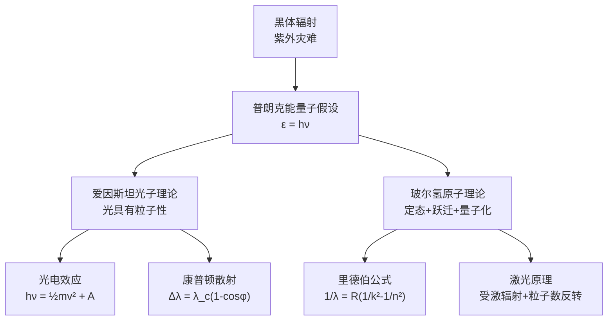
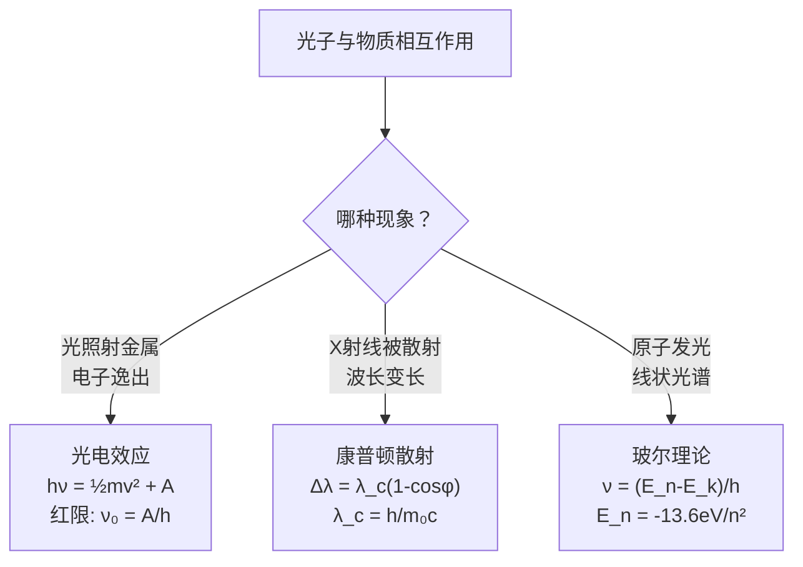

---
subject:
- 大学物理
source:
- 大学物理_16量子光学基础.md
type: review
tags:
- 光电效应
- 爱因斯坦光子理论
- 康普顿散射
- 氢原子光谱
- 玻尔理论
- 激光
- 自发辐射
- 受激辐射
- 粒子数反转
aliases:
- 第16章 早期量子论 — 知识点梳理
schema_version: 2
time: "2026-08-31T11:44:20+08:00"
legacy_topics:
- 黑体辐射
- 普朗克能量子
- 光电效应
- 爱因斯坦光子理论
- 康普顿散射
- 氢原子光谱
- 玻尔理论
- 激光
- 自发辐射
- 受激辐射
- 粒子数反转
status: not done
---
 
# 第16章 早期量子论 — 知识点梳理

## 一、本章核心脉络

经典物理在解释黑体辐射、光电效应、原子光谱时遇到困难 → 催生了**量子**概念。

> 历史逻辑：黑体辐射 → 能量量子化（普朗克，1900）→ 光量子（爱因斯坦，1905）→ 原子量子化（玻尔，1913）→ 激光（受激辐射，1917预言，1960实现）。

---

## 二、黑体辐射与能量子观念

### 2.1 黑体辐射

**理想黑体**：能完全吸收各种波长电磁辐射的物体（小孔空腔模型）。

两个经典公式的困境：

| 公式 | 适用范围 | 问题 |
|------|----------|------|
| **维恩公式** | 短波（高频） | 长波段偏离实验 |
| **瑞利-金斯公式** | 长波（低频） | 短波段发散 → "紫外灾难" |

### 2.2 普朗克能量子假设（核心）

> 谐振子的能量**不连续**，只能取 $E = n h \nu \ (n = 0, 1, 2, \ldots)$ 的整数倍。

由此导出普朗克黑体辐射公式：

$$u(\nu, T) = \frac{8\pi h \nu^3}{c^3} \frac{1}{e^{h\nu/kT} - 1}$$

> 一句话来说：能量不像水一样可以连续流，而像硬币——最小单位是 $h\nu$。$h = 6.63 \times 10^{-34} \text{ J·s}$ 是量子世界的最小"币值"。

---

## 三、光电效应（核心）

### 3.1 实验规律

| 规律 | 内容 |
|------|------|
| 饱和电流 ∝ 光强 | 光强越大，逸出电子越多 |
| 截止电压 ∝ 频率 | $\frac{1}{2}mv^2 = eV_a$，与光强无关 |
| 存在红限 $\nu_0$ | $\nu < \nu_0$ 时无论光强多大都无光电子 |
| 瞬时性 | 延迟不超过 $10^{-8}$s |

> [!warning] 经典波动说的困难
> 按波动理论：光强越大 → 电子动能越大（错！）；不应存在红限（错！）；能量需要积累时间（错！）。

### 3.2 爱因斯坦光子理论

光由**光子**组成，每个光子能量：$E = h\nu$

**光电效应方程**：

$$h\nu = \frac{1}{2}mv^2 + A$$

其中 $A = h\nu_0$ 为**逸出功**（金属中电子的结合能）。

> 一句话来说：一个光子踢出一个电子——光子能量一部分用来"赎身"（逸出功），剩下的变成电子的动能。

### 3.3 光子的性质

| 物理量 | 公式                      |
| --- | ----------------------- |
| 能量  | $E = h\nu = hc/\lambda$ |
| 动质量 | $m = E/c^2 = h\nu/c^2$  |
| 静质量 | $m_0 = 0$               |
| 动量  | $p = mc = h/\lambda$    |

---

## 四、康普顿散射（难点）

### 4.1 实验现象

X 射线经轻元素散射后，散射光波长**随散射角 $\varphi$ 增大而增大**——经典波动理论无法解释。

### 4.2 光子-电子碰撞模型

将散射视为**光子与静止自由电子的弹性碰撞**：

能量守恒 + 动量守恒 → **康普顿散射公式**：

$$\Delta \lambda = \lambda - \lambda_0 = \frac{2h}{m_0 c} \sin^2 \frac{\varphi}{2} = \lambda_c (1 - \cos\varphi)$$

**康普顿波长**：$\lambda_c = \frac{h}{m_0 c} = 0.024 \text{ Å}$

> 一句话来说：光子撞到电子，像台球一样"传了一部分能量"给电子，所以散射光子的能量变小、波长变长。

- $\varphi = 0$：$\lambda_{min} = \lambda_0$（无波长变化）
- $\varphi = 180°$：$\lambda_{max} = \lambda_0 + 2\lambda_c$

> 康普顿散射的意义：证明了**光子具有粒子性**，且光子-电子相互作用遵守能量和动量守恒。

---

## 五、氢原子光谱与玻尔理论（核心）

### 5.1 氢原子光谱规律

**里德伯公式**：

$$\bar{\nu} = \frac{1}{\lambda} = R\left(\frac{1}{k^2} - \frac{1}{n^2}\right), \quad R = 1.097 \times 10^7 \text{ m}^{-1}$$

| 线系   |  k  | n         | 光谱区 |
| ---- | :-: | --------- | --- |
| 赖曼系  |  1  | 2, 3, ... | 紫外  |
| 巴耳末系 |  2  | 3, 4, ... | 可见光 |
| 帕邢系  |  3  | 4, 5, ... | 红外  |

### 5.2 玻尔理论的三条假设

1. **定态假设**：电子在特定轨道上绕核运动**不辐射**能量
2. **角动量量子化**：$L = mvr = n\hbar$，$n = 1, 2, \ldots$
3. **频率条件**：$\nu = \frac{E_n - E_k}{h}$（跃迁时发射/吸收光子）

### 5.3 玻尔理论的结论

结合牛顿定律 $\frac{e^2}{4\pi\varepsilon_0 r^2} = m\frac{v^2}{r}$：

- **玻尔半径**：$a_0 = \frac{\varepsilon_0 h^2}{\pi m e^2} = 5.29 \times 10^{-11} \text{ m}$
- **轨道半径**：$r_n = n^2 a_0$
- **氢原子能级**：$E_n = -\frac{13.6\text{ eV}}{n^2}$（$n = 1, 2, \ldots$）

> 一句话来说：电子只能在几条"特权轨道"上跑（能级量子化），从高轨道跳到低轨道时放出一个光子。

### 5.4 电离能与跃迁

- **基态** $E_1 = -13.6\text{ eV}$，**电离能** = 13.6 eV
- $n=2$ 第一激发态 $E_2 = -3.4\text{ eV}$
- $n=3$ 第二激发态 $E_3 = -1.51\text{ eV}$

> [!warning] 玻尔理论的局限
> 只适用于氢原子和类氢离子；无法解释谱线强度和精细结构。本质上是**半经典半量子**的过渡理论。

---

## 六、激光（了解即可）

### 6.1 三种辐射过程

| 过程 | 特点 | 光子特性 |
|------|------|----------|
| **自发辐射** | 随机、独立发生 | 频率、相位、偏振各不相同（非相干） |
| **受激吸收** | 吸收光子跃迁到高能态 | — |
| **受激辐射** | 外来光子诱导跃迁 | 与外来光子**完全相同**（相干） |

### 6.2 激光产生的条件

1. **粒子数反转**：高能态原子数 > 低能态原子数（必要条件）
2. **激励（泵浦）**：向工作物质输入能量
3. **光学谐振腔**：选频、选方向、维持振荡
4. **亚稳态能级**：有足够寿命积累粒子

### 6.3 激光的特性

- 方向性好 → 测距、定位
- 单色性好 → 精密测量、通讯
- 亮度高（能量集中）→ 切割、焊接、医疗
- 相干性好 → 全息照相、无损检测

---

## 判定/决策流程

---

## 核心公式速查表

| 公式 | 含义 |
|------|------|
| $\varepsilon = h\nu$ | 光子能量（普朗克-爱因斯坦关系） |
| $h\nu = \frac{1}{2}mv^2 + A$ | 光电效应方程 |
| $\Delta\lambda = \lambda_c(1-\cos\varphi)$ | 康普顿散射 |
| $\lambda_c = h/m_0c = 0.024\text{ Å}$ | 康普顿波长 |
| $\bar{\nu} = R(1/k^2 - 1/n^2)$ | 里德伯公式 |
| $r_n = n^2 a_0$ | 玻尔轨道半径 |
| $E_n = -13.6/n^2 \text{ eV}$ | 氢原子能级 |
| $L = n\hbar$ | 轨道角动量量子化 |

---

## 易错点与注意事项

> [!warning]
> 1. **光子静质量为零**：$m_0 = 0$，但有动质量 $m = h\nu/c^2$（因为能量等价质量）
> 2. 光电效应中**截止电压与光强无关**，只与频率有关
> 3. 康普顿散射中波长变化 $\Delta\lambda$ 只与散射角有关，与入射波长和靶材料无关
> 4. 玻尔理论中 $E_n$ 为负值是因为取无穷远为零势能（电子被束缚）
> 5. 原子从高能级跃迁时，可能经过多个中间能级 → 产生多条谱线
> 6. 粒子数反转 = $N_{\text{高}} > N_{\text{低}}$（与正常分布相反）

---

## 相关知识点链接

- [[../课件/MD/大学物理_17量子力学基础]] — 真正的量子力学（波函数、薛定谔方程）
- [[../../知识点汇集/16-早期量子论-知识汇集]] — 复习用清单式汇集

---

## 作业与练习

- [[../习题库/16-早期量子论/习题16-1|习题16-1]] 铯的光电效应计算
- [[../习题库/16-早期量子论/习题16-2|习题16-2]] 磁场中光电子的逸出功计算
- [[../习题库/16-早期量子论/习题16-3|习题16-3]] 光电流曲线的判断
- [[../习题库/16-早期量子论/习题16-5|习题16-5]] 康普顿散射中反冲电子的最大动能
- [[../习题库/16-早期量子论/习题16-6|习题16-6]] 康普顿散射（90°方向）
- [[../习题库/16-早期量子论/习题16-7|习题16-7]] 康普顿散射中反冲电子速度已知
- [[../习题库/16-早期量子论/习题16-8|习题16-8]] 可见光能否激发基态氢原子
- [[../习题库/16-早期量子论/习题16-9|习题16-9]] 氢原子第3激发态的谱线跃迁
- [[../习题库/16-早期量子论/习题16-10|习题16-10]] 电子轰击基态氢原子发出的谱线

## 可复用知识条目

本章涉及以下独立条目；后续补充与跨课程应用统一维护在条目中。

### 概念入口

- [[01_Knowledge/光子|光子]]
- [[01_Knowledge/波粒二象性|波粒二象性]]
- [[01_Knowledge/能级|能级]]
- [[01_Knowledge/量子化|量子化]]

### 知识点入口

- [[01_Knowledge/光电效应|光电效应]]
- [[01_Knowledge/康普顿散射|康普顿散射]]
- [[01_Knowledge/激光原理|激光原理]]
- [[01_Knowledge/玻尔氢原子理论|玻尔氢原子理论]]
