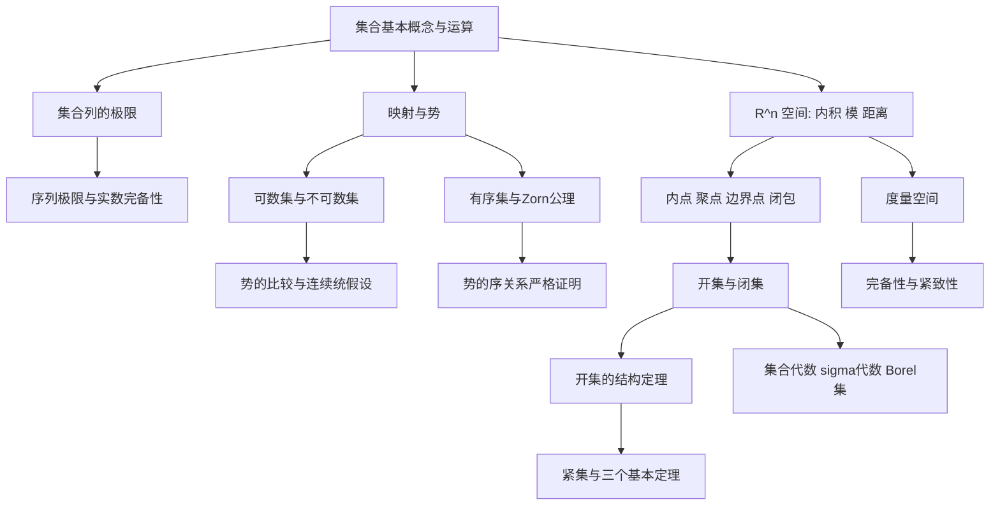
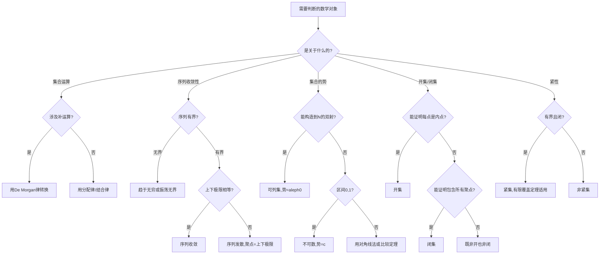

---
subject:
- 实变函数
source:
- RA-01.md, RA-02.md, 2023-RA-03.md, 2023-RA-03-a.md, 2023-RA-04-05.md, 2023-RA-06.md, 2023-RA-07.md, 2023-RA-08.md, 2023-RA-09.md, 2023-RA-09-I.md
type: review
tags:
- 可数集
- 不可数集
- Cantor对角线法
- Cauchy-Schwarz不等式
- 开集与闭集
- Cantor集
- 度量空间
aliases:
- 第1章 集合论与点集拓扑基础 — 知识点梳理
schema_version: 2
time: "2026-08-31T11:44:20+08:00"
legacy_topics:
- 集合运算
- 序列极限
- 映射
- 集合的势
- 可数集
- 不可数集
- Cantor对角线法
- R^n空间
- Cauchy-Schwarz不等式
- 开集与闭集
- 集合代数与sigma代数
- 开集的结构
- Cantor集
- 度量空间
- 序关系与Zorn公理
status: not done
---

# 第1章 集合论与点集拓扑基础

## 一、本章核心脉络

本章是实变函数的**语言基础**。实变函数研究的是函数的极限、积分、测度，而这一切都建立在"集合"这个最基本概念之上。本章从最朴素的概念出发，逐步搭建起整个理论大厦的底座。

**核心问题链**：集合是什么？有哪些运算？ --> 怎么谈集合的"极限"？ --> 怎么比较集合的"大小"（势）？ --> 无穷有多大？ --> 在 R^n 中怎么谈"远近"和"开闭"？ --> 开集长什么样？ --> 距离能在更一般的空间里定义吗？ --> 势的比较有逻辑基础吗？

> 一句话来说：先学会"集合的语言"，再学会"比较大小（势）"和"描述远近（拓扑）"，这两条线分别发展，最后在 Zorn 公理的框架下统一起来。

---

## 二、集合的基本概念与运算（基础）

### 2.1 集合的定义与记号

> 一句话来说：集合就是具有某个共同性质的元素的"总体"，用花括号描述。

- **集合** $A$ 是 $X$ 中所有具有性质 $P$ 的元素 $x$ 的总体：$A = \{x \in X \mid P(x)\}$ 或 $A = \{x \in X : P(x)\}$
- **空集** $\varnothing$：不含任何元素的集合
- $x \in A$：$x$ 是 $A$ 的元素；$x \notin A$：$x$ 不是 $A$ 的元素
- 常用集合记号：$\mathbb{N}$（自然数）、$\mathbb{Z}$（整数）、$\mathbb{Q}$（有理数）、$\mathbb{R}$（实数）、$\mathbb{C}$（复数）

**包含关系**：
- $A \subset B$（或 $B \supset A$）：$A$ 是 $B$ 的子集
- $A = B \Leftrightarrow A \subset B \text{ 且 } B \subset A$
- $A \subsetneq B \Leftrightarrow A \subset B \text{ 且 } \exists b \in B, b \notin A$（真子集）

### 2.2 集合的基本运算

> 一句话来说：交、并、差、补是集合的四种基本运算，De Morgan 律揭示了补运算与交并的互换关系。

| 运算 | 记号 | 定义 | 一句话理解 |
|------|------|------|-----------|
| 交 | $A \cap B$ | $\{x \mid x \in A \text{ 且 } x \in B\}$ | 公共元素 |
| 并 | $A \cup B$ | $\{x \mid x \in A \text{ 或 } x \in B\}$ | 全部元素 |
| 补 | $A^c$ | $\{x \in X \mid x \notin A\}$ | 不在 $A$ 中的元素 |
| 差 | $A \setminus B$ | $\{x \mid x \in A \text{ 且 } x \notin B\}$ | $A$ 中去掉 $B$ 的部分 |

**运算律**：
- **交换律**：$A \cup B = B \cup A$，$A \cap B = B \cap A$
- **结合律**：$(A \cup B) \cup C = A \cup (B \cup C)$，$(A \cap B) \cap C = A \cap (B \cap C)$
- **分配律**：
  - $A \cup (B \cap C) = (A \cup B) \cap (A \cup C)$
  - $A \cap (B \cup C) = (A \cap B) \cup (A \cap C)$
- **对偶律（De Morgan 法则）**：$(A \cup B)^c = A^c \cap B^c$，$(A \cap B)^c = A^c \cup B^c$
- $A \setminus B = A \cap B^c$
- $A \supset B \Rightarrow A^c \subset B^c$

**De Morgan 法则证明思路**：
证 $(A \cup B)^c = A^c \cap B^c$。
$$x \in (A \cup B)^c \Leftrightarrow x \notin A \cup B \Leftrightarrow x \notin A \text{ 且 } x \notin B \Leftrightarrow x \in A^c \text{ 且 } x \in B^c \Leftrightarrow x \in A^c \cap B^c$$

### 2.3 集合族与指标集

> 一句话来说：用指标来标记一族集合，可以统一处理任意多（甚至不可数多）个集合的运算。

设 $\{A_\lambda\}_{\lambda \in I}$ 是一族集合，$\lambda$ 为**指标**，$I$ 为**指标集**。

- 并：$\bigcup_{\lambda \in I} A_\lambda = \{x \mid \exists \lambda \in I, x \in A_\lambda\}$
- 交：$\bigcap_{\lambda \in I} A_\lambda = \{x \mid \forall \lambda \in I, x \in A_\lambda\}$

**泛化运算律**：
- 分配律：$A \cap \left(\bigcup_{\lambda \in I} B_\lambda\right) = \bigcup_{\lambda \in I} (A \cap B_\lambda )$
-  分配律：$A \cup \left(\bigcap_{\lambda \in I} B_\lambda\right) = \bigcap_{\lambda \in I} (A \cup B_\lambda)$
- De Morgan 法则：$\left(\bigcap_{\lambda \in I} A_\lambda\right)^c = \bigcup_{\lambda \in I} A_\lambda^c$，$\left(\bigcup_{\lambda \in I} A_\lambda\right)^c = \bigcap_{\lambda \in I} A_\lambda^c$

**典型例题**：设 $f(x)$ 是 $\mathbb{R}$ 上的实值函数，$A = \{x \in \mathbb{R} \mid f(x) > 0\}$，$A_n = \{x \in \mathbb{R} \mid f(x) > 1/n\}$，则有 $A = \bigcup_{n=1}^{\infty} A_n$。

**证明思路**：$f(x) > 0 \Leftrightarrow \exists n \in \mathbb{N}: f(x) > 1/n$（利用实数的阿基米德性质）。

### 2.4 集合列的单调性与极限

> 一句话来说：集合列的极限是数学分析中序列极限概念的自然推广，用上下极限来描述"最终在集合中"和"无穷次在集合中"。

**单调列**：
- 若 $A_1 \subset A_2 \subset \cdots \subset A_n \subset \cdots$，则称为**升列**
- 若 $A_1 \supset A_2 \supset \cdots \supset A_n \supset \cdots$，则称为**降列**

例：$A_n = (1/n, 1)$ 是升列；$A_n = (0, 1 - 1/n)$ 是升列。

设 $\{A_n\}$ 为任意集合列，令 $B_n = \bigcup_{k=n}^{\infty} A_k$（降列），$C_n = \bigcap_{k=n}^{\infty} A_k$（升列）。

**上下极限**：

| 概念 | 定义 | 直观理解 |
|------|------|----------|
| 上极限 | $\displaystyle\varlimsup_{n \to \infty} A_n = \bigcap_{n=1}^{\infty} \bigcup_{k=n}^{\infty} A_k$ | 属于无穷多个 $A_n$ 的元素 |
| 下极限 | $\displaystyle\varliminf_{n \to \infty} A_n = \bigcup_{n=1}^{\infty} \bigcap_{k=n}^{\infty} A_k$ | 除有限个外都属于 $A_n$ 的元素 |

若上极限 = 下极限，则称**集合列收敛**：$\displaystyle\lim_{n \to \infty} A_n = \varlimsup A_n = \varliminf A_n$。

### 2.5 幂集与直积

> 一句话来说：幂集是一个集合的所有子集的集合；直积是由有序对构成的新集合。

- **幂集** $2^X = \{A \mid A \subset X\}$。含 $n$ 个元素的集合有 $2^n$ 个子集。
- **直积** $X \times Y = \{(x, y) \mid x \in X, y \in Y\}$（顺序不可交换）
- 多个集合的直积：$\prod_{i=1}^{n} X_i = \{(x_1, \ldots, x_n) \mid x_i \in X_i\}$；若 $X_i = X$ 则记为 $X^n$（如 $\mathbb{R}^n$）

**例题**（用集合族表示极限）：设 $f(x), f_n(x)$ 为 $\mathbb{R}$ 上实值函数，$A = \{x \mid \lim_{n \to \infty} f_n(x) = f(x)\}$，$A_{mn} = \{x \mid |f_n(x) - f(x)| < 1/m\}$，则

$$A = \bigcap_{m=1}^{\infty} \bigcup_{n=1}^{\infty} \bigcap_{k=n}^{\infty} A_{mk}$$

**解读**：此式将"极限"这个分析概念纯用集合论语言表达——$\bigcap_{k=n}^{\infty}$ 表示"最终成立"，$\bigcup_{n=1}^{\infty}$ 表示"存在某个 $n$"，$\bigcap_{m=1}^{\infty}$ 表示"对任意精度的 $\varepsilon = 1/m$"。

---

## 三、序列的极限与实数完备性（核心）

### 3.1 序列极限的 $\varepsilon$-$N$ 定义

> 一句话来说：序列 $\{x_n\}$ 趋于 $x$，就是对于任意小的误差 $\varepsilon$，总存在一个下标 $N$，使得 $N$ 之后的所有项都落在 $x$ 的 $\varepsilon$ 邻域内。

$$\lim_{n \to \infty} x_n = x \stackrel{\text{def}}{\Longleftrightarrow} \forall \varepsilon > 0, \exists N \in \mathbb{N} \text{ s.t. } |x_n - x| < \varepsilon \; (\forall n \geq N)$$

极限为无穷大：$\lim_{n \to \infty} x_n = \infty \stackrel{\text{def}}{\Longleftrightarrow} \forall M > 0, \exists N \in \mathbb{N} \text{ s.t. } x_n > M \; (\forall n \geq N)$

### 3.2 有界性与聚点

> 一句话来说：聚点是序列"无限逼近"的点——在每个 $\varepsilon$ 邻域内都有无穷多项落在里面。

- **有界性**：$\{x_n\}$ 有界 $\Leftrightarrow$ $\exists M > 0$ s.t. $|x_n| \leq M \; (\forall n)$
- **聚点** $x$：$\forall \varepsilon > 0, \forall N \in \mathbb{N}, \exists n \geq N$ s.t. $|x_n - x| < \varepsilon$
- 等价表述：存在收敛于 $x$ 的子列 $\{x_{n_j}\}$，即 $\lim_{j \to \infty} x_{n_j} = x$

> [!hint] 例题
> - $x_n = n$：无界，趋于 $\infty$
> - $x_n = (-1)^n$：有界，不收敛，聚点为 1 和 -1
> - $x_n = n \sin(1/n)$：有界，有极限（极限为 1）
> - $x_n = n \bmod 7$：有界，有收敛子列，有限个聚点

### 3.3 扩充实数集

> 一句话来说：把 $\pm\infty$ 当作"数字"加入实数系统，方便描述无界序列的行为。

**定义**：$\mathbb{R} \cup \{\pm\infty\}$ 上的运算（约定）：
- $x + \infty = \infty$，$x - \infty = -\infty$
- $x \cdot \infty = \infty$（$x > 0$），$x \cdot (-\infty) = -\infty$（$x > 0$）
- $\infty + \infty = \infty$，$-\infty - \infty = -\infty$
- $\infty \cdot (\pm\infty) = \pm\infty$，$-\infty \cdot (\pm\infty) = \mp\infty$
- $0 \cdot \infty = 0$（特殊约定）

> [!warning] 注意
> $\infty - \infty$ 和 $-\infty + \infty$ **无定义**。这是所有涉及 $\pm\infty$ 的运算中最需要警惕的地方。

### 3.4 确界与实数完备性公理

> 一句话来说：上确界是最小上界，下确界是最大下界；实数集区别于有理数集的根本性质就是"每个有界子集都有确界"。

设 $E \subset \mathbb{R}$：
- **上界**：$h$ 满足 $x \leq h \; (\forall x \in E)$
- **上确界** $h = \sup E$：(1) $h$ 是上界；(2) 若 $h'$ 也是上界则 $h \leq h'$（最小上界）
- **下界**：$m$ 满足 $x \geq m \; (\forall x \in E)$
- **下确界** $m = \inf E$：(1) $m$ 是下界；(2) 若 $m'$ 也是下界则 $m \geq m'$（最大下界）

**实数集的完备性公理**：每个具有上（下）界的实数集必有上（下）确界。

> 直观理解：这条公理排除了实数集中"空隙"的存在——上确界是确确实实存在的实数，不需要"填补"。

**例**：$E = (0, 1]$，$\sup E = 1 = \max E$，$\inf E = 0$，但 $\min E$ 没有定义（因为 0 不在 E 中）。

### 3.5 序列的上下极限（本章核心）

> 一句话来说：上极限 = 所有子列极限中的最大值，下极限 = 所有子列极限中的最小值；上下极限相等当且仅当序列收敛。

**定义**：

- **上极限**：$\displaystyle\varlimsup_{n \to \infty} x_n = \lim_{n \to \infty} \sup_{k \geq n} x_k = \inf_n \sup_{k \geq n} x_k$

- **下极限**：$\displaystyle\varliminf_{n \to \infty} x_n = \lim_{n \to \infty} \inf_{k \geq n} x_k = \sup_n \inf_{k \geq n} x_k$

记法：$\overline{\lim} x_n = \limsup x_n$，$\underline{\lim} x_n = \liminf x_n$

**上极限的等价刻画**（$l \in \mathbb{R}$）：
1. 存在子列 $\{x_{n_k}\}$ 使得 $\lim x_{n_k} = l$
2. 对任意收敛子列 $\{x_{n_i}\}$，有 $\lim x_{n_i} \leq l$

**上极限的 $\varepsilon$ 刻画**（$l \in \mathbb{R}$）：
1. $\forall \varepsilon > 0, \exists n$ s.t. $x_k < l + \varepsilon$ 对所有的 $k \geq n$
2. $\forall \varepsilon > 0, \forall n, \exists k \geq n$ s.t. $x_k > l - \varepsilon$

**上下极限的不等式**：对于两个序列 $\{x_n\}, \{y_n\}$（假设不出现 $\infty - \infty$ 形式），有

$$\underline{\lim} x_n + \underline{\lim} y_n \leq \underline{\lim}(x_n + y_n) \leq \overline{\lim} x_n + \underline{\lim} y_n \leq \overline{\lim}(x_n + y_n) \leq \overline{\lim} x_n + \overline{\lim} y_n$$

**基本性质**：
- $\underline{\lim}(-x_n) = -\overline{\lim} x_n$
- $\underline{\lim} x_n \leq \overline{\lim} x_n$
- $\lim x_n = l \Longleftrightarrow \underline{\lim} x_n = \overline{\lim} x_n = l$

### 3.6 特征函数与集合列极限的联系

> 一句话来说：集合列的特征函数列，其上下极限恰好对应集合列上下极限的特征函数。

$$\chi_A(x) = \begin{cases} 1 & x \in A \\ 0 & x \notin A \end{cases}$$

性质（课件结论）：
- $\underline{\lim} \chi_{A_n}(x) = \chi_{\underline{\lim} A_n}(x)$
- $\overline{\lim} \chi_{A_n}(x) = \chi_{\overline{\lim} A_n}(x)$

### 3.7 函数的上下极限（了解即可）

$$ \varlimsup_{x \to a} f(x) = \lim_{\delta \to 0} \sup_{0 < |x-a| < \delta} f(x) = \inf_{\delta > 0} \sup_{0 < |x-a| < \delta} f(x) $$

$$ \varliminf_{x \to a} f(x) = \lim_{\delta \to 0} \inf_{0 < |x-a| < \delta} f(x) = \sup_{\delta > 0} \inf_{0 < |x-a| < \delta} f(x) $$

---

## 四、映射（函数）（核心）

### 4.1 映射的基本概念

> 一句话来说：映射就是从一个集合到另一个集合的"唯一指派"，每个定义域元素恰好对应一个值域元素。

$X, Y$ 为非空集合，映射 $f: X \to Y$：对任何 $x \in X$，存在唯一的 $f(x) \in Y$。

- **定义域**：$X$
- **值域**：$f(X) = \{f(x) \mid x \in X\} \subset Y$
- **像**（$A \subset X$）：$f(A) = \{f(x) \mid x \in A\}$
- **原像**（$B \subset Y$）：$f^{-1}(B) = \{x \in X \mid f(x) \in B\}$
- **图（graph）**：$G_r(f) = \{(x, f(x)) \mid x \in X\} \subset X \times Y$

**实例**：
- 集合列 $\{A_n\}$ 可视为 $\mathbb{N} \to 2^X$ 的映射：$f(n) = A_n$
- 并运算可视为 $2^X \times 2^X \to 2^X$ 的映射：$(A, B) \mapsto A \cup B$

### 4.2 单射、满射、双射

> 一句话来说：单射 = 不同输入给出不同输出；满射 = 值域"占满"目标空间；双射 = 两者同时成立，有逆映射。

| 类型 | 定义 | 直观 |
|------|------|------|
| **满射** | $\forall y \in Y, \exists x \in X$ s.t. $f(x) = y$ | "打到所有目标" |
| **单射** | $x_1 \neq x_2 \Rightarrow f(x_1) \neq f(x_2)$ | "不会撞车" |
| **双射** | 同时为单射和满射 | "完美配对" |

- **逆映射**：$f$ 为双射时才存在 $f^{-1}: Y \to X$，满足 $f^{-1}(f(x)) = x$
- **复合映射**：$f: X \to Y, g: Y \to Z$，$(g \circ f)(x) = g(f(x))$

**命题**：若 $f$ 和 $g$ 都有逆，则 $g \circ f$ 也有逆，且 $(g \circ f)^{-1} = f^{-1} \circ g^{-1}$。

### 4.3 像与原像的性质

> 一句话来说：原像比像"性质更好"——原像保持所有交并补运算，而像只保持并运算。

| 性质 | 像 | 原像 |
|------|-----|------|
| 并 | $f\left(\bigcup A_\lambda\right) = \bigcup f(A_\lambda)$ | $f^{-1}\left(\bigcup B_\lambda\right) = \bigcup f^{-1}(B_\lambda)$ |
| 交 | $f\left(\bigcap A_\lambda\right) \subset \bigcap f(A_\lambda)$（可能真包含） | $f^{-1}\left(\bigcap B_\lambda\right) = \bigcap f^{-1}(B_\lambda)$ |
| 补 | 一般情况不成立 | $f^{-1}(B^c) = (f^{-1}(B))^c$ |
| 单调性 | $A_1 \subset A_2 \Rightarrow f(A_1) \subset f(A_2)$ | $B_1 \subset B_2 \Rightarrow f^{-1}(B_1) \subset f^{-1}(B_2)$ |

> [!hint] 记忆技巧
> 原像保持所有运算 = 因为原像是用"条件筛选"定义的，不丢失信息。像的交可能变小 = 因为不同元素可能映射到同一个点。

---

## 五、集合的势：可数与不可数（核心/难点）

### 5.1 对等与势

> 一句话来说："对等"就是存在双射；"势"就是在这种对等关系下的等价类——衡量集合元素个数的"基数"。

- **对等** $A \sim B$：存在从 $A$ 到 $B$ 的一一满映射（双射）
- 对等关系满足：(1) 自反性 $A \sim A$；(2) 对称性 $A \sim B \Rightarrow B \sim A$；(3) 传递性 $A \sim B, B \sim C \Rightarrow A \sim C$。满足这三条的二元关系称为**等价关系**。
- **势（基数）**：若 $A \sim B$，称 $A$ 与 $B$ 有相同的势，记为 $|A| = |B|$
- 若存在从 $A$ 到 $B$ 的单射（不一定是满射），则 $|A| \leq |B|$
- 若 $|A| \leq |B|$ 且 $|A| \neq |B|$，则 $|A| < |B|$

**例**：
1. $\mathbb{N} \sim \mathbb{Z}$：$f(n) = \begin{cases} k & n = 2k \\ -(k-1) & n = 2k - 1 \end{cases}$（$k = 1, 2, \ldots$）
2. $(-1, 1) \sim \mathbb{R}$：$f(x) = \tan(\pi x / 2)$

### 5.2 可列集（可数集）

> 一句话来说：能与自然数集对等的集合就是可列集——元素可以像排队一样排成一个序列。

- **可列集（可数集）**：与 $\mathbb{N}$ 对等的集合。势为 $\aleph_0$（阿列夫零）。
- 可列集的元素可以排列为：$A = \{x_1, x_2, \ldots, x_n, \ldots\}$

**定理 1.2.9**：任何无穷集合都包含一个可列子集。
> 证明思路：用归纳法逐个取出 $x_n \in A \setminus \{x_1, \ldots, x_{n-1}\}$，无穷保证这个差集始终非空。
> 本质洞察：无穷集合"至少"包含可列多个元素。

**定理 1.2.10**：可列集合的无穷子集仍是可列的。
> 证明思路：用定理 1.2.9 得到子集的可列子集，再用势的夹逼。

**定理 1.2.11**：可列集与有限集（或可列集）的并集仍是可列集。

**定理 1.2.12**（对角线法）：可数个有限集或可列集的并仍是可列集。
> 证明思路：将元素排成矩阵 $x_{ij}$，按对角线次序排列——$x_{11}, x_{21}, x_{12}, x_{31}, x_{22}, x_{13}, \ldots$

**定理 1.2.13**：有限个可列集的直积仍是可列集。

**重要例子**：
- **有理数集 $\mathbb{Q}$ 是可列集**：$f: \mathbb{Z} \times \mathbb{Z} \to \mathbb{Q}, (p, q) \mapsto p/q$ 是满射，所以 $|\mathbb{Q}| \leq |\mathbb{Z} \times \mathbb{Z}| = \aleph_0$，又 $\mathbb{N} \subset \mathbb{Q}$ 得 $|\mathbb{Q}| = \aleph_0$
- **有限个自然数构成的有序数组全体**是可列的
- **有理系数多项式之全体**是可列集（由有限个有理系数唯一决定）
- $\mathbb{R}$ 中任意不相交的开区间族是有限集或可列集（每个开区间必含一个有理数）
- $\mathbb{R}$ 上单调上升函数的不连续点为有限集或可列（每个不连续点对应一个非退化的开区间）

**定理 1.2.15**：$A$ 是无限集，$B$ 是可数集，则 $|A \cup B| = |A|$。

**定理 1.2.16**：$A$ 是无限集的充要条件是：$A$ 与其自身的一个真子集对等。
> 直观理解：无穷集的标志性特征——可以"去掉"一些元素后仍然和原来一样多。

### 5.3 势的运算（了解即可）

设 $|A| = \alpha, |B| = \beta$：
- $|A \times B| = \alpha \cdot \beta$
- $|A^n| = \alpha^n$
- 若 $A \cap B = \varnothing$，$|A \cup B| = \alpha + \beta$
- $B^A$（全体 $A$ 到 $B$ 的映射构成的集合）：$|B^A| = \beta^\alpha$

可列集的运算规律：
- $n + \aleph_0 = \aleph_0$
- $\aleph_0 + \aleph_0 = \aleph_0$，$\sum_{i=1}^{\infty} \aleph_0 = \aleph_0$
- $\aleph_0 \times \aleph_0 = \aleph_0$，$\prod_{i=1}^{n} \aleph_0 = \aleph_0$

### 5.4 不可数集与 Cantor 对角线法（难点）

> 一句话来说：Cantor 对角线法证明了"任何枚举 $(0,1]$ 区间元素的尝试都会漏掉某个元素"——这是一个构造性的反证法。

**定理 1.2.17**：区间 $(0, 1)$ 不是可列集。

**证明（对角线法）**：考虑 $(0, 1] = (0, 1) \cup \{1\}$。假设存在 $f: \mathbb{N} \to (0, 1]$ 是一一满映射，记 $f(n) = 0.a_{n_1}a_{n_2}\cdots a_{n_k}\cdots$（十进制，不允许从某位开始全为 0）。

构造 $x = 0.b_1b_2\cdots b_n\cdots$，其中：
- 若 $a_{nn} = 1$，取 $b_n = 2$
- 若 $a_{nn} \neq 1$，取 $b_n = 1$

则 $x$ 与所有 $f(n)$ 在第 $n$ 位不同，因此 $x$ 不在 $f$ 的值域中，矛盾。

> 核心洞察：对角线构造出的数保证与枚举列表中每个数至少有一位不同，从而不在列表中。这个思想在可计算性理论和数理逻辑中反复出现。

**实数集的势**：$|\mathbb{R}| = c$（continuum），$c \geq \aleph_0$。

**定理 1.2.18**：$|2^{\mathbb{N}}| = |\mathbb{R}| = c$，即 $2^{\aleph_0} = c$。

> [!note]- 完整证明（点击展开）
> **目标**：证明 $2^{\mathbb{N}}$（自然数的所有 0-1 序列构成的集合）与 $\mathbb{R}$ 等势。
> 
> 策略分三步：(1) 构造单射 $2^{\mathbb{N}} \to [0, 1]$；(2) 构造单射 $(0, 1] \to 2^{\mathbb{N}}$；(3) 由 Cantor-Bernstein 定理得出等势。
> 
> ---
> 
> **第一步：$|2^{\mathbb{N}}| \leq |\mathbb{R}|$（三进制构造）**
> 
> 对每个 $\phi = (\phi(1), \phi(2), \ldots) \in \{0, 1\}^{\mathbb{N}}$，定义
> 
> $$f(\phi) = \sum_{n=1}^{\infty} \frac{2\phi(n)}{3^n}$$
> 
> 直观：将此无穷序列视作三进制小数，每位取 0 或 2（对应 $\phi(n) = 0$ 或 $1$）。
> 
> **$f(\phi) \in [0, 1]$**：$\sum \frac{2}{3^n} = \frac{2/3}{1 - 1/3} = 1$，且所有项非负，故 $f(\phi) \in [0, 1]$。
> 
> **$f$ 是单射**：设 $\phi \neq \psi$，令 $N = \min\{n \mid \phi(n) \neq \psi(n)\}$。不妨设 $\phi(N) = 1, \psi(N) = 0$。则
> 
> $$
> \begin{aligned}
> f(\phi) - f(\psi) &= \frac{2}{3^N} + \sum_{n=N+1}^{\infty} \frac{2(\phi(n) - \psi(n))}{3^n} \\
> &\geq \frac{2}{3^N} - \sum_{n=N+1}^{\infty} \frac{2}{3^n} \\
> &= \frac{2}{3^N} - \frac{2/3^{N+1}}{1 - 1/3} \\
> &= \frac{2}{3^N} - \frac{1}{3^N} = \frac{1}{3^N} > 0
> \end{aligned}
> $$
> 
> 故 $f(\phi) \neq f(\psi)$，$f$ 为单射。$\square$
> 
> 因此 $|2^{\mathbb{N}}| \leq |[0, 1]| = |\mathbb{R}|$（$[0, 1] \sim \mathbb{R}$ 可由 $\tan(\pi(x - 1/2))$ 给出）。
> 
> ---
> 
> **第二步：$|\mathbb{R}| \leq |2^{\mathbb{N}}|$（二进制构造）**
> 
> 对每个 $x \in (0, 1]$，考虑其二进制展开。然而二进制展开不唯一——例如 $1/2 = 0.1000\ldots_2 = 0.0111\ldots_2$。为解决此问题，我们需要**选定一种标准展开**。
> 
> **标准二进制展开**：对每个 $x \in (0, 1]$，取那个**不从某位开始全为 0** 的二进制展开（即含无穷多个 1）。等价地：若 $x$ 有两种展开，则取"以 1 结尾"的那种（$0.0111\ldots$ 而非 $0.1000\ldots$）。
> 
> 记此标准展开为 $x = 0.b_1 b_2 b_3 \ldots_2$（$b_n \in \{0, 1\}$），定义
> 
> $$g(x) = (b_1, b_2, b_3, \ldots) \in \{0, 1\}^{\mathbb{N}}$$
> 
> **$g$ 是单射**：若 $g(x) = g(y)$，则 $x$ 和 $y$ 的标准二进制展开完全一致，由无穷级数表示的唯一性（级数值由展开唯一决定）得 $x = y$。
> 
> > 注：标准展开的选取排除了二义性——两个不同的数不可能有相同的标准展开，同一个数也只有一个标准展开。
> 
> 因此 $g: (0, 1] \to \{0, 1\}^{\mathbb{N}}$ 是单射。又 $(0, 1] \sim \mathbb{R}$（由 $x \mapsto \tan(\pi(x - 1/2))$），故 $|\mathbb{R}| = |(0, 1]| \leq |2^{\mathbb{N}}|$。$\square$
> 
> ---
> 
> **第三步：Cantor-Bernstein 推论**
> 
> 由第一步得 $|2^{\mathbb{N}}| \leq |\mathbb{R}|$，由第二步得 $|\mathbb{R}| \leq |2^{\mathbb{N}}|$。
> 
> 由 **Cantor-Bernstein 定理**（$|X| \leq |Y| \land |Y| \leq |X| \Rightarrow |X| = |Y|$，证明见 §11.5），立即有
> 
> $$|2^{\mathbb{N}}| = |\mathbb{R}| = c$$
> 
> 即 $2^{\aleph_0} = c$。$\square$
> 
> ---
> 
> > [!tip] 直观理解
> > - 三进制方向：每个 0-1 序列对应 Cantor 集中的一个点（三进制小数只含 0 和 2），所以 $\{0,1\}^{\mathbb{N}}$ "嵌进"了 $\mathbb{R}$。
> > - 二进制方向：$(0,1]$ 中每个数对应一个 0-1 序列（二进制小数），所以 $\mathbb{R}$ "嵌进"了 $\{0,1\}^{\mathbb{N}}$。
> > - 两者互相嵌入，由 Cantor-Bernstein 得出恰好等势。

### 5.5 无最大基数定理与连续统假设

> 一句话来说：任何集合的幂集总比原集合"大"，因此没有"最大的势"——势的序列可以无限延伸。

**定理 1.2.19**（无最大基数定理）：若 $A$ 是非空集合，则 $A$ 与 $2^A$ 不对等。

**证明（对角线法）**：假设存在 $f: A \to 2^A$ 为双射。构造 $B = \{x \in A \mid x \notin f(x)\}$。由于 $f$ 是满射，存在 $y \in A$ 使 $f(y) = B$。则：
- 若 $y \in B$，由 $B$ 的定义 $y \notin f(y) = B$，矛盾
- 若 $y \notin B = f(y)$，由 $B$ 的定义 $y \in B$，矛盾

因此不存在这样的双射。

已知 $|\mathbb{N}| = \aleph_0 < |\mathbb{R}| = 2^{\aleph_0} = c$。

**Aleph 基数的定义**：$\aleph_0$ 是可数无限基数，$\aleph_{k+1}$ 是严格大于 $\aleph_k$ 的最小基数。Aleph 序列按后继基数定义，不能把 $\aleph_{k+1}=2^{\aleph_k}$ 当作定义。

**连续统假设（CH）**：不存在集合 $A$ 满足 $\aleph_0<|A|<c$，其中 $c=2^{\aleph_0}$。在 ZFC 中，这等价于 $c=\aleph_1$。

**广义连续统假设（GCH）**：对每个无限基数 $\kappa$，$2^\kappa=\kappa^+$，其中 $\kappa^+$ 为其后继基数。这是比 CH 更强的命题，不是 CH 的定义。

> 若 ZFC 公理系统相容，则 CH 既不能在 ZFC 中被证明，也不能被证否（Gödel 1940，Cohen 1963）。

---

## 六、$\mathbb{R}^n$ 空间（核心）

### 6.1 内积、模与 Cauchy-Schwarz 不等式

> 一句话来说：内积衡量向量"共向程度"，模是向量长度，Cauchy-Schwarz 不等式保证了内积不会超过长度乘积。

**内积**：$x \cdot y = x_1y_1 + x_2y_2 + \cdots + x_ny_n$

**模**：$\|x\| = (x_1^2 + x_2^2 + \cdots + x_n^2)^{1/2}$，满足：
- (1) 正定性：$\|x\| \geq 0$，$\|x\| = 0 \Leftrightarrow x = 0$
- (2) 齐次性：$\|\lambda x\| = |\lambda| \|x\|$
- (3) 三角不等式：$\|x + y\| \leq \|x\| + \|y\|$

**Cauchy-Schwarz 不等式**：$x \cdot y \leq \|x\| \|y\|$（$\forall x, y \in \mathbb{R}^n$）

**证明思路**：定义 $f(\lambda) = \|x + \lambda y\|^2 = \|y\|^2 \lambda^2 + 2(x \cdot y)\lambda + \|x\|^2 \geq 0$。这是一个关于 $\lambda$ 的二次函数，非负意味着判别式 $\leq 0$：$(2(x \cdot y))^2 - 4\|x\|^2\|y\|^2 \leq 0 \Rightarrow x \cdot y \leq \|x\| \|y\|$。

三角不等式则由 Cauchy-Schwarz 推出：
$$\|x+y\|^2 = \|x\|^2 + 2x\cdot y + \|y\|^2 \leq \|x\|^2 + 2\|x\|\|y\| + \|y\|^2 = (\|x\| + \|y\|)^2$$

### 6.2 距离与球

> 一句话来说：距离和球是 $R^n$ 中"近"和"局部"的量化工具。

**距离**：$d(x, y) = \|x - y\|$，满足：
- (1) 正定性：$d(x,y) \geq 0$，$d(x, y) = 0 \Leftrightarrow x = y$
- (2) 对称性：$d(x, y) = d(y, x)$
- (3) 三角不等式：$d(x, y) \leq d(x, z) + d(y, z)$

**球（球邻域）**：$B(x, r) = \{y \in \mathbb{R}^n \mid d(x, y) < r\}$（以 $x$ 为中心，$r$ 为半径，不含边界）。

**有界集**：存在 $R > 0$ 使 $A \subset B_R(0)$。

### 6.3 内点、边界点、聚点、闭包、稠密

> 一句话来说：内点 = 全力包围在集合内；聚点 = 身旁到处是集合的点；边界点 = 一脚在内一脚在外；闭包 = 集合加上它的聚点。

设 $A \subset \mathbb{R}^n$，$x_0 \in \mathbb{R}^n$：

| 概念 | 定义 | 记号 |
|------|------|------|
| **内点** | $\exists \varepsilon > 0$ s.t. $B_\varepsilon(x_0) \subset A$ | $A^\circ$ |
| **边界点** | $\forall \varepsilon > 0$，$B_\varepsilon(x_0) \cap A \neq \varnothing$ 且 $B_\varepsilon(x_0) \cap A^c \neq \varnothing$ | $\partial A$ |
| **聚点（极限点）** | $\forall \varepsilon > 0$，$B_\varepsilon(x_0) \cap (A \setminus \{x_0\}) \neq \varnothing$ | $A'$（导集） |
| **闭包** | $\overline{A} = A \cup A'$ | $\overline{A}$ |
| **孤立点** | $x \in A \setminus A'$ | — |
| **稠密** | $\overline{A} = E$（$A$ 在 $E$ 中稠密） | — |
| **外点** | $x \in (A^c)^\circ = \mathbb{R}^n \setminus \overline{A}$ | — |

**基本关系**：
- $A^\circ \subset A'$（内点是聚点，但反过来不成立）
- $\partial A = \overline{A} \setminus A^\circ$
- $x \in A \setminus A' \Leftrightarrow \exists r > 0, B_r(x) \cap A = \{x\}$（孤立点等价定义）

**导集的性质**：
- (1) $A \subset B \Rightarrow A' \subset B'$
- (2) $(A \cup B)' = A' \cup B'$

**例题**：设 $A = [-1, 0) \cup \{1/n \mid n \in \mathbb{N}\} \subset \mathbb{R}$，求 $A^\circ, A', \overline{A}, \partial A, A \setminus A'$。

**重要例子**：$\mathbb{Q}^\circ = \varnothing$，$\mathbb{Q}' = \overline{\mathbb{Q}} = \mathbb{R}$，即有理数在实数中**稠密**。

### 6.4 $\mathbb{R}^n$ 中的收敛性

> 一句话来说：$\mathbb{R}^n$ 中序列收敛 = 按模收敛 = 每个坐标分别收敛。

$$\lim_{k \to \infty} x_k = x \stackrel{\text{def}}{\Longleftrightarrow} \lim_{k \to \infty} \|x_k - x\| = 0 \Longleftrightarrow \lim_{k \to \infty} |x_{k,i} - x_i| = 0 \quad (i = 1, \ldots, n)$$

**定理 1.3.7**（聚点的序列刻画）：$x \in A' \Leftrightarrow \exists \{x_k\} \subset A \setminus \{x\}$ s.t. $\lim_{k \to \infty} x_k = x$。

---

## 七、开集与闭集（核心）

### 7.1 开集与闭集的定义

> 一句话来说：开集 = 每个点都是内点；闭集 = 包含所有聚点（等价于补集是开集）。

| 概念 | 定义 | 等价条件 |
|------|------|----------|
| **开集** $O$ | $\forall x \in O, \exists \delta > 0$ s.t. $B_\delta(x) \subset O$ | $O = O^\circ$ |
| **闭集** $F$ | $F = \overline{F}$ | $F \supset F'$ |

开集与闭集的**对偶关系**：$O$ 是开集 $\Leftrightarrow$ $O^c$ 是闭集；$F$ 是闭集 $\Leftrightarrow$ $F^c$ 是开集。

**基本例子**：
- 开区间是开集，$\varnothing$ 和 $\mathbb{R}$ 既是开集又是闭集
- 闭区间是闭集，闭球 $\{y \mid \|y - x\| \leq r\}$ 是闭集

### 7.2 开集与闭集的运算性质

> 一句话来说：开集对"任意并、有限交"封闭；闭集对"任意交、有限并"封闭。这是点集拓扑最核心的对偶性。

| 性质 | 开集 | 闭集 |
|------|------|------|
| 有限交 | 仍是开集 | — |
| 任意并 | 仍是开集 | — |
| 有限并 | — | 仍是闭集 |
| 任意交 | — | 仍是闭集 |

**关键反例**：无限个开集的交不一定是开集。
$O_n = (-1/n, 1/n)$，$\bigcap_{n=1}^{\infty} O_n = \{0\}$ 不是开集。

无限个闭集的并不一定是闭集。
$F_n = [1/n, 1 - 1/n]$，$\bigcup_{n=1}^{\infty} F_n = (0, 1)$ 不是闭集。

**证明要点**（两个开集的交是开集）：
取 $\delta = \min(\delta_1, \delta_2)$，则 $B_\delta(x) \subset B_{\delta_1}(x) \cap B_{\delta_2}(x) \subset O_1 \cap O_2$。

### 7.3 集合的代数与 $\sigma$ 代数

> 一句话来说：集合代数 = 对有限并和取补封闭的集族；$\sigma$ 代数 = 再多加可数并的封闭性——这是测度论的基础框架。

设 $\mathfrak{A}$ 为 $X$ 的子集构成的集族。若满足：
- (i) $A, B \in \mathfrak{A} \Rightarrow A \cup B \in \mathfrak{A}$
- (ii) $A \in \mathfrak{A} \Rightarrow A^c \in \mathfrak{A}$

则称 $\mathfrak{A}$ 为**集合的代数（布尔代数）**。
由 De Morgan 法则，(i)+(ii) $\Rightarrow$ (iii) $A \cap B \in \mathfrak{A}$。

**命题**：给定任何集族 $\mathfrak{C}$，存在包含 $\mathfrak{C}$ 的最小代数——由 $\mathfrak{C}$ 生成的代数。

**命题**（互不相交分解）：代数中的集合列 $\{A_i\}$ 可以分解为互不相交的 $\{B_i\}$ 使并集相同：
$$B_1 = A_1, \quad B_n = A_n \setminus (A_1 \cup \cdots \cup A_{n-1})$$

**$\sigma$ 代数（Borel 域）**：在代数的基础上加上对可数并的封闭性：$\{A_i\} \subset \mathfrak{A} \Rightarrow \bigcup_{i=1}^{\infty} A_i \in \mathfrak{A}$。由 De Morgan 法则，可数交也封闭。

- $2^X$ 是最大的 $\sigma$ 代数
- $\{\varnothing, X\}$ 是最小的（平凡）$\sigma$ 代数

**命题**：给定任何集族，存在包含它的最小 $\sigma$ 代数——由该集族生成的 $\sigma$ 代数。

### 7.4 $F_\sigma$ 集、$G_\delta$ 集与 Borel 集

> 一句话来说：$F_\sigma$ = 可数个闭集的并；$G_\delta$ = 可数个开集的交；Borel 集 = 从开集出发通过可数次交并补生成的集族。

| 概念 | 定义 | 对偶 |
|------|------|------|
| $F_\sigma$ 集 | 可数个闭集的并 | $F_\sigma$ 的余集是 $G_\delta$ |
| $G_\delta$ 集 | 可数个开集的交 | $G_\delta$ 的余集是 $F_\sigma$ |

**Borel $\sigma$ 代数** $\mathcal{B}^n$：由 $\mathbb{R}^n$ 中一切开集构成的开集族所生成的 $\sigma$ 代数。$\mathcal{B}^n$ 中元素称为 **Borel 集**。

开集、闭集、$F_\sigma$ 集、$G_\delta$ 集都是 Borel 集。Borel 集合族对可列交、可列并、上下极限封闭。

**思考题**（课件）：有理数集 $\mathbb{Q}$ 是 $F_\sigma$ 集（单点集可数个的并），无理数集 $\mathbb{R} \setminus \mathbb{Q}$ 是 $G_\delta$ 集。

---

## 八、开集的结构与基本定理（难点）

### 8.1 $\mathbb{R}$ 中开集的结构定理

> 一句话来说：$\mathbb{R}$ 中任何开集都可以分解为可数个互不相交的开区间的并——这是 $\mathbb{R}$ 上一维拓扑的"结构定理"。

**定理 1.3.16**：实数集的每个开集都是可数个不交开区间的并集。

**证明三步走**：
1. 对每个 $x \in O$，构造包含 $x$ 的最大开区间 $I_x = (a, b)$，其中 $b = \sup\{z \mid (x, z) \subset O\}$，$a = \inf\{y \mid (y, x) \subset O\}$。每个 $I_x \subset O$ 且 $a, b \notin O$。
2. 若 $I_x$ 与 $I_y$ 有交点，则它们必须完全相同（由构造可得两端点必须一致）。因此不同的 $I_x$ 是不交的。
3. 每个不交开区间含一个有理数，从而至多可数个。

$$O = \bigcup_{x \in O} I_x \quad (\text{互不相交, 可数个})$$

**推论 1.3.17**：闭集 $F \subsetneq \mathbb{R}$ 是从 $\mathbb{R}$ 中挖去至多可数个互不相交的开区间后的集合。若 $F$ 是有界闭集，则是从一个闭区间中挖去至多可数个互不相交的开区间。

### 8.2 Cantor 集（难点）

> 一句话来说：Cantor 集是通过无限次"挖中间三分之一"得到的完全不连通的完备集，具有 $2^{\aleph_0}$ 个元素但总"长度"为 0。

**构造**：
- $F_1 = [0, 1/3] \cup [2/3, 1]$（2 个区间，长度 $1/3$）
- $F_2 = [0, 1/9] \cup [2/9, 1/3] \cup [2/3, 7/9] \cup [8/9, 1]$（4 个区间，长度 $1/9$）
- $F_n$：$2^n$ 个长度为 $1/3^n$ 的闭区间的并
- **Cantor 集**：$C = \bigcap_{n=1}^{\infty} F_n$

**Cantor 集的性质**：
1. $C$ 是非空有界闭集
2. $C = C'$（完备集，无孤立点）
3. $|C| = 2^{\aleph_0} = c$（与 $\mathbb{R}$ 等势！）

**三进制表示**：$C = \left\{x = \sum_{i=1}^{\infty} \frac{a_i}{3^i} \mid a_i \in \{0, 2\}\right\}$

挖去的总长度：$\sum_{i=0}^{\infty} \frac{2^i}{3^{i+1}} = 1$（但 Cantor 集本身仍有 $c$ 个点！）

### 8.3 $\mathbb{R}^n$ 中开集的结构（了解即可）

**定理 1.3.18**：$\mathbb{R}^n$ 中任意非空开集 $O$ 可表示为至多可数个互不相交的 $n$ 维半开矩体的并集。

半开矩体：$[a_1, b_1) \times [a_2, b_2) \times \cdots \times [a_n, b_n)$。

### 8.4 连续性的开集/闭集刻画

> 一句话来说："函数连续"等价于"任意 $\{f < \lambda\}$ 和 $\{f > \lambda\}$ 是开集"——这是一种不用 $\varepsilon$-$\delta$ 的拓扑视角。

**定理 1.3.20**：$f$ 是 $\mathbb{R}^n$ 上的实值函数，以下等价：
1. $f$ 在 $\mathbb{R}^n$ 上连续。
2. $\forall \lambda \in \mathbb{R}$，$\{x \mid f(x) < \lambda\}$ 与 $\{x \mid f(x) > \lambda\}$ 是开集。
3. $\forall \lambda \in \mathbb{R}$，$\{x \mid f(x) \leq \lambda\}$ 与 $\{x \mid f(x) \geq \lambda\}$ 是闭集。

**命题**：$f$ 连续 $\Leftrightarrow$ 对每个开集 $O \subset \mathbb{R}$，$f^{-1}(O)$ 是开集 $\Leftrightarrow$ 对每个闭集 $F \subset \mathbb{R}$，$f^{-1}(F)$ 是闭集。

**相对开/闭集**：设 $A \subset E \subset \mathbb{R}^n$。若存在开集（闭集）$B \subset \mathbb{R}^n$ 使 $A = E \cap B$，则称 $A$ 相对于 $E$ 是开集（闭集）。

### 8.5 $\mathbb{R}^n$ 中的三个基本定理（核心/难点）

> 一句话来说：柯西收敛定理、有限覆盖定理（Heine-Borel）、Bolzano-Weierstrass 定理是 $\mathbb{R}^n$ 中相互等价的三个核心定理，它们都依赖于实数完备性。

**定理 1.3.23（柯西收敛定理）**：$\{x_n\} \subset \mathbb{R}^n$ 收敛的充要条件是：

$$\lim_{k,l \to \infty} \|x_k - x_l\| = 0$$

证明思路：$|x_{k,i} - x_{l,i}| \leq \|x_k - x_l\| \leq C \sum |x_{k,i} - x_{l,i}|$，归约到一维柯西定理。

**定义（覆盖）**：$A \subset \bigcup_{B \in \mathcal{F}} B$，则 $\mathcal{F}$ 是 $A$ 的一个覆盖。开集族构成开覆盖。有限族构成有限覆盖。子族构成子覆盖。

**定理 1.3.24（有限覆盖定理 / Heine-Borel）**：若 $\mathcal{F}$ 是有界闭集 $F$ 的开覆盖，则可从中取出有限子覆盖。

证明思路（反证法）：假设不能有限覆盖，将 $F$ 所在方体反复对半分，取出不能有限覆盖的那一半，得到直径趋于零的方体降列，取其极限点 $x \in F$。$x$ 被某个开集 $U$ 覆盖，但由直径趋于零，充分大的方体整个落在 $U$ 中——矛盾。

**直径**：$\operatorname{diam} A = \sup_{x,y \in A} \|x - y\|$。

**定理 1.3.25（闭区间套定理）**：设 $\{F_k\}$ 是 $\mathbb{R}^n$ 中非空有界闭集列，$F_1 \supset F_2 \supset \cdots$，则 $\bigcap_{k=1}^{\infty} F_k \neq \varnothing$。

证明思路：用有限覆盖定理的德摩根形式——若交集为空，则 $\{F_k^c\}$ 构成 $F_1$ 的开覆盖，可取出有限子覆盖，矛盾。

**定理 1.3.26（Bolzano-Weierstrass）**：$\mathbb{R}^n$ 中任意有界无限点集 $A$ 必有一个聚点（$A' \neq \varnothing$）。等价表述：有界无限序列必有收敛子列。

### 8.6 紧集

> 一句话来说：在 $\mathbb{R}^n$ 中，"紧集 = 有界闭集"——这是 $\mathbb{R}^n$ 拓扑最重要的等价关系之一。

**定义**：$E \subset \mathbb{R}^n$ 的任意开覆盖均包含有限子覆盖，则称 $E$ 为**紧集**。

**定理 1.3.28**：$\mathbb{R}^n$ 中紧集 = 有界闭集。
- $\Rightarrow$ 方向（任意开覆盖 $\to$ 有限子覆盖 $\Rightarrow$ 有界闭）：用分离球邻域的方法证明补集的点是内点。
- $\Leftarrow$ 方向（有界闭 $\Rightarrow$ 紧）：即定理 1.3.24（有限覆盖定理）。

---

## 九、度量空间（难点）

### 9.1 度量空间的定义

> 一句话来说：度量空间就是把 $\mathbb{R}^n$ 中距离的三条基本性质抽象出来——任何空间只要定义了满足这三条的距离函数，就可以谈收敛、开闭、完备性。

**距离函数** $d(x, y): X \times X \to \mathbb{R}$，满足 $\forall x, y, z \in X$：
- (1) 正定性：$d(x, y) \geq 0$，$d(x, y) = 0 \Leftrightarrow x = y$
- (2) 对称性：$d(x, y) = d(y, x)$
- (3) 三角不等式：$d(x, y) \leq d(x, z) + d(y, z)$

$(X, d)$ 称为**度量空间**。

### 9.2 度量空间举例

| 空间 | 距离定义 | 特点 |
|------|----------|------|
| $(\mathbb{R}^n, d_{\ell^2})$ | $\left(\sum_{i=1}^{n} |x_i - y_i|^2\right)^{1/2}$ | 欧氏距离，球是圆球形 |
| $(\mathbb{R}^n, d_{\ell^1})$ | $\sum_{i=1}^{n} |x_i - y_i|$ | 曼哈顿距离，球是菱形 |
| $(\mathbb{R}^n, d_{\ell^\infty})$ | $\max_{i} |x_i - y_i|$ | Chebyshev距离，球是正方形 |
| $(X, d_{\text{disc}})$ | $d = 0$ 若 $x = y$；$d = 1$ 若 $x \neq y$ | 离散度量 |

### 9.3 度量空间中的收敛与拓扑

> 一句话来说：度量空间中的开闭概念依赖于度量——同一个集合在不同度量下可以是开的也可以是闭的。

- **收敛**：$x_n \to x \stackrel{\text{def}}{\Longleftrightarrow} d(x_n, x) \to 0 \;(n \to \infty)$
- 内点、外点、聚点、开集、闭集都与**度量有关**

**重要反例**：
- $\{1\} \subset \mathbb{R}$ 在 $(\mathbb{R}, d_{\ell^2})$ 中**不是**开集（因为 $B(1, \varepsilon)$ 总包含 $\neq 1$ 的点），但在 $(\mathbb{R}, d_{\text{disc}})$ 中**是**开集（因为 $B(1, 1/2) = \{1\}$）
- 开集也依赖于**环绕空间**：$E = \{(x, 0) \mid x \in (-1, 1)\}$ 在 $(\mathbb{R}^2, d_{\ell^2})$ 中不是开集，但相对于子空间 $(X, d_{\ell^2})$（$X = \{(x, 0) \mid x \in \mathbb{R}\}$）是开集

### 9.4 完备性与紧致性

> 一句话来说：完备 = 每个柯西列都收敛；紧致 = 每个序列都有收敛子列（度量空间中等价于每个开覆盖有有限子覆盖）。

**完备性**：$(X, d)$ 完备 $\Leftrightarrow$ 每个柯西列收敛。$X$ 中的柯西列是指满足 $\lim_{k,l \to \infty} d(x_k, x_l) = 0$ 的序列。

**例**：$(\mathbb{Q}^n, d_{\ell^2})$ 不完备（有理柯西列的极限可能是无理数）；$(\mathbb{R}^n, d_{\ell^2})$ 完备。

**紧致性**：$(X, d)$ 紧致 $\Leftrightarrow$ 每个序列都有收敛子列 $\Leftrightarrow$ 每个开覆盖都有有限子覆盖（在度量空间中两者等价，在拓扑空间中则未必）。

**例**：$(\mathbb{R}, d_{\ell^2})$ 不是紧致的（$\mathbb{N} \subset \mathbb{R}$ 无收敛子列）。

> [!hint] 内在属性
> 完备性、紧致性、有界性与度量有关，但是与环绕空间无关。

---

## 十、数系的构造（了解即可）

### 10.1 自然数：Peano 公理

**公理 1**：$0$ 是一个自然数。
**公理 2**：若 $n$ 是自然数，则 $n++$（后继）也是自然数。
**公理 3**：$0$ 不紧跟在任何自然数之后。
**公理 4**：若 $n \neq m$，则 $n++ \neq m++$。
**公理 5**（数学归纳法原理）：若 $P(0)$ 为真且 $P(n) \Rightarrow P(n++)$，则 $\forall n, P(n)$ 为真。

由增量运算递归定义加法、乘法、指数和序关系。

### 10.2 整数、有理数、实数的构造

- **整数**：用两个自然数的"差"来定义，满足 $m - n = a - b \Leftrightarrow m + b = a + n$
- **有理数**：用两个整数的"商"来定义，满足 $a/b = c/d \Leftrightarrow ad = cb$
- **实数**：用有理柯西列来定义，$\mathbb{R} = \mathbb{Q}'$（有理数集的"聚点"）。实数的运算用极限定义。

> 直观理解：$\sqrt{2}$ 不是有理数（反证法——若 $\sqrt{2} = p/q$ 则 $p, q$ 都是偶数，与互质矛盾），但可以构造有理数柯西列逼近它（如 Newton 法迭代：$x_{n+1} = x_n - (x_n^2 - 2)/(2x_n)$）。

---

## 十一、有序集与 Zorn 公理，势的序关系（难点）

### 11.1 偏序与全序

> 一句话来说：偏序 = 有些对可以比大小、有些不可以；全序 = 任意两个元素都可以比大小。

序关系 $\preceq$ 满足：
- (1) 自反性：$x \preceq x$
- (2) 反对称性：$x \preceq y$ 且 $y \preceq x \Rightarrow x = y$
- (3) 传递性：$x \preceq y$ 且 $y \preceq z \Rightarrow x \preceq z$

$(X, \preceq)$ 为**偏序空间**，$X$ 为偏序集。若对任意 $a, b \in X$ 都有 $a \preceq b$ 或 $b \preceq a$，则为**全序空间**。

**例**：
- $(2^X, \subset)$ 是偏序，一般不是全序（两个不包含的子集不能比较）
- $(\mathbb{N}, \leq), (\mathbb{Q}, \leq), (\mathbb{R}, \leq)$ 是全序
- $(\mathbb{N}, \mid)$（整除关系）是偏序，不是全序

### 11.2 全序子集与最大全序子集

$X$ 的子集 $B$ 若在原有偏序下构成全序，则称 $B$ 是**全序子集**。若 $X$ 中不存在真包含 $B$ 的全序子集，则称 $B$ 是**最大全序子集**。

**例**（$(\mathbb{N}, \mid)$ 中的全序子集）：
- $\{2^n \mid n = 0, 1, 2, \ldots\}$ 是最大全序子集
- $\{3^n \mid n = 0, 1, 2, \ldots\}$ 也是最大全序子集
- $\{4^n \mid n = 0, 1, 2, \ldots\}$ 是全序子集但非最大（真包含于 $\{2^n\}$ 中）

### 11.3 上界、最大元、极大元

设 $X$ 为偏序集，$B \subset X$ 为全序子集：

| 概念 | 定义 | 位置 |
|------|------|------|
| **上界** $a$ | $a \in X$，$x \preceq a \; (\forall x \in B)$ | 可以在 $B$ 外 |
| **最大元** $b$ | $b \in B$，$x \preceq b \; (\forall x \in B)$ | 必须在 $B$ 内 |
| **极大元** $a$ | $a \in X$，对所有可与 $a$ 比较的 $x$ 有 $x \preceq a$ | 在 $X$ 内不可"超越" |

> 直观区分：最大元是"比所有人都大"且在集合内；极大元是"没人比我大但不一定比所有人都大"。

### 11.4 Zorn 公理、Zorn 引理与选择公理

> 一句话来说：Zorn 引理是从"有上界必有极大元"这个朴素直觉的形式化，它与选择公理等价，是证明"存在性"的有力工具。

**Zorn 公理**：每个偏序集都有最大全序子集。

**Zorn 引理**：设 $X$ 是非空偏序集，若 $X$ 的每个全序子集在 $X$ 中都有上界，则 $X$ 必有极大元。

**证明**（Zorn 公理 $\Rightarrow$ Zorn 引理）：取 $X$ 的最大全序子集 $B$，由假设 $B$ 有上界 $a$。若 $a$ 非极大元，则存在 $b \succ a$，$B \cup \{b\}$ 是更大的全序子集——矛盾。

**选择公理**：设 $I$ 是指标集，对每个 $\alpha \in I$，$X_\alpha \neq \varnothing$，则 $\prod_{\alpha \in I} X_\alpha \neq \varnothing$。等价于存在一个选择函数为每个 $\alpha$ 指定 $x_\alpha \in X_\alpha$。

> Zorn 引理、选择公理、良序定理在 ZF 下相互等价。

### 11.5 势的序关系（难点）

> 一句话来说：任意两个集合的势可以比较大小，且 $\leq$ 是反对称的——这正是用 Zorn 引理严格证明的。

**引理**（单调映射的不动点）：$2^X$ 上的单调映射 $f$（$A \subset B \Rightarrow f(A) \subset f(B)$）有不动点 $a = f(a)$。

证明思路：令 $\mathcal{F} = \{A \in 2^X \mid A \subset f(A)\}$，取 $E = \bigcup_{A \in \mathcal{F}} A$，证明 $E = f(E)$。

**定理**（Cantor-Bernstein）：$|X| \leq |Y|$ 且 $|Y| \leq |X| \Rightarrow |X| = |Y|$。

证明思路：由 $f: X \to Y$ 和 $g: Y \to X$ 都是单射。定义 $\psi: 2^X \to 2^X$ 为 $\psi(A) = X \setminus g(Y \setminus f(A))$。$\psi$ 是单调的，由引理存在不动点 $E = \psi(E) = X \setminus g(Y \setminus f(E))$。构造
$$h(x) = \begin{cases} f(x) & x \in E \\ g^{-1}(x) & x \in X \setminus E \end{cases}$$
则 $h: X \to Y$ 是双射。

**定理**（势的三分律）：对任意 $X, Y$，$|X| < |Y|$，$|X| = |Y|$，$|Y| < |X|$ 有且仅有一个成立。

证明思路（使用 Zorn 引理）：考虑全体从 $X$ 的子集到 $Y$ 的子集的一一映射构成的偏序集，由 Zorn 引理存在极大元 $g: M \to N$。可证明 $M = X$ 或 $N = Y$ 必有一成立，从而得出势的比较。

---

## 判定/决策流程

---

## 核心公式速查表

| 类别 | 公式 / 命题 | 备注 |
|------|------------|------|
| De Morgan | $(A \cup B)^c = A^c \cap B^c$ | 对任意交并族也成立 |
| De Morgan | $(A \cap B)^c = A^c \cup B^c$ | |
| 差与补 | $A \setminus B = A \cap B^c$ | |
| 上极限(集) | $\varlimsup A_n = \bigcap_{n} \bigcup_{k \geq n} A_k$ | 属于无穷多个 |
| 下极限(集) | $\varliminf A_n = \bigcup_{n} \bigcap_{k \geq n} A_k$ | 最终属于 |
| $\varepsilon$-$N$ | $\lim x_n = x \Leftrightarrow \forall \varepsilon > 0, \exists N, |x_n - x| < \varepsilon \; (n \geq N)$ | |
| 上极限(序列) | $\varlimsup x_n = \inf_n \sup_{k \geq n} x_k$ | 子列极限的最大值 |
| 下极限(序列) | $\varliminf x_n = \sup_n \inf_{k \geq n} x_k$ | 子列极限的最小值 |
| 上下极限不等式 | $\underline{\lim} x_n + \underline{\lim} y_n \leq \underline{\lim}(x_n + y_n) \leq \overline{\lim} x_n + \underline{\lim} y_n \leq \overline{\lim}(x_n + y_n) \leq \overline{\lim} x_n + \overline{\lim} y_n$ | 避免 $\infty - \infty$ |
| Cauchy-Schwarz | $x \cdot y \leq \|x\| \|y\|$ | 判别式法证明 |
| 三角不等式 | $\|x + y\| \leq \|x\| + \|y\|$ | C-S 不等式推论 |
| 模收敛 | $\lim \|x_k - x\| = 0 \Leftrightarrow$ 各坐标收敛 | |
| 聚点(序列) | $x \in A' \Leftrightarrow \exists \{x_k\} \subset A \setminus \{x\}, x_k \to x$ | 定理 1.3.7 |
| 开集充要 | $O = O^\circ$ | 每点是内点 |
| 闭集充要 | $F = \overline{F} \Leftrightarrow F \supset F'$ | 包含所有聚点 |
| 开集结构(R) | $O = \bigcup$ (可数个不交开区间) | 定理 1.3.16 |
| Cantor集 | $C = \{x = \sum a_i/3^i \mid a_i \in \{0,2\}\}$ | $|C| = c$, 完备, 无孤立点 |
| 连续等价 | $f$ 连续 $\Leftrightarrow \{f < \lambda\}, \{f > \lambda\}$ 开集 | 定理 1.3.20 |
| 柯西收敛 | $\lim_{k,l \to \infty} \|x_k - x_l\| = 0 \Leftrightarrow x_k$ 收敛 | 定理 1.3.23 |
| 有限覆盖 | 有界闭集的开覆盖有有限子覆盖 | 定理 1.3.24 |
| 紧集 = 有界闭 | $\mathbb{R}^n$ 中 | 定理 1.3.28 |
| Cantor-Bernstein | $|X| \leq |Y|, |Y| \leq |X| \Rightarrow |X| = |Y|$ | 单调映射不动点引理 |
| 选择公理 | $\prod_{\alpha \in I} X_\alpha \neq \varnothing$（$X_\alpha \neq \varnothing$） | 与Zorn引理等价 |
| Zorn引理 | 偏序集中每个全序子集有上界 $\Rightarrow$ 存在极大元 | |

---

## 易错点与注意事项

> [!warning] 1. $\infty - \infty$ 无定义
> 扩充实数集中 $\infty - \infty$ 和 $-\infty + \infty$ 是未定义的。进行上下极限运算时，必须确保不出现这种形式。课件中的上下极限不等式明确注明了"假设不出现 $\infty - \infty$ 的形式"。

> [!warning] 2. 无限个开集的交不一定是开集
> 反例：$\bigcap_{n=1}^{\infty} (-1/n, 1/n) = \{0\}$ 是单点集，不是开集。同样，无限个闭集的并不一定是闭集。

> [!warning] 3. $F_\sigma$ 和 $G_\delta$ 的方向不要弄反
> $F_\sigma$ = 可数个闭集（F = Ferme, 法语"闭"）的并（$\sigma$ = Summe, 和），所以是"闭的和" = $F_\sigma$。$G_\delta$ = 可数个开集（G = Gebiet, 德语"区域"）的交（$\delta$ = Durchschnitt, 交），所以是"开的交" = $G_\delta$。

> [!warning] 4. 内点与聚点的区别
> 内点一定在集合内，聚点不一定；内点是聚点（因为可以从邻域中取出不同于内点自身的点），但聚点不一定是内点（例如孤立聚点）。

> [!warning] 5. 势的比较：$\leq$ 的反对称性需要证明
> 从 |X| <= |Y| 且 |Y| <= |X| 推出 |X| = |Y| 不是显然的——这正是 Cantor-Bernstein 定理，需要用单调映射不动点引理来证明。

> [!warning] 6. 开集/闭集依赖于度量和环绕空间
> 同一个集合在不同度量下可以是开的也可以是闭的。$\{1\}$ 在 $d_{\ell^2}$ 下不是开集，但在离散度量下是开集。集合相对于不同环绕空间的开闭性也不同。

> [!warning] 7. 可列集的并/直积规律有严格限制
> - 可数个可列集的仍是可列集（对）
> - 有限个可列集的直积仍是可列集（对）
> - 可数个可列集的直积**不一定**是可列集（$\{0, 1\}^{\mathbb{N}}$ 的势为 $c$）

> [!warning] 8. $\varepsilon$-$N$ 与聚点定义中量词顺序不同
> - 极限：$\forall \varepsilon > 0, \exists N, \forall n \geq N: |x_n - x| < \varepsilon$
> - 聚点：$\forall \varepsilon > 0, \forall N, \exists n \geq N: |x_n - x| < \varepsilon$
> 极限要求"从某一项之后永远靠近"，聚点只要求"每段后面还有一个靠近的"。

---

## 相关知识点链接

| 后续章节 | 依赖本课前置知识 | 说明 |
|----------|-----------------|------|
| 第2章 测度论 | 集合代数与 $\sigma$ 代数 | 测度是定义在 $\sigma$ 代数上的集函数，Borel 集是可测集的基础 |
| 第2章 测度论 | 可数集与不可数集 | 零测集的构造需要不可数集与 Cantor 集的知识 |
| 第2章 测度论 | 开集的结构定理 | 外测度构造中开覆盖方法是核心技巧 |
| 第3章 可测函数 | 连续性的开集刻画 | 可测函数的定义推广了"开集原像是可测集" |
| 第4章 Lebesgue积分 | 映射与集合运算 | 积分定义涉及原像、特征函数等集合论概念 |

---

## 作业与练习

本章课件中的课后问题：

1. **RA-01 问题**：
   - (1) 证明 De Morgan 法则
   - (2) 设 $\{A_n\}$ 和 $\{B_n\}$ 是升列，证明 $(\bigcup A_n) \cap (\bigcup B_n) = \bigcup (A_n \cap B_n)$
   - (3) 互不相交分解构造与证明
   - (4) 用集合族表示 $\{f(x) > a\}$ 和 $\{f(x) \geq a\}$

2. **RA-02 问题**：
   - 函数 $f(x) = \sin(1/x)$ 在 $x = 0$ 处的上下极限
   - 特殊函数在无理数 $a$ 处的上下极限

3. **RA-03 问题**：证明像/原像的交并补性质，给出 $f(\bigcap A_\lambda) \subsetneq \bigcap f(A_\lambda)$ 的实例

4. **RA-06**：有理数集 $\mathbb{Q}$ 和无理数集 $\mathbb{R} \setminus \mathbb{Q}$ 分别是 $F_\sigma$ 还是 $G_\delta$？

5. **RA-09-I 学习报告作业**（任选一个主题）：
   - 类 Cantor 集
   - 可数集和不可数集的例子（不与课件重复）
   - 选择公理和 Zorn 公理

做题建议：优先完成 RA-01 和 RA-03 中的集合运算证明题（训练集合论语言的熟练度），再完成 RA-02 中关于上下极限的计算题（训练分析直觉）。

补充练习线索：

- 自然数集与偶数集一一对应：构造双射 $f(n)=2n$。
- 线段与正方形上点一一对应：小数交错编码。
- $(0,1)$ 上有理数集的“长度”：有理数可列，用区间覆盖估算。
- 区间与单位圆周的对等：构造双射。
- 可列集的有限子集全体可列：对角线排列法。
- $f(x)=\sin(1/x)$ 在 $x=0$ 处的上极限为 $1$，下极限为 $-1$。

- [[03_Sources/Courses/归档/实变函数/习题库/01-集合论与点集拓扑基础/README|第1章习题库索引（共44题）]]

## 可复用知识条目

本章涉及以下独立条目；后续补充与跨课程应用统一维护在条目中。

### 概念入口

- [[01_Knowledge/Borel集|Borel集]]
- [[01_Knowledge/σ代数|σ代数]]
- [[01_Knowledge/不可数集|不可数集]]
- [[01_Knowledge/势|势]]
- [[01_Knowledge/可数集|可数集]]
- [[01_Knowledge/度量空间|度量空间]]
- [[01_Knowledge/开集与闭集|开集与闭集]]

### 知识点入口

- [[01_Knowledge/可数个可数集的并仍是可数集|可数个可数集的并仍是可数集]]

### 方法入口

- [[01_Knowledge/Cantor对角线法|Cantor对角线法]]
