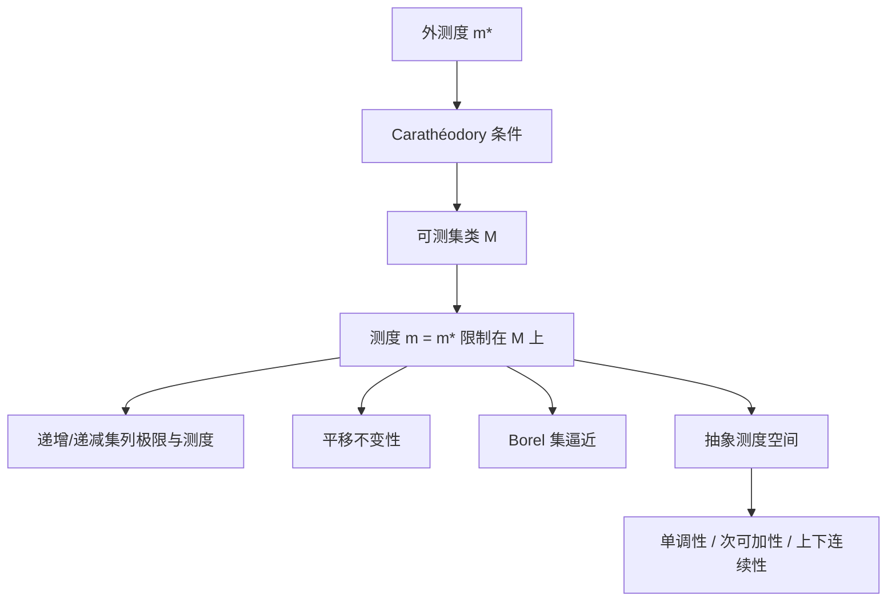
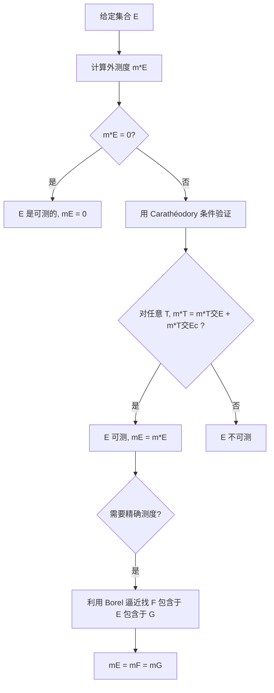

---
subject:
- 实变函数
source:
- 2023-RA-11.md
type: review
tags:
- 外测度
- Lebesgue可测集
- Carathéodory条件
- 可列可加性
- Borel集
- 测度空间
- 完备测度
- 概率测度
aliases:
- 第2章 Lebesgue测度 — 知识点梳理
schema_version: 2
time: "2026-08-31T11:44:20+08:00"
legacy_topics:
- 外测度
- Lebesgue可测集
- Carathéodory条件
- 可测集类
- 可列可加性
- 平移不变性
- Borel集
- 测度空间
- 完备测度
- 概率测度
- 上连续性
- 下连续性
status: not done
---

# 第2章 Lebesgue测度 — 知识点梳理

---

## 一、本章核心脉络

**核心问题**：我们希望给 R^n 中的每个子集赋予一个"体积"（测度），但 Vitali 悖论告诉我们不可能对所有集合同时满足可列可加性、平移不变性和归一性。怎么办？

**思路演进**：先放弃对所有集合直接定义测度——用**外测度**给出任意集合的"外包估计"，再通过 **Carathéodory 条件**筛选出那些"分割性质良好"的集合（即可测集），在这些可测集上**限制外测度**即得到真正的测度。最后把这种构造抽象为一般测度空间。

> 一句话解释这个顺序：先用"外包"思路定义外测度（对一切集合可行），再筛选出满足"分拆不损失信息"的可测集，最后在可测集上建立真正的测度理论并推广到抽象空间。

---

## 二、外测度 — 覆盖任意集合的"最小外包体积"（**核心**）

### 2.1 动机：为什么需要外测度？

R^n 中的开矩体（即各边为开区间的 n 维长方体）$I = (a_1, b_1) \times \cdots \times (a_n, b_n)$ 的体积是显然的：

$$|I| = \prod_{i=1}^n (b_i - a_i)$$

从这个基础出发，我们希望能"量"出 R^n 中任意子集的大小。外测度的想法非常直观：**用可数个开矩体覆盖目标集合，取覆盖总体积的下确界**。

> 一句话来说：外测度就是用最省料的方式来"包住"一个集合，包料的总量就是外测度。

### 2.2 外测度的定义

**定义 2.1.1**（推断自 RA-11 上下文）：对任意 $E \subset \mathbb{R}^n$，其 Lebesgue 外测度定义为

$$m^*(E) = \inf\left\{ \sum_{j=1}^{\infty} |I_j| \;\Big|\; E \subset \bigcup_{j=1}^{\infty} I_j,\; I_j \text{ 为开矩体} \right\}$$

其中 $|I_j|$ 是开矩体 $I_j$ 的体积（各边长的乘积）。

> 一句话来说：外测度 = 用可数多个开矩体覆盖集合所需"总面积"的最小可能值。

**重要说明**：
- 下确界是对**所有可能的可数开矩体覆盖**取的。
- 覆盖不要求互不相交，也不要求有限个——可数无限个即可。
- 这一定义对 R^n 的**任意子集**都有意义。

### 2.3 外测度的基本性质

外测度虽然不是真正的"测度"（它对所有集合有定义，但不满足可列可加性），但它满足以下基本性质：

**性质 1（非负性）**：$m^*(E) \geq 0$，且 $m^*(\emptyset) = 0$。

**性质 2（单调性）**：若 $A \subset B$，则 $m^*(A) \leq m^*(B)$。

> 一句话来说：被包含的集合，外测度不会更大——包小集合需要的料不会超过包大集合。

**性质 3（可列次可加性）**：对任意集合列 $\{E_k\}_{k=1}^{\infty}$，

$$m^*\left(\bigcup_{k=1}^{\infty} E_k\right) \leq \sum_{k=1}^{\infty} m^*(E_k)$$

这是外测度**最重要**的性质。

> 一句话来说：分开包再汇总的总用料，至少不会少于整体包的总用料——次可加性体现的是"批量打包可能更省料"。

**性质 4（平移不变性）**：$m^*(E + x) = m^*(E)$，其中 $E + x = \{y + x \mid y \in E\}$。

> 一句话来说：把集合整体平移，外测度不变——体积不依赖位置。

**证明核心洞察（可列次可加性）**：对每个 $E_k$，取一列覆盖它的开矩体 $\{I_{kj}\}_{j=1}^{\infty}$，使得 $\sum_j |I_{kj}|$ 充分接近 $m^*(E_k)$。把所有覆盖合并起来，就得到 $\bigcup_k E_k$ 的一个可数覆盖，其总体积不超过 $\sum_k m^*(E_k) + \varepsilon$，令 $\varepsilon \to 0$ 即得结论。

---

## 三、Lebesgue 可测集与 Carathéodory 条件（**本章难点**）

### 3.1 外测度的缺陷

外测度虽然是"合理"的（满足次可加性），但它有一个致命缺陷：**不满足可列可加性**。也就是说，存在互不相交的集合列 $\{E_k\}$，使得

$$m^*\left(\bigcup_k E_k\right) < \sum_k m^*(E_k)$$

（回忆 Vitali 构造的反例。）因此不能直接把 $m^*$ 当作对所有集合的"测度"来用。

### 3.2 Carathéodory 条件

Carathéodory 的天才想法是：不要改变外测度的定义，而是**限制它适用的对象**。我们只把 $m^*$ 当作那些满足"良好分拆性质"的集合上的测度。

**定义 2.1.2**（推断）：集合 $E \subset \mathbb{R}^n$ 称为 **Lebesgue 可测的**，如果对**任意**的测试集 $T \subset \mathbb{R}^n$，满足

$$m^*(T) = m^*(T \cap E) + m^*(T \cap E^c)$$

即无论用什么集合 $T$ 去"测试"，$E$ 都能把 $T$ 的外测度**精确地**拆分为 $T$ 与 $E$ 相交部分和不相交部分的外测度之和。

> 一句话来说：可测集就是那些"用外测度切一刀不会漏料"的集合——无论拿什么测试集来切，切开的两块外测度加起来刚好等于整块的外测度。

**关键理解**：
- 条件对**所有** $T \subset \mathbb{R}^n$ 成立——不是只对某些特殊集合。
- 由次可加性，不等式 $m^*(T) \leq m^*(T \cap E) + m^*(T \cap E^c)$ 总是对的，所以真正需要验证的只是**反向不等式**。
- 这个条件的实质是：$E$ 作为一个"刀刃"，能干净利落地切分任何集合的外测度。

### 3.3 可测集类 $\mathfrak{M}$ 的定义

所有 Lebesgue 可测集构成一个集合族，记为 $\mathfrak{M}$。对于 $E \in \mathfrak{M}$，定义其 **Lebesgue 测度** 为

$$m(E) := m^*(E)$$

即在可测集上，外测度直接就是测度。

### 3.4 零外测度集必可测

**定理 2.1.x**（推断）：若 $m^*(E) = 0$，则 $E \in \mathfrak{M}$。

**证明核心**：对任意 $T$，$T \cap E \subset E$，由单调性知 $m^*(T \cap E) \leq m^*(E) = 0$，所以 $m^*(T \cap E) = 0$。从而 $m^*(T) \leq m^*(T \cap E) + m^*(T \cap E^c) = 0 + m^*(T \cap E^c) \leq m^*(T)$，等号成立。

> 一句话来说：外测度为零的集合"太瘦了"，怎么切都不会漏料，自动可测。

---

## 四、可测集类 $\mathfrak{M}$ 的代数结构与测度性质（**核心**）

### 4.1 $\mathfrak{M}$ 是一个 $\sigma$-代数

**定理 2.1.6**（RA-11 中引用）：可测集类 $\mathfrak{M}$ 具有以下代数性质：

(1) $\emptyset \in \mathfrak{M}$，$\mathbb{R}^n \in \mathfrak{M}$；

(2) $E \in \mathfrak{M} \Rightarrow E^c \in \mathfrak{M}$（对补集封闭）；

(3) $E_1, E_2, \ldots \in \mathfrak{M} \Rightarrow \bigcup_{k=1}^{\infty} E_k \in \mathfrak{M}$（对可列并封闭）。

由 De Morgan 律，$\mathfrak{M}$ 对可列交也封闭。因此 $\mathfrak{M}$ 是一个 **$\sigma$-代数**。

> 一句话来说：可测集经过可数次并、交、补操作后仍然可测——可测集类对这些基本集合运算"关起门来不会跑出去"。

**重要推论**：所有开集都是可测集（因为 Borel $\sigma$-代数由开集生成，且 $\mathfrak{M}$ 包含所有开集），从而所有闭集、$F_\sigma$ 集、$G_\delta$ 集以及一般的 Borel 集都是可测的。

### 4.2 Lebesgue 测度的可列可加性

**定理 2.1.6 续**：设 $\{E_k\}_{k=1}^{\infty} \subset \mathfrak{M}$ 是互不相交的可测集列，则

$$m\left(\bigcup_{k=1}^{\infty} E_k\right) = \sum_{k=1}^{\infty} m(E_k)$$

这就是**可列可加性**——测度区别于外测度的最关键特性。

> 一句话来说：不相交的可测集，把它们拼起来的大小恰好等于各自大小的和——这就是"体积"应该有的性质。

**证明核心洞察**：利用 Carathéodory 条件可先证有限可加性（用数学归纳法，每次取 $T = \bigcup_{j=1}^{k} E_j$ 验证一个集合），再利用极限过渡得到可列可加性。

### 4.3 有限并和有限交

由于 $\mathfrak{M}$ 是 $\sigma$-代数，自然有：
- 有限个可测集的并集可测，且若互不相交，则 $m(\bigcup_{k=1}^{n} E_k) = \sum_{k=1}^{n} m(E_k)$。
- 有限个可测集的交集可测。
- $A, B \in \mathfrak{M} \Rightarrow A \setminus B \in \mathfrak{M}$。

---

## 五、可测集列的极限与测度——上连续性与下连续性（**核心**）

### 5.1 递增可测集列的极限

**定理 2.1.8**：设 $\{E_k\}_{k=1}^{\infty} \subset \mathfrak{M}$ 是递增可测集列（即 $E_1 \subset E_2 \subset \cdots$），则

$$\lim_{k \to \infty} E_k = \bigcup_{k=1}^{\infty} E_k \in \mathfrak{M}$$

且

$$m\left(\lim_{k \to \infty} E_k\right) = \lim_{k \to \infty} m(E_k)$$

> 一句话来说：递增可测集列的极限仍可测，而且测度可以"穿过"极限号——先取极限再测等于先测再取极限。

**证明核心**：将 $\bigcup_{k=1}^{\infty} E_k$ 写成互不相交的差集之并：

$$\bigcup_{k=1}^{\infty} E_k = \bigcup_{k=1}^{\infty} (E_k \setminus E_{k-1}), \quad E_0 := \emptyset$$

由 $E_{k-1}$ 与 $E_k \setminus E_{k-1}$ 不相交及测度的有限可加性：

$$m(E_k \setminus E_{k-1}) = m(E_k) - m(E_{k-1})$$

再用可列可加性：

$$m\left(\bigcup_{k=1}^{\infty} E_k\right) = \sum_{k=1}^{\infty} \big(m(E_k) - m(E_{k-1})\big) = \lim_{k \to \infty} m(E_k)$$

最后一步是部分和的极限（裂项相消）。

### 5.2 递减可测集列的极限（**难点**）

**推论 2.1.9**：设 $\{E_k\}_{k=1}^{\infty} \subset \mathfrak{M}$ 是递减可测集列（即 $E_1 \supset E_2 \supset \cdots$），且 **$m(E_1) < \infty$**（有限测度条件是必要的！），则

$$m\left(\lim_{k \to \infty} E_k\right) = \lim_{k \to \infty} m(E_k)$$

其中 $\lim_{k \to \infty} E_k = \bigcap_{k=1}^{\infty} E_k$。

> 一句话来说：递减情况类似，但有个"坑"——第一个集合的测度必须有限，否则结论可能不成立！这是初学者最容易忽略的条件。

**为什么需要 $m(E_1) < \infty$？**

想象 $E_k = (k, \infty)$，每个 $E_k$ 的测度都是 $\infty$，但 $\bigcap_k E_k = \emptyset$，测度是 0。此时 $m(\lim E_k) = 0$ 但 $\lim m(E_k) = \infty$，结论不成立。有限测度条件排除了这种"无限测度漏到无穷远"的情况。

**证明思路**：令 $F_k = E_1 \setminus E_k$，则 $\{F_k\}$ 是递增可测集列，应用定理 2.1.8：

$$m(E_1) - m\left(\bigcap_{k=1}^{\infty} E_k\right) = m\left(\bigcup_{k=1}^{\infty} F_k\right) = \lim_{k \to \infty} m(F_k) = \lim_{k \to \infty} \big(m(E_1) - m(E_k)\big) = m(E_1) - \lim_{k \to \infty} m(E_k)$$

两边消去 $m(E_1)$（前提是它有限！）即得结论。

---

## 六、可测集的平移不变性与 Borel 逼近（**难点**）

### 6.1 平移不变性

**定理 2.1.10**：若 $E \in \mathfrak{M}$，则对任意 $x \in \mathbb{R}^n$，有 $E + x \in \mathfrak{M}$。

> 一句话来说：可测集平移后仍然可测——测度论的"平移不变性"不丢失。

**证明核心**：验证 $E + x$ 满足 Carathéodory 条件。关键利用外测度的平移不变性：对任意 $T \subset \mathbb{R}^n$，

$$m^*(T \cap (E+x)) + m^*(T \cap (E+x)^c) = m^*(((T-x) \cap E) + x) + m^*(((T-x) \cap E^c) + x)$$

$$= m^*((T-x) \cap E) + m^*((T-x) \cap E^c) = m^*(T-x) = m^*(T)$$

因此 $E + x \in \mathfrak{M}$。

### 6.2 可测集的 Borel 逼近

**定理 2.1.11**：对任意 $E \in \mathfrak{M}$，存在 Borel 集 $F, G$，使得

$$F \subset E \subset G, \quad m(F) = m(E) = m(G)$$

> 一句话来说：任何可测集都可以被 Borel 集从内外两侧"紧紧夹住"——内逼近和外逼近的测度都精确等于原集合的测度。

**这意味着**：从测度论角度看，可测集与 Borel 集的差别仅在一个零测集上。

**证明分三步**：

**第一步**（$m(E) < \infty$ 的情形）：构造外逼近 $G$。对每个 $k \in \mathbb{N}$，取一列开矩体 $\{I_j^{(k)}\}$ 覆盖 $E$，满足

$$\sum_{j=1}^{\infty} \big|I_j^{(k)}\big| - \frac{1}{k} \leq m(E) \leq \sum_{j=1}^{\infty} \big|I_j^{(k)}\big|$$

令 $G_k = \bigcup_j I_j^{(k)}$（开集），则 $m(G_k \setminus E) \leq \frac{1}{k}$。取 $G = \bigcap_{k=1}^{\infty} G_k$，则 $G$ 是 $G_\delta$ 型 Borel 集，且 $m(G \setminus E) = 0$，故 $m(G) = m(E)$。

**第二步**（$E$ 有界时构造内逼近 $F$）：取闭矩体 $J \supset E$，令 $S = J \setminus E$。对 $S$ 应用第一步得 $G_\delta$ 集 $G \supset S$ 满足 $m(G) = m(S)$。令 $F = J \cap G^c$，则 $F$ 是 $F_\sigma$ 型 Borel 集且 $F \subset E$，验证 $m(F) = m(E)$。

**第三步**（$E$ 无界时）：将 $\mathbb{R}^n$ 写成递增开矩体列的并，截断 $E$ 得 $E_k = E \cap I_k$，对每个 $E_k$ 用前两步，再取可列并。

---

## 七、抽象测度空间（**拓展**）

RA-11 课件中明确写道："以定理 2.1.6 中的可测集的性质为基本假设引入抽象的测度。"也就是说，从 $\mathbb{R}^n$ 上 Lebesgue 测度的构造中抽象出公理化定义。

### 7.1 可测空间与测度

**定义 2.1.12**：设 $X$ 为非空集，$\mathcal{F} \subset 2^X$ 是 $X$ 的一个 $\sigma$-代数。称 $(X, \mathcal{F})$ 为一个**可测空间**，每个 $A \in \mathcal{F}$ 称为 $\mathcal{F}$-可测集。

若集函数 $\mu: \mathcal{F} \to [0, \infty]$ 满足：

(1) $\mu(\emptyset) = 0$；

(2) 若 $A_n \in \mathcal{F}$（$n = 1, 2, \ldots$）互不相交，则

$$\mu\left(\bigcup_{n=1}^{\infty} A_n\right) = \sum_{n=1}^{\infty} \mu(A_n)$$

则称 $\mu$ 为 $(X, \mathcal{F})$ 上的一个**测度**，称三元组 $(X, \mathcal{F}, \mu)$ 为**测度空间**。

> 一句话来说：测度就是定义在一个 $\sigma$-代数上、满足可列可加性且空集为零的非负集函数——Lebesgue 测度的"灵魂"被提炼为这三条公理。

### 7.2 完备测度

若 $\mu$ 还满足：当 $B \subset A \in \mathcal{F}$ 且 $\mu(A) = 0$ 时，有 $B \in \mathcal{F}$（即零测集的子集也可测），则称 $\mu$ 是**完备测度**，$(X, \mathcal{F}, \mu)$ 是**完备测度空间**。

> 一句话来说：完备测度下，任何零测集的子集都自动可测且测度为零——不存在"藏在零测集里头的不可测集"。

Lebesgue 测度空间 $(\mathbb{R}^n, \mathfrak{M}, m)$ 是完备的。

### 7.3 有限测度与概率测度

- $\mu(X) < \infty$：$\mu$ 称为**有限测度**；
- $\mu(X) = 1$：$\mu$ 称为**概率测度**，$(X, \mathcal{F}, \mu)$ 为概率测度空间。

### 7.4 $\sigma$-有限测度

对 $A \in \mathcal{F}$，若存在 $A_n \in \mathcal{F}$（$n = 1, 2, \ldots$）使得

$$A = \bigcup_{n=1}^{\infty} A_n, \quad \mu(A_n) < \infty$$

则称 $A$ 具有 **$\sigma$-有限测度**。若 $X$ 本身具有 $\sigma$-有限测度，则称 $\mu$ 为 **$\sigma$-有限测度**。

> 一句话来说：$\sigma$-有限意味着整个空间可以分解成可数个测度有限的"小块"——大多数自然地出现的测度都满足这个条件。

### 7.5 测度空间的重要例子（Ex1-Ex5）

| 例子 | 空间 | $\sigma$-代数 | 测度 | 要点 |
|------|------|------------|------|------|
| Ex1 | $\mathbb{R}^n$ | $\mathfrak{M}$ | $m$（Lebesgue 测度） | 最核心的范例 |
| Ex2 | $\mathbb{R}^n$ | $\mathfrak{M}$ | $p(A) = \frac{1}{(2\pi)^{n/2}} \int_A e^{-\frac{1}{2}\sum x_j^2} dx_1 \cdots dx_n$ | 标准正态分布导出的概率测度 |
| Ex3 | $X$ | $2^X$ | $\mu(A) = \vert A \vert$（有限集）或 $\infty$（无限集） | 计数测度；$\mu$ 完备；$\mu$ 是 $\sigma$-有限 $\Leftrightarrow$ $X$ 可列 |
| Ex4 | $X$ | $2^X$ | $\nu(A) = \chi_A(x)$（即 $\delta_x(A)$） | Dirac 测度，集中在一个点 |
| Ex5 | 一一映射下的推前 | $\mathcal{G} = \{f(A) \mid A \in \mathcal{F}\}$ | $\nu(B) = \mu(f^{-1}(B))$ | 通过一一满映射构造新测度空间 |

**Ex3 的深入理解**：计数测度 $\mu(A) = 0 \Leftrightarrow A = \emptyset$。它是完备的（因为 $\mu(A)=0$ 意味着 $A=\emptyset$，其子集只有 $\emptyset$，而 $\emptyset \in 2^X$）。当且仅当 $X$ 是可列集时，计数测度才是 $\sigma$-有限的。

### 7.6 抽象测度的性质

**定理 2.1.13**：设 $(X, \mathcal{F}, \mu)$ 是测度空间，则 $\mu$ 具有以下性质：

**(1) 单调性**：若 $A_1 \subset A_2$，则 $\mu(A_1) \leq \mu(A_2)$。

> 一句话来说：子集的测度不超过母集——跟体积一样。

**(2) 次可加性**（可列）：

$$\mu\left(\bigcup_{k=1}^{\infty} A_k\right) \leq \sum_{k=1}^{\infty} \mu(A_k)$$

> 一句话来说：合并后的测度不超过各自测度之和——测度也满足次可加性，但跟外测度的区别在于测度在不相交时可达到等号。

**(3) 上连续性**（升列）：若 $\{A_k\} \subset \mathcal{F}$ 是一升列（即 $A_1 \subset A_2 \subset \cdots$），则

$$\mu\left(\bigcup_{k=1}^{\infty} A_k\right) = \lim_{n \to \infty} \mu(A_n)$$

**(4) 下连续性**（降列）：若 $\{A_k\} \subset \mathcal{F}$ 是一降列（即 $A_1 \supset A_2 \supset \cdots$），且 **$\mu(A_1) < \infty$**，则

$$\mu\left(\bigcap_{k=1}^{\infty} A_k\right) = \lim_{n \to \infty} \mu(A_n)$$

> 一句话来说：上下连续性是定理 2.1.8 和推论 2.1.9 在抽象测度空间中的推广——说明这两个极限性质不依赖于 Lebesgue 测度的具体构造，只依赖于可列可加性公理。

**证明思路**：上连续性的证明与定理 2.1.8 完全平行——将升列的并集写成不相交差集之并，用可列可加性。下连续性通过取补集化归到上连续性，条件是保证 $m(A_1)$ 有限可以合法做减法。

---

## 判定/决策流程

验证一个集合是否 Lebesgue 可测及求其测度的标准流程：

---

## 核心公式速查表

| 序号 | 公式 | 条件 | 含义 |
|:--:|------|------|------|
| 1 | $m^*(E) = \inf\{\sum \vert I_j\vert \mid \bigcup I_j \supset E\}$ | 定义 | 外测度 = 最小外包体积 |
| 2 | $m^*\left(\bigcup E_k\right) \leq \sum m^*(E_k)$ | 任意 $E_k$ | 可列次可加性 |
| 3 | $m^*(T) = m^*(T \cap E) + m^*(T \cap E^c)$ | $E \in \mathfrak{M}$ | Carathéodory 可测条件 |
| 4 | $m\left(\bigcup E_k\right) = \sum m(E_k)$ | $E_k \in \mathfrak{M}$ 互不相交 | 可列可加性 |
| 5 | $m(\lim_{k\to\infty} E_k) = \lim_{k\to\infty} m(E_k)$ | $\{E_k\} \uparrow$（递增） | 上连续性 |
| 6 | $m(\lim_{k\to\infty} E_k) = \lim_{k\to\infty} m(E_k)$ | $\{E_k\} \downarrow$ 且 $m(E_1) < \infty$ | 下连续性 |
| 7 | $m(E + x) = m(E)$ | $E \in \mathfrak{M}$ | 平移不变性 |
| 8 | $F \subset E \subset G,\; m(F) = m(E) = m(G)$ | $E \in \mathfrak{M}$ | Borel 内外逼近 |
| 9 | $\mu(\bigcup A_k) \leq \sum \mu(A_k)$ | 测度空间 | 抽象测度的次可加性 |

---

## 易错点与注意事项

> [!warning] **易错点 1：外测度不等于测度**
> $m^*$ 定义在所有子集上但只满足次可加性；$m$ 只在 $\mathfrak{M}$ 上定义且满足可列可加性。初学者常混淆两者。

> [!warning] **易错点 2：Carathéodory 条件要对所有 T 成立**
> 验证可测性时不能只取 $T$ 为特殊集合（如开集），必须对**任意** $T \subset \mathbb{R}^n$ 验证等式。由于次可加性自动保证 $\leq$ 方向，实际只需验证 $\geq$ 方向。

> [!warning] **易错点 3：递减集列的下连续性要求 $m(E_1) < \infty$**
> 这是推论 2.1.9 和定理 2.1.13(4) 的关键前提。反例：$E_k = (k, \infty)$，$m(E_k) = \infty$ 但 $\lim E_k = \emptyset$ 测度为零，结论不成立。记牢：递减时要先检查第一个集合测度是否有限。

> [!warning] **易错点 4：不可测集的存在性**
> 并非所有集合都可测——Vitali 集就是典型的反例（依赖选择公理构造）。这意味着 $\mathfrak{M}$ 真包含于 $2^{\mathbb{R}^n}$。

> [!warning] **易错点 5：计数测度的 $\sigma$-有限性**
> 计数测度 $\mu$ 满足 $\mu(A) = 0 \Leftrightarrow A = \emptyset$，所以它是完备的。但它 $\sigma$-有限当且仅当 $X$ 是可列集——不可列空间上的计数测度不是 $\sigma$-有限的。

---

## 相关知识点链接

| 链接 | 为什么需要看 |
|------|-------------|
| [[01-集合与基数-知识梳理]] | 可测集类 $\mathfrak{M}$ 是 $\sigma$-代数的核心例子；集合运算贯穿本章 |
| [[RA-06-开集闭集与集合代数]] | $\sigma$-代数和 Borel 集的定义是理解 $\mathfrak{M}$ 的前置知识 |
| [[RA-07-开集的结构]] | Cantor 集是零测集的重要例子；开集的可数结构用于 Borel $\sigma$-代数的生成 |
| [[RA-08-度量空间]] | 完备性、紧致性的度量空间概念帮助理解 $G_\delta$ 和 $F_\sigma$ 集 |
| [[03_Sources/Courses/归档/实变函数/课件/MD/2023-RA-12]] | 第12讲引入可测函数——可测集是定义可测函数的载体 |

---

## 作业与练习

本章对应第10-11讲，课件中的作业与研究性主题如下：

**第10讲**（对应的作业主题推断）：
- 验证外测度的基本性质（单调性、次可加性）的具体例子
- 用 Carathéodory 条件验证简单集合（区间、单点集）的可测性

**第11讲 RA-11**：课件中末页示例（Ex1-Ex5）建议逐一手动验证，特别是：
- 验证 $(\mathbb{R}^n, \mathfrak{M}, m)$ 是完备测度空间
- 验证 $(\mathbb{R}^n, \mathfrak{M}, p)$ 中的 $p$ 是概率测度
- 验证计数测度完备且 $\sigma$-有限当且仅当 $X$ 可列
- 验证 Dirac 测度 $\delta_x$ 是完备测度
- 验证定理 2.1.13 的上下连续性证明（模仿定理 2.1.8 和推论 2.1.9 的证明思路）

**做题建议**：
1. 先用区间/矩体等简单集合练习 Carathéodory 条件的使用，建立直观
2. 重点掌握外测度到测度的过渡逻辑——这是后续积分理论的基石
3. 递减集列时永远先检查 $m(E_1) < \infty$ 是否满足
4. Borel 逼近定理的构造性证明很经典，建议完整推演一遍

- [[03_Sources/Courses/归档/实变函数/习题库/02-Lebesgue测度/README|第2章习题库]]：2.1 递减列有限测度条件的反例；2.2—2.6 测度空间、Gauss 概率测度、计数测度、Dirac 测度和推前测度的验证。

## 可复用知识条目

本章涉及以下独立条目；后续补充与跨课程应用统一维护在条目中。

### 概念入口

- [[01_Knowledge/σ代数|σ代数]]
- [[01_Knowledge/可测集|可测集]]
- [[01_Knowledge/外测度|外测度]]
- [[01_Knowledge/零测集|零测集]]
