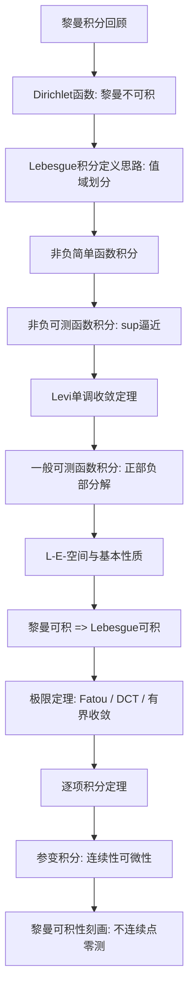
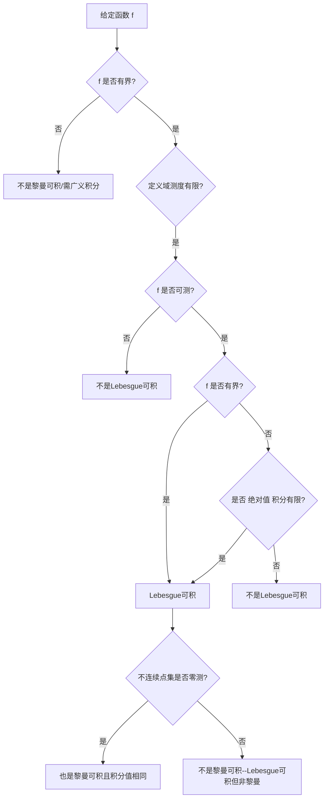

---
subject:
- 实变函数
source:
- 2023-RA-15.md, 2023-RA-16.md, 2023-RA-17.md, 2023-RA-18.md, 2023-RA-19.md, 2023-RA-20.md
type: review
tags:
- Lebesgue积分
- 黎曼积分
- 非负可测函数
- 简单函数逼近
- Levi单调收敛定理
- Fatou引理
- 控制收敛定理
- 逐项积分
- 参变积分
- 零测集
aliases:
- 第4章 Lebesgue积分 — 知识点梳理
schema_version: 2
time: "2026-08-31T11:44:20+08:00"
legacy_topics:
- Lebesgue积分
- 黎曼积分
- 非负可测函数
- 简单函数逼近
- Levi单调收敛定理
- Fatou引理
- Lebesgue控制收敛定理
- 逐项积分
- 参变积分
- 黎曼可积性刻画
- 零测集
- L(E)空间
status: not done
---

# 第4章 Lebesgue积分 — 知识点梳理

---

## 一、本章核心脉络

本章是实变函数课程的**核心章节**。基本问题是：

> 黎曼积分对"好"的函数（连续、分段连续）工作良好，但面对 Dirichlet 函数这类"极度不连续"的函数时无能为力。Lebesgue 积分的根本思想是**放弃对定义域的精细划分，转而对值域进行划分**——这使得更多函数变得可积，同时极限运算与积分运算的交换条件大大放宽。

下面的流程图展示各概念的演进关系：

**为什么是这个顺序？** 先从黎曼积分的困境出发（Dirichlet 函数），引出 Lebesgue 对值域划分的思路。定义从最简单的非负简单函数开始，通过逼近上升到非负可测函数（用 Levi 定理贯通极限），再通过正部/负部分解推广到一般函数。有了积分定义后才能讨论它与黎曼积分的关系，以及 Lebesgue 积分最强大的武器——极限定理。最后用极限定理回过来刻画黎曼可积性的本质条件（不连续点零测集），形成完整的理论闭环。

---

## 二、黎曼积分回顾与 Dirichlet 函数（基础回顾）

### 2.1 黎曼积分的定义

设 $f(x): [a,b] \to \mathbb{R}$ 为有界函数。任取划分：

$$a = \xi_0 < \xi_1 < \cdots < \xi_n = b$$

对每个子区间 $[\xi_{i-1}, \xi_i]$，定义：

$$M_i := \sup_{\xi_{i-1} < x \leq \xi_i} f(x), \qquad m_i := \inf_{\xi_{i-1} < x \leq \xi_i} f(x)$$

> 一句话来说：在每个小区间上用函数的最大值和最小值来"夹逼"积分。

**黎曼上和**（大和）：

$$S = \sum_{i=1}^{n} (\xi_i - \xi_{i-1}) M_i$$

**黎曼下和**（小和）：

$$s = \sum_{i=1}^{n} (\xi_i - \xi_{i-1}) m_i$$

**黎曼上积分**：对所有可能划分取下确界

$$R\overline{\int_a^b} f(x)\,dx = \inf S$$

**黎曼下积分**：对所有可能划分取上确界

$$R\underline{\int_a^b} f(x)\,dx = \sup s$$

若 $R\overline{\int_a^b} f(x)\,dx = R\underline{\int_a^b} f(x)\,dx$，则称 $f(x)$ **黎曼可积**。

> 一句话来说：黎曼积分的本质是"用在越来越细的定义域划分下，上和与下和是否趋于同一个数"来判断可积性。

### 2.2 Dirichlet 函数：黎曼不可积的经典例子

$$D(x) = \begin{cases} 1, & x \in \mathbb{Q} \cap [0,1], \\ 0, & x \in [0,1] \setminus \mathbb{Q}. \end{cases}$$

- 任意子区间内既有有理数又有无理数，故 $M_i = 1$，$m_i = 0$ 对所有 $i$ 成立
- 上积分 = 1，下积分 = 0，不相等 $\Rightarrow$ **不是黎曼可积函数**

> 一句话来说：Dirichlet 函数处处不连续，在黎曼框架下每一小块的上确界和下确界差恒为 1，无法通过加密划分来消除。

### 2.3 Lebesgue 积分的三种等价定义思路

课件介绍了从黎曼积分过渡到 Lebesgue 积分的三种定义方式：

| 定义方法 | 核心思想 | 与黎曼的区别 |
|----------|----------|-------------|
| 方法一：值域划分 | 分割值域 $[-M, M]$，用 $\sum \xi_i \cdot m(E(l_i \leq f < l_{i+1}))$ 逼近 | 对**值域**做划分，集合 $E(\cdots)$ 不必是区间 |
| 方法二：定义域任意划分 | $E = \bigcup E_j$（$E_j$ 不必是区间），取 $\sup s = \inf S$ | 划分子集可以是任意可测集，不限于区间 |
| 方法三：简单函数逼近 | 用单调递增的非负简单函数列 $\{\varphi_n\}$ 逼近 $f$，取积分极限 | 通过**函数逼近**而非集合划分定义积分 |

> 一句话来说：三种方法殊途同归——方法三（简单函数逼近）最便于理论推导，课件后续均采用此法。

---

## 三、非负可测函数的 Lebesgue 积分定义（**本章核心**）

### 3.1 非负简单函数的积分

**定义 3.1.1** 设 $h(x)$ 是可测集 $E \subset \mathbb{R}^n$ 上的非负可测简单函数：

$$h(x) = \sum_{j=1}^{m} a_j \chi_{E_j}(x)$$

其中 $E_j$ 互不相交、可测，$a_j \geq 0$。定义 $h(x)$ 在 $E$ 上的积分为：

$$\int_E h(x)\,dx = \sum_{j=1}^{m} a_j \cdot m(E_j)$$

> 一句话来说：简单函数的积分就是"每个柱体的体积之和"——底是 $E_j$ 的测度，高是取值 $a_j$。

**几何意义**：积分等于 $h(x)$ 下方图 $\{(x,y) \in \mathbb{R}^{n+1} \mid x \in E,\; 0 \leq y \leq h(x)\}$ 的体积。

**线性性质**：对非负简单函数 $h, g$ 和 $a \geq 0$，
$$\int_E a h(x)\,dx = a \int_E h(x)\,dx, \qquad \int_E (h+g)\,dx = \int_E h\,dx + \int_E g\,dx$$

**递增集合列的极限性质**：若 $\{E_k\}$ 是 $E$ 中递增可测子集合列且 $\lim_{k \to \infty} E_k = E$，则

$$\lim_{k \to \infty} \int_{E_k} h(x)\,dx = \int_E h(x)\,dx$$

### 3.2 非负可测函数的积分定义

**定义 3.1.2** 设 $f(x)$ 是 $E$ 上的非负可测函数，定义：

$$\int_E f(x)\,dx = \sup \left\{ \int_E h(x)\,dx \;\middle|\; \begin{array}{l} h(x) \text{ 是 } E \text{ 上的非负简单可测函数} \\ h(x) \leq f(x) \end{array} \right\}$$

> 一句话来说：非负可测函数的积分，就是用所有不超过它的简单函数的积分去"逼近"——取这些逼近值的**上确界**。

注意：可以有 $\int_E f(x)\,dx = \infty$。若 $\int_E f(x)\,dx < \infty$，则称 $f(x)$ 在 $E$ 上 **Lebesgue 可积**。

### 3.3 非负可测函数积分的基本性质

| 性质 | 内容 | 直观理解 |
|------|------|----------|
| (1) 零测集上积分 | 若 $m(E)=0$，则 $\int_E f(x)\,dx = 0$ | 底面积为 0，体积自然为 0 |
| (2) 子集上的积分 | $\int_A f(x)\,dx = \int_E f(x) \chi_A(x)\,dx$ | 限制在子集上 = 乘上指示函数 |
| (3) 单调性 | 若 $f \leq g$，则 $\int_E f \leq \int_E g$ | 函数越大，下方图体积越大 |
| (4) 有界可测必可积 | 若 $m(E) < \infty$ 且 $f$ 有界可测，则 $f \in L(E)$ | 有限测度上的有界函数一定可积 |

### 3.4 Levi 单调收敛定理（定理 3.1.3，**核心**）

**定理** 设 $\{f_k(x)\}$ 是 $E$ 上的非负可测函数列，满足：

$$f_1(x) \leq f_2(x) \leq \cdots \leq f_k(x) \leq \cdots, \qquad \lim_{k \to \infty} f_k(x) = f(x) \quad (x \in E)$$

则

$$\lim_{k \to \infty} \int_E f_k(x)\,dx = \int_E f(x)\,dx$$

> 一句话来说：对于**单调递增**的非负可测函数列，极限和积分可以安全地交换顺序。

**核心证明洞察**：证 $\lim \int f_k \geq \int f$ 是最关键的方向。技巧是取 $\alpha \in (0,1)$，用简单函数 $h \leq f$ 构造集合 $E_k = E(f_k \geq \alpha h)$。由于 $f_k \uparrow f$，有 $E_k \uparrow E$，从而：

$$\int_E f_k \geq \int_{E_k} f_k \geq \int_{E_k} \alpha h = \alpha \int_{E_k} h \to \alpha \int_E h$$

令 $\alpha \to 1$，再对 $h \leq f$ 取上确界，即得 $\lim \int f_k \geq \int f$。

> 结合定理 2.2.5（非负可测函数可由上升非负简单函数列逼近），非负可测函数积分的性质均可通过 Levi 定理从简单函数"遗传"而来。

### 3.5 积分的线性性质（定理 3.1.4）

**定理** 设 $f(x), g(x)$ 是 $E$ 上非负可测函数，$\alpha, \beta \geq 0$，则：

$$\int_E (\alpha f(x) + \beta g(x))\,dx = \alpha \int_E f(x)\,dx + \beta \int_E g(x)\,dx$$

**证明思路**：取非负上升简单函数列 $\varphi_k \uparrow f$，$\psi_k \uparrow g$，则 $\alpha\varphi_k + \beta\psi_k \uparrow \alpha f + \beta g$。利用简单函数的线性性质和 Levi 定理两边取极限即得。

### 3.6 两个重要推论（推论 3.1.5 与定理 3.1.6）

**推论 3.1.5**：
- (1) 若 $f = g$ a.e. $[E]$，则 $\int_E f = \int_E g$
- (2) 若 $\int_E f < \infty$，则 $f < \infty$ a.e. $[E]$

> 一句话来说：(1) 改变函数在一个零测集上的值不影响积分；(2) 可积函数几乎处处有限。

**定理 3.1.6**：若 $\int_E f(x)\,dx = 0$，则 $f = 0$ a.e. $[E]$。

> 一句话来说：非负可测函数的积分为 0，当且仅当函数几乎处处为零——积分具有"正定性"。

**证明技巧**：取 $E_k = E(f \geq 1/k)$，则 $0 = \int_E f \geq \int_{E_k} f \geq \frac{1}{k} m(E_k)$，故 $m(E_k) = 0$，从而 $m(\bigcup E_k) = 0$。

---

## 四、一般可测函数的积分与 $L(E)$ 空间（**核心**）

### 4.1 正部与负部分解

**定义 3.1.7** 设 $f(x) \in \mathfrak{M}(E)$。定义：

$$f^+(x) = \max(0, f(x)), \qquad f^-(x) = \max(-f(x), 0)$$

则 $f = f^+ - f^-$，$|f| = f^+ + f^-$。

若 $f^+$ 和 $f^-$ 中至少有一个可积，则定义 $f$ 在 $E$ 上的积分为：

$$\int_E f(x)\,dx = \int_E f^+(x)\,dx - \int_E f^-(x)\,dx$$

当上式右端两个积分值都有限时，称 $f$ 在 $E$ 上 **Lebesgue 可积**，记 $f \in L(E)$。

> 一句话来说：把函数拆成"正的部分"和"负的部分"，分别对两个非负函数积分再相减——把一般函数的积分完全归结到非负情形。

### 4.2 Lebesgue 可积 = 绝对可积（**难点**）

**关键性质**：

$$f^+ \in L(E),\; f^- \in L(E) \;\Longleftrightarrow\; f \in L(E) \;\Longleftrightarrow\; |f| \in L(E)$$

$$\int_E |f|\,dx = \int_E f^+\,dx + \int_E f^-\,dx$$

> 一句话来说：在 Lebesgue 积分框架下，**可积即绝对可积**——这与黎曼积分截然不同！

**对比**：在黎曼积分中，$\int_0^1 \frac{1}{x}\sin(\frac{1}{x})\,dx$ 作为广义黎曼积分存在（条件收敛），但 $|\frac{1}{x}\sin(\frac{1}{x})|$ 不是广义黎曼可积的。Lebesgue 积分则要求 $|f|$ 可积，因此该函数**不是 Lebesgue 可积的**。

**级数类比**：条件收敛但不绝对收敛的级数，重新排列后可收敛到任何值（Riemann 重排定理）。Lebesgue 积分通过要求绝对可积避免了这种病态。

### 4.3 $L(E)$ 的基本性质

| 性质 | 内容 |
|------|------|
| (1) 几乎处处有限 | 若 $f \in L(E)$，则 $|f| < \infty$ a.e. $[E]$ |
| (2) a.e. 相等 | 若 $f = g$ a.e. $[E]$ 且 $f \in L(E)$，则 $g \in L(E)$ 且积分相等 |
| (3) 控制判别 | 若 $f \in \mathfrak{M}(E)$，$g \in L(E)$ 且 $|f| \leq g$，则 $f \in L(E)$ 且 $|\int_E f| \leq \int_E g$ |
| (4) 单调性 | 若 $f, g \in L(E)$ 且 $f \leq g$，则 $\int_E f \leq \int_E g$ |
| (5) 有限测度+有界 | 若 $m(E) < \infty$ 且 $|f| < M$，则 $f \in L(E)$ |

### 4.4 积分的线性性质（定理 3.1.9，**核心**）

**定理** 设 $f, g \in L(E)$，$\alpha \in \mathbb{R}$，则：

$$\alpha f \in L(E), \quad f+g \in L(E)$$

$$\int_E \alpha f\,dx = \alpha \int_E f\,dx, \qquad \int_E (f+g)\,dx = \int_E f\,dx + \int_E g\,dx$$

> $L(E)$ 是一个线性空间。

**证明核心技巧**：利用恒等式 $(f+g)^+ + f^- + g^- = (f+g)^- + f^+ + g^+$ 将和的积分化归为非负函数的线性性质。

### 4.5 有界可测函数的另一等价定义（定理 3.1.10）

**定理** 设 $f(x)$ 是 $E$ 上有界可测函数（$|f| < M$，$m(E) < \infty$），对 $[-M, M]$ 做划分：

$$-M = \alpha_0 < \alpha_1 < \cdots < \alpha_k = M, \quad \delta = \max(\alpha_j - \alpha_{j-1})$$

记 $E_j = E(\alpha_{j-1} \leq f < \alpha_j)$，则对任意 $\xi_j \in [\alpha_{j-1}, \alpha_j]$：

$$\lim_{\delta \to 0} \sum_{j=1}^{k} \xi_j \cdot m(E_j) = \int_E f(x)\,dx$$

> 一句话来说：这就是第 15 讲提到的"值域划分"定义法——分割值域而非定义域，当划分越来越细时逼近积分。这是连接"黎曼直觉"和"Lebesgue 定义"的桥梁。

### 4.6 积分的绝对连续性（定理 3.1.11）

**定理** 设 $f \in L(E)$，则 $\forall \varepsilon > 0$，$\exists \delta > 0$，使得对任意 $A \subset E$ 且 $m(A) < \delta$：

$$\left| \int_A f(x)\,dx \right| \leq \int_A |f(x)|\,dx < \varepsilon$$

> 一句话来说：可积函数在"小测度集合"上的积分可以任意小——积分的质量不会集中在一个零测集上。

**证明技巧**：用简单函数 $\varphi \leq |f|$ 逼近，使得 $\int_E (|f| - \varphi) < \varepsilon/2$，再取 $\delta = \varepsilon/(2\max\varphi)$。

### 4.7 积分的平移不变性（定理 3.1.12）

**定理** 设 $f \in L(\mathbb{R}^n)$，则 $\forall y \in \mathbb{R}^n$：

$$f(x+y) \in L(\mathbb{R}^n), \qquad \int_{\mathbb{R}^n} f(x+y)\,dx = \int_{\mathbb{R}^n} f(x)\,dx$$

**证明思路**：先证非负简单函数情形（由测度平移不变性 $m(E_i - y) = m(E_i)$），再用 Levi 定理推广到非负可测函数，最后用正部/负部分解推广到一般可积函数。

### 4.8 用连续函数逼近（定理 3.1.13，**难点**）

**定理** 设 $f \in L(E)$，则 $\forall \varepsilon > 0$，存在 $\mathbb{R}^n$ 上具有紧支集的连续函数 $g(x)$ 使得：

$$\int_E |f(x) - g(x)|\,dx < \varepsilon$$

**推论**：存在 $\mathbb{R}^n$ 上具有紧支集的连续函数列 $\{g_k(x)\}$ 满足：
- (1) $\lim_{k \to \infty} \int_E |f(x) - g_k(x)|\,dx = 0$
- (2) $\lim_{k \to \infty} g_k(x) = f(x)$ a.e. $[E]$

> 一句话来说：任何可积函数都可以用"好函数"（紧支集连续函数）在 $L^1$ 意义下任意逼近——这意味着可积函数并不"遥远"，它们就是连续函数的 $L^1$ 极限。

---

## 五、黎曼积分与 Lebesgue 积分的关系（**核心**）

### 5.1 核心定理（定理 3.1.15）

**定理** $f(x)$ 是闭区间 $I = [a, b]$ 上的有界函数。若 $f(x)$ 在 $I$ 上**黎曼可积**，则 $f(x)$ 在 $I$ 上也是 **Lebesgue 可积**的，且：

$$\int_I f(x)\,dx = \int_a^b f(x)\,dx$$

（左边为 Lebesgue 积分，右边为黎曼积分。）

> 一句话来说：黎曼可积的函数一定 Lebesgue 可积，而且两个积分值完全一样——Lebesgue 积分是黎曼积分的**真正推广**。

**证明纲要**（这是理解两种积分关系的关键）：

1. 取一列越来越细的划分 $\Delta_n$（$\Delta_n \subset \Delta_{n+1}$，$|\Delta_n| \to 0$）
2. 构造两个函数列：
   - $\varphi_n(x)$：每段取 $\inf f$（下函数列），单调递增
   - $\psi_n(x)$：每段取 $\sup f$（上函数列），单调递减
3. 由黎曼可积性，$\int \varphi_n$ 和 $\int \psi_n$ 都趋于黎曼积分值
4. 令 $\bar{f} = \lim \psi_n$，$\underline{f} = \lim \varphi_n$，则 $\bar{f} \geq f \geq \underline{f}$
5. 计算得 $\int_I (\bar{f} - \underline{f})\,dx = 0$，由定理 3.1.6 知 $\bar{f} = \underline{f} = f$ a.e.
6. 因此 $f$ 可测（等于两个可测函数的 a.e. 极限），且 Lebesgue 积分 = 黎曼积分

**注意**：反之不成立！Dirichlet 函数就是 Lebesgue 可积但非黎曼可积的例子。

### 5.2 测度空间上的积分推广（了解即可）

课件将 Lebesgue 积分的定义推广到一般测度空间 $(X, \mathcal{F}, \mu)$：

- **定义 3.1.16**：非负 $\mu$ 可测简单函数的积分 $\int_X h \,\mu(dx) = \sum a_j \mu(A_j)$
- **定义 3.1.17**：非负 $\mu$ 可测函数的积分（取上确界）
- **定义 3.1.18**：一般 $\mu$ 可测函数的积分（正部/负部分解），$L(X, \mathcal{F}, \mu)$ 空间

> 这意味着前面关于 Lebesgue 积分的所有性质都可以平移到一般的测度空间上。$S^+(X)$ 上的积分映射 $I$ 是可加泛函。

---

## 六、Lebesgue 积分的极限定理（**本章核心 + 难点**）

这是 Lebesgue 积分理论最强大的部分——相比黎曼积分需要一致收敛等苛刻条件，Lebesgue 积分下极限与积分交换的条件大大放宽。

### 6.1 Lebesgue 基本定理（定理 3.2.1）

**定理** 设 $\{f_n(x)\}$ 是 $E$ 上的非负可测函数列，$f(x) = \sum_{n=1}^{\infty} f_n(x)$，则：

$$\int_E f(x)\,dx = \sum_{n=1}^{\infty} \int_E f_n(x)\,dx$$

即：

$$\int_E \sum_{n=1}^{\infty} f_n(x)\,dx = \sum_{n=1}^{\infty} \int_E f_n(x)\,dx$$

> 一句话来说：**非负可测函数的级数**，积分和求和永远可以交换——这是 Levi 定理的直接推论。

**证明**：令 $S_k(x) = \sum_{n=1}^{k} f_n(x)$，则 $S_k \uparrow f$，由 Levi 定理即得。

### 6.2 积分关于集合的可数可加性（定理 3.2.2）

**定理** 若 $\{E_n\}$ 是 $E$ 的互不相交可测子集且 $E = \bigcup_{n=1}^{\infty} E_n$，当 $f$ 在 $E$ 上有积分时：

$$\int_E f(x)\,dx = \sum_{n=1}^{\infty} \int_{E_n} f(x)\,dx$$

> 一句话来说：积分作为"集合函数"具有可数可加性——这是测度可数可加性在积分上的体现。

### 6.3 Fatou 引理（定理 3.2.3，**难点**）

**定理** 设 $\{f_n(x)\}$ 是 $E$ 上的**非负**可测函数列，则：

$$\int_E \varliminf_{n \to \infty} f_n(x)\,dx \leq \varliminf_{n \to \infty} \int_E f_n(x)\,dx$$

> 一句话来说：非负函数列的下极限的积分，不超过积分的下极限——"极限跑进积分号里"积分值只会变小（或不变），不会变大。

**证明核心技巧**：令 $g_n(x) = \inf\{f_j(x) \mid j \geq n\}$，则 $g_n \uparrow \varliminf f_n$，用 Levi 定理即得。

**Fatou 引理中不等号可能严格成立的反例**（Ex1）：

$$f_n(x) = \frac{\sqrt{n}}{\sqrt{2\pi}} e^{-\frac{nx^2}{2}} \quad (x \in \mathbb{R})$$

- $\int_{\mathbb{R}} f_n(x)\,dx = 1$（正态分布密度）
- $\lim_{n \to \infty} f_n(x) = 0$（$\forall x \neq 0$），逐点极限为 0
- 故 $0 = \int \lim f_n < \lim \int f_n = 1$，左边严格小于右边

> **关键启示**：Fatou 引理只能给出**下界估计**，不能保证等号成立。要得到等号，需要更强的条件——这就是控制收敛定理的意义。

### 6.4 Lebesgue 控制收敛定理（定理 3.2.4，**本章最重要定理**）

**定理** 设 $E \in \mathfrak{M}$，$\{f_n(x)\} \subset \mathfrak{M}(E)$，$\lim_{n \to \infty} f_n(x) = f(x)$ a.e. $[E]$。若存在**控制函数** $F(x) \in L(E)$ 使得 $\forall n$：

$$|f_n(x)| \leq F(x) \quad \text{a.e. } [E]$$

则：

$$f_n \in L(E), \quad f \in L(E), \qquad \lim_{n \to \infty} \int_E f_n(x)\,dx = \int_E f(x)\,dx$$

> 一句话来说：只要函数列被一个**公共的可积函数**"压住"，极限和积分就可以交换——这是 Lebesgue 积分最常用的极限交换工具。

**证明核心技巧**：构造 $g_n(x) = |f_n(x) - f(x)| \leq 2F(x)$，对 $\{2F - g_n\}$ 应用 Fatou 引理：

$$2\int_E F - \int_E \varliminf g_n \leq 2\int_E F - \varlimsup \int_E g_n$$

即 $\varlimsup \int_E g_n \leq \int_E \varliminf g_n = 0$（因为 $\lim g_n = 0$ a.e.），从而 $\int_E g_n \to 0$。

### 6.5 依测度收敛下的控制收敛定理（推论 3.2.5）

**推论** 设 $f_n \xrightarrow{m} f$（依测度收敛），若存在 $F \in L(E)$ 使得 $|f_n(x)| \leq F(x)$ a.e.，则仍有：

$$\lim_{n \to \infty} \int_E f_n(x)\,dx = \int_E f(x)\,dx$$

**证明要点**：由 Riesz 定理，从 $f_n \xrightarrow{m} f$ 可抽出子列 $f_{n_k} \to f$ a.e.，再结合反证法和 DCT 证明原列也收敛。

### 6.6 有界收敛定理（推论 3.2.6）

**推论** 设 $m(E) < \infty$，$\{f_n\} \subset L(E)$ **一致有界**（$\exists M > 0$ 使得 $|f_n(x)| \leq M$）。则当 $f_n \to f$ a.e. $[E]$ 或 $f_n \xrightarrow{m} f$ 时：

$$\lim_{n \to \infty} \int_E f_n(x)\,dx = \int_E f(x)\,dx$$

> 一句话来说：在**有限测度集合**上，**一致有界**的函数列极限和积分可直接交换——这是 DCT 的最简单实用版本（控制函数取常值函数 $F(x) \equiv M$）。

### 6.7 极限定理综合对比

| 定理 | 条件 | 结论 | 用途场景 |
|------|------|------|----------|
| Levi (3.1.3) | $f_n \geq 0$，$f_n \uparrow f$ | $\lim\int f_n = \int f$ | 单调递增列 |
| Fatou (3.2.3) | $f_n \geq 0$ | $\int\varliminf f_n \leq \varliminf\int f_n$ | 需要下界估计 |
| DCT (3.2.4) | $|f_n| \leq F \in L$，$f_n \to f$ a.e. | $\lim\int f_n = \int f$ | **最常用**，有控制函数 |
| 推论 3.2.5 | DCT + $f_n \xrightarrow{m} f$ | $\lim\int f_n = \int f$ | 依测度收敛情形 |
| 有界收敛 (3.2.6) | $m(E) < \infty$，$|f_n| \leq M$ | $\lim\int f_n = \int f$ | 有限测度+一致有界 |

### 6.8 典型例题

**Ex2**（控制函数的构造）求 $I = \lim_{n \to \infty} \int_0^\infty e^{-x} \cos\left(x \frac{\ln(n+x)}{n}\right) dx$。

**解**：逐点极限 $\lim_{n \to \infty} f_n(x) = e^{-x} \cos 0 = e^{-x}$？等一等——实际上 $\frac{\ln(n+x)}{n} \to 0$，所以 $\cos(x \cdot 0) = \cos 0 = 1$，即 $\lim f_n(x) = e^{-x}$。再仔细看：课件给出的极限是 $0$，$\cos$ 里面是 $x \cdot \frac{\ln(n+x)}{n}$。当 $n \to \infty$ 时，$\frac{\ln(n+x)}{n} \to 0$，所以 $\cos \to 1$，故被积函数趋于 $e^{-x}$。构造控制函数：

$$\left| e^{-x} \cos\left(x \frac{\ln(n+x)}{n}\right) \right| \leq e^{-x} \cdot \frac{\ln(n+x)}{n+x} \cdot \frac{n+x}{n} \leq e^{-x} \cdot e^{-1} \cdot (1+x) =: F(x)$$

其中用了 $\frac{\ln t}{t} \leq e^{-1}$（$t > 0$）。验证 $\int_0^\infty F(x)\,dx < \infty$，故 $F$ 即为控制函数。由 DCT：

$$I = \int_0^\infty \lim_{n \to \infty} f_n(x)\,dx = \int_0^\infty 0\,dx = 0$$

**Ex3** $\lim_{n \to \infty} \int_0^1 \frac{n^{3/2} x}{1 + n^2 x^2}\,dx$。

**解**：注意到 $\frac{n^{3/2} x}{1 + n^2 x^2} \leq x^{-1/2} =: F(x)$（$\forall x > 0, n$），$F \in L([0,1])$。由 DCT：

$$I = \int_0^1 \lim_{n \to \infty} f_n(x)\,dx = \int_0^1 0\,dx = 0$$

---

## 七、逐项积分与参变积分（**难点**）

### 7.1 逐项积分定理（定理 3.2.7）

**定理** 设 $m(E) < \infty$，$\{f_n\} \subset L(E)$，若 $\sum_{n=1}^{\infty} \int_E |f_n(x)|\,dx < \infty$，则：

- $\sum_{n=1}^{\infty} f_n(x)$ 在 $E$ 上**几乎处处收敛**
- 记 $f(x) = \sum_{n=1}^{\infty} f_n(x)$，有 $f \in L(E)$ 且

$$\sum_{n=1}^{\infty} \int_E f_n(x)\,dx = \int_E f(x)\,dx$$

> 一句话来说：只要绝对值积分的级数收敛，就可以**逐项积分**——先积分再求和 = 先求和再积分。

**证明思路**：令 $F(x) = \sum_{n=1}^{\infty} |f_n(x)|$，由定理 3.2.1（非负可测函数逐项积分）知 $\int_E F = \sum \int_E |f_n| < \infty$，故 $F \in L(E)$，从而 $F$ 几乎处处有限（级数 a.e. 绝对收敛）。又 $|S_m(x)| \leq \sum_{n=1}^m |f_n| \leq F(x)$，由 DCT 即得结论。

### 7.2 参变积分（定理 3.2.8，**难点**）

**定义**：$f(x,y): E \times [a,b] \to \overline{\mathbb{R}}$，$f(\cdot, y) \in L(E)$（$\forall y \in [a,b]$），称

$$\varphi(y) = \int_E f(x,y)\,dx$$

为参变积分。核心问题：极限/连续性/求导能否穿过积分号？

**定理 3.2.8** 对于上述 $\varphi(y)$：

| 结论 | 条件 | 结果 |
|------|------|------|
| (1) 极限交换 | $\exists F \in L(E)$ 使得 $|f(x,y)| \leq F(x)$，且 $\lim_{y \to y_0} f(x,y)$ a.e. 存在 | $\lim_{y \to y_0} \varphi(y) = \int_E \lim_{y \to y_0} f(x,y)\,dx$ |
| (2) 连续性 | $\exists F \in L(E)$ 使得 $|f(x,y)| \leq F(x)$，且 $f(x,y)$ 对 a.e. $x$ 在 $y_0$ 连续 | $\varphi(y)$ 在 $y_0$ 连续 |
| (3) 可微性 | $\exists F \in L(E)$ 使得 $|f_y(x,y)| \leq F(x)$ | $\varphi'(y) = \int_E f_y(x,y)\,dx$ |

> 一句话来说：参变积分的极限/连续/求导问题，本质都是找**统一的控制函数**——这就是 DCT 在含参变量情形下的应用。

**证明思路**：(1) 用 Heine 归结原理，任取 $y_n \to y_0$，令 $f_n(x) = f(x, y_n)$，由 DCT 即得。(2) 是 (1) 的特例。(3) 用差商 + 中值定理 + (1)。

**Ex1** 设 $f \in L(\mathbb{R})$，讨论 $\varphi(y) = \int_{\mathbb{R}} f(x) \arctan(xy)\,dx$ 的连续性和可微性。

---

## 八、黎曼可积性的 Lebesgue 刻画（**核心**）

### 8.1 振幅函数（**难点**）

对区间 $I = [a,b]$ 上的有界函数 $f(x)$，定义**振幅函数**：

$$\omega_f(x) = \lim_{\delta \to 0} \sup \left\{ |f(x') - f(x'')| : x', x'' \in B(x, \delta) \cap I \right\}$$

> 一句话来说：$\omega_f(x)$ 衡量 $f$ 在 $x$ 点处的"跳跃程度"——$\omega_f(x) = 0$ 当且仅当 $f$ 在 $x$ 处连续。

**性质**：对每个 $t$，集合 $H = \{x \in (a,b) \mid \omega_f(x) < t\}$ 是开集，从而 $\omega_f$ 是 $I$ 上的有界可测函数，$\omega_f \in L(I)$。

### 8.2 关键引理（引理 3.2.9）

**引理** 对于 $I = [a,b]$ 上的有界函数 $f(x)$：

$$\int_I \omega_f(x)\,dx = \overline{\int_a^b} f(x)\,dx - \underline{\int_a^b} f(x)\,dx$$

（左边是 Lebesgue 积分，右边是黎曼上下积分之差。）

> 一句话来说：振幅函数的 Lebesgue 积分**精确等于**黎曼上下积分之差——这是沟通两种积分理论的桥梁。

**证明要点**：构造 $\omega_n(x) = M_j^{(n)} - m_j^{(n)}$（在第 $n$ 次划分的各子区间上），则 $\omega_n(x) \to \omega_f(x)$ a.e.（除去可数个分点组成的零测集），且 $0 \leq \omega_n \leq A - B$（一致有界）。由有界收敛定理：

$$\int_I \omega_f = \lim \int_I \omega_n = \lim \left( \sum M_j^{(n)}\Delta x_j^{(n)} - \sum m_j^{(n)}\Delta x_j^{(n)} \right) = \overline{\int} f - \underline{\int} f$$

### 8.3 黎曼可积的充要条件（定理 3.2.10，**本章最高潮**）

**定理** 区间 $I = [a,b]$ 上的有界函数 $f(x)$ **黎曼可积**的充分必要条件是：

> $f(x)$ 在 $I$ 上的**不连续点集是零测集**。

**证明**：以下每条都是等价条件：

$$
\begin{aligned}
f \text{ 黎曼可积} &\Longleftrightarrow \overline{\int} f = \underline{\int} f \\[4pt]
&\Longleftrightarrow \int_I \omega_f(x)\,dx = 0 \quad \text{(引理 3.2.9)} \\[4pt]
&\Longleftrightarrow \omega_f(x) = 0 \text{ a.e. } [I] \quad \text{(定理 3.1.6)} \\[4pt]
&\Longleftrightarrow f \text{ 在 } I \text{ 上的不连续点集是零测集} \quad (\omega_f(x_0) = 0 \Leftrightarrow f \text{ 在 } x_0 \text{ 连续})
\end{aligned}
$$

> 一句话来说：黎曼可积的本质条件是"几乎所有点都是连续点"——这正是 Dirichlet 函数不可积的根本原因（它处处不连续，不连续点集测度为 1）。

### 8.4 例题

**Ex1** 判断以下函数的黎曼可积性：

$$f(x) = \begin{cases} 1/n, & x = \frac{m}{n} \in \mathbb{Q} \cap [0,1], \; (m,n) \text{ 互质}, \\ 0, & x \in [0,1] \setminus \mathbb{Q}. \end{cases}$$

该函数在无理点处连续（函数值为 0，且有理点处值随分母增大而减小），在有 理点处不连续。有理点集可数 $\Rightarrow$ 零测集。故 $f(x)$ **黎曼可积**，且积分为 0。

**Ex2** 讨论 $f(x) = \begin{cases} n\sin(1/n), & x = \frac{m}{n} \in \mathbb{Q} \cap [0,1], \\ x, & x \in [0,1] \setminus \mathbb{Q} \end{cases}$ 的黎曼可积性。

---

## 九、判定/决策流程

**使用说明**：从给定函数出发，首先检查基本条件（有界性、可测性）。Lebesgue 可积的判断相对容易——有限测度上的有界可测函数必定可积。黎曼可积则需要额外检查不连续点集的测度是否为零。

---

## 十、核心公式速查表

| 编号 | 名称 | 公式/结论 |
|------|------|-----------|
| 3.1.1 | 简单函数积分 | $\int_E \sum a_j \chi_{E_j} = \sum a_j \cdot m(E_j)$ |
| 3.1.2 | 非负可测函数积分 | $\int_E f = \sup\{\int_E h : 0 \leq h \leq f,\; h \text{ 简单}\}$ |
| 3.1.3 | Levi 定理 | $f_n \uparrow f \geq 0 \;\Rightarrow\; \lim\int f_n = \int f$ |
| 3.1.4 | 积分线性（非负） | $\int (\alpha f + \beta g) = \alpha\int f + \beta\int g$ |
| 3.1.6 | 积分为零 | $\int_E f = 0,\; f \geq 0 \;\Rightarrow\; f = 0$ a.e. |
| 3.1.7 | 一般函数积分 | $\int_E f = \int_E f^+ - \int_E f^-$ |
| 3.1.9 | 积分线性（一般） | $L(E)$ 是线性空间 |
| 3.1.11 | 积分绝对连续性 | $m(A) < \delta \Rightarrow |\int_A f| < \varepsilon$ |
| 3.1.12 | 平移不变性 | $\int_{\mathbb{R}^n} f(x+y) = \int_{\mathbb{R}^n} f(x)$ |
| 3.1.13 | 连续函数逼近 | $\exists g_k \in C_c,\; \int|f - g_k| \to 0$ |
| 3.1.15 | 黎曼可积 => Lebesgue | $\int_I f\,dx = \int_a^b f(x)\,dx$ |
| 3.2.1 | Lebesgue 基本定理 | $\int \sum f_n = \sum \int f_n$（非负） |
| 3.2.2 | 集合可数可加性 | $\int_{\bigcup E_n} f = \sum \int_{E_n} f$ |
| 3.2.3 | Fatou 引理 | $\int \varliminf f_n \leq \varliminf \int f_n$ |
| 3.2.4 | 控制收敛定理 DCT | $\|f_n\| \leq F \in L \;\Rightarrow\; \lim\int f_n = \int \lim f_n$ |
| 3.2.6 | 有界收敛定理 | $m(E) < \infty,\; \|f_n\| \leq M \;\Rightarrow\; \lim\int f_n = \int f$ |
| 3.2.7 | 逐项积分 | $\sum\int \|f_n\| < \infty \;\Rightarrow\; \int\sum f_n = \sum\int f_n$ |
| 3.2.8 | 参变积分 | 控制函数条件下极限/求导穿过积分号 |
| 3.2.9 | 振幅函数引理 | $\int_I \omega_f = \overline{\int} f - \underline{\int} f$ |
| 3.2.10 | 黎曼可积充要条件 | 不连续点集是零测集 |

---

## 十一、易错点与注意事项

> [!warning] **易错点 1：Lebesgue 可积 vs 绝对可积**
> Lebesgue 可积 **等价于** 绝对可积（$|f| \in L(E)$）。这与黎曼积分完全不同——黎曼意义下存在条件收敛的广义积分（如 $\int_0^1 \frac{1}{x}\sin(\frac{1}{x})\,dx$），但这些函数**不是** Lebesgue 可积的。

> [!warning] **易错点 2：Fatou 引理的不等号方向**
> Fatou 引理给出的是 $\int \varliminf f_n \leq \varliminf \int f_n$。**方向容易记反**——记住：极限跑进积分里面，积分值"缩水"了（不大于原来的下极限）。只有加上控制函数的条件（DCT）才能保证等号。

> [!warning] **易错点 3：DCT 中控制函数的可积性是关键**
> 使用 DCT 时，不仅需要 $|f_n| \leq F$，更关键的是 **$F \in L(E)$**（$F$ 的积分有限）。如果 $F$ 只是逐点有限但不可积，DCT 不适用。

> [!warning] **易错点 4：黎曼可积 => Lebesgue 可积，但反之不成立**
> 定理 3.1.15 是**单向**的。反例：Dirichlet 函数在 $[0,1]$ 上是 Lebesgue 可积的（积分为 0），但不是黎曼可积的。

> [!warning] **易错点 5：黎曼可积的充要条件是"不连续点零测"**
> 这个条件只对**有界区间上的有界函数**成立（定理 3.2.10）。对于无界区间或无界函数，黎曼积分的定义本身就需要广义积分的概念。

> [!warning] **易错点 6：a.e. 相等不影响积分值**
> 若 $f = g$ a.e.，则它们的 Lebesgue 积分相等（推论 3.1.5）。这意味着 Lebesgue 积分对函数在零测集上的行为完全不敏感——这是与黎曼积分的又一重大区别。

> [!warning] **易错点 7：逐项积分需要绝对值可积条件**
> 定理 3.2.7 要求 $\sum \int |f_n| < \infty$（绝对收敛），这与级数理论中的 Fubini 型条件一致。若仅知道 $\sum \int f_n$ 收敛（条件收敛），不能保证逐项积分。

---

## 十二、相关知识点链接

| 前置知识 | 链接 | 为什么本章需要它 |
|----------|------|-----------------|
| 第2章 测度论 | [[02-测度论-知识梳理]] | Lebesgue 积分的基础是测度——简单函数的积分定义直接依赖 $m(E_j)$；零测集的概念贯穿始终 |
| 第2章 可测函数 | [[02-测度论-知识梳理]] | 积分对象必须是可测函数；简单函数逼近定理（定理 2.2.5）是积分定义的核心工具 |
| 第2章 Lusin 定理 | [[02-测度论-知识梳理]] | 用于证明可积函数可用连续函数逼近（定理 3.1.13） |
| 第2章 Riesz 定理 | [[02-测度论-知识梳理]] | 用于推论 3.2.5（依测度收敛 + 控制函数 => 积分收敛）的证明 |

| 后续知识 | 链接 | 本章为它提供了什么 |
|----------|------|-------------------|
| 第5章 $L^p$ 空间 | [[05-Lp空间-知识梳理]] | $L^1(E)$ 即本章的 $L(E)$；极限定理是 $L^p$ 完备性证明的基础 |

---

## 十三、作业与练习

> [!hint] **做题建议**
> 本章的练习题核心分为三类：(1) 直接用定义计算简单函数的 Lebesgue 积分；(2) 应用极限定理（Levi / Fatou / DCT / 有界收敛）验证极限与积分交换；(3) 用定理 3.2.10（不连续点零测）判断黎曼可积性。建议重点练习**控制函数的构造**（DCT 解题的核心技能）和**振幅函数的分析**。

- 习题库入口：[[实变函数习题库-README]]
- 重点关注：极限定理应用题（构造控制函数）、黎曼可积性判断题

## 可复用知识条目

本章涉及以下独立条目；后续补充与跨课程应用统一维护在条目中。

### 概念入口

- [[01_Knowledge/Lebesgue积分|Lebesgue积分]]
- [[01_Knowledge/下方图|下方图]]
- [[01_Knowledge/简单函数|简单函数]]
- [[01_Knowledge/零测集|零测集]]

### 知识点入口

- [[01_Knowledge/Fatou引理|Fatou引理]]
- [[01_Knowledge/Lebesgue控制收敛定理|Lebesgue控制收敛定理]]
- [[01_Knowledge/Levi单调收敛定理|Levi单调收敛定理]]
- [[01_Knowledge/有界收敛定理|有界收敛定理]]
- [[01_Knowledge/黎曼可积充要条件|黎曼可积充要条件]]
