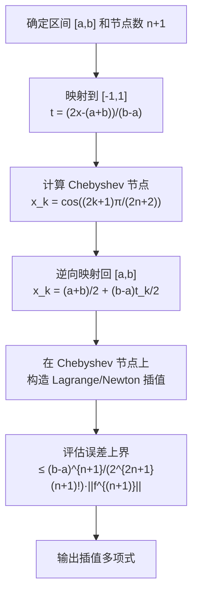

# Chebyshev节点选取流程

## 适用场景
需要高精度多项式插值且可自由选取节点时，用 Chebyshev 节点代替等距节点，减轻等距高次插值的边界振荡；对任意连续函数并无无条件一致收敛保证。

## 核心公式/步骤

1. 将目标区间 $[a,b]$ 映射到 $[-1,1]$：$\boxed{t=\frac{2x-(a+b)}{b-a}}$
2. 在 $[-1,1]$ 上计算 Chebyshev 节点（$n+1$ 个）：
   $\boxed{t_k=\cos\left(\frac{(2k+1)\pi}{2n+2}\right)}$，$k=0,1,\ldots,n$
3. 逆向映射回 $[a,b]$：$\boxed{x_k=\frac{a+b}{2}+\frac{b-a}{2}t_k}$
4. 在 Chebyshev 节点 $\{x_k\}$ 上构造 Lagrange 或 Newton 插值多项式
5. 若 $f\in C^{n+1}[a,b]$，插值误差上界为 $\boxed{\|f-P_n\|_\infty\le\frac{(b-a)^{n+1}}{2^{2n+1}(n+1)!}\|f^{(n+1)}\|_\infty}$

## 典型例题

> **题目**：在 $[-1,1]$ 上用 5 个 Chebyshev 节点插值 $f(x)=1/(1+25x^2)$，与等距节点对比。

> [!example]- 解答
> Chebyshev 节点（$n=4$）：$t_k=\cos(\frac{(2k+1)\pi}{10})$ → $\approx\pm0.951,\pm0.588,0$
> 对本例的五节点插值，密网格复算最大误差约为：等距 0.43836、Chebyshev 0.40202。此处改善有限；经典 Runge 现象主要讨论节点数不断增加时的表现。
> 点评：Chebyshev 零点使首一节点多项式 $\prod_{k=0}^n(x-x_k)$ 的一致范数最小，从而优化上述导数误差上界；这不等于对给定 $f$ 的实际插值误差最小，也不等于最佳一致逼近多项式。

## 链接的知识点
- [[01_Knowledge/Chebyshev插值]]
- [[01_Knowledge/Lagrange插值]]

## 链接的习题
- [[03_Sources/Courses/归档/数值分析/习题库/07-插值法/README|第7章习题库]]

上述及补充材料中的导数余项上界均要求相应阶导数存在并连续；节点乘积最小不等于实际误差最小。

## 合并去向

规范原子为 [[01_Knowledge/Chebyshev插值]]。本文保留原待核实方法的已修订全文。合并前既有原子的原件与 SHA-256 保存在 Vault 外事务备份；不把旧有错误重复发布到正文。

> [!note]- 合并前原子的补充材料
> 
> ### 合并前原子的补充材料（已纠正所定位错误）
> 
> ## 一句话
> 
> 将插值节点选为 Chebyshev 多项式的零点——最小化节点乘积的一致范数，从而优化光滑函数的误差上界；不等于给定函数的实际误差最小，也不对任意连续函数保证收敛。
> 
> ## 严格定义
> 
> **Chebyshev 多项式**（第一类）：
> 
> $$
> \boxed{T_n(x)=\cos(n\cos^{-1}x)},\quad x\in[-1,1]
> $$
> 
> 递推式：$T_0=1,\;T_1=x,\;T_{n+1}=2xT_n-T_{n-1}$。
> 
> **Chebyshev 节点**（$T_{n+1}$ 的零点）：
> 
> $$
> \boxed{x_k=\cos\frac{(2k+1)\pi}{2n+2}},\quad k=0,1,\ldots,n
> $$
> 
> 节点在 $[-1,1]$ 两端密集分布（不是均匀的）。
> 
> **误差界**（在 $[-1,1]$ 上 $n+1$ 个节点）：
> 
> $$
> \boxed{\max_{x\in[-1,1]}|f(x)-P_n(x)|\le\frac{1}{2^n(n+1)!}\max_{\xi\in[-1,1]}|f^{(n+1)}(\xi)|}
> $$
> 
> > [!important] Chebyshev 节点使 $\max\prod|x-x_i|$ 最小化——将 Runge 现象的产生根源（乘积最大项）降到最低
> 
> ## 推导：最小化 $\|\prod(x-x_i)\|_\infty$
> 
> > [!proof]- 推导
> > 插值余项主导因子为 $\prod_{i=0}^{n}|x-x_i|$。在所有首一多项式 $x^{n+1}+\cdots$ 中，$T_{n+1}(x)/2^n$ 在 $[-1,1]$ 上的最大绝对值最小。
> >
> > 将 $T_{n+1}$ 的零点作为插值节点（此时 $\prod(x-x_i)=T_{n+1}(x)/2^n$），恰好实现余项因子的最小化。
> >
> > 对一般区间 $[a,b]$，需做线性变换：
> >
> > $$
> > x_k'=\frac{a+b}{2}+\frac{b-a}{2}\cos\frac{(2k+1)\pi}{2n+2}
> > $$
> 
> ## 算法步骤
> 
> 1. 区间映射：$x\in[a,b]\mapsto t=\frac{2x-a-b}{b-a}\in[-1,1]$
> 2. 计算 Chebyshev 节点 $t_k=\cos\frac{(2k+1)\pi}{2n+2}$
> 3. 映射回原区间 $x_k=\frac{a+b}{2}+\frac{b-a}{2}t_k$
> 4. 计算 $f(x_k)$，用 Lagrange 或 Newton 构造插值多项式
> 
> ## 关键性质
> 
> | 性质 | 数值 |
> |------|------|
> | 节点分布 | $[-1,1]$ 两端密集 |
> | 误差上界 | $\frac{1}{2^n(n+1)!}\max|f^{(n+1)}|$ |
> | Runge 现象 | 对适当光滑函数可减轻边界振荡 |
> | 需要函数值 | 在 Chebyshev 节点处 |
> | 一般区间 | 需线性变换映射 |
> 
> ## 易错点
> 
> > [!warning] 节点仅在 $[-1,1]$ 上定义
> > 对一般区间 $[a,b]$ 必须做线性变换 $x_k=\frac{a+b}{2}+\frac{b-a}{2}t_k$——直接用 $[-1,1]$ 的节点在 $[a,b]$ 上毫无意义。
> 
> > [!warning] Chebyshev 节点≠均匀节点
> > 均匀节点间距恒定，而 Chebyshev 节点在两端更密（两端密）——这是压制 Runge 现象的关键。
> 
> > [!warning] 需要能在 Chebyshev 节点处计算函数值
> > Chebyshev 零点是横坐标，可能为有理数（如0）。若只能使用固定的已有采样点且不能重新测量，就不能任意选用 Chebyshev 节点。
> 
> ## 相关概念
> 
> - [[01_Knowledge/插值与拟合]]
> - [[01_Knowledge/数值稳定性]]
> - [[01_Knowledge/Lagrange插值]]
> 
> ## 习题
> 
> - [[03_Sources/Courses/归档/数值分析/习题库/07-插值法/README|第7章习题库]]
