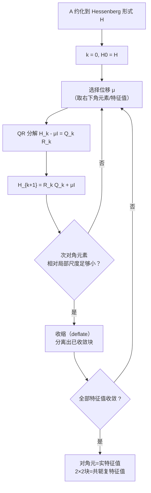

# QR算法迭代流程

## 适用场景
计算一般实矩阵的全部特征值（含复特征值），是数值线性代数中最重要、最通用的特征值算法。

## 核心公式/步骤

1. 预步：约化到上 Hessenberg 形式 $\boxed{H=Q_0^T A Q_0}$（Householder 约化，$O(n^3)$）
2. QR 迭代（$k=0,1,2,\ldots$）：
   - QR 分解：$\boxed{H_k=Q_k R_k}$
   - 逆序乘：$\boxed{H_{k+1}=R_k Q_k}$
3. 带位移加速：$\boxed{H_k-\mu I=Q_k R_k}$，$\boxed{H_{k+1}=R_k Q_k+\mu I}$（$\mu$ 取右下角元素或特征值估计）
4. 检查次对角元是否相对局部尺度足够小，例如 $|h_{i+1,i}|\le\varepsilon(|h_{ii}|+|h_{i+1,i+1}|)$（另设极小量防护）；满足时置零并分割活动块。一般实矩阵的共轭复根需用实双位移等策略，不能指望单实位移总能消去所有次对角元
5. 收敛到实 Schur 形后，1×1 对角块给实特征值，不可约 2×2 对角块给共轭复特征值；未收敛的任意 2×2 块不能直接如此判读。设置迭代上限并报告未收敛活动块

## 典型例题

> **题目**：简述 QR 算法求 $A=\begin{bmatrix}2&1\\1&2\end{bmatrix}$ 特征值的过程。

> [!example]- 解答
> 已是 Hessenberg 形式。无位移迭代：
> $H_0$ QR→$Q_1R_1$, $H_1=R_1Q_1$；迭代若干步后对角元趋于特征值。
> 对本例若每步恰取右下角元素 $\mu=2$，$H_0-2I$ 的 QR 迭代会停滞（不改变该矩阵）；可改用 Wilkinson 位移或对本例直接解 2×2 块。
> 精确特征值为 $3$ 和 $1$。点评：位移改善通常收敛表现，但收敛阶取决于矩阵与位移策略，不能对一般实矩阵声称立方收敛。

## 链接的知识点
- [[01_Knowledge/QR算法]]
- [[01_Knowledge/幂法]]

## 链接的习题
- [[03_Sources/Courses/归档/数值分析/习题库/06-矩阵特征值的数值解法/README|第6章习题库]]

## 合并去向

规范原子为 [[01_Knowledge/QR算法]]。本文保留原待核实方法的已修订全文。合并前既有原子的原件与 SHA-256 保存在 Vault 外事务备份；不把旧有错误重复发布到正文。

> [!note]- 合并前原子的补充材料
> 
> ### 合并前原子的补充材料（已纠正所定位错误）
> 
> ## 一句话
> 
> $A_k=Q_k R_k$，$A_{k+1}=R_k Q_k$——正交相似变换保持特征值，迭代收敛到上三角（或对角块），是计算全部特征值的标准方法。
> 
> ## 严格定义
> 
> **基本 QR 迭代**：
> 
> $$
> \begin{aligned}
> A_0 &= A \\
> A_k &= Q_k R_k \quad\text{(QR 分解)} \\
> A_{k+1} &= R_k Q_k = Q_k^T A_k Q_k
> \end{aligned}
> $$
> 
> **关键**：$A_{k+1}=Q_k^T A_k Q_k$ 是**正交相似变换**——特征值不变。
> 
> **收敛**：$A_k$ 逐渐趋近于 **Schur 形式**（上三角或块上三角），对角元素（或 $2\times2$ 块）即为特征值（或复共轭对）。
> 
> > [!important] 基本 QR 算法收敛慢→需**位移加速**（$A_k-\mu_k I=Q_k R_k$）和**Hessenberg 约化**
> 
> ## 推导：与幂法的联系
> 
> > [!proof]- 推导
> > 基本 QR 算法可视为"对正交基做幂法"（子空间迭代）。
> >
> > 设 $A_0=A$。$k$ 步 QR 后：
> >
> > $$
> > A_k=Q^T A Q
> > $$
> >
> > 其中 $Q=Q_1 Q_2\cdots Q_k$ 的列张成的空间等价于 $A^k$ 作用在初始子空间上。
> >
> > 随着 $k$ 增长，$Q$ 的列趋近于 Schur 向量（一般并非逐个特征向量）。$A_k$ 收敛到 Schur 形式（实对称阵→对角；一般方阵→上三角/块上三角）。
> >
> > **位移加速**：$\mu_k$ 取为 $A_k$ 右下角某元素的 Rayleigh 商加速该对角块的收敛——类似逆幂法的效果。
> 
> ## 算法步骤（实用版：带位移 + Hessenberg）
> 
> 1. **约化**：将 $A$ 相似变换为 Hessenberg 形式 $H=U^T A U$（$O(n^3)$）
> 2. **QR 迭代**（对 Hessenberg $H$）：
>    - 选位移 $\mu_k$（如右下角 $2\times2$ 块的特征值）
>    - $H_k-\mu_k I=Q_k R_k$
>    - $H_{k+1}=R_k Q_k+\mu_k I$
> 3. 收敛后读出特征值（$H_k$ 对角/块对角元素）
> 
> ## 关键性质
> 
> | 性质 | 数值 |
> |------|------|
> | 全部特征值 | 是（所有特征值同时收敛） |
> | 正交相似 | 数值稳定 |
> | Hessenberg 约化 | 每步 QR 降至 $O(n^2)$ |
> | 带位移版 | 迭代数依矩阵与位移策略而定 |
> | 复特征值 | $2\times2$ 对角块 |
> 
> ## 易错点
> 
> > [!warning] 基本 QR 算法收敛极慢
> > 不加位移的 QR 算法收敛率取决于特征值比值——对密集特征值几乎不收敛。位移（尤其是 Wilkinson 位移）是实用的关键。
> 
> > [!warning] Hessenberg 约化不可省略
> > 直接对稠密矩阵做 QR 每次 $O(n^3)$——约化为 Hessenberg 形式只需一次 $O(n^3)$，之后每次 QR 降至 $O(n^2)$。Hessenberg 约化可降低每步成本，是否能处理某一规模取决于实现与资源，不能以 n>10 作普遍界限。
> 
> > [!warning] 复特征值需要 $2\times2$ 块
> > 实矩阵的复共轭特征值对在 $A_k$ 中表现为 $2\times2$ 对角线块——不能直接读出复数特征值而需解该块的二阶特征方程。
> 
> ## 相关概念
> 
> - [[01_Knowledge/QR分解]]
> - [[01_Knowledge/谱半径]]
> - [[01_Knowledge/幂法]]
> 
> ## 习题
> 
> - [[03_Sources/Courses/归档/数值分析/习题库/06-矩阵特征值的数值解法/README|第6章习题库]]
> 
> 
> > [!warning] 收敛条件
> > 本节描述常用算法的目标形式，不保证任意无位移或单实位移迭代都收敛；停滞反例与复根处理以本文上方核对后的操作流程为准。
