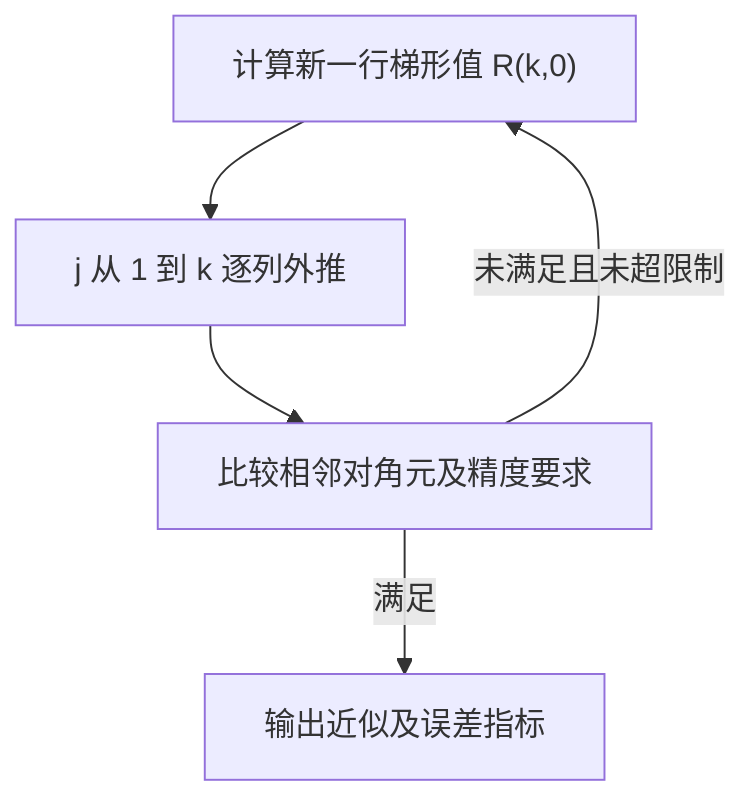

# Romberg外推流程

## 适用场景
被积函数充分光滑时，用梯形序列通过 Richardson 外推快速收敛到高精度积分值，兼具高效和高精度的优点。

## 核心公式/步骤

1. 令 $R_{k,0}=T_{2^k}$，即把 $[a,b]$ 分为 $2^k$ 段所得的复化梯形值，$k=0,1,\ldots$。
2. 对每行 $k$，依次计算 $j=1,\ldots,k$：
   $$R_{k,j}=\frac{4^jR_{k,j-1}-R_{k-1,j-1}}{4^j-1}.$$
3. 第 0、1、2、3 列分别对应梯形、Simpson、Boole（常称 Cotes）、更高阶外推。对角线为 $R_{0,0},R_{1,1},R_{2,2},\ldots$。
4. $|R_{k,k}-R_{k-1,k-1}|<\varepsilon$ 可作经验停机指标，需配合绝对/相对容差、最大细分层数及舍入误差检查；相邻近似接近不等于严格误差保证。高阶外推依赖足够光滑的偶次幂误差展开，不能任意无限加阶保证收敛。

## 典型例题

> **题目**：计算 $\int_0^\pi\sin x\,dx$。
>
> [!example]- 解答
> 统一使用行列编号，复算结果如下。
>
> | $k$ | $R_{k,0}$ | $R_{k,1}$ | $R_{k,2}$ | $R_{k,3}$ |
> |---|---|---|---|---|
> | 0 | 0 | | | |
> | 1 | 1.570796327 | 2.094395102 | | |
> | 2 | 1.896118898 | 2.004559755 | 1.998570732 | |
> | 3 | 1.974231602 | 2.000269170 | 1.999983131 | 2.000005550 |
>
> 精确值为 $2$。例如 $R_{2,1}=(4R_{2,0}-R_{1,0})/3$，不会混用粗网格下标和三角表行号。

## 链接的知识点
- [[01_Knowledge/Romberg外推]]
- [[01_Knowledge/复化求积法]]

## 链接的习题
- [[03_Sources/Courses/归档/数值分析/习题库/09-数值积分与数值微分/README|第9章习题库]]

## 合并去向

规范原子为 [[01_Knowledge/Romberg外推]]。本文保留原待核实方法的已修订全文。合并前既有原子的原件与 SHA-256 保存在 Vault 外事务备份；不把旧有错误重复发布到正文。

> [!note]- 合并前原子的补充材料
> 
> ### 合并前原子的补充材料（已纠正所定位错误）
> 
> ## 一句话
> 
> 用复化梯形序列做 Richardson 外推——$T\to S\to C\to R$，每次外推精度提升 $O(h^2)$。
> 
> ## 严格定义
> 
> **Romberg 外推表**：
> 
> $$
> \boxed{T_n^{(0)}=T_n\quad\text{（复化梯形）}}
> $$
> 
> $$
> \boxed{T_n^{(m)}=\frac{4^m T_{n}^{(m-1)}-T_{n/2}^{(m-1)}}{4^m-1},\quad m=1,2,\ldots}
> $$
> 
> **各列含义**：
> 
> - $T_n^{(0)}$：复化梯形值（$O(h^2)$）
> - $T_n^{(1)}$：复化 Simpson 值（$O(h^4)$）
> - $T_n^{(2)}$：复化 Cotes 值（$O(h^6)$）
> - $T_n^{(3)}$：Romberg 值（$O(h^8)$）
> 
> > [!important] 完全不需要求高阶 NC 系数——仅用最简单的梯形值反复做外推就能达到任意高阶精度
> 
> ## 推导：Euler-Maclaurin 公式
> 
> > [!proof]- 推导
> > Euler-Maclaurin 公式表明梯形误差可表示为 $h^2$ 的幂级数（仅偶次项）：
> >
> > $$
> > \int_a^b f-T_n=c_2 h^2+c_4 h^4+c_6 h^6+\cdots
> > $$
> >
> > 将 $T_n$ 和 $T_{2n}$（$h'=h/2$）代入，用 Richardson 消去 $c_2 h^2$ 项：
> >
> > $$
> > \frac{4\cdot T_{2n}-T_n}{4-1}=\int f+O(h^4)=S_n\quad\text{（Simpson）}
> > $$
> >
> > 重复此过程：第 $m$ 次外推消去 $h^{2m}$ 项，精度提升 $O(h^2)$ 每次。
> 
> ## 算法步骤
> 
> 1. 计算 $T_1,T_2,T_4,T_8,\ldots$（复化梯形序列，每个对分复用旧值）
> 2. 建 Romberg 表（下三角矩阵）：
>    - 第 0 列：$T_1,T_2,T_4,\ldots$
>    - 第 $m$ 列：$T_n^{(m)}=(4^m T_n^{(m-1)}-T_{n/2}^{(m-1)})/(4^m-1)$
> 3. 取表中最右下角的值作为当前最高阶近似（不保证实际误差最小）
> 4. 后验误差估计：$|T_n^{(m)}-T_n^{(m-1)}|$ 或 $|T_n^{(m)}-T_{n/2}^{(m)}|$
> 
> ## 关键性质
> 
> | 性质 | 数值 |
> |------|------|
> | 基础 | 复化梯形（$O(h^2)$） |
> | 第 1 次外推 | Simpson（$O(h^4)$） |
> | 第 2 次外推 | Cotes（$O(h^6)$） |
> | 适用条件 | $f$ 足够光滑 |
> | 阶梯精度 | 每外推一次精度提升 $O(h^2)$ |
> 
> ## 典型例题
> 
> > **题目**：对 $\int_0^1\frac{4}{1+x^2}dx$ 做 Romberg 外推（用 $T_1,T_2,T_4$）。
> 
> > [!example]- 解答
> > 先算梯形序列：
> > - $T_1=\frac12[4+2]=3.0000$
> > - $T_2=\frac14[4+2\times3.2+2]=3.1000$
> > - $T_4=3.1312$（同上例）
> >
> > **Romberg 表**：
> >
> > | | $m=0$（梯形） | $m=1$（Simpson） | $m=2$（Cotes） |
> > |-|--------------|-----------------|---------------|
> > | $n=1$ | 3.0000 | — | — |
> > | $n=2$ | 3.1000 | $\frac{4\cdot3.1-3}{3}=3.1333$ | — |
> > | $n=4$ | 3.1312 | $\frac{4\cdot3.1312-3.1}{3}=3.1416$ | $\frac{16\cdot3.1416-3.1333}{15}=3.1421$ |
> >
> > $T_4^{(2)}=3.1421$ vs 真值 $\pi=3.1416$，误差 $5\times10^{-4}$。
> >
> > **点评**：从梯形 $T_1=3$（误差 $0.14$）到 Romberg $T_4^{(2)}=3.1421$（误差 $5\times10^{-4}$）——仅 3 个梯形值就能达到 Cotes 精度。
> 
> ## 易错点
> 
> > [!warning] 被积函数需足够光滑
> > Euler-Maclaurin 展开要求 $f\in C^{2m}$——若 $f$ 在某点导数不存在，梯形误差的 $h^2$ 级数不再完整，外推失效。
> 
> > [!warning] 外推表越往右下越不稳定
> > $T_n^{(m)}$ 的系数 $4^m/(4^m-1)$ 随 $m$ 增长趋近于 1，但减法 $T_n^{(m-1)}-T_{n/2}^{(m-1)}$ 中两个接近值相减→有效数字丢失。应按目标精度、光滑性和舍入误差选取层数，没有普遍固定的 3—4 阶上限。
> 
> > [!warning] 外推只在梯形误差为 $h^2$ 偶次幂时准确
> > 若用 Simpson 作为基础列做外推（而非梯形），公式中的 $4^m$ 需替换为 $4^{m+1}$ 等——公式不同但原理一致。
> 
> ## 相关概念
> 
> - [[01_Knowledge/收敛性]]
> - [[01_Knowledge/复化求积法]]
> - [[01_Knowledge/Newton-Cotes公式]]
> 
> ## 习题
> 
> - [[03_Sources/Courses/归档/数值分析/习题库/09-数值积分与数值微分/README|第9章习题库]]
