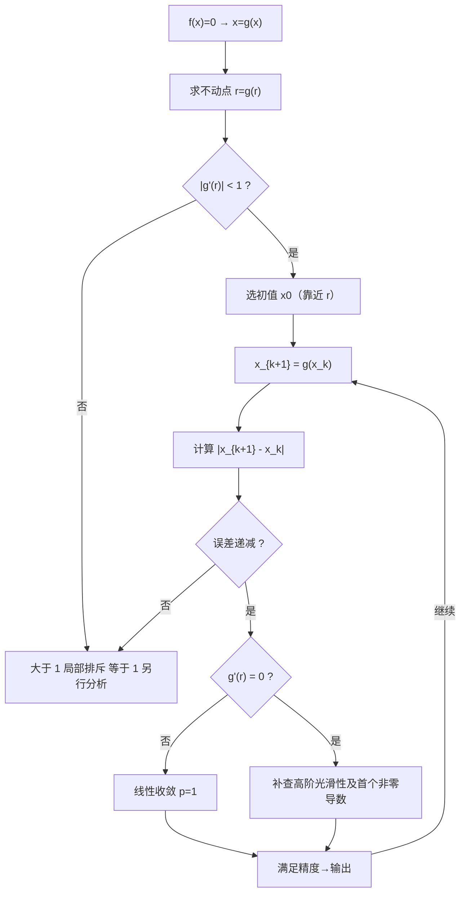

# 不动点迭代判敛流程

## 适用场景
方程已改写为 $x=g(x)$，需判断迭代是否收敛及收敛速度，用于分析迭代格式的可行性。

## 核心公式/步骤

1. 将 $f(x)=0$ 改写为 $\boxed{x=g(x)}$（多种改写方式）
2. 求不动点 $r=g(r)$，检查 $\boxed{|g'(r)|<1}$（$g$ 在 $r$ 邻域为 $C^1$ 时的局部吸引充分条件；$|g'(r)|>1$ 时局部排斥；等于 1 时须进一步分析）
3. 选初值 $x_0$（在不动点附近），迭代 $\boxed{x_{k+1}=g(x_k)}$
4. 计算相邻迭代差 $|x_{k+1}-x_k|$；它不是自动成立的真实误差界。若在不变区间上 $|g\prime|\le q<1$，则 $|x_{k+1}-r|\le q|x_{k+1}-x_k|/(1-q)$
5. 在相应阶导数连续、迭代收敛且未有限步终止的前提下判断收敛阶：$0<|g'(r)|<1$→$p=1$（线性）；$g'(r)=0, g''(r)\neq0$→$p=2$（平方）

## 典型例题

> **题目**：$f(x)=x^3+2x-4=0$，构造 $g_1(x)=\frac{4-x^3}{2}$ 和 $g_2(x)=\sqrt[3]{4-2x}$，分析收敛性。

> [!example]- 解答
> 先求根：$f(1)=-1,\ f(1.2)=0.128$，根 $r\approx1.18$。
> 
> $g_1'(x)=-\frac{3}{2}x^2$，$|g_1'(1.18)|\approx2.09>1$→发散。
> $g_2'(x)=-\frac{2}{3}(4-2x)^{-2/3}$，$|g_2'(1.18)|\approx0.48<1$→收敛。
> 
> 点评：同一方程不同 $g(x)$ 收敛性不同，构造 $g$ 是关键。

## 链接的知识点
- [[01_Knowledge/不动点迭代]]
- [[01_Knowledge/收敛阶定理]]

## 链接的习题
- [[03_Sources/Courses/归档/数值分析/习题库/02-非线性方程求根/README|第2章习题库]]

## 合并去向

规范原子为 [[01_Knowledge/不动点迭代]]。本文保留原待核实方法的已修订全文。合并前既有原子的原件与 SHA-256 保存在 Vault 外事务备份；不把旧有错误重复发布到正文。

> [!note]- 合并前原子的补充材料
> 
> ### 合并前原子的补充材料（已纠正所定位错误）
> 
> ## 一句话
> 
> 将 $f(x)=0$ 改写为 $x=g(x)$，从初值 $x_0$ 出发迭代 $x_{i+1}=g(x_i)$，收敛条件由 $g$ 的 Lipschitz 常数或导数值决定。
> 
> ## 严格定义
> 
> **不动点**：$r$ 是 $g$ 的不动点若 $g(r)=r$。等价于 $r$ 是 $f(x)=x-g(x)=0$ 的根。
> 
> **不动点迭代**：
> 
> $$
> \boxed{x_{i+1}=g(x_i)},\quad i=0,1,2,\ldots
> $$
> 
> **全局收敛条件**：若 $\exists L<1$ 使得 $\forall x,y\in[a,b]$：
> 
> $$
> |g(x)-g(y)|\le L|x-y|
> $$
> 
> 且 $g([a,b])\subseteq[a,b]$，则 $g$ 在 $[a,b]$ 上有唯一不动点，迭代对任意 $x_0\in[a,b]$ 收敛。
> 
> **局部收敛的实用判据**：若 $g$ 连续可微、$g([a,b])\subseteq[a,b]$ 且 $\max|g\prime|<1$，则对区间内任意初值收敛到唯一不动点。
> 
> > [!important] $|g'(r)|<1$ 在导数邻域连续时是局部吸引的充分条件
> 
> ## 推导：收敛性分析
> 
> > [!proof]- 推导
> > 设 $r$ 为不动点，$e_i=x_i-r$ 为第 $i$ 步误差。
> >
> > 由中值定理：
> >
> > $$
> > e_{i+1}=x_{i+1}-r=g(x_i)-g(r)=g'(\xi_i)(x_i-r)=g'(\xi_i)e_i
> > $$
> >
> > 其中 $\xi_i$ 在 $x_i$ 与 $r$ 之间。
> >
> > 若 $|g'(\xi)|\le L<1$，则 $|e_{i+1}|\le L|e_i|\le L^{i+1}|e_0|\to 0$。
> >
> > **收敛阶**：
> > - 若 $g'(r)\neq 0$：线性收敛，收敛率 $|g'(r)|$
> > - 若 $g'(r)=0$ 且 $g\in C^2$：至少二次收敛
> 
> ## 算法步骤
> 
> 1. 将 $f(x)=0$ 改写为 $x=g(x)$（关注 $|g'|<1$ 的区域）
> 2. 选取初值 $x_0$（在不动点附近）
> 3. 迭代 $x_{i+1}=g(x_i)$
> 4. 停机准则：$|x_{i+1}-x_i|<\varepsilon$ 或 $|f(x_{i+1})|<\delta$
> 
> ## 关键性质
> 
> | 性质 | 数值 |
> |------|------|
> | 收敛判断 | $|g'(r)|<1$ 局部收敛 |
> | 收敛阶 | $p=1$（一般），$p\ge2$（若 $g'(r)=0$） |
> | $g'(r)$ 与收敛 | $g'(r)=0\Rightarrow$ 至少二次收敛 |
> | 发散条件 | $|g'(r)|>1$ 发散 |
> | $|g'(r)|=1$ | 无法判定 |
> 
> ## 典型例题
> 
> > **题目**：$f(x)=x^3+x-1=0$ 在 $[0,1]$ 上有根，考虑两种改写：
> > （1）$g_1(x)=1-x^3$；（2）$g_2(x)=\sqrt[3]{1-x}$。判断哪个迭代收敛。
> 
> > [!example]- 解答
> > （1）$g_1(x)=1-x^3$，$g_1'(x)=-3x^2$。
> >
> > 在 $x=0.7$（根附近），$|g_1'(0.7)|=1.47>1$，**发散**。
> >
> > （2）$g_2(x)=\sqrt[3]{1-x}$，$g_2'(x)=-\frac{1}{3}(1-x)^{-2/3}$。
> >
> > 在 $x=0.7$，$g_2'(0.7)\approx-0.744$ ，$|g_2'|<1$，**收敛**。
> >
> > 验证：取 $x_0=0.5$：
> >
> > | $i$ | $g_1$ | $g_2$ |
> > |-----|-------|-------|
> > | 0 | 0.5 | 0.5 |
> > | 1 | 0.875 | 0.7937 |
> > | 2 | 0.330 | 0.5907 |
> > | 3 | 0.964 | 0.7428 |
> > | 4 | 0.104 | 0.6359 |
> >
> > $g_1$ 震荡不收敛，$g_2$ 逐步趋近 $\approx 0.6823$。
> >
> > **点评**：同一个 $f(x)=0$ 的不同 $g$ 构造，收敛性天差地别——选择 $g$ 是做不动点迭代的核心技巧。
> 
> ## 易错点
> 
> > [!warning] 不动点迭代的收敛性完全取决于 $g$ 的构造
> > $f(x)=0$ 改写为 $x=g(x)$ 的方式无穷多，收敛与否和收敛快慢取决于 $|g'(r)|$。不要以为"改写后总会收敛"。
> 
> > [!warning] $|g'(x)|<1$ 是充分不必要条件
> > 即使 $|g'(r)|<1$ 在某点成立，若初值太远（$g'$ 在初值附近 $>1$），可能先发散再收敛或根本不收敛。
> 
> > [!warning] 停机准则只检查相邻差
> > $|x_{i+1}-x_i|<\varepsilon$ 并不意味着 $|x_i-r|<\varepsilon$——收敛率慢时 $x_i$ 可能还离 $r$ 很远。
> 
> ## 相关概念
> 
> - [[01_Knowledge/不动点]]
> - [[01_Knowledge/收敛性]]
> - [[01_Knowledge/Lipschitz条件]]
> - [[01_Knowledge/收敛阶定理]]
> - [[01_Knowledge/牛顿法]]
> 
> ## 习题
> 
> - [[03_Sources/Courses/归档/数值分析/习题库/02-非线性方程求根/README|第2章习题库]]
