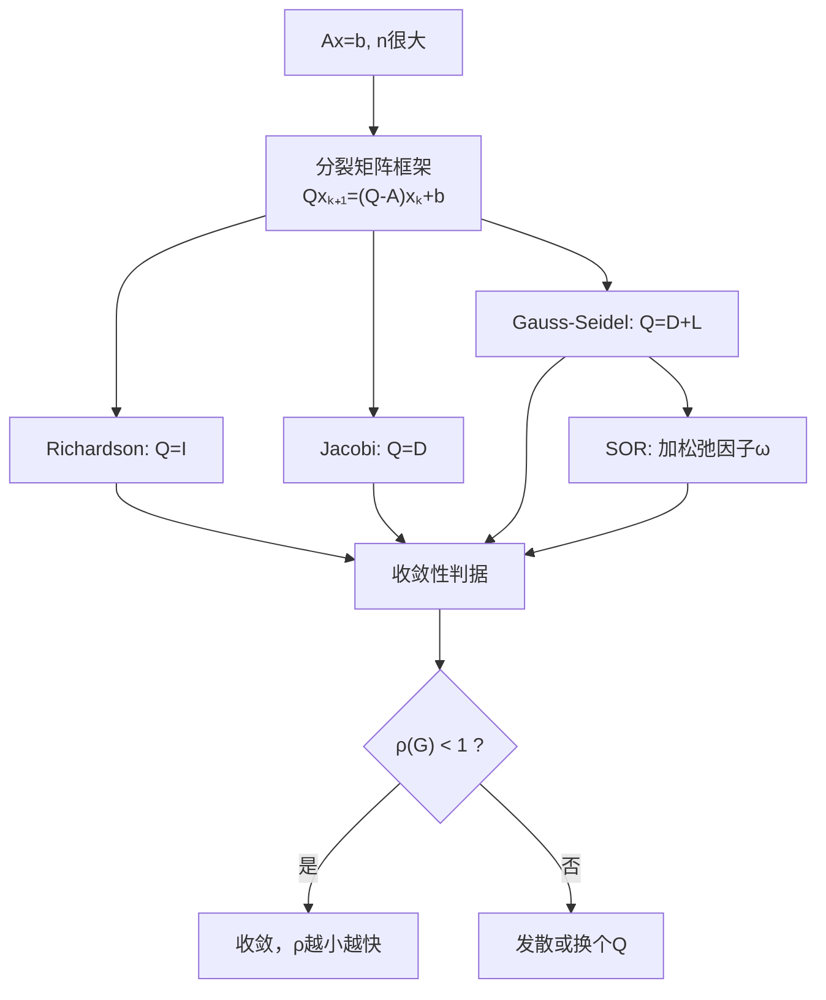
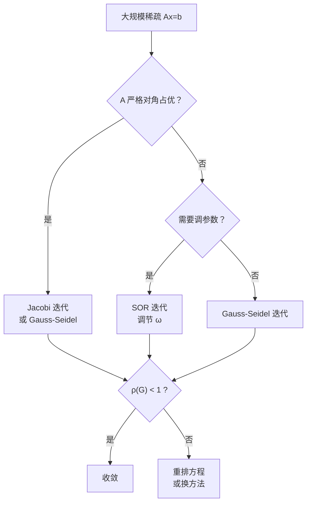

---
subject:
- 数值分析
source:
- 课件/MD/04-线性方程组的迭代法.md
type: review
tags:
- Richardson迭代
- Jacobi迭代
- Gauss-Seidel迭代
- SOR迭代
- 谱半径
- 收敛性
aliases:
- 第04章 线性方程组的迭代法 — 知识点梳理
schema_version: 2
time: "2026-08-31T11:44:20+08:00"
legacy_topics:
- Richardson迭代
- Jacobi迭代
- Gauss-Seidel迭代
- SOR迭代
- 谱半径
- 收敛性
status: not done
---

# 第04章 线性方程组的迭代法

---

## 一、本章核心脉络

**核心问题**：$n$ 很大时 $O(n^3)$ 的直接法太慢——能否用 $O(n^2)$ 每步的迭代逐步逼近解？

> 这条脉络的核心逻辑：**迭代法的本质就是一个统一框架——选不同的分裂矩阵 $Q$，得到不同的迭代方法。$Q$ 越接近 $A$，收敛越快；$Q$ 越简单，每步计算越便宜。两者的折中产生了从 Richardson 到 SOR 的一系列方法。收敛性的核心判据是谱半径 $\rho(G) < 1$。**

---

## 二、迭代法的统一框架（**核心**）

### 2.1 一般形式

> 一句话来说：把 $Ax=b$ 改写为不动点迭代 $x_{k+1} = Gx_k + c$——迭代矩阵 $G$ 决定了收敛性，分裂矩阵 $Q$ 决定了每步的计算代价。

**分裂矩阵形式**：
$$Qx_{k+1} = (Q-A)x_k + b$$

等价的不动点形式：
$$x_{k+1} = (I - Q^{-1}A)x_k + Q^{-1}b \triangleq Gx_k + c$$

**设计原则**：
1. $Q$ 要容易求逆（每步解 $Qx_{k+1} = \text{向量}$ 要便宜）
2. $G$ 的谱半径 $\rho(G) < 1$（确保收敛）
3. $\rho(G)$ 越小收敛越快

### 2.2 四种分裂方法对比

| 方法 | $Q$ | $G$（迭代矩阵） | 特点 |
|------|-----|-----|------|
| Richardson | $I$ | $I - A$ | 最简单，收敛条件苛刻 |
| Jacobi | $D$（对角线） | $-D^{-1}(L+U)$ | 天然并行 |
| Gauss-Seidel | $D+L$（下三角） | $-(L+D)^{-1}U$ | 更快，用最新值 |
| SOR | $\frac{1}{\omega}(D+\omega L)$ | $(D+\omega L)^{-1}[(1-\omega)D-\omega U]$ | 加松弛因子调优 |

---

## 三、Richardson 迭代

> 一句话来说：$Q=I$，最简单——每步就是 $x_{k+1} = (I-A)x_k + b$。但收敛条件苛刻。

$$x_{k+1} = (I-A)x_k + b$$

**例题**：求解 $\begin{cases}3u+v=5 \\ u+2v=5\end{cases}$，$A = \begin{pmatrix}3 & 1 \\ 1 & 2\end{pmatrix}$

$$x_{k+1} = \begin{pmatrix}-2 & -1 \\ -1 & -1\end{pmatrix}x_k + \begin{pmatrix}5 \\ 5\end{pmatrix}$$

从 $x_0=(0,0)^T$ 出发：$(5,5) \to (-10,-5) \to (30,20) \to \cdots$ ——**发散！**

> 原因：$\rho(G) = \frac{3+\sqrt{5}}{2} \approx 2.618 > 1$

---

## 四、Jacobi 迭代

> 一句话来说：每步把对角线的逆乘上去——相当于"把每个方程对它的对角元解出来"，所有变量同时更新。

$$Q = D, \quad G = -D^{-1}(L+U)$$

其中 $A = D + L + U$——$D$ 取对角线，$L$ 取严格下三角，$U$ 取严格上三角。

> [!note]- 如何从 $A$ 拆出 $D,L,U$？
> 
> $$A = \begin{pmatrix}a_{11}&a_{12}&a_{13}\\a_{21}&a_{22}&a_{23}\\a_{31}&a_{32}&a_{33}\end{pmatrix}$$
> 
> $$D = \begin{pmatrix}a_{11}&0&0\\0&a_{22}&0\\0&0&a_{33}\end{pmatrix},\; L = \begin{pmatrix}0&0&0\\a_{21}&0&0\\a_{31}&a_{32}&0\end{pmatrix},\; U = \begin{pmatrix}0&a_{12}&a_{13}\\0&0&a_{23}\\0&0&0\end{pmatrix}$$
> 
> $D^{-1}$ 只是每个对角元取倒数：$D^{-1}=\operatorname{diag}(1/a_{11},1/a_{22},1/a_{33})$。乘以 $(L+U)$ 就是每行除以该行的对角元。
> 
> **例**：$A=\begin{pmatrix}3&1\\1&2\end{pmatrix}$，$D=\begin{pmatrix}3&0\\0&2\end{pmatrix}$，$L=\begin{pmatrix}0&0\\1&0\end{pmatrix}$，$U=\begin{pmatrix}0&1\\0&0\end{pmatrix}$：
> $$G = -D^{-1}(L+U) = -\begin{pmatrix}\frac13&0\\0&\frac12\end{pmatrix}\!\begin{pmatrix}0&1\\1&0\end{pmatrix} = \begin{pmatrix}0&-\frac13\\[2pt]-\frac12&0\end{pmatrix}$$

**分量形式**（等价，手算更方便）：
$$x_i^{(k+1)} = \frac{b_i - \sum_{j\neq i} a_{ij}x_j^{(k)}}{a_{ii}}$$

**例题**（同一方程组）：
$$\begin{pmatrix}u_{k+1} \\ v_{k+1}\end{pmatrix} = \begin{pmatrix}0 & -1/3 \\ -1/2 & 0\end{pmatrix}\begin{pmatrix}u_k \\ v_k\end{pmatrix} + \begin{pmatrix}5/3 \\ 5/2\end{pmatrix}$$

$$\rho(G) = \frac{1}{\sqrt{6}} \approx 0.408 < 1$$——**收敛！**

> [!note]- 反例：不对角占优也能写，但发散
> 
> $$A = \begin{pmatrix}1&2\\2&1\end{pmatrix},\; b = \begin{pmatrix}5\\4\end{pmatrix},\; \text{精确解 } (1,2)^T$$
> 
> 对角占优？$|1| < |2|$ → **不满足**。对角元非零 → 仍可写 Jacobi：
> $$\begin{cases} x_{k+1} = (5 - 2y_k)/1 = 5 - 2y_k \\ y_{k+1} = (4 - 2x_k)/1 = 4 - 2x_k \end{cases}$$
> 
> $G = \begin{pmatrix}0&-2\\-2&0\end{pmatrix}$，$\rho(G)=2>1$。
> 
> 从 $x_0=(0,0)^T$ 迭代：
> | $k$ | $x_k$ | $y_k$ |
> |:---:|:---:|:---:|
> | 0 | 0 | 0 |
> | 1 | 5 | 4 |
> | 2 | -3 | -6 |
> | 3 | 17 | 10 |
> | 4 | -15 | -30 |
> 
> 远离 $(1,2)$，振幅越来越大 → **发散**。公式能写，不收敛。

> 核心洞察：Jacobi 迭代天然适合并行——所有分量同时用上一轮的值更新，没有数据依赖。

### 同一方程组的另一种重排可能发散

对方程组 $3u+v=5,\ u+2v=5$，还可以比较
$$
u_{k+1}=5-2v_k,\qquad v_{k+1}=5-3u_k.
$$
这种重排得到的迭代不收敛；原来的 Jacobi 写法
$u_{k+1}=(5-v_k)/3,\ v_{k+1}=(5-u_k)/2$ 则收敛。

---

## 五、Gauss-Seidel 迭代（**核心**）

### 5.1 改进思路

> 一句话来说：Jacobi 用旧值，Gauss-Seidel 用"刚算出来的新值"——信息传播更快，收敛自然也更快。

$$Q = D+L, \quad G = -(L+D)^{-1}U$$

**分量形式**：
$$x_i^{(k+1)} = \frac{b_i - \sum_{j<i} a_{ij}x_j^{(k+1)} - \sum_{j>i} a_{ij}x_j^{(k)}}{a_{ii}}$$

对比 Jacobi（同一题）：
- Jacobi：$u_{k+1} = (5-v_k)/3, \; v_{k+1} = (5-u_k)/2$
- Gauss-Seidel：$u_{k+1} = (5-v_k)/3, \; v_{k+1} = (5-u_{k+1})/2$

$\rho(G) = \frac{1}{6} \ll \frac{1}{\sqrt{6}}$——**收敛快得多！**

### 5.2 与 Jacobi 的对比

| | Jacobi | Gauss-Seidel |
|------|:---:|:---:|
| 每步用值 | 全部旧值 | 新值+旧值混合 |
| 收敛速度 | 较慢 | 通常更快 |
| 并行性 | 天然并行 | 有数据依赖 |

---

## 六、SOR（逐次超松弛）迭代（**难点**）

> 一句话来说：在 Gauss-Seidel 基础上引入松弛因子 $\omega$——$\omega>1$ 加速收敛，$\omega<1$ 增强稳定性。

$$x_{k+1} = (1-\omega)x_k + \omega \cdot (\text{Gauss-Seidel 步})$$

- $\omega = 1$：退化为 Gauss-Seidel
- $\omega > 1$：**超松弛**——迈大步加快收敛
- $\omega < 1$：**欠松弛**——缩小步增强稳定

**分裂矩阵**：
$$Q = \frac{1}{\omega}(D + \omega L), \quad G = (D+\omega L)^{-1}[(1-\omega)D - \omega U]$$

**收敛必要条件**：$0 < \omega < 2$

**最优 $\omega$ 的存在性**：对同一问题，$\omega$ 取不同值，收敛步数可在5~14步范围内变化（课件例题显示 $\omega \approx 1.1$ 最优）。

---

## 七、收敛性理论（**难点**）

### 7.1 两个核心定理

**定理1**（充分条件，基于范数）：若某个算子范数 $\|G\| = \delta < 1$，则迭代收敛，且
$$\|x - x_k\| \leq \frac{\delta}{1-\delta}\|x_k - x_{k-1}\| \leq \frac{\delta^k}{1-\delta}\|x_1 - x_0\|$$

**定理2**（充要条件，基于谱半径）：迭代 $x_{k+1}=Gx_k+c$ 对任意初值收敛 $\iff \rho(G) < 1$

> 一句话来说：**谱半径 $\rho(G)$ 是收敛性的终极判据**——小于1收敛，等于临界，大于1发散。$\rho$ 越小收敛越快。

#### 谱半径与对角占优的补充定义

谱半径为 $\rho(A)=\max_i\vert\lambda_i\vert$。对任意算子范数都有
$$
\rho(A)\le\|A\|.
$$
而且对任意 $\epsilon>0$，存在算子范数 $\|\cdot\|^*$，使
$$
\|A\|^*\le\rho(A)+\epsilon.
$$

严格行对角占优的具体判据为
$$
\vert a_{ii}\vert>\sum_{j\ne i}\vert a_{ij}\vert.
$$

### 7.2 实用收敛判据

| 条件 | 结论 |
|------|------|
| $A$ 严格行对角占优 | Jacobi 收敛 |
| $A$ 严格行对角占优 | Gauss-Seidel 收敛 |
| $A$ 单位严格行/列对角占优 | Richardson 收敛 |
| $0 < \omega < 2$ | SOR 收敛的必要条件 |

### 7.3 Neumann 级数定理

若 $\|G\| < 1$，则 $(I-G)^{-1} = \sum_{k=0}^\infty G^k$——这是迭代收敛的数学根基。

---

## 八、为什么需要迭代法？（**了解即可**）

> 一句话来说：$n=10^5$ 时直接法 $O(n^3)$ 需要80G内存、算几个月；迭代法 $O(kn)$ 只需几MB内存、几秒钟。

| | Gauss消元 | 迭代法 |
|------|:---:|:---:|
| 计算量 | $O(n^3)$ | $O(k \cdot n^2)$ 密集，$O(kn)$ 稀疏 |
| 内存 | $O(n^2)$ | $O(n)$（稀疏矩阵） |
| 适用场景 | 中小规模密集 | 大规模稀疏 |

**实例**：$n=10^5$ 的稀疏矩阵——Gauss消元 80GB 内存、$10^{15}$ 次运算；Gauss-Seidel 迭代 100 步、秒级完成。

---

## 判定/决策流程

---

## 核心公式速查表

| 方法 | 迭代矩阵 $G$ | $\rho(G)$（例题） |
|------|------|:---:|
| Richardson | $I-A$ | 2.618（发散） |
| Jacobi | $-D^{-1}(L+U)$ | 0.408 |
| Gauss-Seidel | $-(L+D)^{-1}U$ | 0.167 |
| SOR | $(D+\omega L)^{-1}[(1-\omega)D-\omega U]$ | 取决于 $\omega$ |
| 收敛充要条件 | $\rho(G) < 1$ | — |
| 误差界 | $\|x-x_k\| \leq \frac{\delta^k}{1-\delta}\|x_1-x_0\|$ | $\delta = \|G\|$ |

---

## 易错点与注意事项

> [!warning] **$\|G\| < 1$ 是充分非必要条件**
> 可能 $\|G\| > 1$ 但 $\rho(G) < 1$，迭代仍收敛。谱半径才是终极判据。

> [!warning] **Jacobi vs Gauss-Seidel：不一定哪个更快**
> 大多数情况 Gauss-Seidel 更快，但存在 Jacobi 收敛而 GS 发散的例子。选什么取决于矩阵结构。

> [!warning] **SOR 的 $\omega$ 需要调优**
> $\omega=1$ 即 Gauss-Seidel；最优 $\omega$ 通常在 1.0~1.5 之间。$\omega \geq 2$ 必发散。

---

## 相关知识点链接

| 章节 | 关联点 |
|------|--------|
| [[03_Sources/Courses/归档/数值分析/课件/MD/03-线性方程组的直接解法]] | 直接法 vs 迭代法对比 |
| [[03_Sources/Courses/归档/数值分析/课件/MD/02-非线性方程求根]] | 不动点迭代统一理论 |
| [[03_Sources/Courses/归档/数值分析/课件/MD/06-矩阵特征值的数值解法]] | $\rho(G)$ 需计算特征值 |

### 与梯度类迭代法的联系

- [[03_Sources/Reviews/归档/数值分析/知识点解析梳理/05-对称正定线性方程组-知识梳理|对称正定线性方程组]]：对比 Jacobi、Gauss-Seidel、SOR 与梯度下降、共轭梯度这些不同的迭代思路。

---

## 作业与练习

1. 重组方程为严格对角占优，推导 Jacobi/Gauss-Seidel 公式
2. 编程实现 Jacobi、Gauss-Seidel、SOR（含 $\omega$ 调优），TOL=$10^{-6}$
3. 用迭代法求解大规模稀疏矩阵，与 Gauss 消元对比效率

### 练习的方程组与精度要求

重新组织下列方程，使系数矩阵严格行对角占优，再推导 Jacobi 与 Gauss-Seidel 迭代：
$$
\begin{cases}
u-8v-2w=1,\\
u+v+5w=4,\\
3u-v+w=-2.
\end{cases}
$$
编程实现 Jacobi、Gauss-Seidel 和 SOR，取初始向量为 $0$，误差限 $10^{-6}$，结果保留8位小数。

## 可复用知识条目

本章涉及以下独立条目；后续补充与跨课程应用统一维护在条目中。

### 概念入口

- [[01_Knowledge/不动点|不动点]]
- [[01_Knowledge/对角占优|对角占优]]
- [[01_Knowledge/收敛性|收敛性]]
- [[01_Knowledge/范数|范数]]
- [[01_Knowledge/谱半径|谱半径]]

### 知识点入口

- [[01_Knowledge/迭代收敛定理(谱半径)|迭代收敛定理(谱半径)]]

### 方法入口

- [[01_Knowledge/Gauss-Seidel迭代|Gauss-Seidel迭代]]
- [[01_Knowledge/Jacobi迭代|Jacobi迭代]]
- [[01_Knowledge/SOR迭代|SOR迭代]]
