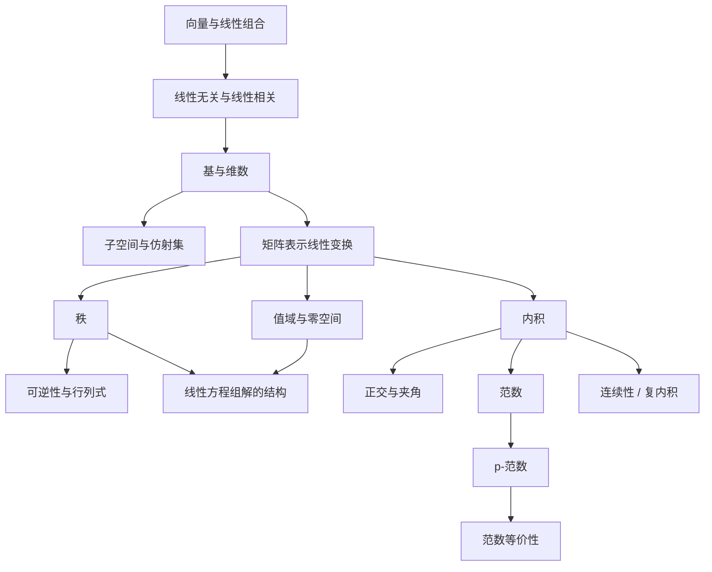
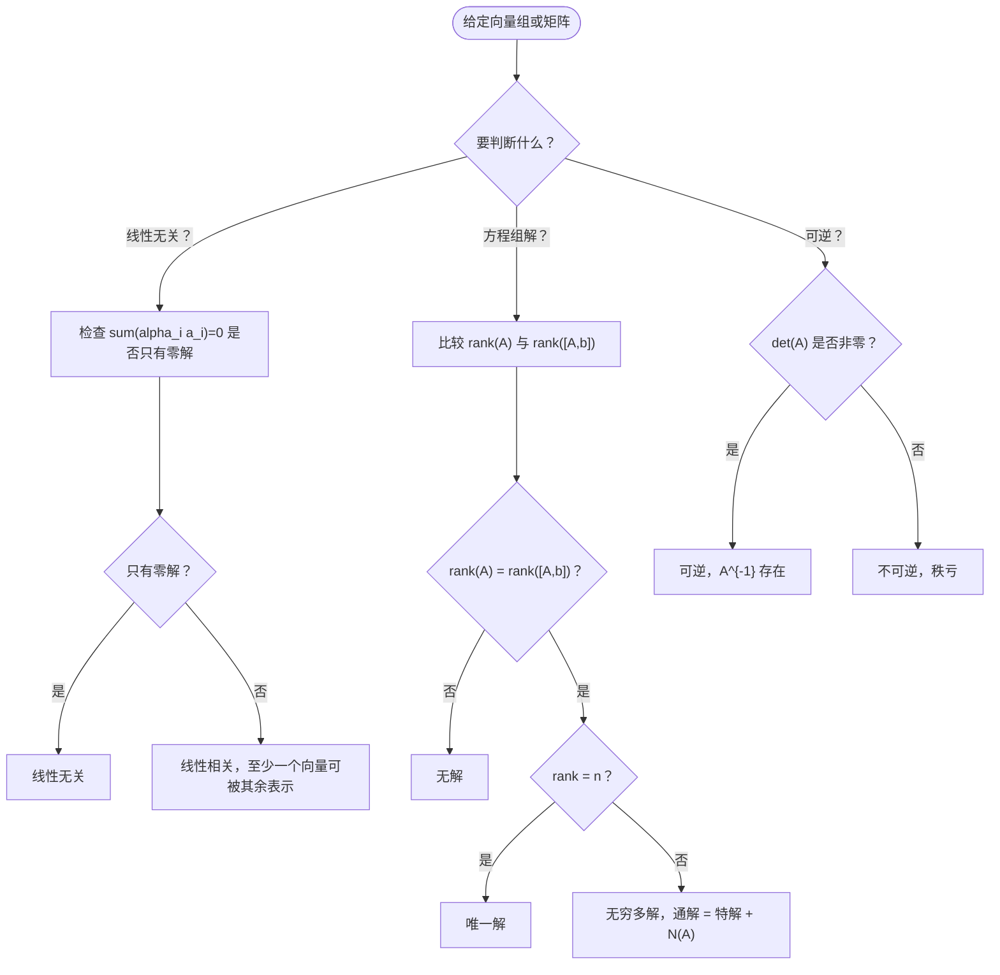

---
subject:
- 最优化方法
source:
- 02-向量空间与矩阵.md
type: review
tags:
- 向量空间
- 矩阵
- 线性方程组
- 内积
- 范数
aliases:
- 第2章 向量空间与矩阵 — 知识点梳理
schema_version: 2
time: "2026-08-31T11:44:20+08:00"
legacy_topics:
- 向量空间
- 矩阵
- 秩
- 线性方程组
- 内积
- 范数
status: not done
---

# 第2章 向量空间与矩阵 — 知识点梳理

> 本章解决的核心问题：**为优化问题建立统一的线性代数语言。梯度是向量，Hessian 是矩阵，约束的切空间是零空间——后面每一章都在用本章的概念。**

---

## 一、本章核心脉络

> 本章沿两条主线推进。第一条"结构链"：从向量出发，通过线性无关建立基和子空间，用矩阵统一表示线性变换，秩刻画信息量并决定方程组解的结构。第二条"度量链"：内积赋予空间以角度和长度，范数及其等价性保证收敛性分析不依赖具体范数的选择。两链在优化中汇合——算法在子空间中搜索（结构链），用范数评估收敛（度量链）。先讲结构再讲度量是因为必须先有空间才能往上面放尺子。

---

## 二、向量空间基础（基础）

### 2.1 符号约定

| 符号 | 含义 | 示例 |
|------|------|------|
| $x \in X$ | $x$ 是集合 $X$ 的元素 | $x \in \mathbb{R}^n$ |
| $\max X / \min X$ | 集合的最大 / 最小元素 | |
| $\sup X / \inf X$ | 上确界 / 下确界 | $\inf_x e^x = 0$，$\sup_x \arctan x = \frac{\pi}{2}$ |
| $x_i$ | 向量 $x$ 的第 $i$ 个分量 | $x = (x_1, \ldots, x_n)^\top$ |

> 无特殊说明，全文中的向量默认为**列向量**。

### 2.2 子空间与仿射集

| 概念 | 定义 | 关键特征 |
|------|------|----------|
| **子空间** | 非空集 $V$，$\forall x,y \in V$，$\forall a,b \in \mathbb{R}$：$ax+by \in V$ | 对加法和数乘封闭，**必过原点** |
| **仿射集** | $X = \bar{x} + V$，其中 $V$ 是子空间 | 子空间的平移，**不一定过原点** |

> 一句话来说：**子空间是平移到原点的"平面"；仿射集是不一定过原点的"超平面"，本质是子空间加一个偏移。** 在优化中，线性等式约束 $Ax=b$ 的可行集就是仿射集，它对应的子空间是 $\mathcal{N}(A)$。

### 2.3 线性无关与线性相关

**定理**：向量组 $a_1, \ldots, a_k$ 称为——

| 类型 | 条件 |
|------|------|
| **线性无关** | $\sum_{i=1}^k \alpha_i a_i = 0$ 只有零解 $\alpha_1 = \cdots = \alpha_k = 0$ |
| **线性相关** | 存在不全为零的 $\alpha_i$ 使 $\sum_{i=1}^k \alpha_i a_i = 0$ |

> 一句话来说：**线性无关 = 向量组中每个向量都提供了新的方向信息；线性相关 = 有冗余，至少一个向量可由其余表示。**

> 含有零向量的向量组必是线性相关组。

**定理（线性相关的等价刻画）**：向量组线性相关 $\iff$ 至少有一个向量可表示为其余向量的线性组合。

### 2.4 线性组合与张成子空间

**定义（线性组合）**：若存在实数 $\alpha_1, \ldots, \alpha_k$ 使 $a = \sum_{i=1}^k \alpha_i a_i$，则称 $a$ 是 $\{a_i\}$ 的线性组合。

**定义（张成子空间）**：

$$\operatorname{span}[a_1, \ldots, a_k] = \left\{ \sum_{i=1}^{k} \alpha_i a_i \;\middle|\; \alpha_i \in \mathbb{R} \right\}$$

> 一句话来说：**张成子空间 = 所有线性组合能到达的点的集合，就是用给定向量为"建筑材料"能搭出的最大空间。**

### 2.5 基、维数与坐标

**定义（基）**：$\{a_1, \ldots, a_k\} \subset V$ 是子空间 $V$ 的一组基，当且仅当：
1. $\{a_1, \ldots, a_k\}$ 线性无关
2. $V = \operatorname{span}[a_1, \ldots, a_k]$

> 一句话来说：**基 = 最少向量、完整表达空间的"坐标系"。**

| 性质 | 说明 |
|------|------|
| 维数唯一 | 任意两组基所含向量个数相同，记 $\dim V = k$ |
| 坐标唯一 | $\forall a \in V$，$\exists!$ 系数 $\alpha_i$ 使 $a = \sum \alpha_i a_i$，$(\alpha_1,\ldots,\alpha_k)$ 称为 $a$ 在该基下的坐标 |
| 标准基 | $\mathbb{R}^n$ 的标准基 = $I_n$（单位矩阵）的列向量组 |

> 直观理解：基的选择不唯一（同一个空间可以换不同的坐标系），但维数是空间的内在属性，"换基不换维"。

---

## 三、矩阵及其四大空间（核心）

### 3.1 矩阵的定义与转置

$A \in \mathbb{R}^{m \times n}$，$m$ 行 $n$ 列。$A^\top$ 是 $A$ 的**转置**（行列互换）。

### 3.2 值域与零空间

对于 $A \in \mathbb{R}^{m \times n}$：

| 空间 | 记法 | 定义 | 所在空间 | 维数 |
|------|------|------|:---:|:---:|
| **值域（列空间）** | $\mathcal{R}(A)$ | $\{Ax \mid x \in \mathbb{R}^n\}$ | $\mathbb{R}^m$ 的子空间 | $\operatorname{rank}(A)$ |
| **零空间（核）** | $\mathcal{N}(A)$ | $\{x \mid Ax = 0\}$ | $\mathbb{R}^n$ 的子空间 | $n - \operatorname{rank}(A)$ |

> 一句话来说：$\mathcal{R}(A)$ **是 $A$ 能"打到"的所有向量的集合**；$\mathcal{N}(A)$ **是被 $A$ "打扁到零"的所有向量的集合**。

**在优化中的角色**：
- $\mathcal{R}(A)$：线性方程组 $Ax = b$ **有解** $\iff$ $b \in \mathcal{R}(A)$
- $\mathcal{N}(A)$：$Ax = b$ 有解时，**通解 = 特解 + $\mathcal{N}(A)$**，零空间刻画了解的非唯一性

### 3.3 方阵的迹

$$\operatorname{tr}(A) \triangleq \sum_{i=1}^{n} a_{ii}$$

| 性质 | 公式 |
|------|------|
| 线性性 | $\operatorname{tr}(\alpha A + \beta B) = \alpha\operatorname{tr}(A) + \beta\operatorname{tr}(B)$ |
| 转置不变 | $\operatorname{tr}(A^\top) = \operatorname{tr}(A)$ |
| 乘积可换 | $\operatorname{tr}(AB) = \operatorname{tr}(BA)$ |
| 特征值之和 | $\operatorname{tr}(A) = \sum_{i=1}^n \lambda_i$ |

> 一句话来说：**迹 = 矩阵对角元和 = 特征值之和，是矩阵的"总缩放量"。**

---

## 四、矩阵的秩（核心）

### 4.1 秩的定义

$$\operatorname{rank}(A) = \text{线性无关列的最大个数} = \text{线性无关行的最大个数} = \dim \mathcal{R}(A)$$

> 一句话来说：**秩 = 矩阵的有效信息量。满秩 = 没有信息丢失；降秩 = 矩阵在某个方向把信息压缩掉了。**

### 4.2 保秩运算

以下操作**不改变**矩阵的秩：

| 运算 | 说明 |
|------|------|
| 列乘以非零标量 | 缩放不改变线性无关性 |
| 交换列 | 顺序不影响秩 |
| 加入一列（该列是现有列的线性组合） | 冗余信息不增加秩 |
| 乘以可逆矩阵 | $A \to PAQ$，$P,Q$ 可逆，秩不变 |
| 刚体变换 | 翻转、镜像、对称等 |

> 直观理解：保秩运算的本质是**不改变"列之间的线性关系"**。可逆矩阵乘法就是换个坐标系看同一个变换，秩是坐标无关量。

---

## 五、行列式与逆矩阵

### 5.1 行列式

任意方阵 $A \in \mathbb{R}^{n \times n}$ 的**行列式**记为 $\det A$ 或 $|A|$，是一个标量。

**定理（秩与子式的关系）**：若 $A \in \mathbb{R}^{m \times n}$ 的最高阶非零子式为 $r$ 阶，则 $\operatorname{rank}(A) = r$，且这些非零子式所在的行/列构成线性无关组。

> 一句话来说：**最高阶非零子式的阶数就是秩——这给出了通过行列式计算秩的方法。**

### 5.2 逆矩阵

| 条件 | 结论 |
|------|------|
| $\det A \neq 0$ | $A$ 非奇异 |
| $A$ 非奇异 | $\exists B$ 使 $AB = BA = I_n$，$B$ 称为 $A$ 的**逆矩阵**，记为 $A^{-1}$ |

> 等价链：$\det A \neq 0$ $\iff$ $\operatorname{rank}(A) = n$ $\iff$ $A$ 可逆 $\iff$ 列满秩 $\iff$ 行满秩

---

## 六、线性方程组（核心）

### 6.1 问题形式

$$Ax = b \quad \iff \quad x_1 a_1 + x_2 a_2 + \cdots + x_n a_n = b$$

即 $b$ 表示为 $A$ 的列向量的线性组合。

### 6.2 解的存在性与唯一性

| 秩条件 | 解的情况 |
|--------|----------|
| $\operatorname{rank}(A) = \operatorname{rank}[A, b] = n$ | **唯一解** |
| $\operatorname{rank}(A) = \operatorname{rank}[A, b] < n$ | **无穷多解** |
| $\operatorname{rank}(A) \neq \operatorname{rank}[A, b]$ | **无解** |

> 判定口诀：**有解靠秩相等，唯一靠秩等于列数。**

### 6.3 通解的结构

$Ax = b$ 的通解可表示为以下三种等价形式：

| 表示形式 | 含义 |
|----------|------|
| $x = x_0 + \sum_{i=1}^{n-r} k_i \xi_i$ | 特解 $x_0$ + 基础解系 $\{\xi_i\}$ 的线性组合 |
| $x = x_0 + \mathcal{N}(A)$ | 特解 + 整个零空间 |
| $x = A^\dagger b$ | 广义逆表示（最小范数解） |

> 一句话来说：**通解 = 一个特解 + 整个零空间。** 在优化中，约束优化的搜索方向就在（约束切平面的）零空间中寻找。

> 直观理解：零空间中的向量加上去不影响 $Ax$ 的结果——它们对应的是不会改变"输出"的"自由变量"。有多少个自由变量，解的集合就有多少维的自由度。

### 6.4 典型例题

> **例**：判断 $Ax = b$ 的解的情况。
> $$A = \begin{bmatrix} 1 & 2 & 1 \\ 2 & 4 & 3 \end{bmatrix}, \quad b = \begin{bmatrix} 3 \\ 7 \end{bmatrix}$$
>
> **步骤**：
> 1. 计算 $\operatorname{rank}(A) = 2$（两行不成比例）
> 2. 计算 $\operatorname{rank}[A, b] = 2$（$b$ 可由 $A$ 的列线性表出）
> 3. $2 = 2 < 3 = n$ → **无穷多解**，含 $3-2=1$ 个自由变量
>
> 通解：$x = [1,1,0]^\top + k \cdot [-2,1,0]^\top$（$k$ 为任意实数）

---

## 七、内积与正交（核心）

### 7.1 欧式内积

$$(x, y) = \sum_{i=1}^{n} x_i y_i = x^\top y$$

> 一句话来说：**内积 = 衡量两个向量"相似度"的标量。越大越指向同一方向，为零则垂直（正交）。**

### 7.2 内积公理

内积是满足以下三条的实值双线性函数 $(\cdot, \cdot): \mathbb{R}^n \times \mathbb{R}^n \to \mathbb{R}$：

| 公理 | 内容 |
|------|------|
| **非负性** | $(x, x) \geq 0$，且 $=0 \iff x = 0$ |
| **对称性** | $(x, y) = (y, x)$ |
| **双线性** | $(r(x+y), z) = r(x,z) + r(y,z)$，$\forall r \in \mathbb{R}$ |

### 7.3 内积的推广

| 类型 | 形式 | 用途 |
|------|------|------|
| 加权内积 | $(x, y) = x^\top Q y,\; Q \succ 0$ | 引入方向偏好（如马氏距离） |
| 矩阵内积 | $(A, B) = \operatorname{tr}(A^\top B)$ | 矩阵空间的"点积" |
| 函数内积 | $(f, g) = \int_a^b f(t)g(t)dt$ | 无限维空间的内积 |

### 7.4 正交与夹角

$$\cos\theta = \frac{(x, y)}{\|x\| \|y\|}$$

| 术语 | 条件 |
|------|------|
| **正交** | $(x, y) = 0$，即 $\theta = 90^\circ$ |
| **正交向量组** | 组内向量两两正交 |

> 一句话来说：**正交 = 两个向量在"信息上完全独立"，彼此不包含对方的任何成分。**

> **关键性质**：正交向量组一定是线性无关组（但线性无关不一定正交）。Ch03 的施密特正交化就是把"线性无关"升级为"正交"的方法。

---

## 八、范数及其等价性（核心）

### 8.1 欧式范数

$$\|x\| = \sqrt{(x, x)} = \sqrt{x^\top x}$$

### 8.2 核心不等式

| 不等式 | 公式 | 等号条件 |
|--------|------|----------|
| **Cauchy-Schwarz** | $|x^\top y| \leq \|x\| \|y\|$ | $x = \alpha y$（共线） |
| **勾股定理** | $\|x \pm y\|^2 = \|x\|^2 + \|y\|^2$ | $x \perp y$ |
| **Hölder 不等式** | $|x^\top y| \leq \|x\|_p \|y\|_q$ | $\frac{1}{p} + \frac{1}{q} = 1$ |
| **均值不等式** | $\sqrt{|a_1 a_2|} \leq \frac{1}{2}(|a_1| + |a_2|)$ | $|a_1| = |a_2|$ |

> 一句话来说：**Cauchy-Schwarz = 内积的绝对值不超过各自长度的乘积。** 这是 Ch08 中证明梯度是最速下降方向的核心工具——$|\nabla f^\top d| \leq \|\nabla f\| \|d\|$，取等时 $\nabla f \parallel d$。

### 8.3 范数的三条性质

| 性质 | 内容 |
|------|------|
| 非负性 | $\|x\| > 0$（$x \neq 0$），$\|0\| = 0$ |
| 齐次性 | $\|\alpha x\| = |\alpha| \|x\|$ |
| 三角不等式 | $\|x - y\| \leq \|x\| + \|y\|$ |

### 8.4 $p$-范数

$$\|x\|_p = \begin{cases}
\left( \sum_{i=1}^n |x_i|^p \right)^{1/p}, & 1 \leq p < \infty \\[4pt]
\max\{|x_1|,\ldots,|x_n|\}, & p = \infty
\end{cases}$$

| $\|x\|_1$ | $\|x\|_2$ | $\|x\|_\infty$ |
|-----------|-----------|----------------|
| 曼哈顿距离（分量绝对值和） | 欧式距离 | 最大分量绝对值 |

### 8.5 范数等价性

**定理**：在 $\mathbb{R}^n$ 中，所有范数等价。即对任意范数 $\|\cdot\|_\alpha$ 和 $\|\cdot\|_\beta$，存在 $c_1, c_2 > 0$ 使：

$$c_1 \|x\|_\alpha \leq \|x\|_\beta \leq c_2 \|x\|_\alpha$$

**常用等价关系**（$p > q \geq 0$）：

$$\|x\|_p \leq \|x\|_q \leq n^{\frac{1}{q} - \frac{1}{p}} \|x\|_p$$

> 一句话来说：**在有限维空间中，所有范数"本质上等价"——用哪个范数定义收敛都可以，只差一个常数因子。** 这是梯度法收敛性分析的理论基础——可以选最方便的范数（通常是 $\ell_2$）而结论对任意范数成立。

---

## 九、连续性与复空间内积（了解即可）

### 9.1 连续性

$f: \mathbb{R}^n \to \mathbb{R}^m$ 在 $x$ 处连续 $\iff$ $\forall \varepsilon > 0$，$\exists \delta > 0$ 使 $\|y - x\| < \delta \implies \|f(y) - f(x)\| < \varepsilon$。

> 一句话来说：**输入的小变化只引起输出的小变化。** 在优化中，连续性保证最优性条件的极限推导合法。

### 9.2 复空间内积

在 $\mathbb{C}^n$ 中，内积加入共轭：

$$(x, y) = \sum_{i=1}^n x_i \bar{y}_i$$

| 性质 | 与实空间对比 |
|------|-------------|
| 非负性 | $(x, x) \geq 0$，同实空间 |
| 共轭对称 | $(x, y) = \overline{(y, x)}$（实空间是对称） |
| 齐次性（第一变元） | $(\alpha x, y) = \alpha(x, y)$，$\alpha \in \mathbb{C}$ |

> 复空间内积主要用于信号处理、量子力学等；最优化主要在实数域，了解即可。

---

## 十、判定/决策流程

**判定要点**：
1. **线性无关**：看系数方程只有零解还是有不全为零的解。秩的维度就是极大线性无关组的向量个数。
2. **方程组解**：先看秩等不等（有无解），再看秩等于几（唯一还是无穷多）。
3. **可逆**：方阵才可谈逆；$\det A \neq 0 \iff \operatorname{rank}(A)=n \iff$ 可逆。

---

## 十一、核心公式速查表

| 概念 | 公式 | 在优化中的应用 |
|------|------|---------------|
| 子空间判定 | $\forall x,y \in V, \forall a,b \in \mathbb{R}: ax+by \in V$ | 切空间、零空间都是子空间 |
| 仿射集 | $X = \bar{x} + V$ | 线性等式约束的可行集 |
| 值域 | $\mathcal{R}(A) = \{Ax\}$ | $Ax = b$ 有解 $\iff$ $b \in \mathcal{R}(A)$ |
| 零空间 | $\mathcal{N}(A) = \{x \mid Ax = 0\}$ | 搜索方向空间 |
| 秩 | $\operatorname{rank}(A) = \dim \mathcal{R}(A)$ | 有效约束的个数 |
| 迹 | $\operatorname{tr}(A) = \sum a_{ii} = \sum \lambda_i$ | 特征值总和 |
| 通解结构 | $x = x_0 + \mathcal{N}(A)$ | KKT 系统的解结构 |
| 内积 | $(x, y) = x^\top y$ | 梯度与方向的内积 = 方向导数 |
| Cauchy-Schwarz | $|x^\top y| \leq \|x\| \|y\|$ | 证明梯度是最速下降方向 |
| $p$-范数 | $\|x\|_p = (\sum |x_i|^p)^{1/p}$ | 正则化项、停机准则 |
| 范数等价 | $\|x\|_p \leq \|x\|_q \leq n^{\frac{1}{q}-\frac{1}{p}}\|x\|_p$ | 收敛性分析 |
| 四大空间对偶 | $\mathcal{R}(A)^\perp = \mathcal{N}(A^\top)$ | 切空间 = 法空间的补 |

---

## 十二、易错点与注意事项

> [!warning] 子空间必须过原点
> 验证子空间时必须检查零向量是否在集合中。仿射集不一定过原点——不要混淆子空间和仿射集。

> [!warning] $\mathcal{R}(A)$ 和 $\mathcal{R}(A^\top)$ 在不同空间
> 虽然 $\operatorname{rank}(A) = \operatorname{rank}(A^\top)$，但 $\mathcal{R}(A) \subset \mathbb{R}^m$ 而 $\mathcal{R}(A^\top) \subset \mathbb{R}^n$。两者不是同一个空间的子集。

> [!warning] 零空间维数 = $n - \operatorname{rank}(A)$，不是 $m - \operatorname{rank}(A)$
> $\mathcal{N}(A)$ 是 $\mathbb{R}^n$ 的子空间（输入空间），维数由**列数**减秩决定，与行数 $m$ 无直接关系。

> [!warning] 线性无关 vs 正交
> 正交向量组一定线性无关（因为两两正交意味着不能互相表示），但线性无关不一定正交。例如 $(1,0)^\top$ 和 $(1,1)^\top$ 线性无关但不正交。

> [!warning] 范数等价性仅在有限维
> 范数等价性是有限维空间的特有性质。在无穷维函数空间中，$\ell_1$ 和 $\ell_2$ 不等价。

> [!warning] 秩等 $\Rightarrow$ 有解，但要注意是增广矩阵的秩
> 判断 $Ax = b$ 是否有解，需要比较 $\operatorname{rank}(A)$ 和 $\operatorname{rank}([A, b])$（增广矩阵），不是 $\operatorname{rank}(A)$ 和 $\operatorname{rank}(b)$。

---

## 十三、相关知识点链接

| 链接 | 为什么需要这个前置知识 |
|------|----------------------|
| [[03-线性代数基础\|特征值与二次型]] | 矩阵的特征值与秩是线性代数的两大核心量——秩管方程求解，特征值管正定性 |
| [[04-几何概念\|超平面与凸集]] | 子空间和仿射集是超平面的特例；仿射集是凸集的子类 |
| [[05-微积分基础\|梯度与方向导数]] | 梯度是向量、方向导数是内积——本章的内积/范数是微分学的基础语言 |
| [[06-最优性条件\|FONC/SONC]] | $\nabla f(x^*) = 0$ 是 $n$ 维向量方程，需要用本章的线性方程组理论理解 |
| [[08-梯度方法\|最速下降法]] | 相邻梯度正交（源于内积性质）；收敛率用范数描述；Cauchy-Schwarz 是核心证明工具 |
| [[20-等式约束优化\|切空间/法空间]] | 四大空间对偶关系 $\mathcal{R}(A)^\perp = \mathcal{N}(A^\top)$ 直接应用于罚函数法和 KKT 理论 |

---

## 十四、作业与练习

课后习题已录入：[[习题库/02-向量空间与矩阵/README|第2章习题库]]

| 题号 | 练什么 | 建议 |
|------|--------|------|
| 2.3 | 线性无关判定 | 熟练掌握"系数方程只有零解"的判断方法 |
| 2.5 | 子空间与基 | 验证子空间的三步法：零向量、加法封闭、数乘封闭 |
| 2.10 | 范数计算与不等式 | 熟练使用 Cauchy-Schwarz 和三角不等式 |
