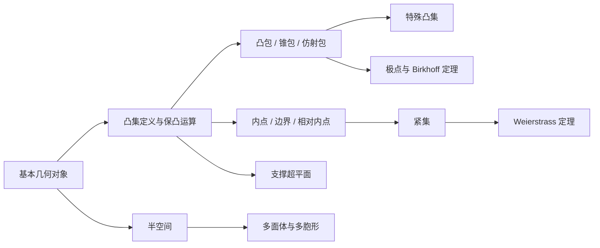
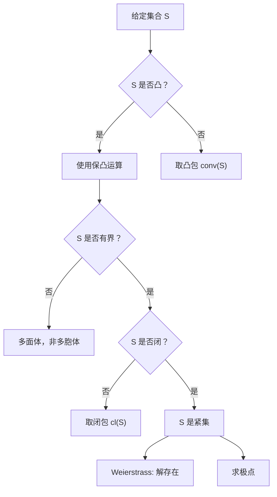

---
subject:
- 最优化方法
source:
- 04-几何概念.md
type: review
tags:
- 凸集
- 极点
- 支撑超平面
aliases:
- 第4章 几何概念 — 知识点梳理
schema_version: 2
time: "2026-08-31T11:44:20+08:00"
legacy_topics:
- 凸集
- 凸包
- 凸锥
- 极点
- Birkhoff定理
- 支撑超平面
- 多面体
- Weierstrass定理
status: not done
---

# 第4章 几何概念 — 知识点梳理

> 本章解决的核心问题：**为优化问题的可行集建立几何语言——什么是凸集、如何构造凸集、凸集的边界和极点有什么性质，以及何时最优解一定存在。这是后续凸优化理论（Ch20-22）的全部几何基础。**

---

## 一、本章核心脉络

> 图中主要路径说明：基本几何对象（线段/超平面/线性簇）定义后，凸集是核心概念（定义+保凸运算），然后从凸集分出三条线——(1) 三种"包"（凸包/锥包/仿射包）用于生成更多凸集；(2) 极点理论（含 Birkhoff 定理）用于线性规划；(3) 内点/边界/紧集通向 Weierstrass 定理（解的存在性）。半空间分支独立导出多面体与多胞形。支撑超平面是分离定理的前身。

> 理解这个顺序：从最基本的几何对象（线段、超平面）出发，定义凸集（4.2）后马上学会三种"批量生产"凸集的方法（凸包/锥包/仿射包，4.3）——这是本章的第一个核心能力。然后认识几类特殊的凸集（4.4）。随后的极点（4.5-4.6）是线性规划的理论基石；紧集与 Weierstrass 定理（4.7-4.8）回答"最优解何时存在"；支撑超平面（4.9）是分离定理的前身；多面体（4.10）为线性规划和约束优化的可行域建模。

---

## 二、基础几何对象：线段、超平面与线性簇

### 2.1 直线、线段与射线

给定空间中两点 $x, y \in \mathbb{R}^n$，参数 $a \in \mathbb{R}$ 控制位置：

| 对象 | 定义 | 参数范围 | 几何直觉 |
|------|------|----------|----------|
| **直线** | $L = \{a x + (1-a) y \mid a \in \mathbb{R}\}$ | $(-\infty, +\infty)$ | 过两点的无限延伸线 |
| **线段** | $[x, y] = \{a x + (1-a) y \mid a \in [0, 1]\}$ | $[0, 1]$ | 两点之间的"桥" |
| **射线** | $R = \{a x + (1-a) y \mid a \geq 0\}$ | $[0, +\infty)$ | 从 $y$ 出发指向 $x$ 的半直线 |

> 一句话来说：**线段是 $x$ 和 $y$ 的所有凸组合**（系数和为 1 且非负）；直线放宽了非负条件；射线只在一个方向放宽。

### 2.2 超平面

设 $a \in \mathbb{R}^n$（超平面上一点），$v \in \mathbb{R}^n \setminus \{0\}$（法向量），超平面定义为：

$$H = \{x \in \mathbb{R}^n \mid v^{\top}(x - a) = 0\}$$

> 一句话来说：超平面是 $\mathbb{R}^n$ 中一个 $(n-1)$ 维"平板"——所有与法向量 $v$ 垂直的偏移量的集合。

**两类超平面：**

| 情形 | 性质 | 例子 |
|------|------|------|
| $a = 0$ | 过原点，是**子空间** | $x_1 + x_2 = 0$ |
| $a \neq 0$ | 不过原点，是**仿射集（流形）** | $x_1 + x_2 = 3$ |

**半空间**——超平面将空间一分为二：

$$H^{+} = \{x \mid v^{\top}(x - a) \geq 0\}, \quad H^{-} = \{x \mid v^{\top}(x - a) \leq 0\}$$

> 一句话来说：半空间是"站"在超平面一侧的所有点——不等式约束（如 $Ax \leq b$）的本质就是要求 $x$ 落在若干个半空间的交集内。

### 2.3 线性簇

设 $A \in \mathbb{R}^{m \times n}$，$b \in \mathbb{R}^m$：

$$L = \{x \in \mathbb{R}^n \mid Ax = b\}$$

> 一句话来说：线性簇是多个超平面的交集——$m$ 个线性方程各定义一个超平面，它们的公共解集就是线性簇。

| 性质 | 说明 |
|------|------|
| 维数 | $\dim N(A)$（$A$ 的零空间维数） |
| $b = 0$ 时为子空间 | 零向量属于 $L$ |
| $A = 0, b = 0$ | $L = \mathbb{R}^n$ |
| $\dim N(A) < n$ | $L$ 是有限个超平面的交 |

---

## 三、凸集与保凸性（核心）

### 3.1 凸集的定义

$S \subset \mathbb{R}^n$ 是**凸集** $\Longleftrightarrow$ 对任意 $x, y \in S$，$x$ 和 $y$ 之间的线段全在 $S$ 内：

$$a x + (1-a) y \in S, \quad \forall x, y \in S, \; \forall a \in (0, 1)$$

> 一句话来说：**凸集就是"连线上没有洞"的集合——任取两点，它们之间的连线不离开集合。**

**直观理解**：想象 $S$ 是一个橡皮泥捏成的形状。如果它是凸的，那么把一根针从任意一点扎进去、从另一点穿出来，针身全程都在形状内部。如果存在一对点使得针身有一段露在外面，$S$ 就不是凸的。

**课件中的凸性判定练习**：

1. $S = \{x \in \mathbb{R}^2 \mid x_1 x_2 \geq 1, \; x_1 \geq 0, \; x_2 \geq 0\}$ — 这是双曲线 $x_1 x_2 = 1$ 上方的区域。取 $(1, 2)$ 和 $(2, 1)$ 两点的中点 $(1.5, 1.5)$，$1.5 \times 1.5 = 2.25 \geq 1$。但取 $(0.1, 10)$ 和 $(10, 0.1)$ 的中点 $(5.05, 5.05)$，乘积 $> 1$。实际上该集合是凸的（双曲线上方区域）。

2. $S = \{x \in \mathbb{R}^n \mid x^{\top} A x + b^{\top} x + c \leq 0, \; A \succeq 0\}$ — 这是二次不等式定义的区域。当 $A \succeq 0$（半正定）时，$x^{\top} A x$ 是凸函数，水平下集是凸集。所以 $S$ 是凸集。

### 3.2 常见的凸集

| 集合类型 | 是否凸集 | 理由 |
|----------|:---:|------|
| 空集、单点集 | 是 | 平凡情况 |
| 直线、线段、子空间 | 是 | 仿射集都是凸集 |
| 超平面 | 是 | 仿射集 |
| 半空间 | 是 | 凸集（可以用定义验证） |
| 多面体 $\{x \mid Ax \leq b\}$ | 是 | 半空间的交，交集保凸 |
| 二阶锥 $\{(x,t) \mid \|x\|_2 \leq t\}$ | 是 | 见 4.4 |
| 正半定锥 $\mathbb{S}_+^n$ | 是 | 见 4.4 |

### 3.3 保凸运算（定理）

> 直观理解：如果能从已知的凸集通过"简单操作"得到新集合，我们就不需要每次都用定义去验证凸性。以下是五种保凸运算：

| 运算 | 定义 | 直观理解 |
|------|------|----------|
| **数乘** | $\alpha S = \{\alpha x \mid x \in S\}$ | 对集合做均匀缩放，不改变凸性 |
| **交集** | $S_1 \cap S_2$ | 两个凸集的公共区域仍是凸的 |
| **Minkowski 和** | $S_1 \pm S_2 = \{x_1 \pm x_2 \mid x_1 \in S_1, x_2 \in S_2\}$ | 两个集合"膨胀叠加"，保持凸性 |
| **线性变换** | $A S = \{A x \mid x \in S\}$ | 线性映射不破坏凸性 |
| **内部与闭包** | $\operatorname{int}(S), \; \operatorname{cl}(S)$ | 取内部或取闭包也保凸 |

> 一句话来说：**保凸运算是我们"免费"构造新凸集的工具箱——只要原材料是凸的，经过这些操作后结果自动是凸的。**

---

## 四、凸包、锥包与仿射包（核心）

这三种"包"是将任意集合"变成"对应类型凸集的最小方式。

### 4.1 三者对比

| 类型 | 离散形式（$C = \{x_i\}_{i=1}^m$） | 系数条件 | 目的 |
|------|------|----------|------|
| **凸包** $\operatorname{conv}(C)$ | $\sum a_i x_i$ | $a_i \geq 0, \; \sum a_i = 1$ | 生成包含 $C$ 的最小凸集 |
| **锥包** $\operatorname{cone}(C)$ | $\sum a_i x_i$ | $a_i \geq 0$（无 $\sum = 1$） | 生成包含 $C$ 的最小凸锥 |
| **仿射包** $\operatorname{aff}(C)$ | $\sum a_i x_i$ | $\sum a_i = 1$（无非负限制）| 生成包含 $C$ 的最小仿射集 |

> 一句话来说：**凸包 = 非负 + 和为 1（凸组合）；锥包 = 仅非负（锥组合）；仿射包 = 仅和为 1（仿射组合）。** 约束越少，生成的集合越大。

**直观理解**：
- **凸包**：取 $C$ 中所有点，想象在这些点之间拉一张紧绷的橡皮膜——膜覆盖的区域就是 $\operatorname{conv}(C)$。
- **锥包**：把 $C$ 中每个点看成从原点射出的一根射线，所有射线的"扇形区域"就是 $\operatorname{cone}(C)$。
- **仿射包**：过 $C$ 中所有点的最小"平面"（可以是直线、平面、超平面……）。

### 4.2 连续集情形

对于一般集合 $C$：
- $\operatorname{conv}(C)$ = $C$ 中所有点的凸组合所成的集合
- $\operatorname{cone}(C)$ = $C$ 中所有点的锥组合所成的集合
- $\operatorname{aff}(C)$ = 包含 $C$ 的所有仿射集的交

---

## 五、球、椭球与凸锥

### 5.1 球与椭球

| 对象 | 定义 | 核心参数 |
|------|------|----------|
| **球** | $B(x_0, r) = \{x \mid \|x - x_0\| \leq r\}$ | 球心 $x_0$，半径 $r$ |
| **椭球**（范数形式） | $E = \{x \mid \|x - x_0\|_{P^{-1}} \leq r\}$ | 球心 $x_0$，形状矩阵 $P \succ 0$ |
| **椭球**（变换形式） | $E = \{x_0 + A u \mid \|u\| \leq r\}$ | $P = A A^{\top}$，$A$ 非奇异 |

> 一句话来说：**椭球是对球的仿射变形——把球在不同方向上拉长或压缩，就得到椭球。** 其中的 $P$（或 $A$）决定了"不同方向上的半径"。

### 5.2 凸锥

**定义回顾**：$K$ 是锥 $\Longleftrightarrow$ 对任意 $x \in K$ 和 $\lambda \geq 0$，有 $\lambda x \in K$。$K$ 是**凸锥** $\Longleftrightarrow$ $K$ 同时是锥和凸集。

两个最重要的凸锥：

| 凸锥 | 定义 | 维度 | 几何直觉 |
|------|------|------|----------|
| **二阶锥** | $K = \{(x, t) \in \mathbb{R}^{n} \mid \|x\|_2 \leq t\}$ | $\mathbb{R}^{n}$ 中 | 像一个"冰淇淋筒"——顶点在原点，$t$ 轴为对称轴 |
| **正半定锥** | $\mathbb{S}_+^n = \{A \in \mathbb{R}^{n \times n} \mid A = A^{\top}, \; A \succeq 0\}$ | 对称矩阵空间 | 所有半正定对称矩阵构成的锥 |

> 一句话来说：二阶锥是"范数约束"的几何化身（二阶锥规划的基础），正半定锥是"矩阵不等式"的几何化身（半定规划的基础）。

---

## 六、集合的极点与 Birkhoff 定理（难点）

### 6.1 极点的定义

点 $x \in S$ 是 $S$ 的**极点** $\Longleftrightarrow$ 不能表示为 $S$ 中其他两点的严格凸组合：

$$\nexists u, v \in S, \; u \neq v, \; a \in (0, 1): \; x = a u + (1-a) v$$

> 一句话来说：**极点是凸集中无法被"夹在中间"的点——它们是凸集的"尖角"和"顶点"。**

**等价刻画**（定理）：设 $S$ 是凸集。$x$ 是 $S$ 的极点 $\Longleftrightarrow$ $S \setminus \{x\}$ 仍是凸集。

> 直观理解：拿走一个极点后，集合仍然是凸的（只是少了个角）；但拿走一个非极点，集合就可能出现"凹陷"。

### 6.2 典型集合的极点

| 集合 | 极点 |
|------|------|
| 概率单纯形 $\{x \geq 0 \mid \sum x_i = 1\}$ | 自然基 $e_1, \ldots, e_n$ |
| 全维单纯形 $\{0 \leq x \leq 1 \mid \sum x_i \leq 1\}$ | $e_1, \ldots, e_n$ 和原点 $0$ |
| $\ell_1$-范数单位球 $\{x \mid \|x\|_1 \leq 1\}$ | $\pm e_1, \ldots, \pm e_n$（共 $2n$ 个） |
| $\ell_{\infty}$-范数单位球 $\{x \mid \|x\|_{\infty} \leq 1\}$ | 全部分量为 $\pm 1$ 的向量（共 $2^n$ 个） |

> 一句话来说：单纯形的极点是自然基向量（$n$ 维空间中 $n+1$ 个或 $n$ 个极点）；$\ell_1$ 球是菱形体，"尖角"在坐标轴上；$\ell_{\infty}$ 球是正方体，每个顶点都是极点。

### 6.3 Birkhoff 定理

**背景**：双随机矩阵——行和与列和都为 1 的非负方阵。

$$\Omega = \{X \in \mathbb{R}_+^{n \times n} \mid X e = e, \; e^{\top} X = e^{\top}\}$$

其中 $e = (1, 1, \ldots, 1)^{\top}$。

> **定理（Birkhoff）**：$\Omega$ 的极点是**置换矩阵**（每行每列恰有一个 1，其余为 0 的 $0$-$1$ 矩阵），共有 $n!$ 个。

> 一句话来说：**任何一个双随机矩阵都可以写成若干个置换矩阵的凸组合——这就是"Birkhoff-von Neumann 分解"。**

**证明核心洞察**：若 $X$ 是 $\Omega$ 的极点，则 $X$ 必有一个元素等于 1。该元素所在行和列的其他元素必为 0（否则 $X$ 可以写成两个不同双随机矩阵的凸组合）。删去该行该列得到一个 $(n-1) \times (n-1)$ 双随机矩阵，归纳即可。

> 这个定理的重要性在于：它将"连续"的双随机矩阵集合与"离散"的置换矩阵建立了联系——在分配问题、匹配问题的理论分析中至关重要。

---

## 七、内点、边界点与集合分类

### 7.1 三种点的定义

| 点的类型 | 定义 | 直观理解 |
|----------|------|----------|
| **内点** | $\exists N(x) \subset S$（$x$ 的某邻域全在 $S$ 内） | 周围全是 $S$ 的地盘 |
| **边界点** | 任意 $N(x)$ 既含 $S$ 中点，也含补集中点 | 站在边界上，一脚里一脚外 |
| **相对内点** | $\exists N(x) \cap \operatorname{aff}(S) \subset S$ | 在 $S$ 的仿射包内"看"，$x$ 是内点 |

> 一句话来说：**内点 = 有"活动空间"；边界点 = 无路可退；相对内点 = 沿着集合自己"躺"的方向有活动空间。**

**为什么要区分相对内点？** 考虑 $\mathbb{R}^3$ 中的一个三角形（$S$ 是二维的）。它在 $\mathbb{R}^3$ 中没有内点（任何小球都会穿出三角形），但在三角形所在平面内它有内点。——这就是"相对"的含义。

### 7.2 集合的分类

| 类型 | 定义 | 直观 |
|------|------|------|
| **开集** | 每个点都是内点 | 没有边界 |
| **闭集** | 包含所有边界点 | "完整"，补集是开集 |
| **有界集** | 可用有限半径的球覆盖 | 不会"跑"到无穷远 |
| **紧集** | 有界 + 闭集 | $\mathbb{R}^n$ 中紧 = 有界闭 |

---

## 八、Weierstrass 定理与支撑超平面

### 8.1 Weierstrass 定理

> **定理**：设 $\Omega \subset \mathbb{R}^n$ 是紧集，$f: \Omega \to \mathbb{R}$ 是连续函数。则存在 $x_0 \in \Omega$ 使得 $f(x_0) = \min_{x \in \Omega} f(x)$。

> 一句话来说：**紧集上的连续函数一定能取到最小值——这是"最优解存在性"的数学保证。**

**直观理解**：
- 紧集（有界闭集）保证可行域不会"无限大"（有界）也不会"有缺口"（闭）
- 连续函数不会"跳"
- 两者合起来：最小值一定在该集合的某处达到

**注意**：光是紧 + 连续只保证**存在性**，不保证**唯一性**。要保证唯一性还需要额外条件（如严格凸性、下半连续性、强制性）。

> 课件提示：函数的**严格凸性**保证唯一性，**下半连续性**放松了对连续性的要求，**强制性**（$\|x\| \to \infty \Rightarrow f(x) \to \infty$）保证水平集有界。

### 8.2 支撑超平面

设 $S \subset \mathbb{R}^n$ 为凸集，$x \in \operatorname{bd}(S)$（$x$ 是边界点）。过 $x$ 的某超平面 $H$ 若使 $S$ 完全位于 $H$ 的一侧，则称 $H$ 为 $S$ 在 $x$ 点的**支撑超平面**。

> 一句话来说：**支撑超平面是"贴着"凸集边界的一个超平面——整个凸集都在它的一侧。** 这就像把一块凸石头放在桌面上，桌面就是支撑超平面。

**重要性**：支撑超平面定理是凸集分离定理的基础——如果两个凸集不相交，可以找一个超平面将它们分开。分离定理又是 Lagrange 对偶理论（Ch20-22）的几何核心。

#### 支撑超平面的存在性

设 $\Theta \subset \mathbb{R}^n$ 为凸集，$x \in \operatorname{bd}(\Theta)$。存在过 $x$ 的超平面，使 $\Theta$ 完全位于它的一侧。

---

## 九、多面体与多胞形

### 9.1 定义对比

| 术语 | 定义 | 是否有界 |
|------|------|:---:|
| **多面体** | $S = \{x \mid Ax \leq b\}$（有限个半空间的交） | 不一定 |
| **多胞体** | 非空且有界的多面体 | 一定有界 |

> 一句话来说：**多胞体 = 有界的多面体。** 多面体可以延伸到无穷远（如 $\{x \mid x \geq 0\}$），多胞体一定可以被一个球包住。

### 9.2 多面体的面结构

| 概念 | 定义 | 例子（正方体） |
|------|------|------|
| **$k$ 维面** | $(k+1)$ 维多面体的边界 | $k=2$：正方形面 |
| **0 维面** | 顶点 | 8 个顶点 |
| **1 维面** | 边 | 12 条棱 |
| **$(n-1)$ 维面** | 超面（facet） | 6 个面 |

> 直观理解：一个 $k$ 维多面体由 $k$ 维的内部加上 $(k-1)$ 维、$(k-2)$ 维、……、0 维的面组成，形成一个层级结构。

---

## 判定 / 决策流程

---

## 核心公式速查表

| 概念 | 公式 | 关键条件 |
|------|------|----------|
| 直线 | $\{a x + (1-a) y \mid a \in \mathbb{R}\}$ | 无限制 |
| 线段 | $[x, y] = \{a x + (1-a) y \mid a \in [0, 1]\}$ | $a \in [0,1]$ |
| 超平面 | $H = \{x \mid v^{\top}(x - a) = 0\}$ | $v \neq 0$ |
| 线性簇 | $L = \{x \mid Ax = b\}$ | $\dim = \dim N(A)$ |
| 凸集定义 | $a x + (1-a) y \in S, \; \forall a \in (0,1)$ | 线段在集合内 |
| 凸包（离散） | $\operatorname{conv}(C) = \{\sum a_i x_i \mid \sum a_i = 1, a_i \geq 0\}$ | $a_i \geq 0$, 和为 1 |
| 锥包（离散） | $\operatorname{cone}(C) = \{\sum a_i x_i \mid a_i \geq 0\}$ | 仅非负 |
| 仿射包（离散） | $\operatorname{aff}(C) = \{\sum a_i x_i \mid \sum a_i = 1\}$ | 仅和为 1 |
| 球 | $B(x_0, r) = \{x \mid \|x - x_0\| \leq r\}$ | 范数定义 |
| 椭球 | $E = \{x \mid \|x - x_0\|_{P^{-1}} \leq r\}$ | $P \succ 0$ |
| 二阶锥 | $K = \{(x, t) \mid \|x\|_2 \leq t\}$ | $\mathbb{R}^n \times \mathbb{R}$ |
| 正半定锥 | $\mathbb{S}_+^n = \{A = A^{\top} \succeq 0\}$ | 半正定对称矩阵 |
| 极点 | 不能表示为两点的严格凸组合 | $S \setminus \{x\}$ 仍是凸集 |
| Birkhoff | $\Omega$ 极点是置换矩阵 | 共 $n!$ 个 |
| 多面体 | $S = \{x \mid Ax \leq b\}$ | 有限半空间交 |
| 多胞体 | 非空有界多面体 | |
| Weierstrass | $\min_{x \in \Omega} f(x)$ 存在 | $\Omega$ 紧, $f$ 连续 |

---

## 易错点与注意事项

> [!warning] 凸集 ≠ "看起来没有凹陷"
> 凸集必须满足**任意两点**的连线都在集合内。例如 $S = \{x \mid x_1^2 + x_2^2 \leq 1\} \setminus \{(0,0)\}$（圆盘去掉圆心）不是凸集——取直径两端点，它们的中点（圆心）不在集合内。

> [!warning] 凸包的"最小性"
> $\operatorname{conv}(C)$ 是**包含 $C$ 的最小凸集**。如果有另一个凸集 $K \supset C$，则 $\operatorname{conv}(C) \subseteq K$。这是凸包最重要的性质。

> [!warning] 极点 ≠ 边界点
> 圆的边界上每个点都是边界点，但圆盘（凸集）没有极点——因为圆盘内每个点都可以写成其他两点的凸组合。只有带"尖角"的凸集才有极点。

> [!warning] 紧性条件不可少
> Weierstrass 定理要求**紧集 + 连续函数**两个条件同时成立。如果可行域不是闭的（如开区间 $(0, 1)$ 上的 $f(x) = x$），或者不是有界的（如 $[0, +\infty)$ 上的 $f(x) = e^{-x}$），最小值可能不存在。

> [!warning] 仿射包 ≠ 凸包
> $\operatorname{aff}(C)$ 不要求系数非负，所以仿射包可以延伸到无穷远而"超出" $C$ 本身。$\{a_i \geq 0\}$ 这个条件区分了凸包和仿射包。

---

## 相关知识点链接

- 前置知识：[[03_Sources/Courses/归档/最优化方法/最优化方法PPT课件/MD/02-向量空间与矩阵#向量空间与子空间|子空间和线性空间]] — 超平面、线性簇的代数基础
- 前置知识：[[03_Sources/Courses/归档/最优化方法/最优化方法PPT课件/MD/03-线性代数基础#特征值与二次型|特征值与矩阵正定性]] — 椭球中 $P \succ 0$ 的含义和正半定锥的定义依赖于此
- 直接应用：[[03_Sources/Courses/归档/最优化方法/最优化方法PPT课件/MD/06-最优性条件#可行方向与切锥|可行方向与切锥]] — 凸集的几何结构直接决定可行方向的形状（子空间/锥/半空间）
- 后续核心：[[03_Sources/Courses/归档/最优化方法/最优化方法PPT课件/MD/20-等式约束优化问题|等式约束优化的 Lagrange 乘子法]] — 支撑超平面和分离定理是 Lagrange 对偶的几何基础
- 后续核心：[[03_Sources/Courses/归档/最优化方法/最优化方法PPT课件/MD/22a-凸优化问题|凸优化]] — 凸集 + 凸函数 = 凸优化，局部极小即全局极小的根源
- 后续核心：线性规划（后续章节） — 多面体的极点理论是单纯形法的几何基础

---

## 作业与练习

课后习题：[[习题库/04-几何概念/README|第4章习题库]]

| 题号 | 类型 | 建议 |
|------|------|------|
| 4.3 | 凸集判定 | 先用定义验证，再考虑保凸运算简化 |

> 本章是凸优化的几何语言基础。建议重点掌握：**凸集定义的三段式验证**（任取两点、构造凸组合、检查是否在集合内）、**三种包的区别**（系数条件）、**极点的几何直觉**（什么集合有极点、极点在哪）、**Weierstrass 定理的条件**。

练习凸集判定：[[03_Sources/Courses/归档/最优化方法/作业/04-几何概念/考题-判断凸集|判断集合是否为凸集]]，覆盖凸集定义、半空间、超平面与二阶锥。

## 可复用知识条目

本章涉及以下独立条目；后续补充与跨课程应用统一维护在条目中。

### 概念入口

- [[01_Knowledge/凸函数|凸函数]]
- [[01_Knowledge/凸集|凸集]]
