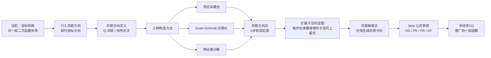
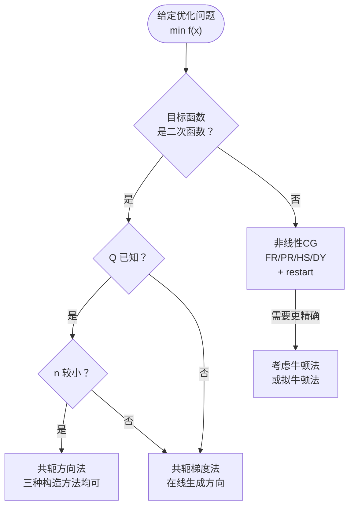

---
subject:
- 最优化方法
source:
- 10-共轭方向法.md
type: review
tags:
- 共轭方向法
- 共轭梯度法
- Krylov子空间
- Q-共轭
- 二次函数极小化
- 精确线搜索
aliases:
- 第10章 共轭方向法 — 知识点梳理
schema_version: 2
time: "2026-08-31T11:44:20+08:00"
legacy_topics:
- 共轭方向法
- 共轭梯度法
- 非线性共轭梯度法
- Gram-Schmidt共轭化
- Krylov子空间
- Q-共轭
- 二次函数极小化
- 精确线搜索
status: not done
---

# 第10章 共轭方向法 — 知识点梳理

> 本章解决的核心问题：**梯度法太慢（仅用一阶信息），牛顿法太贵（需要 Hessian 和矩阵求逆）。能不能找到一个"折中"的方法——比梯度法快，但不需要 Hessian？**

---

## 一、本章核心脉络

这条脉络体现了一个从"坐标轮换为什么失效"出发，经由共轭方向的概念，逐步演进到共轭梯度法（在线生成方向，无需预准备）的逻辑链。核心洞察是：**共轭方向 $=$ 在 $Q$ 的"弯曲坐标系"下的正交方向。** 正交使搜索高效（不重复工作），适配 $Q$ 的弯曲使每一步在正确的"尺度"下进行。

---

## 二、共轭方向的基本概念

### 2.1 思想动机：坐标轮换为何失效？

考虑二次函数 $f(x) = \frac{1}{2}x^T Q x - b^T x$（$Q \succ 0$）。

- 对**简单**二次函数（如 $f = x_1^2 + x_2^2$，$Q = 2I$），坐标轮换法通过逐坐标极小化可在 $n$ 步内到达极小点。
- 对**一般**二次函数（$Q$ 不是对角阵），坐标轮换方向不再"匹配"函数的等高线形状——沿坐标轴搜索会走弯路，甚至无法有限步收敛。

> 一句话来说：**问题不在于"沿什么方向搜索"，而在于"搜索方向之间是否互相干扰"。正交方向在欧氏空间不干扰，但二次函数定义的几何不是欧氏的——我们需要在 $Q$ 的弯曲度量下"正交"的方向。**

### 2.2 已有方法在这个问题上的表现

考虑 $n$ 元二次函数 $\min f(x) = \frac{1}{2}x^T Q x - b^T x$（$Q \succ 0$）：

| 方法 | 每次迭代计算量 | 存储量 | 收敛速度 |
|------|:---:|:---:|------|
| 最速下降法 | 小（仅梯度 $O(n)$） | 小 | 慢（需多次迭代） |
| 牛顿法 | 大（Hessian $O(n^3)$） | 大 | 快（一步终止） |

本章目标：找到一种方法，计算量和存储量都较小（不需要 Hessian），但能在有限步内（至多 $n$ 步）精确求解 $n$ 元二次函数。

### 2.3 共轭方向的定义

记符号：$S^n$（$n$ 阶实对称矩阵全体），$S_+^n$（半正定），$S_{++}^n$（正定）。

> **定义（$Q$-共轭方向）**：设 $Q \in S^n$，$\{p^{(0)}, \dots, p^{(m)}\}$ 是 $n$ 维非零向量组。如果
>
> $$p^{(i)T} Q p^{(j)} = 0, \quad \forall i \neq j$$
>
> 则称 $\{p^{(0)}, \dots, p^{(m)}\}$ 为 **$Q$-共轭向量组**。

> 一句话来说：**$Q$-共轭就是把普通正交条件 $x^T y = 0$ 中的欧氏内积换成 $Q$ 加权的内积 $x^T Q y = 0$——相当于在 $Q$ 定义的弯曲空间里"正交"。**

**退化关系**：当 $Q = I$ 时，$Q$-共轭退化为普通正交。

### 2.4 线性无关性

> **定理**：设 $Q \in S_{++}^n$。如果非零向量组 $\{p^{(0)}, \dots, p^{(n-1)}\}$ 是 $Q$-共轭的，则该向量组是线性无关组。

证明思路与"正交向量组必线性无关"完全类比——仅需将欧氏内积替换为 $Q$ 内积。

**推论**：$n$ 个 $n$ 维 $Q$-共轭向量构成 $\mathbb{R}^n$ 的一组基。

> 一句话来说：**$n$ 个 $Q$-共轭的非零向量必然铺满整个 $\mathbb{R}^n$ 空间——这保证我们沿着它们搜索时能"到达"空间中的任意点。**

---

## 三、获得共轭方向的三种方法（核心）

给定 $Q \in S_{++}^n$，如何获得一个 $Q$-共轭向量组？有三种方法。

### 方法 I：待定系数法

取第一个方向 $p^{(0)}$ 为某单位坐标向量（如 $[1,0,0]^T$），然后通过解方程确定后续方向。

**以 $3 \times 3$ 矩阵为例**：

$$Q = \begin{bmatrix} 3 & 0 & 1 \\ 0 & 4 & 2 \\ 1 & 2 & 3 \end{bmatrix}, \quad p^{(0)} = [1, 0, 0]^T$$

设 $p^{(1)} = [p_{11}, p_{12}, p_{13}]^T$，由 $p^{(0)T} Q p^{(1)} = 0$ 得一个线性方程。重复利用多重共轭条件可得整个共轭向量组。

例如可得：$p^{(1)} = [1, 0, -3]^T$，$p^{(2)} = [1, 4, -3]^T$。

> 一句话来说：**待定系数法 = 把共轭条件写成一堆线性方程组来解——在小规模时直观但计算量大，不适合大规模问题。**

### 方法 II：Gram-Schmidt 共轭化

给定 $Q \in S_{++}^n$ 和 $\mathbb{R}^n$ 中的任意一组线性无关向量 $\{\xi^{(0)}, \dots, \xi^{(n-1)}\}$，通过以下递推进行共轭化：

$$p^{(0)} = \xi^{(0)}$$

$$p^{(k)} = \xi^{(k)} - \sum_{j=0}^{k-1} \frac{\xi^{(k)T} Q p^{(j)}}{p^{(j)T} Q p^{(j)}} p^{(j)}, \quad k = 1, \dots, n-1$$

则 $\{p^{(0)}, \dots, p^{(n-1)}\}$ 是 $Q$-共轭向量组。

**直观理解**：这是经典 Gram-Schmidt 正交化的推广——只需把欧氏内积 $(x, y) = x^T y$ 替换为 $Q$ 内积 $\langle x, y \rangle_Q = x^T Q y$。当 $Q = I$ 时公式退化为标准的 GS 正交化。

> 一句话来说：**GS 共轭化就像 GS 正交化，只不过"正交"被重新定义为相对于 $Q$ 的加权"正交"——任意一组线性无关向量丢进去，出来一组 $Q$-共轭向量。**

> [!warning] 计算成本
> Gram-Schmidt 共轭化的计算量是 $O(n^3)$，且需要事先知道 $Q$。在共轭梯度法中我们会看到更高效的方法（在线生成，不需要 $Q$）。

### 方法 III：特征值分解

> **结论**：对称正定矩阵 $Q$ 的正交特征向量组天然是 $Q$-共轭的。

**正向（充分）**：若 $\{p^{(1)}, \dots, p^{(n)}\}$ 是 $Q$ 的一组正交特征向量（$Q p^{(i)} = \lambda_i p^{(i)}$，$p^{(i)T} p^{(j)} = 0$），则对 $i \neq j$：

$$p^{(i)T} Q p^{(j)} = p^{(i)T} (\lambda_j p^{(j)}) = \lambda_j p^{(i)T} p^{(j)} = 0$$

**逆向（必要——参见习题 10.4）**：若非零向量组既是正交的又是 $Q$-共轭的，则它们必是 $Q$ 的特征向量。

> 一句话来说：**正交 + $Q$-共轭 ⇔ 是 $Q$ 的特征向量。特征向量是同时满足两种"正交"（欧氏和 $Q$ 的）的最自然向量。**

三种方法的对比：

| 方法 | 是否需要 $Q$ | 计算量 | 适用场景 |
|------|:---:|:---:|------|
| 待定系数法 | 是 | 手工小规模 | 教学演示 |
| Gram-Schmidt 共轭化 | 是 | $O(n^3)$ | 理论上可行但昂贵 |
| 特征值分解 | 是 | $O(n^3)$（全套特征分解更贵） | $Q$ 已知且需要理论理解时 |
| 共轭梯度法（见后） | **否** | 每步 $O(n)$ | **实际使用** |

---

## 四、共轭方向法——算法与收敛定理（本章核心）

### 4.1 算法

给定初始点 $x^{(0)}$ 和一组 $Q$-共轭向量 $\{p^{(0)}, p^{(1)}, \dots, p^{(n-1)}\}$：

$$\alpha_k = -\frac{g^{(k)T} p^{(k)}}{p^{(k)T} Q p^{(k)}}, \quad g^{(k)} = \nabla f(x^{(k)})$$

$$x^{(k+1)} = x^{(k)} + \alpha_k p^{(k)}$$

步长 $\alpha_k$ 由精确线搜索导出（沿 $p^{(k)}$ 方向精确极小化二次函数）。

> 一句话来说：**共轭方向法 = 沿着一组提前备好的 $Q$-共轭方向，依次做精确线搜索——$n$ 步之内必然到达极小点。**

### 4.2 算例

极小化二次函数（$Q$ 和 $b$ 给定），使用一组给定的 $Q$-共轭方向 $p^{(0)}, p^{(1)}$。依次计算 $\alpha_0, x^{(1)}, \alpha_1, x^{(2)}$，$x^{(2)}$ 即为极小点。 

### 4.3 主要定理 — $n$ 步收敛

> **定理（共轭方向法极小化二次函数）**：对任意初始点 $x^{(0)}$，共轭方向法至多迭代 $n$ 次可获得极小点 $x^*$，即 $x^{(n)} = x^*$。

**证明核心洞察**：

1. $\{p^{(i)}\}_{i=0}^{n-1}$ 是 $Q$-共轭的 $\Rightarrow$ 线性无关 $\Rightarrow$ 是 $\mathbb{R}^n$ 的一组基。
2. 将 $x^* - x^{(0)}$ 在这组基下展开：

   $$x^* - x^{(0)} = \beta_0 p^{(0)} + \cdots + \beta_{n-1} p^{(n-1)}$$

   左乘 $p^{(k)T} Q$ 利用共轭性解出 $\beta_k$。
3. 另一方面，累计的迭代步为 $x^{(k)} - x^{(0)} = \alpha_0 p^{(0)} + \cdots + \alpha_{k-1} p^{(k-1)}$。
4. 证明 $\alpha_k = \beta_k$（两者的分子相等）：

   $$p^{(k)T} Q (x^* - x^{(0)}) = -p^{(k)T} g^{(k)}$$

   因此 $x^{(n)} = x^{(0)} + \sum_{i=0}^{n-1} \beta_i p^{(i)} = x^*$。

**直观理解**：$Q$-共轭方向构成 $\mathbb{R}^n$ 的一组基，沿每个基方向做一次精确线搜索等价于在这个基下"逐个坐标"精确求解——恰好 $n$ 次覆盖整个空间。

> 一句话来说：**共轭方向法对于二次函数就像在旋转拉伸过的坐标系上做坐标轮换——恰好 $n$ 步走完所有"自由度"。**

### 4.4 引理：精确线搜索的正交性

采用精确线搜索时，搜索方向与新点处的梯度正交：

$$g^{(k+1)T} p^{(k)} = 0$$

这已在第 8 章（梯度法）中证明过。其几何含义是：沿 $p^{(k)}$ 精确一维搜索到达的点处，梯度与搜索方向垂直——这意味着"沿这个方向已经无法继续下降了"。

### 4.5 梯度与历史方向的性质

共轭方向法极小化二次函数时，给定 $k$（$0 \le k \le n-1$）：

$$g^{(k+1)T} p^{(i)} = 0, \quad \forall \; 0 \le i \le k$$

**证明思路（数学归纳法）**：

- **基底**：由引理，$g^{(1)T} p^{(0)} = 0$。
- **归纳步**：假设对 $k-1$ 成立。需证 $g^{(k+1)T} p^{(i)} = 0$ 对所有 $0 \le i \le k$：
  - $i = k$：精确线搜索性质直接给出 $g^{(k+1)T} p^{(k)} = 0$。
  - $i < k$：利用 $g^{(k+1)} = g^{(k)} + \alpha_k Q p^{(k)}$，由归纳假设 $g^{(k)T} p^{(i)} = 0$，由共轭性 $p^{(k)T} Q p^{(i)} = 0$，故 $g^{(k+1)T} p^{(i)} = 0$。

**关键结论**：

$$g^{(k+1)} \perp \text{span}\{p^{(0)}, p^{(1)}, \dots, p^{(k)}\}$$

> 一句话来说：**新迭代点处的梯度垂直于之前所有用过的共轭方向——意味着在已探索的子空间内，已经无法继续下降了。**

---

## 五、扩展子空间定理

### 5.1 定理陈述

> **定理（扩展子空间定理）**：共轭方向法产生的迭代点满足：
>
> $$x^{(k+1)} = \arg\min_{x \in V_k} f(x)$$
>
> 其中 $V_k = x^{(0)} + \text{span}\{p^{(0)}, \dots, p^{(k)}\}$。

**含义**：$x^{(k+1)}$ 不仅是沿 $p^{(k)}$ 方向的最优步，而是在整个 $k+1$ 维子空间 $V_k$ 上的全局最优解。

### 5.2 证明思路

记 $P^{(k)} = [p^{(0)}, p^{(1)}, \dots, p^{(k)}]$。任意 $x \in V_k$ 可写为 $x = x^{(0)} + P^{(k)} a$。

由一阶最优性条件，$x$ 是 $f$ 在 $V_k$ 上的极小点当且仅当梯度在子空间上的投影为零：

$$g^T P^{(k)} = 0^T$$

而由第 4.5 节的性质，$g^{(k+1)T} P^{(k)} = 0^T$ 恰好成立——因此 $x^{(k+1)}$ 是 $f$ 在 $V_k$ 上的极小点。

> 一句话来说：**每步迭代得到一个"逐渐扩大"的子空间上的最优解——步子不会浪费，因为每一步都是在比上一步高一维的空间中达到全局最优。**

### 5.3 维数增长的含义

随着 $k$ 增大，子空间 $\text{span}\{p^{(0)}, \dots, p^{(k)}\}$ 的维数持续上升，直到 $k = n-1$ 时张成整个 $\mathbb{R}^n$——此时 $x^{(n)}$ 就是全局极小点。

这解释了为什么恰好需要 $n$ 步：每个新的 $Q$-共轭方向往子空间中添加一个新的维度，需要恰好 $n$ 步覆盖整个 $\mathbb{R}^n$。

---

## 六、共轭梯度法（本章核心）

### 6.1 基本思想：从"预准备"到"在线生成"

共轭方向法的前提是"提前准备好一组 $Q$-共轭方向"——但这需要知道 $Q$ 并付出 $O(n^3)$ 的计算成本，抵消了共轭方向法的优势。

**共轭梯度法的创新**：在迭代过程中**在线生成**共轭方向——利用当前点的梯度信息和上一步的搜索方向，递推构造下一个共轭方向，完全不需要提前知道 $Q$。

> 一句话来说：**共轭梯度法 = 共轭方向法 + "共轭方向不提前准备，而是边搜边造"。**

### 6.2 算法推导

给定初始点 $x^{(0)}$，精确线搜索。

**Step 0**：第一个方向取负梯度（最速下降方向）：

$$p^{(0)} = -g^{(0)}$$

$$\alpha_0 = -\frac{g^{(0)T} p^{(0)}}{p^{(0)T} Q p^{(0)}}, \quad x^{(1)} = x^{(0)} + \alpha_0 p^{(0)}$$

**Step 1**：第二个方向取当前负梯度与上一步方向的线性组合：

$$p^{(1)} = -g^{(1)} + \beta_0 p^{(0)}$$

要求 $p^{(1)}$ 与 $p^{(0)}$ $Q$-共轭：$p^{(1)T} Q p^{(0)} = 0$。推导得：

$$\beta_0 = \frac{g^{(1)T} Q p^{(0)}}{p^{(0)T} Q p^{(0)}}$$

**Step k**：一般递推公式：

$$p^{(k)} = -g^{(k)} + \beta_{k-1} p^{(k-1)}, \quad \beta_{k-1} = \frac{g^{(k)T} Q p^{(k-1)}}{p^{(k-1)T} Q p^{(k-1)}}$$

> 一句话来说：**每个新方向 = 当前负梯度 + 旧方向的一个缩放——缩放系数 $\beta$ 恰好保证新方向与所有旧方向 $Q$-共轭。**

### 6.3 递推构造的合理性——$Q$-共轭性证明

通过递推公式产生的 $\{p^{(0)}, \dots, p^{(n-1)}\}$ 确实是 $Q$-共轭的。

**证明关键步骤（数学归纳法）**：

1. **基底**：由 $\beta_0$ 的定义，$p^{(1)} = -g^{(1)} + \beta_0 p^{(0)}$，直接验证 $p^{(1)T} Q p^{(0)} = 0$。

2. **归纳假设**：假设 $\{p^{(0)}, \dots, p^{(k)}\}$ 是 $Q$-共轭的。

3. **梯度正交性**：由归纳假设和共轭方向法的性质（第 4.5 节），$g^{(k+1)} \perp \text{span}\{p^{(0)}, \dots, p^{(k)}\}$。进一步推导得：

   $$g^{(k+1)T} g^{(j)} = 0, \quad \forall \; 0 \le j \le k$$

   即新梯度与所有历史梯度正交。

4. **新方向与旧方向的 $Q$-共轭性**：对于 $p^{(k+1)} = -g^{(k+1)} + \beta_k p^{(k)}$：
   - 当 $j < k$：由归纳假设 $p^{(k)T} Q p^{(j)} = 0$，且利用梯度正交性和梯度递推关系可证 $g^{(k+1)T} Q p^{(j)} = 0$。
   - 当 $j = k$：由 $\beta_k$ 的定义直接可证 $p^{(k+1)T} Q p^{(k)} = 0$。

### 6.4 算法伪代码

> **共轭梯度法（二次函数）：**
>
> 输入：初始点 $x^{(0)}$，停机误差 $\varepsilon$，置 $k = 0$，$p^{(0)} = -g^{(0)}$
>
> 1. **repeat**
> 2. &emsp; $\alpha_k = -\dfrac{g^{(k)T} p^{(k)}}{p^{(k)T} Q p^{(k)}}$
> 3. &emsp; $x^{(k+1)} = x^{(k)} + \alpha_k p^{(k)}$
> 4. &emsp; $g^{(k+1)} = \nabla f(x^{(k+1)}) = Q x^{(k+1)} - b$
> 5. &emsp; $\beta_k = \dfrac{g^{(k+1)T} Q p^{(k)}}{p^{(k)T} Q p^{(k)}}$
> 6. &emsp; $p^{(k+1)} = -g^{(k+1)} + \beta_k p^{(k)}$
> 7. &emsp; $k := k + 1$
> 8. **until** $\|g^{(k+1)}\| < \varepsilon$

### 6.5 $\beta_k$ 的四种等价公式

对于二次函数，以下四种公式等价：

| 名称 | 公式 | 特点 |
|------|------|------|
| **Hestenes-Stiefel (HS)** | $\beta_k^{\text{HS}} = \dfrac{g^{(k+1)T} [g^{(k+1)} - g^{(k)}]}{p^{(k)T} [g^{(k+1)} - g^{(k)}]}$ | 直接推导形式 |
| **Polak-Ribiere (PR)** | $\beta_k^{\text{PR}} = \dfrac{g^{(k+1)T} [g^{(k+1)} - g^{(k)}]}{g^{(k)T} g^{(k)}}$ | 分母为 $\|g^{(k)}\|^2$ |
| **Fletcher-Reeves (FR)** | $\beta_k^{\text{FR}} = \dfrac{g^{(k+1)T} g^{(k+1)}}{g^{(k)T} g^{(k)}}$ | **数值最稳定**（Powell 证明） |
| **Dai-Yuan (DY)** | $\beta_k^{\text{DY}} = \dfrac{g^{(k+1)T} g^{(k+1)}}{p^{(k)T} [g^{(k+1)} - g^{(k)}]}$ | 近年提出的变体 |

> **关键性质**：对二次函数四种公式等价（数学上给出相同的 $\beta_k$）。对一般非线性函数**不等价**，其中 Fletcher-Reeves 被证明为数值最稳定。

> [!hint] FR 公式为何最稳定
> FR 公式仅依赖梯度范数的比值，不涉及 $Q$ 或 $p^{(k)}$ 的二次型。当函数偏离二次时，FR 对曲率估计误差最不敏感。

### 6.6 算例

**例 1（二维）**：$f(x_1, x_2) = x_1^2 + 2x_2^2$，初始点 $x^{(0)} = [5, 5]^T$。

- Step 1：$g^{(0)} = [10, 20]^T$，$p^{(0)} = [-10, -20]^T$，$\alpha_0 = 5/18$，$x^{(1)} = [20/9, -5/9]^T$
- Step 2：计算 $g^{(1)}$，$\beta_0$，$p^{(1)} = -g^{(1)} + \beta_0 p^{(0)}$，$\alpha_1$ 后得 $x^{(2)} = [0, 0]^T$

$g^{(2)} = 0$，$x^* = [0, 0]^T$。恰好 2 步收敛（$n = 2$）。

**例 2（三维）**：$f(x_1, x_2, x_3) = x_1^2 + 2x_2^2 + x_3^2 + x_1 x_3 + 2x_2 x_3 - 3x_1 - x_3$，初始点 $x^{(0)} = [0, 0, 0]^T$。

- Step 1：$g^{(0)} = [-3, 0, -1]^T$，$p^{(0)} = [3, 0, 1]^T$，$\alpha_0 \approx 0.2778$，$x^{(1)} = [0.8333, 0, 0.2778]^T$
- Step 2：$g^{(1)} = [-0.2222, 0.5556, 0.6667]^T$，$\beta_0 = 0.08025$，$p^{(1)} = [0.4630, -0.5556, -0.5864]^T$，$\alpha_1 = 0.2187$，$x^{(2)} = [0.9346, -0.1215, 0.1495]^T$
- Step 3：$g^{(2)} = [-0.04673, -0.1869, 0.1402]^T$，$\beta_1 = 0.07075$，$p^{(2)} = [0.07948, 0.1476, -0.1817]^T$，$\alpha_2 = 0.8231$，$x^{(3)} = [1.0, 0.0, 0.0]^T$

$g^{(3)} = 0$，$x^* = [1, 0, 0]^T$。恰好 3 步收敛（$n = 3$）。

> 一句话来说：**对于 $n$ 元二次函数，共轭梯度法恰好 $n$ 步收敛——每一步的计算量是 $O(n)$（只需梯度），远比牛顿法的 $O(n^3)$ 便宜。**

### 6.7 共轭梯度法的综合优势

| 特性 | 说明 |
|------|------|
| **不需要 Hessian** | 每步只需计算梯度（$O(n)$），不存储 $n \times n$ 矩阵 |
| **$n$ 步收敛** | 对 $n$ 元二次函数，至多 $n$ 步到达精确解 |
| **计算量介于梯度法和牛顿法之间** | 比梯度法快（共轭方向避免 zigzag），比牛顿法便宜（无矩阵求逆） |
| **适合大规模优化** | $n$ 很大时，牛顿法的 $O(n^3)$ 完全不可接受，共轭梯度法的 $O(n)$ 每步非常高效 |
| **与 Krylov 子空间法的联系** | 共轭梯度法是 Krylov 子空间方法家族的重要成员——20 世纪科学计算十大算法之一 |

---

## 七、非线性共轭梯度法（了解即可）

### 7.1 从二次函数到一般函数

理论上的推广：将公式中的 $Q$ 替换为 $f$ 的 Hessian $\nabla^2 f(x^{(k)})$。但 Hessian 每次迭代都更新，计算量大——抵消了共轭梯度法的优势。

实际做法：使用第 6.5 节中**不显含 $Q$** 的 $\beta_k$ 公式（FR、PR、HS、DY），这些公式仅涉及梯度信息。

### 7.2 非线性共轭梯度法的算法

1. 置 $k = 0$，取初始点 $x^{(0)}$
2. $g^{(0)} = \nabla f(x^{(0)})$，若 $g^{(0)} = 0$，停止；否则 $p^{(0)} = -g^{(0)}$
3. $\alpha_k = \arg\min_{\alpha} f(x^{(k)} + \alpha p^{(k)})$（线搜索，通常用非精确线搜索）
4. $x^{(k+1)} = x^{(k)} + \alpha_k p^{(k)}$
5. $g^{(k+1)} = \nabla f(x^{(k+1)})$，若 $g^{(k+1)} = 0$，停止
6. $\beta_k$ 用 HS / PR / FR / DY 之一计算
7. $p^{(k+1)} = -g^{(k+1)} + \beta_k p^{(k)}$
8. 令 $k = k + 1$，转到 Step 3

### 7.3 非线性情形的重要变化

> [!warning] 两个关键变化
> 1. **共轭性和正交性消失**：对一般非线性函数，搜索方向不再具有精确的 $Q$-共轭性和梯度正交性。
> 2. **有限步终止不再成立**：通常需要 **restart**（每隔若干步重新将方向重置为负梯度）来获得近似解。常见的 restart 策略是每 $n$ 步重置一次。

> 一句话来说：**非线性共轭梯度法 = 把"恰好 $n$ 步收敛"的奢望放下，换一个实用的迭代算法——像带记忆的梯度法，用旧方向信息加速收敛。**

> [!warning] 方向失去下降性时重启
> 当 $g^{(k)T}p^{(k)}\geq0$ 时，搜索方向不再满足下降条件，应重置为 $p^{(k)}=-g^{(k)}$。

---

## 判定/决策流程

选择策略总结：
- 二次函数 + $n$ 较小 + $Q$ 已知：共轭方向法（三种构造方法均可），恰好 $n$ 步终止
- 二次函数 + $n$ 很大：共轭梯度法（在线生成方向，每步 $O(n)$）
- 一般非线性函数：非线性共轭梯度法（推荐用 FR 公式，定期 restart）
- 对精度要求极高或函数高度非二次：考虑拟牛顿法（BFGS）或牛顿法

---

## 核心公式速查表

| 概念 | 公式 | 备注 |
|------|------|------|
| $Q$-共轭定义 | $p^{(i)T} Q p^{(j)} = 0, \; \forall i \neq j$ | $Q = I$ 退化为正交 |
| GS 共轭化 | $p^{(k)} = \xi^{(k)} - \sum_{j=0}^{k-1} \frac{\xi^{(k)T} Q p^{(j)}}{p^{(j)T} Q p^{(j)}} p^{(j)}$ | $k = 1, \dots, n-1$ |
| 共轭方向法步长 | $\alpha_k = -\dfrac{g^{(k)T} p^{(k)}}{p^{(k)T} Q p^{(k)}}$ | 精确线搜索导出 |
| $n$ 步收敛 | $x^{(n)} = x^*$（对任意初始点） | 基于 $\{p^{(i)}\}$ 线性无关 |
| 梯度-历史方向正交 | $g^{(k+1)T} p^{(i)} = 0, \; \forall 0 \le i \le k$ | $g^{(k+1)} \perp \text{span}\{p^{(0)},\dots,p^{(k)}\}$ |
| 扩展子空间 | $x^{(k+1)} = \arg\min_{x \in V_k} f(x), \; V_k = x^{(0)} + \text{span}\{p^{(0)},\dots,p^{(k)}\}$ | 维数递增的最优性 |
| CG 方向递推 | $p^{(k)} = -g^{(k)} + \beta_{k-1} p^{(k-1)}$ | $p^{(0)} = -g^{(0)}$ |
| CG 原始 $\beta$ | $\beta_{k-1} = \dfrac{g^{(k)T} Q p^{(k-1)}}{p^{(k-1)T} Q p^{(k-1)}}$ | 含 $Q$，不用于非线性 |
| FR 公式 | $\beta_k^{\text{FR}} = \dfrac{g^{(k+1)T} g^{(k+1)}}{g^{(k)T} g^{(k)}}$ | 数值最稳定 |
| PR 公式 | $\beta_k^{\text{PR}} = \dfrac{g^{(k+1)T} [g^{(k+1)} - g^{(k)}]}{g^{(k)T} g^{(k)}}$ | 分母为 $\|g^{(k)}\|^2$ |
| HS 公式 | $\beta_k^{\text{HS}} = \dfrac{g^{(k+1)T} [g^{(k+1)} - g^{(k)}]}{p^{(k)T} [g^{(k+1)} - g^{(k)}]}$ | 直接推导形式 |
| DY 公式 | $\beta_k^{\text{DY}} = \dfrac{g^{(k+1)T} g^{(k+1)}}{p^{(k)T} [g^{(k+1)} - g^{(k)}]}$ | 近年变体 |

---

## 易错点与注意事项

> [!warning] 共轭 $\neq$ 正交
> $p^{(i)T} Q p^{(j)} = 0$ 不意味着 $p^{(i)T} p^{(j)} = 0$。$Q$-共轭方向在欧氏度量下一般不是正交的。只有在 $Q = I$ 时两者重合。

> [!warning] 共轭方向法的"$n$ 步收敛"仅对二次函数成立
> 该定理的前提是 $f(x) = \frac{1}{2}x^T Q x - b^T x$ 且使用精确线搜索。对一般非线性函数，共轭方向法不能保证 $n$ 步收敛。

> [!warning] 原始 $\beta$ 公式含 $Q$，不能用于非线性推广
> $\beta_{k-1} = g^{(k)T} Q p^{(k-1)} / p^{(k-1)T} Q p^{(k-1)}$ 中显含 $Q$。推广到非线性时必须使用仅含梯度的替代公式（FR / PR / HS / DY）。

> [!warning] 非线性 CG 中四种 $\beta$ 公式不等价
> 对二次函数四种公式等价。对一般非线性函数，它们给出不同的搜索方向和收敛行为。Fletcher-Reeves 被 Powell 证明为数值最稳定，推荐作为默认选择。

> [!warning] 非线性 CG 需要 restart
> 非线性共轭梯度法不再具有有限步终止性质。通常每 $n$ 步（或当连续两次梯度不够正交时）将搜索方向重置为负梯度方向，避免方向退化。

> [!warning] 共轭梯度法不需要显式存储 $Q$
> 这是 CG 相对于共轭方向法的关键优势——对于 $n$ 元二次函数，CG 每步仅需要梯度 $g^{(k)}$（通过 $g^{(k)} = Q x^{(k)} - b$ 计算），完全不需要显式存储或操作 $Q$ 矩阵自身。

---

## 相关知识点链接

- 前置知识：[[03_Sources/Courses/归档/最优化方法/最优化方法PPT课件/MD/02-向量空间与矩阵#2.6 行列式与逆矩阵|线性无关与基]] —— $Q$-共轭向量构成 $\mathbb{R}^n$ 的基是 $n$ 步收敛的代数基础
- 前置知识：[[03_Sources/Courses/归档/最优化方法/最优化方法PPT课件/MD/03-线性代数基础#特征值与二次型|对称矩阵的特征分解]] —— 获得 $Q$-共轭方向的第三种方法（特征值分解）
- 前置知识：[[08-梯度法#精确线搜索|精确线搜索]] —— 共轭方向法/共轭梯度法的步长 $\alpha_k$ 由精确线搜索导出
- 前置知识：[[03_Sources/Courses/归档/最优化方法/最优化方法PPT课件/MD/09-牛顿法|牛顿法]] —— 共轭梯度法填补了梯度法（慢）和牛顿法（贵）之间的空白
- 后继章节：拟牛顿法（BFGS）——另一种"不需要 Hessian 但比梯度法快"的方法，思路不同但目标一致
- 计算数学背景：Krylov 子空间方法——由 Hestenes、Stiefel 和 Lanczos 提出，20 世纪科学计算十大算法之一

---

## 作业与练习

课后习题：[[../习题库/10-共轭方向法/README|第10章习题库]]

| 题号 | 类型 | 建议 |
|------|------|------|
| [[03_Sources/Courses/归档/最优化方法/作业/10-共轭方向法/习题10.4\|10.4]] | 特征向量与 $Q$-共轭的等价关系 | 理解共轭方向的第三种构造方法；注意 (b) 需"正交"条件 |
| [[03_Sources/Courses/归档/最优化方法/作业/10-共轭方向法/习题10.10\|10.10]] | 共轭梯度法求解二维二次函数 | 从头到尾独立完成一次 CG 迭代：化为二次型 → 计算 $\alpha_k, \beta_k$ → 验证 $n$ 步收敛 |

做题建议：
1. 10.4(a) 是特征向量作为共轭方向的构造法验证，直接利用 $Q v = \lambda v$ 和正交性即可
2. 10.4(b) 需要同时使用"正交"和"$Q$-共轭"两个条件，注意题目修正（原题缺正交条件）
3. 10.10 是完整的 CG 计算练习——先把 $f$ 化为 $\frac{1}{2}x^T Q x - b^T x$ 标准形式（关键：对称化 $Q$），再用 FR 公式一步步迭代
4. 计算过程中保留分数（不要用小数），最后一步再用小数验证
