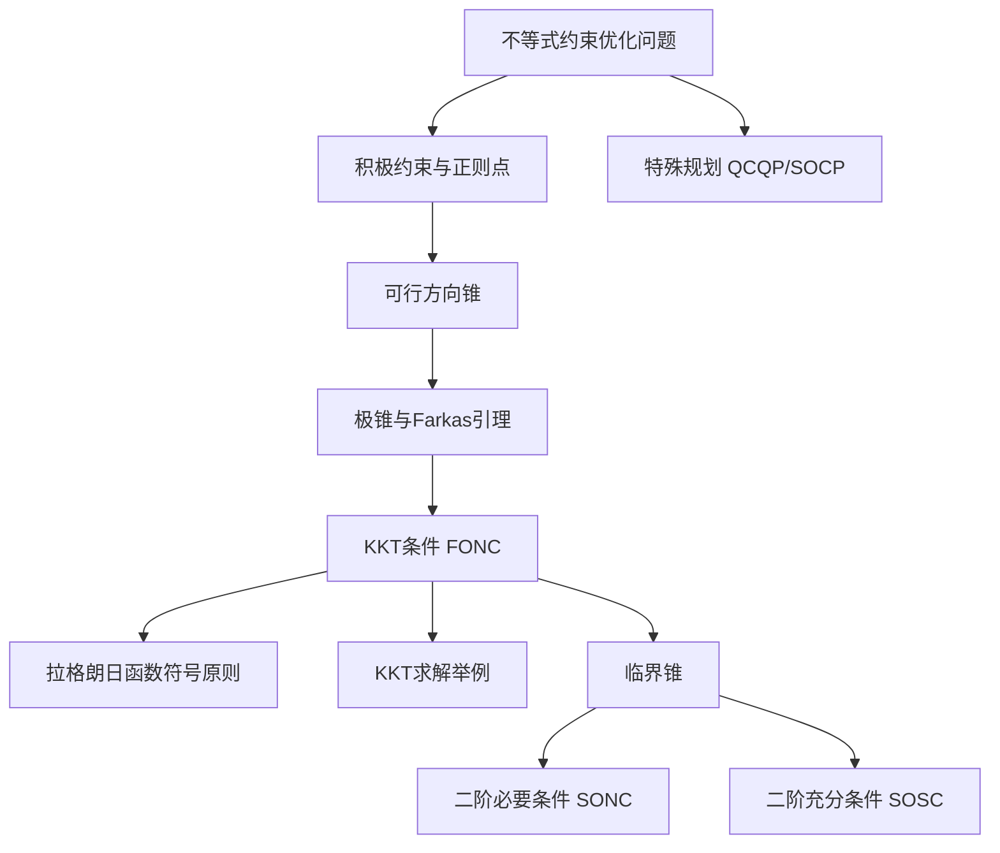
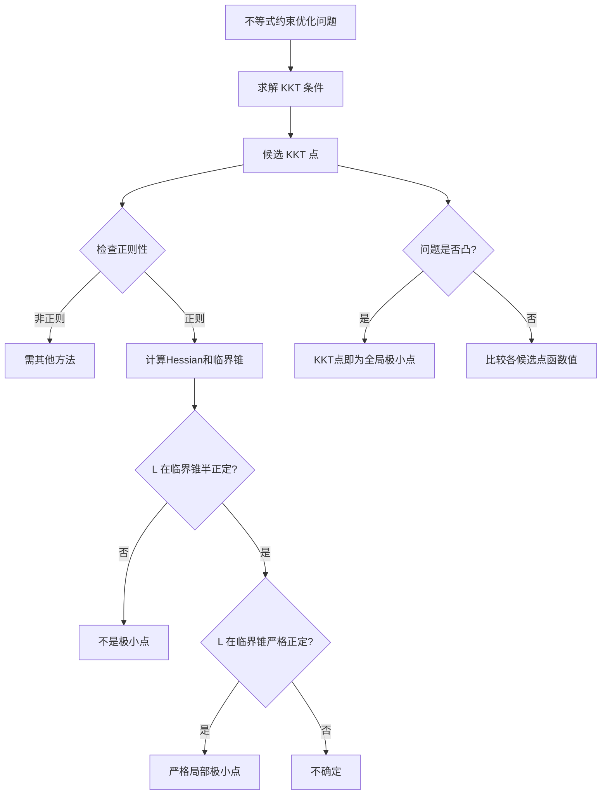

---
subject:
- 最优化方法
source:
- 21-不等式约束优化问题.md
type: review
tags:
- 不等式约束优化
- KKT条件
- Lagrange对偶
aliases:
- 第21章 不等式约束优化问题 — 知识点梳理
schema_version: 2
time: "2026-08-31T11:44:20+08:00"
legacy_topics:
- 不等式约束优化
- KKT条件
- 二阶最优性条件
- QCQP
- SOCP
- 拉格朗日对偶
status: not done
---

# 第21章 不等式约束优化问题 — 知识点梳理

> 本章解决的核心问题：**当约束既有等式又有不等式时，如何刻画局部极小点的必要条件（KKT）和充分条件？不等式约束的"取等与否"如何影响最优性条件的形式？**

---

## 一、本章核心脉络

> 概念演进逻辑：不等式约束与等式约束的关键区别在于"方向性"——等式约束要求沿方向一阶变化为零（子空间），而不等式约束只要求不违反（锥）。这导致：(1) 极锥中的乘子必须有符号约束（$\mu \geq 0$）；(2) 出现互补松弛条件（积极约束才"有发言权"）；(3) 二阶条件需在更小的临界锥（而非整个切空间）上判定。

---

## 二、问题形式与基本概念

### 2.1 问题形式

$$
\min_{x \in \mathbb{R}^n} f(x), \quad \text{s.t.} \quad x \in \Omega = \{x \mid h(x) = 0,\; g(x) \leq 0\}
$$

其中 $f: \mathbb{R}^n \to \mathbb{R}$，$h: \mathbb{R}^n \to \mathbb{R}^m$（等式约束），$g: \mathbb{R}^n \to \mathbb{R}^p$（不等式约束）。

> 一句话来说：**既要满足等式（在曲面上），又要满足不等式（在曲面的某一侧）。**

### 2.2 积极约束与非积极约束

**定义**：不等式约束 $g_j(x) \leq 0$ 在 $x^*$ 处是：

| 类型 | 条件 | 含义 |
|------|------|------|
| **积极约束** (active) | $g_j(x^*) = 0$ | 约束刚好取等，"绑紧了" |
| **非积极约束** (inactive) | $g_j(x^*) < 0$ | 约束是松的，有一定"余量" |

记积极约束的指标集：$J(x^*) = \{j \mid g_j(x^*) = 0,\; j = 1, \dots, p\}$。

> 一句话来说：**积极约束就是"起作用"的约束——它们在 $x^*$ 处刚好取等，限制了可以移动的方向。非积极约束暂时不参与最优性条件。**

> [!hint] 等式约束 $h_i(x) = 0$ 总是积极的。

### 2.3 正则点（不等式约束版本）

**定义**：$x^* \in \Omega$ 是**正则点**，若向量组

$$
\{\nabla h_i(x^*)\}_{i=1}^{m} \cup \{\nabla g_j(x^*)\}_{j \in J(x^*)}
$$

是线性无关的。

> 一句话来说：**正则点处，所有等式约束的梯度加上所有积极不等式约束的梯度，构成线性无关组。** 这意味着积极约束的数量不能超过 $n$，且它们的梯度不能有冗余。

---

## 三、可行方向锥与 Farkas 引理（核心）

### 3.1 可行方向锥

对于局部极小点 $x^*$，沿可行方向 $d$ 走一小步必须仍在 $\Omega$ 内。对等式约束 $\nabla h_i(x^*)^T d = 0$（方向在切平面内）；对积极不等式约束 $\nabla g_j(x^*)^T d \leq 0$（方向指向可行半空间）。

**定义（线性化可行方向锥）**：

$$
F(x^*) = \{d \in \mathbb{R}^n \mid \nabla h_i(x^*)^T d = 0,\; i = 1, \dots, m;\; \nabla g_j(x^*)^T d \leq 0,\; j \in J(x^*)\}
$$

> 一句话来说：**$F(x^*)$ 是由所有"不违反约束梯度条件"的方向构成的锥——等式要求正交，不等式要求指向约束值减小的方向。**

### 3.2 极锥与 Farkas 引理

**定义**：
- 子空间的正交补：$Y^\perp = \{y \mid x^T y = 0,\; \forall x \in Y\}$
- 锥的极锥：$C^\circ = \{y \mid x^T y \leq 0,\; \forall x \in C\}$

**Farkas 引理（关键工具）**：若锥 $C = \text{cone}\{a_1, \dots, a_m\} = \{\sum \lambda_i a_i \mid \lambda_i \geq 0\}$，则

$$
C^\circ = \{y \mid a_i^T y \leq 0,\; \forall i\}
$$

**应用于可行方向锥**：$F(x^*)$ 的极锥为

$$
F(x^*)^\circ = \left\{\sum_{i=1}^{m} \lambda_i \nabla h_i(x^*) + \sum_{j \in J(x^*)} \mu_j \nabla g_j(x^*) \;\middle|\; \lambda \in \mathbb{R}^m,\; \mu_j \geq 0\right\}
$$

> 一句话来说：**Farkas 引理实现了"半空间交的极锥 = 半法线的非负锥组合"。不等式乘子 $\mu_j$ 必须非负——这是不等式约束与等式约束的本质区别。**

**一阶必要条件分析**：$x^*$ 是局部极小点 $\Rightarrow$ 沿任意可行方向都不下降 $\Rightarrow$ $\nabla f(x^*)^T d \geq 0,\; \forall d \in F(x^*)$ $\Rightarrow$ $-\nabla f(x^*) \in F(x^*)^\circ$。

> 直观理解：**如果存在可行方向 $d$ 使 $\nabla f(x^*)^T d < 0$，沿 $d$ 走一小步就能减小 $f$——与极小点矛盾。因此 $-\nabla f$ 必须在可行方向锥的极锥中。**

---

## 四、KKT 条件（本章核心）

### 4.1 KKT 条件的标准形式

> **定理（KKT 条件 / 一阶必要条件）**：设 $f, h, g \in C^1$，$x^*$ 是正则点。若 $x^*$ 是局部极小点，则存在 $\lambda^* \in \mathbb{R}^m$ 和 $\mu^* \in \mathbb{R}^p$ 使得：

1. **原始可行性（Primal Feasibility）**：
   $$h(x^*) = 0, \qquad g(x^*) \leq 0$$

2. **对偶可行性（Dual Feasibility）**：
   $$\mu^* \geq 0 \quad \text{（每个分量 } \mu_j^* \geq 0\text{）}$$

3. **驻点条件 / 原始最优性（Stationarity）**：
   $$\nabla f(x^*) + \sum_{i=1}^{m} \lambda_i^* \nabla h_i(x^*) + \sum_{j=1}^{p} \mu_j^* \nabla g_j(x^*) = 0$$

4. **互补松弛条件（Complementary Slackness）**：
   $$\mu_j^* \cdot g_j(x^*) = 0, \quad j = 1, \dots, p$$

> 一句话来说：**KKT 条件 = 拉格朗日定理的四个升级：(1) 不等式乘子必须非负；(2) 非积极约束的乘子必须为零（互补松弛）；(3) 等式乘子符号自由；(4) 不等式约束在条件中只要求 $\leq 0$ 而非 $= 0$。**

### 4.2 KKT 条件证明核心洞察

**证明思路**（正则点假设下）：

1. 将不等式问题"局部等式化"——在 $x^*$ 处，非积极约束在最优点附近仍非积极，可以暂时忽略
2. 由 $-\nabla f(x^*) \in F(x^*)^\circ$ 和极锥表达式，存在乘子使得 $\nabla f + \sum \lambda_i \nabla h_i + \sum_{j \in J} \mu_j \nabla g_j = 0$
3. **关键一步**：证明 $\mu_j \geq 0$（$\forall j \in J$）。用反证法——若某 $\mu_j < 0$，利用正则性构造不违反其他约束但使目标下降的方向，与极小性矛盾
4. 对 $j \notin J$，令 $\mu_j = 0$，得到完整的 KKT 条件

> 直观理解：**KKT 条件的本质是——在极小点处，目标函数的负梯度能被积极约束的梯度所"抵消"，且不等式乘子符号保证沿可行方向不能下降。互补松弛则体现了"不积极的约束不参与"的原则。**

### 4.3 拉格朗日函数与符号原则

**定义**：

$$
\mathcal{L}(x, \lambda, \mu) = f(x) + \sum_{i=1}^{m} \lambda_i h_i(x) + \sum_{j=1}^{p} \mu_j g_j(x) = f(x) + \lambda^T h(x) + \mu^T g(x)
$$

**符号原则**：对任意可行点 $x$（$h(x) = 0, g(x) \leq 0$），由于 $\mu \geq 0$：

$$
\mathcal{L}(x, \lambda, \mu) = f(x) + \mu^T g(x) \leq f(x)
$$

> 一句话来说：**KKT 乘子 $\mu$ 的非负性保证了拉格朗日函数是目标函数的"下界"（对可行点而言）——这是拉格朗日对偶理论的基础。**

等价地，驻点条件可写为 $\nabla_x \mathcal{L}(x^*, \lambda^*, \mu^*) = 0$（在 $x^*$ 处拉格朗日函数无约束极小）。

### 4.4 线性约束优化的特殊情形

当约束为线性（$a_i^T x \geq b_i$）时，有以下简化：

1. **正则性自动成立**——线性函数的梯度是常数向量，线性无关性退化检查即可
2. KKT 条件简化为 $\nabla f(x^*) + \sum_{i=1}^p \mu_i^* a_i = 0$，$\mu_i^* \geq 0$，$\mu_i^* = 0$（$\forall i \notin J(x^*)$）

> 一句话来说：**线性约束的 KKT 是 KKT 最简单的特例——梯度条件退化为线性组合，不需要处理约束函数的二阶导。**

### 4.5 互补松弛条件的深入理解

互补松弛 $\mu_j g_j(x^*) = 0$ 等价于：

| 条件 | 结论 |
|------|------|
| $g_j(x^*) < 0$（非积极） | $\mu_j^* = 0$（该约束的乘子退场） |
| $g_j(x^*) = 0$（积极） | $\mu_j^* \geq 0$（可取正或零） |
| $\mu_j^* > 0$（积极且严格） | $g_j(x^*) = 0$（约束必须取等） |

> 直观理解：**互补松弛 = "不绑紧的绳子不承力"。只有刚好拉紧的约束才会对最优解施加限制（$\mu_j > 0$），松着的约束不影响最优点在哪里。**

---

## 五、KKT 条件应用举例（核心）

### 5.1 例 1 — 一维问题，$\mu = 0$ 的情形

> $\min f(x) = \frac{1}{2}x^2 - 10x$，s.t. $x \geq 0$（即 $g(x) = -x \leq 0$）

拉格朗日函数：$\mathcal{L}(x, \mu) = \frac{1}{2}x^2 - 10x - \mu x$

KKT 条件：$\mu \geq 0$，$x - 10 - \mu = 0$，$x \geq 0$，$\mu x = 0$

**分类讨论**：
- $\mu > 0 \Rightarrow x = 0 \Rightarrow -10 - \mu = 0 \Rightarrow \mu = -10$，与 $\mu \geq 0$ 矛盾。
- $\mu = 0 \Rightarrow x = 10$，所有条件满足。**$x^* = 10$，$\mu^* = 0$**。

> **点评**：无约束极小点在 $x = 10$（恰好满足 $x \geq 0$），所以约束不起作用，$\mu^* = 0$。

### 5.2 例 2 — 一维问题，$\mu > 0$ 的情形

> $\min f(x) = \frac{1}{2}x^2 + 8x$，s.t. $x \geq 0$

拉格朗日函数：$\mathcal{L}(x, \mu) = \frac{1}{2}x^2 + 8x - \mu x$

KKT 条件：$\mu \geq 0$，$x + 8 - \mu = 0$，$x \geq 0$，$\mu x = 0$

**分类讨论**：
- $\mu = 0 \Rightarrow x = -8$，与 $x \geq 0$ 矛盾。
- $\mu > 0 \Rightarrow x = 0 \Rightarrow 8 - \mu = 0 \Rightarrow \mu = 8$。**$x^* = 0$，$\mu^* = 8$**。

> **点评**：无约束极小点在 $x = -8$（违反约束），所以最优点被"推"到边界 $x = 0$，约束积极，$\mu^* > 0$。$\mu^* = 8$ 表示如果把约束放松一个单位（允许 $x \geq -1$），目标值大约能改善 8。

### 5.3 例 3 — 二维问题，多分类讨论

> $\min f(x) = x_1^2 + x_2^2 + x_1x_2 - 3x_1$，s.t. $x_1 \geq 0$，$x_2 \geq 0$

重写：$g_1(x) = -x_1 \leq 0$，$g_2(x) = -x_2 \leq 0$。

拉格朗日函数：$\mathcal{L} = x_1^2 + x_2^2 + x_1x_2 - 3x_1 - \mu_1 x_1 - \mu_2 x_2$

驻点条件：
$$
\begin{cases} 2x_1 + x_2 - 3 - \mu_1 = 0 \\ 2x_2 + x_1 - \mu_2 = 0 \end{cases}
$$

互补松弛：$\mu_1 x_1 = 0$，$\mu_2 x_2 = 0$。

| 情形 | $x_1$ | $x_2$ | $\mu_1$ | $\mu_2$ | 可行性 |
|------|-------|-------|---------|---------|:---:|
| $\mu_1 = 0, \mu_2 = 0$ | 2 | -1 | 0 | 0 | $x_2 < 0$，违反 |
| $\mu_1 = 0, \mu_2 > 0$ | 3/2 | 0 | 0 | 3/2 | 可行 |
| $\mu_1 > 0, \mu_2 = 0$ | 0 | 3 | -3 | 0 | $\mu_1 < 0$，违反 |
| $\mu_1 > 0, \mu_2 > 0$ | 0 | 0 | -3 | 0 | $\mu_1 < 0$，违反 |

**唯一 KKT 点**：$x^* = (3/2, 0)^T$，$\mu^* = (0, 3/2)^T$。

> **点评**：分类讨论是 KKT 求解的标准方法——对每个 $\mu_j$，分"$=0$"和"$>0$"两种情况，$p$ 个不等式约束有 $2^p$ 种组合。配合互补松弛可以有效缩减搜索空间。

### 5.4 例 4 — 带等式和不等式的混合问题

> $\min f(x) = -\sum_{i=1}^n x_i \log(x_i + \alpha_i)$，s.t. $x \geq 0$，$\mathbf{1}^T x = 1$

拉格朗日函数：$\mathcal{L} = f(x) + \lambda(\mathbf{1}^T x - 1) - \sum \mu_i x_i$

驻点条件：$-(x_i + \alpha_i)^{-1} + \lambda - \mu_i = 0$（对每个 $i$）

配合互补松弛 $\mu_i x_i = 0$，分类讨论：

- $\lambda \leq \frac{1}{\alpha_i} \Rightarrow \mu_i = 0,\; x_i = \frac{1}{\lambda} - \alpha_i > 0$
- $\lambda > \frac{1}{\alpha_i} \Rightarrow x_i = 0,\; \mu_i = \lambda - \frac{1}{\alpha_i} > 0$

由等式约束 $\sum x_i = 1$ 确定 $\lambda$：$\sum_{i=1}^n \max\{0, \frac{1}{\lambda} - \alpha_i\} = 1$。

> **点评**：这是一个重要的信息论/统计学问题的结构。KKT 提供了一个**解析的阈值规则**——$\lambda$ 控制哪些分量取正、哪些为零。这种"部分分量被约束压在边界上"的结构在 Lasso、SVM 等机器学习模型中反复出现。

---

## 六、二阶条件（难点）

### 6.1 拉格朗日函数的 Hessian

$$
\nabla_{xx}^2 \mathcal{L}(x, \lambda, \mu) = \nabla^2 f(x) + \sum_{i=1}^{m} \lambda_i \nabla^2 h_i(x) + \sum_{j=1}^{p} \mu_j \nabla^2 g_j(x)
$$

> 一句话来说：**和等式约束情形一样，拉格朗日函数对 $x$ 的 Hessian 由目标函数和所有约束函数的 Hessian（用乘子加权）构成——不等式乘子 $\mu_j$ 的非负性会影响 Hessian 的性质。**

### 6.2 临界锥（Critical Cone）—— 本章的关键难点

在等式约束中，二阶条件在切空间 $\mathcal{T}(x^*)$ 上判定。不等式约束的情形更精细：只有**部分**积极约束在二阶条件中真正"起作用"。

记**强积极约束指标集**（乘子严格为正的积极约束）：

$$
J_+(x^*, \mu^*) = \{j \in J(x^*) \mid \mu_j^* > 0\}
$$

**定义（临界锥）**：

$$
\mathcal{C}(x^*, \mu^*) = \left\{d \in \mathbb{R}^n \;\middle|\;
\begin{aligned}
&\nabla h_i(x^*)^T d = 0, && i = 1, \dots, m \\
&\nabla g_j(x^*)^T d = 0, && j \in J_+(x^*, \mu^*) \\
&\nabla g_j(x^*)^T d \leq 0, && j \in J(x^*) \setminus J_+(x^*, \mu^*)
\end{aligned}\right\}
$$

> 一句话来说：**临界锥比可行方向锥更小——$\mu_j > 0$ 的积极约束在二阶条件中表现得像等式约束（要求 $d$ 与梯度正交），而 $\mu_j = 0$ 的积极约束仍只要求不等式。** 包含关系：$\mathcal{C}(x^*, \mu^*) \subseteq F(x^*)$。

**为什么需要临界锥？** 直观理解：若 $\mu_j^* > 0$（约束的"影子价格"为正），说明该约束确实在限制最优值——沿任何放松该约束的方向（$\nabla g_j^T d < 0$，约束值减小方向就是不等式约束的可行方向），会有一阶下降效应被乘子补偿所抵消，二阶分析必须在这个"临界"方向上精确进行。而 $\mu_j^* = 0$ 的约束在二阶展开中不产生交叉项影响。

### 6.3 二阶必要条件（SONC）

> **定理（SONC）**：设 $f, h, g \in C^2$。若 $x^*$ 是局部极小点且是正则点，则存在 $\lambda^*, \mu^*$ 满足 KKT 条件，且
>
> $$d^T \nabla_{xx}^2 \mathcal{L}(x^*, \lambda^*, \mu^*) \, d \geq 0, \quad \forall d \in \mathcal{C}(x^*, \mu^*)$$

### 6.4 二阶充分条件（SOSC）

> **定理（SOSC）**：若存在可行点 $x^*$ 和乘子 $\lambda^*, \mu^*$ 满足 KKT 条件，且
>
> $$d^T \nabla_{xx}^2 \mathcal{L}(x^*, \lambda^*, \mu^*) \, d > 0, \quad \forall d \neq 0,\; d \in \mathcal{C}(x^*, \mu^*)$$
>
> 则 $x^*$ 是**严格局部极小点**。

> [!warning] SOSC 对不等式约束不要求正则性（与等式约束的 SOSC 不同），只需要 KKT 条件成立和 Hessian 在临界锥上正定。

### 6.5 二阶条件综合例题

> **例 5**：$\min f(x) = x_1 x_2$，s.t. $x_1 + x_2 \geq 2$，$x_2 \geq x_1$

标准形式：$g_1(x) = -(x_1 + x_2 - 2) \leq 0$，$g_2(x) = -(x_2 - x_1) \leq 0$

**步骤 1：求解 KKT**

拉格朗日函数：$\mathcal{L} = x_1 x_2 - \mu_1(x_1 + x_2 - 2) - \mu_2(x_2 - x_1)$

驻点条件：$x_2 - \mu_1 + \mu_2 = 0$，$x_1 - \mu_1 - \mu_2 = 0$

分类讨论得唯一 KKT 点：$x^* = (1, 1)^T$，$\mu_1^* = 1$，$\mu_2^* = 0$

**步骤 2：计算 Hessian 和临界锥**

$$
\nabla_{xx}^2 \mathcal{L} = \begin{bmatrix} 0 & 1 \\ 1 & 0 \end{bmatrix}
$$

$J_+(x^*, \mu^*) = \{1\}$（$\mu_1^* > 0$），$\mathcal{C}(x^*, \mu^*) = \{d \mid d_1 + d_2 = 0\} = \{(a, -a)^T\}$

$d^T \nabla_{xx}^2 \mathcal{L} \, d = [a, -a] \begin{bmatrix} 0 & 1 \\ 1 & 0 \end{bmatrix} \begin{bmatrix} a \\ -a \end{bmatrix} = -2a^2 < 0$（$a \neq 0$）

**结论**：不满足 SOSC，$x^*$ **不是极小点**。实际上在 $x^*$ 处，沿可行方向 $(1, -1)^T$ 函数值上升，沿 $(-1, 1)^T$ 函数值下降——是一个鞍点。

> **点评**：这是一个"KKT 点但不是极小点"的标准反例——满足 KKT 条件只是必要而非充分，二阶验证不可跳过。

> **例 6**：$\min f(x) = (x_1 - 1)^2 + (x_2 - 2)^2$，s.t. $h(x) = x_2 - x_1 - 1 = 0$，$g(x) = x_1 + x_2 - 2 \leq 0$

**步骤 1：求解 KKT**

拉格朗日函数：$\mathcal{L} = (x_1 - 1)^2 + (x_2 - 2)^2 + \lambda(x_2 - x_1 - 1) + \mu(x_1 + x_2 - 2)$

驻点条件：$2(x_1 - 1) - \lambda + \mu = 0$，$2(x_2 - 2) + \lambda + \mu = 0$

分类讨论：$\mu > 0$ 情况导出矛盾；$\mu = 0$ 得 $x^* = (3/2, 5/2)^T$，$\lambda^* = 1$，$\mu^* = 0$。

**步骤 2：验证二阶条件**

$$
\nabla_{xx}^2 \mathcal{L} = \begin{bmatrix} 2 & 0 \\ 0 & 2 \end{bmatrix}
$$

$J_+(x^*, \mu^*) = \varnothing$（$\mu^* = 0$，无强积极不等式约束），临界锥仅含等式约束方向：

$\mathcal{C}(x^*, \mu^*) = \{d \mid -d_1 + d_2 = 0\} = \{(a, a)^T\}$

$d^T \nabla_{xx}^2 \mathcal{L} \, d = [a, a] \begin{bmatrix} 2 & 0 \\ 0 & 2 \end{bmatrix} \begin{bmatrix} a \\ a \end{bmatrix} = 4a^2 > 0$（$a \neq 0$）

SOSC 成立，$x^* = (3/2, 5/2)^T$ 是**严格局部极小点**。

> **点评**：例 5 和例 6 代表了 KKT 点的两种命运：(a) KKT 满足但二阶条件不满足，是鞍点；(b) KKT 满足且二阶条件满足，是极小点。两个例子合在一起，展示了"KKT 只是必要条件"和"临界锥判定"的完整流程。

---

## 七、特殊规划问题（了解即可）

### 7.1 二次约束二次规划（QCQP）

$$
\min_{x \in \mathbb{R}^n} \frac{1}{2}x^T Q_0 x + c_0^T x + r_0, \quad \text{s.t.} \quad \frac{1}{2}x^T Q_i x + c_i^T x + r_i \leq 0,\; i = 1, \dots, p
$$

**特例退化链**：

| 条件 | 退化结果 |
|------|----------|
| 所有 $Q_i \succeq 0$ | 凸 QCQP（全局最优可求解） |
| $Q_i = 0$（$i \geq 1$） | 二次规划（QP） |
| 所有 $Q_i = 0$ | 线性规划（LP） |

> 一句话来说：**QCQP 是"目标二次 + 约束二次"的框架，涵盖了 QP 和 LP 作为特例。当所有 $Q_i$ 半正定时是凸问题（全局最优易解），否则是非凸 NP-hard 问题。**

### 7.2 二阶锥规划（SOCP）

$$
\min_{x \in \mathbb{R}^n} c^T x, \quad \text{s.t.} \quad \|A_i x + b_i\|_2 \leq u_i^T x + v_i,\; i = 1, \dots, p
$$

约束等价于 $(A_i x + b_i,\; u_i^T x + v_i)$ 落在 $\mathbb{R}^{n_i+1}$ 中的**二阶锥**（Lorentz cone）内。

> 一句话来说：**SOCP 的约束是"Euclid 范数 $\leq$ 线性函数"的形式——几何上要求点在一个旋转的锥体内。SOCP 是凸优化问题，可用内点法高效求解，QCQP 可以转化为 SOCP。**

---

## 八、最优性条件总结对比

### 8.1 三种优化问题的条件对比表

| | 无约束优化 | 等式约束优化 | 不等式约束优化（一般） |
|---|---|---|---|
| **问题** | $\min f(x)$ | $\min f(x)$ s.t. $h(x)=0$ | $\min f(x)$ s.t. $h=0,\; g\leq 0$ |
| **FONC** | $\nabla f(x^*) = 0$ | $\nabla f + Dh^T \lambda = 0$，$h=0$ | KKT 4 条件 |
| **Hessian** | $\nabla^2 f(x^*)$ | $\nabla_{xx}^2 \mathcal{L}(x^*, \lambda^*)$ | $\nabla_{xx}^2 \mathcal{L}(x^*, \lambda^*, \mu^*)$ |
| **判定空间** | $\mathbb{R}^n$ | $\mathcal{T}(x^*)$（切空间） | $\mathcal{C}(x^*, \mu^*)$（临界锥） |
| **SONC** | $F \succeq 0$ 在 $\mathbb{R}^n$ | $L \succeq 0$ 在 $\mathcal{T}$ | $L \succeq 0$ 在 $\mathcal{C}$ |
| **SOSC** | $F \succ 0$ 在 $\mathbb{R}^n$ | $L \succ 0$ 在 $\mathcal{T}$ | $L \succ 0$ 在 $\mathcal{C}$ |
| **乘子符号** | — | $\lambda \in \mathbb{R}^m$ 自由 | $\lambda$ 自由，$\mu \geq 0$ |
| **互补松弛** | — | — | $\mu_j g_j = 0$ |

### 8.2 FONC 升格为 FONS 的条件

若 $f$ 是凸函数且约束集 $\Omega$ 是凸集（$h_i$ 为线性函数，$g_j$ 为凸函数），则 **KKT 条件同时是充分条件**——满足 KKT 的点一定是全局极小点。

> 一句话来说：**凸优化中，KKT = 全局最优的充要条件。** 这就是为什么凸优化在理论和实践中如此重要。

---

## 九、判定 / 决策流程

**求解步骤**：
1. 写出拉格朗日函数和 KKT 四条条件
2. 对每个不等式乘子 $\mu_j$ 分 "$=0$" 和 "$>0$" 两种情况（$2^p$ 种组合），配合互补松弛求解
3. 剔除不满足原始可行性和对偶可行性的解
4. 对剩余 KKT 点计算 Hessian，确定临界锥
5. 在临界锥上判断 $L$ 的正定性
6. 若问题是凸的，KKT 点直接是全局极小点

---

## 十、核心公式速查表

| 概念 | 公式 | 备注 |
|------|------|------|
| 问题形式 | $\min f(x)$ s.t. $h(x)=0,\; g(x)\leq 0$ | $h:\mathbb{R}^n \to \mathbb{R}^m$，$g:\mathbb{R}^n \to \mathbb{R}^p$ |
| 积极约束集 | $J(x^*) = \{j \mid g_j(x^*) = 0\}$ | 取等的约束 |
| 正则点 | $\{\nabla h_i\} \cup \{\nabla g_j\}_{j \in J}$ 线性无关 | KKT 前提 |
| 可行方向锥 | $F(x^*) = \{d \mid \nabla h_i^T d = 0,\; \nabla g_j^T d \leq 0\}$ | 锥结构 |
| 极锥 | $C^\circ = \{y \mid x^T y \leq 0,\; \forall x \in C\}$ | Farkas 引理工具 |
| 拉格朗日函数 | $\mathcal{L} = f + \lambda^T h + \mu^T g$ | $\mu \geq 0$ |
| KKT 驻点条件 | $\nabla f + \sum \lambda_i \nabla h_i + \sum \mu_j \nabla g_j = 0$ | FONC |
| 互补松弛 | $\mu_j g_j = 0,\; \forall j$ | $\mu_j \geq 0$ |
| 拉格朗日 Hessian | $\nabla_{xx}^2 \mathcal{L} = \nabla^2 f + \sum \lambda_i \nabla^2 h_i + \sum \mu_j \nabla^2 g_j$ | $n \times n$ 对称 |
| 强积极集 | $J_+(x^*, \mu^*) = \{j \in J \mid \mu_j^* > 0\}$ | 乘子严格为正 |
| 临界锥 | $\mathcal{C} = \{d \mid \nabla h^T d=0,\; \nabla g_j^T d=0\;(j \in J_+),\; \nabla g_j^T d \leq 0\;(j \in J\setminus J_+)\}$ | 二阶判定空间 |
| SONC | $d^T \nabla_{xx}^2 \mathcal{L} \, d \geq 0,\; \forall d \in \mathcal{C}$ | 必要条件 |
| SOSC | $d^T \nabla_{xx}^2 \mathcal{L} \, d > 0,\; \forall 0 \neq d \in \mathcal{C}$ | 充分条件 |

---

## 十一、易错点与注意事项

> [!warning] KKT 只是必要条件
> 满足 KKT 条件的点不一定是极小点（如例 5）。除非问题是凸的（此时 KKT 升格为充分条件）。

> [!warning] 乘子的符号：$\lambda$ 自由，$\mu \geq 0$
> 等式约束的乘子 $\lambda$ 可取任意实数值（正、负、零均可），而不等式约束的乘子 $\mu$ 必须非负。方向写反（如把 $x \geq 0$ 写成 $g(x) = x \leq 0$ 而非 $-x \leq 0$）会导致乘子符号错误。

> [!warning] 互补松弛的条件
> $\mu_j g_j(x^*) = 0$ 是因为 $\mu_j \geq 0$ 且 $g_j(x^*) \leq 0$，每一项 $\mu_j g_j \leq 0$，和为 0 意味着每一项都是 0。这是推导的基础。

> [!warning] 临界锥与可行方向锥的区别
> - $F(x^*)$：用于**一阶**条件（$\mu_j \geq 0$ 的积极约束只要求 $\nabla g_j^T d \leq 0$）
> - $\mathcal{C}(x^*, \mu^*)$：用于**二阶**条件（$\mu_j > 0$ 的积极约束要求 $\nabla g_j^T d = 0$，变得像等式约束）
> - 错误地在 $F(x^*)$ 上做二阶判定会导致漏判或误判

> [!warning] 正则性条件在 SOSC 中的差异
> - 等式约束的 SOSC 需要正则性前提
> - 不等式约束的 SOSC **不需要**额外正则性条件——只要 KKT 成立、Hessian 在临界锥正定即可

> [!warning] 分类讨论的完整性
> $p$ 个不等式有 $2^p$ 种 $\mu_j = 0$ 或 $\mu_j > 0$ 的组合，必须**逐一检查**，遗漏任何一种都可能丢掉真正的 KKT 点。

---

## 十二、相关知识点链接

- **最优性条件**：[[03_Sources/Courses/归档/最优化方法/最优化方法PPT课件/MD/06-最优性条件#五、最优性条件|FONC/SONC/SOSC 框架]]——第 6 章建立了无约束下的最优性条件，本章将其推广到不等式约束。理解第 6 章的切锥和二阶条件是本章的前提
- **等式约束优化**：[[03_Sources/Courses/归档/最优化方法/最优化方法PPT课件/MD/20-等式约束优化问题|拉格朗日乘子法与二阶条件]]——KKT 条件是拉格朗日定理的推广。等式约束是 $\mu = 0$ 的特殊情形（没有不等式时退化为第 20 章）
- **线性代数基础**：[[03_Sources/Courses/归档/最优化方法/最优化方法PPT课件/MD/03-线性代数基础#二次型|二次型与正定性]]——二阶条件中 Hessian 在临界锥上的正定性判定依赖二次型理论
- **向量空间**：[[03_Sources/Courses/归档/最优化方法/最优化方法PPT课件/MD/02-向量空间与矩阵#零空间|零空间与正交补]]——可行方向锥的构造基于零空间（等式约束）和半空间交（不等式约束），Farkas 引理本质是极锥的对偶关系
- **微积分基础**：[[03_Sources/Courses/归档/最优化方法/最优化方法PPT课件/MD/05-微积分基础#Taylor展开|Taylor 展开]]——KKT 条件的线性化推导和二阶条件的证明均基于 Taylor 展开

---

## 十三、作业与练习

课后习题：21.1, 21.6, 21.24

| 题号 | 类型 | 知识点 | 建议 |
|------|------|--------|------|
| 21.1 | 基础 KKT | KKT 条件书写与分类讨论 | 先正确写出标准形式（不等式全部 $\leq 0$），再分类讨论 |
| 21.6 | 不等式约束求解 | 多约束 KKT + 非线性约束 | 关注非线性约束的梯度计算和正则性验证 |
| 21.24 | 二阶条件验证 | 临界锥 + SOSC | 正确定义临界锥（区分 $J_+$ 和 $J \setminus J_+$），不要误用 $F(x^*)$ |

**补充练习**（课件中的无需交的练习，建议自行完成）：

| 题目 | 核心技巧 |
|------|----------|
| $\min x_1 + x_2$ s.t. $x_1^2 + x_2^2 \leq 5$，$x_2 \geq 0$ | KKT + 非线性不等式约束 |
| $\min x_1 x_2$ s.t. $x_1 + x_2 = 2$ | 等式约束 + 二阶验证 |
| $\min c^T x$ s.t. $(x-a)^T Q(x-a) \leq r^2$ | SOCP 型约束，闭式解推导 |
---

## 相关概念

- [[01_Knowledge/KKT条件]]
---

## 相关知识点

- [[01_Knowledge/KKT互补松弛]]

## 可复用知识条目

本章涉及以下独立条目；后续补充与跨课程应用统一维护在条目中。

### 概念入口

- [[01_Knowledge/KKT条件|KKT条件]]

### 知识点入口

- [[01_Knowledge/KKT互补松弛|KKT互补松弛]]
