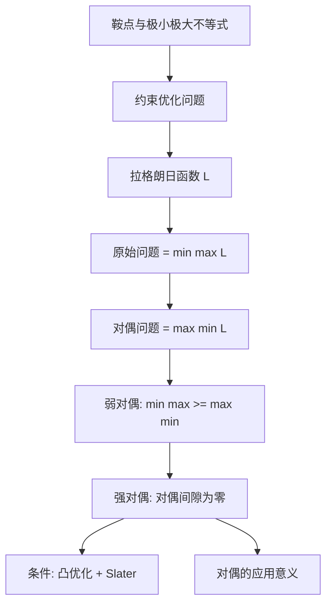
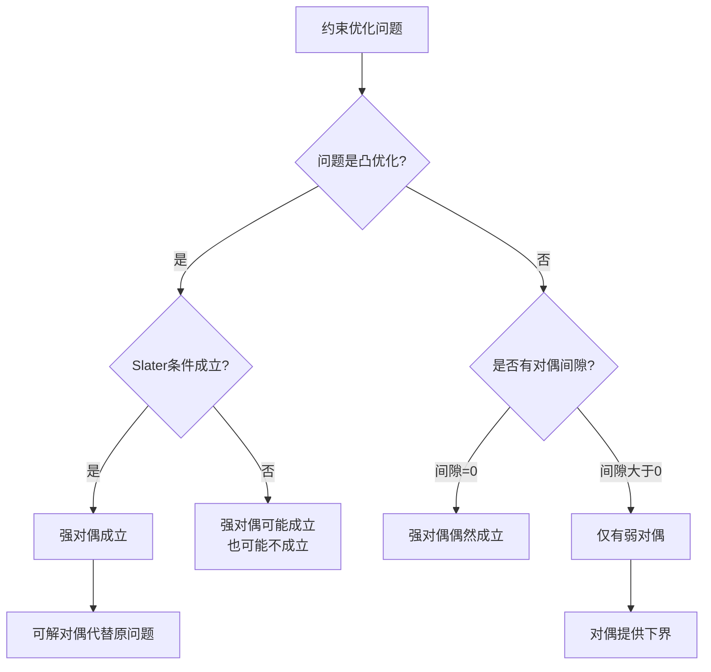
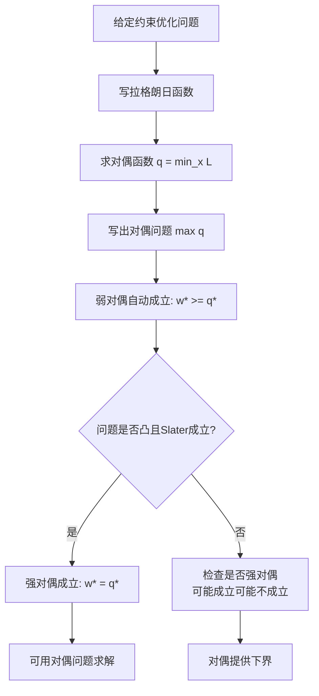

---
subject:
- 最优化方法
source:
- 22b-拉格朗日对偶.md
type: review
tags:
- Lagrange对偶
- 鞍点
- 强对偶
- Slater条件
- 对偶间隙
aliases:
- 第22b章 拉格朗日对偶 — 知识点梳理
schema_version: 2
time: "2026-08-31T11:44:20+08:00"
legacy_topics:
- 拉格朗日对偶
- 鞍点
- 极小极大不等式
- 强对偶
- Slater条件
- 对偶间隙
- 弱对偶性
- 对偶问题推导
status: not done
---

# 第22b章 拉格朗日对偶 — 知识点梳理

> 本章解决的核心问题：**给定一个约束优化问题，如何构造它的对偶问题？对偶问题能告诉我们关于原问题的什么信息？在什么条件下对偶问题的解恰好等于原问题的解？**

---

## 一、本章核心脉络

> 本章的逻辑演进：从鞍点的抽象概念出发，建立极小极大不等式（min max >= max min）→ 将约束优化问题用拉格朗日函数重新表述为 min max 形式 → 交换 min 和 max 得到对偶问题 → 分析弱对偶（不等式总是成立）与强对偶（等式何时成立）的条件 → 最后讨论对偶在算法设计和理论分析中的应用。

本章的核心思维链条：

| 步骤 | 操作 | 对应节 |
|:---:|------|:---:|
| 1 | 引入鞍点概念和极小极大不等式 | 第1节 |
| 2 | 将约束优化重写为 $\min_x \max_{\lambda,\mu \ge 0} L(x,\lambda,\mu)$ | 第2节 |
| 3 | 交换 min 和 max 得到对偶问题 $\max_{\lambda,\mu \ge 0} \min_x L$ | 第3节 |
| 4 | 三条例题：掌握对偶推导的标准流程 | 第3.2–3.4节 |
| 5 | 分析弱对偶与强对偶的成立条件 | 第4–5节 |

---

## 二、鞍点与极小极大不等式（核心）

### 2.1 鞍点的定义

> **定义（鞍点）**：点 $(x^*, z^*) \in X \times Z$ 称为函数 $\phi: X \times Z \to \mathbb{R}$ 的**鞍点**，如果：
> $$\phi(x, z^*) \leq \phi(x^*, z^*) \leq \phi(x^*, z), \quad \forall x \in X,\ \forall z \in Z$$

> 一句话来说：**鞍点是这样一个点——在 $x$ 方向看它是极小点（固定 $z^*$ 时 $x^*$ 使 $\phi$ 最小），在 $z$ 方向看它是极大点（固定 $x^*$ 时 $z^*$ 使 $\phi$ 最大）。**

**几何理解**：想象马鞍的形状——沿马头到马尾的方向，你坐在最低点；沿左右两侧的方向，你坐在最高点。这就是"鞍点"名字的来源。

### 2.2 极小极大问题

| 问题 | 表达式 | 含义 |
|------|--------|------|
| **原始问题 (Primal)** | $\displaystyle w^* = \min_{x \in X} \max_{z \in Z} \phi(x, z)$ | 先对 $z$ 取最坏情况，再选最优 $x$ |
| **对偶问题 (Dual)** | $\displaystyle q^* = \max_{z \in Z} \min_{x \in X} \phi(x, z)$ | 先对 $x$ 取最坏情况，再选最优 $z$ |

**应用背景**：worst-case design（鲁棒优化）、zero-sum game（零和博弈）、equilibrium（均衡分析）。

### 2.3 极小极大不等式

> **定理（极小极大不等式）**：
> $$\min_{x \in X} \max_{z \in Z} \phi(x, z) \geq \max_{z \in Z} \min_{x \in X} \phi(x, z)$$
> 即 $w^* \geq q^*$。

> 一句话来说：**"先选 $x$ 后让对手选最坏的 $z$" 的结果，总是不优于"先让对手选 $z$ 后我选最好的 $x$"——先手吃亏，后手占优。**

**证明核心洞察**：

记 $p(x) = \max_{z \in Z} \phi(x, z)$。因为 $p(x) \ge \phi(x, z)$ 对所有 $z$ 成立，两边对 $x$ 取 $\min$：
$$\min_x p(x) \ge \min_x \phi(x, z), \quad \forall z \in Z$$
左边即 $w^*$。由于上式对任意 $z$ 成立，右边对 $z$ 取 $\max$ 得：
$$w^* \ge \max_{z \in Z} \min_{x \in X} \phi(x, z) = q^*$$

**矩阵示例**：

$$
A = \begin{bmatrix}
3 & 6 & 7 & 2 \\
8 & 3 & 6 & 5 \\
5 & 13 & 28 & 4 \\
7 & 0 & 2 & 1
\end{bmatrix}
$$

- $w^* = \min_i \max_j a_{ij} = \min\{7, 8, 28, 7\} = 7$（每行取最大，再取最小）
- $q^* = \max_j \min_i a_{ij} = \max\{3, 0, 2, 1\} = 3$（每列取最小，再取最大）
- $w^* = 7 > 3 = q^*$，极小极大不等式严格成立。

> **点评**：矩阵示例直观地展示了"先手吃亏"——行玩家（$\min$ 玩家）先选行时，列玩家可以针对性地选最大值，得到 7；而列玩家（$\max$ 玩家）先选列时，行玩家可以针对性地选最小值，只能得到 3。

### 2.4 鞍点与极小极大问题的等价性

> **定理**：$(x^*, z^*) \in X \times Z$ 是 $\phi$ 的鞍点，**当且仅当** 极小极大不等式取等号且 $x^*$ 和 $z^*$ 分别是原始问题和对偶问题的最优解：
> $$x^* = \arg\min_x \max_z \phi(x, z), \quad z^* = \arg\max_z \min_x \phi(x, z)$$

> 一句话来说：**鞍点的存在等价于"极小极大等式成立"——如果能同时找到 $x^*$ 和 $z^*$ 分别实现双方的最优策略，那么极小极大不等式中的不等号变为等号。**

---

## 三、拉格朗日函数与原始问题重构

### 3.1 约束优化问题的标准形式

$$\min_{x \in \Omega} f(x), \quad \Omega = \{x \in \mathbb{R}^n \mid h(x) = 0,\; g(x) \le 0\}$$

其中 $h: \mathbb{R}^n \to \mathbb{R}^m$（等式约束），$g: \mathbb{R}^n \to \mathbb{R}^l$（不等式约束）。

### 3.2 拉格朗日函数

> **定义（拉格朗日函数）**：
> $$L(x, \lambda, \mu) = f(x) + \lambda^\top h(x) + \mu^\top g(x) = f(x) + \sum_{i=1}^{m} \lambda_i h_i(x) + \sum_{j=1}^{l} \mu_j g_j(x)$$
> 其中 $\lambda \in \mathbb{R}^m$（等式约束乘子，无符号限制），$\mu \in \mathbb{R}^l_+$（不等式约束乘子，非负）。

> 一句话来说：**拉格朗日函数是将约束"价格化"——每个约束配一个价格（乘子），违反约束就"罚款"，把约束优化变成无约束的 min-max 博弈。**

### 3.3 原始问题的 min-max 表述

考虑 $\max_{\lambda, \mu \ge 0} L(x, \lambda, \mu)$：

- 若 $h(x) \neq 0$：可令 $\lambda_i \to \pm\infty$ 使 $L \to +\infty$
- 若 $g_j(x) > 0$：可令 $\mu_j \to +\infty$ 使 $L \to +\infty$
- 若 $h(x) = 0$ 且 $g(x) \le 0$：$\mu^\top g(x) \le 0$，最优取 $\mu_j = 0$（对 $g_j(x) < 0$ 的非积极约束），此时 $\max$ 恰好等于 $f(x)$

因此：
$$p(x) = \max_{\lambda, \mu \ge 0} L(x, \lambda, \mu) = \begin{cases} f(x), & \text{if } h(x) = 0,\ g(x) \le 0 \\ +\infty, & \text{otherwise} \end{cases}$$

从而：
$$\boxed{\min_{x \in \mathbb{R}^n} \max_{\lambda, \mu \ge 0} L(x, \lambda, \mu) = \min_{x \in \Omega} f(x)}$$

> 一句话来说：**拉格朗日函数做了一个"魔术"——把约束变成了惩罚项，使得无约束的 min-max 问题恰好等价于原约束优化问题。**

**直观理解**：$\max_{\lambda, \mu \ge 0}$ 扮演了"检察官"的角色——它检查 $x$ 是否满足约束，如果不满足就给出 $+\infty$ 的惩罚，迫使 $\min_x$ 只能选择可行点。

---

## 四、对偶问题的推导方法（核心）

### 4.1 推导对偶问题的标准流程

交换 min 和 max 的顺序：

$$\min_{x} \max_{\lambda, \mu \ge 0} L(x, \lambda, \mu) \quad\longrightarrow\quad \max_{\lambda, \mu \ge 0} \min_{x} L(x, \lambda, \mu)$$

定义**对偶函数**：
$$q(\lambda, \mu) = \min_{x \in \mathbb{R}^n} L(x, \lambda, \mu)$$

则**对偶问题**为：
$$\max_{\lambda \in \mathbb{R}^m,\ \mu \ge 0} \; q(\lambda, \mu)$$

| 问题 | 表达式 | 变量 |
|------|--------|------|
| **原始问题 (Primal)** | $\min_{x} \max_{\lambda, \mu \ge 0} L(x, \lambda, \mu)$ | $x$ |
| **对偶问题 (Dual)** | $\max_{\lambda, \mu \ge 0} \min_{x} L(x, \lambda, \mu)$ | $\lambda, \mu$ |

> 一句话来说：**对偶问题的推导就是"换手气"——把 $\min$ 和 $\max$ 的顺序交换，内部的 $\min_x$ 通常可以解析求出（因为是无约束优化，只需令梯度为零）。**

**推导对偶问题的标准三步**：

1. **写出拉格朗日函数**：$L(x, \lambda, \mu) = f(x) + \lambda^\top h(x) + \mu^\top g(x)$
2. **求对偶函数** $q(\lambda, \mu) = \min_x L(x, \lambda, \mu)$：对 $x$ 求无约束极小（通常令 $\nabla_x L = 0$ 解出 $x^*(\lambda, \mu)$，回代得 $q$）
3. **写出对偶问题**：$\max_{\lambda, \mu \ge 0} q(\lambda, \mu)$

### 4.2 例题一（含不等式约束）

> **原问题**：$\displaystyle \min_{x \in \mathbb{R}^2} f(x) = x_1^2 + x_2^3, \quad \text{s.t.} \; g(x) = 1 - x_1 \leq 0$

**Step 1 — 拉格朗日函数**：
$$L(x, \mu) = x_1^2 + x_2^3 + \mu(1 - x_1), \quad \mu \ge 0$$

**Step 2 — 求对偶函数**：
$$q(\mu) = \min_{x \in \mathbb{R}^2} \left(x_1^2 - \mu x_1 + \mu + x_2^3\right)$$

由一阶必要条件（对 $x$ 求无约束极小）：
$$\frac{\partial L}{\partial x_1} = 2x_1 - \mu = 0 \;\Rightarrow\; x_1 = \frac{\mu}{2}$$
$$\frac{\partial L}{\partial x_2} = 3x_2^2 = 0 \;\Rightarrow\; x_2 = 0$$

代入得：
$$q(\mu) = \left(\frac{\mu}{2}\right)^2 - \mu \cdot \frac{\mu}{2} + \mu + 0 = -\frac{\mu^2}{4} + \mu$$

**Step 3 — 对偶问题**：
$$\max_{\mu \ge 0} \; q(\mu) = -\frac{\mu^2}{4} + \mu$$

求解：$\frac{dq}{d\mu} = -\frac{\mu}{2} + 1 = 0 \;\Rightarrow\; \mu^* = 2$，$q^* = q(2) = 1$。

**验证原问题**：$x^* = (1, 0)$（由约束 $1 - x_1 \le 0$ 取等），$w^* = f(x^*) = 1^2 + 0^3 = 1$。

$\therefore w^* = q^* = 1$，**强对偶成立**。

> **点评**：这个简单例子展示了完整的三步推导流程。注意 $x_2^3$ 不是凸函数（$x_2^3$ 在 $\mathbb{R}$ 上不是凸的——二阶导数 $6x_2$ 可变号），但强对偶仍然成立——这说明**非凸问题也可能有强对偶**，只是不一定保证。

### 4.3 例题二（二次规划等式约束对偶）

> **原问题**：$\displaystyle \min_{x \in \mathbb{R}^n} f(x) = \frac{1}{2}x^\top Q x + c^\top x, \quad \text{s.t.} \; Ax = b$
> 其中 $Q \succ 0$（正定），$A \in \mathbb{R}^{m \times n}$，$b \in \mathbb{R}^m$，$c \in \mathbb{R}^n$。

**Step 1 — 拉格朗日函数**：
$$L(x, \lambda) = \frac{1}{2}x^\top Q x + c^\top x + \lambda^\top (Ax - b)$$

**Step 2 — 求对偶函数**（$\min_x$ 为无约束严格凸二次函数，有闭式解）：

令 $\nabla_x L = Qx + c + A^\top \lambda = 0$，得：
$$x^*(\lambda) = -Q^{-1}(c + A^\top \lambda)$$

代入 $L$ 化简：
$$\begin{aligned} q(\lambda) &= \frac{1}{2}(x^*)^\top Q x^* + c^\top x^* + \lambda^\top(A x^* - b) \\ &= -\frac{1}{2}\lambda^\top (A Q^{-1} A^\top) \lambda - \lambda^\top(b + A Q^{-1} c) - \frac{1}{2}c^\top Q^{-1} c \end{aligned}$$

记 $P = A Q^{-1} A^\top$（注意 $P \succeq 0$ 且通常 $P \succ 0$ 若 $A$ 行满秩），$d = -b - A Q^{-1} c$。

**Step 3 — 对偶问题**：
$$\max_{\lambda \in \mathbb{R}^m} \; q(\lambda) = -\frac{1}{2}\lambda^\top P \lambda + d^\top \lambda - \frac{1}{2}c^\top Q^{-1} c$$

注意 $\lambda$ **无符号限制**（因为对应等式约束）。

> **点评**：这个例题展示了二次规划对偶的优雅结构——原问题有 $n$ 个变量和 $m$ 个等式约束，对偶问题只有 $m$ 个变量且无约束。当 $m \ll n$ 时，解对偶问题比解原问题更高效。此外 $P = A Q^{-1} A^\top$ 的结构在后续拟牛顿法和 KKT 系统中会反复出现。

### 4.4 例题三（线性规划对偶）

> **原问题**：$\displaystyle \min_{x} f(x) = c^\top x, \quad \text{s.t.} \; Ax = b,\; x \ge 0$

**Step 1 — 拉格朗日函数**（注意 $x \ge 0$ 写为 $-x \le 0$）：
$$L(x, \lambda, \mu) = c^\top x - \lambda^\top(Ax - b) - \mu^\top x, \quad \mu \ge 0$$

也可合并为 $L = c^\top x + \lambda^\top(b - Ax) - \mu^\top x$。

**Step 2 — 求对偶函数**：

$$q(\lambda, \mu) = \min_{x} \left\{(c - A^\top \lambda - \mu)^\top x\right\} + b^\top \lambda$$

这是关于 $x$ 的线性函数。极小值：
- 若 $c - A^\top \lambda - \mu \neq 0$：$x$ 可取任意方向使线性项 $\to -\infty$，故 $q = -\infty$
- 若 $c - A^\top \lambda - \mu = 0$：线性项消失，$q = b^\top \lambda$

$$\therefore \; q(\lambda, \mu) = \begin{cases} b^\top \lambda, & \text{if } c - A^\top \lambda - \mu = 0 \\ -\infty, & \text{otherwise} \end{cases}$$

**Step 3 — 对偶问题**：

$$\max_{\lambda,\ \mu \ge 0} \; b^\top \lambda, \quad \text{s.t.} \; c - A^\top \lambda - \mu = 0$$

消去 $\mu$（$\mu = c - A^\top \lambda \ge 0$）：
$$\boxed{\max_{\lambda} \; b^\top \lambda, \quad \text{s.t.} \; A^\top \lambda \le c}$$

> **点评**：这就是线性规划（LP）对偶的标准形式——原始 LP（$\min c^\top x$ s.t. $Ax = b, x \ge 0$）的对偶是 $\max b^\top \lambda$ s.t. $A^\top \lambda \le c$。注意对偶变量 $\lambda$ **无符号限制**（对应等式约束），而对偶约束 $A^\top \lambda \le c$ 对应于原始变量 $x \ge 0$。这是 LP 对偶理论的经典结果。

**三种对偶推导的对比**：

| | 例题一 | 例题二 | 例题三 |
|---|---|---|---|
| 原问题类型 | 非线性 + 不等式 | 二次规划 + 等式 | 线性规划 |
| 内层 $\min_x$ 解法 | FONC（偏导为零） | $\nabla_x L = 0$ 解线性方程组 | 线性函数在 $\mathbb{R}^n$ 上的极小 |
| $q$ 的形式 | 二次函数（$\mu$） | 二次函数（$\lambda$） | 分段函数 |
| 对偶约束 | $\mu \ge 0$ | $\lambda$ 无限制 | $\mu \ge 0$（化为 $A^\top \lambda \le c$） |
| $q$ 取 $-\infty$ 的情况 | 无（二次函数有下界） | 无（$Q \succ 0$ 保证） | 有（当 $c - A^\top \lambda - \mu \neq 0$） |

---

## 五、弱对偶性、对偶间隙与强对偶（核心）

### 5.1 弱对偶性

> **定理（弱对偶性）**：对任意可行点 $x \in \Omega$ 和任意对偶可行点 $(\lambda, \mu \ge 0)$，总有：
> $$f(x) \ge q(\lambda, \mu)$$

> 一句话来说：**对偶函数的值永远不超过原目标函数在任意可行点处的值——对偶问题的任意可行解都给出原问题最优值的一个下界。**

**证明**（直接来自极小极大不等式）：
$$f(x) = \max_{\lambda, \mu \ge 0} L(x, \lambda, \mu) \ge L(x, \lambda, \mu) \ge \min_{x'} L(x', \lambda, \mu) = q(\lambda, \mu)$$

因此：
$$w^* = \min_{x \in \Omega} f(x) \ge \max_{\lambda, \mu \ge 0} q(\lambda, \mu) = q^*$$

即 $w^* \ge q^*$。

### 5.2 对偶间隙

> **定义（对偶间隙）**：对于可行点 $x$ 和对偶可行点 $(\lambda, \mu)$，对偶间隙为：
> $$\text{dual gap} = f(x) - q(\lambda, \mu) \ge 0$$

- **强对偶 (Strong Duality)**：对偶间隙为零，即 $w^* = q^*$。
- **弱对偶 (Weak Duality)**：对偶间隙大于零，即 $w^* > q^*$。

> 一句话来说：**对偶间隙衡量了"换手气"带来的损失——如果间隙为零，说明先手和后手一样好，对偶问题与原问题等价。**

### 5.3 强对偶定理（凸优化情形）

> **定理（强对偶——凸优化版）**：对于凸优化问题，在 Slater 条件下，以下各概念等价：
> $$\text{稳定点} \iff \text{全局极值点} \iff \text{局部极值点} \iff \text{KKT系统的解} \iff \text{拉格朗日函数的鞍点}$$

> 一句话来说：**在凸优化中（满足 Slater 条件时），最优解、KKT 点和鞍点是同一个东西——这意味着对偶间隙必定为零。**

**等价关系的含义**：

| 关系 | 含义 |
|------|------|
| 稳定点 $\iff$ 全局极值点 | 凸函数的 FONC 也是充分条件（见 22a 章） |
| KKT 系统解 $\iff$ 全局极值点 | KKT 条件在凸优化中是充分的 |
| 鞍点 $\iff$ KKT 系统解 | 鞍点条件展开后即 KKT 条件 |
| 鞍点 $\iff$ 极小极大等式 | $w^* = q^*$ 当且仅当存在鞍点 |

### 5.4 对偶的应用意义

| 应用 | 说明 |
|------|------|
| **提供下界** | 任意对偶可行解给出 $w^*$ 的下界，可用于评估原可行解的最优性 |
| **简化求解** | 当对偶问题维数更低或结构更简单时，可解对偶代替原问题 |
| **设计算法** | 对偶上升法、增广拉格朗日法、ADMM 等都基于对偶理论 |
| **灵敏度分析** | $\lambda^*$ 和 $\mu^*$ 反映了约束的"影子价格" |
| **可行性检测** | 若 $q(\lambda, \mu) \to +\infty$，原问题可能不可行 |

---

## 六、Slater 条件与强对偶的成立条件

### 6.1 Slater 条件

> **定义（Slater 条件）**：对于凸优化问题 $\min \{f(x) \mid g_j(x) \le 0, \; h_i(x) = 0\}$（$f$ 凸，$g_j$ 凸，$h_i$ 仿射），若存在一个**严格可行点** $\tilde{x}$ 满足：
> $$h_i(\tilde{x}) = 0, \quad g_j(\tilde{x}) < 0 \quad (\text{对所有不等式约束严格成立})$$
> 则 **Slater 条件成立**。

> 一句话来说：**Slater 条件要求不等式约束的可行域有"内部点"——即存在一个点满足所有等式约束，且所有不等式约束都是严格小于零的（不触及边界）。**

### 6.2 Slater 条件的成立情况

| 问题类型 | Slater 条件是否成立 | 说明 |
|----------|:---:|------|
| **线性约束的凸优化** | 恒成立 | LP、QP 等只要可行域非空 |
| **一般凸优化** | 不一定 | 需要验证是否存在严格内点 |
| **非凸优化** | — | Slater 条件为凸优化设计，非凸问题强对偶可能成立也可能不成立 |

> **关键结论**：对于线性约束（即所有 $g_j$ 和 $h_i$ 都是仿射函数），只要可行域非空，Slater 条件自动满足。这就是为什么 LP 和 QP 的强对偶总是成立的原因。

### 6.3 强对偶的判定流程图

**实践指导**：
- 对于 LP 和 QP（凸）：放心使用强对偶，对偶问题等价于原问题
- 对于一般凸优化：检查 Slater 条件，通常容易满足（大多数实际问题有严格内点）
- 对于非凸问题：不要假设强对偶，但可以利用弱对偶获得有用的下界

---

## 判定 / 决策流程

### 对偶问题的完整解题流程

### 对偶问题的标准推导流程（三步法）

1. **写拉格朗日函数**：$L = f + \lambda^\top h + \mu^\top g$，$\mu \ge 0$
2. **求对偶函数 $q(\lambda, \mu) = \min_x L$**：
   - 对 $x$ 求无约束极小（通常令 $\nabla_x L = 0$ 解 $x^*(\lambda, \mu)$）
   - 若 $L$ 关于 $x$ 无下界（如线性函数），则 $q = -\infty$（此时对偶问题需加约束排除此情况）
   - 回代 $x^*$ 得 $q(\lambda, \mu)$
3. **写出对偶问题**：$\max_{\lambda, \mu \ge 0} q(\lambda, \mu)$

---

## 核心公式速查表

| 概念 | 公式 | 备注 |
|------|------|------|
| 鞍点定义 | $\phi(x, z^*) \le \phi(x^*, z^*) \le \phi(x^*, z)$ | $x$ 方向极小，$z$ 方向极大 |
| 极小极大不等式 | $\min_x \max_z \phi(x,z) \ge \max_z \min_x \phi(x,z)$ | 总是成立 |
| 鞍点 $\iff$ 等式 | $(x^*,z^*)$ 是鞍点 $\iff$ $w^* = q^* = \phi(x^*,z^*)$ | 鞍点存在时等号成立 |
| 拉格朗日函数 | $L(x,\lambda,\mu) = f(x) + \lambda^\top h(x) + \mu^\top g(x)$ | $\mu \ge 0$ |
| 原始问题 (min-max) | $\min_x \max_{\lambda,\mu \ge 0} L(x,\lambda,\mu)$ | 等价于原约束优化 |
| 对偶函数 | $q(\lambda,\mu) = \min_x L(x,\lambda,\mu)$ | 无约束极小 |
| 对偶问题 | $\max_{\lambda,\mu \ge 0} q(\lambda,\mu)$ | $\lambda$ 无限制 |
| 弱对偶性 | $f(x) \ge q(\lambda,\mu)$, $\forall x \in \Omega, \mu \ge 0$ | 总是成立 |
| 对偶间隙 | $f(x) - q(\lambda,\mu) \ge 0$ | 强对偶时为零 |
| 强对偶条件 | 凸优化 + Slater 条件 | 充分条件 |
| Slater 条件 | $\exists \tilde{x}: h(\tilde{x}) = 0, g(\tilde{x}) < 0$ | 严格内点 |

---

## 易错点与注意事项

> [!warning] 拉格朗日乘子的符号约定
> 不等式约束写作 $g(x) \le 0$ 时，拉格朗日函数中为 $+\mu^\top g(x)$ 且 $\mu \ge 0$。若写作 $g(x) \ge 0$，则为 $-\mu^\top g(x)$ 且 $\mu \ge 0$。注意课件中例题三使用了 $-\mu^\top x$（因为 $x \ge 0$ 写为 $-x \le 0$）。符号一致性至关重要。

> [!warning] 对偶函数的定义域可能是受限的
> 当 $\min_x L(x, \lambda, \mu) = -\infty$ 对某些 $(\lambda, \mu)$ 成立时，这些 $(\lambda, \mu)$ 实际上不是对偶问题的可行解。这在处理线性函数（如 LP 对偶推导）时尤其重要——需要通过"$q = -\infty$ 除非..."的条件来隐式定义对偶约束。

> [!warning] 弱对偶性是"永恒的"，强对偶不是
> 弱对偶性 $w^* \ge q^*$ 不需要任何条件——它来自极小极大不等式。但强对偶 $w^* = q^*$ 不是天然成立的，需要凸性 + Slater 条件（或更一般的 constraint qualification）来保证。

> [!warning] Slater 条件在线性约束中自动满足
> LP 和 QP（凸）的 Slater 条件只需要可行域非空。但需要注意：若 LP 的可行域只有一个点（退化的多面体），Slater 条件可能不满足（没有严格内点）。不过此时强对偶通常仍然成立——Slater 是充分条件而非必要条件。

> [!warning] 非凸问题也可能有强对偶
> 例题一中的 $x_2^3$ 不是凸函数，但强对偶仍然成立。这说明强对偶不需要问题全局是凸的——只需在局部满足某些条件。分析非凸问题的强对偶比凸情形复杂得多，通常不在基础课程范围内。

> [!warning] 鞍点存在 $\iff$ 极小极大不等式取等
> 这是一个充要条件。如果找到了鞍点，强对偶一定成立；反过来，如果强对偶成立且原始和对偶问题都有最优解，那么最优解对一定是鞍点。

---

## 相关知识点链接

- **最优性条件**：[[03_Sources/Reviews/归档/最优化方法/知识点解析梳理/06-最优性条件-知识梳理|KKT 条件]]——拉格朗日对偶的鞍点条件展开后即为 KKT 条件。理解 KKT 是从另一个角度理解对偶。
- **凸优化问题**：[[03_Sources/Reviews/归档/最优化方法/知识点解析梳理/22a-凸优化问题-知识梳理|凸函数与凸优化]]——强对偶定理的前提是凸优化问题，凸性分析是本章的前置知识。
- **线性规划**：[[03_Sources/Courses/归档/最优化方法/最优化方法PPT课件/MD/15-线性规划概述|线性规划]]——LP 对偶是拉格朗日对偶在线性情形下的特例。
- **等式约束优化**：[[03_Sources/Courses/归档/最优化方法/最优化方法PPT课件/MD/20-等式约束优化问题|Lagrange 乘子法]]——等式约束优化的拉格朗日乘子与对偶理论中 $\lambda$ 的角色一致。
- **不等式约束优化**：[[03_Sources/Courses/归档/最优化方法/最优化方法PPT课件/MD/21-不等式约束优化问题|一般 KKT 条件]]——理解一般非凸优化中 KKT 的必要性，对比凸优化中 KKT + 对偶的充分性。
- **微积分基础**：[[03_Sources/Reviews/归档/最优化方法/知识点解析梳理/05-微积分基础-知识梳理|导数与梯度]]——对偶推导中 $\min_x L$ 的无约束极小依赖于梯度条件。

---

## 作业与练习

课后习题（来自课件第 22b 章作业）：

| 编号  | 原问题                                                                   | 类型         | 建议                                                   | 习题链接 |
| :-: | --------------------------------------------------------------------- | ---------- | ---------------------------------------------------- | :--- |
| (1) | $\min x_1^2 + x_2^2$ s.t. $x_1 + x_2 - 4 \le 0, x_1 \le 0, x_2 \ge 0$ | 二次 + 线性不等式 | 练习基本三步推导法，注意将所有不等式改写为 $g(x) \le 0$ 形式                | [[../习题库/22b-拉格朗日对偶/习题22b.1\|习题22b.1]] |
| (2) | $\min \frac{1}{2}x^\top Q x + b^\top x$ s.t. $Ax = b$                 | 二次规划等式约束   | 对照例题二，注意这里的 $Q$ 是否正定会影响到推导（若不正定则 $\min_x$ 可能无下界）     | [[../习题库/22b-拉格朗日对偶/习题22b.2\|习题22b.2]] |
| (3) | $\min \|x_1\| + x_2^2$ s.t. $x_1 \le 0, x_2 \ge 0$                    | 非光滑 + 不等式  | 绝对值函数的对偶处理——可考虑引入辅助变量或使用次梯度                          | [[../习题库/22b-拉格朗日对偶/习题22b.3\|习题22b.3]] |
| (4) | $\min \|Ax - b\|_2^2 + r\|x\|_1$                                      | LASSO 问题   | 这是机器学习中 LASSO 的对偶形式，$\ell_1$ 范数的对偶是 $\ell_\infty$ 约束 | [[../习题库/22b-拉格朗日对偶/习题22b.4\|习题22b.4]] |
| (5) | $\min \|x\|_\infty$ s.t. $Ax = b$                                     | 无穷范数优化     | $\ell_\infty$ 范数可转化为线性约束，对偶推导涉及线性规划对偶                | [[../习题库/22b-拉格朗日对偶/习题22b.5\|习题22b.5]] |

> **做题建议**：从 (1) 和 (2) 入手，熟练掌握拉格朗日对偶的标准三步推导流程。(3)–(5) 涉及非光滑目标函数（$\ell_1$、$\ell_\infty$），处理技巧稍有不同，建议先复习次梯度的概念。每道题完成后建议验证弱对偶性（即检查 $w^* \ge q^*$），并判断强对偶是否成立。
---

## 相关概念

- [[01_Knowledge/对偶]]
---

## 相关知识点

- [[01_Knowledge/对偶间隙]]

## 可复用知识条目

本章涉及以下独立条目；后续补充与跨课程应用统一维护在条目中。

### 概念入口

- [[01_Knowledge/对偶|对偶]]

### 知识点入口

- [[01_Knowledge/对偶间隙|对偶间隙]]
