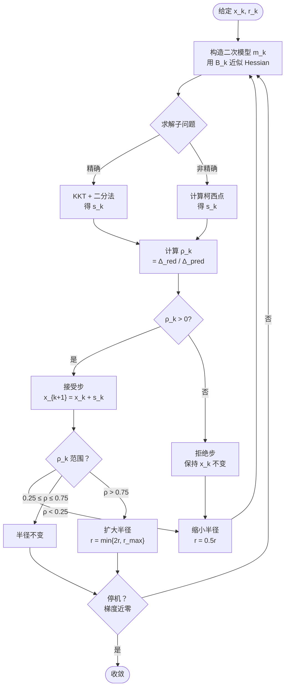

---
subject:
- 最优化方法
source:
- 25-信赖域方法.md
type: review
tags:
- 信赖域方法
- 柯西点
- 信赖域半径
- 收敛性分析
aliases:
- 第25章 信赖域方法 — 知识点梳理
schema_version: 2
time: "2026-08-31T11:44:20+08:00"
legacy_topics:
- 信赖域方法
- 信赖域子问题
- 柯西点
- 信赖域半径
- 收敛性分析
status: not done
---

# 第25章 信赖域方法 — 知识点梳理

> 本章解决的核心问题：**当牛顿法的二阶 Taylor 逼近只在局部可信时，如何通过限制搜索范围来保证每一步迭代都有意义？**

---

## 一、本章核心脉络

> 上述流程展示了信赖域方法的完整逻辑链：从牛顿法的不足出发，用"信任半径"将二次模型的适用范围限制在可控区域内；子问题求解是核心计算环节（精确求解用 KKT + 二分法，非精确用柯西点）；半径更新通过比较实际下降与预估下降来动态调整信赖程度；最终获得全局收敛性保证。

---

## 二、背景：牛顿法的回顾与局限性

### 2.1 牛顿法基本思想

在当前点 $x_k$ 处用二阶 Taylor 展开近似目标函数：

$$m_k(p) = f(x_k) + g_k^T (x - x_k) + \frac{1}{2} (x - x_k)^T G_k (x - x_k)$$

其中 $g_k = \nabla f(x_k)$，$G_k = \nabla^2 f(x_k)$。

- **牛顿步**：$x_{k+1} = x_k - G_k^{-1} g_k$（对二次模型取极小点的解析解）
- **阻尼牛顿步**：$x_{k+1} = x_k - \alpha_k G_k^{-1} g_k$（引入步长因子控制步幅）

### 2.2 牛顿法的优缺点

| 优点 | 缺点 |
|------|------|
| 二次收敛（局部）——快 | 仅局部收敛，对初值要求高 |
| 利用曲率信息，方向选择比梯度法更优 | $G_k$ 非正定或接近奇异时算法失效 |
| — | 每次迭代需计算并求逆 Hessian（计算量大） |
| — | 需要 $f \in C^2$ |

> 一句话来说：牛顿法在"足够近"的时候快如闪电，但在远离极小点或 Hessian 不良时可能完全失效。

### 2.3 问题导向

牛顿法的两个核心缺陷（仅局部收敛、Hessian 非正定时方向不可靠）共同指向同一个解决思路：**限制模型的使用范围**——在什么样的邻域内，二次 Taylor 逼近是"可信"的？这就是信赖域方法的出发点。

---

## 三、信赖域方法的基本框架（核心）

### 3.1 信赖域定义

在迭代点 $x_k$ 处，定义**信赖域**：

$$\Omega_k := \{x \in \mathbb{R}^n \mid \|x - x_k\| \leq r_k\}$$

其中 $r_k > 0$ 称为**信赖域半径**。范数 $\|\cdot\|$ 理论上可任取（$\ell^1$、$\ell^2$、$\ell^{\infty}$），实践中 $\ell^2$ 最常用。

> 一句话来说：信赖域就是在当前点周围画一个球，我们只信任这个球以内的二次模型。

### 3.2 信赖域子问题

在 $\Omega_k$ 内用二次模型 $m_k$ 近似 $f$，求解带约束的子问题得到下一步迭代点 $x_{k+1}$：

$$\min_{x} \; m_k(x) = g_k^T (x - x_k) + \frac{1}{2} (x - x_k)^T B_k (x - x_k) \quad \text{s.t.} \quad \|x - x_k\| \leq r_k$$

其中 $B_k$ 是 Hessian 或其近似：

| $B_k$ 的选择 | 方法名称 | 特点 |
|-------------|----------|------|
| $B_k = I$ | 基于梯度下降的信赖域方法 | 退化为最速下降方向 |
| $B_k = \nabla^2 f(x_k)$ | 基于牛顿法的信赖域方法 | 利用真实曲率信息 |
| $B_k \approx \nabla^2 f(x_k)$ | 基于拟牛顿法的信赖域方法 | 近似 Hessian，计算代价低 |

> [!hint] 关键洞察
> 即使在 $B_k$ 非正定的情况下，信赖域约束 $\|s\| \leq r_k$ 的存在使得子问题总是适定的（有界可行域上的连续函数必有极小点）——这正是信赖域方法克服牛顿法 Hessian 非正定问题的核心机制。

### 3.3 与经典线搜索方法的对比

| | 经典线搜索方法 | 信赖域方法 |
|---|-------------|----------|
| **决策顺序** | 先选方向，再选步长 | 先选范围，再在范围内选点 |
| **核心驱动** | 搜索方向驱动 | 信赖域约束驱动 |
| **每步计算** | 一维搜索（通常廉价） | 求解带约束子问题（更贵但更稳健） |
| **Hessian 非正定** | 需修正方向（如加正则项） | 约束自动处理 |
| **全局收敛性** | 需要 Wolfe 条件等 | 通过半径调整自然获得 |
| **非凸问题** | 可能失效 | 仍可求解 |

---

## 四、信赖域子问题的求解（核心 + 难点）

### 4.1 子问题的标准形式

令 $s = x - x_k$，信赖域子问题简记为：

$$\min_{s \in \mathbb{R}^n} \; q(s) = \frac{1}{2} s^T B s + g^T s \quad \text{s.t.} \quad \|s\| \leq r$$

其中 $B = B_k$，$g = g_k$（省略下标 $k$ 以简化记号）。

> 一句话来说：这是在 $\ell^2$ 球内的带约束二次优化问题——一个球约束二次规划。

### 4.2 $\ell^2$ 范数下的 KKT 条件

目标函数 $q(s)$ 的 Lagrange 函数为 $\mathcal{L}(s, \lambda) = \frac{1}{2} s^T B s + g^T s + \frac{\lambda}{2}(\|s\|^2 - r^2)$。$\ell^2$ 范数下 KKT 条件为：

$$
\begin{aligned}
B s^* + g + \lambda s^* &= 0 \quad &\text{(梯度条件)} \\
\|s^*\| &\leq r \quad &\text{(约束)} \\
\lambda &\geq 0 \quad &\text{(乘子非负)} \\
\lambda(\|s^*\| - r) &= 0 \quad &\text{(互补松弛)}
\end{aligned}
$$

### 4.3 特殊情况：$g = 0$

| Hessian 情况 | 最优解 |
|-------------|--------|
| $\lambda_{\min}(B) > 0$（正定） | $s^* = 0$（当前点就是极小点） |
| $\lambda_{\min}(B) < 0$（不定/负定） | $s^*$ 是 $\lambda_{\min}(B)$ 对应的特征向量，$\|s^*\| = r$（沿最负曲率方向走到边界） |

> 直观理解：梯度为零时，若 Hessian 有负特征值，函数在某些方向上下降——这些方向上的"谷底"就在边界上，所以最优解取在球面上。

### 4.4 一般情况：$g \neq 0$ 的求解方法

当 $B + \lambda I \succ 0$ 时，由梯度条件解出：

$$s(\lambda) = -(B + \lambda I)^{-1} g$$

且 $\|s(\lambda)\|$ 关于 $\lambda$ 单调递减。

**二分法求解流程**：

1. 确定 $\lambda$ 的搜索下界：$\lambda_l = \max\{0, -\lambda_{\min}(B)\}$（确保 $B + \lambda I \succeq 0$）
2. 若 $\|s(\lambda_l)\| \leq r$：则 $s(\lambda_l)$ 是最优解，停机（约束不活跃，$\lambda = \lambda_l$ 即是解）
3. 否则，寻找 $\lambda_u$ 使得 $\|s(\lambda_u)\| < r$（从 $\lambda_u = \max\{1, \lambda_l\}$ 开始，反复加倍直到满足条件）
4. 二分搜索：$\lambda = (\lambda_l + \lambda_u) / 2$
   - 若 $\|s(\lambda)\| \leq r$：令 $\lambda_l = \lambda$
   - 否则：令 $\lambda_u = \lambda$
5. 当 $|\lambda_u - \lambda_l| < \varepsilon$ 时停机

> [!hint] 为什么需要单调性？
> $\|s(\lambda)\|$ 关于 $\lambda$ 的单调递减性是二分法可行性的关键保证——它确保 $\lambda$ 和 $\|s\|$ 之间存在一一对应关系，从而可以通过不断调整 $\lambda$ 来同时满足 KKT 条件和约束。

#### 例题：信赖域约束是否活跃

给定
$$
g_k=\begin{bmatrix}2\\-1\end{bmatrix},\qquad
B_k=\begin{bmatrix}3&1\\1&2\end{bmatrix},\qquad r_k=1.
$$

$B_k$ 的特征值为 $(5\pm\sqrt5)/2$，均为正。其无约束极小步为
$$
s^{\mathrm{unc}}=-B_k^{-1}g_k
=-\frac15\begin{bmatrix}2&-1\\-1&3\end{bmatrix}
\begin{bmatrix}2\\-1\end{bmatrix}
=\begin{bmatrix}-1\\1\end{bmatrix}.
$$
由于 $\|s^{\mathrm{unc}}\|=\sqrt2>1$，信赖域约束活跃。应求 $\lambda>0$，使
$$
\bigl\|-(B_k+\lambda I)^{-1}g_k\bigr\|=1,
$$
可利用范数随 $\lambda$ 单调递减的性质进行二分搜索。

> [!warning] 奇异端点需要特殊处理
> 当 $B$ 有负特征值且 $\lambda=-\lambda_{\min}(B)$ 时，$B+\lambda I$ 奇异，不能直接套用求逆表达式；此时可能需要特殊处理（Hard Case）。

---

## 五、信赖域半径的选取与更新（核心）

### 5.1 半径更新的基本思想

信赖域半径 $r_k$ 反映二次模型 $m_k$ 在当前邻域内对 $f$ 的近似质量。通过比较**实际下降量**和**预估下降量**来决定调整方向。

| 量 | 定义 | 含义 |
|----|------|------|
| **实际下降量** | $\Delta_{\text{red}}^k = f(x_k) - f(x_{k+1})$ | 目标函数真实的下降 |
| **预估下降量** | $\Delta_{\text{pred}}^k = m_k(0) - m_k(s_k)$ | 二次模型预测的下降 |
| **比值** | $\rho_k = \dfrac{\Delta_{\text{red}}^k}{\Delta_{\text{pred}}^k}$ | 衡量模型精度 |

> 一句话来说：$\rho_k \approx 1$ 说明二次模型预测准确，可以信任更多；$\rho_k \ll 1$ 甚至为负，说明模型预测太乐观（或错误），需要缩小信任范围。

### 5.2 半径更新规则

| $\rho_k$ 范围 | 模型质量判断 | 半径调整 |
|--------------|-------------|----------|
| $\rho_k < 0.25$ | 模型预测差 | $r_{k+1} = 0.5 \, r_k$（收缩） |
| $\rho_k \in [0.25, 0.75]$ | 模型可接受 | $r_{k+1} = r_k$（保持不变） |
| $\rho_k > 0.75$ | 模型预测好 | $r_{k+1} = \min\{2 r_k, \bar{r}\}$（扩张，但不超过上限 $\bar{r}$）|

### 5.3 迭代点接受准则

仅当 $\rho_k > 0$（即 $f$ 的实际值确有下降）时才接受 $x_{k+1}$，否则回退——拒绝该步，缩小半径后重新求解子问题。

> [!warning] $\rho_k \leq 0$ 的含义
> 若 $\Delta_{\text{red}}^k \leq 0$，意味着实际函数值没有下降（甚至上升），说明二次模型在当前半径内完全不可信。此时必须缩小 $r_k$ 重新求解。

---

## 六、非精确求解：柯西点（核心）

### 6.1 动机

精确求解信赖域子问题（KKT + 二分法）代价较高。能否用一个廉价的近似解替代，同时不牺牲收敛性？答案是**柯西点**。

### 6.2 柯西点的定义

柯西点 $x_k^c$ 是沿负梯度方向 $(-g_k)$ 在信赖域内精确极小化二次模型得到的点：

$$x_k^c = x_k - \tau_k \frac{r_k}{\|g_k\|} g_k$$

其中 $\tau_k$ 由一维搜索确定：

$$\tau_k = \begin{cases}
1, & g_k^T G_k g_k \leq 0 \\[8pt]
\min\!\left(1,\; \dfrac{\|g_k\|^3}{r_k \, g_k^T G_k g_k}\right), & g_k^T G_k g_k > 0
\end{cases}$$

> 一句话来说：柯西点是最速下降法的一步在信赖域约束下的推广——方向就是负梯度方向，步长由二次模型在球内的一维优化决定。

### 6.3 $\tau_k$ 的推导逻辑

- 若 $g_k^T G_k g_k \leq 0$（沿负梯度方向曲率非正）：沿负梯度方向，二次模型一直下降（或不变），所以走得越远越好——$\tau_k = 1$，即走到边界。
- 若 $g_k^T G_k g_k > 0$（沿负梯度方向曲率正）：二次模型在某处达到极小，极小点在 $\tau_k = \dfrac{\|g_k\|^3}{r_k \, g_k^T G_k g_k}$。若该值 $< 1$，取该极小点；若 $\geq 1$（极小点在界外），走到边界 $\tau_k = 1$。

### 6.4 柯西点的充分下降性

**定理**：柯西点满足充分下降条件——存在常数 $c_1 \in (0, 1]$ 使得：

$$m_k(x_k^c) - m_k(x_k) \leq -c_1 \|g_k\| \min\!\left(r_k,\; \frac{\|g_k\|}{\|G_k\|}\right)$$

> 直观理解：无论信赖域半径多大或多小，柯西点保证每次迭代的下降量至少与梯度范数和半径的乘积成比例——这足以驱动全局收敛。

### 6.5 改进的柯西点（二维子空间法）

为进一步提升精度，可在二维子空间中求解信赖域子问题：

$$\min_{x} \; m_k(x) \quad \text{s.t.} \quad \|x - x_k\| \leq r_k, \quad x \in x_k + \mathcal{K}_k$$

其中 $\mathcal{K}_k := \text{span}\{g_k,\; G_k^{-1} g_k\}$ 是由梯度方向和 Newton 方向张成的二维子空间。

> 一句话来说：二维子空间法兼顾了梯度方向（安全性）和 Newton 方向（加速性），等价于求解一个四次方程的根，计算代价远低于全空间求解。

大规模信赖域子问题还可采用迭代近似算法，如 Steihaug-CG；其共轭梯度基础可参看 [[03_Sources/Reviews/归档/最优化方法/知识点解析梳理/10-共轭方向法-知识梳理|共轭梯度法]]。

---

## 七、信赖域方法的收敛性

### 7.1 假设条件

- 下水平集 $S := \{x \mid f(x) \leq f(x_0)\}$ 有界
- $\nabla^2 f(x)$ 在 $S$ 上有界（即 $\exists M > 0$ 使 $\|G_k\| \leq M$）

### 7.2 核心结论

1. **充分下降性**：信赖域子问题的解（无论是精确解还是柯西点）都满足

   $$m_k(s_k) \leq -c \,\|g_k\| \min\!\left(r_k,\; \frac{\|g_k\|}{\|G_k\|}\right)$$

2. **梯度收敛**：当 $k \to \infty$ 时，$\nabla f(x_k) \to 0$

3. **拟牛顿版本**：若用近似矩阵 $B_k$ 替代 $G_k = \nabla^2 f(x_k)$，只要 $\{B_k\}$ 一致有界（$\|B_k\| \leq M$ 对所有 $k$），上述收敛性仍然成立。

> 一句话来说：信赖域方法有全局收敛性保证，且不要求 Hessian 正定——正是因为半径调整机制自动在模型不准确时收缩搜索范围。

### 7.3 信赖域方法为什么比线搜索方法更稳健

| 挑战 | 线搜索方法的应对 | 信赖域方法的应对 |
|------|----------------|-----------------|
| Hessian 非正定 | 需要修正 Hessian（如加正则项），或改用梯度方向 | $B_k$ 可非正定，约束使子问题仍有界适定 |
| 二次模型不准确 | 通过 Armijo/Wolfe 条件限制步长 | 通过 $\rho_k$ 直接评估并调整 $r_k$ |
| 非凸目标 | 线搜索可能找到上升方向 | 约束保证子问题有解 |

---

## 判定/决策流程

---

## 核心公式速查表

| 概念 | 公式 | 备注 |
|------|------|------|
| 二次模型 | $m_k(x) = f_k + g_k^T (x - x_k) + \frac{1}{2} (x - x_k)^T B_k (x - x_k)$ | $f_k = f(x_k)$，可省略常数项 |
| 信赖域约束 | $\|x - x_k\| \leq r_k$ | 通常取 $\ell^2$ 范数 |
| 子问题 | $\min_s \frac{1}{2} s^T B s + g^T s \;\; \text{s.t.} \;\; \|s\| \leq r$ | $B = B_k$, $g = g_k$ |
| KKT 梯度条件 | $B s^* + g + \lambda s^* = 0$ | $\lambda \geq 0$ 为 Lagrange 乘子 |
| KKT 互补松弛 | $\lambda(\|s^*\| - r) = 0$ | 活跃/不活跃约束的切换 |
| $s(\lambda)$ 表达式 | $s(\lambda) = -(B + \lambda I)^{-1} g$ | 当 $B + \lambda I \succ 0$ |
| $\lambda$ 下界 | $\lambda_l = \max\{0, -\lambda_{\min}(B)\}$ | 保证 $B + \lambda I \succeq 0$ |
| 实际下降量 | $\Delta_{\text{red}}^k = f(x_k) - f(x_{k+1})$ | 真实的 $f$ 值下降 |
| 预估下降量 | $\Delta_{\text{pred}}^k = m_k(0) - m_k(s_k)$ | 模型预测的下降 |
| 比值 | $\rho_k = \dfrac{\Delta_{\text{red}}^k}{\Delta_{\text{pred}}^k}$ | 衡量模型精度 |
| 柯西点 | $x_k^c = x_k - \tau_k \frac{r_k}{\|g_k\|} g_k$ | 沿负梯度方向的最优步长 |
| $\tau_k$ 定义 | $\tau_k = \min(1, \frac{\|g_k\|^3}{r_k g_k^T G_k g_k})$ 或 $1$ | 取决于 $g_k^T G_k g_k$ 的符号 |
| 柯西点充分下降 | $m_k(x_k^c) - m_k(x_k) \leq -c_1 \|g_k\| \min(r_k, \frac{\|g_k\|}{\|G_k\|})$ | 理论保证 |
| 收敛结论 | $\nabla f(x_k) \to 0$（$k \to \infty$） | 全局收敛 |

---

## 易错点与注意事项

> [!warning] 信赖域半径不是线搜索步长
> 线搜索方法是"沿固定方向找步长"，信赖域方法是"在固定范围内找最佳点"。半径 $r_k$ 限制的是位移的范数，而不是步长因子。两者不能直接等价。

> [!warning] KKT 条件中的 $\lambda$ 不是约束优化的 Lagrange 乘子
> 信赖域子问题的 Lagrange 乘子 $\lambda$ 作用于 $\|s\|^2 - r^2 \leq 0$，它的角色是使 $B + \lambda I$ 正定——等价于在 Hessian 上加一个正则项。这是 KKT 条件在信赖域上下文中的特殊解释。

> [!warning] 二分法的前提：$B + \lambda I \succ 0$
> 二分法中 $s(\lambda) = -(B + \lambda I)^{-1} g$ 的表达式**仅在 $B + \lambda I$ 正定时有效**。因此 $\lambda$ 的搜索下界 $\lambda_l = \max\{0, -\lambda_{\min}(B)\}$ 是必需的——它确保矩阵至少半正定。实际计算中通常取 $\lambda_l + \varepsilon$ 以保证正定。

> [!warning] $\rho_k$ 的分母不能为零
> 当 $s_k = 0$ 时，$\Delta_{\text{pred}}^k = 0$，$\rho_k$ 无定义。此时意味着当前点已是子问题的驻点（$g_k \approx 0$），应检查停机条件。

> [!warning] 柯西点不一定在边界上
> 当 $g_k^T G_k g_k > 0$ 且 $\frac{\|g_k\|^3}{r_k g_k^T G_k g_k} < 1$ 时，$\tau_k < 1$，柯西点严格在球内——此时沿负梯度方向在碰到边界之前就已经到达了二次模型的极小点。

> [!warning] 信赖域方法的收敛性不要求 Hessian 正定
> 这是信赖域方法最重要的优势之一：$B_k$ 可以不定甚至负定，因为子问题是有界约束下的优化，极小点总是存在的。与之相比，纯牛顿法在 $G_k$ 非正定时产生的方向可能是上升方向。

---

## 相关知识点链接

- 数学基础：[[03_Sources/Courses/归档/最优化方法/最优化方法PPT课件/MD/03-线性代数基础#特征值|特征值分解、XXXXXXXXXXXXXXXXXXX]] — 信赖域子问题求解需要计算或估计 Hessian 的最小特征值
- 数学基础：[[03_Sources/Courses/归档/最优化方法/最优化方法PPT课件/MD/05-微积分基础#Taylor展开|二阶 Taylor 展开]] — 二次模型 $m_k$ 的理论基础
- 前置章节：[[03_Sources/Courses/归档/最优化方法/最优化方法PPT课件/MD/06-最优性条件#KKT条件|KKT 条件]] — 信赖域子问题是带约束优化，其最优解由 KKT 条件刻画
- 前置章节：[[03_Sources/Courses/归档/最优化方法/最优化方法PPT课件/MD/07-一维搜索方法|一维搜索方法]] — 柯西点计算中的 $\tau_k$ 本质上是沿负梯度方向的精确线搜索
- 前置章节：[[03_Sources/Courses/归档/最优化方法/最优化方法PPT课件/MD/08-梯度方法|梯度方法（第8章）]] — 梯度方向、最速下降法、收敛性分析框架在信赖域语境下的延伸
- 前置章节（参照）：[[03_Sources/Courses/归档/最优化方法/最优化方法PPT课件/MD/20-等式约束优化问题|等式约束优化]] — 比较信赖域约束与等式/不等式约束的处理差异
- 后续章节（参照）：[[03_Sources/Courses/归档/最优化方法/最优化方法PPT课件/MD/23-约束优化方法|约束优化方法]] — 信赖域思想也可用于求解一般约束优化问题

---

## 作业与练习

本章课件末尾未标注具体课后习题编号。但以下类型的问题值得练习：

| 建议练习方向 | 说明 |
|-------------|------|
| 信赖域子问题的手算 | 对于 2 维问题，给定 $B$、$g$、$r$，手算 KKT 条件并求解 $s^*$ |
| 半径更新逻辑 | 给定几步的实际下降和预估下降，判断半径变化趋势 |
| 柯西点计算 | 给定 $g$、$G$、$r$，计算 $\tau_k$ 和柯西点坐标 |
| 与线搜索方法的比较 | 理解两种范式的差异，能判断何种情形下信赖域更优 |

> 注：课件标注的课后习题为 "8.4, 8.10, 8.16"——这是第 8 章的习题，可能为本章课件末尾的笔误。本章无独立的习题库文件夹。
