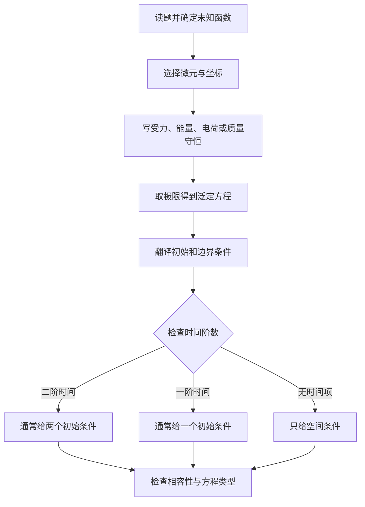

---
subject:
- 数学物理方程
chapter: 2
source:
- 数学物理方程（第二版）第二章
- '[[03_Sources/Courses/数学物理方程/课堂笔记/2026-09-16-第1节-数理方程课程导论与基础知识回顾]]'
- '[[03_Sources/Courses/数学物理方程/课堂笔记/2026-09-18-第2节-偏微分方程课程讲授]]'
type: review
tags:
- 波动方程
- 热传导方程
- Laplace方程
- 叠加原理
- Delta函数
aliases:
- 第二章 定解问题与偏微分方程理论 — 知识点梳理
schema_version: 2
time: "2026-10-14T20:49:51+08:00"
legacy_topics:
- 波动方程
- 热传导方程
- Laplace方程
- Poisson方程
- 定解条件
- 偏微分方程分类
- 叠加原理
- Delta函数
status: not done
---

# 第二章 定解问题与偏微分方程理论 — 知识点梳理

## 一、本章核心脉络

第二章完成三件事：从物理规律建立波动、热传导和稳态方程；把实际约束翻译成初始条件、边界条件或衔接条件；再从数学上研究二阶线性偏微分方程的分类、叠加、齐次化、适定性和点源表示。

> 一句话来说：泛定方程描述“一类过程的共同规律”，定解条件描述“这个具体过程的特殊约束”，二者合起来才是可求解的问题。

---

## 二、波动方程及定解条件【核心】

### 2.1 细弦横振动：微元受力法

设 $u(x,t)$ 为弦的横向位移，$T$ 为张力，$\rho$ 为线密度。对微元 $[x,x+\mathrm dx]$ 使用：

1. 小振动近似 $\sin\alpha\approx\tan\alpha\approx u_x$；
2. 弧长 $\mathrm ds\approx\mathrm dx$；
3. Newton 第二定律“横向合力等于质量乘加速度”。

若单位长度外力为 $F(x,t)$，得到

$$
\rho u_{tt}=Tu_{xx}+F-\rho g.
$$

记 $a^2=T/\rho$、$f=F/\rho-g$，则

$$
\boxed{u_{tt}=a^2u_{xx}+f(x,t)}.
$$

无外力且忽略自重时为齐次波动方程

$$
\boxed{u_{tt}=a^2u_{xx}}.
$$

> 一句话来说：弦的局部弯曲 $u_{xx}$ 产生回复力，回复力导致时间加速度 $u_{tt}$。

### 2.2 弹性细杆纵振动

由 Hooke 定律，截面应力 $p=Yu_x$，截面面积为 $S$ 时轴向内力为 $T=SYu_x$。对杆微元使用 Newton 第二定律：

$$
\rho S\,\mathrm dx\,u_{tt}
=SY[u_x(x+\mathrm dx,t)-u_x(x,t)].
$$

因此

$$
\boxed{u_{tt}=a^2u_{xx}},
\qquad a^2=\frac Y\rho.
$$

> 一句话来说：弦横振动和杆纵振动物理对象不同，却因“线性回复力加惯性”得到同一类波动方程。

### 2.3 高频传输线与电报方程

由 Kirchhoff 定律，对单位长度电阻 $R$、电感 $L$、电容 $C$ 和电导 $g$ 的传输线有

$$
\begin{cases}
-u_x=Ri+Li_t,\\
-i_x=gu+Cu_t.
\end{cases}
$$

消元得到电报方程

$$
u_{xx}-LCu_{tt}-(Lg+RC)u_t-Rgu=0,
$$

电流 $i$ 满足同型方程。理想传输线 $R=g=0$ 时退化为波动方程，波速满足

$$
a^2=\frac1{LC}.
$$

> 一句话来说：电压、电流的传播与机械波共享同一个数学结构。

### 2.4 波动方程的初始条件

波动方程含时间二阶导数，需要两个初始条件：

$$
u(x,0)=\varphi(x),\qquad
u_t(x,0)=\psi(x).
$$

它们分别是初位移和初速度。

> 一句话来说：二阶时间演化需要同时知道“从哪里出发”和“以多快速度出发”。

### 2.5 三类边界条件

| 类型 | 数学形式 | 典型物理含义 |
|:--|:--|:--|
| 第一类 Dirichlet | $u\vert_S=f_1$ | 给定位移或函数值；弦端固定时 $u=0$ |
| 第二类 Neumann | $\partial u/\partial n\vert_S=f_2$ | 给定通量、应力或法向导数；杆端自由时 $u_x=0$ |
| 第三类 Robin | $(\partial u/\partial n+\sigma u)\vert_S=f_3$ | 函数值与法向导数的线性关系；弹性端 |

教材中弹性杆受端力 $F(t)$ 时，

$$
u_x(L,t)=\frac{F(t)}{YS};
$$

弦端连接弹簧时，

$$
u_x(L,t)+\frac KT u(L,t)=0.
$$

> 一句话来说：边界条件就是把“固定、自由、受力、接弹簧”等端点状态翻译成数学语言。

### 2.6 相容条件

若希望得到连续经典解，初值与边值在角点必须一致。例如固定端要求

$$
\varphi(0)=\varphi(L)=0,
$$

若边界值随时间变化，还需 $\varphi(0)=g_0(0)$、$\varphi(L)=g_L(0)$。更高正则性通常还要求更高阶相容条件。

> 一句话来说：同一个角点不能被初始条件和边界条件同时规定成两个不同的值。

---

## 三、热传导与扩散方程【核心】

### 3.1 Fourier 定律与一维热方程

Fourier 定律为

$$
\boldsymbol q=-k\nabla u.
$$

对横截面积 $A$ 的杆微元做热量平衡：

$$
\text{流入热量}-\text{流出热量}+\text{内热源}
=\text{内能增加}.
$$

无内热源时

$$
c\rho Au_t\,\mathrm dx=kAu_{xx}\,\mathrm dx,
$$

所以

$$
\boxed{u_t=a^2u_{xx}},
\qquad a^2=\frac{k}{c\rho}.
$$

有单位体积、单位时间热源 $F$ 时

$$
u_t=a^2u_{xx}+\frac{F}{c\rho}.
$$

> 一句话来说：温度变化率等于温度分布的局部“凹凸”所产生的净热流，再加内部热源。

### 3.2 三维热方程

利用 Gauss 公式把边界热流转成体积分，均匀各向同性介质中得到

$$
\boxed{u_t=a^2\Delta u+f(x,y,z,t)}.
$$

若 $k$ 随空间变化，扩散项应写成

$$
\nabla\cdot(k\nabla u),
$$

不能简单写成 $k\Delta u$。

> 一句话来说：高维热方程仍是局部能量守恒，只是热量能沿所有空间方向流动。

### 3.3 扩散方程

由 Fick 型扩散定律和质量守恒，同样得到

$$
u_t=k u_{xx}
$$

或高维形式 $u_t=k\Delta u$。这里 $u$ 表示浓度而不是温度。

> 一句话来说：热扩散与粒子扩散物理量不同，但都是“从高处向低处流”的平滑过程。

### 3.4 热方程的定解条件

热方程对时间是一阶，只需一个初始条件

$$
u(x,0)=\varphi(x).
$$

边界条件仍分三类：

- 恒温：$u\vert_S=g$；
- 给定热流：$-k\partial u/\partial n=q_{\mathrm{out}}$；
- Newton 换热：

$$
-k\frac{\partial u}{\partial n}
=k_1(u-u_{\mathrm{ext}}).
$$

> 一句话来说：热方程只需初始温度，但必须仔细依据外法向判断热流边界的正负号。

---

## 四、稳态方程及其定解条件【核心】

### 4.1 Poisson 与 Laplace 方程

静电场满足

$$
\nabla\cdot(\varepsilon\boldsymbol E)=\rho,
\qquad
\boldsymbol E=-\nabla u.
$$

均匀介质中

$$
\boxed{\Delta u=-\frac\rho\varepsilon}.
$$

无自由电荷时

$$
\boxed{\Delta u=0}.
$$

前者为 Poisson 方程，后者为 Laplace 方程。

> 一句话来说：Poisson 方程描述“有源的稳态场”，Laplace 方程描述“无源的稳态场”。

### 4.2 Maxwell 方程导出的阻尼波动方程

均匀介质中电场或磁场分量满足

$$
\mu\varepsilon u_{tt}+\mu\sigma u_t=\Delta u.
$$

- $\sigma\approx0$：近似为波动方程；
- 高导电情形忽略惯性项：近似为扩散方程；
- 稳态 $u_t=0$：退化为 Laplace 方程。

> 一句话来说：波动、扩散和稳态不是孤立模型，而可由同一电磁方程在不同尺度和近似下得到。

### 4.3 稳态问题的条件

稳态方程不含时间，通常没有初始条件，而需要：

1. Dirichlet、Neumann 或 Robin 边界条件；
2. 不同介质界面上的衔接条件；
3. 奇点附近或无穷远处的有限性、衰减条件；
4. 极坐标、柱坐标或球坐标中的周期性条件。

> 一句话来说：稳态问题由空间边界、界面、奇点和无穷远行为共同确定。

### 4.4 静电场衔接条件

介质分界面上通常有电势连续：

$$
u_1\vert_S=u_2\vert_S.
$$

法向电位移满足跳跃关系：

$$
\varepsilon_2\frac{\partial u_2}{\partial n}
-\varepsilon_1\frac{\partial u_1}{\partial n}
=-\sigma_S.
$$

若无面自由电荷，则 $\varepsilon\partial u/\partial n$ 连续。

> 一句话来说：界面上电势通常不断裂，但法向导数可因介电常数或面电荷而发生跳跃。

---

## 五、二阶线性偏微分方程的化简与分类【难点】

### 5.1 一般形式与主部

$$
a_{11}u_{xx}+2a_{12}u_{xy}+a_{22}u_{yy}
+b_1u_x+b_2u_y+cu=f.
$$

分类只看二阶主部。对应系数矩阵

$$
A=
\begin{pmatrix}
a_{11}&a_{12}\\
a_{12}&a_{22}
\end{pmatrix}.
$$

> 一句话来说：二阶方程的传播性质主要由最高阶导数项决定，低阶项不改变局部类型。

### 5.2 特征方程与特征线

特征方程为

$$
a_{11}\left(\frac{\mathrm dy}{\mathrm dx}\right)^2
-2a_{12}\frac{\mathrm dy}{\mathrm dx}+a_{22}=0.
$$

其积分曲线称为特征线。作可逆变量变换

$$
\zeta=\zeta(x,y),\qquad \eta=\eta(x,y),
$$

必须保证 Jacobi 行列式非零。

> 一句话来说：特征线给出最适合化简方程主部的坐标方向。

### 5.3 分类判据

定义判别式

$$
D=a_{12}^2-a_{11}a_{22}.
$$

| 判别式 | 类型 | 特征线 | 典型标准主部 | 代表方程 |
|:--:|:--|:--|:--|:--|
| $D>0$ | 双曲型 | 两族实特征线 | $u_{\zeta\eta}$ 或 $u_{ss}-u_{tt}$ | 波动方程 |
| $D=0$ | 抛物型 | 一族重实特征线 | 单个二阶方向导数 | 热方程 |
| $D<0$ | 椭圆型 | 无实特征线 | $u_{\zeta\zeta}+u_{\eta\eta}$ | Laplace 方程 |

等价地：矩阵 $A$ 的特征值同号为椭圆型，异号为双曲型，有零特征值为抛物型。

> 一句话来说：判别式统计实特征方向的数量，从而区分传播、扩散和稳态三类行为。

### 5.4 混合型方程

若判别式随位置改变符号，方程在不同区域可能属于不同类型，例如 Tricomi 方程

$$
u_{yy}-yu_{xx}=0.
$$

> 一句话来说：方程类型可以是局部概念，同一方程在不同位置可能具有不同性质。

### 5.5 波动方程的特征变量

对

$$
u_{tt}-a^2u_{xx}=0,
$$

特征变量

$$
\zeta=x+at,
\qquad
\eta=x-at
$$

将方程化为 $u_{\zeta\eta}=0$，从而

$$
u=f(x+at)+g(x-at).
$$

> 一句话来说：一维波动由两个方向相反、速度为 $a$ 的行波叠加而成。

---

## 六、线性理论：叠加、齐次化与适定性【核心】

### 6.1 叠加原理

若 $L$ 是线性算子且 $Lu_i=f_i$，则

$$
L\left(\sum_i c_i u_i\right)=\sum_i c_i f_i.
$$

在满足逐项微分或微分与积分可交换的条件下，无穷级数和参数积分也可叠加。非线性方程通常不满足叠加原理。

> 一句话来说：线性允许把复杂输入拆成简单输入分别求解，再把响应相加。

### 6.2 非齐次方程的“齐次解加特解”

若 $Lu=f$，先找一个特解 $u_p$，再令 $u=u_p+v$，则 $Lv=0$。例如 Poisson 方程可先用多项式试探找特解，再叠加任意调和函数。

> 一句话来说：非齐次项负责确定一个特解，齐次解负责提供满足边界条件的自由度。

### 6.3 齐次化原理或 Duhamel 原理

把连续作用的源 $f(M,t)$ 看成从每个时刻 $\tau$ 开始施加的一次“瞬时初始扰动”。若 $w(M,t;\tau)$ 是相应齐次问题的响应，则

$$
u(M,t)=\int_0^t w(M,t;\tau)\,\mathrm d\tau.
$$

它适用于波动型、热传导型以及保持相同齐次边界条件的有界问题。

> 一句话来说：Duhamel 原理把持续外力分解为无穷多个瞬时冲量响应再叠加。

### 6.4 定解问题的三种类型

- 初值问题：只有初始条件；
- 边值问题：只有边界条件；
- 混合问题：同时有初始条件和边界条件。

### 6.5 适定性

一个定解问题适定，需要：

1. 解存在；
2. 解唯一；
3. 解连续依赖于给定数据，即稳定。

> 一句话来说：能算出一个表达式不等于问题合理，合理的问题还必须存在、唯一且对误差不敏感。

---

## 七、Dirac Delta 函数【核心工具】

### 7.1 为什么需要 Delta

点质量、点电荷、瞬时冲量或集中热源的总量有限，却集中在零体积区域，普通密度函数难以表示。$\delta$ 应通过对测试函数的作用理解：

$$
\int_{-\infty}^{\infty}
\delta(x-x_0)\varphi(x)\,\mathrm dx
=\varphi(x_0).
$$

> 一句话来说：Delta 不是普通点值函数，而是把函数在指定点“抽取出来”的分布。

### 7.2 集中冲量与集中热量

弦在 $x_0$ 受到冲量 $I$：

$$
u_t(x,0)=\frac I\rho\delta(x-x_0).
$$

导热杆在 $x_0$ 瞬间获得热量 $Q$：

$$
u(x,0)=\frac Q{c\rho}\delta(x-x_0).
$$

> 一句话来说：先用守恒关系确定 Delta 前的系数，保证积分后的总动量或总热量正确。

### 7.3 基本性质

$$
\delta(-x)=\delta(x),
\qquad
f(x)\delta(x-a)=f(a)\delta(x-a),
$$

$$
\delta(ax)=\frac1{|a|}\delta(x),
\qquad
\int\delta^{(n)}(x)f(x)\,\mathrm dx=(-1)^nf^{(n)}(0).
$$

Delta 是卷积单位元：

$$
\delta*f=f.
$$

> 一句话来说：Delta 的运算必须放在积分或分布意义下理解，不能按普通函数逐点计算。

### 7.4 三维 Delta 与 Laplace 基本解

$$
\delta(M-M_0)
=\delta(x-x_0)\delta(y-y_0)\delta(z-z_0).
$$

三维 Laplace 算子的基本解满足

$$
\boxed{
\Delta\left(\frac1{4\pi r}\right)
=-\delta(M-M_0)},
$$

其中 $r=|M-M_0|$。

> 一句话来说：$1/(4\pi r)$ 在源点外是调和函数，但在源点整体贡献了一个单位点源。

---

## 八、统一建模与分类流程

---

## 九、核心公式速查表

| 内容 | 公式 |
|:--|:--|
| 一维波动方程 | $u_{tt}=a^2u_{xx}+f$ |
| 弦波速 | $a^2=T/\rho$ |
| 杆纵波速度 | $a^2=Y/\rho$ |
| 一维热方程 | $u_t=a^2u_{xx}+f$ |
| 热扩散率 | $a^2=k/(c\rho)$ |
| 三维热方程 | $u_t=a^2\Delta u+f$ |
| Poisson 方程 | $\Delta u=-\rho/\varepsilon$ |
| Laplace 方程 | $\Delta u=0$ |
| 分类判据 | $D=a_{12}^2-a_{11}a_{22}$ |
| 特征方程 | $a_{11}(\mathrm dy/\mathrm dx)^2-2a_{12}\mathrm dy/\mathrm dx+a_{22}=0$ |
| Duhamel 形式 | $u(t)=\int_0^t w(t;\tau)\,\mathrm d\tau$ |
| Delta 抽样性 | $\int\delta(x-x_0)f(x)\,\mathrm dx=f(x_0)$ |

---

## 十、易错点与注意事项

> [!warning] 易错点
> 1. 小角度近似是保留一阶项，不是把角度直接设成零。
> 2. 变张力弦应写 $\rho u_{tt}=[T(x)u_x]_x$，不能直接把 $T$ 提到导数外。
> 3. 波动方程需要初位移和初速度；热方程只需要初温。
> 4. Neumann、Robin 条件中的符号必须结合外法向和通量正方向判断。
> 5. 分类时交叉项写成 $2a_{12}u_{xy}$，判别式才是 $a_{12}^2-a_{11}a_{22}$。
> 6. 特征方程与 PDE 主部中的交叉项符号不同，容易抄错。
> 7. 叠加原理仅适用于线性问题，并且无穷叠加要满足逐项微分条件。
> 8. $\delta$ 不是“某点真的等于无穷大”的普通函数，应在分布意义下使用。
> 9. 教材公式可能有 OCR 错误；应优先用量纲、物理方向和推导结果交叉检查。

---

## 十一、相关知识点链接

- [[03_Sources/Reviews/数学物理方程/知识点解析梳理/01-绪论-知识梳理]]：本章使用的常微分方程、场论算子、Gauss 公式和物理规律来源。
- [[03_Sources/Reviews/数学物理方程/知识点解析梳理/03-分离变量法-知识梳理]]：下一章开始实际求解本章建立的混合问题与边值问题。
- [[03_Sources/Courses/数学物理方程/课堂笔记/2026-09-16-第1节-数理方程课程导论与基础知识回顾|第1节：波动方程建模]]
- [[03_Sources/Courses/数学物理方程/课堂笔记/2026-09-18-第2节-偏微分方程课程讲授|第2节：定解问题、热方程和分类]]

## 十二、作业与练习

- [[03_Sources/Courses/数学物理方程/作业/9月21日数学作业|习题 2.1 第1、2、4题与习题2.2第4题]]
- 独立推导细弦波动方程和一维热方程，逐项检查量纲。
- 对一般二阶方程先写主部、判别式和特征方程，再求标准型。
- 用 Delta 函数分别表示点冲量、点热源和点电荷，并用积分验证系数。

