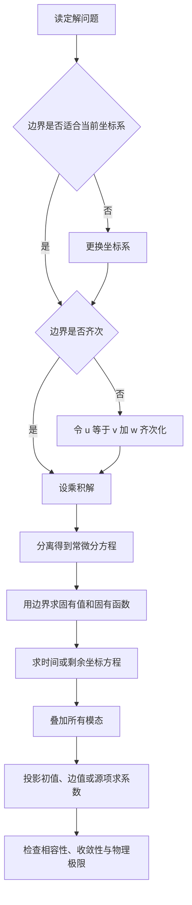

---
subject:
- 数学物理方程
chapter: 3
source:
- 数学物理方程（第二版）第三章
- '[[03_Sources/Courses/数学物理方程/课堂笔记/2026-09-18-第2节-偏微分方程课程讲授]]'
type: review
tags:
- 分离变量法
- Fourier级数
- 固有值
- 固有函数
- 齐次化
- Duhamel原理
aliases:
- 第三章 分离变量法 — 知识点梳理
schema_version: 2
time: "2026-10-14T20:49:51+08:00"
legacy_topics:
- 分离变量法
- Fourier级数
- 固有值
- 固有函数
- Sturm-Liouville理论
- 齐次化
- Duhamel原理
status: not done
---

# 第三章 分离变量法 — 知识点梳理

## 一、本章核心脉络

分离变量法适合边界规则、边界条件线性且经过齐次化的定解问题。它先假设多元解可写成若干一元函数之积，把 PDE 化为常微分方程；齐次边界条件把其中的空间方程变成固有值问题；最后利用固有函数的正交性和完备性，把初值、边值或源项展开成 Fourier 级数并叠加所有模态。

> 一句话来说：分离变量法把“一个多变量 PDE”拆成“一串一变量模态”，再用 Fourier 展开把这些模态组合起来。

---

## 二、使用前提与统一策略【先判断】

### 2.1 适合的情形

- 区域边界在某种坐标系中可写成坐标常量面；
- 方程和边界条件是线性的；
- 边界条件齐次，或能先通过代换齐次化；
- 分离后的空间边值问题具有正交、完备的固有函数系。

> 一句话来说：区域几何和边界条件能否“按坐标拆开”，决定了分离变量是否顺手。

### 2.2 坐标系选择

| 区域 | 推荐坐标系 | 常见空间方程 |
|:--|:--|:--|
| 区间、矩形、长方体 | 直角坐标 | 正弦、余弦模态 |
| 圆、圆环、扇形 | 极坐标 | Euler 径向方程、三角角向方程 |
| 圆柱 | 柱坐标 | Bessel 方程与三角函数 |
| 球 | 球坐标 | Legendre 方程与球 Bessel 方程 |

> 一句话来说：坐标系要优先让边界简单，而不是只让方程形式看起来熟悉。

### 2.3 先检查齐次边界

非齐次边界会使乘积解难以构成固有值问题，应先令

$$
u=v+w,
$$

选取 $w$ 承担非齐次边界，使 $v$ 满足齐次边界。

> 一句话来说：分离变量前先把边界“归零”，否则空间模态通常无法正交展开。

---

## 三、齐次弦振动的分离变量法【核心模板】

考虑两端固定弦：

$$
\begin{cases}
u_{tt}=a^2u_{xx},&0<x<L, t>0,\\
u(0,t)=u(L,t)=0,\\
u(x,0)=\varphi(x),\quad u_t(x,0)=\psi(x).
\end{cases}
$$

### 3.1 第一步：设乘积解

令

$$
u(x,t)=X(x)T(t).
$$

代入 PDE：

$$
\frac{T''}{a^2T}=\frac{X''}{X}=-\lambda.
$$

得到

$$
X''+\lambda X=0,
\qquad
T''+a^2\lambda T=0.
$$

> 一句话来说：等式一边只依赖 $x$、另一边只依赖 $t$，二者对独立变量恒等时只能等于同一常数。

### 3.2 第二步：空间固有值问题

齐次边界给出

$$
X(0)=X(L)=0.
$$

讨论 $\lambda<0$、$\lambda=0$、$\lambda>0$：前两种只有零解；$\lambda>0$ 时非零解要求

$$
\sin(\sqrt\lambda L)=0.
$$

因此

$$
\boxed{\lambda_n=\left(\frac{n\pi}{L}\right)^2},
\qquad
\boxed{X_n(x)=\sin\frac{n\pi x}{L}},
\qquad n=1,2,\ldots
$$

> 一句话来说：边界条件只允许离散空间频率存在，这些允许频率就是固有值。

### 3.3 第三步：时间模态

对每个 $\lambda_n$，

$$
T_n(t)=C_n\cos\frac{n\pi at}{L}
+D_n\sin\frac{n\pi at}{L}.
$$

单个模态为

$$
u_n(x,t)=
\left(C_n\cos\frac{n\pi at}{L}
+D_n\sin\frac{n\pi at}{L}\right)
\sin\frac{n\pi x}{L}.
$$

> 一句话来说：空间边界决定固有频率，时间方程决定每个模态如何振荡。

### 3.4 第四步：叠加所有模态

$$
\boxed{
u(x,t)=\sum_{n=1}^{\infty}
\left(C_n\cos\frac{n\pi at}{L}
+D_n\sin\frac{n\pi at}{L}\right)
\sin\frac{n\pi x}{L}.}
$$

由初始条件和正弦系正交性：

$$
\boxed{C_n=\frac2L\int_0^L
\varphi(s)\sin\frac{n\pi s}{L}\,\mathrm ds,}
$$

$$
\boxed{D_n=\frac2{n\pi a}\int_0^L
\psi(s)\sin\frac{n\pi s}{L}\,\mathrm ds.}
$$

> 一句话来说：初位移决定余弦时间项系数，初速度决定正弦时间项系数。

### 3.5 正交性为何能取系数

$$
\int_0^L
\sin\frac{m\pi x}{L}
\sin\frac{n\pi x}{L}\,\mathrm dx
=
\begin{cases}
0,&m\ne n,\\
L/2,&m=n.
\end{cases}
$$

乘上第 $m$ 个固有函数再积分，会消去所有其他模态。

> 一句话来说：正交性像互相垂直的坐标轴，使每个模态系数可以单独投影出来。

---

## 四、边界条件如何决定固有函数【核心】

空间方程常为 $X''+\lambda X=0$，但不同齐次边界条件产生不同固有函数系。

| 边界条件 | 固有值 | 固有函数 | 编号 |
|:--|:--|:--|:--|
| $X(0)=X(L)=0$ | $(n\pi/L)^2$ | $\sin(n\pi x/L)$ | $n=1,2,\ldots$ |
| $X'(0)=X'(L)=0$ | $(n\pi/L)^2$ | $\cos(n\pi x/L)$ | $n=0,1,\ldots$ |
| $X(0)=0, X'(L)=0$ | $[(2n+1)\pi/(2L)]^2$ | $\sin[(2n+1)\pi x/(2L)]$ | $n=0,1,\ldots$ |
| $X'(0)=0, X(L)=0$ | $[(2n+1)\pi/(2L)]^2$ | $\cos[(2n+1)\pi x/(2L)]$ | $n=0,1,\ldots$ |

第三类边界通常得到超越方程。例如

$$
X'(0)=0,qquad X'(L)+hX(L)=0
$$

给出

$$
\tan(\mu L)=\frac h\mu,
\qquad
X_n(x)=\cos\mu_nx.
$$

> 一句话来说：不要先背正弦还是余弦；把通解代入边界条件，非零系数存在的条件自然给出固有值。

---

## 五、Fourier 解的物理意义【理解】

单个弦振动模态可写成

$$
u_n=N_n\sin(\omega_nt+\delta_n)
\sin\frac{n\pi x}{L},
\qquad
\omega_n=\frac{n\pi a}{L}.
$$

- 节点：$x=kL/n$，振幅为零；
- 波腹：$x=(2k+1)L/(2n)$，振幅最大；
- $\omega_1=\pi a/L$ 是基频；
- $\omega_2,\omega_3,\ldots$ 是谐频；
- 总运动是不同频率、相位和振幅的驻波叠加。

> 一句话来说：分离变量法又称驻波法，因为每个固有函数描述一种固定空间形状的振动模态。

音调主要由频率决定，响度与振幅有关，音色取决于基波和各阶谐波的组合。截断到前 $N$ 项的部分和可作为近似解，但高频项越多才能刻画越尖锐的初始形状。

---

## 六、Fourier 解的存在性与波动方程唯一性【理论】

### 6.1 形式解不自动等于经典解

把级数代入 PDE 需要逐项求导，因此必须保证级数及所需导数级数收敛。教材给出较强的充分条件，例如

$$
\varphi\in C^4,
\qquad
\psi\in C^3,
$$

并满足端点相容条件，使 Fourier 系数有足够快的衰减。

> 一句话来说：写出级数只是“形式求解”，验证收敛和逐项求导后才得到经典解。

### 6.2 能量积分

弦的总能量为

$$
E(t)=\frac12\int_0^L\rho u_t^2\,\mathrm dx
+\frac12\int_0^LTu_x^2\,\mathrm dx.
$$

对齐次波动方程和固定端边界，分部积分得

$$
\frac{\mathrm dE}{\mathrm dt}=0.
$$

> 一句话来说：无外力、固定端的理想弦不会凭空产生或损失总能量。

### 6.3 唯一性

若有两个解，取差 $w=u_1-u_2$，则 $w$ 满足齐次 PDE、齐次边界和零初值。其初始能量为零，由能量守恒始终为零，因此 $w_t=w_x=0$，结合零初值可得 $w\equiv0$。

> 一句话来说：唯一性证明的标准套路是“两个解作差，再证明齐次零数据问题只有零解”。

---

## 七、热传导方程的分离变量法【核心】

### 7.1 与波动方程的共同点和差别

对

$$
u_t=a^2u_{xx},
$$

令 $u=XT$，得到

$$
X''+\lambda X=0,
\qquad
T'+a^2\lambda T=0.
$$

所以

$$
T_n(t)=A_ne^{-a^2\lambda_nt}.
$$

空间固有值由边界决定，与同边界下的波动方程完全相同；时间部分却由周期振荡变为指数衰减。

> 一句话来说：波动模态“来回振荡”，热模态“按固有值大小逐渐衰减”。

### 7.2 左端恒温、右端绝热

$$
u(0,t)=0,qquad u_x(L,t)=0
$$

给出

$$
\mu_n=\frac{(2n+1)\pi}{2L},
\qquad
X_n=\sin\frac{(2n+1)\pi x}{2L}.
$$

因此

$$
u(x,t)=\sum_{n=0}^{\infty}
A_ne^{-a^2\mu_n^2t}\sin(\mu_nx),
$$

$$
A_n=\frac2L\int_0^L\varphi(x)\sin(\mu_nx)\,\mathrm dx.
$$

> 一句话来说：混合边界产生半整数频率，而热方程让高频模态更快消失。

### 7.3 两端绝热与零模态

Neumann–Neumann 边界给出余弦系，并包含 $n=0$ 的常数模态：

$$
u(x,t)=\frac{A_0}{2}
+\sum_{n=1}^{\infty}A_ne^{-a^2(n\pi/L)^2t}
\cos\frac{n\pi x}{L}.
$$

常数模态不衰减，代表总热量守恒后的最终平均温度。

> 一句话来说：两端绝热时热量无处流失，最终温度趋于初温的空间平均值，而不是趋于零。

### 7.4 极值原理、唯一性和稳定性

热方程解在闭时空区域的最大值、最小值由抛物边界上的数据控制。两个解作差后边界与初值为零，由极值原理得差恒为零；边界数据的微小差异也只能引起解的相应小差异。

> 一句话来说：热扩散不会在内部凭空制造超过已有边界和初值范围的新极值。

---

## 八、二维圆域与 Poisson 公式【难点】

### 8.1 极坐标下的 Laplace 方程

$$
\Delta u=u_{rr}+\frac1r u_r+\frac1{r^2}u_{\theta\theta}=0.
$$

圆域问题还必须满足中心有限性和角度周期性：

$$
|u(0,\theta)|<\infty,
\qquad
u(r,\theta+2\pi)=u(r,\theta).
$$

> 一句话来说：坐标奇点处的有限性与角向周期性，和边界条件一样会淘汰不合格的分离解。

### 8.2 分离角向与径向

令 $u=R(r)\Phi(\theta)$，得到

$$
\Phi''+\lambda\Phi=0,
$$

$$
r^2R''+rR'-\lambda R=0.
$$

周期性要求 $\lambda=n^2$。角向模态是 $\cos n\theta$、$\sin n\theta$；径向 Euler 方程给出 $r^n$、$r^{-n}$，而圆心有限性排除 $r^{-n}$ 和 $\ln r$。

> 一句话来说：周期性离散化角频率，中心有限性选择向内不发散的径向解。

### 8.3 圆域 Dirichlet 问题

若 $u(R,\theta)=f(\theta)$，则

$$
u(r,\theta)=\frac{a_0}{2}
+\sum_{n=1}^{\infty}r^n
(a_n\cos n\theta+b_n\sin n\theta),
$$

其中系数由边界函数的 Fourier 系数决定。等价的 Poisson 积分公式是

$$
\boxed{
u(r,\theta)=\frac1{2\pi}
\int_0^{2\pi}
f(t)\frac{R^2-r^2}
{R^2+r^2-2Rr\cos(\theta-t)}\,\mathrm dt,\quad r<R.}
$$

> 一句话来说：圆内每一点的调和函数值，是边界数据按 Poisson 核加权后的平均。

### 8.4 外圆域与圆环

外域不能用中心有限性，而要使用无穷远条件；圆环既不包含 $r=0$，通常需同时保留

$$
r^n,quad r^{-n},quad 1,quad \ln r.
$$

> 一句话来说：保留哪些径向解取决于定义域是否包含圆心、是否延伸到无穷远。

---

## 九、高维问题的逐层分离【核心】

### 9.1 长方体热传导

对零温边界长方体

$$
u_t=k^2\Delta u,
$$

先设 $u=T(t)V(x,y,z)$，再设 $V=X(x)Y(y)Z(z)$。得到

$$
\lambda_{pmn}=\pi^2
\left(\frac{p^2}{a^2}+\frac{m^2}{b^2}+\frac{n^2}{c^2}\right),
$$

$$
V_{pmn}=sin\frac{p\pi x}{a}
\sin\frac{m\pi y}{b}
\sin\frac{n\pi z}{c}.
$$

解为三重级数

$$
u=\sum_{p,m,n\ge1}
A_{pmn}e^{-k^2\lambda_{pmn}t}V_{pmn},
$$

$$
A_{pmn}=\frac8{abc}
\int_0^a\int_0^b\int_0^c
\varphi(x,y,z)V_{pmn}\,\mathrm dz\,\mathrm dy\,\mathrm dx.
$$

> 一句话来说：长方体中的每个模态由三个一维正弦模态相乘，固有值则是三个方向固有值之和。

### 9.2 三维 Laplace 边值问题

矩形盒中若五个面电势为零、一个面给定 $\varphi(x,y)$，对 $x,y$ 用正弦固有函数展开，对剩余方向得到指数或双曲正弦函数。边界函数使用二重 Fourier 级数确定系数。

> 一句话来说：多维分离不是新方法，只是一维固有值问题逐个方向重复使用。

---

## 十、非齐次方程与齐次边界【核心】

考虑

$$
u_{tt}=a^2u_{xx}+f(x,t),
\qquad u(0,t)=u(L,t)=0.
$$

### 10.1 先拆分初值响应与受迫响应

令

$$
u=v+w,
$$

其中 $v$ 解齐次方程并承担原初值；$w$ 解非齐次方程，但初值为零。

> 一句话来说：把“初始扰动”和“持续外力”分开处理，是线性问题最清晰的组织方式。

### 10.2 固有函数法

展开

$$
w(x,t)=\sum_{n=1}^{\infty}T_n(t)
\sin\frac{n\pi x}{L},
$$

$$
f(x,t)=\sum_{n=1}^{\infty}f_n(t)
\sin\frac{n\pi x}{L},
$$

其中

$$
f_n(t)=\frac2L\int_0^Lf(x,t)
\sin\frac{n\pi x}{L}\,\mathrm dx.
$$

比较系数得到一组受迫振子：

$$
T_n''+\omega_n^2T_n=f_n(t),
\qquad
T_n(0)=T_n'(0)=0,
$$

$$
\omega_n=\frac{n\pi a}{L}.
$$

参数变易给出

$$
T_n(t)=\frac1{\omega_n}
\int_0^tf_n(\tau)
\sin[\omega_n(t-\tau)]\,\mathrm d\tau.
$$

> 一句话来说：外力先投影到各固有模态，每个模态再按受迫振子的规律独立响应。

### 10.3 Duhamel 原理

也可以把非齐次项看成不断施加的瞬时初值响应：

$$
u(x,t)=\int_0^tw(x,t;\tau)\,\mathrm d\tau.
$$

波动问题中 $w$ 在 $t=\tau$ 取得零位移和由 $f(x,\tau)$ 给出的初速度；热问题中 $w$ 在 $t=\tau$ 取得由 $f(x,\tau)$ 给出的初温。

> 一句话来说：固有函数法按空间模态分解，Duhamel 原理按时间冲量分解，它们是同一线性叠加思想的两种视角。

### 10.4 与时间无关的源项

若 $f=f(x)$，可先求稳态特解 $w(x)$：

$$
a^2w''+f(x)=0
$$

并让 $w$ 满足边界条件，再令 $u=v+w$，把问题化为齐次方程。

> 一句话来说：恒定源项优先抽出稳态部分，剩余部分只描述围绕稳态的暂态变化。

---

## 十一、非齐次边界条件的齐次化【必须掌握】

### 11.1 两端给定位移

若

$$
u(0,t)=u_1(t),
\qquad
u(L,t)=u_2(t),
$$

可选连接两端数据的一次函数

$$
W(x,t)=u_1(t)+\frac{u_2(t)-u_1(t)}Lx,
$$

再令 $u=V+W$，则 $V(0,t)=V(L,t)=0$。新方程的源项和初值都要重新计算。

> 一句话来说：齐次化函数不要求唯一，只要准确承担原边界数据且尽量简单。

### 11.2 更优的选择

若源项和边界数据与时间无关，可让 $W(x)$ 同时满足稳态方程与非齐次边界，使新问题的 PDE 和边界一次全部齐次。若边界周期振动，也可尝试令 $W=X(x)\sin\omega t$ 同时满足 PDE 和边界，减少后续计算。

> 一句话来说：最简单的一次插值总能齐次化边界，但能同时满足 PDE 的 $W$ 往往更高效。

### 11.3 混合边界如何构造 $W$

- $u(0,t)$ 与 $u_x(L,t)$ 已知：通常取关于 $x$ 的二次式；
- $u_x(0,t)$ 与 $u(L,t)$ 已知：同样用一次或二次式配系数；
- 两端导数都已知：至少需要关于 $x$ 的二次式，并注意纯 Neumann 问题可能有相容条件和加常数不唯一性。

> 一句话来说：边界给函数值还是导数，决定了辅助函数至少需要多高次数才能同时匹配。

---

## 十二、Sturm–Liouville 固有值理论【理论核心】

### 12.1 标准形式

一般二阶方程乘以适当积分因子后可化为

$$
\boxed{
\frac{\mathrm d}{\mathrm dx}
\left[k(x)y'(x)\right]
-q(x)y(x)+\lambda\rho(x)y(x)=0.}
$$

其中 $k(x)$ 是核函数，$\rho(x)$ 是权函数。Bessel、Legendre、Euler 及 $y''+\lambda y=0$ 都可视为其特例。

> 一句话来说：Sturm–Liouville 形式把不同几何中出现的空间方程统一为一个自伴随固有值问题。

### 12.2 固有值与固有函数

满足给定齐次边界条件的非零解只在某些离散 $\lambda$ 下存在，这些 $\lambda_n$ 是固有值，解 $y_n$ 是固有函数。

> 一句话来说：固有值不是任意分离常数，而是经过边界条件筛选后留下的允许值。

### 12.3 主要结论

在正则条件下：

1. 固有值为实数并构成可数序列，$\lambda_n\to\infty$；
2. 在教材给定的正性和边界条件下，固有值非负；
3. 不同固有值对应的固有函数按权 $\rho$ 正交：

$$
\int_a^b\rho(x)y_m(x)y_n(x)\,\mathrm dx=0,
\qquad m\ne n;
$$

4. 合适的函数可展开为广义 Fourier 级数：

$$
f(x)=\sum_{n=1}^{\infty}f_ny_n(x),
$$

$$
\boxed{
f_n=
\frac{\int_a^b\rho(x)f(x)y_n(x)\,\mathrm dx}
{\int_a^b\rho(x)y_n^2(x)\,\mathrm dx}.}
$$

> 一句话来说：正交性保证系数可投影求出，完备性保证这些模态足以表示一般数据。

### 12.4 正交性的证明思路

写出 $y_m,y_n$ 的两个固有方程，分别乘以 $y_n,y_m$ 后相减并积分。自伴随结构把主体化为边界项；齐次边界条件使边界项消失，剩下

$$
(\lambda_m-\lambda_n)
\int_a^b\rho y_my_n\,\mathrm dx=0.
$$

当 $\lambda_m\ne\lambda_n$ 时即得正交。

> 一句话来说：正交性来自自伴随微分算子和使分部积分边界项消失的边界条件。

### 12.5 复固有函数

周期问题可用实函数 $1,\cos n\theta,\sin n\theta$，也可用复指数 $e^{in\theta}$。复函数内积需使用共轭：

$$
\langle y_m,y_n\rangle
=\int_a^b y_m^*(x)y_n(x)\rho(x)\,\mathrm dx.
$$

> 一句话来说：复指数只是正弦余弦的更紧凑表达，正交内积中必须对一个因子取复共轭。

---

## 十三、分离变量法完整决策流程

---

## 十四、核心公式速查表

| 内容 | 公式 |
|:--|:--|
| 固定端弦固有值 | $\lambda_n=(n\pi/L)^2$ |
| 固定端弦固有函数 | $X_n=\sin(n\pi x/L)$ |
| 弦的固有频率 | $\omega_n=n\pi a/L$ |
| 弦振动 Fourier 解 | $u=\sum(C_n\cos\omega_nt+D_n\sin\omega_nt)X_n$ |
| 热方程时间因子 | $T_n=e^{-a^2\lambda_nt}$ |
| 正弦系数 | $C_n=(2/L)\int_0^Lf(x)\sin(n\pi x/L)\,\mathrm dx$ |
| 圆域 Poisson 公式 | $u=(1/2\pi)\int_0^{2\pi}f(t)(R^2-r^2)/(R^2+r^2-2Rr\cos(\theta-t))\,\mathrm dt$ |
| 受迫模态响应 | $T_n=(1/\omega_n)\int_0^tf_n(\tau)\sin[\omega_n(t-\tau)]\,\mathrm d\tau$ |
| 广义 Fourier 系数 | $f_n=\langle f,y_n\rangle_\rho/\langle y_n,y_n\rangle_\rho$ |
| 波动能量 | $E=(1/2)\int(\rho u_t^2+Tu_x^2)\,\mathrm dx$ |

---

## 十五、易错点与注意事项

> [!warning] 易错点
> 1. 分离常数写成 $-\lambda$ 是为了让常见齐次边界产生正固有值；换符号后两个 ODE 的符号必须同步。
> 2. 固有值问题一定要同时包含空间 ODE 和齐次边界条件；只有 ODE 不能确定离散固有值。
> 3. $X(0)=0, X'(L)=0$ 的固有函数应为正弦半整数模态；不要把正弦、余弦写反。
> 4. Neumann–Neumann 问题包含 $\lambda_0=0$ 的常数模态，不能从 $n=1$ 开始漏掉平均值。
> 5. 热方程时间因子是指数衰减，不是正余弦振荡。
> 6. 圆域内要排除 $r^{-n}$ 与 $\ln r$，但圆环域中它们通常必须保留。
> 7. 非齐次边界必须先齐次化；代换后源项、初值和初速度都要重新计算。
> 8. 形式级数必须检查收敛和逐项求导条件，不能只因每一项满足 PDE 就断言级数一定是经典解。
> 9. 广义 Fourier 系数必须带权函数 $\rho(x)$，不能机械套普通三角级数公式。
> 10. 纯 Neumann 椭圆问题通常需要相容条件，且解只确定到加法常数。

---

## 十六、相关知识点链接

- [[03_Sources/Reviews/数学物理方程/知识点解析梳理/01-绪论-知识梳理]]：常微分方程、Euler 方程、Bessel/Legendre 方程和积分公式基础。
- [[03_Sources/Reviews/数学物理方程/知识点解析梳理/02-定解问题与偏微分方程理论-知识梳理]]：本章所求解的三类方程、边界条件、叠加与 Duhamel 原理来源。
- [[03_Sources/Courses/数学物理方程/课堂笔记/2026-09-18-第2节-偏微分方程课程讲授|第2节课堂笔记]]：三类方程和定解条件的课堂背景。

## 十七、作业与练习

建议按以下顺序练习：

1. 两端固定弦：分别给定初位移和初速度，求 Fourier 解；
2. 两端绝热杆：保留零模态，并解释长期极限；
3. 混合边界 $X(0)=0, X'(L)=0$：独立求固有值与固有函数；
4. 圆域 Laplace 方程：由边界单个谐波直接判断内部解；
5. 非齐次波动方程：用固有函数法得到受迫模态积分；
6. 非齐次边界：自行构造 $W(x,t)$ 并检查代换后的全部数据；
7. Sturm–Liouville 问题：证明不同固有值对应固有函数的带权正交性。

- [[03_Sources/Courses/数学物理方程/作业/10月14日数学作业|10月14日作业解答]]：习题 3.2 第 1、4 题与习题 3.5 第 1、3、6 题，覆盖热方程、零模态、常源响应、受迫振动与共振。
- [[03_Sources/Courses/数学物理方程/作业/10月23日课堂测试|10月23日课堂测试解答]]：非齐次混合边界的热方程，先作边界齐次化，再用半整数正弦模态求解。
- [[03_Sources/Courses/数学物理方程/作业/10月23日作业|10月23日作业解答]]：习题 3.6 第 1、2、3 题与习题 4.1 第 1、2、6 题，涵盖边界齐次化、矩形域 Poisson 方程与达朗贝尔公式。

