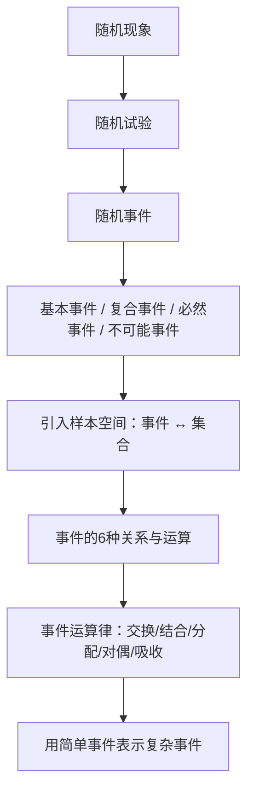
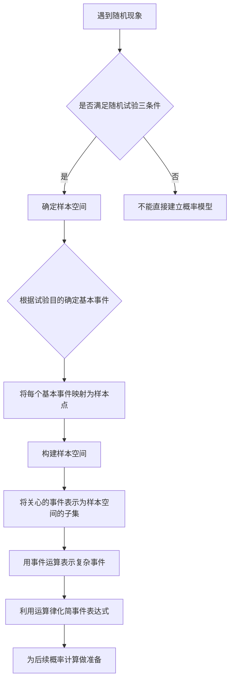

---
subject:
- 概率论
source:
- C1.1 随机事件的直观意义及其运算.md
type: review
tags:
- 集合论
aliases:
- 第1章 随机事件的直观意义及其运算 — 知识点梳理
schema_version: 2
time: "2026-08-31T11:44:20+08:00"
legacy_status: 已完成
legacy_topics:
- 随机现象
- 随机试验
- 样本空间
- 随机事件
- 事件运算
- 集合论
status: not done
---

## 一、本章核心脉络

**核心问题**：如何用数学语言精确地描述"随机事件"，为后续计算概率打下语言基础？

> [!info] 学习导读
> **必要先修**：只需熟悉集合的并、交、补与包含关系。
> **来源边界**：正文依据[[03_Sources/Courses/概率论/PPT课件/MD/C1.1 随机事件的直观意义及其运算|C1.1 课件源文]]重组；“补充解释”和“自测（新编）”不是教师原话。
> **阅读路线**：随机现象 → 随机试验 → 样本空间 → 事件的集合表示 → 事件运算。若事件运算不熟，先用具体样本点逐一核对。

> 这个顺序反映了从"现实世界"到"数学世界"的抽象过程：先认清现实中的随机现象有什么特征，再从中提炼出随机试验这一数学模型，然后把随机事件转化为集合，最后借助集合论的工具（关系和运算）来精确操作事件。

---

## 二、随机现象与统计规律

### 2.1 确定性现象 vs 非确定性现象

| 类型 | 特点 | 例子 |
|:--|:--|:--|
| 确定性（必然）现象 | 可事前预言 | $1+1=2$，$\frac{\partial e^x}{\partial x}=e^x$，物质燃烧 |
| 非确定性现象 | 不可事前预言 | 抛硬币结果、明天是否下雨、炮弹落点 |

### 2.2 随机现象与统计规律（核心）

在非确定性现象中有一类很重要的现象：**随机现象**。

> **一句话来说**：随机现象就是"单次看猜不准，大量重复看有规律"的现象。

**定义**：一次观察时不可事先预言其结果，而进行大量次重复观察时，结果却呈现某种规律的非确定性现象。

称大量同类随机现象所呈现的固有规律为**随机现象的统计规律**。

> **一句话来说**：统计规律是随机现象"看不见的手"——它不以人的主观意志转移，但确实在大量重复中稳定地展现出来。

**概率论与数理统计**就是研究随机现象的统计规律性的一门数学学科。

---

## 三、随机试验（核心）

**定义**：随机试验是对随机现象所进行的观察和实验，需满足三个特征：

| 特征 | 含义 |
|:--|:--|
| （1）可重复性 | 可在相同条件下重复进行 |
| （2）结果明确性 | 事前可明确试验的全部可能结果 |
| （3）不可预言性 | 试验前不能预言将出现哪一个结果 |

> **一句话来说**：随机试验就是在可控条件下观察随机现象——你知道可能发生什么（知道全部可能结果），但不知道这次会发生什么。

**典型试验举例**：

| 试验 | 描述 |
|:--|:--|
| $E_1$ 抛硬币 | 抛一枚硬币，观察出现正面还是反面 |
| $E_2$ 摸球 | 从10个标号1~10的小球中任取一个，记录号码 |
| $E_3$ 元件寿命 | 检测仪器上某种型号电子元件的使用寿命 |
| $E_4$ 掷骰子 | 掷两粒均匀骰子，观察点数 |
| $E_5$ 产品检验 | 检验N件产品中的次品数 |
| $E_6$ 车辆计数 | 观察某路口一天内到达的车辆数 |
| $E_7$ 测量身高 | 测量某团体人员的身高 |

---

## 四、随机事件与基本事件

### 4.1 随机事件（核心）

**定义**：在一定条件下基于一定的试验目的进行试验，称试验中每一个可能发生也可能不发生的事情为**随机事件**，简称事件。

通常用大写字母 $A, B, C$ 以及 $A_1, A_2, \cdots, A_n$ 等表示事件。

> **一句话来说**：随机事件是随机试验中我们关心的某种"情况"——它可能发生也可能不发生。

### 4.2 基本事件 vs 复合事件

| 类型 | 定义 | 性质 |
|:--|:--|:--|
| 基本事件 | 在一次试验中必发生一个且仅发生一个的最简单事件 | "不能再分解" |
| 复合事件 | 由若干基本事件组合而成的事件 | 可分解为基本事件的集合 |

**基本事件的相对性**：试验目的不同，则试验的基本事件可能不相同。

> **一句话来说**：基本事件不是绝对的——它取决于你问什么问题。测量身高时，如果你关心的是"具体身高值"，那么 $\{\xi = x\}$ 是基本事件；如果你只关心"购票类型"，那么基本事件就变成 $\{购全票\}, \{购半票\}, \{免票\}$ 三个。

### 4.3 必然事件与不可能事件

| 类型 | 定义 | 记号 |
|:--|:--|:--|
| 必然事件 | 做一次随机试验必定发生的事件 | $\Omega$ |
| 不可能事件 | 做一次随机试验必定不发生的事件 | $\Phi$ |

例如摸球试验（标号1~10）：$\Omega = \{\text{号码不超过10}\}$，$\Phi = \{\text{号码小于0}\}$。

---

## 五、样本空间 —— 事件到集合的桥梁（本章核心）

### 5.1 样本空间的概念

**核心思想**：将联系于试验的每一个基本事件，用包含一个元素 $\omega$ 的单点集来表示。

- 基本事件 $\leftrightarrow$ 单点集 $\{\omega_i\}$
- 基本事件对应元素的全体组成的集合 $\Omega = \{\omega_1, \omega_2, \ldots\}$ 称为**样本空间**
- 样本空间的元素称为**样本点**

> **一句话来说**：样本空间就是把所有"最底层"的可能结果装进一个集合，这样随机事件的描述就从"用文字说"变成了"用集合写"。

### 5.2 事件与集合的对应关系

引入样本空间后，事件可以转化为集合的子集：

| 事件类型 | 集合等价 |
|:--|:--|
| 基本事件 | 单点集 $\{\omega_i\}$ |
| 复合事件 | 样本空间的子集 |
| 必然事件 | 样本空间 $\Omega$ |
| 不可能事件 | 空集 $\Phi$ |

**事件发生的判定**：在一次试验中，若试验结果 $\omega$ 是集合 $A$ 中元素（即 $\omega \in A$），则称事件 $A$ 发生；否则称 $A$ 没有发生。

> **一句话来说**：样本空间把"事件发生与否"的陈述，转化为"样本点是否属于某个子集"的集合论判断。

**注**：样本空间与试验目的有关。以 $E_7$ 测量身高为例：
- 若关心精确身高值：$\Omega = \{x, x > 0\}$（无穷多个样本点）
- 若只关心购票类型：$\Omega = \{购全票, 购半票, 免票\}$（仅有3个样本点）

### 5.3 各试验的样本空间示例

| 试验 | 样本空间 |
|:--|:--|
| $E_1$ 抛硬币 | $\Omega = \{H, T\}$ |
| $E_2$ 摸球 | $\Omega = \{1,2,3,4,5,6,7,8,9,10\}$ |
| $E_4$ 掷两粒骰子 | $\Omega = \{(i,j), i,j=1,\ldots,6\}$ |
| $E_6$ 路口车辆 | $\Omega = \{0,1,2,\ldots\}$ |
| $E_7$ 测量身高 | $\Omega = \{x, x > 0\}$ |

---

## 六、随机事件的关系及运算

事件转化为集合后，事件的关系和运算就自然转化为集合的关系和运算。

### 6.1 包含关系 $A \subset B$

- 集合含义：$\omega \in A$ 则 $\omega \in B$
- 事件含义：事件 $A$ 发生，必然导致事件 $B$ 发生
- 对任意事件 $A$，有 $\Phi \subset A \subset \Omega$
- 若两个事件互相包含，称为两事件相等

> **一句话来说**：$A \subset B$ 就是"A发生保证B一定也发生"——A是B的"加强版"。

**例**（$E_2$摸球）：$A = \{\text{球的号码为4的倍数}\} = \{4,8\}$，$B = \{\text{球的号码为偶数}\} = \{2,4,6,8,10\}$，则 $A \subset B$。

### 6.2 和事件 $A \cup B$

- 集合含义：$A \cup B = \{\omega \mid \omega \in A \text{ 或 } \omega \in B\}$
- 事件含义：$A \cup B$ 是事件 $\{A \text{ 与 } B \text{ 至少有一个发生}\}$
- $\cup_{i=1}^{n} A_i$：事件组 $A_1, A_2, \cdots, A_n$ 中至少有一个发生
- $\cup_{i=1}^{\infty} A_i$：事件列 $A_1, A_2, \cdots$ 中至少有一个发生

> **一句话来说**：和事件就是"或"——A或B至少有一个发生就算。

**例**（$E_2$摸球）：$A = \{\text{不大于3的奇数}\} = \{1,3\}$，$B = \{\text{不大于4的偶数}\} = \{2,4\}$，则 $A \cup B = \{1,2,3,4\}$。

**例**（射击试验）：$C_i = \{\text{进行了i次射击}\}$，$B_k = \{\text{前k次以内击中}\} = \cup_{i=1}^{k} C_i$，$A = \{\text{击中目标}\} = \cup_{i=1}^{\infty} C_i$。

### 6.3 积事件 $A \cap B$（或 $AB$）

- 集合含义：$A \cap B = \{\omega \mid \omega \in A \text{ 且 } \omega \in B\}$
- 事件含义：$A \cap B$ 是事件 $\{A \text{ 与 } B \text{ 同时发生}\}$
- $\cap_{i=1}^{n} A_i$：事件组 $A_1, A_2, \cdots, A_n$ 同时发生

> **一句话来说**：积事件就是"且"——A和B必须同时发生才算。

**例**（$E_2$摸球）：$A = \{\text{奇数}\} = \{1,3,5,7,9\}$，$B = \{\text{号码大于5}\} = \{6,7,8,9,10\}$，则 $A \cap B = \{7,9\}$。

**例**（射击首次命中）：$C_i = B_1 B_2 \cdots B_{i-1} A_i$，其中 $A_k = \{\text{第k次命中}\}$，$B_k = \{\text{第k次未命中}\}$。即前 $i-1$ 次未命中且第 $i$ 次命中。

### 6.4 互不相容 $AB = \Phi$

- 若 $AB = \Phi$，称A、B为互不相容或互斥事件
- 事件含义：在一次试验中A、B不可能同时发生
- $\Phi$ 与任何事件互不相容
- 同一试验的基本事件互不相容

> **一句话来说**：互不相容就是"水火不容"——A和B不可能同时发生。

**例**（$E_2$摸球）：$A = \{\text{奇数}\} = \{1,3,5,7,9\}$，$B = \{\text{不大于4的偶数}\} = \{2,4\}$，则 $A$ 与 $B$ 互不相容。

**注**：若事件组中任意两个互不相容，称此事件组互不相容。事件列互不相容是指其中任意有限个事件互不相容。

### 6.5 逆事件（对立事件）$\overline{A}$

- 若 $AB = \Phi$ 且 $A \cup B = \Omega$，称A与B互为逆事件，记为 $B = \overline{A}$
- 集合含义：$\overline{A} = \{\omega \mid \omega \notin A\}$
- 事件含义：$\overline{A}$ 是事件 $\{A \text{ 不发生}\}$
- 在一次试验中A与 $\overline{A}$ 必发生且仅发生一个，非此即彼

> **一句话来说**：逆事件就是"不是A"——要么A发生，要么A的对立面发生，二者必居其一且仅居其一。

**例**（$E_2$摸球）：$A = \{\text{奇数}\}$，则 $\overline{A} = \{\text{偶数}\}$。

**对比互不相容与对立**：

| | 互不相容 | 对立事件 |
|:--|:--|:--|
| 条件 | $AB = \Phi$ | $AB = \Phi$ 且 $A \cup B = \Omega$ |
| 关系 | 弱（可能还有"第三者"） | 强（非此即彼，无第三者） |
| 性质 | 对立一定互不相容 | 互不相容不一定对立 |

### 6.6 差事件 $A - B$

- 集合含义：$A - B = \{\omega \mid \omega \in A \text{ 但 } \omega \notin B\}$
- 事件含义：$A - B$ 是事件 $\{A \text{ 发生并且 } B \text{ 不发生}\}$
- 有用公式：$A - B = A\overline{B}$，$\overline{A} = \Omega - A$

> **一句话来说**：差事件就是"A发生但B没发生"——从A中"挖掉"了B的部分。

**例**（$E_7$身高）：$\{\xi \leq 1.7\} - \{\xi \leq 1.5\} = \{1.5 < \xi \leq 1.7\}$，即"人的身高介于1.5米与1.7米之间"。

### 6.7 事件运算律

| 运算律 | 公式 |
|:--|:--|
| 交换律 | $A \cup B = B \cup A$，$A \cap B = B \cap A$ |
| 结合律 | $(A \cup B) \cup C = A \cup (B \cup C)$；$(A \cap B) \cap C = A \cap (B \cap C)$ |
| 分配律 | $(A \cup B) \cap C = (A \cap C) \cup (B \cap C)$；$(A \cap B) \cup C = (A \cup C) \cap (B \cup C)$ |
| 德·摩根律（对偶律） | $\overline{A \cup B} = \overline{A} \cap \overline{B}$，$\overline{A \cap B} = \overline{A} \cup \overline{B}$ |
| 吸收律 | 如果 $A \subset B$，则 $A \cup B = B$，$AB = A$ |

> **直观理解**：德·摩根律是说——"A或B至少一个不发生"等于"A不发生且B不发生"；"A和B不同时发生"等于"A不发生或B不发生"。本质上是在说：把"或"和"且"互换，再把每个事件取反。

### 6.8 运算律应用示例

**例** 证明 $(A - AB) \cup B = A \cup B$：

> [!solution]- 点击展开详细解析
> $$
> \begin{aligned}
> (A - AB) \cup B &= A(\overline{AB}) \cup B & &\text{(差事件性质)}\\
> &= A(\overline{A} \cup \overline{B}) \cup B & &\text{(对偶律)}\\
> &= A\overline{A} \cup A\overline{B} \cup B & &\text{(分配律)}\\
> &= A\overline{B} \cup B & &(A\overline{A} = \Phi)\\
> &= A\overline{B} \cup AB \cup B & &\text{(吸收律)}\\
> &= A(B \cup \overline{B}) \cup B & &\text{(分配律)}\\
> &= A\Omega \cup B = A \cup B
> \end{aligned}
> $$

---

## 七、事件与集合对应总表

| 记号 | 集合论 | 概率论 |
|:--|:--|:--|
| $\Omega$ | 空间，全集 | 样本空间，必然事件 |
| $\Phi$ | 空集 | 不可能事件 |
| $A$ | $\Omega$ 的子集 | 事件 |
| $\overline{A}$ | $A$ 的余集 | $A$ 的对立事件 |
| $\omega \in A$ | $\omega$ 属于集合 $A$ | 事件 $A$ 发生 |
| $\omega \notin A$ | $\omega$ 不属于集合 $A$ | 事件 $A$ 不发生 |
| $A \subset B$ | $A$ 是 $B$ 的子集 | $A$ 发生 $B$ 必发生 |
| $A \cup B$ | $A$ 与 $B$ 的和 | $A$ 与 $B$ 至少一个发生 |
| $A \cap B$ ($AB$) | $A$ 与 $B$ 的交 | $A$ 与 $B$ 同时发生 |
| $A \cap B = \Phi$ | $A$ 与 $B$ 无公共元素 | $A$ 与 $B$ 不可能同时发生 |
| $A \cap B = \Phi$ 且 $A \cup B = \Omega$ | $A$ 与 $B$ 互为余集 | $A$ 与 $B$ 非此即彼 |
| $A - B$ | $A$ 与 $B$ 的差集 | $A$ 发生且 $B$ 不发生 |
| $A = B$ | $A$ 与 $B$ 相等 | 事件 $A$ 与 $B$ 相等 |

---

## 判定/决策流程

---

## 核心公式速查表

| 名称 | 公式 | 含义 |
|:--|:--|:--|
| 包含 | $A \subset B$ | A发生则B必发生 |
| 和事件 | $A \cup B$ | A与B至少一个发生 |
| 积事件 | $A \cap B$ | A与B同时发生 |
| 互不相容 | $AB = \Phi$ | A与B不可能同时发生 |
| 对立事件 | $AB = \Phi$ 且 $A \cup B = \Omega$ | 非此即彼 |
| 差事件 | $A - B = A\overline{B}$ | A发生且B不发生 |
| 补事件 | $\overline{A} = \Omega - A$ | A不发生 |
| 德·摩根律 | $\overline{A \cup B} = \overline{A} \cap \overline{B}$ | 和的逆 = 逆的积 |
| 德·摩根律 | $\overline{A \cap B} = \overline{A} \cup \overline{B}$ | 积的逆 = 逆的和 |
| 吸收律 | 若 $A \subset B$，则 $A \cup B = B$，$AB = A$ | 子事件被吸收 |

---

## 易错点与注意事项

> [!warning] 易错点

1. **基本事件的相对性**：基本事件取决于试验目的，不是绝对的。同一个随机现象，试验目的不同，基本事件的划分就不同。这是常被忽略的概念。

2. **互不相容 vs 对立事件**：对立事件是互不相容的**充分不必要条件**。$AB = \Phi$ 只说明不相容，$AB = \Phi$ 且 $A \cup B = \Omega$ 才是对立。例如掷骰子，$\{1\}$ 与 $\{2\}$ 互不相容但不是对立事件。

3. **样本空间与试验目的有关**：同一个现实场景（如测身高），样本空间可以是 $\Omega = \{x, x > 0\}$（连续），也可以是 $\Omega = \{\text{全票}, \text{半票}, \text{免票}\}$（离散）。

4. **事件运算必须注意事件含义**：虽然事件运算是集合运算，但不能只做形式推导而不理解事件意义。例如 $A - B$ 是"A发生且B不发生"，而不是"集合A减去集合B"的简单减法。

5. **$\omega \in A$ 是连接事件和集合的桥梁**：一次试验完成后，看试验结果（样本点）落在哪个子集中，就能判断哪些事件发生了。

6. **基本事件"互不相容"是默认性质**：同一试验的基本事件天然互不相容，因为一次试验的结果只有一个。

---

## 自测（新编）

设 $A$ 表示“至少有一门考试及格”，$B_i$ 表示“第 $i$ 门考试及格”。用 $B_1,B_2,B_3$ 表示 $A$ 与其对立事件。

> [!hint]- 提示
> “至少一个”对应并集；它的对立事件是“三门都不及格”。

> [!solution]- 解析
> $A=B_1\cup B_2\cup B_3$。由德摩根律，$\overline A=\overline{B_1}\cap\overline{B_2}\cap\overline{B_3}$。

## 相关知识点链接

- **前置**：需要基本的集合论知识（子集、并集、交集、补集、空集），本章是将集合论语言应用于概率论的起点。
- **后续**：[[01b-概率的直观意义及其运算]] — 有了事件的表示方法后，下一步就是对事件发生的可能性进行度量（概率）。
- **后续**：[[01c-概率模型与公理化结构]] — 事件（集合）的运算是概率公理化结构中"可测空间"和"概率测度"的基础。

---

## 作业与练习

参见习题库中第1章对应节次的习题，重点练习：
1. 用简单事件来表示复杂事件（这是概率计算的第一步）
2. 利用运算律（特别是德·摩根律）化简事件表达式
3. 准确区分互不相容与对立事件
