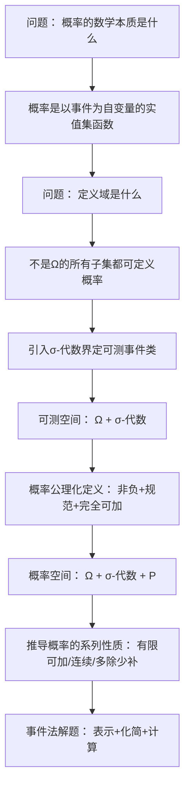
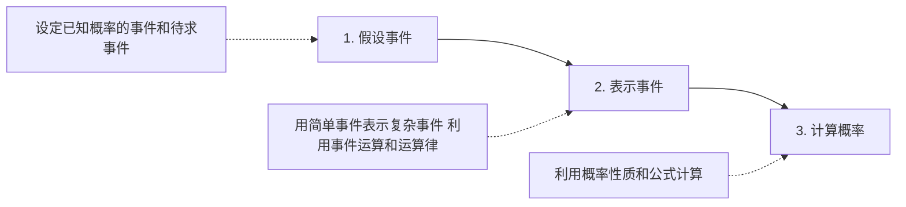
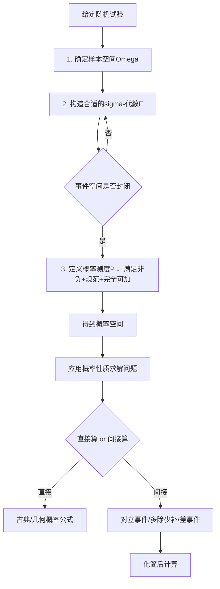

---
subject:
- 概率论
source:
- C1.3 概率模型与公理化结构.md
type: review
tags:
- 可测空间
- σ代数
- 概率空间
aliases:
- 第1章 概率模型与公理化结构 — 知识点梳理
schema_version: 2
time: "2026-08-31T11:44:20+08:00"
legacy_status: 已完成
legacy_topics:
- 可测空间
- σ-代数
- 概率公理化
- 概率空间
- 概率性质
- 多除少补原理
status: not done
---

## 一、本章核心脉络

**核心问题**：如何给"概率"一个严格的数学定义，使其既统一古典概率、几何概率和统计概率，又具备普遍适用性？

> [!info] 学习导读
> **必要先修**：先掌握[[03_Sources/Reviews/概率论/知识点解析梳理/01a-随机事件的直观意义及其运算-知识梳理|事件运算]]与[[03_Sources/Reviews/概率论/知识点解析梳理/01b-概率的直观意义及其运算-知识梳理|概率的直观模型]]。
> **来源边界**：正文依据[[03_Sources/Courses/概率论/PPT课件/MD/C1.3 概率模型与公理化结构|C1.3 课件源文]]重组；抽象概念的直观说明属于补充解释。
> **阅读路线**：概率是集函数 → 为什么需要 $\sigma$-代数 → 三条公理 → 由公理推出性质 → 用事件法解题。

> 这个顺序是"数学化"的逐步精确过程：先搞清楚概率的本质是函数，再确定其定义域（不是全集子集，而是σ-代数），最后用三条公理定义这个函数的行为，从而推导所有概率性质。

---

## 二、可测空间 —— 概率的定义域（难点）

### 2.1 概率的数学本质

**问题1**：概率的数学本质是什么？

> **一句话来说**：概率 $P(\cdot)$ 是一个**实值集函数**——它以样本空间的子集（事件）为自变量，输出 $[0,1]$ 中的实数。

$$P: \text{事件 } A \subset \Omega \;\mapsto\; P(A) \in [0,1]$$

**问题2**：概率函数的定义域是 $\Omega$ 的所有子集构成的集族吗？

**问题3**：对于随机试验 $E$ 的样本空间 $\Omega$，是否 $\Omega$ 的每一个子集（事件）都能确定概率？

| 情境 | 答案 |
|:--|:--|
| 古典概率（样本点有限） | 可以！所有子集都能确定概率 |
| 几何概率（样本点无限） | **不一定！** 存在不可测子集，无法计算其几何度量 |

> **直观理解**：在无限样本空间中，有些集合"太古怪"以至于无法合理定义其"大小"（测度），就像你无法说清一片有无限多孔的瑞士奶酪的面积。因此需要限定概率函数的定义域在"可测"的事件类（σ-代数）上。

### 2.2 代数与σ-代数

**定义1.3.1**：设随机试验 $E$ 的样本空间为 $\Omega$，$\mathscr{F}$ 是 $\Omega$ 的子集组成的集族，满足：

1. $\Omega \in \mathscr{F}$
2. 若 $A \in \mathscr{F}$，则 $\overline{A} \in \mathscr{F}$（对逆运算封闭）
3. 若 $A_i \in \mathscr{F}\;(i=1,2,\cdots,n)$，则 $\cup_{i=1}^{n} A_i \in \mathscr{F}$（对有限并封闭）

称 $\mathscr{F}$ 为**代数**（algebra）。

若将条件（3）加强为：

- （3'）若 $A_i \in \mathscr{F}\;(i=1,2,\cdots)$，则 $\cup_{i=1}^{\infty} A_i \in \mathscr{F}$（对可列并封闭）

称 $\mathscr{F}$ 为**σ-代数**（$\sigma$-algebra）。

> **一句话来说**：σ-代数就是一个"对补集和可列并封闭"的事件集合族，它保证了在这个族里面做任何有限或可数次的事件运算都不会"跑出"这个范围。

**注**：若 $\Omega$ 是有限样本空间，则 $\Omega$ 的代数一定是σ-代数。

### 2.3 σ-代数的构造示例

**例1.3.1**（有限空间的两类σ-代数）：

> [!solution]- 点击展开详细解析
> （1）在 $n$ 个元件中任取一件，考虑编号——由全部可能事件（所有非空子集）加上 $\Phi$ 和 $\Omega$ 构成的集族组成一个σ-代数。
> 
> （2）若只关心元件是正品还是次品：
> - $A_1 = \{\text{取到正品}\}$，$A_2 = \{\text{取到次品}\}$
> - $\mathscr{F} = \{\Phi, A_1, A_2, \Omega\}$ 为一个σ-代数
> 
> > **一句话来说**：$\mathscr{F} = \{\Phi, A, \overline{A}, \Omega\}$ 是由事件 $A$ 产生的**最简单σ-代数**——它只包含"什么都不发生"、"A发生"、"A不发生"和"一切可能"四种情况。

**例1.3.2**（连续空间）：测量误差的样本空间 $\Omega = R_1$。

> [!solution]- 点击展开详细解析
> - $\mathscr{F}_1$：$R_1$ 的**所有子集**构成一个σ-代数，但太大——无法在 $\mathscr{F}_1$ 的每个元素上定义区间长度的自然推广（勒贝格测度）
> - $\mathscr{F}_2$：由 $R_1$ 中所有开集经过至多可列次并、交、逆运算所得集合组成的集族——**Borel σ-代数** $\mathscr{B}_1$
> 
> > **直观理解**：σ-代数不是越大越好——太大可能无法定义合理的测度；太小则可能装不下你感兴趣的事件。因此要"恰好合适"地选取。

**一维Borel σ-代数 $\mathscr{B}_1$**（核心）：由一切形为 $[a,b)$ 的有界左闭右开区间产生的σ-域。

$\mathscr{B}_1$ 包含：一切开区间、闭区间、半开半闭区间、单个实数、可列个实数，以及由它们经可列次并、交、逆运算而得的集合。这是一个**相当大的集类**，足以把实际问题中感兴趣的点集都包括在内。

**n维Borel σ-代数 $\mathscr{B}_n$**：由一切n维矩形产生的σ-域。

### 2.4 可测空间的定义

**定义1.3.2**：样本空间 $\Omega$ 和σ-代数 $\mathscr{F}$ 的二元体 $(\Omega, \mathscr{F})$ 称为**可测空间**。

可测空间的性质：

| 性质 | 说明 |
|:--|:--|
| $\Phi \in \mathscr{F}$ | 因为 $\Phi = \overline{\Omega}$ |
| 对可列交封闭 | $\cap_{i=1}^{\infty} A_i \in \mathscr{F}$ |
| 对有限并、有限交封闭 | $\cup_{i=1}^{n} A_i \in \mathscr{F}$，$\cap_{i=1}^{n} A_i \in \mathscr{F}$ |
| 对差运算封闭 | $A - B = A \cap \overline{B} \in \mathscr{F}$ |

> **一句话来说**：$(\Omega, \mathscr{F})$ 是一个"尚未定义概率"的空间——它已经准备好了"哪些事件是合法的（可测的）"，只等你来定义概率测度。

---

## 三、概率空间 —— 概率的公理化定义（本章核心）

### 3.1 柯尔莫哥洛夫公理体系

从古典概率、几何概率、统计概率等共有基本属性出发：
- **非负性**（nonnegativity）
- **规范性/归一性**（unit measure）
- **可加性**（additivity，有限和完全）

抽象出概率的公理化定义。

**定义1.3.3**（概率的公理化定义）：设 $(\Omega, \mathscr{F})$ 是一可测空间，对 $A \in \mathscr{F}$，定义在 $\mathscr{F}$ 上的实值集函数 $P(A)$，满足：

$$ \boxed{
\begin{aligned}
\text{1) 非负性：} &\quad \forall A \in \mathscr{F},\; 0 \leq P(A) \leq 1 \\
\text{2) 规范性：} &\quad P(\Omega) = 1 \\
\text{3) 完全可加性：} &\quad \forall A_i \in \mathscr{F}, i=1,2,\cdots; \; A_i \cap A_j = \Phi, i \neq j; \\
&\quad P\left(\cup_{i=1}^{\infty} A_i\right) = \sum_{i=1}^{\infty} P(A_i)
\end{aligned}
} $$

称 $P$ 是 $(\Omega, \mathscr{F})$ 上的**概率（测度）**，$P(A)$ 是事件 $A$ 的概率。

三元体 $(\Omega, \mathscr{F}, P)$ 称为**概率（测度）空间**。

> **一句话来说**：公理化定义不是告诉你某个具体事件的概率是多少，而是告诉你：不管你用什么方式定义概率，它必须满足这三条"法律"——非负、归一、可列可加。

### 3.2 公理化定义的意义

**问题5**：概率的公理化定义到底定义了什么？

（1）概率的公理化定义**并没有解决**在特定场合下如何定出概率的问题（如：抛掷一颗不均匀的骰子，怎样确定点数 $i$ 出现的可能性 $p_i$？）。

（2）但概率的公理化定义**界定了**概率必须满足的一般性质——能够在满足基本性质的基础上，针对不同的随机试验给定适当的概率。

> **核心理解**：公理化定义为一种**普遍而严格**的数学化概率理论奠定了基础，建立了概率论与数理统计的宏伟大厦。

### 3.3 验证概率测度的示例

**例1.3.3**（泊松概率测度）：设 $\Omega = \{0,1,2,\cdots\}$，$\mathscr{F}$ 是 $\Omega$ 的一切子集。定义 $P(\Phi) = 0$，并对 $A \in \mathscr{F}$ 令

$$P(A) = \sum_{k \in A} e^{-\lambda} \frac{\lambda^k}{k!}$$

> [!solution]- 点击展开详细解析
> **证明**：验证三条公理。
> 
> - 规范性：$P(\Omega) = e^{-\lambda} \sum_{k=0}^{\infty} \frac{\lambda^k}{k!} = e^{-\lambda} \cdot e^{\lambda} = 1$
> - 非负性：$0 \leq P(A) \leq P(\Omega) = 1$
> - 完全可加性：若 $A_i$ 互不相容，$P(\cup_{i=1}^{\infty} A_i) = \sum_{k \in \cup A_i} e^{-\lambda} \frac{\lambda^k}{k!} = \sum_{i=1}^{\infty} \sum_{k \in A_i} \cdots = \sum_{i=1}^{\infty} P(A_i)$
> 
> 故 $P$ 为概率测度。

---

## 四、常用概率空间例子（了解即可）

在柯尔莫哥洛夫的公理化结构中，三元组 $(\Omega, \mathscr{F}, P)$ 为概率空间。实际中如何选定 $\Omega$、构造 $\mathscr{F}$、给定 $P$，要视具体问题而定。

| 概率空间类型 | $\Omega$ | $\mathscr{F}$ | $P$ 的给定 |
|:--|:--|:--|:--|
| **Bernoulli概率空间** | 任意，含非空真子集 $A$ | $\{\Phi, A, \overline{A}, \Omega\}$ | $P(A)=p$，$P(\overline{A})=q=1-p$ |
| **有限概率空间** | 有限集 $\{\omega_1,\ldots,\omega_n\}$ | $\Omega$ 的一切子集 | $P(A) = \sum_{\omega_i \in A} p_i$，$\sum p_i = 1$ |
| **离散概率空间** | 可数集 $\{\omega_1,\omega_2,\ldots\}$ | $\Omega$ 的一切子集 | $P(A) = \sum_{\omega_i \in A} p_i$，$\sum p_i = 1$ |
| **一维几何概率空间** | $(-\infty,+\infty)$ 中Borel集 | $\Omega$ 中的Borel集类 | $P(A) = \frac{\mu(A)}{\mu(\Omega)}$（勒贝格测度） |

**特殊情形**：有限概率空间中取 $p_i = \frac{1}{n}$（$i=1,2,\cdots,n$），就是古典概型的概率空间。

**关键结论**：
1. 选定了可测空间 $(\Omega, \mathscr{F})$ 之后，对事件概率 $P$ 的给定有相当大的灵活性——可用概率空间描述不同的随机现象。
2. 事件的概率不能任意给定——事件域中各事件的概率有一定的相互关系约束。

---

## 五、概率的性质（核心）

设 $(\Omega, \mathscr{F}, P)$ 是概率空间，则概率 $P$ 有如下性质：

### 5.1 基础性质

**性质1**：$P(\Phi) = 0$

> **直观理解**：不可能事件概率为零——这是从完全可加性推出来的，但**注意逆命题不真**（概率为零的事件不一定是 $\Phi$，见后续连续分布的内容）。

**性质2**：**有限可加性**

若 $A_i \in \mathscr{F}$，$i=1,2,\cdots,n$；$A_i \cap A_j = \Phi$（$i \neq j$），则

$$P\left(\cup_{i=1}^{n} A_i\right) = \sum_{i=1}^{n} P(A_i)$$

> **直观理解**：有限可加性是完全可加性的直接推论（取 $A_{n+1}=A_{n+2}=\cdots=\Phi$ 即可），但反过来不成立！由完全可加性可推得有限可加性，但有限可加性不能推出完全可加性。

### 5.2 推论

**推论1**：$P(A) + P(\overline{A}) = 1$

> **一句话来说**：事件发生与不发生的概率之和为1——这是"归一性"+有限可加性的直接结果。

**推论2**：若 $A \subset B$，则 $P(B - A) = P(B) - P(A)$，且 $P(A) \leq P(B)$

> **直观理解**：$B$ 包含 $A$ 时，$B$ 比 $A$ 多的那部分（$B - A$）的概率就是两者概率之差。自然地，$B$ 的概率不小于 $A$。

**有用结论**：

（1）$P(A - B) = P(A) - P(AB)$

（2）$P(A - B) = P(A \cup B) - P(B)$

### 5.3 概率的连续性（难点）

**性质3**：若 $A_1 \supset A_2 \supset \cdots$，且 $\cap_{n=1}^{\infty} A_n = \Phi$，则 $\lim_{n \to \infty} P(A_n) = 0$。

**下连续性**：若 $A_1 \supset A_2 \supset \cdots$，且 $\cap_{n=1}^{\infty} A_n = A$，则 $\lim_{n \to \infty} P(A_n) = P(A)$。

**上连续性**：若 $A_1 \subset A_2 \subset \cdots$，且 $\cup_{n=1}^{\infty} A_n = A$，则 $\lim_{n \to \infty} P(A_n) = P(A)$。

> **直观理解**：概率的连续性说的是——如果一列事件单调地"收缩"到某个极限事件，那么概率也跟着连续地"收缩"过去。这保证了概率度量在极限操作下的"稳定性"。

**定理1.3.1**：设 $P$ 为可测空间 $(\Omega, \mathscr{F})$ 上的非负实值集函数，$P(\Omega) = 1$，则 $P$ 完全可加的充分必要条件是：

1. $P$ 是有限可加的；
2. $P$ 是下连续的。

> **一句话来说**：有限可加 + 下连续 ⟺ 完全可加。这是一个重要的等价刻画：在有限可加性的基础上，加上"连续性"就可以得到"可列可加性"。

### 5.4 多除少补原理（容斥原理）

**性质4**：设 $A_i \in \mathscr{F}, i=1,2,\cdots,n$，有

$$P\left(\bigcup_{i=1}^{n} A_i\right) = \sum_{i=1}^{n} P(A_i) - \sum_{1 \leq i < k \leq n} P(A_i A_k) + \cdots + (-1)^{n+1} P\left(\bigcap_{i=1}^{n} A_i\right)$$

**特例**：

$$P(A \cup B) = P(A) + P(B) - P(AB)$$

$$P(A \cup B \cup C) = P(A) + P(B) + P(C) - P(AB) - P(AC) - P(BC) + P(ABC)$$

> **直观理解**：多除少补就是集合论中容斥原理的概率版本——先加单个概率（多加的），减去两两交的概率（多减的），加回三三交的概率...交替直到所有n元交。

**推论**：**次可加性** $P\left(\bigcup_{i=1}^{n} A_i\right) \leq \sum_{i=1}^{n} P(A_i)$

> **一句话来说**：次可加性说"并事件的概率不超过各事件概率之和"——多除少补去掉高阶项就得到这个上界。

---

## 六、"事件法"解题步骤（核心）

在一个具体问题中，使用"事件法"解题的标准三步：

**例1.3.4**（掷两个均匀骰子）：

> [!solution]- 点击展开详细解析
> - $A = \{\text{点数之和为10}\} = \{(5,5),(4,6),(6,4)\}$，$P(A) = \frac{3}{36}$
> - $B = \{\text{两个骰子点数均为大于3的偶数}\} = \{(4,4),(4,6),(6,4),(6,6)\}$，$P(B) = \frac{4}{36}$
> - $AB = \{(4,6),(6,4)\}$，$P(AB) = \frac{2}{36}$
> - $P(A \cup B) = P(A) + P(B) - P(AB) = \frac{5}{36}$

**例1.3.5**（道-琼斯指数）：

今天上升概率 $0.54$，明天上升概率 $0.54$，两天都上升概率 $0.28$。求两天内都不上升的概率。

> [!solution]- 点击展开详细解析
> 设 $A = \{\text{今天上升}\}$，$B = \{\text{明天上升}\}$，则 $C = \{\text{都不上升}\} = \overline{A} \cap \overline{B} = \overline{A \cup B}$
> 
> $$P(C) = 1 - P(A \cup B) = 1 - [P(A) + P(B) - P(AB)] = 1 - (0.54 + 0.54 - 0.28) = 0.2$$

**例1.3.6**（产品次品——利用对立事件）：

50件产品中有5件次品，任取3件，求其中有次品的概率。

> [!solution]- 点击展开详细解析
> 解法一（利用互不相容分解）：设 $A_i = \{\text{恰有i件次品}\}$，$A = A_1 \cup A_2 \cup A_3$
> 
> $$P(A) = P(A_1) + P(A_2) + P(A_3) = \frac{C_5^1 C_{45}^2}{C_{50}^3} + \frac{C_5^2 C_{45}^1}{C_{50}^3} + \frac{C_5^3}{C_{50}^3} \approx 0.2761$$
> 
> 解法二（利用对立事件——更简洁）：
> 
> $$\overline{A} = \{\text{全为合格品}\}, \quad P(\overline{A}) = \frac{C_{45}^3}{C_{50}^3} \approx 0.7239$$
> 
> $$P(A) = 1 - P(\overline{A}) \approx 0.2761$$
> 
> > **步骤点评**：解法二利用了"至少有一件次品"的对立事件是"全是合格品"，这比直接计算 $A_1 \cup A_2 \cup A_3$ 简单得多。**在"至少"类问题中，考虑对立事件往往是捷径。**

**例1.3.7**（放球问题——多除少补的应用）：

将5个球随意地放入三只盒子，求每个盒子中至少有一个球的概率。

> [!solution]- 点击展开详细解析
> 设 $A = \{\text{每个盒子至少有一个球}\}$，$B_i = \{\text{第i个盒子是空的}\}$
> 
> 则 $A = \overline{B_1} \cap \overline{B_2} \cap \overline{B_3} = \overline{B_1 \cup B_2 \cup B_3}$
> 
> $$P(A) = 1 - P(B_1 \cup B_2 \cup B_3)$$
> 
> 利用多除少补原理：
> 
> $$P(B_1 \cup B_2 \cup B_3) = \sum P(B_i) - \sum P(B_i B_j) + P(B_1 B_2 B_3)$$
> 
> 其中 $P(B_i) = 2^5 / 3^5$，$P(B_i B_j) = 1/3^5$，$P(B_1 B_2 B_3) = 0$（三个盒子不可能同时空）。
> 
> 故 $P(A) = 1 - 3 \times (2/3)^5 + 3 \times (1/3)^5 = 50/81 \approx 0.6173$

---

## 贝特朗悖论再审视

贝特朗悖论是悖论吗？

**结论**：不是逻辑悖论，而是**概率空间不明确**造成的问题。三种解法中的概率空间 $(\Omega, \mathscr{F}, P)$ 各不相同——"均匀分布"的定义方式不同导致不同结果。

**核心启示**：概率空间是研究随机现象的**根本前提**——概率空间不明确或不统一可能导致错误或矛盾。

---

## 判定/决策流程

---

## 核心公式速查表

| 名称 | 公式 |
|:--|:--|
| 公理化三条件 | $0 \leq P(A) \leq 1$；$P(\Omega)=1$；完全可加性 |
| 空集概率 | $P(\Phi) = 0$ |
| 对立事件 | $P(A) + P(\overline{A}) = 1$ |
| 包含单调性 | 若 $A \subset B$，则 $P(A) \leq P(B)$ |
| 差事件（形式1） | $P(A - B) = P(A) - P(AB)$ |
| 差事件（形式2） | $P(A - B) = P(A \cup B) - P(B)$ |
| 和事件（两事件） | $P(A \cup B) = P(A) + P(B) - P(AB)$ |
| 和事件（三事件） | $P(A \cup B \cup C) = P(A)+P(B)+P(C)-P(AB)-P(AC)-P(BC)+P(ABC)$ |
| 一般容斥公式 | $P(\cup_{i=1}^{n} A_i) = \sum P(A_i) - \sum P(A_i A_k) + \cdots + (-1)^{n+1}P(\cap A_i)$ |
| 次可加性 | $P(\cup_{i=1}^{n} A_i) \leq \sum_{i=1}^{n} P(A_i)$ |
| 下连续性 | 若 $A_n \searrow A$，则 $P(A_n) \to P(A)$ |
| 上连续性 | 若 $A_n \nearrow A$，则 $P(A_n) \to P(A)$ |
| 完全可加等价刻画 | 有限可加 + 下连续 ⟺ 完全可加 |

---

## 易错点与注意事项

> [!warning] 易错点

1. **$P(\Phi) = 0$ 但概率为0不等于不可能事件**：公理只能推出 $P(\Phi) = 0$，但 $P(A) = 0$ 不能推出 $A = \Phi$。例如在几何概率中，单个点的概率为0，但它不是不可能事件。这是 **充分条件**（$\Phi \Rightarrow P=0$），不是必要条件。

2. **$P(\Omega) = 1$ 但概率为1不等于必然事件**：同理，$P(A) = 1$ 不能推出 $A = \Omega$。例如在几何概率中，去掉一个点集的概率仍为1。

3. **完全可加性 ⇒ 有限可加性，但逆不真**：这是定理1.3.1的核心——需要额外加上"下连续性"才能从有限可加推出完全可加。

4. **多除少补公式中符号交替**：第一项为正（单个概率和），第二项为负（两两交），第三项为正（三三交），以此类推交替变化。

5. **差事件概率公式不要混淆**：$P(A - B) = P(A) - P(AB)$（一般情况），和 $P(B - A) = P(B) - P(A)$（仅在 $A \subset B$ 时成立）。注意哪个减哪个。

6. **$\sigma$-代数不是"取最大"就好**：过大可能导致不可测集存在而无法定义合适的概率测度；过小可能无法包含感兴趣的事件。要根据实际问题选取适中的$\sigma$-代数。

7. **概率空间 $(\Omega, \mathscr{F}, P)$ 中三个要素缺一不可**：选定了可测空间后，对 $P$ 的给定仍有相当大的灵活性，能用同一可测空间描述不同的随机现象（只要给定不同的 $P$）。

---

## 自测（新编）

设 $P(A)=0.7$、$P(B)=0.6$、$P(A\cap B)=0.4$。求 $P(A\cup B)$ 与 $P(\overline A\cap\overline B)$。

> [!hint]- 提示
> 先用二事件容斥公式，再取补集。

> [!solution]- 解析
> $P(A\cup B)=0.7+0.6-0.4=0.9$；因此 $P(\overline A\cap\overline B)=P(\overline{A\cup B})=1-0.9=0.1$。

## 相关知识点链接

- **前置**：[[01a-随机事件的直观意义及其运算]] — $\sigma$-代数是事件（集合）概念的推广；概率的公理化定义基于事件运算的封闭性。
- **前置**：[[01b-概率的直观意义及其运算]] — 古典概率、几何概率、统计概率的共性直接导出了公理化三条件。
- **后续**：[[01d-事件的独立性]] — 独立性的定义和运算是基于概率空间 $(\Omega, \mathscr{F}, P)$ 的，依赖公理化框架。

---

## 作业与练习

参见习题库中第1章对应节次的习题，重点练习：
1. 构造简单的 $\sigma$-代数
2. 运用概率性质（特别是对立事件和多除少补）简化概率计算
3. 事件法解题三步：假设事件 → 表示事件 → 计算概率

## 可复用知识条目

本章涉及以下独立条目；后续补充与跨课程应用统一维护在条目中。

### 概念入口

- [[01_Knowledge/概率空间|概率空间]]
