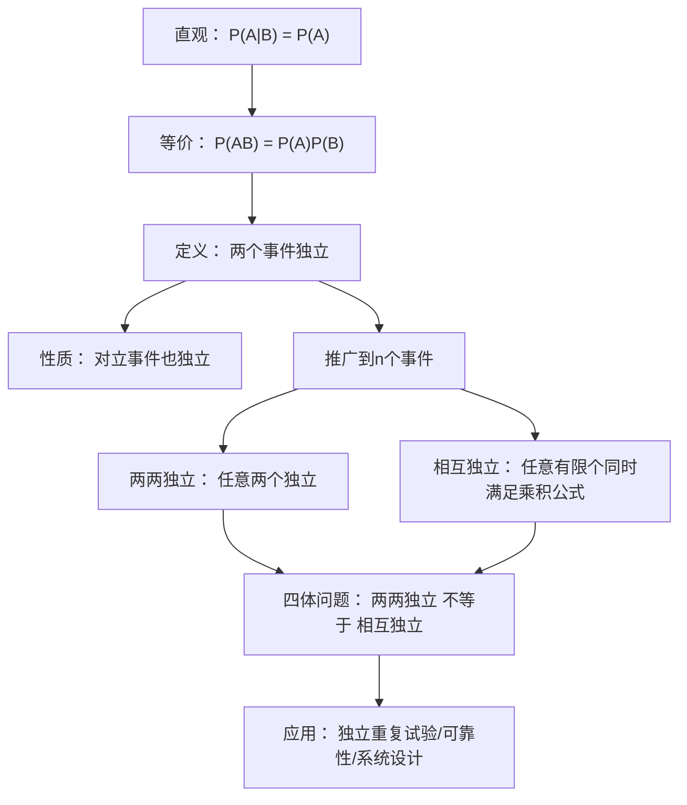
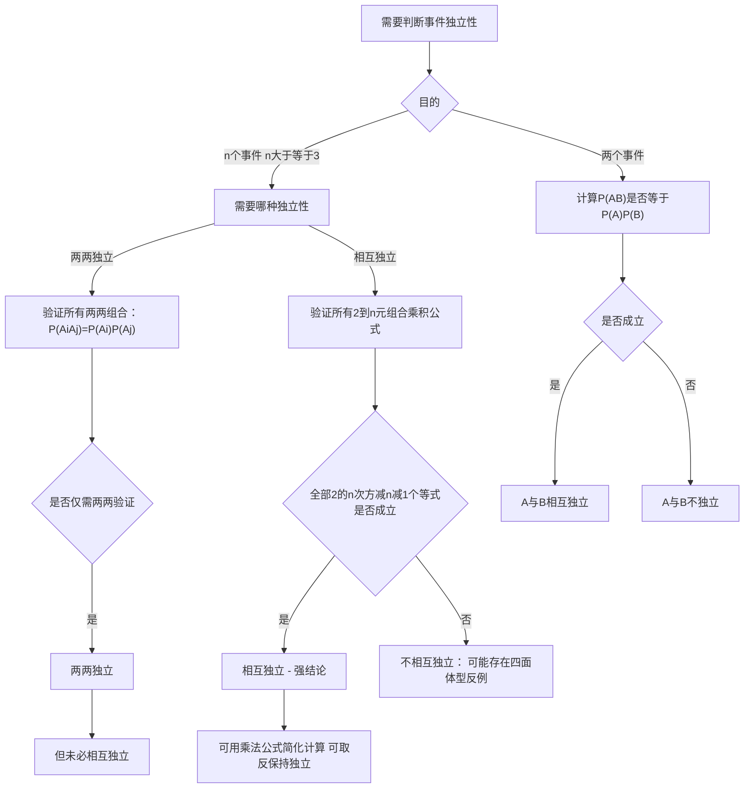

---
subject:
- 概率论
source:
- C1.5 事件的独立性.md
type: review
tags:
- 两两独立
- 相互独立
aliases:
- 第1章 事件的独立性 — 知识点梳理
schema_version: 2
time: "2026-08-31T11:44:20+08:00"
legacy_status: 已完成
legacy_topics:
- 事件独立性
- 两两独立
- 相互独立
- 可靠性
- 小概率事件
status: not done
---

## 一、本章核心脉络

**核心问题**：当一个事件的发生与否不影响另一个事件发生的概率时，它们的概率之间满足什么简单关系？这种关系如何推广到多个事件？

> [!info] 学习导读
> **必要先修**：回看[[03_Sources/Reviews/概率论/知识点解析梳理/01e-条件概率-知识梳理|条件概率与乘法公式]]；独立不是互不相容。
> **来源边界**：正文依据[[03_Sources/Courses/概率论/PPT课件/MD/C1.5  事件的独立性|C1.5 课件源文]]重组；系统可靠性解释和自测属于补充学习内容。
> **阅读路线**：两个事件独立 → 对立事件的独立性 → 两两独立与相互独立 → 独立重复试验与可靠性应用。

> 这个顺序从最简单的直觉（$P(A|B) = P(A)$ 就是独立）出发，转化为不依赖条件概率的等价乘积形式，再逐步推广到多个事件，最终揭示了两两独立与相互独立的本质区别——这也是本章最容易出错的地方。

---

## 二、两个事件的独立性（核心）

### 2.1 从直观到定义

**直觉出发点**：在一般情况下 $P(A|B) \neq P(A)$（即事件 $B$ 的发生会影响 $A$ 的概率）。但若

$$P(A|B) = P(A)$$

即事件 $A$ 发生的可能性大小**不受**事件 $B$ 出现与否的影响，这就是"独立"的直观含义。

**定义1.5.1**：设 $(\Omega, \mathscr{F}, P)$ 为概率空间，$A \in \mathscr{F}$，$B \in \mathscr{F}$，$P(B) > 0$，若

$$P(A|B) = P(A)$$

称事件 $A$ **独立于**事件 $B$。

> **一句话来说**：独立就是"你发生不发生，跟我没关系"——已知B发生了，A的概率还是老样子。

**性质1.5.1（对称性，核心）**：若事件 $A$ 独立于事件 $B$，且 $P(A) > 0, P(B) > 0$，则事件 $B$ 也独立于事件 $A$：

$$P(B|A) = P(B)$$

> **直观理解**：独立性天然是对称的——如果"A发生"不影响B的概率，那么"B发生"也不影响A的概率。这不是定义强加的，而是数学推导的必然结论。因此说两个事件"相互独立"而不仅仅是"A独立于B"。

### 2.2 等价定义 —— 乘法公式

**性质1.5.2**：设 $P(A) > 0$，$P(B) > 0$，则 $A$ 与 $B$ 相互独立的**充分必要条件**是：

$$P(A \cap B) = P(A) P(B)$$

> **直观理解**：这个公式是独立性的核心——当事件独立时，它们"同时发生"的概率就是把各自的概率直接相乘。这里的"乘法"不是巧合，而是独立性的代数和计算等价形式。

**定义1.5.2（等价定义）**：设 $(\Omega, \mathscr{F}, P)$ 为概率空间，$A \in \mathscr{F}$，$B \in \mathscr{F}$，若

$$P(A \cap B) = P(A) P(B)$$

称 $A$ 与 $B$ **相互独立**。

> **关键优势**：此定义**不要求** $P(A) > 0$ 或 $P(B) > 0$，比定义1.5.1更具一般性（$P = 0$ 时条件概率无定义，但乘法公式仍可判定）。

### 2.3 独立的推广性质

**性质1.5.3**：若事件 $A$ 和 $B$ 相互独立，则下列三对事件也分别相互独立：

- $A$ 与 $\overline{B}$ 独立
- $\overline{A}$ 与 $B$ 独立
- $\overline{A}$ 与 $\overline{B}$ 独立

**证明**（以 $\overline{A}$ 与 $\overline{B}$ 为例）：

$$
\begin{aligned}
P(\overline{A}\,\overline{B}) &= P(\overline{A \cup B}) \\
&= 1 - P(A \cup B) \\
&= 1 - [P(A) + P(B) - P(AB)] \\
&= 1 - P(A) - P(B) + P(A)P(B) \quad (\text{因为A,B独立}) \\
&= [1 - P(A)][1 - P(B)] \\
&= P(\overline{A})P(\overline{B})
\end{aligned}
$$

> **一句话来说**：如果用条件判断独立性——可以"整体取反"：把A换成"非A"、B换成"非B"，独立性不变。

**推论**：设 $A, B$ 是两个随机事件，且 $0 < P(A) < 1$。若 $P(B|A) = P(B|\overline{A})$，则 $A$ 与 $B$ 相互独立。

**证明**：

$$P(B|A) = P(B|\overline{A}) \;\Rightarrow\; \frac{P(AB)}{P(A)} = \frac{P(\overline{A}B)}{P(\overline{A})}$$

$$P(AB)P(\overline{A}) = P(\overline{A}B)P(A)$$

$$P(AB)[1 - P(A)] = [P(B) - P(AB)]P(A)$$

化简得 $P(AB) = P(A)P(B)$，故 $A, B$ 相互独立。

> **直观理解**：这给出了一种检验独立性的方法——如果无论A是否发生，B的条件概率都一样，那么A和B就是独立的。

---

## 三、独立 vs 互不相容 vs 对立事件

### 3.1 三者的根本区别

| 维度 | 相互独立 | 互不相容 | 对立事件 |
|:--|:--|:--|:--|
| **事件含义** | 一个发生与否不影响另一个的概率 | 两者不可能同时发生 | 非此即彼，有且仅有一个发生 |
| **集合条件** | $P(AB) = P(A)P(B)$ | $AB = \Phi$ | $AB = \Phi$ 且 $A \cup B = \Omega$ |
| **文氏图** | 有交集（通常） | 无交集 | 无交集且覆盖整个空间 |
| **概率关系** | $P(AB) = P(A)P(B)$ | $P(AB) = 0$ | $P(A) + P(B) = 1$ |

### 3.2 重要结论

**独立与互不相容不能同时成立（除非事件概率为0）**：
- 若 $A$ 与 $B$ 互不相容（$AB = \Phi$），且 $P(A) > 0, P(B) > 0$，则 $P(AB) = 0 \neq P(A)P(B) > 0$，故 $A$ 与 $B$ 不独立。
- 若 $A$ 与 $B$ 独立，且 $P(A) > 0, P(B) > 0$，则 $P(AB) = P(A)P(B) > 0$，故 $AB \neq \Phi$（$A$ 与 $B$ 不互不相容）。

> **一句话来说**：独立是"概率互不影响"，互不相容是"事件不能同时发生"——前者描述概率关系，后者描述事件是否可能共存，是两个完全不同的维度。

---

## 四、多个事件的独立性（本章难点）

### 4.1 从两个事件到三个事件 —— 四面体问题

**例1.5.1（四面体问题）**：同时掷两个均匀的正四面体一次，每个四面体标有号码1,2,3,4。

令：
- $A = \{\text{甲四面体向下的一面是偶数}\}$
- $B = \{\text{乙四面体向下的一面是奇数}\}$
- $C = \{\text{两个四面体向下的一面同为奇数或偶数}\}$

由古典概率：

$$P(A) = P(B) = P(C) = \frac{8}{16} = \frac{1}{2}$$

$$P(AB) = P(AC) = P(BC) = \frac{1}{4}$$

$$P(ABC) = P(\Phi) = 0$$

验证两两乘积：

$$P(AB) = \frac{1}{4} = \frac{1}{2} \cdot \frac{1}{2} = P(A)P(B)$$
$$P(AC) = \frac{1}{4} = P(A)P(C)$$
$$P(BC) = \frac{1}{4} = P(B)P(C)$$

**结论：A、B、C两两独立**。

但另一方面：

$$P(A|BC) = 0 \neq \frac{1}{2} = P(A)$$

说明 $A$ 发生的可能性会受到 $B$ 与 $C$ 的"联合"影响！

而且：

$$P(ABC) = 0 \neq \frac{1}{8} = P(A)P(B)P(C)$$

> **直观理解（四面体问题的核心洞察）**：这个例子揭示了一个反直觉的事实——即使三个事件"两两之间"互相独立，它们"三者之间"可能还是不独立的！因为"A和B一起发生"这个联合信息可以传递新的信息从而改变C的概率。

### 4.2 两两独立 vs 相互独立 —— 两个定义

**定义1.5.3（相互独立）**：设 $(\Omega, \mathscr{F}, P)$ 为概率空间，$A_i \in \mathscr{F}\;(i = 1,2,\cdots,n)$，若对任意的 $s\;(1 < s \leq n)$ 及 $1 \leq i_1 < i_2 < \cdots < i_s \leq n$，有

$$P(A_{i_1} A_{i_2} \cdots A_{i_s}) = P(A_{i_1}) P(A_{i_2}) \cdots P(A_{i_s})$$

则称事件 $A_1, A_2, \cdots, A_n$ **相互独立**。

> **一句话来说**：相互独立要求**所有**子集组合的乘积公式都成立——不止是每两个，而是每三个、每四个...直到全部n个。

**定义1.5.4（两两独立）**：若对一切 $1 \leq i_1 < i_2 \leq n$，有

$$P(A_{i_1} A_{i_2}) = P(A_{i_1}) P(A_{i_2})$$

则称事件 $A_1, A_2, \cdots, A_n$ **两两独立**。

### 4.3 两两独立与相互独立的关系

| 关系 | 说明 |
|:--|:--|
| 相互独立 $\Rightarrow$ 两两独立 | 必然成立（两两独立条件的方程是相互独立方程的一部分） |
| 两两独立 $\nRightarrow$ 相互独立 | 四面体问题即为反例 |
| 相互独立是比两两独立**更强的结论** | 需要验证 $C_n^2 + C_n^3 + \cdots + C_n^n = 2^n - n - 1$ 个条件 |

对于 $n$ 个事件，相互独立需要验证的总条件数为 $2^n - n - 1$ 个等式。

> **一句话来说**：两两独立只关心"每对之间"，相互独立关心"每一个子集"——后者包含前者，但远比前者严格。

**性质1.5.4**：若事件 $A_1, A_2, \cdots, A_n$ 相互独立，则将其中任意多个事件换成它们的对立事件后，所得到的 $n$ 个事件仍然相互独立。

> **直观理解**：独立性具有"取反不变"性质——如果你有一组相互独立的事件，把其中任意几个换成"不发生"，独立性关系不变。这在实际计算中非常有用。

---

## 五、独立性的应用（核心）

### 5.1 独立射击问题

**例1.5.2**：三个人独立地向同一目标射击，命中率分别为 $0.45$、$0.55$、$0.60$，求目标被击中的概率 $p$。

> [!solution]- 点击展开详细解析
> **解**：令 $A_i = \{\text{第i人命中目标}\}$，$i = 1,2,3$。则 $A_1, A_2, A_3$ 相互独立。
>
> $$p = P(A_1 \cup A_2 \cup A_3)$$
>
> 利用多除少补原理 + 独立性：
>
> $$
> \begin{aligned}
> p &= P(A_1) + P(A_2) + P(A_3) - P(A_1)P(A_2) - P(A_1)P(A_3) - P(A_2)P(A_3) + P(A_1)P(A_2)P(A_3) \\
> &= 0.45 + 0.55 + 0.60 - 0.45 \times 0.55 - 0.45 \times 0.60 - 0.60 \times 0.55 + 0.45 \times 0.55 \times 0.60 \\
> &= 0.901
> \end{aligned}
> $$
>
> **另解（利用对立事件，更简洁）**：
>
> $$p = 1 - P(\overline{A_1}\,\overline{A_2}\,\overline{A_3}) = 1 - P(\overline{A_1})P(\overline{A_2})P(\overline{A_3}) = 1 - 0.55 \times 0.45 \times 0.40 = 0.901$$
>
> **步骤点评**：利用独立性的"取反不变"性质，将并事件化为对立事件的积，计算量大大降低。

### 5.2 独立重复试验 —— 小概率事件的必然性（核心）

**例1.5.3**：某人做一次试验获得成功的概率仅为 $0.2$，求他做 $10$ 次试验至少成功一次的概率？做 $20$ 次呢？

> [!solution]- 点击展开详细解析
> **解**：设 $p_k$ 为做 $k$ 次试验至少成功一次的概率，$A_j = \{\text{第j次试验成功}\}$。
>
> $$
> \begin{aligned}
> p_{10} &= P(A_1 \cup A_2 \cup \cdots \cup A_{10}) \\
> &= 1 - P(\overline{A_1})P(\overline{A_2})\cdots P(\overline{A_{10}}) \\
> &= 1 - (1 - 0.2)^{10} \approx 0.8926
> \end{aligned}
> $$
>
> $$p_{20} = 1 - (1 - 0.2)^{20} \approx 0.9885$$
>
> **一般结论**：将试验 $E$ 重复进行 $k$ 次，每次试验中 $A$ 出现的概率为 $p\;(0 < p < 1)$，则 $A$ 至少出现一次的概率为
>
> $$1 - (1 - p)^k$$
>
> 且有
>
> $$\lim_{k \to \infty} [1 - (1 - p)^k] = 1$$
>
> > **重要结论**：**小概率事件在大量独立重复试验中几乎一定会发生！**
>
> > **直观理解**：即使每次尝试成功的概率低至 $0.2$，重复 $20$ 次后几乎必然（$98.85\%$）会至少成功一次。这就是"持之以恒"的概率论基础，也是"有志者事竟成"的数学阐释。

### 5.3 系统可靠性问题

**例1.5.4**：设有6个元件，每个元件在单位时间内能正常工作的概率均为 $0.9$，各元件独立，系统结构为三对并联元件串联。求系统能正常工作的概率。

元件1和2并联，元件3和4并联，元件5和6并联，三对串联。

> [!solution]- 点击展开详细解析
> **解**：设 $A_k = \{\text{第k个元件能正常工作}\}$，$k = 1,2,\ldots,6$。
>
> 系统正常工作 $A = (A_1 \cup A_2)(A_3 \cup A_4)(A_5 \cup A_6)$。
>
> 由独立性，$A_1 \cup A_2$、$A_3 \cup A_4$、$A_5 \cup A_6$ 也相互独立。
>
> $$
> \begin{aligned}
> P(A) &= P(A_1 \cup A_2) \cdot P(A_3 \cup A_4) \cdot P(A_5 \cup A_6) \\
> &= [1 - P(\overline{A_1}\,\overline{A_2})] \cdot [1 - P(\overline{A_3}\,\overline{A_4})] \cdot [1 - P(\overline{A_5}\,\overline{A_6})] \\
> &= [1 - P(\overline{A_1})P(\overline{A_2})] \cdot [1 - P(\overline{A_3})P(\overline{A_4})] \cdot [1 - P(\overline{A_5})P(\overline{A_6})] \\
> &= [1 - (1 - 0.9)^2]^3 = 0.970299
> \end{aligned}
> $$
>
> > **步骤点评**：可靠性问题中，并联用"或"（并事件），串联用"且"（交事件）。并联提高可靠性（只要有一个正常就行），串联降低可靠性（必须全部正常）。

---

## 六、"三个臭皮匠，顶个诸葛亮"的概率论解释

设有 $n$ 个相互独立的事件 $A_1, A_2, \ldots, A_n$（每个代表一个"臭皮匠"做对某件事），每个概率为 $p_i$。则全体至少有一人做对的概率为：

$$P(\cup_{i=1}^{n} A_i) = 1 - \prod_{i=1}^{n} (1 - p_i)$$

当 $n$ 足够大时，即使每个 $p_i$ 很小，$\prod_{i=1}^{n} (1 - p_i) \to 0$，则 $P(\cup A_i) \to 1$。

> **一句话来说**：众多独立的小概率事件合起来就成了高概率事件——大量"可能"的叠加可以逼近"必然"。

---

## 判定/决策流程

---

## 核心公式速查表

| 名称 | 公式 | 条件 |
|:--|:--|:--|
| 两个事件独立（条件概率形式） | $P(A\|B) = P(A)$ | $P(B) > 0$ |
| 两个事件独立（乘法形式） | $P(AB) = P(A)P(B)$ | 无需 $P>0$ |
| 独立事件的对立事件 | $P(\overline{A}\,\overline{B}) = P(\overline{A})P(\overline{B})$ | $A,B$ 独立 |
| 两两独立 | $P(A_i A_j) = P(A_i)P(A_j)$，$\forall i < j$ | — |
| 相互独立 | $P(\cap_{k} A_{i_k}) = \prod_{k} P(A_{i_k})$ | 任意子集 |
| 独立重复试验至少成功一次 | $1 - (1-p)^k$ | $k$ 次独立重复 |
| 独立事件取反对应 | 将任意多事件换为对立事件，独立性不变 | 原事件组相互独立 |
| 系统可靠性（并联） | $P(A_i \cup A_j) = 1 - (1-p_i)(1-p_j)$ | $A_i, A_j$ 独立 |
| 系统可靠性（串联） | $P(A_i A_j) = p_i p_j$ | $A_i, A_j$ 独立 |

---

## 易错点与注意事项

> [!warning] 易错点

1. **独立与互不相容是两种完全不同的关系**：独立描述的是"概率上的无关"，互不相容描述的是"事件不可能共存"。两者不能混淆，且（概率非零时）独立的事件一定有交集，互不相容的事件一定不独立。

2. **两两独立 $\neq$ 相互独立（核心易错点）**：四面体问题是最经典的反例。相互独立要求 $2^n - n - 1$ 个等式成立（从两两到全部n元组合），而两两独立只要求 $C_n^2$ 个。它们是**充分条件**的关系：相互独立 $\Rightarrow$ 两两独立，但逆不真。

3. **$P(AB) = P(A)P(B)$ 并不意味着 A 和 B 一定有因果独立关系**：这只是数学上的概率等式。数学独立和因果独立是不同的概念。

4. **利用独立性的"取反不变"简化计算**：求 $P(A_1 \cup A_2 \cup \cdots \cup A_n)$ 时，常用对立法：$P(\cup A_i) = 1 - \prod P(\overline{A_i})$，比直接用多除少补简洁得多。

5. **小概率事件的"必然性"有前提**：公式 $\lim_{k \to \infty} [1 - (1-p)^k] = 1$ 要求 $p > 0$。若 $p = 0$，重复多少次都没用。

6. **定义1.5.1（$P(A|B) = P(A)$）要求 $P(B) > 0$**：若 $P(B) = 0$，条件概率无定义，但这种情况下通过 $P(AB) = 0 = P(A) \cdot 0$ 仍有 $A$ 与 $B$ 独立（按定义1.5.2）。定义1.5.2更一般。

7. **$P(B|A) = P(B|\overline{A})$ 是独立的充要条件**（当 $0 < P(A) < 1$ 时）：这提供了一种不依赖乘法公式的验证方式。

---

## 自测（新编）

连续抛两次均匀硬币。令 $A$ 为“第一次正面”，$B$ 为“第二次正面”，$C$ 为“两次结果相同”。判断三者是否两两独立、是否相互独立。

> [!hint]- 提示
> 分别计算三组交事件概率，再计算 $P(A\cap B\cap C)$。

> [!solution]- 解析
> 三个事件概率均为 $1/2$，任意两者交集概率均为 $1/4$，故两两独立。但 $A\cap B\cap C=\{HH\}$，其概率为 $1/4\ne(1/2)^3$，因此不相互独立。

## 相关知识点链接

- **前置**：[[01c-概率模型与公理化结构]] — 独立性定义在概率空间 $(\Omega, \mathscr{F}, P)$ 之上，$P(AB) = P(A)P(B)$ 是公理化框架下的核心运算规则。
- **前置**：[[01a-随机事件的直观意义及其运算]] — 独立性的运算大量用到德·摩根律（如 $P(\overline{A}\,\overline{B}) = P(\overline{A \cup B})$）、对立法和事件表示技巧。
- **后续**：条件概率与全概率公式（第2章）—— 独立性本质上是条件概率的特例（$P(A|B) = P(A)$）。
- **后续**：伯努利试验与二项分布—— 独立重复试验是独立性的直接应用，是离散分布的理论基础。

---

## 作业与练习

参见习题库中第1章对应节次的习题，重点练习：
1. 判断两个事件是否独立（用乘法公式验证）
2. 区分两两独立与相互独立（四面体问题及变形）
3. 利用独立事件的"取反不变"简化概率计算
4. 独立重复试验中"至少发生一次"的概率计算
5. 系统可靠性分析（串并联组合）

## 可复用知识条目

本章涉及以下独立条目；后续补充与跨课程应用统一维护在条目中。

### 概念入口

- [[01_Knowledge/独立性|独立性]]
