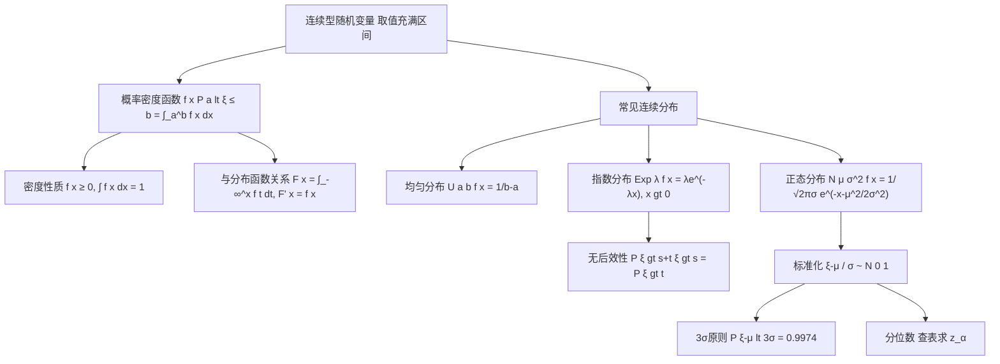
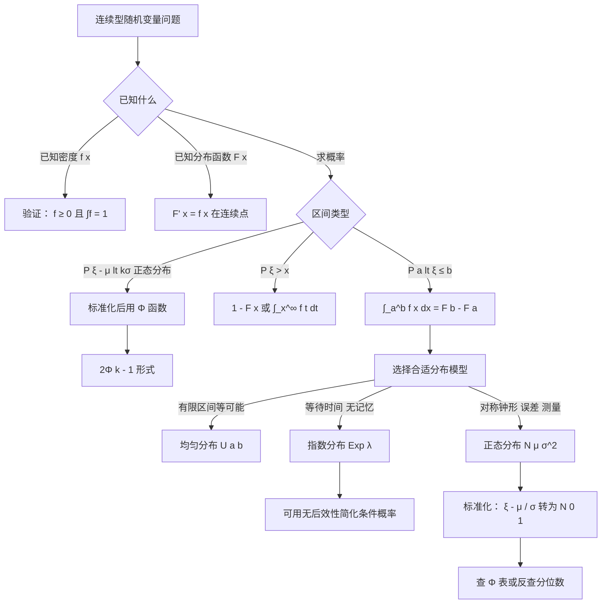

---
subject:
- 概率论
source:
- C 2.3 连续型 随机变量及概率密度.md
type: review
tags: ["连续型随机变量", "概率密度", "分布函数", "均匀分布", "指数分布", "正态分布", "无后效性", "3σ原则", "标准化"]
aliases:
- 第2章 连续型随机变量及概率密度 — 知识点梳理
schema_version: 2
time: "2026-08-31T11:44:20+08:00"
legacy_status: 已完成
legacy_topics:
- 连续型随机变量
- 概率密度函数
- 分布函数
- 均匀分布
- 指数分布
- 正态分布
- 无后效性
- 3σ原则
- 标准化
status: not done
---

# 第2章 连续型随机变量及概率密度 — 知识点梳理

## 一、本章核心脉络

**核心问题**：当随机变量可以在一个区间（甚至整个实数轴）上连续取值时，如何描述它的概率分布？单个点的概率为 0 了，那概率的"密度"概念如何替代"质量"概念？

> [!info] 学习导读
> **必要先修**：回看[[03_Sources/Reviews/概率论/知识点解析梳理/02a-随机变量及分布函数-知识梳理|分布函数]]，并熟悉定积分与简单换元。
> **来源边界**：正文依据[[03_Sources/Courses/概率论/PPT课件/MD/C 2.3 连续型 随机变量及概率密度|C2.3 课件源文]]重组；分布对照与自测属于补充学习内容。
> **阅读路线**：密度定义 → 密度与分布函数互换 → 均匀分布 → 指数分布 → 正态分布与标准化。

> 这个顺序从连续型随机变量的基本概念（密度函数）出发，到与分布函数的关系（微积分桥梁），再到三种最重要的连续分布模型——均匀、指数、正态——其中正态分布是概率统计中真正的"王者分布"，3$\sigma$ 原则和标准化是应用最频繁的技能。

---

## 二、连续型随机变量与概率密度函数（核心）

### 2.1 从离散到连续：思维方式转换

**离散型**：$\xi$ 取值在 $\{x_1, x_2, \ldots\}$，每个点上有"概率质量" $p_n = P\{\xi = x_n\}$，总质量为 1。

**连续型**：$\xi$ 取值充满一个或几个区间。**对于任何一个具体的点 $x_0$，$P\{\xi = x_0\} = 0$**。因此离散型中"某点的概率"的概念在这里失效了——我们需要用"密度"来替代"质量"。

> **直观理解**：把总概率 1 想象成一团总质量为 1 的面团。离散型下，面团被切成可数个小块，每块有确定的质量。连续型下，面团被擀成一张连续的薄饼——任何一个单独的点都没有质量，但任何一块区域都有质量（区域的面积）。

**类比**：

|  | 离散型（质量） | 连续型（密度） |
|:--|:--|:--|
| 概率分配 | $p_n = P\{\xi = x_n\}$ | $P\{a < \xi \leq b\} = \int_a^b f(x) dx$ |
| 单个点 | $P\{\xi = x_n\} = p_n > 0$ | $P\{\xi = x_0\} = 0$ |
| 总概率 | $\sum_n p_n = 1$ | $\int_{-\infty}^{\infty} f(x) dx = 1$ |

### 2.2 定义 2.3.1

对于随机变量 $\xi$，如果存在一个非负可积函数 $f(x)$，$-\infty < x < \infty$，使得对于任意实数 $a < b$，有

$$P\{a < \xi \leq b\} = \int_a^b f(x) dx$$

则称 $\xi$ 为**连续型随机变量（Continuous Random Variable）**，称 $f(x)$ 为 $\xi$ 的**概率密度函数（Probability Density Function, PDF）**。

> **一句话来说**：连续型随机变量的概率 = 密度函数曲线下的面积——$P\{a < \xi \leq b\}$ 就是 $f(x)$ 在 $[a, b]$ 上与 $x$ 轴围成的面积。

### 2.3 概率密度函数的基本性质

**性质 1（非负性）**：$f(x) \geq 0$，$\forall x \in \mathbb{R}$

**性质 2（规范性）**：$\int_{-\infty}^{\infty} f(x) dx = 1$

**性质 3（区间概率）**：$P\{a < \xi \leq b\} = \int_a^b f(x) dx = F(b) - F(a)$

**性质 4（单点概率为 0）**：对于任意实数 $x_0$，$P\{\xi = x_0\} = \int_{x_0}^{x_0} f(x) dx = 0$

**推论**：对于连续型随机变量，开区间、闭区间、半开半闭区间的概率相同：

$$P\{a < \xi < b\} = P\{a \leq \xi < b\} = P\{a < \xi \leq b\} = P\{a \leq \xi \leq b\} = \int_a^b f(x) dx$$

> **一句话来说**：在连续型世界里，"等号"不改变概率大小——边界点的概率永远是 0，所以是否包含端点完全不影响结果。

> [!hint] 记忆技巧
> 验证一个函数 $f(x)$ 是否是概率密度函数，只需满足两点：(1) 在整个实数轴上非负；(2) 在整个实数轴上积分为 1。这两个条件等价于离散型中 $p_n \geq 0$ 和 $\sum p_n = 1$。

---

## 三、分布函数与密度函数的关系（核心）

### 3.1 从密度到分布函数

设 $\xi$ 是连续型随机变量，密度函数为 $f(x)$，则其分布函数为

$$F(x) = P\{\xi \leq x\} = \int_{-\infty}^{x} f(t) dt$$

**几何意义**：$F(x)$ 是密度函数 $f(t)$ 在 $(-\infty, x]$ 上与 $x$ 轴围成的面积。

> **一句话来说**：分布函数 $F(x)$ 是密度函数的"累积面积函数"——从负无穷开始，一路积分到 $x$，得到的就是 $\xi$ 落在 $x$ 及以左的总概率。

### 3.2 从分布函数到密度

**定理 2.3.1**：若 $f(x)$ 在点 $x$ 处连续，则

$$F'(x) = f(x)$$

即密度函数是分布函数的**导数**。

> **直观理解**：如果分布函数 $F(x)$ 告诉你在 $x$ 处累积了多少概率，那么它的导数 $F'(x) = f(x)$ 就是概率在该点的"增长率"——也就是密度。分布函数是"存量"，密度函数是"流量"。

**更一般地**：在 $f(x)$ 的连续点 $x$ 处，有

$$f(x) = \lim_{\Delta x \to 0^+} \frac{P\{x < \xi \leq x + \Delta x\}}{\Delta x} = \lim_{\Delta x \to 0^+} \frac{F(x+\Delta x) - F(x)}{\Delta x}$$

这个极限形式说明了"密度"的字面含义——单位长度上有多少概率。

### 3.3 两类随机变量的分布函数对比

| 特征 | 离散型 | 连续型 |
|:--|:--|:--|
| $F(x)$ 的形态 | 阶梯函数（跳跃上升） | 连续函数（光滑或分段光滑） |
| 跳跃点 | 在取值点有跳跃，高度为 $p_n$ | 无跳跃 |
| $F(x)$ 与概率的关系 | $p_n = F(x_n) - F(x_n - 0)$ | $f(x) = F'(x)$，区间概率用差 |
| 区间概率 | $P\{a < \xi \leq b\} = \sum_{a < x_i \leq b} p_i$ | $P\{a < \xi \leq b\} = \int_a^b f(x) dx$ |

---

## 四、均匀分布（了解即可）

### 4.1 定义与密度

设 $\xi$ 服从区间 $[a, b]$ 上的**均匀分布（Uniform Distribution）**，记为 $\xi \sim U(a, b)$，其密度函数为：

$$f(x) = \begin{cases} \dfrac{1}{b-a}, & a \leq x \leq b \\[8pt] 0, & \text{其他} \end{cases}$$

### 4.2 分布函数

$$F(x) = \begin{cases} 0, & x < a \\[4pt] \dfrac{x-a}{b-a}, & a \leq x \leq b \\[4pt] 1, & x > b \end{cases}$$

> **一句话来说**：均匀分布在 $[a, b]$ 上每个点的密度都一样——落在任何等长子区间内的概率都相等，这正是"均匀"两字的含义。

**几何模型**：在 $[a, b]$ 上随机投点，落入 $[c, d] \subset [a, b]$ 的概率 = $(d-c)/(b-a)$。这是一维几何概率的连续版本。

---

## 五、指数分布（核心）

### 5.1 定义与密度

设 $\xi$ 服从参数为 $\lambda > 0$ 的**指数分布（Exponential Distribution）**，记为 $\xi \sim \text{Exp}(\lambda)$，其密度函数为：

$$f(x) = \begin{cases} \lambda e^{-\lambda x}, & x \geq 0 \\[4pt] 0, & x < 0 \end{cases}$$

### 5.2 分布函数

$$F(x) = P\{\xi \leq x\} = \begin{cases} 1 - e^{-\lambda x}, & x \geq 0 \\[4pt] 0, & x < 0 \end{cases}$$

从而有

$$P\{\xi > x\} = e^{-\lambda x} \quad (x \geq 0)$$

> **一句话来说**：指数分布描述的是"等待时间"——$P\{\xi > x\} = e^{-\lambda x}$ 表示$\xi$ 超过 $x$ 的概率按指数衰减，$\lambda$ 越大衰减越快。

### 5.3 无后效性（难点 / 本章核心难点）

**定理 2.3.2（无后效性 / 无记忆性）**：设 $\xi \sim \text{Exp}(\lambda)$，则对任意 $s > 0, t > 0$，有

$$P\{\xi > s + t \mid \xi > s\} = P\{\xi > t\} = e^{-\lambda t}$$

**证明**：

$$
\begin{aligned}
P\{\xi > s + t \mid \xi > s\} &= \frac{P\{\xi > s + t, \xi > s\}}{P\{\xi > s\}} \\
&= \frac{P\{\xi > s + t\}}{P\{\xi > s\}} \\
&= \frac{e^{-\lambda (s+t)}}{e^{-\lambda s}} = e^{-\lambda t} = P\{\xi > t\}
\end{aligned}
$$

> **直观理解**：假设 $\xi$ 是某元件的寿命。如果它已经正常工作了 $s$ 小时，那么它再工作 $t$ 小时的概率，和一个全新的元件工作 $t$ 小时的概率完全一样——元件"不记得"自己已经用过多久了。指数分布是**唯一**具有无后效性的连续型分布。

**例（源自教材）**：设 $\xi \sim \text{Exp}(\lambda)$，$\lambda = 0.0005$。求 $P\{\xi > 3000 \mid \xi > 2000\}$。

> [!solution]- 点击展开详细解析
> $$P\{\xi > 3000 \mid \xi > 2000\} = \frac{P\{\xi > 3000\}}{P\{\xi > 2000\}} = \frac{e^{-3000\lambda}}{e^{-2000\lambda}} = e^{-1000\lambda} \approx 0.607$$
>
> 另解（利用无后效性）：
>
> $$P\{\xi > 3000 \mid \xi > 2000\} = P\{\xi > 1000\} = e^{-1000\lambda} \approx 0.607$$
>
> > **步骤点评**：在无后效性下，"已经等了 2000 小时"这段历史被完全忽略——条件概率退化成了无条件概率，只需看"还差 1000 小时"。

### 5.4 应用场景

指数分布常用于描述：
- 电子元件的寿命
- 排队系统中顾客到达的时间间隔
- 放射性粒子的衰变时间
- 电话通话的持续时间

---

## 六、正态分布（核心 / 难点）

### 6.1 定义与密度

设 $\xi$ 服从参数为 $\mu$ 和 $\sigma^2$（$\sigma > 0$）的**正态分布（Normal Distribution / Gaussian Distribution）**，记为 $\xi \sim N(\mu, \sigma^2)$，其密度函数为：

$$f(x) = \frac{1}{\sqrt{2\pi}\,\sigma} e^{-\frac{(x-\mu)^2}{2\sigma^2}}, \quad -\infty < x < \infty$$

其中：
- $\mu$ 是**位置参数**，决定了密度曲线的对称中心
- $\sigma^2$ 是**尺度参数**，决定了曲线的"胖瘦"（$\sigma$ 越大曲线越扁平，$\sigma$ 越小曲线越尖峭）

> **一句话来说**：正态分布是概率统计中最重要的分布——描述了大量独立微小因素叠加的总效果，其密度曲线是著名的"钟形曲线"，以 $\mu$ 为中心对称。

**几何特征**：

| 特征 | 说明 |
|:--|:--|
| 对称性 | $f(\mu - x) = f(\mu + x)$（关于 $x = \mu$ 对称）|
| 最大值 | $f(\mu) = 1/(\sqrt{2\pi}\sigma)$（在 $\mu$ 处达到最大值）|
| 单调性 | $x < \mu$ 时递增，$x > \mu$ 时递减 |
| 拐点 | $x = \mu \pm \sigma$（离中心 ±1 个标准差处）|
| 渐近线 | $\lim_{x \to \pm\infty} f(x) = 0$（以 $x$ 轴为水平渐近线）|

### 6.2 标准正态分布

当 $\mu = 0$，$\sigma = 1$ 时，称为**标准正态分布（Standard Normal Distribution）**，记为 $\xi \sim N(0, 1)$。

其密度函数（通常用 $\varphi(x)$ 表示）为：

$$\varphi(x) = \frac{1}{\sqrt{2\pi}} e^{-\frac{x^2}{2}}, \quad -\infty < x < \infty$$

分布函数（通常用 $\Phi(x)$ 表示）为：

$$\Phi(x) = \int_{-\infty}^{x} \frac{1}{\sqrt{2\pi}} e^{-\frac{t^2}{2}} dt$$

> **一句话来说**：标准正态分布是"基准版"的正态分布——所有正态分布都可以通过标准化变成它，然后查表计算概率。

**$\Phi(x)$ 的性质**：

1. $\Phi(0) = 0.5$（对称中心处概率为一半）
2. $\Phi(-x) = 1 - \Phi(x)$（对称性）
3. $\Phi(+\infty) = 1$，$\Phi(-\infty) = 0$

### 6.3 标准化（核心技能）

**定理 2.3.3**：若 $\xi \sim N(\mu, \sigma^2)$，则

$$\eta = \frac{\xi - \mu}{\sigma} \sim N(0, 1)$$

这个变换称为**标准化（Standardization）**。

**标准化后的概率计算**：

$$P\{\xi \leq x\} = P\left\{\frac{\xi - \mu}{\sigma} \leq \frac{x - \mu}{\sigma}\right\} = \Phi\left(\frac{x - \mu}{\sigma}\right)$$

$$P\{a < \xi \leq b\} = \Phi\left(\frac{b - \mu}{\sigma}\right) - \Phi\left(\frac{a - \mu}{\sigma}\right)$$

> **一句话来说**：把任意正态变量减均值、除标准差，就变成标准正态——然后一切概率计算转化为查 $\Phi$ 表。标准化是处理正态分布的唯一通用方法。

**步骤总结**（三步走）：

1. **减均值**：$\xi - \mu$，使分布中心移到 0
2. **除标准差**：$(\xi - \mu) / \sigma$，使方差变为 1
3. **查 $\Phi$ 表**：用标准正态分布函数值求概率

### 6.4 3$\sigma$ 原则（核心）

**例（源自教材）**：设 $\xi \sim N(\mu, \sigma^2)$，证明

$$P\{|\xi - \mu| < x\} = 2\Phi\left(\frac{x}{\sigma}\right) - 1$$

> [!solution]- 点击展开详细解析
> **证明**：
>
> $$
> \begin{aligned}
> P\{|\xi - \mu| < x\} &= P\{\mu - x < \xi < \mu + x\} \\
> &= \Phi\left(\frac{(\mu+x)-\mu}{\sigma}\right) - \Phi\left(\frac{(\mu-x)-\mu}{\sigma}\right) \\
> &= \Phi\left(\frac{x}{\sigma}\right) - \Phi\left(-\frac{x}{\sigma}\right) \\
> &= \Phi\left(\frac{x}{\sigma}\right) - \left[1 - \Phi\left(\frac{x}{\sigma}\right)\right] \quad (\text{利用} \Phi(-z) = 1 - \Phi(z)) \\
> &= 2\Phi\left(\frac{x}{\sigma}\right) - 1
> \end{aligned}
> $$

取 $x = \sigma, 2\sigma, 3\sigma$，得著名的 **$3\sigma$ 原则**：

| $x$ | 概率 | 直观含义 |
|:--|:--|:--|
| $\sigma$ | $2\Phi(1) - 1 \approx 0.6826$ | 约 $68.3\%$ 的数据在 $\mu \pm \sigma$ 内 |
| $2\sigma$ | $2\Phi(2) - 1 \approx 0.9544$ | 约 $95.4\%$ 的数据在 $\mu \pm 2\sigma$ 内 |
| $3\sigma$ | $2\Phi(3) - 1 \approx 0.9974$ | 约 $99.74\%$ 的数据在 $\mu \pm 3\sigma$ 内 |

> **一句话来说**：正态分布下，几乎所有的概率（99.74%）都集中在均值附近 ±3 个标准差的范围内——超出 $3\sigma$ 几乎不可能。

**直观理解**：$3\sigma$ 原则是质量控制的基石。如果你的工序服从正态分布，那么合格品会以 99.74% 的概率自然落入 $\mu \pm 3\sigma$ 之内。偏离超过 $3\sigma$ 的观测值极有可能是"异常"（而不只是随机波动）。

### 6.5 例（源自教材）—— 车门高度设计

**题目**：男子身高 $\xi \sim N(172, 36)$（单位 cm），要求男子与车门碰头的概率不超过 0.01，设计车门高度 $h$。

> [!solution]- 点击展开详细解析
> **步骤分解**：
>
> **第1步 — 建立概率不等式**：
>
> $$P\{\xi \geq h\} \leq 0.01 \quad \text{即} \quad P\{\xi < h\} \geq 0.99$$
>
> **第2步 — 标准化**：
>
> $$P\{\xi < h\} = \Phi\left(\frac{h - 172}{6}\right) \geq 0.99$$
>
> **第3步 — 反查 $\Phi$ 表**：
>
> $$\Phi(2.33) = 0.9901 > 0.99 \quad \Rightarrow \quad \frac{h - 172}{6} = 2.33$$
>
> **第4步 — 解出 $h$**：
>
> $$h = 172 + 6 \times 2.33 \approx 186 \text{ cm}$$
>
> **结论**：车门高度设计为 186 cm。
>
> > **步骤点评**：这个例子展示了正态分布从"概率要求"反推出"设计参数"的典型思路——先标准化转化为 $\Phi$，再通过查表（或反查表）找到分位点，最后还原为原始尺度。

### 6.6 分位数概念

对于给定的 $\alpha$（$0 < \alpha < 1$），满足

$$P\{\xi \leq z_\alpha\} = \Phi(z_\alpha) = \alpha$$

的 $z_\alpha$ 称为标准正态分布的**下侧 $\alpha$ 分位数**。

常用的分位数：

| $\alpha$ | $z_\alpha$ | 含义 |
|:--|:--|:--|
| 0.95 | 1.645 | |
| 0.975 | 1.96 | $P\{|\xi| \leq 1.96\} = 0.95$ |
| 0.99 | 2.33 | 车门高度例子中的分位点 |
| 0.995 | 2.58 | |

---

## 七、三种核心连续分布对比

| 分布 | 记号 | 密度 $f(x)$ | 支撑集 | 参数 | 核心特征 |
|:--|:--|:--|:--|:--|:--|
| 均匀 | $U(a, b)$ | $\frac{1}{b-a}$ | $[a, b]$ | $a < b$ | 等可能区间 |
| 指数 | $\text{Exp}(\lambda)$ | $\lambda e^{-\lambda x}$ | $[0, \infty)$ | $\lambda > 0$ | 无后效性 |
| 正态 | $N(\mu, \sigma^2)$ | $\frac{1}{\sqrt{2\pi}\sigma}e^{-\frac{(x-\mu)^2}{2\sigma^2}}$ | $(-\infty, \infty)$ | $\mu \in \mathbb{R}, \sigma > 0$ | 对称钟形，3$\sigma$ |

---

## 判定/决策流程

---

## 核心公式速查表

| 名称 | 公式 | 条件/备注 |
|:--|:--|:--|
| 密度定义 | $P\{a < \xi \leq b\} = \int_a^b f(x) dx$ | $f(x)$ 非负可积 |
| 密度非负性 | $f(x) \geq 0$ | $\forall x \in \mathbb{R}$ |
| 密度规范性 | $\int_{-\infty}^{\infty} f(x) dx = 1$ | — |
| 分布函数（连续型） | $F(x) = \int_{-\infty}^{x} f(t) dt$ | $F$ 连续 |
| 密度由分布函数求 | $f(x) = F'(x)$ | 在 $f$ 的连续点 |
| 均匀分布密度 | $f(x) = \frac{1}{b-a},\ x \in [a, b]$ | $\xi \sim U(a, b)$ |
| 指数分布密度 | $f(x) = \lambda e^{-\lambda x},\ x \geq 0$ | $\xi \sim \text{Exp}(\lambda)$ |
| 指数分布函数 | $F(x) = 1 - e^{-\lambda x},\ x \geq 0$ | — |
| 指数无后效性 | $P\{\xi > s+t \mid \xi > s\} = P\{\xi > t\}$ | $\xi \sim \text{Exp}(\lambda)$ |
| 正态分布密度 | $f(x) = \frac{1}{\sqrt{2\pi}\sigma} e^{-\frac{(x-\mu)^2}{2\sigma^2}}$ | $\xi \sim N(\mu, \sigma^2)$ |
| 标准正态密度 | $\varphi(x) = \frac{1}{\sqrt{2\pi}} e^{-x^2/2}$ | $\xi \sim N(0, 1)$ |
| 标准化 | $\eta = \frac{\xi - \mu}{\sigma} \sim N(0, 1)$ | $\xi \sim N(\mu, \sigma^2)$ |
| 对称区间概率 | $P\{\|\xi - \mu\| < x\} = 2\Phi(x/\sigma) - 1$ | $\xi \sim N(\mu, \sigma^2)$ |
| 3$\sigma$ 原则 | $P\{\|\xi - \mu\| < 3\sigma\} \approx 0.9974$ | 正态分布 |
| $\Phi$ 对称性 | $\Phi(-x) = 1 - \Phi(x)$ | 标准正态 |

---

## 易错点与注意事项

> [!warning] 易错点

1. **$f(x)$ 不是概率，$\int f(x) dx$ 才是！**（核心易错点）：密度函数 $f(x)$ 的值可能大于 1（如均匀分布 $U(0, 0.5)$ 上 $f(x) = 2$），这不违反任何规则。$f(x)$ 本身不是概率，必须乘以一个区间长度 $dx$ 才能得到概率。只有积分 $\int_a^b f(x) dx$ 才是概率，其值永远在 $[0, 1]$ 内。

2. **连续型随机变量在单点的概率等于 0**：$P\{\xi = x_0\} = 0$ 并不意味着 $\{x_0\}$ 是不可能事件。这是连续型的本质特征——概率分布在稠密的连续统上，每个单独的点"太细"了，测不到概率。

3. **密度函数不一定连续，甚至可能在某些点无定义**：改变 $f(x)$ 在有限个点或可列个点上的值，不影响积分结果，因此也不影响概率。密度函数不唯一！

4. **标准化是必须掌握的技能**：任何正态分布的概率计算都必须先标准化为 $N(0, 1)$，然后查 $\Phi$ 表或计算。不能直接在 $N(\mu, \sigma^2)$ 上算积分。

5. **$\Phi(-x) = 1 - \Phi(x)$ 是频繁使用的恒等式**：当需要计算 $P\{\xi < -x\}$ 或 $P\{|\xi| > x\}$ 时，用这个恒等式把负数转化成正数再查表。

6. **无后效性是条件概率的退化**：指数分布下，$P\{\xi > s+t \mid \xi > s\} = P\{\xi > t\}$——条件概率退化为无条件概率。这意味着"历史"信息在指数分布下完全没有提供任何额外的预测能力。不要混淆无后效性和独立性——它们不是一回事。

7. **分布函数 $F(x)$ 在连续型下连续但不一定光滑**：$F(x)$ 是连续函数（没有跳跃），而离散型下 $F(x)$ 是阶梯函数（有跳跃）。但连续型下 $F(x)$ 可能在分段点处不可导（如均匀分布的两端），$f(x) = F'(x)$ 只在 $F$ 可导的点成立。

8. **均匀分布和指数分布的支撑集（支撑区间）要写清楚**：$f(x)$ 在支撑集之外必须为零。这是函数定义完整性的要求，也是积分 $\int_{-\infty}^{\infty} f(x) dx = 1$ 成立的前提。

---

## 自测（新编）

设 $f(x)=cx$（$0<x<2$），其他处为 $0$。求 $c$ 与 $P(X>1)$。

> [!hint]- 提示
> 先用 $\int_{-\infty}^{\infty}f(x)\,dx=1$ 确定 $c$。

> [!solution]- 解析
> $\int_0^2cx\,dx=2c=1$，故 $c=1/2$。于是 $P(X>1)=\int_1^2\frac{x}{2}\,dx=\frac34$。

## 相关知识点链接

- **前置**：[[02a-随机变量及分布函数]] — 连续型随机变量是在分布函数 $F(x)$ 框架下的特殊类型，$F(x)$ 的连续性是其与离散型区分的核心标志
- **前置**：[[02b-离散型随机变量]] — 离散型用分布律（质量在点上），连续型用密度函数（质量在区间上），两者共享"非负性+规范性"的公理结构
- **前置**：[[01b-概率的直观意义及其运算]] — 积分求概率的思想可以追溯到几何概率的面积计算
- **后续**：[[03a-多维随机变量及其分布]] — 连续型多维随机变量的联合密度、边缘密度由此自然推广
- **后续**：[[04a-数学期望和方差]] — 连续型随机变量的数学期望定义为 $\int x f(x) dx$，直接由密度函数定义
- **后续**：[[03c-条件分布]] — 条件密度的定义（$f_{Y|X}(y|x) = f(x,y) / f_X(x)$）是条件概率在连续型下的自然推广

---

## 作业与练习

参见习题库中第2章对应节次的习题，重点练习：

1. 验证一个函数是否是概率密度函数（非负性 + 积分为 1）
2. 已知密度函数 $f(x)$，求分布函数 $F(x)$（分段积分）
3. 已知分布函数 $F(x)$，求密度函数 $f(x)$（求导，注意分段点）
4. 区间概率计算：$\int_a^b f(x) dx$ 或 $F(b) - F(a)$
5. 均匀分布：等可能区间内的概率计算
6. 指数分布：利用 $P\{\xi > x\} = e^{-\lambda x}$ 和无后效性计算条件概率
7. 正态分布：标准化后查 $\Phi$ 表求概率
8. 正态分布：已知概率反求参数（分位数反向查表）
9. $3\sigma$ 原则的证明和应用

## 可复用知识条目

本章涉及以下独立条目；后续补充与跨课程应用统一维护在条目中。

### 概念入口

- [[01_Knowledge/概率密度|概率密度]]

### 知识点入口

- [[03_Sources/Reviews/概率论/专题复习/常见连续型分布|常见连续型分布]]
- [[01_Knowledge/概率密度|概率密度函数]]
