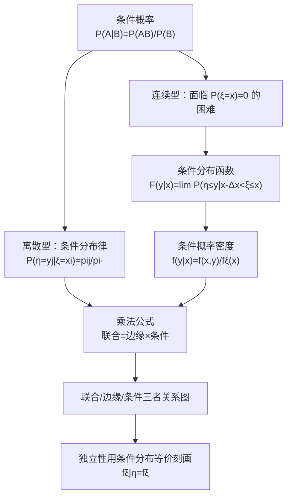
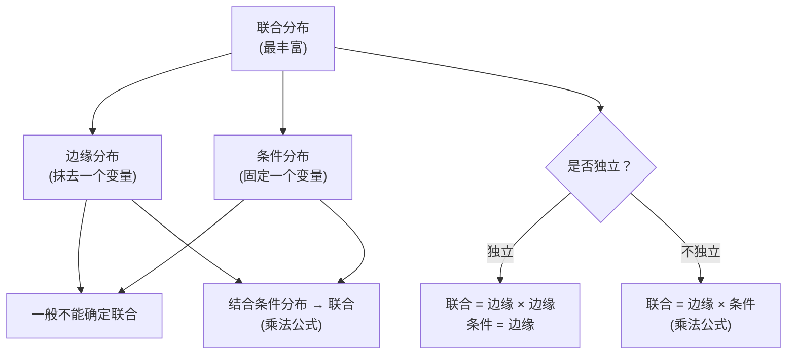
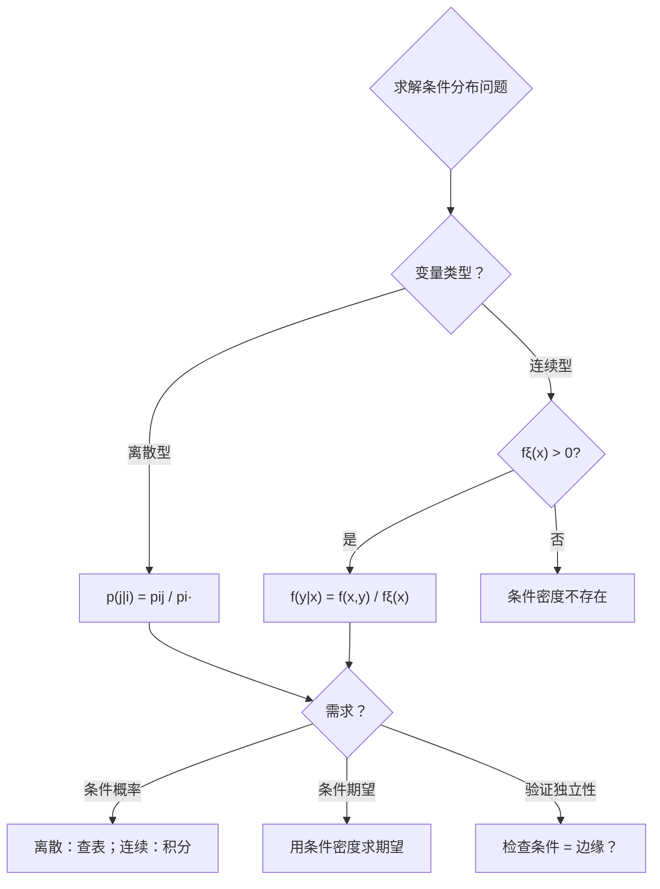

---
subject:
- 概率论
source:
- C3.3 条件分布.md
type: review
tags:
- 条件分布
- 乘法公式
aliases:
- 第3章 条件分布 — 知识点梳理
schema_version: 2
time: "2026-08-31T11:44:20+08:00"
legacy_status: 已完成
legacy_topics:
- 条件分布
- 条件分布律
- 条件概率密度
- 条件分布函数
- 乘法公式
- 联合/边缘/条件分布三者的关系
status: not done
---

## 一、本章核心脉络

**核心问题**：当我们知道了两个随机变量中某一个的取值（例如身高 $\xi = 1.75$m），另一个（体重 $\eta$）的分布会发生怎样的变化？如何用数学工具精确刻画这种"给定条件下的分布"？

> [!info] 学习导读
> **必要先修**：先掌握[[03_Sources/Reviews/概率论/知识点解析梳理/03a-多维随机变量及其分布-知识梳理|联合与边缘分布]]和[[03_Sources/Reviews/概率论/知识点解析梳理/01e-条件概率-知识梳理|条件概率]]。
> **来源边界**：正文依据[[03_Sources/Courses/概率论/PPT课件/MD/C3.3 条件分布|C3.3 课件源文]]重组；“切片归一化”的直觉与自测属于补充解释。
> **阅读路线**：离散条件分布 → 连续情形的零概率困难 → 条件密度 → 联合、边缘、条件三者互换 → 独立性。

这个顺序反映了从离散到连续、从直观到严格的自然过渡：离散型直接套用条件概率公式，连续型则需要极限方法绕过 $P\{\xi = x\} = 0$ 的障碍，最终统一到"条件密度 = 联合密度 / 边缘密度"这一简洁公式。

---

## 二、条件分布律（离散型，核心）

### 2.1 定义与动机

设 $(\xi, \eta)$ 的联合分布律为 $P\{\xi = x_i, \eta = y_j\} = p_{ij}$，$i, j = 1, 2, \ldots$

**动机问题**：已知身高 $\xi$ 固定为 1.75m，体重的分布是怎样的？

**定义 3.3.1** 若 $P\{\xi = x_i\} > 0$，则在事件 $\{\xi = x_i\}$ 发生的条件下，事件 $\{\eta = y_j\}$ 发生的**条件概率**为

$$P\{\eta = y_j \mid \xi = x_i\} = \frac{p_{ij}}{p_{i\cdot}} \triangleq p_{j|i}, \quad j = 1, 2, \ldots$$

> 一句话来说：条件分布律就是把联合分布表的第 $i$ 行**重新归一化**（除以该行的和 $p_{i\cdot}$），使得条件概率之和为 1。

**条件分布律的性质**：

1. $P\{\eta = y_j \mid \xi = x_i\} \geq 0$，$j = 1, 2, \ldots$
2. $\sum_{j=1}^{+\infty} P\{\eta = y_j \mid \xi = x_i\} = 1$

这表明 $\{p_{j|i}\}$ 确实构成一个合法的概率分布。

### 2.2 对称定义

同理，在 $\eta = y_j$ 的条件下，$\xi$ 的条件分布律为

$$P\{\xi = x_i \mid \eta = y_j\} = \frac{p_{ij}}{p_{\cdot j}} \triangleq p_{i|j}, \quad i = 1, 2, \ldots$$

### 2.3 乘法公式（离散型）

由条件分布律的定义可直接推出乘法公式：

$$P\{\xi = x_i, \eta = y_j\} = P\{\eta = y_j\} \cdot P\{\xi = x_i \mid \eta = y_j\}, \quad i,j = 1,2,\ldots$$

> 一句话来说：乘法公式将"联合"分解为"一个边缘"乘以"一个条件"——这种方式更贴近人类的因果思维。

---

## 三、条件分布函数与条件概率密度（连续型，难点）

### 3.1 连续型的困难

离散型中直接用 $P\{\eta = y_j \mid \xi = x_i\}$，但连续型中 $P\{\xi = x\} = 0$，导致条件概率无法直接计算分母。

**解决思路**：不用"$\xi = x$"这个零概率事件，而是考虑"$\xi$ 接近 $x$"——取极限。

### 3.2 条件分布函数的定义

**定义 3.3.2** 给定 $x \in \mathbb{R}$，对任意 $\Delta x > 0$ 有 $P\{x - \Delta x < \xi \leq x\} > 0$，且对任意 $y \in \mathbb{R}$，极限

$$\lim_{\Delta x \to 0^+} P\{\eta \leq y \mid x - \Delta x < \xi \leq x\} = \lim_{\Delta x \to 0^+} \frac{F(x, y) - F(x - \Delta x, y)}{F_{\xi}(x) - F_{\xi}(x - \Delta x)}$$

存在，则称此极限为在 $\xi = x$ 的条件下 $\eta$ 的**条件分布函数**，记作 $F_{\eta|\xi}(y|x)$。

> 一句话来说：连续型条件分布函数是通过"小区间条件概率取极限"来绕开 $P\{\xi = x\} = 0$ 的困境，本质是联合分布函数关于 $x$ 的偏导与边缘分布函数导数的比值。

### 3.3 条件概率密度

若 $(\xi, \eta)$ 是连续型随机变量，$f(x, y)$ 和 $f_{\xi}(x)$ 在 $(x, y)$ 附近连续，且 $f_{\xi}(x) > 0$，则

$$F_{\eta|\xi}(y|x) = \frac{\int_{-\infty}^y f(x, v) \,dv}{\int_{-\infty}^{\infty} f(x, v) \,dv} = \frac{\int_{-\infty}^y f(x, v) \,dv}{f_{\xi}(x)}$$

对 $y$ 求导，得**条件概率密度**：

$$f_{\eta|\xi}(y|x) = F_{\eta|\xi}'(y|x) = \frac{f(x, y)}{f_{\xi}(x)}, \quad y \in \mathbb{R}$$

> 一句话来说：条件概率密度 = 联合概率密度 / 边缘概率密度——形式上与离散型的 $p_{j|i} = p_{ij} / p_{i\cdot}$ 完全统一。

**对称地**，在 $\eta = y$ 的条件下 $\xi$ 的条件概率密度为

$$f_{\xi|\eta}(x|y) = \frac{f(x, y)}{f_{\eta}(y)}, \quad x \in \mathbb{R}$$

### 3.4 条件的本质——"切片归一化"

> 直观理解：$f_{\xi|\eta}(x|y)$ 相当于在联合密度曲面上，沿 $y$ 固定处切一刀，得到的截面曲线（它是 $x$ 的函数），再将其面积归一化到 1。也就是说，条件分布就是在"给定一个坐标"的约束下，看另一个坐标的概率分布。

### 3.5 条件分布的基本性质

条件分布与一般分布具有相同的概率性质：

$$F_{\eta|\xi}(y|x) = \int_{-\infty}^y f_{\eta|\xi}(v|x) \,dv$$

$$\int_{-\infty}^{+\infty} f_{\eta|\xi}(y|x) \,dy = 1$$

在 $\xi = c$ 的条件下，区间概率：

$$P\{a \leq \eta < b \mid \xi = c\} = \int_a^b f_{\eta|\xi}(y|c) \,dy$$

---

## 四、典型例题解析

### 例 3.3.1 — 离散型条件分布律

设 $(\xi, \eta)$ 的联合分布律如下，求 $\eta = 2$ 时 $\xi$ 的条件分布律。

| $\xi$ | 1 | 2 | 3 | 4 |
|:---:|:---:|:---:|:---:|:---:|
| 0 | 1/16 | 1/16 | 1/16 | 1/16 |
| 1 | 1/16 | 3/16 | 1/16 | 0 |

> [!solution]- 点击展开详细解析
> **解**：首先计算边缘：$P\{\eta = 2\} = 1/16 + 3/16 = 1/4$。
>
> $$P\{\xi = 0 \mid \eta = 2\} = \frac{1/16}{1/4} = \frac{1}{4}$$
>
> $$P\{\xi = 1 \mid \eta = 2\} = \frac{3/16}{1/4} = \frac{3}{4}$$
>
> 而 $\xi$ 的**无条件分布**（边缘分布）为 $P\{\xi = 0\} = 5/8$, $P\{\xi = 1\} = 3/8$。
>
> > 点评：条件分布 $(1/4, 3/4)$ 与无条件分布 $(5/8, 3/8)$ 不同，说明 $\xi$ 和 $\eta$ **不独立**——$\eta$ 的取值影响了 $\xi$ 的概率结构。

---

### 例 3.3.2 — 射击问题（条件分布的实际应用）

某射手进行射击，击中目标两次则停止，每次命中率为 $p$。$\xi$ 表示第一次命中时的射击次数，$\eta$ 表示第二次命中时的射击次数。求 $P\{\xi = i \mid \eta = j\}$。

> [!solution]- 点击展开详细解析
> **分析**：联合分布律：
>
> $$P\{\xi = i, \eta = j\} = p^2 (1-p)^{j-2}, \quad 1 \leq i < j, \; j = 2, 3, \ldots$$
>
> 边缘分布律（通过求和）：
>
> $$P\{\eta = j\} = \sum_{i=1}^{j-1} p^2 (1-p)^{j-2} = (j-1) p^2 (1-p)^{j-2}, \quad j = 2, 3, \ldots$$
>
> 条件分布律：
>
> $$P\{\xi = i \mid \eta = j\} = \frac{p^2 (1-p)^{j-2}}{(j-1) p^2 (1-p)^{j-2}} = \frac{1}{j-1}, \quad i = 1, 2, \ldots, j-1$$
>
> > 点评：这是一个漂亮的结果——已知第二次命中发生在第 $j$ 次射击，则第一次命中均匀地分布在 $1, 2, \ldots, j-1$ 之中。这是射击的"无记忆性"的一种体现。

---

### 例 3.3.3 — 矿山事故问题（条件分布 + 全概率）

某矿山一年内事故总数 $\xi \sim P(\lambda)$（泊松分布），一个事故是致命的概率为 $p$。设一年内致命事故次数为 $\eta$，求 $\eta$ 的分布律。

> [!solution]- 点击展开详细解析
> **解**：已知 $P\{\xi = k\} = \frac{\lambda^k}{k!} e^{-\lambda}$，$(k = 0, 1, 2, \ldots)$。
>
> 在 $\{\xi = k\}$ 的条件下，$\eta$ 的条件分布律为二项分布（$k$ 次独立试验，每次致命概率 $p$）：
>
> $$P\{\eta = m \mid \xi = k\} = C_k^m p^m (1-p)^{k-m}, \quad m = 0, 1, \ldots, k$$
>
> 通过乘法公式得联合分布律：
>
> $$P\{\xi = k, \eta = m\} = P\{\xi = k\} \cdot P\{\eta = m \mid \xi = k\} = \frac{\lambda^k}{k!} e^{-\lambda} \cdot C_k^m p^m (1-p)^{k-m}$$
>
> 通过全概率公式（对 $k$ 求和）得 $\eta$ 的边缘分布：
>
> $$P\{\eta = m\} = \sum_{k=m}^{\infty} \frac{\lambda^k}{k!} e^{-\lambda} C_k^m p^m (1-p)^{k-m} = \frac{(\lambda p)^m}{m!} e^{-\lambda p}, \quad m = 0, 1, 2, \ldots$$
>
> > 点评：$\eta \sim P(\lambda p)$！致命事故次数仍然是泊松分布，参数是 $\lambda p$——这是一个非常优雅的结果。解题的关键链条是：边缘（$\xi$）$\to$ 条件（$\eta|\xi$）$\to$ 联合 $\to$ 边缘（$\eta$）。

---

### 例 3.3.4 — 二维均匀分布的条件分布

设 $(\xi, \eta)$ 在 $D = \{(x, y): 0 \leq x \leq 1, 0 \leq x + y/2 \leq 1, 0 \leq y\}$ 上服从均匀分布。求 $f_{\xi|\eta}(x|y)$ 和 $f_{\eta|\xi}(y|x)$。

> [!solution]- 点击展开详细解析
> **解**：联合密度 $f(x, y) = \begin{cases} 1, & (x, y) \in D \\ 0, & (x, y) \notin D \end{cases}$。
>
> 求边缘密度：
>
> $$f_{\xi}(x) = \begin{cases} \int_0^{2(1-x)} 1 \,dy = 2(1-x), & 0 < x < 1 \\ 0, & \text{其他} \end{cases}$$
>
> $$f_{\eta}(y) = \begin{cases} \int_0^{1-y/2} 1 \,dx = 1 - y/2, & 0 < y < 2 \\ 0, & \text{其他} \end{cases}$$
>
> 当 $0 < x < 1$ 时，
>
> $$f_{\eta|\xi}(y|x) = \frac{f(x, y)}{f_{\xi}(x)} = \begin{cases} \frac{1}{2(1-x)}, & 0 < y < 2(1-x) \\ 0, & \text{其他} \end{cases}$$
>
> 当 $0 < y < 2$ 时，
>
> $$f_{\xi|\eta}(x|y) = \frac{f(x, y)}{f_{\eta}(y)} = \begin{cases} \frac{1}{1 - y/2}, & 0 < x < 1 - y/2 \\ 0, & \text{其他} \end{cases}$$
>
> > 核心结论：**二维均匀分布的条件分布是一维均匀分布**——给定一个坐标后，另一个坐标在相应区间上均匀分布。
>
> 验证条件概率：
>
> $$P\{0 < \xi < 0.5 \mid \eta = 0.5\} = \int_0^{0.5} \frac{1}{3/4} \,dx = \frac{2}{3}$$

---

### 例 3.3.5 — 复杂区域的条件密度（难点）

设 $(\xi, \eta)$ 的联合概率密度为

$$f(x, y) = \begin{cases} 1, & 0 \leq x \leq 2, \max(0, x-1) \leq y \leq \min(1, x) \\ 0, & \text{其他} \end{cases}$$

求 $f_{\eta|\xi}(y|x)$，并计算 $P\{0 < \eta < 0.5 \mid \xi = 1.2\}$。

> [!solution]- 点击展开详细解析
> **分析难点**：$f(x, y)$ 的非零区域是一个平行四边形带，需要分段处理。
>
> **解**：先求边缘密度 $f_{\xi}(x)$：
>
> $$f_{\xi}(x) = \begin{cases} \int_0^x 1 \,dy = x, & 0 \leq x \leq 1 \\ \int_{x-1}^1 1 \,dy = 2 - x, & 1 < x \leq 2 \\ 0, & \text{其他} \end{cases}$$
>
> 条件密度 $f_{\eta|\xi}(y|x)$：
>
> - 当 $0 < x \leq 1$ 时（$f_{\xi}(x) = x > 0$）：
>
> $$f_{\eta|\xi}(y|x) = \begin{cases} 1/x, & 0 < y < x \\ 0, & \text{其他} \end{cases}$$
>
> - 当 $1 < x < 2$ 时（$f_{\xi}(x) = 2 - x > 0$）：
>
> $$f_{\eta|\xi}(y|x) = \begin{cases} 1/(2-x), & x-1 < y < 1 \\ 0, & \text{其他} \end{cases}$$
>
> - 当 $x \notin (0, 2)$ 时，$f_{\xi}(x) = 0$，条件密度不存在。
>
> 计算条件概率（$x = 1.2$ 属于第二种情况）：
>
> $$P\{0 < \eta < 0.5 \mid \xi = 1.2\} = \int_{0}^{0.5} f_{\eta|\xi}(y|1.2) \,dy = \int_{0.2}^{0.5} \frac{1}{0.8} \,dy = 0.375$$
>
> 注意积分下限不是 0 而是 $x-1 = 0.2$——条件密度的非零区间是 $[0.2, 1]$，$[0, 0.2)$ 内密度为 0。
>
> > 点评：条件概率计算中最易错的是**积分上下限**——需要交叉参考联合密度的非零区域和条件密度的非零区间。

---

## 五、条件分布与独立性（核心联系）

### 5.1 用条件分布等价刻画独立

| 类型 | $\xi$ 与 $\eta$ 相互独立的充要条件 |
|:-----|:-----|
| 一般情形 | $F_{\xi|\eta}(x|y) = F_{\xi}(x)$，对所有 $(x, y) \in \mathbb{R}^2$ |
| 离散型 | $P\{\xi = x_i \mid \eta = y_j\} = P\{\xi = x_i\}$，对所有 $(x_i, y_j)$ |
| 连续型 | $f_{\xi|\eta}(x|y) = f_{\xi}(x)$，在几乎所有 $(x, y)$ 处成立 |

> 一句话来说：$\xi$ 与 $\eta$ 独立 $\Leftrightarrow$ 给定 $\eta$ 不改变 $\xi$ 的概率分布——条件分布退化为无条件（边缘）分布。

**对称等价**：
- 独立 $\Leftrightarrow$ $F_{\eta|\xi}(y|x) = F_{\eta}(y)$
- 独立 $\Leftrightarrow$ $f_{\eta|\xi}(y|x) = f_{\eta}(y)$
- 独立 $\Leftrightarrow$ $P\{\eta = y_j \mid \xi = x_i\} = P\{\eta = y_j\}$

---

## 六、边缘分布、条件分布与联合分布的关系（本章综合）

三者之间的完整关系图：

**三条核心结论**：

1. **联合分布 $\Rightarrow$ 边缘分布和条件分布**（往前可推）
2. **边缘分布 + 相应的条件分布 $\Rightarrow$ 联合分布**（乘法公式：联合 = 边缘 × 条件）
3. **边缘分布单独 $\Rightarrow$ 联合分布**（一般不能，仅在独立时可以）

---

## 七、二维正态分布的条件分布（重要结论）

> **重要结论**：二维正态分布 $(\xi, \eta) \sim N(\mu_1, \sigma_1^2; \mu_2, \sigma_2^2; \rho)$ 的条件分布**仍然是正态分布**。

$$\xi = x \text{ 时}, \quad \eta \sim N\left(\mu_2 + \rho \frac{\sigma_2}{\sigma_1}(x - \mu_1), \; \sigma_2^2 (1 - \rho^2)\right)$$

$$\eta = y \text{ 时}, \quad \xi \sim N\left(\mu_1 + \rho \frac{\sigma_1}{\sigma_2}(y - \mu_2), \; \sigma_1^2 (1 - \rho^2)\right)$$

> 一句话来说：二维正态的条件分布仍为一维正态；条件均值随给定值线性调整（回归直线），条件方差缩小为原方差的 $(1 - \rho^2)$ 倍——相关系数 $|\rho|$ 越大，条件方差越小（信息越多，不确定越小）。

**参数解读**：
- 条件均值（回归线）：$\mu_2 + \rho \frac{\sigma_2}{\sigma_1}(x - \mu_1)$——一条过 $(\mu_1, \mu_2)$ 的直线
- 条件方差：$\sigma_2^2(1 - \rho^2)$——与 $x$ **无关**（等方差性）
- 特殊情形 $\rho = 0$：条件分布 = 无条件分布（回归线退化为水平线，独立）

**证明要点**（从条件密度定义出发）：

$$f_{\eta|\xi}(y|x) = \frac{f(x, y)}{f_{\xi}(x)} = \frac{\frac{1}{2\pi\sigma_1\sigma_2\sqrt{1-\rho^2}} \exp\{\cdots\}}{\frac{1}{\sqrt{2\pi}\sigma_1} \exp[-\frac{1}{2}(\frac{x-\mu_1}{\sigma_1})^2]}$$

化简后即得 $N(\mu_2 + \rho \frac{\sigma_2}{\sigma_1}(x - \mu_1), \sigma_2^2(1 - \rho^2))$ 的密度形式。

---

## 八、判定/决策流程

---

## 九、核心公式速查表

| 概念 | 离散型 | 连续型 |
|:-----|:-----|:-----|
| **条件分布（$\eta$ 给定 $\xi = x_i$）** | $P\{\eta = y_j \mid \xi = x_i\} = \frac{p_{ij}}{p_{i\cdot}}$ | $f_{\eta|\xi}(y|x) = \frac{f(x, y)}{f_{\xi}(x)}$ |
| **条件分布（$\xi$ 给定 $\eta = y_j$）** | $P\{\xi = x_i \mid \eta = y_j\} = \frac{p_{ij}}{p_{\cdot j}}$ | $f_{\xi|\eta}(x|y) = \frac{f(x, y)}{f_{\eta}(y)}$ |
| **乘法公式** | $p_{ij} = p_{i\cdot} \cdot p_{j|i} = p_{\cdot j} \cdot p_{i|j}$ | $f(x, y) = f_{\xi}(x) f_{\eta|\xi}(y|x) = f_{\eta}(y) f_{\xi|\eta}(x|y)$ |
| **条件分布函数** | $F_{\eta|\xi}(y|x_i) = \sum_{y_j \leq y} p_{j|i}$ | $F_{\eta|\xi}(y|x) = \int_{-\infty}^y f_{\eta|\xi}(v|x) \,dv$ |
| **归一化** | $\sum_j p_{j|i} = 1$ | $\int_{-\infty}^{+\infty} f_{\eta|\xi}(y|x) \,dy = 1$ |
| **条件区间概率** | $\sum_{y_j \in [a,b)} p_{j|i}$ | $P\{a \leq \eta < b \mid \xi = c\} = \int_a^b f_{\eta|\xi}(y|c) \,dy$ |
| **独立等价条件** | $p_{j|i} = p_{\cdot j}$，$\forall i,j$ | $f_{\eta|\xi}(y|x) = f_{\eta}(y)$，a.e. |

---

## 十、易错点与注意事项

> [!warning] 易错点与注意事项

1. **连续型条件分布不能直接套用条件概率公式**：
   - $P\{\eta = y \mid \xi = x\} \neq \frac{f(x, y)}{f_{\xi}(x)}$（这是密度比，不是概率）
   - 必须通过条件概率密度 $f_{\eta|\xi}(y|x)$ 进行积分来求条件概率

2. **条件密度存在的条件**：$f_{\xi}(x) > 0$。若 $f_{\xi}(x) = 0$，$f_{\eta|\xi}(y|x)$ 无定义。

3. **条件概率计算中积分上下限容易出错**（例 3.3.5 的典型陷阱）：
   - 条件密度的非零区间 $\neq$ 联合密度的非零区间的截面（$y$ 的范围可能变化）
   - 必须先确定条件密度的完整表达式，再在其非零区间上积分

4. **条件分布与独立性的关系——区分"必要条件"和"充分条件"**：
   - 独立 $\Rightarrow$ 条件分布 = 边缘分布 ✓
   - 条件分布 = 边缘分布 $\Rightarrow$ 独立 ✓（等价！）
   - 但"条件分布不等于边缘分布"只说明不独立，无法推断具体的依赖形式

5. **乘法公式的方向选择**：
   - $f(x,y) = f_{\xi}(x) \cdot f_{\eta|\xi}(y|x) = f_{\eta}(y) \cdot f_{\xi|\eta}(x|y)$
   - 选择哪一个方向取决于哪个边缘和哪个条件更容易计算

6. **二维均匀 $\Rightarrow$ 条件分布为一维均匀**，二维正态 $\Rightarrow$ 条件分布为一维正态。这是两个重要的"不变性"结论，但注意其他分布一般没有这种不变性。

---

## 十一、自测（新编）

沿用 $f(x,y)=2$（$0<x<y<1$）的联合密度，求给定 $X=x$ 时 $Y$ 的条件密度。

> [!hint]- 提示
> 使用 $f_{Y\mid X}(y\mid x)=f(x,y)/f_X(x)$，并保留切片后的支撑范围。

> [!solution]- 解析
> 由 $f_X(x)=2(1-x)$，得 $f_{Y\mid X}(y\mid x)=1/(1-x)$，其中 $x<y<1$、$0<x<1$；其他处为 $0$。这就是在区间 $(x,1)$ 上的均匀分布。

## 十二、相关知识点链接

- [[03_Sources/Courses/概率论/PPT课件/MD/C1.3 概率模型与公理化结构]]：条件概率 $P(A|B) = P(AB)/P(B)$ 是本章条件分布律的直接来源
- [[03_Sources/Courses/概率论/PPT课件/MD/C3.1 多维随机变量及其分布]]：联合分布函数和边缘分布函数是计算条件分布的必要基础
- [[03_Sources/Courses/概率论/PPT课件/MD/C3.2 随机变量的独立性]]：条件分布提供了独立性的替代等价定义——条件等于边缘即独立
- [[03_Sources/Courses/概率论/PPT课件/MD/C4.3 条件数学期望与方差]]：本章的条件分布概念将直接推广到条件期望

---

## 十三、作业与练习

- 本节思考题（2 题）
- 教材 P152 条件分布函数的推导
- 重点练习：离散型条件分布律的归一化计算、连续型条件密度的分段确定（特别注意积分上下限）、联合/边缘/条件三者的相互转化

## 可复用知识条目

本章涉及以下独立条目；后续补充与跨课程应用统一维护在条目中。

### 概念入口

- [[01_Knowledge/条件概率与条件期望|条件概率与条件期望]]
- [[01_Knowledge/概率密度|概率密度]]
