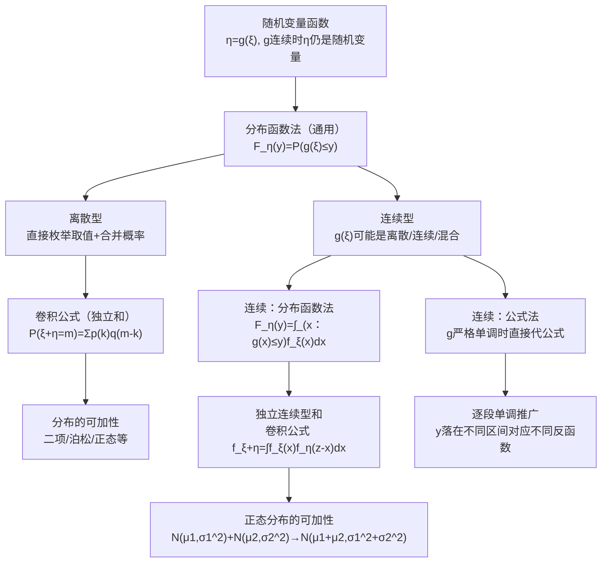

---
subject:
- 概率论
source:
- C3.4 随机变量函数的分布.md
type: review
tags:
- 随机变量函数
- 分布函数法
- 公式法
- 单调函数
- 卷积公式
- 独立随机变量和
- 分布可加性
aliases:
- 第3章 随机变量函数的分布 — 知识点梳理
schema_version: 2
time: "2026-08-31T11:44:20+08:00"
legacy_status: 已完成
legacy_topics:
- 随机变量函数
- 分布函数法
- 公式法
- 单调函数
- 卷积公式
- 独立随机变量和
- 分布可加性
- 正态分布可加性
- 逆变换法
status: not done
---

## 一、本章核心脉络

**核心问题**：已知随机变量 $\xi$ 的分布，如何求其函数 $\eta = g(\xi)$ 的分布？更进一步，已知多维随机变量 $(\xi_1, \ldots, \xi_n)$ 的联合分布，如何求 $\eta = g(\xi_1, \ldots, \xi_n)$ 的分布？

> [!info] 学习导读
> **必要先修**：回看[[03_Sources/Reviews/概率论/知识点解析梳理/02a-随机变量及分布函数-知识梳理|分布函数法]]、[[03_Sources/Reviews/概率论/知识点解析梳理/03a-多维随机变量及其分布-知识梳理|联合密度]]与积分换元。
> **来源边界**：正文依据[[03_Sources/Courses/概率论/PPT课件/MD/C3.4 随机变量函数的分布|C3.4 课件源文]]重组；方法对照与自测属于补充学习内容。
> **阅读路线**：先用通用分布函数法，再学习离散合并、单调变换公式、卷积以及和/积/商/极值的专门方法。



这个顺序体现了"通用方法先行，具体技巧随后"的逻辑：分布函数法 $F_\eta(y) = P\{g(\xi) \leq y\}$ 是解决一切函数分布问题的根本武器，在此基础上分化为离散（直接枚举）和连续（积分）两条路径；当函数形式特殊时（如线性、单调），可借助公式法简化计算。

---

## 二、随机变量函数的基本概念（核心）

### 2.1 问题的由来

实际中往往需要研究随机变量的函数。例如：
- 已知圆盘半径 $\xi$ 的分布，求面积 $\eta = \pi \xi^2$ 的分布
- 已知电压 $\xi$ 和电阻 $\eta$ 的联合分布，求功率 $\zeta = \xi^2 / \eta$ 的分布
- 已知多个独立元件寿命的分布，求串联系统寿命 $\zeta = \min\{\xi_1, \ldots, \xi_n\}$ 的分布

### 2.2 随机变量函数的性质

**定理** 若 $\xi$ 是随机变量，$g(x)$ 是连续函数，则 $\eta = g(\xi)$ 也是随机变量。

> 一句话来说：连续函数保持"随机变量性"——对连续函数 $g$，$\eta = g(\xi)$ 仍然满足随机变量的定义（即可测性），不需要额外验证。

**推广到多维**：若 $(\xi_1, \xi_2, \ldots, \xi_n)$ 是 $n$ 维随机变量，$g_i(x_1, x_2, \ldots, x_n)$（$i = 1, 2, \ldots, m$）是 $m$ 个 $n$ 元连续函数，则

$$\eta_i = g_i(\xi_1, \xi_2, \ldots, \xi_n), \quad i = 1, 2, \ldots, m$$

都是随机变量，且 $(\eta_1, \eta_2, \ldots, \eta_m)$ 是 $m$ 维随机变量。

**直观理解**：多维随机变量通过连续变换得到的仍是随机向量——这与微积分中"连续函数之复合仍连续"完全对应。

---

## 三、分布函数法——求随机变量函数分布的通用方法（本章核心）

### 3.1 基本思想

对任意随机变量 $\xi$ 和函数 $g$，求 $\eta = g(\xi)$ 的分布函数：

$$F_\eta(y) = P\{\eta \leq y\} = P\{g(\xi) \leq y\}$$

> 一句话来说：不直接求 $\eta$ 的分布，而是把"$\eta \leq y$"这个事件翻译成"$\xi$ 满足某个条件"的事件，利用 $\xi$ 的已知分布来计算概率。

### 3.2 多维推广

设 $(\xi_1, \ldots, \xi_n)$ 有已知联合分布，$\eta_i = g_i(\xi_1, \ldots, \xi_n)$，则 $(\eta_1, \ldots, \eta_m)$ 的联合分布函数为：

$$F_{\eta_1,\ldots,\eta_m}(y_1, \ldots, y_m) = P\{g_1(\xi_1,\ldots,\xi_n) \leq y_1, \ldots, g_m(\xi_1,\ldots,\xi_n) \leq y_m\}$$

$$= P\{(\xi_1,\ldots,\xi_n) \in B(y_1,\ldots,y_m)\}$$

其中 $B = \{(x_1,\ldots,x_n): g_i(x_1,\ldots,x_n) \leq y_i, i=1,\ldots,m\}$。

**单个分量**的边缘分布：

$$F_{\eta_1}(y_1) = P\{\eta_1 \leq y_1\} = P\{g_1(\xi_1,\ldots,\xi_n) \leq y_1\}$$

---

## 四、离散型随机变量函数的分布（核心）

### 4.1 一维离散型

设 $\xi$ 的分布律为 $P\{\xi = x_i\} = p_i$，$i = 1, 2, \ldots$。则 $\eta = h(\xi)$ 的分布律为：

$$P\{\eta = y_j\} = \sum_{x_i: h(x_i) = y_j} P\{\xi = x_i\}$$

> 一句话来说：先算出所有可能的函数值 $h(x_i)$ 作为 $\eta$ 的取值，再把相同函数值对应的多个 $x_i$ 的概率加起来。

**步骤**：
1. 列出 $\xi$ 的所有可能取值 $x_1, x_2, \ldots$ 和对应概率 $p_1, p_2, \ldots$
2. 计算 $h(x_1), h(x_2), \ldots$，这些值（去重后）就是 $\eta$ 的可能取值
3. 对 $\eta$ 的每个可能取值 $y_j$，累加所有满足 $h(x_i) = y_j$ 的 $p_i$

### 4.2 二维离散型

设 $(\xi, \eta)$ 的联合分布律为 $P\{\xi = x_i, \eta = y_j\} = p_{ij}$，则 $\zeta = g(\xi, \eta)$ 的分布律为：

$$P\{\zeta = z_k\} = \sum_{(x_i, y_j): g(x_i, y_j) = z_k} p_{ij}$$

**总结口诀**：可能取值——计算所有可能的函数值；取值概率——合并相同函数值对应的取值点概率。

### 4.3 独立离散型随机变量和的分布——卷积公式（重点）

**定理 3.4.1** 设 $\xi$ 和 $\eta$ 是相互独立的离散型随机变量，分布律分别为：

$$P\{\xi = k\} = p(k), \quad k = 0, 1, 2, \ldots$$
$$P\{\eta = r\} = q(r), \quad r = 0, 1, 2, \ldots$$

则 $\xi + \eta$ 的分布律为：

$$P\{\xi + \eta = m\} = \sum_{k=0}^{m} p(k) \, q(m - k), \quad m = 0, 1, 2, \ldots \tag{3.4.3}$$

> 一句话来说：独立随机变量和的分布律是各自分布律的**离散卷积**——$m$ 的概率等于所有能凑出 $m$ 的 $(k, m-k)$ 组合的概率之和。

**直观理解**：要使得 $\xi + \eta = m$，$\xi$ 可以取 $0, 1, \ldots, m$，对应的 $\eta$ 取 $m - k$。由于独立，每种情况的概率是 $p(k) \cdot q(m-k)$，全部加起来。

---

## 五、分布的可加性（了解即可）

### 5.1 定义

若独立随机变量 $\xi_1, \ldots, \xi_n$ 服从同一类型的分布（参数可以不同），且其和 $\xi_1 + \cdots + \xi_n$ 仍服从该类型的分布（参数变为各参数之和），则称该分布具有**可加性**。

### 5.2 具有可加性的分布

| 分布类型 | 可加性表述 |
|:--|:--|
| 二项分布 | $\xi_i \sim B(n_i, p)$ 独立 $\Rightarrow \sum \xi_i \sim B(\sum n_i, p)$ |
| 泊松分布 | $\xi_i \sim P(\lambda_i)$ 独立 $\Rightarrow \sum \xi_i \sim P(\sum \lambda_i)$ |
| 正态分布 | $\xi_i \sim N(\mu_i, \sigma_i^2)$ 独立 $\Rightarrow \sum \xi_i \sim N(\sum \mu_i, \sum \sigma_i^2)$ |
| Gamma分布 | $\xi_i \sim \Gamma(\alpha_i, \beta)$ 独立 $\Rightarrow \sum \xi_i \sim \Gamma(\sum \alpha_i, \beta)$（相同尺度参数） |

**注意**：几何分布、超几何分布、负二项分布（$r$ 不同时）**不具有**可加性。

**二项分布可加性的深层含义**：$B(n, p)$ 可以看成 $n$ 个独立 $B(1, p)$（0-1 分布）随机变量之和——这是二项分布的本质，也是其可加性的根源。

---

## 六、连续型随机变量函数的分布（本章核心）

### 6.1 分布函数法（连续型）

当 $\xi$ 是连续型随机变量时，求 $\eta = g(\xi)$ 的分布：

$$F_\eta(y) = P\{g(\xi) \leq y\} = \int_{\{x: g(x) \leq y\}} f_\xi(x) \, dx$$

然后对 $F_\eta(y)$ 求导得到概率密度：$f_\eta(y) = F_\eta'(y)$（在连续点处）。

> 一句话来说：把条件 $g(x) \leq y$ 解出来，得到 $x$ 的取值范围（可能是几个区间的并集），在那些区间上对 $\xi$ 的密度函数积分。

**三种可能结果**：
1. $g(\xi)$ 是离散型——只需找到所有可能取值并计算对应的概率
2. $g(\xi)$ 是连续型——用分布函数法求出 $F_\eta(y)$ 再求导
3. $g(\xi)$ 是混合型——仍用分布函数法，但注意在某些特殊 $y$ 处 $F_\eta(y)$ 可能有跳跃

### 6.2 公式法——单调情形（难点）

**定理（公式法，单调情形）** 设 $\xi$ 有概率密度 $p(x)$，$y = g(x)$ 严格单调，其反函数 $x = h(y) = g^{-1}(y)$ 有连续导函数，则 $\eta = g(\xi)$ 是连续型随机变量，其概率密度为：

$$q(y) = p[h(y)] \cdot |h'(y)| \tag{3.3.12}$$

> 一句话来说：公式法的本质是积分换元——把 $F_\eta(y) = P\{g(\xi) \leq y\}$ 中关于 $x$ 的积分，通过 $x = h(y)$ 进行变量替换，再对 $y$ 求导即得。

**证明核心洞察**：

记 $S(a) = \{x: g(x) < a\}$（严格单调时就是 $x < h(a)$ 或 $x > h(a)$），则

$$P\{\eta < a\} = P\{\xi \in S(a)\} = \int_{S(a)} p(x) dx$$

作积分换元 $x = h(y)$，令 $dx = h'(y) dy$，积分限变为 $y$ 从 $-\infty$ 到 $a$：

$$\int_{S(a)} p(x) dx = \int_{-\infty}^{a} p[h(y)] |h'(y)| dy$$

对 $a$ 求导即得 $q(a) = p[h(a)] \cdot |h'(a)|$。**关键是绝对值**——无论 $g$ 单调增还是单调减，$|h'(y)|$ 保证密度非负。

### 6.3 公式法——逐段单调情形

**定理（逐段单调推广）** 若 $y = g(x)$ 在不相重叠的区间 $I_1, I_2, \ldots$ 上逐段严格单调，在各段上的反函数分别为 $h_1(y), h_2(y), \ldots$，且 $h_i'(y)$ 均连续，则 $\eta = g(\xi)$ 的概率密度为：

$$q(y) = p[h_1(y)] \cdot |h_1'(y)| + p[h_2(y)] \cdot |h_2'(y)| + \cdots \tag{3.3.14}$$

> 一句话来说：逐段单调时，同一个 $y$ 可能对应多个 $x$（每个单调段各一个），把各段的贡献**加起来**即可。

**直观理解**：以 $y = x^2$ 为例，$y > 0$ 时对应的 $x$ 有两个——$x = \sqrt{y}$（在 $[0, +\infty)$ 段）和 $x = -\sqrt{y}$（在 $(-\infty, 0]$ 段）。密度等于两段贡献之和。

---

## 七、独立连续型随机变量和的分布——卷积公式（核心）

### 7.1 连续型卷积公式

若 $\xi$ 和 $\eta$ 相互独立，概率密度分别为 $f_\xi(x)$ 和 $f_\eta(y)$，则 $\zeta = \xi + \eta$ 的概率密度为：

$$f_\zeta(z) = \int_{-\infty}^{+\infty} f_\xi(x) \, f_\eta(z - x) \, dx$$

> 一句话来说：独立连续型随机变量和的密度是各自密度的**连续卷积**——对每个可能的 $x$，对应的 $\eta$ 取 $z - x$，密度相乘后遍历所有 $x$ 积分。

**推导思路**：先用分布函数法 $F_\zeta(z) = P\{\xi + \eta \leq z\}$，在 $xOy$ 平面上区域为 $x + y \leq z$，写成二重积分后对 $y$ 先积分一次，再对 $z$ 求导即得。

### 7.2 典型例题

**例 3.4.9** 若 $\xi, \eta$ 相互独立，$\xi \sim N(0, 1)$，$\eta \sim N(0, 1)$，求 $\xi + \eta$ 的概率密度。

> [!solution]- 点击展开详细解析
> **解**：
>
> $$f_{\xi+\eta}(z) = \int_{-\infty}^{+\infty} f_\xi(x) f_\eta(z - x) dx = \frac{1}{2\pi} \int_{-\infty}^{+\infty} e^{-\frac{x^2}{2}} e^{-\frac{(z-x)^2}{2}} dx$$
>
> $$= \frac{1}{2\pi} e^{-\frac{z^2}{4}} \int_{-\infty}^{+\infty} e^{-(x - \frac{z}{2})^2} dx = \frac{1}{2\sqrt{\pi}} e^{-\frac{z^2}{4}}$$
>
> **结论**：$\xi + \eta \sim N(0, 2)$。
>
> **推广**：若 $\xi \sim N(\mu_1, \sigma_1^2)$，$\eta \sim N(\mu_2, \sigma_2^2)$，且相互独立，则
>
> $$\xi + \eta \sim N(\mu_1 + \mu_2, \sigma_1^2 + \sigma_2^2)$$
>
> 这就是**正态分布的可加性**——均值相加，方差相加。

---

## 八、商的分布与 $\max/\min$ 分布（了解即可）

### 8.1 商的分布

若 $\xi$ 和 $\eta$ 相互独立，密度分别为 $f_\xi(x)$ 和 $f_\eta(y)$（$f_\eta(y) = 0, \forall y \leq 0$），则 $\zeta = \xi / \eta$ 的概率密度为：

$$f_{\frac{\xi}{\eta}}(z) = \int_{-\infty}^{+\infty} |y| \, f_\xi(yz) \, f_\eta(y) \, dy$$

### 8.2 积的分布

$$f_{\xi \cdot \eta}(z) = \int_{-\infty}^{+\infty} \frac{1}{|y|} f_\xi\left(\frac{z}{y}\right) f_\eta(y) \, dy$$

---

## 九、正态分布线性变换与标准化（核心）

**例 3.4.11** 若 $\xi \sim N(\mu, \sigma^2)$，则 $\eta = a\xi + b$（$a \neq 0$）服从正态分布 $N(a\mu + b, a^2\sigma^2)$。

> [!solution]- 点击展开详细解析
> > 一句话来说：正态随机变量的线性函数仍是正态的，均值线性变换，方差按 $a^2$ 缩放。
>
> **证明**：由公式法
>
> $$f_\eta(y) = \frac{1}{|a|} f_\xi\left(\frac{y - b}{a}\right) = \frac{1}{|a|\sqrt{2\pi}\sigma} e^{-\frac{(\frac{y-b}{a} - \mu)^2}{2\sigma^2}} = \frac{1}{\sqrt{2\pi}|a|\sigma} e^{-\frac{[y - (a\mu + b)]^2}{2a^2\sigma^2}}$$
>
> **标准化变换**（重点）：取 $a = \frac{1}{\sigma}$，$b = -\frac{\mu}{\sigma}$，则
>
> $$\eta = \frac{\xi - \mu}{\sigma} \sim N(0, 1)$$
>
> 标准化后的随机变量服从标准正态分布，这是查表和假设检验的基础。

---

## 十、逆变换法——随机模拟的应用（了解即可）

若 $Z$ 是分布函数 $F_Z(z)$ 严格单调递增的连续型随机变量，$X \sim U[0, 1]$，则

$$Y = F_Z^{-1}(X)$$

具有与 $Z$ 相同的分布。

**证明思路**：

$$F_Y(y) = P\{Y \leq y\} = P\{F_Z^{-1}(X) \leq y\} = P\{X \leq F_Z(y)\} = \frac{F_Z(y) - 0}{1 - 0} = F_Z(y)$$

**实际意义**：只要能在计算机上生成均匀分布 $U[0, 1]$ 的随机数，就可以通过反函数变换生成任意（严格单调分布函数的）分布的随机数。

---

## 判定/决策流程

```mermaid
flowchart TD
    A["求 η=g(ξ) 的分布"] --> B{ξ 是离散型?}
    B -->|是| C["枚举所有 h(x_i)\n合并相同值的概率"]
    B -->|否| D{"g(x) 是否严格单调\n且有连续导数的反函数?"}
    D -->|是| E[""公式法\nq(y)=p[h(y)"]|h'(y)|"]
    D -->|否| F{"g(x) 是否逐段单调?"}
    F -->|是| G[""逐段公式法\nq(y)=Σ p[h_i(y)"]|h_i'(y)|"]
    F -->|否| H["分布函数法（通用）\nF_η(y)=P(g(ξ)≤y)\n=∫_(x：g(x)≤y) f_ξ(x)dx\n求导得密度"]
    C --> I["若是独立和 可简化为卷积"]
    E --> I
    G --> I
    H --> I
```

---

## 核心公式速查表

| 场景 | 公式 | 条件 |
|:--|:--|:--|
| 分布函数法（通用） | $F_\eta(y) = P\{g(\xi) \leq y\}$ | 无限制 |
| 离散型函数分布 | $P\{\eta = y_j\} = \sum_{h(x_i)=y_j} P\{\xi = x_i\}$ | $\xi$ 离散 |
| 离散卷积 | $P\{\xi+\eta=m\} = \sum_k p(k) q(m-k)$ | $\xi, \eta$ 独立离散 |
| 公式法（单调） | $q(y) = p[h(y)] \cdot \|h'(y)\|$ | $g$ 严格单调，$h = g^{-1}$ 有连续导数 |
| 公式法（逐段单调） | $q(y) = \sum_i p[h_i(y)] \cdot \|h_i'(y)\|$ | $g$ 在 $I_i$ 上逐段单调 |
| 连续卷积 | $f_{\xi+\eta}(z) = \int f_\xi(x) f_\eta(z-x) dx$ | $\xi, \eta$ 独立连续 |
| 商的分布 | $f_{\xi/\eta}(z) = \int \|y\| f_\xi(yz) f_\eta(y) dy$ | $\xi, \eta$ 独立 |
| 正态线性变换 | $\xi \sim N(\mu,\sigma^2) \Rightarrow a\xi+b \sim N(a\mu+b, a^2\sigma^2)$ | $a \neq 0$ |
| 正态可加性 | $N(\mu_1,\sigma_1^2)+N(\mu_2,\sigma_2^2) \sim N(\mu_1+\mu_2,\sigma_1^2+\sigma_2^2)$ | 独立 |
| 标准化 | $\frac{\xi - E(\xi)}{\sqrt{D(\xi)}}$ 均值为 0，方差为 1 | $D(\xi) > 0$ |

---

## 易错点与注意事项

> [!warning] **易错点与注意事项**

**1. 公式法中绝对值不能丢**

公式 $q(y) = p[h(y)] \cdot |h'(y)|$ 中的绝对值是必需的。反函数的导数 $h'(y) = 1 / g'(x)$，无论 $g'(x)$ 正负，概率密度必须非负。

**2. 分布函数法 vs 公式法的选择**

- **必要条件**：公式法要求 $g(x)$ 严格单调（或逐段严格单调），反函数有连续导数。不满足时必须用分布函数法。
- **充分条件不是必要条件**：即使满足公式法条件，分布函数法也总是对的——公式法只是分布函数法的特例。

**3. 逐段单调时别忘了"加"**

$y = x^2$ 在 $x \in (-\infty, 0]$ 和 $x \in [0, +\infty)$ 各有一段，密度需要**两段贡献相加**，不是选一段。

**4. 卷积公式的前提是相互独立**

离散卷积 $P\{\xi+\eta=m\} = \sum p(k)q(m-k)$ 和连续卷积 $f_{\xi+\eta}(z) = \int f_\xi(x) f_\eta(z-x) dx$ 都要求 $\xi$ 和 $\eta$ **相互独立**。不独立时需用联合分布计算。

**5. 连续型 $g(\xi)$ 不一定是连续型**

例如 $\xi \sim U[-1, 1]$，$\eta = \xi^2$ 是连续型；但若 $\eta = I_{\{\xi > 0\}}$（示性函数），则 $\eta$ 是离散型（只取 0 和 1）。

**6. 分布可加性的参数要求**

二项分布可加性要求**相同的 $p$**；泊松分布可加性无额外要求；正态分布无额外要求。不同 $p$ 的二项分布之和**不具有**二项分布可加性。

---

## 自测（新编）

设 $X\sim U(-1,1)$，令 $Y=X^2$。求 $Y$ 的分布函数与密度。

> [!hint]- 提示
> 对 $0\le y\le1$，把 $X^2\le y$ 改写成关于 $X$ 的区间事件。

> [!solution]- 解析
> 当 $0\le y\le1$ 时，$F_Y(y)=P(-\sqrt y\le X\le\sqrt y)=\sqrt y$。因此 $F_Y(y)=0$（$y<0$），$F_Y(y)=\sqrt y$（$0\le y<1$），$F_Y(y)=1$（$y\ge1$）；密度为 $f_Y(y)=1/(2\sqrt y)$，$0<y<1$。

## 相关知识点链接

- [[03_Sources/Reviews/概率论/知识点解析梳理/02b-离散型随机变量-知识梳理]] —— 离散型分布律是函数分布计算的基础，二项分布和泊松分布的可加性是本章卷积公式的直接应用
- [[03_Sources/Reviews/概率论/知识点解析梳理/02a-随机变量及分布函数-知识梳理]] —— 分布函数 $F(x)$ 的定义是分布函数法 $F_\eta(y) = P\{g(\xi) \leq y\}$ 的基础
- [[03_Sources/Reviews/概率论/知识点解析梳理/03b-随机变量的独立性-知识梳理]] —— 卷积公式和可加性都建立在相互独立的前提上
- [[03_Sources/Reviews/概率论/知识点解析梳理/03a-多维随机变量及其分布-知识梳理]] —— 多维函数分布需要联合分布的知识
- [[03_Sources/Reviews/概率论/知识点解析梳理/04a-数学期望、方差和矩-知识梳理]] —— 标准化变换 $\frac{\xi - E(\xi)}{\sqrt{D(\xi)}}$ 是正态线性变换的特例

---

## 作业与练习

**做题建议**：
1. 先掌握分布函数法的基本套路：写出 $F_\eta(y) = P\{g(\xi) \leq y\}$，解出 $\xi$ 的范围，积分
2. 熟练掌握两个卷积公式：离散和连续
3. 正态分布的可加性和线性变换性质是考试高频考点
4. 公式法（单调/逐段单调）要记住绝对值，多做几个 $y = x^2$、$y = x^3$ 类型的练习

## 可复用知识条目

本章涉及以下独立条目；后续补充与跨课程应用统一维护在条目中。

### 知识点入口

- [[01_Knowledge/一维随机变量函数的分布|一维随机变量函数的分布]]
- [[01_Knowledge/多维随机变量函数的分布|多维随机变量函数的分布]]
