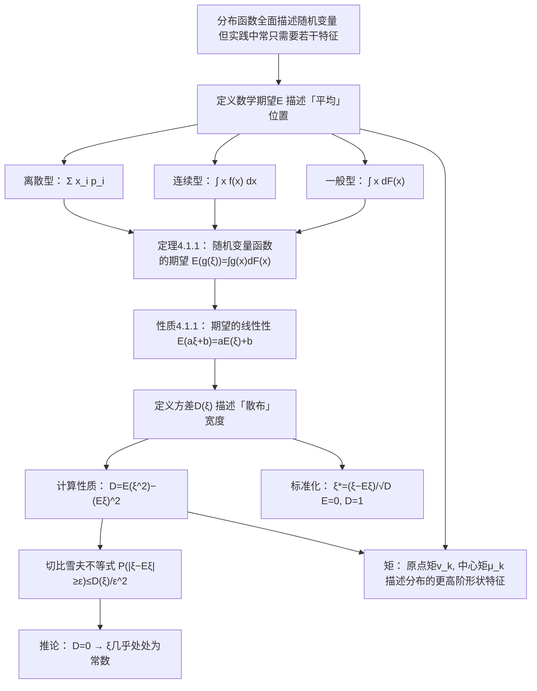
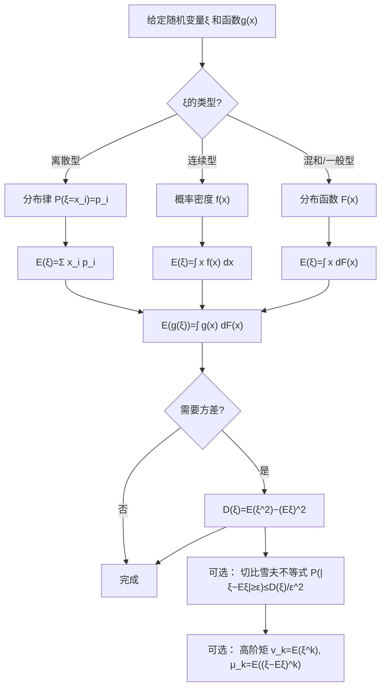

---
subject:
- 概率论
source:
- C4.1 数学期望、方差和矩.md
type: review
tags:
- 数学期望
- 方差
- 标准差
- 矩
- R-S积分
- 切比雪夫不等式
aliases:
- 第4章 数学期望、方差和矩 — 知识点梳理
schema_version: 2
time: "2026-08-31T11:44:20+08:00"
legacy_status: 已完成
legacy_topics:
- 数学期望
- 方差
- 标准差
- 矩
- R-S积分
- 切比雪夫不等式
- 标准化随机变量
status: not done
---

# 第4章 数学期望、方差和矩 — 知识点梳理

## 一、本章核心脉络

**核心问题**：已知随机变量的分布，如何用几个"数字"概括其核心特征——它"平均"取什么值？取值围绕这个平均值"散布"多宽？取值的"形状"是否有偏斜或厚尾？

> [!info] 学习导读
> **必要先修**：掌握[[03_Sources/Reviews/概率论/知识点解析梳理/02b-离散型随机变量-知识梳理|离散分布律]]、[[03_Sources/Reviews/概率论/知识点解析梳理/02c-连续型随机变量及概率密度-知识梳理|连续密度]]及随机变量函数的分布。
> **来源边界**：正文依据[[03_Sources/Courses/概率论/PPT课件/MD/C4.1 数学期望、方差和矩|C4.1 课件源文]]重组；直观解释与自测属于补充学习内容。
> **阅读路线**：期望定义 → 随机变量函数的期望 → 方差 → 切比雪夫不等式与标准化 → 高阶矩。

图中三条演进线索：(1) **横向**：从"平均"到"散布"再到"形状"——一阶矩定位置、二阶矩定宽度、高阶矩定形态；(2) **纵向**：从离散型定义→连续型定义→R-S积分统一定义，每个定义层级都向下兼容；(3) **应用链**：期望→方差→切比雪夫不等式，提供了"用方差控制偏离概率"的定量工具。

## 二、数学期望的定义与计算（**核心**）

### 2.1 直观引入：为什么需要数字特征？

分布函数能完全描述随机变量的概率规律，但在实际中：
- 有时**无法**确定随机变量取值的全部统计规律；
- 有时**只需**了解某些方面（如平均成绩、平均收入）即可。

**引例（摸彩赌博）**：袋中有 8 白 8 黑共 16 子，摸出 5 子。彩金：5 白 → 20 元，4 白 → 2 元，3 白 → 0.5 元，其他 → 0 元。庄家平均每次付出多少？

如果简单取算术平均 $(0+0.5+2+20)/4=5.625$ 元，显然不合理——因为各彩金出现的概率不同。正确的做法是以概率为权重的加权平均，即**数学期望**。

> **一句话来说**：数学期望就是"以概率为权重的加权平均"——它不是简单的算术平均，而是考虑了每种取值出现可能性之后的"长期平均值"。

### 2.2 离散型随机变量的数学期望

**定义 4.1.1-1**：设 $\xi$ 是离散型随机变量，其分布律为

$$P\{\xi = x_i\} = p_i, \quad i = 1, 2, 3, \cdots$$

若 $\sum_{i=1}^{+\infty} |x_i| p_i < +\infty$，则称

$$E(\xi) = \sum_{i=1}^{+\infty} x_i p_i$$

为 $\xi$ 的**数学期望**（Expectation）或均值（Mean）。

**两条关键注解**：

| 注 | 内容 | 为什么重要 |
|:--|:--|:--|
| 注 1 | 要求无穷级数**绝对收敛** | 保证数学期望有唯一数值（条件收敛的级数重排后可能得到不同值） |
| 注 2 | 数学期望是取值的**概率加权平均**，是一个**确定的数** | 它不是随机变量，是随机变量的一个数字特征 |

> **一句话来说**：离散型数学期望 = 所有可能取值乘以各自概率再求和，前提是这个和"绝对可求"（绝对收敛）。

**离散型常见分布的期望**：

| 分布 | 分布律 | $E(\xi)$ |
|:--|:--|:--|
| 泊松分布 $P(\lambda)$ | $P\{\xi=k\} = e^{-\lambda}\frac{\lambda^k}{k!}$ | $\lambda$ |
| 二项分布 $B(n,p)$ | $P\{\xi=i\} = C_n^i p^i (1-p)^{n-i}$ | $np$ |

**泊松分布期望证明**（核心洞察）：

$$E(\xi) = \sum_{k=0}^{+\infty} k e^{-\lambda} \frac{\lambda^k}{k!} = \lambda e^{-\lambda} \sum_{k=1}^{+\infty} \frac{\lambda^{k-1}}{(k-1)!} = \lambda e^{-\lambda} e^{\lambda} = \lambda$$

核心技巧：提取 $\lambda$，将求和指标平移一位，利用指数函数的泰勒展开 $e^\lambda = \sum_{j=0}^\infty \lambda^j/j!$。

**二项分布期望证明**（核心洞察）：

$$E(\xi) = \sum_{i=0}^{n} i C_n^i p^i (1-p)^{n-i} = np \sum_{i=1}^{n} C_{n-1}^{i-1} p^{i-1} (1-p)^{(n-1)-(i-1)} = np[p+(1-p)]^{n-1} = np$$

核心技巧：将 $i C_n^i = n C_{n-1}^{i-1}$ 提取 $np$，余下恰为 $(p+(1-p))^{n-1} = 1$。

### 2.3 连续型随机变量的数学期望

**思路**：离散化后取极限。将区间 $[a,b]$ 划分为 $n$ 份，$\Delta x_i = x_i - x_{i-1}$，则均值近似为

$$\sum_{i=1}^{n} x_i^* P\{x_{i-1} < X \leq x_i\} \approx \sum_{i=1}^{n} x_i^* f(x_i^*) \Delta x_i$$

令 $\lambda = \max \Delta x_i \to 0$（即 $n \to \infty$），得 $\int_a^b x f(x) dx$，再令 $a \to -\infty, b \to +\infty$。

**定义 4.1.1-2**：设连续型随机变量 $\xi$ 的概率密度为 $f(x)$，若

$$\int_{-\infty}^{+\infty} |x| f(x) dx < +\infty,$$

则称

$$E(\xi) = \int_{-\infty}^{+\infty} x f(x) dx$$

为 $\xi$ 的数学期望（均值）。

> **一句话来说**：连续型数学期望 = 取值 $x$ 乘以密度 $f(x)$ 在整个实数轴上的积分，本质上仍是"概率加权平均"——$f(x)dx$ 就是 $x$ 附近微小区间的概率。

**连续型常见分布的期望**：

| 分布 | 密度函数 | $E(\xi)$ | 证明关键 |
|:--|:--|:--|:--|
| 均匀分布 $U(a,b)$ | $f(x)=\frac{1}{b-a}, x\in[a,b]$ | $\frac{a+b}{2}$ | 直接积分 |
| 正态分布 $N(\mu,\sigma^2)$ | $f(x)=\frac{1}{\sigma\sqrt{2\pi}}e^{-\frac{(x-\mu)^2}{2\sigma^2}}$ | $\mu$ | 换元 $t=\frac{x-\mu}{\sigma}$，奇函数积分=0 |
| 指数分布 | $f(x)=\lambda e^{-\lambda x}, x>0$ | $\frac{1}{\lambda}$ | 换元 $u=\lambda x$，$\Gamma(2)=1$ |
| $\Gamma$ 分布 $\Gamma(\alpha,\beta)$ | $f(x)=\frac{\beta^\alpha}{\Gamma(\alpha)}x^{\alpha-1}e^{-\beta x}, x>0$ | $\frac{\alpha}{\beta}$ | 凑 $\Gamma$ 函数：$\int_0^\infty x^\alpha e^{-\beta x}dx = \Gamma(\alpha+1)/\beta^{\alpha+1}$ |

**正态分布期望证明**：

$$E(\xi) = \frac{1}{\sigma\sqrt{2\pi}}\int_{-\infty}^{+\infty} x e^{-\frac{(x-\mu)^2}{2\sigma^2}} dx \xrightarrow{t=\frac{x-\mu}{\sigma}} \int_{-\infty}^{+\infty} \frac{1}{\sqrt{2\pi}}(\mu+\sigma t) e^{-\frac{t^2}{2}} dt$$

$$= \mu\int_{-\infty}^{+\infty} \frac{1}{\sqrt{2\pi}} e^{-\frac{t^2}{2}} dt + \sigma\int_{-\infty}^{+\infty} \frac{t}{\sqrt{2\pi}} e^{-\frac{t^2}{2}} dt$$

第一项中积分为标准正态密度的全积分 = 1；第二项中被积函数是奇函数，积分为 0。故 $E(\xi) = \mu$。

### 2.4 数学期望不存在的例子

**柯西分布**：$f(x) = \frac{1}{\pi(1+x^2)}$，$-\infty < x < +\infty$

$$\because \int_{-\infty}^{+\infty} \frac{1}{\pi} \frac{|x|}{1+x^2} dx = \infty$$

故 $\xi$ 的数学期望**不存在**——虽然被积奇函数在对称区间上的积分主值为 0（$\lim_{R\to\infty}\int_{-R}^R = 0$），但不满足绝对可积条件。

> [!warning] 关键区分
> $\int_{-\infty}^{+\infty} \frac{x}{1+x^2} dx$ 作为**瑕积分主值**为 0，但作为**绝对可积**检验的 $\int_{-\infty}^{+\infty} \frac{|x|}{1+x^2} dx$ 发散。数学期望要求的是**绝对可积**，而非仅仅是条件收敛。

## 三、R-S 积分与随机变量数学期望的一般定义（**难点**）

### 3.1 动机：统一离散和连续

离散型和连续型有各自的期望公式，但对于既非离散也非连续的奇异型随机变量，如何定义数学期望？

$$
F(x) = \begin{cases} 0, & x < 0; \\ \frac{1+x}{2}, & 0 \leq x < 1; \\ 1, & x \geq 1. \end{cases}
$$

这个分布函数在 $x=0$ 处有跳跃（离散特征），在 $(0,1)$ 上连续且可导（连续特征），属于**混合型**。我们需要一个统一的积分框架：**R-S 积分**。

> **一句话来说**：R-S（Riemann-Stieltjes）积分把 Riemann 积分中的 $dx$ 换成 $dg(x)$，让"积分增量"不再必须是均匀的 $dx$，而是可以跟随 $g(x)$ 的结构——跳跃处贡献离散概率，平滑处退化为密度积分。

### 3.2 R-S 积分定义

设 $f(x), g(x)$ 为 $[a,b]$ 上的实值函数。做剖分 $a = x_0 < x_1 < \cdots < x_n = b$，任取 $x_k^* \in [x_k, x_{k+1}]$。做和式

$$\sigma = \sum_{k=0}^{n-1} f(x_k^*) [g(x_{k+1}) - g(x_k)]$$

若存在实数 $I$，对任意 $\epsilon > 0$，存在 $\delta > 0$，只要 $\lambda = \max(x_{k+1} - x_k) < \delta$，对任意剖分和任意 $x_k^*$ 的选取均有 $|\sigma - I| < \epsilon$，则称 $I$ 为 $f(x)$ 关于 $g(x)$ 在 $[a,b]$ 上的 **R-S 积分**：

$$I = \int_a^b f(x) dg(x)$$

广义 R-S 积分：$\int_{-\infty}^{+\infty} f(x) dg(x) \triangleq \lim_{\substack{a\to -\infty \\ b\to +\infty}} \int_a^b f(x) dg(x)$。

**注**：Riemann 积分 $\int_a^b f(x) dx$ 是 $g(x) = x$ 时的特例。

### 3.3 R-S 积分的六条性质

| 性质 | 表达式 | 说明 |
|:--|:--|:--|
| 1) 对 $f$ 线性 | $\int_a^b [f_1 \pm f_2] dg = \int f_1 dg \pm \int f_2 dg$ | 被积函数可拆分 |
| 2) 对 $g$ 线性 | $\int_a^b f d[g_1 \pm g_2] = \int f dg_1 \pm \int f dg_2$ | 积分函数可拆分 |
| 3) 常数因子 | $\int_a^b \alpha f d[\beta g] = \alpha\beta \int_a^b f dg$ | 常数可提出 |
| 4) 区间可加性 | $\int_a^b f dg = \int_a^c f dg + \int_c^b f dg$ | $a < c < b$ |
| 5) 分部积分 | $\int_a^b f dg = [fg]_a^b - \int_a^b g df$ | 一个存在则另一个也存在 |
| 6) 许瓦尔兹不等式 | $\left|\int f_1 f_2 dg\right|^2 \leq \int f_1^2 dg \cdot \int f_2^2 dg$ | $g$ 单调不减，$f_i$ 平方可积 |

**分部积分的广义形式**：

$$\int_{-\infty}^{+\infty} f(x) dg(x) = -\int_{-\infty}^{+\infty} g(x) df(x) + \lim_{\substack{a\to -\infty \\ b\to +\infty}} [f(x)g(x)]_a^b$$

**直观理解**：分部积分公式将"关于 $g$ 的积分"与"关于 $f$ 的积分"互换——这在后续证明中非常有用（如协方差与期望的关系）。

### 3.4 R-S 积分在离散型和连续型上的退化

**广义 R-S 积分定理**：设 $f(x), g(x)$ 满足条件 (A)（$f$ 在 $\mathbb{R}$ 上连续，$\int_{-\infty}^{+\infty} f dg$ 存在）。

**(1) 若 $g(x)$ 可导**（$g'(x)$ 在任意有限区间上 Riemann 可积）：

$$\int_{-\infty}^{+\infty} f(x) dg(x) = \int_{-\infty}^{+\infty} f(x) g'(x) dx$$

这正是**连续型**情形——$g(x) = F(x)$（分布函数），$g'(x) = f(x)$（密度）。

**(2) 若 $g(x)$ 是阶梯函数**（存在 $\cdots < C_{-1} < C_0 < C_1 < \cdots$，$g(x)$ 在 $[C_k, C_{k+1})$ 上为常数）：

$$\int_{-\infty}^{+\infty} f(x) dg(x) = \sum_{k=-\infty}^{\infty} f(C_k) [g(C_k+0) - g(C_k-0)]$$

这正是**离散型**情形——$g(x) = F(x)$（分布函数），$g(C_k+0) - g(C_k-0) = p_k$。

> **一句话来说**：R-S 积分是数学期望的"万能公式"——$g(x)$ 是分布函数时，可导则退化为密度积分，阶梯则退化为求和，混合则两者兼顾。

### 3.5 数学期望的统一定义

**定义 4.1.3**：设随机变量 $\xi$ 的分布函数为 $F(x)$，若

$$\int_{-\infty}^{+\infty} |x| dF(x) < +\infty,$$

则称

$$E(\xi) = \int_{-\infty}^{+\infty} x dF(x)$$

为 $\xi$ 的数学期望。

此定义统一了所有类型：
- **连续型**：$dF(x) = F'(x) dx = f(x) dx$ → $E(\xi) = \int x f(x) dx$
- **离散型**：$F(x)$ 在 $x_i$ 处跳跃 $p_i$ → $E(\xi) = \sum x_i p_i$
- **混合型**：跳跃处贡献离散部分，连续处贡献密度积分

## 四、随机变量函数的数学期望（**核心**）

### 4.1 问题引入

设 $\eta = g(\xi)$ 也是随机变量。如何计算 $E(\eta) = E[g(\xi)]$ ？

**思路一**：先求 $\eta$ 的分布 $F_\eta(y)$，再按定义求 $E(\eta) = \int y dF_\eta(y)$。→ 但求函数的分布往往很繁琐。

**思路二**（定理 4.1.1）：直接用 $\xi$ 的分布求导，绕开对 $\eta$ 分布的计算。

**定理 4.1.1**：设 $F_\xi(x)$ 是随机变量 $\xi$ 的分布函数，$g(x)$ 在 $\mathbb{R}$ 上连续，若

$$\int_{-\infty}^{+\infty} |g(x)| dF_\xi(x) < \infty,$$

则 $\eta = g(\xi)$ 的数学期望存在，且

$$E(\eta) = E[g(\xi)] = \int_{-\infty}^{+\infty} g(x) dF_\xi(x)$$

**本章核心公式**——后续所有方差、矩的计算都源于此。

**证明（$g$ 严格递增时）**：令 $\eta = g(\xi)$，

$$F_\eta(y) = P\{\eta \leq y\} = P\{g(\xi) \leq y\} = P\{\xi \leq g^{-1}(y)\} = F_\xi[g^{-1}(y)]$$

$$E(\eta) = \int_{-\infty}^{+\infty} y dF_\eta(y) = \int_{-\infty}^{+\infty} y d[F_\xi(g^{-1}(y))]$$

换元 $y = g(x)$，得 $E(\eta) = \int_{-\infty}^{+\infty} g(x) d[F_\xi(x)]$。

> **一句话来说**：求 $g(\xi)$ 的期望不需要先求 $g(\xi)$ 的分布——直接用 $\xi$ 的分布函数把 $g(x)$ 代入积分即可。这节省了大量分布函数转换的工作。

**在实际计算中的具体形式**：

- **连续型**：$E[g(\xi)] = \int_{-\infty}^{+\infty} g(x) f(x) dx$
- **离散型**：$E[g(\xi)] = \sum_{i=1}^{\infty} g(x_i) P\{\xi = x_i\}$

### 4.2 性质 4.1.1（期望的线性性质）

若随机变量 $\xi$ 的数学期望存在，则

$$E[a\xi + b] = aE(\xi) + b, \qquad E(b) = b$$

> **一句话来说**：期望是线性算子——常数可提出，常数平移直接加。这是期望最重要的运算性质，也是方差性质推导的基础。

### 4.3 典型例题

**例 4.1.1（球的体积）**：球的直径 $\xi \sim U(a,b)$，求球的体积 $V = \frac{\pi}{6} \xi^3$ 的数学期望。

> [!solution]- 点击展开详细解析
> **解法一**（先求分布再求期望——繁琐）：
> 先求 $V$ 的密度 $f_V(y) = \frac{1}{b-a} \sqrt[3]{\frac{2}{9\pi}} y^{-\frac{2}{3}}$，再积分得 $E(V) = \frac{\pi}{24}(a+b)(a^2+b^2)$。
>
> **解法二**（直接用定理 4.1.1——简洁）：
> $$E(V) = \int_{-\infty}^{+\infty} g(x) f_X(x) dx = \frac{1}{b-a} \int_a^b \frac{\pi}{6} x^3 dx = \frac{\pi}{24}(a+b)(a^2+b^2)$$
>
> **点评**：两种解法结果相同，但解法二直接绕开了求 $V$ 分布的繁琐步骤——这就是定理 4.1.1 的核心价值。

**例 4.1.2（弦的平均长度）**：过半径为 $R$ 的圆周上已知点，与圆周任意点相连，求弦的平均长度。

> [!solution]- 点击展开详细解析
> 以已知点为原点，过已知点的直径为 $x$ 轴正向。设弦与直径的夹角为 $\Theta$，均匀分布于 $(-\frac{\pi}{2}, \frac{\pi}{2})$。弦长 $L = 2R\cos\Theta$。
>
> $$E(L) = \int_{-\frac{\pi}{2}}^{\frac{\pi}{2}} (2R\cos\theta) \cdot \frac{1}{\pi} d\theta = \frac{4R}{\pi}$$
>
> **点评**：这里 $\Theta$ 服从简单的均匀分布，直接套用定理 4.1.1 即可。若先求 $L$ 的分布再积分，过程将非常繁杂。

**例 4.1.3（截断函数）**：设 $\xi$ 的概率密度为 $f(x) = \frac{1}{\pi(1+x^2)}$（柯西分布），求 $E[\min(|\xi|, 1)]$。

> [!solution]- 点击展开详细解析
> $$g(x) = \min(|x|, 1) = \begin{cases} |x|, & |x| < 1; \\ 1, & |x| \geq 1. \end{cases}$$
>
> $$E[g(\xi)] = \int_{-\infty}^{+\infty} g(x) f(x) dx = \int_{-1}^{1} \frac{|x|}{\pi(1+x^2)} dx + \int_{1}^{+\infty} \frac{2}{\pi(1+x^2)} dx = \frac{1}{2} + \frac{1}{\pi}\ln 2$$
>
> **点评**：柯西分布本身期望不存在，但经过 $\min(|\xi|,1)$ 的"截断"处理后，函数 $g(\xi)$ 的期望存在——这说明"函数的期望"可以比"原变量的期望"更温和。

## 五、方差（**核心**）

### 5.1 引入：只知平均是不够的

**引例（射击水平比较）**：已知甲乙两名射击运动员的历史记录：

| 环数 | 10 | 9 | 8 | 7 | 6 | 5 |
|:--|:--|:--|:--|:--|:--|:--|
| 甲的概率 | 0.5 | 0.2 | 0.1 | 0.1 | 0.05 | 0.05 |
| 乙的概率 | 0.7 | 0.05 | 0.02 | 0.03 | 0.1 | 0.1 |

计算得 $E(\xi_{\text{甲}}) = 8.85$，$E(\xi_{\text{乙}}) = 8.92$。从平均水平看，乙略高。

但进一步计算偏差平方的平均：
- 甲：$E[(\xi - 8.85)^2] = 2.2275$
- 乙：$E[(\xi - 8.92)^2] = 3.4860$

甲的偏差平方平均更小，说明甲发挥**更稳定**——数学期望相同或相近时，方差决定了稳定性。

> **一句话来说**：期望回答"平均在哪"，方差回答"偏得有多厉害"——两者配合才能完整描述一个随机变量的数字特征。

### 5.2 方差的定义与计算

**定义 4.1.4**：设随机变量 $\xi$ 的分布函数为 $F(x)$，称

$$D(\xi) \triangleq E[(\xi - E(\xi))^2] = \int_{-\infty}^{+\infty} [x - E(\xi)]^2 dF(x)$$

为 $\xi$ 的**方差**（Deviation / Variance）。称 $\sigma(\xi) = \sqrt{D(\xi)}$ 为 $\xi$ 的**标准差**（Standard Deviation）或均方差。

**注**：(1) $D(\xi) \geq 0$，恒非负；(2) 标准差与原变量保持相同量纲（如"环"），便于实际解释。

**具体形式**：
- **离散型**：$D(\xi) = \sum_{i=1}^{+\infty} [x_i - E(\xi)]^2 p_i$
- **连续型**：$D(\xi) = \int_{-\infty}^{+\infty} [x - E(\xi)]^2 f_\xi(x) dx$

### 5.3 方差的计算性质

**性质 4.1.2（核心计算公式）**：若 $E(\xi^2)$ 存在，则 $\xi$ 的方差和数学期望一定存在，且

$$D(\xi) = E(\xi^2) - [E(\xi)]^2$$

**证明**（展开期望的定义）：

$$D(\xi) = \int_{-\infty}^{+\infty} [x - E(\xi)]^2 dF(x)$$

$$= \int_{-\infty}^{+\infty} x^2 dF(x) - 2E(\xi)\int_{-\infty}^{+\infty} x dF(x) + [E(\xi)]^2 \int_{-\infty}^{+\infty} dF(x)$$

$$= E(\xi^2) - 2E(\xi) \cdot E(\xi) + [E(\xi)]^2 \cdot 1 = E(\xi^2) - [E(\xi)]^2$$

**一个关键不等式**：展开过程还证明了

$$\left[\int_{-\infty}^{+\infty} x dF(x)\right]^2 \leq \int_{-\infty}^{+\infty} x^2 dF(x)$$

即 $[E(\xi)]^2 \leq E(\xi^2)$，这与 $D(\xi) \geq 0$ 等价。

> **一句话来说**：$D(\xi) = E(\xi^2) - [E(\xi)]^2$ 是方差最实用的计算公式——避免了先算期望再代入平方的麻烦，直接算"平方的期望"减去"期望的平方"。

**性质 4.1.3（方差的线性变换性质）**：若随机变量 $\xi$ 的方差存在，则

$$D[a\xi + b] = a^2 D(\xi), \qquad D(b) = 0$$

> **直观理解**：常数平移不影响散布宽度（$D(b)=0$ 表示常数没有波动），但缩放因子 $a$ 通过平方影响方差（$D(-\xi) = D(\xi)$——负号不影响离散程度）。

### 5.4 常见分布的方差

| 分布 | $E(\xi)$ | $D(\xi)$ | 证明关键 |
|:--|:--|:--|:--|
| 泊松分布 $P(\lambda)$ | $\lambda$ | $\lambda$ | $E(\xi^2) = \lambda^2 + \lambda$，$D = (\lambda^2+\lambda) - \lambda^2 = \lambda$ |
| 二项分布 $B(n,p)$ | $np$ | $np(1-p)$ | $E(\xi^2) - (np)^2 = np(1-p)$ |
| 均匀分布 $U(a,b)$ | $\frac{a+b}{2}$ | $\frac{(b-a)^2}{12}$ | $E(\xi^2) = \frac{a^2+ab+b^2}{3}$ |
| 正态分布 $N(\mu,\sigma^2)$ | $\mu$ | $\sigma^2$ | 换元 + 分部积分 |
| 指数分布 | $\frac{1}{\lambda}$ | $\frac{1}{\lambda^2}$ | $E(\xi^2) = 2/\lambda^2$ |

**泊松分布方差证明**：

$$E(\xi^2) = \sum_{k=0}^{\infty} k^2 e^{-\lambda} \frac{\lambda^k}{k!} = e^{-\lambda} \sum_{k=1}^{\infty} \frac{\lambda^k (k-1+1)}{(k-1)!}$$

$$= e^{-\lambda} \sum_{k=2}^{\infty} \frac{\lambda^k}{(k-2)!} + e^{-\lambda} \sum_{k=1}^{\infty} \frac{\lambda^k}{(k-1)!}$$

$$= e^{-\lambda} \lambda^2 e^{\lambda} + e^{-\lambda} \lambda e^{\lambda} = \lambda^2 + \lambda$$

$$D(\xi) = E(\xi^2) - [E(\xi)]^2 = (\lambda^2 + \lambda) - \lambda^2 = \lambda$$

**核心技巧**：将 $k^2 = k(k-1) + k$ 拆分，第一项让 $\lambda^k/(k-2)!$ 凑成 $e^\lambda$ 的级数（提取 $\lambda^2$），第二项就是 $E(\xi) = \lambda$。

**正态分布方差证明**：

$$D(\xi) = \int_{-\infty}^{+\infty} (x-\mu)^2 \frac{1}{\sigma\sqrt{2\pi}} e^{-\frac{(x-\mu)^2}{2\sigma^2}} dx \xrightarrow{t=\frac{x-\mu}{\sigma}} \frac{\sigma^2}{\sqrt{2\pi}} \int_{-\infty}^{+\infty} t^2 e^{-\frac{t^2}{2}} dt$$

$$= -\frac{\sigma^2}{\sqrt{2\pi}} \int_{-\infty}^{+\infty} t \, d\left(e^{-\frac{t^2}{2}}\right) = -\frac{\sigma^2}{\sqrt{2\pi}} \left( \left[ t e^{-\frac{t^2}{2}} \right]_{-\infty}^{+\infty} - \int_{-\infty}^{+\infty} e^{-\frac{t^2}{2}} dt \right)$$

分部积分后，边界项为 0（指数衰减快于线性增长），积分项 $\int e^{-t^2/2} dt = \sqrt{2\pi}$，故 $D(\xi) = \sigma^2$。

## 六、切比雪夫不等式与标准化（**难点**）

### 6.1 定理 4.1.2（切比雪夫不等式）

若随机变量 $\xi$ 的方差存在，则 $\forall \epsilon > 0$ 有

$$P\{|\xi - E(\xi)| \geq \epsilon\} \leq \frac{D(\xi)}{\epsilon^2}$$

**证明**（仅涉及放大不等式——核心洞察）：

$$
\begin{aligned}
P\{|\xi - E(\xi)| \geq \epsilon\} &= \int_{|x - E(\xi)| \geq \epsilon} dF(x) \\
&\leq \int_{|x - E(\xi)| \geq \epsilon} \frac{[x - E(\xi)]^2}{\epsilon^2} dF(x) \\
&\leq \frac{1}{\epsilon^2} \int_{-\infty}^{+\infty} [x - E(\xi)]^2 dF(x) = \frac{D(\xi)}{\epsilon^2}
\end{aligned}
$$

**直观理解**：在 $|x - E(\xi)| \geq \epsilon$ 的区域内，$[x-E(\xi)]^2 / \epsilon^2 \geq 1$，所以用这个放大系数代替被积函数 1，再把积分域放宽到全实数轴。这等价于说：如果偏差很大（$\geq \epsilon$），那么在方差中贡献的平方偏差一定 $\geq \epsilon^2$，由此可以反过来用方差"控制"大偏差发生的概率。

> **一句话来说**：切比雪夫不等式用方差给出了"偏离期望超过 $\epsilon$"的概率上界——方差越小，大偏差越不可能发生。它是方差作为"离散程度"度量的定量依据。

### 6.2 推论：方差为零意味着什么

**定理 4.1.2 推论**：若 $D(\xi) = 0$，则 $P\{\xi = E(\xi)\} = 1$。

**证明**：

$$\{\xi \neq E(\xi)\} = \bigcup_{n=1}^{\infty} \left\{|\xi - E(\xi)| \geq \frac{1}{n}\right\}$$

$$
P\{\xi \neq E(\xi)\} \leq \sum_{n=1}^{\infty} P\left\{|\xi - E(\xi)| \geq \frac{1}{n}\right\} \leq \sum_{n=1}^{\infty} \frac{D(\xi)}{(1/n)^2} = 0
$$

故 $P\{\xi = E(\xi)\} = 1 - P\{\xi \neq E(\xi)\} = 1$。

> **直观理解**：方差为 0 意味着随机变量**几乎必然**（以概率 1）等于其数学期望——即它实际上退化为了一个常数。任何有真实波动的随机变量，方差一定严格大于 0。

### 6.3 例 4.1.4：标准化随机变量

设 $\xi$ 的 $E(\xi), D(\xi)$ 存在且 $D(\xi) > 0$。令

$$\xi^* = \frac{\xi - E(\xi)}{\sqrt{D(\xi)}}$$

**求证**：$E(\xi^*) = 0$，$D(\xi^*) = 1$。

**证明**：

$$E(\xi^*) = \frac{1}{\sqrt{D(\xi)}} E[\xi - E(\xi)] = 0$$

$$D(\xi^*) = \frac{1}{D(\xi)} D[\xi - E(\xi)] = \frac{D(\xi)}{D(\xi)} = 1$$

称 $\xi^*$ 为 $\xi$ 的**标准化随机变量**——它消除了原变量的量纲和位置，均值为 0、方差为 1，使得不同随机变量可以在同一尺度下比较。

**特别地**：若 $\xi \sim N(\mu, \sigma^2)$，则 $\frac{\xi - \mu}{\sigma} \sim N(0, 1)$——这就是标准正态分布。

### 6.4 例 4.1.5：期望的最小偏差性质

**证明**：函数 $g(x) = E[(\xi - x)^2]$（$x \in \mathbb{R}$）当 $x = E(\xi)$ 时达到最小。

**证明**：

$$g(x) = E[(\xi - x)^2] = E(\xi^2) - 2x E(\xi) + x^2$$

令 $g'(x) = -2E(\xi) + 2x = 0$，得 $x = E(\xi)$。

又 $g''(x) |_{x = E(\xi)} = 2 > 0$，故 $g(x)$ 在 $x = E(\xi)$ 处取到最小值。

> **直观理解**：随机变量关于自身数学期望的偏离程度，比关于任何其他值的偏离程度都小。这从数学上证明了**数学期望是"最小均方误差"意义下的最佳预测值**——如果你要用一个固定值来"概括"一个随机变量，数学期望是使得均方误差最小的选择。

### 6.5 数学期望和方差的物理解释

以离散型为例：将概率 $p_i$ 视为分布在直线上各点 $x_i$ 处的质量。

- **数学期望** = 质点系的**质心**（重心）：

$$\frac{\sum m_i x_i}{\sum m_i} = \sum p_i x_i$$

- **方差** = 质点系相对于过质心的纵轴的**转动惯量**：

$$J = \sum m_i r_i^2 = \sum p_i [x_i - E(\xi)]^2$$

且此转动惯量是关于直线上其他任何点所在纵轴的转动惯量中**最小的**（与例 4.1.5 一致）。

## 七、矩（了解即可）

### 7.1 原点矩与中心矩

**定义 4.1.5（原点矩）**：设 $\xi$ 为随机变量，若 $E(|\xi|^k) < +\infty$，称

$$v_k = E(\xi^k), \quad k = 1, 2, 3, \cdots$$

为 $\xi$ 的 **$k$ 阶原点矩**。称 $\alpha_k = E(|\xi|^k)$ 为 $k$ 阶绝对原点矩。

**定义 4.1.6（中心矩）**：设 $\xi$ 为随机变量，若 $E[|\xi - E(\xi)|^k] < +\infty$，称

$$\mu_k = E\{[\xi - E(\xi)]^k\}, \quad k = 1, 2, 3, \cdots$$

为 $\xi$ 的 **$k$ 阶中心矩**。称 $\beta_k = E[|\xi - E(\xi)|^k]$ 为 $k$ 阶绝对中心矩。

| $k$ | 原点矩 $v_k$ | 中心矩 $\mu_k$ |
|:--|:--|:--|
| 0 | $v_0 = 1$ | $\mu_0 = 1$ |
| 1 | $v_1 = E(\xi)$ | $\mu_1 = 0$ |
| 2 | $v_2 = E(\xi^2)$ | $\mu_2 = D(\xi)$ |

> **一句话来说**：矩是期望和方差的"高阶推广"——一阶原点矩 = 期望，二阶中心矩 = 方差，更高阶矩可以刻画分布的不对称性（偏度）和尾部厚度（峰度），但本课程主体仅用到一阶和二阶矩。

### 7.2 原点矩与中心矩的关系

更一般的，因 $\mu_1 = 0$，$v_k$ 与 $\mu_k$ 的关系为：

$$v_k = E(\xi^k) = E\{[\xi - E(\xi) + E(\xi)]^k\} = E\{[(\xi - v_1) + v_1]^k\} = \sum_{i=0}^{k} C_k^i \, v_1^i \, \mu_{k-i}$$

同理：

$$\mu_k = \sum_{i=0}^{k} (-1)^{k-i} C_k^i \, v_1^{k-i} \, v_k$$

特别地，取 $k=2$：$\mu_2 = v_2 - 2v_1^2 + v_1^2 = v_2 - v_1^2$，即 $D(\xi) = E(\xi^2) - [E(\xi)]^2$——与性质 4.1.2 一致。

## 判定/决策流程

图中三条主线：(1) **期望路径**：根据类型选公式 → 统一定理覆盖函数期望；(2) **方差路径**：始终用 $D = E(\xi^2) - (E\xi)^2$ 而不要用定义式硬算；(3) **深化路径**：切比雪夫不等式建立了方差与概率的定量联系，高阶矩进一步刻画分布形状。

## 核心公式速查表

| 概念 | 公式 | 适用条件 |
|:--|:--|:--|
| 离散型期望 | $E(\xi) = \sum_{i} x_i p_i$ | 级数绝对收敛 |
| 连续型期望 | $E(\xi) = \int x f(x) dx$ | 积分绝对收敛 |
| 一般期望（R-S） | $E(\xi) = \int_{-\infty}^{+\infty} x dF(x)$ | 绝对可积 |
| 函数期望 | $E[g(\xi)] = \int_{-\infty}^{+\infty} g(x) dF(x)$ | $g$ 连续，绝对可积 |
| 期望线性性 | $E[a\xi + b] = aE(\xi) + b$ | 期望存在 |
| 方差定义 | $D(\xi) = E[(\xi - E(\xi))^2]$ | 方差存在 |
| 方差计算公式 | $D(\xi) = E(\xi^2) - [E(\xi)]^2$ | $E(\xi^2)$ 存在 |
| 方差线性变换 | $D[a\xi + b] = a^2 D(\xi)$ | 方差存在 |
| 切比雪夫不等式 | $P(|\xi - E\xi| \geq \epsilon) \leq D(\xi)/\epsilon^2$ | 方差存在 |
| 标准化 | $\xi^* = \frac{\xi - E(\xi)}{\sqrt{D(\xi)}}$，$E=0, D=1$ | $D(\xi) > 0$ |
| $k$ 阶原点矩 | $v_k = E(\xi^k)$ | $E(|\xi|^k) < \infty$ |
| $k$ 阶中心矩 | $\mu_k = E[(\xi - E(\xi))^k]$ | $E(|\xi - E\xi|^k) < \infty$ |
| 中心矩与原点矩 | $\mu_2 = v_2 - v_1^2$ | — |
| $D=0$ 推论 | $P\{\xi = E(\xi)\} = 1$ | $D(\xi) = 0$ |
| 最小均方误差 | $\min_x E[(\xi - x)^2] = D(\xi)$，于 $x = E(\xi)$ | 期望和方差存在 |

## 易错点与注意事项

> [!warning] 易错点与注意事项
>
> 1. **绝对收敛/绝对可积是必要条件，不是可选项**：数学期望存在的**必要条件**是 $\sum |x_i| p_i < \infty$ 或 $\int |x| f(x) dx < \infty$。柯西分布 $\int x/(1+x^2) dx$ 的 Cauchy 主值为 0，但因 $\int |x|/(1+x^2) dx = \infty$，数学期望**不存在**。"看起来好像是对称的，期望应该是 0"是一个常见错误直觉。
>
> 2. **期望是常数，不是随机变量**：$E(\xi)$ 是一个确定的数值，与 $\xi$ 本质不同。$E(\xi)$ 是 $\xi$ 所有可能取值的加权平均——是一个确定的数字特征，不随试验结果变化。
>
> 3. **方差计算：永远优先用 $D(\xi) = E(\xi^2) - [E(\xi)]^2$**，而非定义式 $E[(\xi - E(\xi))^2]$。原因：(a) 避免先减后平方的双重积分；(b) 许多分布的 $E(\xi^2)$ 有现成公式可直接套用。
>
> 4. **$D(a\xi + b) = a^2 D(\xi)$，注意：是 $a^2$ 不是 $a$**：缩放因子在方差中以平方形式出现，且平移 $b$ 对方差无影响。这是一元方差与多元协方差矩阵运算的核心区别之一。
>
> 5. **必要条件 vs 充分条件**：$D(\xi) = 0$ 是 $P\{\xi = E(\xi)\} = 1$ 的**充分必要条件**（定理 4.1.2 推论），而切比雪夫不等式 $P(|\xi - E\xi| \geq \epsilon) \leq D(\xi)/\epsilon^2$ 给出的是概率**上界**，这是充分条件关系——它只给出了方差不超某个值的保证，反向不成立。
>
> 6. **$E(\xi^2)$ 存在 → $E(\xi)$ 存在，但反之不然**：由 $|x| \leq 1 + x^2$ 可证（证明见性质 4.1.2），二阶矩存在可推出一阶矩存在，这对级数和积分均成立。
>
> 7. **标准化公式 $\xi^* = (\xi - E\xi)/\sqrt{D(\xi)}$ 要求 $D(\xi) > 0$**：若 $D(\xi) = 0$，则 $\xi$ 几乎必然为常数，无需也**无法**标准化。此时 $\xi$ 本身已经是"标准化"到极致的——完全确定的常数。

## 自测（新编）

设 $X$ 的分布律为 $P(X=-1)=1/4$、$P(X=1)=3/4$。求 $E(X)$、$D(X)$，并给出切比雪夫不等式对 $P(|X-E(X)|\ge1)$ 的上界。

> [!hint]- 提示
> 先算 $E(X^2)$，再用 $D(X)=E(X^2)-[E(X)]^2$。

> [!solution]- 解析
> $E(X)=1/2$，$E(X^2)=1$，故 $D(X)=1-1/4=3/4$。切比雪夫不等式给出 $P(|X-E(X)|\ge1)\le3/4$；直接计算可知真实概率为 $1/4$，说明该界通常不紧。

## 相关知识点链接

- **前置**：[[03_Sources/Reviews/概率论/知识点解析梳理/02a-随机变量及分布函数-知识梳理]] — 分布函数 $F(x)$ 是本章所有定义的基础（$E(\xi) = \int x dF(x)$），没有分布函数就无法定义期望。
- **前置**：[[03_Sources/Reviews/概率论/知识点解析梳理/02b-离散型随机变量-知识梳理]] — 离散型期望 $E(\xi) = \sum x_i p_i$ 的直接前置，本章中泊松分布、二项分布均依赖其分布律。
- **前置**：[[03_Sources/Reviews/概率论/知识点解析梳理/02c-连续型随机变量及概率密度-知识梳理]] — 连续型期望 $E(\xi) = \int x f(x) dx$ 的直接前置，本章中正态、均匀、指数分布的期望计算均依赖其密度函数。
- **前置**：[[03_Sources/Reviews/概率论/知识点解析梳理/03d-随机变量函数的分布-知识梳理]] — 随机变量函数的分布是定理 4.1.1 的自然背景——正因为求函数分布通常很繁琐，才催生了"直接代入原分布"的方法。
- **后续**：[[03_Sources/Reviews/概率论/知识点解析梳理/04b-多维随机变量的数字特征-知识梳理]] — 本章的期望和方差从一维推广到多维（协方差、相关系数、协方差矩阵），线性性质、计算性质全部平移。
- **后续**：[[03_Sources/Reviews/概率论/知识点解析梳理/04c-条件数学期望与方差-知识梳理]] — 条件期望是在"已知部分信息"条件下对本章期望的重算，全数学期望公式将复杂期望分解为条件期望的期望。

## 作业与练习

本章对应习题见 [[习题库/第4章-数学期望方差和矩]]。重点练习：

1. **常见分布的期望与方差计算**：泊松分布、二项分布、均匀分布、正态分布、指数分布的 $E$ 和 $D$，掌握核心求和/积分技巧（提取参数、凑指数级数/$\Gamma$ 函数、奇偶性消去）。
2. **随机变量函数的期望**（定理 4.1.1 的应用）：给定 $g(\xi)$ 和 $\xi$ 的分布，不先求 $g(\xi)$ 的分布，直接用 $\xi$ 的分布公式计算（参考例 4.1.1 ~ 4.1.3）。
3. **标准化**：任意给定 $E(\xi)$ 和 $D(\xi)$，写出 $\xi^*$ 并验证 $E=0, D=1$。
4. **切比雪夫不等式的应用**：用不等式估计 $P(|\xi - E\xi| \geq k\sigma)$ 的上界并理解其含义。
5. **期望最小均方误差性质**：证明并理解 $E[(\xi - x)^2]$ 在 $x = E(\xi)$ 处取最小。
6. **方差与常数的关系**：证明 $D(\xi) = 0 \iff P(\xi = c) = 1$，并理解其物理含义。

## 可复用知识条目

本章涉及以下独立条目；后续补充与跨课程应用统一维护在条目中。

### 概念入口

- [[01_Knowledge/分布函数|分布函数]]
- [[01_Knowledge/数学期望|数学期望]]
- [[01_Knowledge/概率密度|概率密度]]
- [[01_Knowledge/概率空间|概率空间]]
- [[01_Knowledge/随机变量|随机变量]]

### 知识点入口

- [[03_Sources/Reviews/概率论/专题复习/方差、矩与切比雪夫概率界|方差与切比雪夫不等式]]
