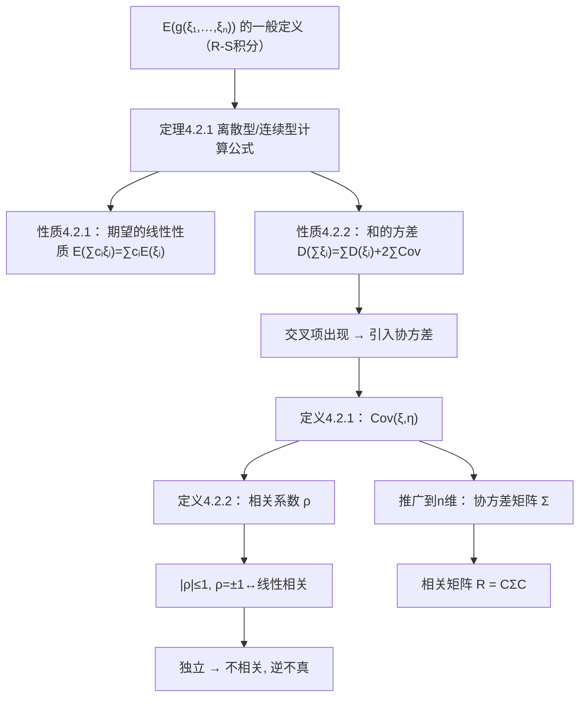
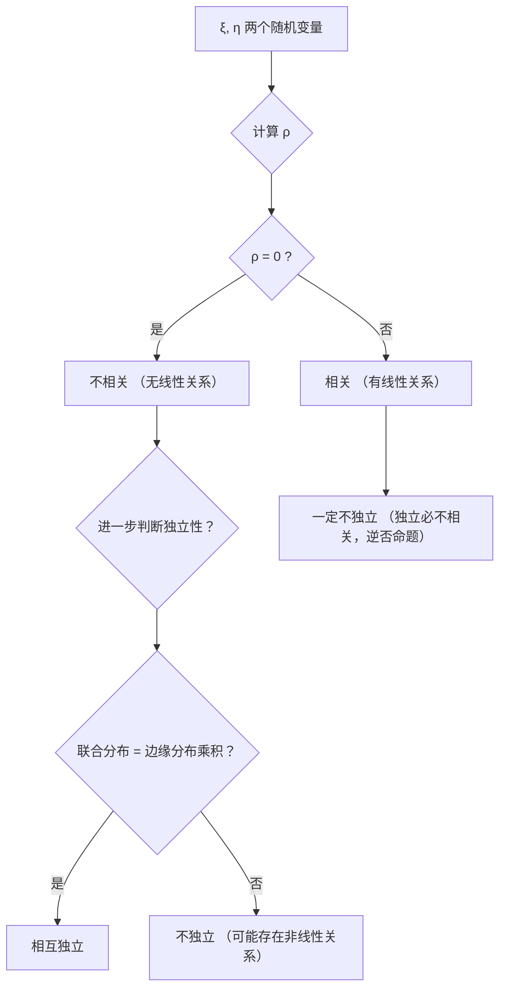

---
subject:
- 概率论
source:
- C4.2 多维随机变量的数字特征.md
type: review
tags:
- 协方差
- 相关系数
- 协方差矩阵
- 不相关与独立
aliases:
- 第4章 多维随机变量的数字特征 — 知识点梳理
schema_version: 2
time: "2026-08-31T11:44:20+08:00"
legacy_status: 已完成
legacy_topics:
- 多维随机变量函数的数学期望
- 协方差
- 相关系数
- 协方差矩阵
- 相关矩阵
- 不相关与独立
status: not done
---

## 一、本章核心脉络

**核心问题**：给定多维随机变量 $(\xi_1,\xi_2,\cdots,\xi_n)$，如何计算其函数的数学期望？进一步，如何用"数字"描述各分量之间的关联强度？

> [!info] 学习导读
> **必要先修**：回看[[03_Sources/Reviews/概率论/知识点解析梳理/04a-数学期望、方差和矩-知识梳理|期望与方差]]和[[03_Sources/Reviews/概率论/知识点解析梳理/03b-随机变量的独立性-知识梳理|随机变量独立性]]。
> **来源边界**：正文依据[[03_Sources/Courses/概率论/PPT课件/MD/C4.2  多维随机变量的数字特征|C4.2 课件源文]]重组；矩阵视角与自测属于补充解释。
> **阅读路线**：多维函数期望 → 和的方差 → 协方差 → 相关系数 → 独立与不相关 → 协方差矩阵。



> 这条脉络的演进逻辑是：从"如何算多维函数的期望"出发，自然导出期望的线性性质与和的方差，方差的交叉项催生了协方差的概念，标准化后得到相关系数，最终推广为矩阵形式。

## 二、多维随机变量函数的数学期望（核心）

### 2.1 问题引入

对二维随机变量 $(\xi,\eta)$，如何直接求 $E(\xi)$ 而无需先求边缘分布？

- **离散型**：
  $$E(\xi)=\sum_{i=1}^{+\infty}x_iP\{\xi=x_i\}=\sum_{i=1}^{+\infty}\sum_{j=1}^{+\infty}x_i p_{ij}$$

- **连续型**：
  $$E(\xi)=\int_{-\infty}^{+\infty}xf_\xi(x)dx=\int_{-\infty}^{+\infty}\int_{-\infty}^{+\infty}x f(x,y)\,dxdy$$

> 一句话来说：**求单个分量的期望时，可以直接用联合分布加权求和/积分，不必先求边缘分布。**

### 2.2 一般定义与定理 4.2.1（核心）

用二重广义 **R-S 积分**给出统一表述：

$$E(\xi)=\int_{-\infty}^{+\infty}\int_{-\infty}^{+\infty}x\,dF(x,y)$$

其中 $dF(x,y)=P\{x-\Delta x<\xi\leq x,\;y-\Delta y<\eta\leq y\}$。

**定理 4.2.1**（多维随机变量函数的期望）设随机向量 $(\xi_1,\xi_2,\cdots,\xi_n)$ 的分布函数为 $F(x_1,x_2,\cdots,x_n)$，$g$ 是连续函数，若

$$\int_{-\infty}^{+\infty}\int_{-\infty}^{+\infty}\cdots\int_{-\infty}^{+\infty}|g(x_1,x_2,\cdots,x_n)|\,dF(x_1,x_2,\cdots,x_n)<\infty$$

则

$$E[g(\xi_1,\xi_2,\cdots,\xi_n)]=\int_{-\infty}^{+\infty}\int_{-\infty}^{+\infty}\cdots\int_{-\infty}^{+\infty}g(x_1,x_2,\cdots,x_n)\,dF(x_1,x_2,\cdots,x_n)$$

> 一句话来说：**多维随机变量函数的期望，等于函数值对其联合分布的"加权平均"——对离散型用求和，对连续型用积分。**

**具体形式**：

- **离散型**：
  $$E[g(\xi_1,\xi_2,\cdots,\xi_n)]=\sum_{i_1=1}^{\infty}\sum_{i_2=1}^{\infty}\cdots\sum_{i_n=1}^{\infty}g(x_{i_1}^{(1)},x_{i_2}^{(2)},\cdots,x_{i_n}^{(n)})\cdot P(\xi_1=x_{i_1}^{(1)},\xi_2=x_{i_2}^{(2)},\cdots,\xi_n=x_{i_n}^{(n)})$$

- **连续型**：
  $$E[g(\xi_1,\xi_2,\cdots,\xi_n)]=\int_{-\infty}^{+\infty}\int_{-\infty}^{+\infty}\cdots\int_{-\infty}^{+\infty}g(x_1,x_2,\cdots,x_n)f(x_1,x_2,\cdots,x_n)\,dx_1dx_2\cdots dx_n$$

### 2.3 典型例题分析

**例 4.2.1** 设 $(\xi,\eta)$ 在以 $(0,1),(1,0),(1,1)$ 为顶点的三角形区域 $G$ 上服从均匀分布，求 $E[(\xi+\eta)^2]$。

> [!solution]- 点击展开详细解析
> **逐步分析**：
> 1. 区域 $G$：由 $0\leq x\leq 1,\;1-x\leq y\leq 1$ 围成，面积为 $1/2$，故 $f(x,y)=2,\;(x,y)\in G$
> 2. 直接套连续型公式：
>    $$E[(\xi+\eta)^2]=\iint_{R^2}(x+y)^2f(x,y)\,dxdy=2\iint_G(x+y)^2dxdy$$
> 3. 化为累次积分：$=2\int_0^1 dx\int_{1-x}^1 (x+y)^2dy$
> 4. 计算得：$=\frac{2}{3}\int_0^1[(x+1)^3-1]dx=\frac{11}{6}$
>
> > **关键技巧**：不需要先求 $(\xi+\eta)^2$ 的密度函数，直接用联合密度积分即可。

---

**例 4.2.2** 设 $(\xi,\eta)$ 在 $D=\{0<x<1,\;-x<y<x\}$ 上服从均匀分布，求 $E(2\xi+1)$。

> [!solution]- 点击展开详细解析
> **逐步分析**：
> 1. 区域 $D$ 是以 $(0,0),(1,1),(1,-1)$ 为顶点的三角形，面积为 $1$，故 $f(x,y)=1$
> 2. $$E(2\xi+1)=\iint_D(2x+1)dxdy=\int_0^1 dx\int_{-x}^x (2x+1)dy=\frac{5}{3}$$
> 3. 同样不必求 $\xi$ 的边缘概率密度。

---

**例 4.2.3** $\xi$ 与 $\eta$ 相互独立，均服从 $N(0,1)$，求 $E[\min(\xi,\eta)]$。

> [!solution]- 点击展开详细解析
> **逐步分析**：
> 1. 联合密度：$f(x,y)=\frac{1}{2\pi}e^{-\frac{x^2+y^2}{2}}$
> 2. 利用对称性：$\min(x,y)$ 关于 $y=x$ 对称
>    $$E[\min(\xi,\eta)]=2\int_{-\infty}^{+\infty}\int_{-\infty}^{x}y\cdot\frac{1}{2\pi}e^{-\frac{x^2+y^2}{2}}\,dydx$$
> 3. 先对 $y$ 积分：$=\frac{1}{\pi}\int_{-\infty}^{+\infty}e^{-\frac{x^2}{2}}\left(-e^{-\frac{y^2}{2}}\right)\big|_{-\infty}^{x}dx$
> 4. 化简：$=-\frac{1}{\pi}\int_{-\infty}^{+\infty}e^{-x^2}dx=-\frac{1}{\sqrt{\pi}}$

### 2.4 期望与方差的性质

**性质 4.2.1**（期望的线性性质与独立性）（核心）

设 $n$ 维随机变量 $(\xi_1,\xi_2,\cdots,\xi_n)$ 的数学期望都存在。

(1) **线性性质**：对任意常数 $c_i\;(i=1,2,\cdots,n)$，
$$E\left(\sum_{i=1}^{n}c_i\xi_i\right)=\sum_{i=1}^{n}c_i E(\xi_i)$$

(2) 若 $\xi_1,\xi_2,\cdots,\xi_n$ **相互独立**，则
$$E\left(\prod_{i=1}^{n}\xi_i\right)=\prod_{i=1}^{n}E(\xi_i)$$

> 一句话来说：**期望的线性性质无条件成立（不需要独立！），但期望的乘积分解需要独立性作为充分条件。**

**直观理解**：线性性质来源于积分的线性性（积分与求和可交换）；乘积的期望分解需要独立性，因为独立性保证联合分布可分解为边缘分布的乘积。

---

**性质 4.2.2**（方差的加法）（核心）

设 $n$ 维随机变量 $(\xi_1,\xi_2,\cdots,\xi_n)$ 的方差都存在，则

$$D\left(\sum_{i=1}^{n}\xi_i\right)=\sum_{i=1}^{n}D(\xi_i)+2\sum_{\substack{i,j=1\\i<j}}^{n}E\left\{\big[\xi_i-E(\xi_i)\big]\big[\xi_j-E(\xi_j)\big]\right\}$$

若 $\xi_1,\xi_2,\cdots,\xi_n$ **相互独立**（充分条件），则

$$D\left(\sum_{i=1}^{n}\xi_i\right)=\sum_{i=1}^{n}D(\xi_i)$$

> 一句话来说：**方差没有无条件加法——和的方差等于各方差之和，当且仅当交叉项（协方差）全部为 0。**

**带系数的推广**：

$$D\left(\sum_{i=1}^{n}c_i\xi_i\right)=\sum_{i=1}^{n}c_i^2D(\xi_i)+2\sum_{\substack{i,j=1\\i<j}}^{n}c_i c_j\,E\big\{[\xi_i-E(\xi_i)][\xi_j-E(\xi_j)]\big\}$$

若相互独立，则 $D(\sum c_i\xi_i)=\sum c_i^2 D(\xi_i)$。

**思考**：条件"相互独立"能否减弱？答：只需交叉项（协方差）为零即可，即"两两不相关"。

### 2.5 柯西-许瓦兹不等式

若随机变量 $\xi,\eta$ 的二阶矩存在，则

$$\big\{E[\xi\eta]\big\}^2 \leq E[\xi^2]\cdot E[\eta^2]$$

即

$$\left[\int_{-\infty}^{+\infty}\int_{-\infty}^{+\infty}xy\,dF(x,y)\right]^2 \leq \int_{-\infty}^{+\infty}\int_{-\infty}^{+\infty}x^2\,dF(x,y)\;\int_{-\infty}^{+\infty}\int_{-\infty}^{+\infty}y^2\,dF(x,y)$$

> 一句话来说：**Cauchy-Schwarz 不等式保证了协方差的有界性，是证明 $|\rho|\leq 1$ 的理论基础。**

### 2.6 期望性质的应用例题（难点）

**例 4.2.4**（二项分布的期望与方差）进行了 $n$ 次独立试验，事件 $A$ 在第 $k$ 次试验出现的概率为 $p_k$，求事件 $A$ 在 $n$ 次试验中出现总次数 $\xi$ 的期望和方差。

> [!solution]- 点击展开详细解析
> **逐步分析**：
> 1. 引入指示变量：$\xi_k$ 表示第 $k$ 次试验 $A$ 出现的次数，则 $\xi_k\sim B(1,p_k)$
> 2. 总次数：$\xi=\sum_{k=1}^n\xi_k$
> 3. 由线性性质（不需要独立！）：$E(\xi)=\sum_{k=1}^n E(\xi_k)=\sum_{k=1}^n p_k$
> 4. 由独立性（$\xi_k$ 相互独立）：$D(\xi)=\sum_{k=1}^n D(\xi_k)=\sum_{k=1}^n p_k(1-p_k)$
> 5. 特别地，对 $n$ 重贝努里试验（$p_k=p$）：$E(\xi)=np$，$D(\xi)=np(1-p)$
>
> > **核心技巧**：把复杂随机变量分解为简单指示变量的和，用期望的线性性质拆解。

---

**例 4.2.5**（超几何分布的期望）$N$ 个球中有 $M$ 个红球，从中不放回取 $n$ 个，红球数 $\xi$ 服从超几何分布：$P\{\xi=m\}=C_M^m C_{N-M}^{n-m}/C_N^n$。求 $E(\xi)$。

> [!solution]- 点击展开详细解析
> **逐步分析**：
> 1. 直接按定义求和极其繁琐，改用分解策略
> 2. 令 $\xi_i$ 表示第 $i$ 次取到红球的个数（0 或 1），$\xi_i\sim B(1,p)$
> 3. 由抽签公平性：$p=P\{\xi_i=1\}=M/N$（虽然不放回，每次抽取的边际概率相等）
> 4. $\xi=\xi_1+\xi_2+\cdots+\xi_n$
> 5. $E(\xi)=\sum_{i=1}^n E(\xi_i)=n\cdot M/N$
> 6. **但注意**：$\xi_i$ 不独立（不放回），故 $D(\xi)\neq\sum D(\xi_i)$！需要计算协方差。
>
> > **核心技巧**：即使 $\xi_i$ 不独立，期望的线性性质仍然成立；方差则不然。

---

**例 4.2.6**（负二项分布的期望）设命中率为 $p>0$，射击直至命中 $k$ 次为止，求射击次数 $\xi$ 的数学期望。

> [!solution]- 点击展开详细解析
> **逐步分析**：
> 1. $\xi$ 的分布律为 $P\{\xi=j\}=C_{j-1}^{k-1}p^k(1-p)^{j-k},\;j=k,k+1,\cdots$，直接求期望很繁琐
> 2. 改用分解：令 $\xi_i$ 表示第 $i-1$ 次命中后到第 $i$ 次命中的射击次数（几何分布）
> 3. $\xi=\xi_1+\xi_2+\cdots+\xi_k$
> 4. $\xi_i$ 的分布：$P\{\xi_i=m\}=(1-p)^{m-1}p,\;m=1,2,\cdots$
> 5. $E(\xi_i)=1/p$（几何分布的期望）
> 6. $E(\xi)=\sum_{i=1}^k E(\xi_i)=k/p$
>
> > **核心技巧**：等待 $k$ 次成功的总次数 = $k$ 个独立几何分布之和。

---

**例 4.2.7**（样本均值的期望与方差）对物体长度进行 $n$ 次独立测量，$E(\xi_i)=\mu$，$D(\xi_i)=\sigma^2$。取 $\overline{\xi}=\frac{1}{n}\sum_{i=1}^n\xi_i$，求期望和方差。

> [!solution]- 点击展开详细解析
> **逐步分析**：
> 1. $E(\overline{\xi})=E\left(\frac{1}{n}\sum_{i=1}^n\xi_i\right)=\frac{1}{n}\sum_{i=1}^n E(\xi_i)=\mu$
> 2. 由独立性：$D(\overline{\xi})=D\left(\frac{1}{n}\sum_{i=1}^n\xi_i\right)=\frac{1}{n^2}\sum_{i=1}^n D(\xi_i)=\frac{\sigma^2}{n}$
> 3. 实际含义：样本均值的期望等于真值（无偏），方差随样本量增大而减小，即测量次数越多越精确。

### 2.7 独立正态之差例题

**练习**：$\xi$ 与 $\eta$ 相互独立，均服从 $N(0,\frac{1}{2})$，求 $E(|\xi-\eta|)$。

> [!solution]- 点击展开详细解析
> **逐步分析**：
> 1. 直接做二重积分：$f(x,y)=\frac{1}{\pi}e^{-(x^2+y^2)}$，积分 $E(|\xi-\eta|)=\iint_{R^2}|x-y|f(x,y)d\sigma$ 较复杂
> 2. **巧解**：$\xi-\eta\sim N(0,1)$（独立正态之差仍是正态，方差相加），转化为一维问题
> 3. $E(|\xi-\eta|)=\int_{-\infty}^{+\infty}|z|\frac{1}{\sqrt{2\pi}}e^{-\frac{z^2}{2}}dz=\sqrt{\frac{2}{\pi}}$
>
> > **关键技巧**：利用正态分布的可加性将多维问题降维，大幅简化计算。

## 三、协方差与相关系数（核心 + 难点）

### 3.1 为什么需要协方差？

回顾方差公式 $D(\xi\pm\eta)=D(\xi)+D(\eta)\pm 2E\{[\xi-E(\xi)][\eta-E(\eta)]\}$，交叉项 $E\{[\xi-E(\xi)][\eta-E(\eta)]\}$ 刻画了 $\xi$ 与 $\eta$ 偏离各自期望的"协同"程度——这就是协方差的来源。

### 3.2 协方差的定义与性质

**定义 4.2.1** 若 $E\{[\xi-E(\xi)][\eta-E(\eta)]\}$ 存在，称

$$\mathrm{Cov}(\xi,\eta)=E\{[\xi-E(\xi)][\eta-E(\eta)]\}$$

为 $(\xi,\eta)$ 的**协方差**（Covariance）。

> 一句话来说：**协方差衡量两个随机变量偏离各自期望时的"同步性"——同向偏离为正，反向偏离为负。**

**特例**：$D(\xi)=\mathrm{Cov}(\xi,\xi)$，方差是协方差的特殊情形。

**性质 4.2.3**（协方差性质）

1. **对称性**：$\mathrm{Cov}(\xi,\eta)=\mathrm{Cov}(\eta,\xi)$
2. **齐次性**：$\mathrm{Cov}(a\xi,b\eta)=ab\,\mathrm{Cov}(\xi,\eta)$，$a,b$ 是常数
3. **可加性**：$\mathrm{Cov}(\xi_1+\xi_2,\eta)=\mathrm{Cov}(\xi_1,\eta)+\mathrm{Cov}(\xi_2,\eta)$

**常用计算公式**：

$$\mathrm{Cov}(\xi,\eta)=E(\xi\eta)-E(\xi)E(\eta)$$

> **直观理解**：协方差 = "乘积的期望"减去"期望的乘积"。若 $\xi,\eta$ 独立，则 $E(\xi\eta)=E(\xi)E(\eta)$，故协方差为 0。

### 3.3 相关系数的定义与性质（核心 + 难点）

**定义 4.2.2** 设 $D(\xi)>0$，$D(\eta)>0$，称

$$\rho_{\xi\eta}=\frac{\mathrm{Cov}(\xi,\eta)}{\sqrt{D(\xi)}\sqrt{D(\eta)}}=\frac{E\{[\xi-E(\xi)][\eta-E(\eta)]\}}{\sqrt{D(\xi)}\sqrt{D(\eta)}}$$

为 $\xi$ 与 $\eta$ 的**相关系数**（Correlation Coefficient）。

> 一句话来说：**相关系数是"标准化后的协方差"——将 $\xi$ 和 $\eta$ 分别标准化后求协方差，消除量纲影响，使结果落在 $[-1,1]$ 之间。**

**注**：
1. $\rho_{\xi\eta}$ 是无量纲的量
2. $\rho_{\xi\eta}=E[\xi^*\eta^*]=\mathrm{Cov}(\xi^*,\eta^*)$，其中 $\xi^*=\frac{\xi-E(\xi)}{\sqrt{D(\xi)}}$ 是标准化随机变量
   — 相关系数就是标准化随机变量的协方差

---

**性质 4.2.4**（相关系数的核心性质）

设相关系数 $\rho$ 存在，则：

1. **有界性**：$|\rho|\leq 1$
2. **极端值含义**：$|\rho|=1$ **等价于** $\xi$ 与 $\eta$ 以概率 1 线性相关，即存在 $\alpha,\beta\;(\alpha\neq0)$，使 $P\{\eta=\alpha\xi+\beta\}=1$

> **直观理解**：$\rho=\pm1$ 意味着 $\xi$ 和 $\eta$ 几乎必然落在一条直线上；$\rho=0$ 意味着两者没有线性关系（但不排除非线性关系）。

**三种情况**：

| 相关系数 | 名称 | 含义 |
|:--|:--|:--|
| $\rho=1$ | 正相关 | $\eta=\alpha\xi+\beta\;(\alpha>0)$ 以概率 1 成立 |
| $\rho=-1$ | 负相关 | $\eta=\alpha\xi+\beta\;(\alpha<0)$ 以概率 1 成立 |
| $\rho=0$ | 不相关 | 无线性关系，但可能存在非线性关系 |

**$|\rho|\leq 1$ 的证明（核心）**：

利用标准化变量 $\xi^*,\eta^*$：
$$0\leq D(\xi^*\pm\eta^*)=D(\xi^*)+D(\eta^*)\pm 2\mathrm{Cov}(\xi^*,\eta^*)=2\pm 2\rho_{\xi\eta}=2(1\pm\rho_{\xi\eta})$$
$$\therefore 1\pm\rho_{\xi\eta}\geq 0 \;\Rightarrow\; |\rho_{\xi\eta}|\leq 1$$

**$\rho=\pm1$ 必要性的证明**（以 $\rho=-1$ 为例）：

由 $D(\xi^*+\eta^*)=2(1+\rho)=0$ 及 $E(\xi^*+\eta^*)=0$，结合方差性质 $D(Z)=0\Leftrightarrow P\{Z=E(Z)\}=1$，得：
$$P\{\xi^*+\eta^*=0\}=1$$
展开即得线性关系。$\rho=1$ 同理（用 $D(\xi^*-\eta^*)=0$）。

> **关键一步**：方差的零值性质——方差为零意味着随机变量以概率 1 为常数。

### 3.4 独立与不相关的关系（核心 + 难点）

**关键命题**：

- 若 $\xi$ 与 $\eta$ **相互独立**，则 $\xi$ 与 $\eta$ **不相关**（$\rho_{\xi\eta}=0$）
- **逆不真**：由 $\rho_{\xi\eta}=0$ **不能**推出 $\xi$ 与 $\eta$ 相互独立

> 一句话来说：**独立是不相关的充分但不必要条件——独立可以推出不相关，但不相关时可能仍有非线性函数关系。**

**注**：$\rho_{\xi\eta}=0$ 仅说明没有**线性**关系，但可能仍有其他非线性关系（如平方关系、圆关系等）。

**特例（重要）**：若 $(\xi,\eta)$ 服从**二维正态分布**，则 $\xi$ 与 $\eta$ 不相关**等价于**相互独立（见教材 P211）。

### 3.5 协方差与相关系数例题

**例 4.2.8** $(\xi,\eta)$ 在以原点为圆心的单位圆内服从均匀分布，求 $\mathrm{Cov}(\xi,\eta)$。

> [!solution]- 点击展开详细解析
> **逐步分析**：
> 1. $f(x,y)=\frac{1}{\pi},\;x^2+y^2\leq 1$
> 2. 由对称性：$E(\xi)=E(\eta)=0$
> 3. $\mathrm{Cov}(\xi,\eta)=E(\xi\eta)-E(\xi)E(\eta)=E(\xi\eta)=\iint_{x^2+y^2\leq 1}\frac{xy}{\pi}dxdy$
> 4. 化为极坐标：$=\frac{1}{\pi}\int_0^1\int_0^{2\pi}r^3\sin\theta\cos\theta\,d\theta dr=0$（$\sin\theta\cos\theta$ 在 $[0,2\pi]$ 上积分为 0）

---

**例 4.2.9** $X_1,X_2,\cdots,X_n$ 相互独立同分布，方差为 $\sigma^2>0$。令 $Y=\frac{1}{n}\sum_{i=1}^n X_i$，求 $\mathrm{Cov}(X_1,Y)$。

> [!solution]- 点击展开详细解析
> **逐步分析**：
> 1. 由独立性：$\mathrm{Cov}(X_1,X_i)=0\;(i=2,3,\cdots,n)$
> 2. $\mathrm{Cov}(X_1,Y)=\frac{1}{n}\mathrm{Cov}(X_1,\sum_{i=1}^n X_i)=\frac{1}{n}\mathrm{Cov}(X_1,X_1)+\frac{1}{n}\sum_{i=2}^n\mathrm{Cov}(X_1,X_i)=\frac{1}{n}D(X_1)=\frac{\sigma^2}{n}$

---

**例 4.2.10**（不相关但存在函数关系的经典反例）

设 $\Theta\sim U(0,2\pi)$，$\xi=\cos\Theta$，$\eta=\cos(\Theta+\pi/2)=-\sin\Theta$，讨论 $\xi$ 与 $\eta$ 的相关性。

> [!solution]- 点击展开详细解析
> **逐步分析**：
> 1. $E(\xi)=\frac{1}{2\pi}\int_0^{2\pi}\cos\theta\,d\theta=0$，$E(\eta)=0$
> 2. $\mathrm{Cov}(\xi,\eta)=E(\xi\eta)=\frac{1}{2\pi}\int_0^{2\pi}\cos\theta\cos(\theta+\frac{\pi}{2})d\theta=0$
> 3. $D(\xi)=D(\eta)=1/2$，故 $\rho_{\xi\eta}=0$——不相关
> 4. **但**：$\xi^2+\eta^2=\cos^2\Theta+\sin^2\Theta=1$，$\xi$ 与 $\eta$ 有确定的函数关系！
>
> > **关键启示**：不相关不意味独立——此例中知道 $\xi$ 就能完全确定 $\eta$（差一个符号），相关系数却为 0。

---

**例 4.2.11** $(\xi,\eta)$ 在单位圆内均匀分布，已算得 $\mathrm{Cov}(\xi,\eta)=0$ 故 $\rho_{\xi\eta}=0$。

> [!solution]- 点击展开详细解析
> 但当 $x^2+y^2\leq 1$ 时，
> $f(x,y)=\frac{1}{\pi}\neq f_\xi(x)f_\eta(y)=\frac{4\sqrt{1-x^2}\sqrt{1-y^2}}{\pi^2}$。因此：
>
> > **随机变量不相关不一定相互独立！**

---

**例 4.2.12** 100 件产品中一、二、三等品分别为 80、10、10 件，任取一件。定义
$$\xi_i=\begin{cases}1,&\text{抽到 }i\text{ 等品}\\0,&\text{其它}\end{cases}\quad(i=1,2,3)$$
求 $\rho_{\xi_1\xi_2}$。

> [!solution]- 点击展开详细解析
> **逐步分析**：
> 1. $E(\xi_1)=0.8$，$D(\xi_1)=0.16$；$E(\xi_2)=0.1$，$D(\xi_2)=0.09$
> 2. $\xi_1\xi_2=0$（不可能同时抽到一等品和二等品），$E(\xi_1\xi_2)=0$
> 3. $\mathrm{Cov}(\xi_1,\xi_2)=0-0.8\times0.1=-0.08$
> 4. $\rho_{\xi_1\xi_2}=\frac{-0.08}{\sqrt{0.16}\sqrt{0.09}}=\frac{-0.08}{0.4\times0.3}=-\frac{2}{3}$
> 5. 实际上 $\xi_1,\xi_2$ 显然不独立（一次只能抽到一种等级）。

## 四、$n$ 维随机变量的协方差矩阵与相关矩阵（了解即可）

### 4.1 定义

**定义 4.2.3** 设 $n$ 维随机变量 $(\xi_1,\xi_2,\cdots,\xi_n)$ 的协方差 $b_{ij}=\mathrm{Cov}(\xi_i,\xi_j)$ 均存在，称矩阵 $\Sigma=(b_{ij})$ 为协方差矩阵：

$$\Sigma=\begin{bmatrix}b_{11}&b_{12}&\cdots&b_{1n}\\ b_{21}&b_{22}&\cdots&b_{2n}\\ \vdots&\vdots&\ddots&\vdots\\ b_{n1}&b_{n2}&\cdots&b_{nn}\end{bmatrix}$$

> 一句话来说：**协方差矩阵将 $n$ 个随机变量两两之间的协方差组织成一个矩阵，对角线是各方差，非对角线是协方差。**

**性质 4.2.5**（协方差矩阵元素的性质）

1. $b_{kk}=D(\xi_k)$，$k=1,2,\cdots,n$（对角线是方差）
2. $b_{ij}=b_{ji}$，$i,j=1,2,\cdots,n$（**对称矩阵**）
3. $b_{ij}^2\leq b_{ii}\cdot b_{jj}$，$i,j=1,2,\cdots,n$（由施瓦兹不等式保证）

**性质 4.2.6** 协方差矩阵是**非负定矩阵**，即对任意实数 $t_i$，有

$$T'\Sigma T=\sum_{i=1}^{n}\sum_{j=1}^{n}b_{ij}t_i t_j\geq 0,\quad T=\begin{bmatrix}t_1\\\vdots\\t_n\end{bmatrix}$$

**证明思路**：$\sum\sum b_{ij}t_i t_j = E\{[\sum t_k(\xi_k-E(\xi_k))]^2\}\geq 0$。

### 4.2 相关矩阵

**定义 4.2.4** 设相关系数 $\rho_{ij}$ 存在，称

$$R=\begin{bmatrix}\rho_{11}&\rho_{12}&\cdots&\rho_{1n}\\ \rho_{21}&\rho_{22}&\cdots&\rho_{2n}\\ \vdots&\vdots&\ddots&\vdots\\ \rho_{n1}&\rho_{n2}&\cdots&\rho_{nn}\end{bmatrix}$$

为**相关（系数）矩阵**。

> 一句话来说：**相关矩阵是协方差矩阵的标准化版本——对角线全为 1，非对角线是相关系数。**

若 $\rho_{ij}=0\;(i\neq j)$，则称 $\xi_1,\xi_2,\cdots,\xi_n$ **两两不相关**。

**注记**：令 $C=\mathrm{diag}\left(\frac{1}{\sqrt{D(\xi_1)}},\cdots,\frac{1}{\sqrt{D(\xi_n)}}\right)$，有 $R=C\Sigma C$。相关矩阵与协方差矩阵有相同的性质。

### 4.3 协方差矩阵计算例题

**例 4.2.13** 设二维随机变量 $(\xi,\eta)$ 的联合概率密度为
$$f(x,y)=\begin{cases}6xy,&0<x<1,\;0<y<2(1-x)\\0,&\text{其它}\end{cases}$$
求 $(\xi,\eta)$ 的协方差矩阵。

> [!solution]- 点击展开详细解析
> **逐步分析**：
> 1. **先求 $E(\xi)$**：$E(\xi)=\int_0^1 dx\int_0^{2(1-x)}6x^2y\,dy=\int_0^1 12x^2(1-x)^2dx=\frac{2}{5}$
> 2. **先求 $E(\eta)$**：$E(\eta)=\int_0^1 dx\int_0^{2(1-x)}6xy^2\,dy=\int_0^1 16x(1-x)^3dx=\frac{4}{5}$
> 3. **求 $E(\xi^2)$**：$E(\xi^2)=\int_0^1 dx\int_0^{2(1-x)}6x^3y\,dy=\int_0^1 12x^3(1-x)^2dx=\frac{1}{5}$
> 4. **求 $E(\eta^2)$**：$E(\eta^2)=\int_0^1 dx\int_0^{2(1-x)}6xy^3\,dy=\int_0^1 24x(1-x)^4dx=\frac{4}{5}$
> 5. **算方差**：
>    $D(\xi)=\frac{1}{5}-\left(\frac{2}{5}\right)^2=\frac{1}{25}$，
>    $D(\eta)=\frac{4}{5}-\left(\frac{4}{5}\right)^2=\frac{4}{25}$
> 6. **求 $E(\xi\eta)$**：$E(\xi\eta)=\int_0^1 dx\int_0^{2(1-x)}6x^2y^2\,dy=\int_0^1 16x^2(1-x)^3dx=\frac{4}{15}$
> 7. **算协方差**：$\mathrm{Cov}(\xi,\eta)=\frac{4}{15}-\frac{2}{5}\times\frac{4}{5}=-\frac{4}{75}$
> 8. 协方差矩阵：
>    $$\Sigma=\begin{bmatrix}\frac{1}{25}&-\frac{4}{75}\\-\frac{4}{75}&\frac{4}{25}\end{bmatrix}$$

## 五、判定/决策流程

### 5.1 计算多维随机变量函数期望的决策流程

```mermaid
flowchart TD
 A["求 E(g(ξ₁,…,ξₙ))" --> B{g 是线性函数 g=∑cᵢξᵢ ?}
 B -->|是| C["E(∑cᵢξᵢ) = ∑cᵢE(ξᵢ)（无条件成立）"]
    B -->|否| D{"(ξ₁,…,ξₙ) 的类型？"}
 D -->|离散型| E["用联合分布律求和 ∑…∑ g·P"]
 D -->|连续型| F["用联合密度积分 ∫…∫ g·f dx₁…dxₙ"]
    C --> G{需要方差？}
    G -->|是| H{ξᵢ 相互独立？}
    H -->|是| I["D(∑cᵢξᵢ) = ∑cᵢ^2D(ξᵢ)"]
    H -->|否| J["D = ∑cᵢ^2D + 2∑cᵢcⱼCov"]
```

### 5.2 判断独立/不相关的决策流程



**特别提醒**：若 $(\xi,\eta)\sim N(\mu_1,\mu_2,\sigma_1^2,\sigma_2^2,\rho)$，则 $\rho=0\Leftrightarrow$ 独立。这是正态分布的特有性质！

## 六、核心公式速查表

| 公式 | 条件 | 含义 |
|:--|:--|:--|
| $E[g(\xi_1,\cdots,\xi_n)]=\int\cdots\int g\,dF$ | 绝对可积 | 多维函数期望的一般定义 |
| $E(\sum c_i\xi_i)=\sum c_i E(\xi_i)$ | 无条件 | 期望的线性性质 |
| $E(\prod\xi_i)=\prod E(\xi_i)$ | $\xi_i$ 相互独立 | 独立时乘积的期望 |
| $D(\sum\xi_i)=\sum D(\xi_i)+2\sum_{i<j}\mathrm{Cov}(\xi_i,\xi_j)$ | 无条件 | 方差的加法（含协方差） |
| $D(\sum\xi_i)=\sum D(\xi_i)$ | $\xi_i$ 相互独立 | 独立时方差的可加性 |
| $D(\sum c_i\xi_i)=\sum c_i^2 D(\xi_i)$ | $\xi_i$ 相互独立 | 带系数的方差 |
| $\mathrm{Cov}(\xi,\eta)=E(\xi\eta)-E(\xi)E(\eta)$ | 无条件 | 协方差计算公式 |
| $\mathrm{Cov}(a\xi,b\eta)=ab\,\mathrm{Cov}(\xi,\eta)$ | 无条件 | 协方差齐次性 |
| $\rho_{\xi\eta}=\frac{\mathrm{Cov}(\xi,\eta)}{\sqrt{D(\xi)}\sqrt{D(\eta)}}$ | $D>0$ | 相关系数定义 |
| $\|\rho\|\leq 1$ | 无条件 | 相关系数有界性 |
| $\|\rho\|=1\Leftrightarrow P\{\eta=\alpha\xi+\beta\}=1$ | $\alpha\neq0$ | 以概率1线性相关 |
| $\{E[\xi\eta]\}^2\leq E[\xi^2]E[\eta^2]$ | 二阶矩存在 | Cauchy-Schwarz 不等式 |

## 七、易错点与注意事项

> [!warning] **易错点与注意事项**
>
> 1. **期望的线性性质不要求独立**。$E(\sum c_i\xi_i)=\sum c_i E(\xi_i)$ 永远成立，这是线性性质最基本也最容易混淆的地方。
>
> 2. **必要性 vs 充分性**：
>    - $\xi,\eta$ 独立 $\Rightarrow$ $\rho=0$（充分条件：独立足以推出不相关）
>    - $\rho=0$ $\not\Rightarrow$ $\xi,\eta$ 独立（不相关不是独立的充分条件）
>    - $\rho\neq0$ $\Rightarrow$ $\xi,\eta$ 不独立（逆否命题：相关必不独立）
>
> 3. **$\rho=0$ 的含义**：只说明无**线性**关系。$\xi$ 和 $\eta$ 可以具有精确的非线性函数关系（如 $\xi^2+\eta^2=1$）而相关系数仍为 0。
>
> 4. **方差的可加性需要条件**：$D(\sum\xi_i)=\sum D(\xi_i)$ 在独立时成立，但一般情况需要加上协方差项。用方差公式前务必确认独立性或计算协方差。
>
> 5. **协方差矩阵对角线是方差，不是标准差**：$b_{kk}=D(\xi_k)$，而 $\sqrt{b_{kk}}$ 才是标准差。
>
> 6. **n 维随机变量的独立、两两独立、两两不相关是三个不同的概念**：
>    - **相互独立**：联合分布 = 边缘分布乘积，最强条件
>    - **两两独立**：任意两个分量独立，弱于相互独立
>    - **两两不相关**：任意两个分量 $\rho=0$，最弱条件
>    - 强弱关系：相互独立 $\Rightarrow$ 两两独立 $\Rightarrow$ 两两不相关，逆命题均不成立
>
> 7. **超几何分布期望可用分解法，但方差不能简单相加**：因为各次抽取不独立，需计算协方差。

## 八、自测（新编）

已知 $D(X)=4$、$D(Y)=9$、$\operatorname{Cov}(X,Y)=3$。求 $\rho_{XY}$ 与 $D(X+Y)$，并判断能否据此断言 $X,Y$ 独立。

> [!hint]- 提示
> 相关系数要除以两个标准差的乘积；零相关一般也不能推出独立。

> [!solution]- 解析
> $\rho_{XY}=3/(2\times3)=1/2$；$D(X+Y)=4+9+2\times3=19$。由于相关系数非零，可断言不独立；反过来即使相关系数为零，在非联合正态情形也不能据此断言独立。

## 九、相关知识点链接

- [[04a-数学期望与方差-知识梳理]] — 一维随机变量的期望与方差定义、性质
- [[03_Sources/Reviews/概率论/知识点解析梳理/04c-条件数学期望与方差-知识梳理]] — 条件期望、全期望公式
- [[03b-多维随机变量函数的分布-知识梳理]] — 多维随机变量函数分布的计算方法
- [[05-大数定律与中心极限定理-知识梳理]] — 协方差、相关系数在极限理论中的应用

## 十、作业与练习

- 习题库：[[../习题库/第4章/]] 中关于多维数字特征的习题

## 可复用知识条目

本章涉及以下独立条目；后续补充与跨课程应用统一维护在条目中。

### 概念入口

- [[01_Knowledge/协方差与相关系数|协方差与相关系数]]

### 知识点入口

- [[01_Knowledge/协方差|协方差]]
- [[01_Knowledge/相关系数|相关系数]]
