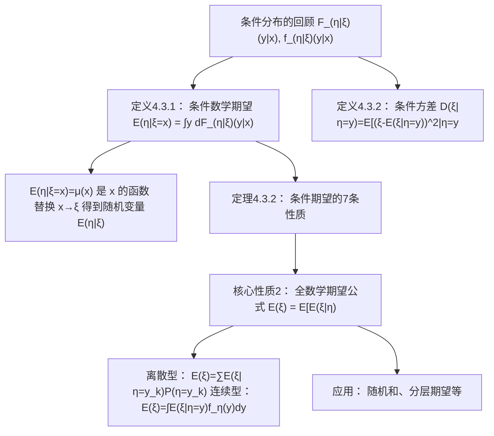
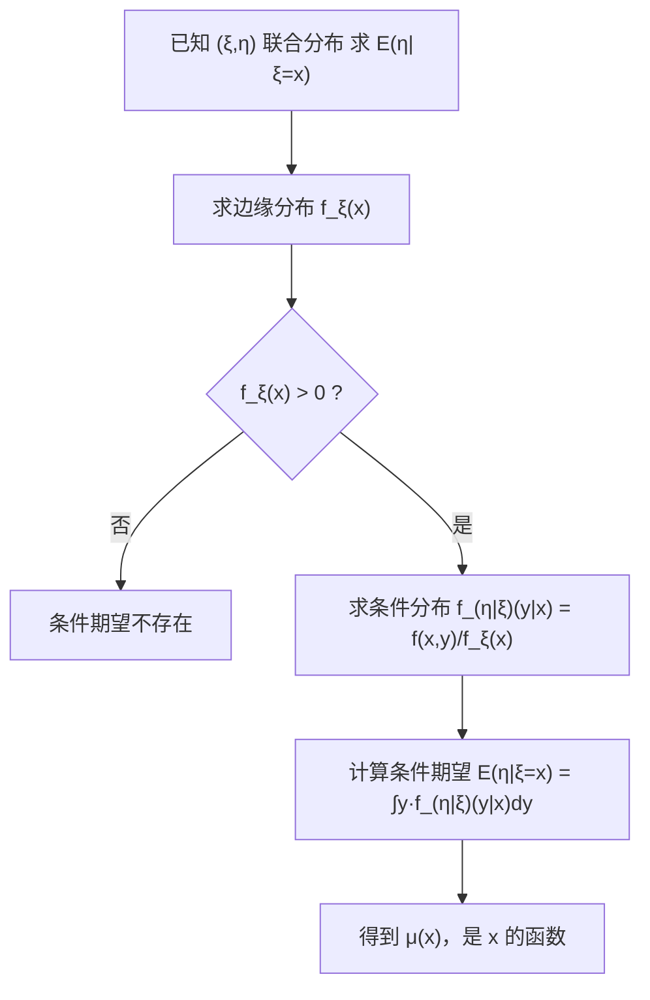
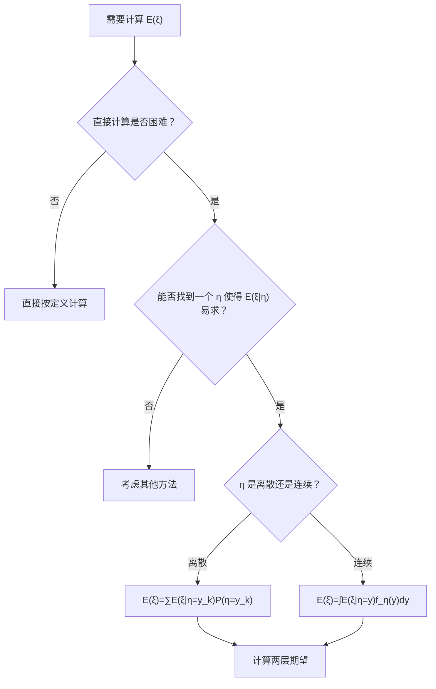

---
subject:
- 概率论
source:
- C4.3 条件数学期望与方差.md
type: review
tags:
- 条件方差
- 全数学期望公式
aliases:
- 第4章 条件数学期望与方差 — 知识点梳理
schema_version: 2
time: "2026-08-31T11:44:20+08:00"
legacy_status: 已完成
legacy_topics:
- 条件数学期望
- 条件方差
- 全数学期望公式
- 条件期望性质
status: not done
---

## 一、本章核心脉络

**核心问题**：已知 $(\xi,\eta)$ 的联合分布，当我们获知 $\xi$ 取某个值时，如何重新评估 $\eta$ 的平均水平？进一步，如何在不知道 $\eta$ 分布的情况下，借助条件期望求出 $\xi$ 的无条件期望？

> [!info] 学习导读
> **必要先修**：先掌握[[03_Sources/Reviews/概率论/知识点解析梳理/03c-条件分布-知识梳理|条件分布]]与[[03_Sources/Reviews/概率论/知识点解析梳理/04a-数学期望、方差和矩-知识梳理|数学期望]]。
> **来源边界**：正文依据[[03_Sources/Courses/概率论/PPT课件/MD/C4.3 条件数学期望与方差|C4.3 课件源文]]重组；全方差扩展与自测属于补充学习内容。
> **阅读路线**：条件分布的期望 → 条件期望作为随机变量 → 条件期望性质 → 全期望公式 → 条件方差与全方差。



> 这条脉络的演进逻辑是：从条件分布自然引出条件期望的定义，发现它是条件的函数，进而可将条件变量替换为随机变量，得到"条件期望作为随机变量"的观点，由此推导出全数学期望公式——将复杂期望分解为条件期望的期望。

## 二、条件数学期望的定义与计算（核心）

### 2.1 直观引入

**动机**：若 $\xi$ 表示人的身高，$\eta$ 表示体重。已知联合分布，如何求"身高为某个固定值 $x$ 的人"的平均体重？

- 无身高限制时：$E(\eta)=\int_{-\infty}^{+\infty}y\,dF_\eta(y)$
- 在 $\xi=x$ 的条件下：$E(\eta|x)=E(\eta|\xi=x)\triangleq\int_{-\infty}^{+\infty}y\,dF_{\eta|\xi}(y|x)$

> 一句话来说：**条件期望就是"在已知部分信息的条件下"，对随机变量重新计算的加权平均——权重由条件分布决定。**

### 2.2 定义 4.3.1（条件数学期望）

设 $(\xi,\eta)$ 是二维随机变量，条件分布函数 $F_{\eta|\xi}(y|x)$、$F_{\xi|\eta}(x|y)$ 存在，若

$$\int_{-\infty}^{+\infty}|y|\,dF_{\eta|\xi}(y|x)<\infty,\quad \int_{-\infty}^{+\infty}|x|\,dF_{\xi|\eta}(x|y)<\infty$$

则称

$$E(\eta|x)=E(\eta|\xi=x)\triangleq\int_{-\infty}^{+\infty}y\,dF_{\eta|\xi}(y|x)$$

为在 $\xi=x$ 的条件下，$\eta$ 的**条件数学期望**。同理

$$E(\xi|y)=E(\xi|\eta=y)\triangleq\int_{-\infty}^{+\infty}x\,dF_{\xi|\eta}(x|y)$$

**具体形式的计算公式**：

| 类型 | 条件期望公式 | 本质 |
|:--|:--|:--|
| 连续型 | $E(\eta\|x)=\int_{-\infty}^{+\infty}y f_{\eta\|\xi}(y\|x)\,dy$ | 对条件密度加权积分 |
| 连续型 | $E(\xi\|y)=\int_{-\infty}^{+\infty}x f_{\xi\|\eta}(x\|y)\,dx$ | 对条件密度加权积分 |
| 离散型 | $E(\eta\|x_i)=\sum_{j=1}^{\infty}y_j p_{j\|i}$ | 对条件分布律加权求和 |
| 离散型 | $E(\xi\|y_j)=\sum_{i=1}^{\infty}x_i p_{i\|j}$ | 对条件分布律加权求和 |

> 一句话来说：**条件期望的计算方式与无条件期望完全一致，只是将边缘分布替换为条件分布即可。**

### 2.3 $E(\eta|\xi=x)$ 是 $x$ 的函数

一般有

$$E(\eta|\xi=x)=\mu(x),\quad E(\xi|\eta=y)=\delta(y)$$

都是实值函数。**关键步骤**：在上式中用 $\xi$ 替换 $x$，定义

$$E(\eta|\xi)\triangleq\mu(\xi),\quad E(\xi|\eta)\triangleq\delta(\eta)$$

可以证明：$E(\eta|\xi)$ 和 $E(\xi|\eta)$ 作为随机变量的函数，**仍然是随机变量**，具有随机变量的概率性质。

> 一句话来说：**条件期望有两种视角——给定具体条件值 $x$ 时是一个数 $\mu(x)$；把条件换回随机变量 $\xi$ 时是一个新的随机变量 $\mu(\xi)$。** 后者是全期望公式的基础。

### 2.4 定理 4.3.1（条件期望的推广）

设函数 $g(x)$ 在 $\mathbb{R}$ 上连续，若 $\int_{-\infty}^{+\infty}|g(x)|\,dF_{\xi|\eta}(x|y)<+\infty$，则

$$E[g(\xi)|\eta=y]=\int_{-\infty}^{+\infty}g(x)\,dF_{\xi|\eta}(x|y)$$

同理 $E[g(\eta)|\xi=x]=\int_{-\infty}^{+\infty}g(y)\,dF_{\eta|\xi}(y|x)$。类似可定义 $E[g(\eta)|\xi]$ 和 $E[g(\xi)|\eta]$。

### 2.5 条件期望的计算例题（核心）

**例 4.3.1**（二维正态分布的条件期望）若 $(\xi,\eta)\sim N(0,1;0,1;\rho),\;(-1<\rho<1)$，求 $E(\eta|\xi=x)$ 和 $E(\xi|\eta=y)$。

> [!solution]- 点击展开详细解析
> **逐步分析**：
> 1. 在 $\xi=x$ 的条件下，$\eta\sim N(\rho x,\sqrt{1-\rho^2})$（这是二维正态的条件分布性质）
> 2. 条件密度：$f_{\eta|\xi}(y|x)=\frac{1}{\sqrt{2\pi}\sqrt{1-\rho^2}}e^{-\frac{1}{2}\left[\frac{y-\rho x}{\sqrt{1-\rho^2}}\right]^2}$
> 3. 正态分布的条件期望即为其均值参数：
>    $$E(\eta|\xi=x)=\int_{-\infty}^{+\infty}y f_{\eta|\xi}(y|x)\,dy=\rho x$$
> 4. 同理 $E(\xi|\eta=y)=\rho y$
>
> > **直观理解**：条件期望 $E(\eta|\xi=x)=\rho x$ 是一条过原点的直线。$\rho$ 越大，$\xi$ 的取值对 $\eta$ 的预测越"陡峭"；$\rho=0$ 时条件期望恒为 0（知道 $\xi$ 不提供任何关于 $\eta$ 的信息）。

---

**例 4.3.2** 设 $(\xi,\eta)$ 的联合概率密度为
$$f(x,y)=\begin{cases}\frac{1}{2}e^{-y},&y>|x|,\;-\infty<x<\infty\\0,&\text{其它}\end{cases}$$
求 $E(\eta|\xi=x)$。

> [!solution]- 点击展开详细解析
> **逐步分析**：
> 1. 先求边缘密度：$f_\xi(x)=\int_{|x|}^{\infty}\frac{1}{2}e^{-y}dy=\frac{1}{2}e^{-|x|},\;x\in\mathbb{R}$
> 2. 条件密度：$f_{\eta|\xi}(y|x)=\frac{f(x,y)}{f_\xi(x)}=\frac{\frac{1}{2}e^{-y}}{\frac{1}{2}e^{-|x|}}=e^{-y+|x|},\;y>|x|$
> 3. 条件期望：
>    $$E(\eta|\xi=x)=\int_{|x|}^{\infty}y e^{-y+|x|}dy=1+|x|,\quad x\in\mathbb{R}$$
> 4. 结果是 $x$ 的实值函数。

---

**例 4.3.3** 设 $(\xi,\eta)$ 的联合概率密度为
$$f(x,y)=\begin{cases}1,&0\leq x\leq 2,\;\max(0,x-1)\leq y\leq\min(1,x)\\0,&\text{其他}\end{cases}$$
求 $f_{\eta|\xi}(y|x)$，并计算 $E(\eta|\xi=x)$。

> [!solution]- 点击展开详细解析
> **逐步分析**：
> 1. 支持域是一个平行四边形：由 $y=x$ 和 $y=x-1$ 在 $[0,2]\times[0,1]$ 中围成
> 2. 求边缘密度 $f_\xi(x)$：
>    - $0\leq x\leq 1$：$f_\xi(x)=\int_0^x dy=x$
>    - $1<x\leq 2$：$f_\xi(x)=\int_{x-1}^1 dy=2-x$
>    - 其他：$0$
> 3. 求条件密度 $f_{\eta|\xi}(y|x)=\frac{f(x,y)}{f_\xi(x)}$：
>    - $0<x\leq 1$：$f_{\eta|\xi}(y|x)=\frac{1}{x},\;0<y<x$
>    - $1<x<2$：$f_{\eta|\xi}(y|x)=\frac{1}{2-x},\;x-1<y<1$
>    - $x\notin(0,2)$：不存在（边缘密度为 0）
> 4. 条件期望：
>    - $0<x\leq 1$：$E(\eta|\xi=x)=\int_0^x y\cdot\frac{1}{x}dy=\frac{x}{2}$
>    - $1<x<2$：$E(\eta|\xi=x)=\int_{x-1}^1 y\cdot\frac{1}{2-x}dy=\frac{x}{2}$
> 5. 统一写成：$E(\eta|\xi=x)=\frac{x}{2},\;(0<x<2)$
>
> > **要点**：分段讨论边缘密度和条件密度的定义域，最终条件期望恰好统一为一个简洁表达式。

---

**填空题练习**：设 $(\xi,\eta)$ 服从区域 $\{(x,y)|0<x<1,\;0<y<2x\}$ 上的均匀分布，则当 $0<x<1$ 时，$E(\eta|\xi=x)=x$

> [!solution]- 点击展开详细解析
> （面积 $=1$，$f(x,y)=1$；$f_\xi(x)=2x$；$f_{\eta|\xi}(y|x)=\frac{1}{2x}$，$E(\eta|\xi=x)=\int_0^{2x}y\cdot\frac{1}{2x}dy=x$）

## 三、条件期望的性质——定理 4.3.2（核心）

设 $\xi,\eta,\zeta$ 是 $(\Omega,\mathcal{F},P)$ 上的随机变量，$g(\cdot)$ 为 $\mathbb{R}$ 上连续函数，且各数学期望存在。

### 性质 1：独立时条件期望退化为无条件期望

若 $\xi$ 与 $\eta$ 相互独立，则

$$E(\xi|\eta)=E(\xi)$$

**证明**：$\xi$ 与 $\eta$ 独立 $\Rightarrow$ $F_{\xi|\eta}(x|y)=F_\xi(x),\;\forall y\in\mathbb{R}$。故对任意 $y$，
$E(\xi|y)=\int_{-\infty}^{+\infty}x\,dF_{\xi|\eta}(x|y)=\int_{-\infty}^{+\infty}x\,dF_\xi(x)=E(\xi)$，从而 $E(\xi|\eta)=E(\xi)$。

> 一句话来说：**独立意味着"知道一个变量不提供另一个变量的任何信息"，所以条件期望退化为无条件期望。**

### 性质 2：全数学期望公式 【必考·大题】

$$E(\xi)=E[E(\xi|\eta)]$$

**证明**（以连续型为例）：

$$\begin{aligned}
E\{E[\xi|\eta]\}&=\int_{-\infty}^{+\infty}E[\xi|y]f_\eta(y)dy \\
&=\int_{-\infty}^{+\infty}\left[\int_{-\infty}^{+\infty}x f_{\xi|\eta}(x|y)dx\right]f_\eta(y)dy \\
&=\int_{-\infty}^{+\infty}\int_{-\infty}^{+\infty}x f(x,y)\,dxdy = E[\xi]
\end{aligned}$$

> 一句话来说：**无条件期望等于"条件期望的期望"——先按条件分组求期望，再对各组期望按条件的概率加权平均。** 这是全概率公式在期望上的对应。

**离散型形式**（$\eta$ 是离散型，$P\{\eta=y_k\}=p_k$）：

$$E(\xi)=\sum_{k=1}^{\infty}E(\xi|\eta=y_k)\,P(\eta=y_k)$$

**连续型形式**（$\eta$ 是连续型）：

$$E(\xi)=\int_{-\infty}^{+\infty}E(\xi|\eta=y)\,f_\eta(y)\,dy$$

### 性质 3：条件变量可提因子

$$E[g(\eta)\xi|\eta]=g(\eta)E[\xi|\eta]$$

**证明**：对任意 $y\in\mathbb{R}$，
$E[g(\eta)\xi|\eta=y]=\int_{-\infty}^{+\infty}g(y)\cdot x\,dF_{\xi|\eta}(x|y)=g(y)\int_{-\infty}^{+\infty}x\,dF_{\xi|\eta}(x|y)=g(y)E(\xi|y)$，用 $\eta$ 替换 $y$ 即得。

> 一句话来说：**在给定 $\eta$ 的条件下，$\eta$ 的任意函数 $g(\eta)$ 相当于"常数"，可以从条件期望中提出。**

### 性质 4（由性质 2 + 性质 3 导出）

$$E[g(\eta)\cdot\xi]=E[g(\eta)\cdot E(\xi|\eta)]$$

**证明**：$E[g(\eta)\xi]=E\{E[g(\eta)\xi|\eta]\}=E[g(\eta)E(\xi|\eta)]$（全期望公式 + 性质 3）。

### 性质 5：常数的条件期望

$$E(c|\eta)=c,\quad c\text{ 是常数}$$

**证明**：对任意 $y$，$E(c|\eta=y)=\int_{-\infty}^{+\infty}c\,dF_{\xi|\eta}(x|y)=c$，故 $E(c|\eta)=c$。

### 性质 6

$$E[g(\eta)]=E\{E[g(\eta)|\eta]\}$$

**证明**：根据性质 3，$E\{E[g(\eta)\cdot 1|\eta]\}=E[g(\eta)E(1|\eta)]=E[g(\eta)]$。

### 性质 7：线性性质

$$E[a\xi+b\eta|\zeta]=aE(\xi|\zeta)+bE(\eta|\zeta),\quad a,b\text{ 是常数}$$

> 一句话来说：**条件期望保留了无条件期望的几乎所有优良性质——线性性、常数保序性等，且额外获得了"提因子"和"全期望公式"两大工具。**

### 补充性质 8（教材 P223）

$$E\{[\xi-E(\xi|\eta)]^2\}\leq E\{[\xi-g(\eta)]^2\}$$

对任意函数 $g$ 成立。即：在均方误差意义下，$E(\xi|\eta)$ 是 $\xi$ 基于 $\eta$ 的**最优预测**。

## 四、全数学期望公式的应用 【必考·大题】

全期望公式 $E(\xi)=E[E(\xi|\eta)]$ 是处理"随机个随机变量之和"以及"分层模型"的核心工具。

### 4.1 离散型应用：随机和

**例 4.3.4**（随机顾客消费总额）某段时间内到达商场的顾客人数 $N$ 服从参数为 $\lambda$ 的泊松分布。每位顾客消费额 $\xi$ 服从 $[a,b]$ 上的均匀分布。各位顾客之间消费独立且与 $N$ 独立。求总消费额的平均值。

> [!solution]- 点击展开详细解析
> **逐步分析**：
> 1. 总消费额：$S=\sum_{i=1}^{N}\xi_i$（随机个随机变量之和）
> 2. 由离散型全期望公式：$E(S)=\sum_{n=1}^{\infty}P\{N=n\}E(S|N=n)$
> 3. 给定 $N=n$ 时：$E(S|N=n)=E\left(\sum_{i=1}^{n}\xi_i\right)=\sum_{i=1}^{n}E(\xi_i)=nE(\xi)$（$\xi_i$ 与 $N$ 独立）
> 4. 代回：$E(S)=E(\xi)\sum_{n=1}^{\infty}nP\{N=n\}=E(\xi)E(N)$
> 5. $E(\xi)=\frac{a+b}{2}$（均匀分布），$E(N)=\lambda$（泊松分布）
> 6. 最终：$E(S)=\frac{a+b}{2}\lambda$
>
> > **核心技巧**：随机和 $S=\sum_{i=1}^N\xi_i$ 的期望可以分解为 $E(S)=E(N)E(\xi)$，条件是 $\xi_i$ 与 $N$ 独立且 $\xi_i$ 同分布。

---

### 4.2 连续型应用：分层条件

**例 4.3.5** 已知 $\xi$ 服从 $[0,a]$ 上的均匀分布，$\eta$ 服从 $[\xi,a]$ 上的均匀分布（即 $\eta$ 的条件分布依赖于 $\xi$），求 $E(\eta)$。

> [!solution]- 点击展开详细解析
> **逐步分析**：
> 1. **先求条件期望**：对 $0<x<a$，$f_{\eta|\xi}(y|x)=\frac{1}{a-x},\;x<y<a$
>    $$E(\eta|\xi=x)=\int_x^a\frac{y}{a-x}dy=\frac{a+x}{2}$$
> 2. **再用全期望公式**：
>    $$E(\eta)=E[E(\eta|\xi)]=E\left(\frac{a+\xi}{2}\right)=\frac{a+E(\xi)}{2}$$
> 3. $\xi\sim U[0,a]$，$E(\xi)=a/2$
> 4. 最终：$E(\eta)=\frac{a+a/2}{2}=\frac{3}{4}a$
>
> > **分层计算思路**：先算"内层"条件期望（把条件变量当常数），再算"外层"期望（对条件变量求期望）。两层分别使用自己熟悉的方法。

## 五、条件方差（了解即可）

### 5.1 定义 4.3.2

称

$$D(\xi|\eta=y)=E\left\{\big[\xi-E(\xi|\eta=y)\big]^2\;\big|\;\eta=y\right\}$$

为在"$\eta=y$"的条件下，$\xi$ 的**条件方差**。

> 一句话来说：**条件方差衡量在给定 $\eta=y$ 的条件下，$\xi$ 相对于其条件期望的离散程度。**

**注**：条件方差刻画了随机变量 $\xi$ 相对于条件数学期望 $E(\xi|\eta=y)$ 的偏离程度。

**例**：设 $(\xi,\eta)$ 服从区域 $\{(x,y)|0<x<1,\;0<y<2x\}$ 上的均匀分布，$x=3/4$ 时：

> [!solution]- 点击展开详细解析
> - $E(\eta|\xi=\frac{3}{4})=\frac{3}{4}$
> - $f_{\eta|\xi}(y|\frac{3}{4})=\frac{2}{3},\;0<y<\frac{3}{2}$
> - $E(\eta^2|\xi=\frac{3}{4})=\int_0^{3/2}y^2\cdot\frac{2}{3}dy=\frac{3}{4}$
> - $D(\eta|\xi=\frac{3}{4})=\frac{3}{4}-\left(\frac{3}{4}\right)^2=\frac{3}{16}$

### 5.2 全方差公式（扩展了解）

与全期望公式对应，条件方差也有分解公式（教材后续内容）：

$$D(\xi)=E[D(\xi|\eta)]+D[E(\xi|\eta)]$$

即：总方差 = 组内方差的期望 + 组间方差。

## 六、判定/决策流程

### 6.1 计算条件期望的决策流程



### 6.2 全期望公式的使用决策流程



### 6.3 条件期望性质的决策流程

```mermaid
flowchart TD
    A["表达式含条件期望"] --> B{ξ 与 η 独立？}
    B -->|是| C["E(ξ|η) = E(ξ)"]
    B -->|否| D{"含 g(η)ξ 形式？"}
    D -->|是| E["E[g(η)ξ|η"] = g(η)E[ξ|η]"]
    D -->|否| F{需要消除条件？}
 F -->|是| G["用全期望公式： E[E(ξ|η)"] = E(ξ)"]
 F -->|否| H["检查其他性质 （线性、常数等）"]
```

## 七、核心公式速查表

| 公式 | 条件/说明 |
|:--|:--|
| $E(\eta\|\xi=x)=\int y\,dF_{\eta\|\xi}(y\|x)$ | 条件期望的一般定义 |
| $E(\eta\|\xi=x)=\int y f_{\eta\|\xi}(y\|x)dy$ | 连续型 |
| $E(\eta\|x_i)=\sum_j y_j p_{j\|i}$ | 离散型 |
| $E(\eta\|\xi)=\mu(\xi)$ 是随机变量 | 将条件值替换为随机变量 |
| $E[g(\xi)\|\eta=y]=\int g(x)dF_{\xi\|\eta}(x\|y)$ | 定理 4.3.1 |
| $E(\xi)=E[E(\xi\|\eta)]$ | **全数学期望公式**（定理 4.3.2-2） |
| $E(\xi)=\sum_k E(\xi\|\eta=y_k)P(\eta=y_k)$ | 离散型全期望公式 |
| $E(\xi)=\int E(\xi\|\eta=y)f_\eta(y)dy$ | 连续型全期望公式 |
| $E(\xi\|\eta)=E(\xi)$ | $\xi,\eta$ 独立 |
| $E[g(\eta)\xi\|\eta]=g(\eta)E[\xi\|\eta]$ | 条件变量函数可提因子 |
| $E[g(\eta)\xi]=E[g(\eta)E(\xi\|\eta)]$ | 性质 2+3 的推论 |
| $E(c\|\eta)=c$ | 常数条件期望 |
| $E[a\xi+b\eta\|\zeta]=aE(\xi\|\zeta)+bE(\eta\|\zeta)$ | 线性性质 |
| $D(\xi\|\eta=y)=E[(\xi-E(\xi\|\eta=y))^2\|\eta=y]$ | 条件方差定义 |

## 八、易错点与注意事项

> [!warning] **易错点与注意事项**
>
> 1. **$E(\eta|\xi=x)$ 是 $x$ 的函数，不是常数**。很多初学者算出 $\mu(x)=1+|x|$ 后就结束了，但要注意这个结果依赖于 $x$，在不同条件下取不同值。
>
> 2. **全期望公式的嵌套方向**：$E(\xi)=E[E(\xi|\eta)]$，外层期望是对 $\eta$ 求的。操作上：
>    - 先算内层：将 $\eta$ 固定为 $y$，求 $E(\xi|\eta=y)$，得到 $y$ 的函数 $h(y)$
>    - 再算外层：$E[h(\eta)]$，对 $\eta$ 的分布求期望
>    - **常见错误**：内层算完后不知道该对谁求外层期望。
>
> 3. **独立时条件期望退化为无条件期望，但逆不真**：$E(\xi|\eta)=E(\xi)$ 不能推出 $\xi$ 与 $\eta$ 独立（仅说明条件期望不依赖于条件，不保证独立性）。
>
> 4. **性质 3 的使用条件**：$E[g(\eta)\xi|\eta]=g(\eta)E[\xi|\eta]$ 中，$g(\eta)$ 必须是条件变量 $\eta$ 的函数。若形式为 $E[g(\xi)\eta|\eta]$，不能把 $g(\xi)$ 提出。
>
> 5. **条件期望 vs 无条件期望**：$E[E(\xi|\eta)]$ 是一个数（无条件期望），$E(\xi|\eta)$ 是一个随机变量（条件变量 $\eta$ 的函数）。两者类型不同。
>
> 6. **全概率公式 vs 全期望公式的对应**：
>    - 全概率：$P(A)=\sum_k P(A|B_k)P(B_k)$（对概率分解）
>    - 全期望：$E(\xi)=\sum_k E(\xi|B_k)P(B_k)$（对期望分解）
>    - 两者结构一致，只是把"事件的概率"替换为"随机变量的期望"。
>
> 7. **随机和的期望**：$S=\sum_{i=1}^N\xi_i$ 中 $N$ 也是随机的，不能直接写 $E(S)=E(N)E(\xi_1)$，必须通过全期望公式严格推导。这个结论成立的条件是 $\xi_i$ 与 $N$ 独立且 $\xi_i$ 同分布。
>
> 8. **条件方差不等于无条件方差的简单替换**：$D(\xi|\eta=y)$ 不是直接用条件分布代入方差公式就完事，需要先求 $E(\xi|\eta=y)$ 作为"条件均值"，再算偏离程度。

## 九、自测（新编）

设 $N$ 取 $1,2$ 的概率各为 $1/2$。给定 $N=n$ 时，$X\sim B(n,1/2)$。不用先求 $X$ 的完整分布，计算 $E(X)$。

> [!hint]- 提示
> 先求 $E(X\mid N)$，再用全期望公式。

> [!solution]- 解析
> $E(X\mid N=n)=n/2$，所以 $E(X)=E[E(X\mid N)]=E(N/2)=\frac12\times\frac{1+2}{2}=3/4$。

## 十、相关知识点链接

- [[04a-数学期望与方差-知识梳理]] — 一维无条件期望与方差的定义和性质
- [[03_Sources/Reviews/概率论/知识点解析梳理/04b-多维随机变量的数字特征-知识梳理]] — 协方差、相关系数、协方差矩阵
- [[03a-条件分布-知识梳理]] — 条件分布的定义和计算方法（条件期望的前置知识）
- [[02b-多维随机变量及其分布-知识梳理]] — 联合分布、边缘分布、条件分布的基础

## 十一、作业与练习

- 习题库：[[../习题库/第4章/]] 中关于条件期望与全期望公式的习题

## 可复用知识条目

本章涉及以下独立条目；后续补充与跨课程应用统一维护在条目中。

### 概念入口

- [[01_Knowledge/数学期望|数学期望]]
- [[01_Knowledge/条件概率与条件期望|条件概率与条件期望]]

### 知识点入口

- [[01_Knowledge/全数学期望公式|全数学期望公式]]
- [[01_Knowledge/条件方差|条件方差]]
