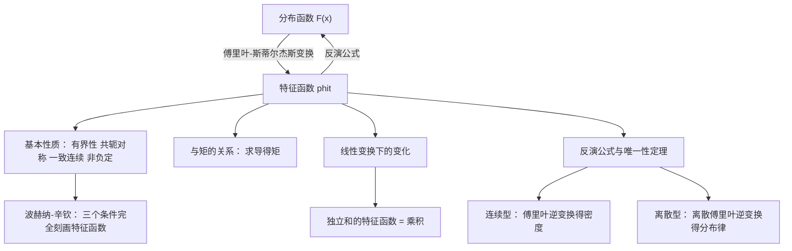
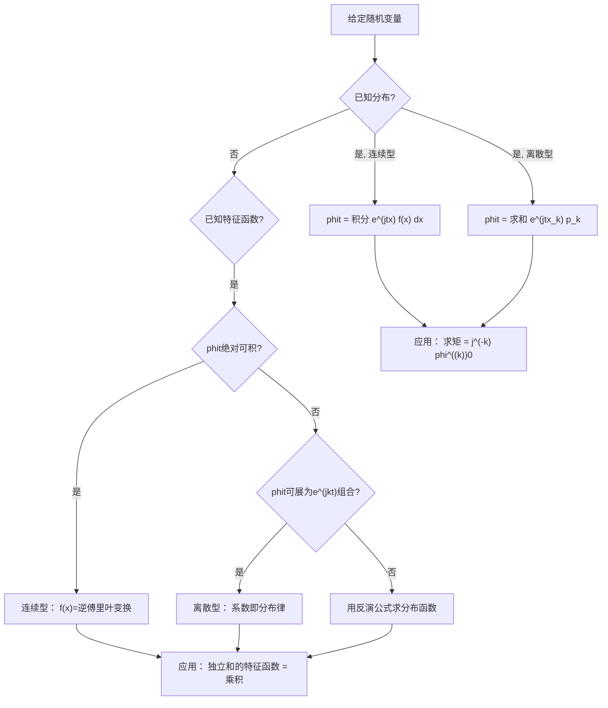

---
subject:
- 概率论
source:
- 5.1 一维特征函数的定义及性质.md
type: review
tags:
- 特征函数
- 傅里叶-斯蒂尔杰斯变换
- 反演公式
- 波赫纳-辛钦定理
aliases:
- 第5章 一维特征函数的定义及性质 — 知识点梳理
schema_version: 2
time: "2026-08-31T11:44:20+08:00"
legacy_status: 已完成
legacy_topics:
- 特征函数
- 傅里叶-斯蒂尔杰斯变换
- 反演公式
- 惟一性定理
- 波赫纳-辛钦定理
- 矩与特征函数
status: not done
---

# 一、本章核心脉络

**核心问题**：分布函数完整描述了随机变量的概率规律，但分布函数的卷积运算（求独立和的分布）非常繁琐。能否找到一个与分布函数一一对应、且能将"卷积"变成"乘积"的工具？

> [!info] 学习导读
> **必要先修**：掌握[[03_Sources/Reviews/概率论/知识点解析梳理/04a-数学期望、方差和矩-知识梳理|随机变量函数的期望]]，并了解复指数 $e^{itx}=\cos(tx)+i\sin(tx)$。
> **来源边界**：正文依据[[03_Sources/Courses/概率论/PPT课件/MD/5.1 一维特征函数的定义及性质|5.1 课件源文]]重组；傅里叶直觉与自测属于补充解释。
> **阅读路线**：定义与常见例子 → 基本性质 → 导数与矩 → 反演公式 → 惟一性定理。

答案就是**特征函数**——分布函数的傅里叶-斯蒂尔杰斯变换。特征函数与分布函数一一对应（惟一性定理），且独立随机变量和的特征函数等于各自特征函数的乘积。

> 这个顺序是从"定义"到"性质"再到"应用"的自然递进：先定义清楚特征函数是什么，然后研究它具备哪些内蕴性质（为后续判定打好基础），接着建立它与矩的桥梁（实际计算工具），最后用反演公式完成"特征函数到分布函数"的闭环，从而确立一一对应关系。

# 二、特征函数的定义

## 2.1 复随机变量的数学期望

设 $X,Y$ 是实随机变量，定义复随机变量 $Z = X + jY$（其中 $j = \sqrt{-1}$），其数学期望为：

$$E(Z) = E(X) + jE(Y)$$

> 一句话来说：复随机变量的期望就是实部和虚部分别取期望再组合，因为期望是线性算子。

## 2.2 特征函数的定义（核心）

**定义 5.1.1** 设 $\xi$ 是定义在 $(\Omega, \mathcal{F}, P)$ 上的随机变量，称

$$\varphi(t) = E(e^{jt\xi}) = \int_{-\infty}^{+\infty} e^{jtx} dF(x), \quad t \in \mathbb{R}$$

为 $\xi$ 的**特征函数**。

> 一句话来说：特征函数就是把随机变量 $\xi$ 塞进复指数函数 $e^{jt\xi}$ 里再取期望——本质是对分布函数做傅里叶-斯蒂尔杰斯变换，把概率信息编码成复平面上的一个函数。

**存在性保证**：$\forall t \in \mathbb{R}$，$\cos tx$ 和 $\sin tx$ 均为连续有界函数，$F(x)$ 单调有界，由 $R$-$S$ 积分存在定理（$f$ 连续有界，$g$ 单调有界，则 $\int f dg$ 存在），$E(e^{jt\xi})$ 总存在。

等价写法：

$$\varphi(t) = E(\cos t\xi) + jE(\sin t\xi) = \int_{-\infty}^{+\infty} \cos tx \, dF(x) + j\int_{-\infty}^{+\infty} \sin tx \, dF(x)$$

### 两种具体形式

| 类型 | 特征函数形式 |
|:-----|:------------|
| 连续型 | $\displaystyle \varphi(t) = \int_{-\infty}^{+\infty} e^{jtx} f(x) \, dx$ |
| 离散型 | $\displaystyle \varphi(t) = \sum_k e^{jtx_k} p_k$ |
  
## 2.3 常见分布的特征函数（必须记住）

**Ex.1 单点分布** $P\{\xi = c\} = 1$

$$\varphi(t) = e^{jtc}, \quad t \in \mathbb{R}$$

**Ex.2 两点分布（伯努利分布）** $P\{\xi = 0\} = 1-p = q,\; P\{\xi = 1\} = p$

$$\varphi(t) = q + pe^{jt}, \quad t \in \mathbb{R}$$

**Ex.3 二项分布** $B(n, p)$

$$\varphi(t) = (q + pe^{jt})^n, \quad t \in \mathbb{R}$$

> 一句话来说：二项分布是 $n$ 个独立伯努利之和，其特征函数就是伯努利特征函数的 $n$ 次方。

**Ex.4 泊松分布** $P(\lambda)$

$$\varphi(t) = e^{\lambda(e^{jt} - 1)}, \quad t \in \mathbb{R}$$

**Ex.5 指数分布** $f(x) = \lambda e^{-\lambda x} \; (x \geq 0), \; \lambda > 0$

$$\varphi(t) = \left(1 - \frac{jt}{\lambda}\right)^{-1} = \frac{\lambda}{\lambda - jt}, \quad t \in \mathbb{R}$$

**Ex.6 均匀分布** $U[-a, a]$

$$\varphi(t) = \frac{\sin at}{at}, \quad t \in \mathbb{R}$$

**Ex.7 正态分布** $N(\mu, \sigma^2)$

$$\varphi(t) = e^{j\mu t - \frac{1}{2}\sigma^2 t^2}, \quad t \in \mathbb{R}$$

特别地，$N(0, 1)$ 的特征函数为：

$$\varphi(t) = e^{-\frac{1}{2}t^2}$$

> 一句话来说：正态分布的特征函数仍然是"正态形式"——这是正态分布独有的优良性质（事实上，只有正态分布的特征函数具有 $e^{P(t)}$ 的形式，其中 $P(t)$ 是二次多项式）。

### 正态分布特征函数的推导（核心洞察）

设 $f(x) = \frac{1}{\sqrt{2\pi}\sigma} e^{-\frac{(x-\mu)^2}{2\sigma^2}}$，令 $y = \frac{x-\mu}{\sigma}$，则

$$\varphi(t) = \frac{1}{\sqrt{2\pi}} \int_{-\infty}^{+\infty} e^{jt(\mu + \sigma y)} e^{-\frac{y^2}{2}} dy = \frac{1}{\sqrt{2\pi}} e^{j\mu t} \int_{-\infty}^{+\infty} e^{-\frac{y^2}{2} + jt\sigma y} dy$$

配方：$-\frac{y^2}{2} + jt\sigma y = -\frac{1}{2}(y - j\sigma t)^2 - \frac{1}{2}\sigma^2 t^2$，代入得

$$\varphi(t) = e^{j\mu t - \frac{1}{2}\sigma^2 t^2} \cdot \frac{1}{\sqrt{2\pi}} \int_{-\infty}^{+\infty} e^{-\frac{1}{2}(y - j\sigma t)^2} dy = e^{j\mu t - \frac{1}{2}\sigma^2 t^2}$$

最后一步利用了复平面上围道积分的平移不变性（积分值仍为 1）。

# 三、特征函数的基本性质

## 3.1 有界性与共轭对称性

**性质 5.1.1** 随机变量 $\xi$ 的特征函数满足：

1. $|\varphi(t)| \leq \varphi(0) = 1$
2. $\overline{\varphi(t)} = \varphi(-t)$

**直观理解**：
- (1) $|e^{jt\xi}| = 1$，取期望后模长不超过 1；当 $t=0$ 时 $e^{j\cdot 0 \cdot \xi} = 1$，期望自然是 1。
- (2) 共轭对称性来自 $e^{jt\xi}$ 的共轭等于 $e^{j(-t)\xi}$，即 $\overline{e^{jt\xi}} = e^{-jt\xi}$。

证明要点：
- (1) $|\varphi(t)|^2 = [E(\cos t\xi)]^2 + [E(\sin t\xi)]^2 \leq E[(\cos t\xi)^2] + E[(\sin t\xi)^2] = E[1] = 1 = \varphi(0)$（用了方差非负或斯蒂尔杰斯积分的柯西-施瓦茨性质）
- (2) $\overline{\varphi(t)} = \overline{E(e^{jt\xi})} = E(\cos t\xi) - jE(\sin t\xi) = E[\cos(-t\xi)] + jE[\sin(-t\xi)] = \varphi(-t)$

## 3.2 线性变换下的特征函数

**性质 5.1.2** 设 $\xi$ 的特征函数为 $\varphi_\xi(t)$，则 $\eta = a\xi + b$ 的特征函数为

$$\varphi_\eta(t) = e^{jbt} \varphi_\xi(at), \quad a, b \text{ 为常数}$$

> 一句话来说：平移 $b$ 相当于在特征函数上乘一个相位因子 $e^{jbt}$，缩放 $a$ 相当于把自变量 $t$ 缩放为 $at$。

证明：$\varphi_\eta(t) = E[e^{jt(a\xi + b)}] = E[e^{jbt} e^{j(at)\xi}] = e^{jbt} \varphi_\xi(at)$。

**Ex.8** 设 $\eta \sim N(a, \sigma^2)$，利用性质 5.1.2：
- 取 $\xi \sim N(0, 1)$，则 $\eta = \sigma\xi + a$
- $\varphi_\xi(t) = e^{-\frac{1}{2}t^2}$
- $\varphi_\eta(t) = e^{jat} \varphi_\xi(\sigma t) = e^{jat - \frac{1}{2}\sigma^2 t^2}$

## 3.3 一致连续性

**性质 5.1.3** 特征函数 $\varphi(t)$ 在 $\mathbb{R}$ 上一致连续。即 $\forall \epsilon > 0, \exists \delta > 0$，使 $|h| < \delta$ 时，对 $t$ 一致地有

$$|\varphi(t+h) - \varphi(t)| < \epsilon$$

> 一句话来说：不管 $t$ 在哪里，只要参数变动足够小，特征函数的变化也一致地小——这是由 $|e^{jh\xi} - 1|$ 的可控性保证的。

**直观理解**：$|\varphi(t+h) - \varphi(t)| = |E[e^{jt\xi}(e^{jh\xi} - 1)]| \leq E|e^{jh\xi} - 1|$，而 $|e^{jh\xi} - 1|$ 当 $h \to 0$ 时趋于 0，与 $t$ 无关。

## 3.4 非负定性

**性质 5.1.4** 特征函数是非负定的函数，即对任意正整数 $n$，任意复数 $z_1, z_2, \cdots, z_n$，及 $t_r \in \mathbb{R}$（$r = 1, 2, \cdots, n$），有

$$\sum_{r=1}^{n} \sum_{s=1}^{n} \varphi(t_r - t_s) z_r \overline{z_s} \geq 0$$

**直观理解**：这个条件来自 $\sum \sum \varphi(t_r - t_s) z_r \overline{z_s} = \int |\sum z_r e^{jt_r x}|^2 dF(x) \geq 0$。本质上是一个"二次型"非负，对应概率测度下某个平方模长的积分。

以上三个性质——$\varphi(0)=1$、一致连续、非负定——是**本质性的**，它们完全刻画了特征函数。

## 3.5 波赫纳-辛钦定理（了解即可）

**定理**：函数 $\varphi(t)$ 为某随机变量的特征函数的**充要条件**是 $\varphi(t)$ 在 $\mathbb{R}$ 上一致连续、非负定且 $\varphi(0) = 1$。

> 一句话来说：要判定一个函数是不是特征函数，只需检查三个条件——这给出了特征函数的完整数学刻画。

# 四、特征函数与矩的关系（本章核心）

## 4.1 定理 5.1.1：求导得矩

**定理 5.1.1** 若随机变量 $\xi$ 的 $n$ 阶矩存在，则 $\xi$ 的特征函数 $\varphi(t)$ 的 $k$ 阶导数 $\varphi^{(k)}(t)$ 存在，且

$$E(\xi^k) = j^{-k} \varphi^{(k)}(0), \quad (k \leq n)$$

> 一句话来说：特征函数在 0 处的导数直接给出各阶矩——求矩不用积分，求导就行。

**直观理解**：将 $e^{jt\xi}$ 对 $t$ 求导 $k$ 次，每次求导"拉下"一个因子 $j\xi$，即 $\frac{d^k}{dt^k} e^{jt\xi} = (j\xi)^k e^{jt\xi}$。在 $t=0$ 处，$e^{jt\xi} = 1$，于是导数 = $(j\xi)^k$ 的期望 = $j^k E(\xi^k)$。

**重要注意**：逆命题不成立——特征函数可导不意味着矩存在。

证明思路（连续型情形）：设 $f(x)$ 为概率密度，
- $\frac{d^k}{dt^k}[e^{jtx}f(x)] = j^k x^k e^{jtx} f(x)$
- 由于 $\int |j^k x^k e^{jtx} f(x)| dx = E[|\xi|^k] < \infty$，可以交换积分和求导顺序
- 对 $\varphi(t) = \int e^{jtx} f(x) dx$ 两边求导，得 $\varphi^{(k)}(t) = j^k \int e^{jtx} x^k f(x) dx = j^k E(\xi^k e^{jt\xi})$
- 令 $t=0$，得 $\varphi^{(k)}(0) = j^k E(\xi^k)$，故 $E(\xi^k) = j^{-k} \varphi^{(k)}(0)$

## 4.2 例题

**Ex.9** 设 $\xi$ 的概率密度为

$$f(x) = \begin{cases} \frac{1}{2}\cos x, & -\frac{\pi}{2} \leq x \leq \frac{\pi}{2} \\ 0, & \text{其它} \end{cases}$$

求 $E(\xi)$ 和 $D(\xi)$。

**逐步分析**：
1. 先求特征函数：
   $$\varphi(t) = \int_{-\pi/2}^{\pi/2} e^{jtx} \frac{1}{2}\cos x \, dx = 2\int_0^{\pi/2} \frac{1}{2} \cos tx \cos x \, dx$$
   利用积化和差：
   $$\varphi(t) = \frac{1}{2}\int_0^{\pi/2} [\cos(t+1)x + \cos(t-1)x] dx$$
   $$= \frac{1}{2}\left\{\frac{1}{t+1}\sin\left[(t+1)\frac{\pi}{2}\right] + \frac{1}{t-1}\sin\left[(t-1)\frac{\pi}{2}\right]\right\}$$

2. 求 $E(\xi)$：
   $$\varphi'(0) = 0 \quad \Rightarrow \quad E(\xi) = j^{-1}\varphi'(0) = 0$$

3. 求 $D(\xi)$：先求 $\varphi''(0) = 2 - \frac{\pi^2}{4}$
   $$D(\xi) = E(\xi^2) = j^{-2}\varphi''(0) = -\left(2 - \frac{\pi^2}{4}\right) = \frac{\pi^2}{4} - 2$$

**Ex.10** $\xi \sim N(\mu, \sigma^2)$，用特征函数计算 $E(\xi)$ 和 $D(\xi)$。

**逐步分析**：
1. $\varphi(t) = e^{j\mu t - \frac{1}{2}\sigma^2 t^2}$
2. $\varphi'(t) = (j\mu - \sigma^2 t) e^{j\mu t - \frac{1}{2}\sigma^2 t^2}$，$\varphi'(0) = j\mu$
3. $\varphi''(t) = [(j\mu - \sigma^2 t)^2 - \sigma^2] e^{j\mu t - \frac{1}{2}\sigma^2 t^2}$，$\varphi''(0) = -\mu^2 - \sigma^2$
4. $E(\xi) = -j \cdot j\mu = \mu$
5. $E(\xi^2) = j^{-2}(-\mu^2 - \sigma^2) = \mu^2 + \sigma^2$
6. $D(\xi) = (\mu^2 + \sigma^2) - \mu^2 = \sigma^2$

**更一般的结论**（正态分布的中心矩）：
$$E[(\xi - \mu)^k] = \begin{cases} 0, & k \text{ 为奇数} \\ 1 \cdot 3 \cdot 5 \cdots (k-1) \sigma^k, & k \text{ 为偶数} \end{cases}$$

# 五、反演公式与惟一性定理（难点）

## 5.1 核心问题

分布函数 $\Rightarrow$ 特征函数是直接的（定义即可）。问题是反过来：特征函数能否唯一确定分布函数？

## 5.2 反演公式

**定理 5.1.2（反演公式）** 设 $\xi$ 的分布函数和特征函数分别为 $F(x)$ 和 $\varphi(t)$，则对 $F(x)$ 的任意连续点 $x_1, x_2$（$x_1 < x_2$），有

$$F(x_2) - F(x_1) = \lim_{T \to \infty} \frac{1}{2\pi} \int_{-T}^{T} \frac{e^{-jtx_1} - e^{-jtx_2}}{jt} \varphi(t) \, dt$$

> 一句话来说：反演公式是"傅里叶逆变换"的分布函数版本——通过特征函数在区间上的积分，可以恢复出随机变量落在该区间的概率。

**推导的核心洞察**：

$$\int_{-T}^{T} \frac{e^{-jtx_1} - e^{-jtx_2}}{jt} \varphi(t) dt = \int_{-\infty}^{\infty} \left[2\int_0^T \left(\frac{\sin t(x-x_1)}{t} - \frac{\sin t(x-x_2)}{t}\right) dt\right] dF(x)$$

利用 $\int_0^{\infty} \frac{\sin \alpha t}{t} dt = \frac{\pi}{2} \text{sgn}(\alpha)$，当 $T \to \infty$ 时，括号内的积分逼近一个"指示函数"——在 $x \in (x_1, x_2)$ 时为 $2\pi$，否则为 0。于是整个积分 $\to 2\pi[F(x_2) - F(x_1)]$。

**注**：设 $x_2 = x$ 为 $F(x)$ 的连续点，令 $x_1 \to -\infty$，有

$$F(x) = \lim_{x_1 \to -\infty} \lim_{T \to \infty} \frac{1}{2\pi} \int_{-T}^{T} \frac{e^{-jtx_1} - e^{-jtx}}{jt} \varphi(t) dt$$

## 5.3 惟一性定理

**推论 1（惟一性定理）** 分布函数 $F_1(x)$ 与 $F_2(x)$ 恒等的**充要条件**是它们的特征函数 $\varphi_1(t)$ 与 $\varphi_2(t)$ 恒等。

> 一句话来说：特征函数和分布函数是一一对应的——知道其中一个，另一个就完全确定了。

**证明要点**：
- 充分性（$\Leftarrow$）：设 $\varphi_1 = \varphi_2$，令 $A = \{x: F_1(x) \text{ 和 } F_2(x) \text{ 的连续点}\}$。若 $x \in A$，由反演公式得 $F_1(x) = F_2(x)$。若 $x \notin A$，取单调下降序列 $\{x_n\} \subset A$ 且 $x_n \to x$，由分布函数的右连续性得 $F_1(x) = F_2(x)$。
- 必要性（$\Rightarrow$）：显然，同一个分布函数定义出的特征函数必然相同。

## 5.4 连续型情形

**推论 2** 若 $\varphi(t)$ 在 $\mathbb{R}$ 上绝对可积，则 $\xi$ 为连续型随机变量，其概率密度为特征函数的傅里叶逆变换：

$$f(x) = F'(x) = \frac{1}{2\pi} \int_{-\infty}^{+\infty} e^{-jtx} \varphi(t) \, dt$$

> 一句话来说：如果特征函数"衰减得足够快"（绝对可积），那么随机变量一定是连续的，且密度函数就是特征函数的傅里叶逆变换。

此时特征函数与概率密度**互为傅里叶变换**：
$$\varphi(t) = \int_{-\infty}^{+\infty} e^{jtx} f(x) dx \quad \longleftrightarrow \quad f(x) = \frac{1}{2\pi} \int_{-\infty}^{+\infty} e^{-jtx} \varphi(t) dt$$

## 5.5 离散型情形

**定理 5.1.3** 若 $\xi$ 是取整数值的离散型随机变量，分布律 $p_k = P\{\xi = k\}$（$k = 0, \pm 1, \pm 2, \cdots$），其特征函数为

$$\varphi(t) = \sum_{k=-\infty}^{\infty} p_k e^{jkt}, \quad t \in \mathbb{R}$$

则分布律可由特征函数的离散傅里叶逆变换恢复：

$$p_k = \frac{1}{2\pi} \int_{-\pi}^{\pi} e^{-jtk} \varphi(t) \, dt$$

> 一句话来说：整数格点上的离散分布，其特征函数是周期函数，分布律就是特征函数的傅里叶级数系数。

**证明要点**：$\int_{-\pi}^{\pi} e^{-jtk} \varphi(t) dt = \int_{-\pi}^{\pi} \sum_{s=-\infty}^{\infty} p_s e^{jts} e^{-jtk} dt = 2\pi p_k + \sum_{s \neq k} p_s \int_{-\pi}^{\pi} e^{jt(k-s)} dt = 2\pi p_k + 0$，因为 $s \neq k$ 时 $\int_{-\pi}^{\pi} e^{jt(k-s)} dt = 0$。

## 5.6 例题

**Ex.12** $\xi$ 在 $[-\frac{\pi}{2}, \frac{\pi}{2}]$ 上服从均匀分布，$\eta = \cos \xi$，利用特征函数法求 $\eta$ 的概率密度。

> [!solution]- 点击展开详细解析
> **逐步分析**：
> 1. $\xi$ 的概率密度：$f_\xi(x) = \frac{1}{\pi},\; x \in [-\frac{\pi}{2}, \frac{\pi}{2}]$
> 2. 求 $\eta$ 的特征函数：
>    $$\varphi_\eta(t) = E(e^{jt\cos\xi}) = \int_{-\pi/2}^{\pi/2} e^{jt\cos x} \frac{1}{\pi} dx = 2\int_0^{\pi/2} e^{jt\cos x} \frac{1}{\pi} dx$$
> 3. 换元 $u = \cos x$，$du = -\sin x \, dx = -\sqrt{1-u^2} \, dx$，积分限 $x: 0 \to \pi/2$ 对应 $u: 1 \to 0$：
>    $$\varphi_\eta(t) = \int_0^1 e^{jtu} \cdot \frac{2}{\pi} \cdot \frac{1}{\sqrt{1-u^2}} du = \int_{-\infty}^{+\infty} e^{jtu} f_\eta(u) du$$
> 4. 由惟一性定理，$\eta$ 的概率密度为：
>    $$f_\eta(y) = \begin{cases} \frac{2}{\pi} \frac{1}{\sqrt{1-y^2}}, & 0 < y < 1 \\ 0, & \text{其它} \end{cases}$$
> 
> **点评**：这个例子展示了特征函数法求随机变量函数分布的威力——不需要先求分布函数再求导，直接利用惟一性定理"匹配"密度。

**Ex.13** 已知 $\xi$ 的特征函数为 $\varphi(t) = \cos^2 t$（$t \in \mathbb{R}$），求 $\xi$ 的概率分布。

> [!solution]- 点击展开详细解析
> **逐步分析**：
> 1. 将 $\varphi(t)$ 写成 $e^{jkt}$ 的线性组合：
>    $$\varphi(t) = \cos^2 t = \left(\frac{e^{jt} + e^{-jt}}{2}\right)^2 = \frac{1}{4}e^{2jt} + \frac{1}{2} + \frac{1}{4}e^{-2jt}$$
> 2. 对照离散型特征函数的形式 $\varphi(t) = \sum p_k e^{jkt}$，读出：
>    $$P\{\xi = -2\} = \frac{1}{4}, \quad P\{\xi = 0\} = \frac{1}{2}, \quad P\{\xi = 2\} = \frac{1}{4}$$
> 
> **点评**：这个例子展示了离散情形下如何从特征函数"读"出分布律——因为特征函数是 $e^{jkt}$ 的线性组合，系数就是概率。

# 六、判定/决策流程

# 七、核心公式速查表

| 分布 | 分布律/密度 | 特征函数 $\varphi(t)$ |
|:-----|:-----------|:---------------------|
| 单点分布 $P(\xi=c)=1$ | — | $e^{jtc}$ |
| 两点分布 $B(1,p)$ | $P(\xi=0)=q, P(\xi=1)=p$ | $q + pe^{jt}$ |
| 二项分布 $B(n,p)$ | $P(\xi=k)=C_n^k p^k q^{n-k}$ | $(q + pe^{jt})^n$ |
| 泊松分布 $P(\lambda)$ | $P(\xi=k)=\frac{\lambda^k}{k!}e^{-\lambda}$ | $e^{\lambda(e^{jt}-1)}$ |
| 指数分布 | $f(x)=\lambda e^{-\lambda x}\;(x \geq 0)$ | $\left(1 - \frac{jt}{\lambda}\right)^{-1}$ |
| 均匀分布 $U[-a,a]$ | $f(x)=\frac{1}{2a}$ | $\frac{\sin at}{at}$ |
| 正态分布 $N(\mu,\sigma^2)$ | $f(x)=\frac{1}{\sqrt{2\pi}\sigma}e^{-\frac{(x-\mu)^2}{2\sigma^2}}$ | $e^{j\mu t - \frac{1}{2}\sigma^2 t^2}$ |
| 标准正态 $N(0,1)$ | $f(x)=\frac{1}{\sqrt{2\pi}}e^{-\frac{x^2}{2}}$ | $e^{-\frac{1}{2}t^2}$ |

| 定理/公式 | 表达式 |
|:---------|:------|
| 线性变换 | $\eta = a\xi + b \;\Rightarrow\; \varphi_\eta(t) = e^{jbt}\varphi_\xi(at)$ |
| 矩公式 | $E(\xi^k) = j^{-k} \varphi^{(k)}(0)$ |
| 反演公式 | $F(x_2)-F(x_1) = \lim_{T\to\infty} \frac{1}{2\pi}\int_{-T}^{T} \frac{e^{-jtx_1}-e^{-jtx_2}}{jt}\varphi(t)dt$ |
| 连续型反演 | $f(x) = \frac{1}{2\pi}\int_{-\infty}^{+\infty} e^{-jtx}\varphi(t)dt$（$\varphi$ 绝对可积时） |
| 离散型反演 | $p_k = \frac{1}{2\pi}\int_{-\pi}^{\pi} e^{-jtk}\varphi(t)dt$（整数值情形） |
| 波赫纳-辛钦 | $\varphi(t)$ 是特征函数 $\iff$ 一致连续 + 非负定 + $\varphi(0)=1$ |

# 八、易错点与注意事项

> [!warning] 易错点与注意事项
>
> 1. **$|\varphi(t)| \leq 1$ 但 $|\varphi(t)|$ 不一定单调**。例如 $N(0,1)$ 的 $\varphi(t) = e^{-t^2/2}$ 确实单调递减，但均匀分布的 $\varphi(t) = \frac{\sin at}{at}$ 是振荡衰减的。
>
> 2. **矩公式的逆不成立**。$\varphi^{(k)}(0)$ 存在是 $E(|\xi|^k) < \infty$ 的**必要条件**而非充分条件。特征函数可导不代表矩存在。
>
> 3. **$j^{-k}$ 的符号问题**。$j^{-1} = -j$，$j^{-2} = -1$，$j^{-3} = j$，$j^{-4} = 1$。计算时注意不要弄错正负号。$E(\xi^k) = j^{-k}\varphi^{(k)}(0)$ 可以理解为"每求一次导多出一个 $j$，需要除回去"。
>
> 4. **反演公式的积分是柯西主值**。$\lim_{T \to \infty} \int_{-T}^{T}$ 不是通常的广义积分，而是对称极限。$\frac{e^{-jtx_1} - e^{-jtx_2}}{jt}$ 在 $t=0$ 处有可去奇点（极限为 $x_2 - x_1$）。
>
> 5. **分布函数由特征函数唯一确定，但需要知道所有 $t$ 上的值**。仅知道部分区间上的特征函数值不足以确定分布。
>
> 6. **离散型特征函数是周期函数**（周期为 $2\pi$），连续型的特征函数一般 $|t| \to \infty$ 时趋于 0（黎曼-勒贝格引理）。
>
> 7. **指数分布的特征函数有两种常见写法**：$(1 - jt/\lambda)^{-1}$ 和 $\lambda/(\lambda - jt)$，两者等价，注意不要和拉普拉斯变换混淆。

# 九、自测（新编）

若 $X\sim N(\mu,\sigma^2)$，其特征函数为 $\varphi_X(t)=\exp(i\mu t-\sigma^2t^2/2)$。由特征函数导数恢复 $E(X)$ 与 $E(X^2)$。

> [!hint]- 提示
> 使用 $E(X)=\varphi_X'(0)/i$、$E(X^2)=\varphi_X''(0)/i^2$。

> [!solution]- 解析
> $\varphi_X'(0)=i\mu$，故 $E(X)=\mu$；$\varphi_X''(0)=-\mu^2-\sigma^2$，除以 $i^2=-1$ 得 $E(X^2)=\mu^2+\sigma^2$，从而 $D(X)=\sigma^2$。

# 十、相关知识点链接

- **傅里叶变换基础**（前置知识）：特征函数本质是分布函数的傅里叶-斯蒂尔杰斯变换，如果对傅里叶变换不熟悉建议先复习——特别是傅里叶变换与逆变换的对称形式。
- [[03_Sources/Courses/概率论/PPT课件/MD/C3.1 多维随机变量及其分布]]（前序章节）：多维特征函数是本章的自然推广，独立性的等价刻画在多维情形尤为重要。
- [[C4.2 多维随机变量的数字特征]]（前序章节）：特征函数与矩的关系（定理 5.1.1）直接依赖矩的概念，需要先熟悉期望和方差。
- [[03_Sources/Courses/概率论/PPT课件/MD/5.2 多维随机变量的特征函数]]（后续章节）：将本章所有结论推广到多维情形。
- [[03_Sources/Courses/概率论/PPT课件/MD/C5.3 多维正态随机变量及其特征函数]]（后续章节）：利用特征函数研究多维正态分布的性质是本章最重要的应用。

# 十一、作业与练习

参见习题库中第 5.1 节对应练习（习题库路径：`课程/概率论/习题库/`）。

**做题建议**：
1. 优先掌握七种常见分布特征函数的记忆和推导（Ex.1--Ex.7），做到能不看笔记默写。
2. 熟练运用性质 5.1.2（线性变换）快速计算特征函数，这可以帮你避免重复的积分计算。
3. 会用定理 5.1.1（求导得矩）验证已知分布的期望和方差。
4. 理解反演公式和惟一性定理的**逻辑**（为什么一一对应），具体积分计算考察较少。

## 可复用知识条目

本章涉及以下独立条目；后续补充与跨课程应用统一维护在条目中。

### 概念入口

- [[01_Knowledge/分布函数|分布函数]]
- [[01_Knowledge/数学期望|数学期望]]
- [[01_Knowledge/概率空间|概率空间]]
- [[01_Knowledge/随机变量|随机变量]]

### 知识点入口

- [[01_Knowledge/反演公式与唯一性定理|反演公式与唯一性定理]]
- [[03_Sources/Reviews/概率论/专题复习/常见概率分布的特征函数与独立和计算|常见分布的特征函数]]
