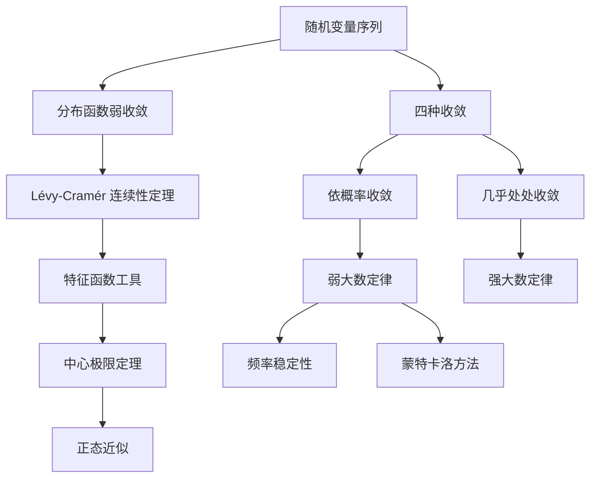
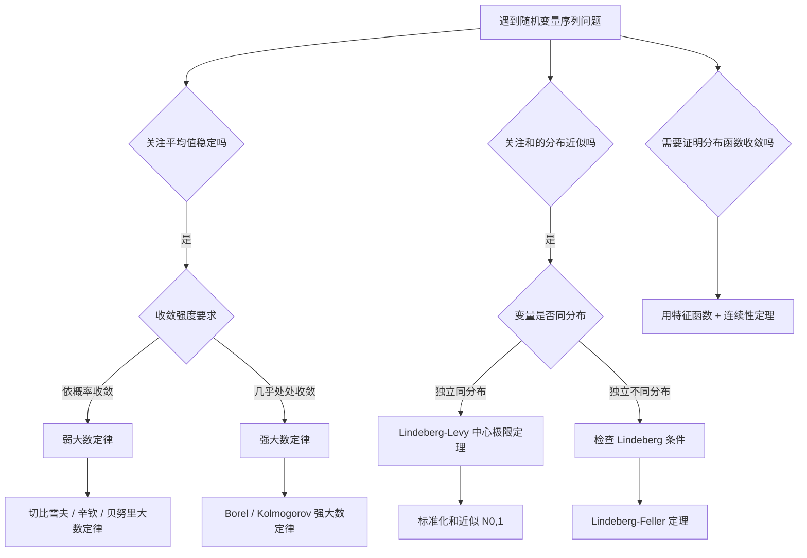

---
subject:
- 概率论
source:
- C5.1 收敛性.md; C5.2 大数定律.md; C5.3 中心极限定理.md
type: review
tags:
- 极限定理
- 收敛性
- 大数定律
- 中心极限定理
- 弱收敛
- 依概率收敛
- 几乎处处收敛
- 蒙特卡洛方法
aliases:
- 第5章 极限定理 — 知识点梳理
schema_version: 2
time: "2026-08-31T11:44:20+08:00"
legacy_status: 已完成
legacy_topics:
- 极限定理
- 收敛性
- 大数定律
- 中心极限定理
- 弱收敛
- 依概率收敛
- 几乎处处收敛
- 蒙特卡洛方法
status: not done
---

# 第5章 极限定理 — 知识点梳理

## 一、本章核心脉络

**核心问题**：当随机变量越来越多、试验次数越来越大时，随机现象是否会表现出稳定规律？如果会，这种稳定是“大概率稳定”还是“几乎必然稳定”？大量独立小扰动的和为什么常常近似服从正态分布？

> [!info] 学习导读
> **必要先修**：掌握[[03_Sources/Reviews/概率论/知识点解析梳理/04a-数学期望、方差和矩-知识梳理|期望、方差与切比雪夫不等式]]以及[[03_Sources/Reviews/概率论/知识点解析梳理/05a-一维特征函数的定义及性质-知识梳理|特征函数]]。
> **来源边界**：正文综合[[03_Sources/Courses/概率论/PPT课件/MD/C5.1 收敛性|C5.1 收敛性]]、[[03_Sources/Courses/概率论/PPT课件/MD/C5.2 大数定律|C5.2 大数定律]]与[[03_Sources/Courses/概率论/PPT课件/MD/C5.3 中心极限定理|C5.3 中心极限定理]]重组；应用解释与自测属于补充学习内容。
> **阅读路线**：弱收敛与连续性定理 → 四种收敛关系 → 弱/强大数定律 → 中心极限定理 → 正态近似应用。先分清“样本均值趋于常数”和“标准化和趋于分布”。

极限定理的学习链条是：

1. 先定义**分布函数弱收敛**，因为中心极限定理本质上是分布函数收敛到正态分布函数；
2. 再用**Lévy-Cramér 连续性定理**把分布函数收敛转化为特征函数收敛；
3. 然后区分随机变量序列的四种收敛：依分布、依概率、矩收敛、几乎处处收敛；
4. 用依概率收敛定义**弱大数定律**，用几乎处处收敛定义**强大数定律**；
5. 最后用依分布收敛定义**中心极限定理**，说明标准化和的极限分布是正态分布。

> 一句话来说：极限定理把“大量随机现象的平均稳定”和“独立和的正态近似”统一在收敛性语言中。

## 二、分布函数弱收敛（核心）

### 2.1 为什么不能要求处处收敛？

分布函数是右连续的阶梯或连续函数，极限分布函数可能有不连续点。若要求 $F_n(x)\to F(x)$ 在所有点成立，会过于苛刻。

例如，$F_n$ 是退化在 $1/n$ 处的分布函数，直观上它应收敛到退化在 $0$ 处的分布函数：

$$
F(x)=
\begin{cases}
0, & x<0,\\
1, & x\ge0.
\end{cases}
$$

但在 $x=0$ 处，$F_n(0)=0$，而 $F(0)=1$，并不收敛。问题在于 $0$ 是 $F$ 的不连续点。

> 一句话来说：弱收敛允许极限分布函数的不连续点处“不收敛”。

### 2.2 弱收敛定义

设 $\{F_n(x)\}$ 是分布函数列。若存在非降函数 $F(x)$，使得对 $F$ 的每个连续点 $x$，都有

$$
\lim_{n\to\infty}F_n(x)=F(x),
$$

则称 $\{F_n(x)\}$ **弱收敛**于 $F(x)$，记作

$$
F_n \xrightarrow{W} F.
$$

### 2.3 弱收敛极限的唯一性

若弱收敛极限 $F$ 是分布函数，则由右连续性可知，$F$ 在不连续点的值由连续点上的值唯一确定。因此弱收敛极限唯一。

### 2.4 Helly 定理

**Helly 第一定理**：任一一致有界的非降函数列 $\{F_n(x)\}$ 中，必存在子序列 $\{F_{n_k}(x)\}$ 弱收敛于某个有界非降函数 $F(x)$。

**Helly 第二定理**：若 $\{F_n(x)\}$ 在 $[a,b]$ 上弱收敛于 $F(x)$，$f(x)$ 在 $[a,b]$ 上连续，且 $a,b$ 是 $F$ 的连续点，则

$$
\lim_{n\to\infty}\int_a^b f(x)\,dF_n(x)
=
\int_a^b f(x)\,dF(x).
$$

**推广的 Helly 第二定理**：若 $f$ 在 $\mathbb{R}$ 上连续有界，$\{F_n\}$ 在 $\mathbb{R}$ 上弱收敛于 $F$，且

$$
\lim_{n\to\infty}F_n(-\infty)=F(-\infty),\quad
\lim_{n\to\infty}F_n(+\infty)=F(+\infty),
$$

则

$$
\lim_{n\to\infty}\int_{-\infty}^{+\infty}f(x)\,dF_n(x)
=
\int_{-\infty}^{+\infty}f(x)\,dF(x).
$$

> 一句话来说：Helly 定理保证弱收敛不仅控制分布函数本身，也控制对连续有界函数的积分。

## 三、Lévy-Cramér 连续性定理（难点）

### 3.1 正极限定理

若分布函数列 $\{F_n(x)\}$ 弱收敛于分布函数 $F(x)$，则对应特征函数列 $\{\varphi_n(t)\}$ 收敛于 $F$ 的特征函数 $\varphi(t)$，且在任意有限区间内一致收敛。

### 3.2 逆极限定理

若特征函数列 $\{\varphi_n(t)\}$ 收敛于函数 $\varphi(t)$，且 $\varphi(t)$ 在 $t=0$ 连续，则对应分布函数列 $\{F_n(x)\}$ 弱收敛于某个分布函数 $F(x)$，且 $\varphi(t)$ 是 $F$ 的特征函数。

### 3.3 连续性定理

通常把正、逆极限定理合称为 **Lévy-Cramér 连续性定理**：

$$
F_n \xrightarrow{W} F
\quad\Longleftrightarrow\quad
\varphi_n(t)\to\varphi(t)\ \text{在任意有限区间上一致收敛}.
$$

> 一句话来说：连续性定理说明“分布函数弱收敛”和“特征函数局部一致收敛”等价，这是用特征函数证明中心极限定理的关键桥梁。

## 四、随机变量的四种收敛（核心）

### 4.1 依分布收敛

设 $\xi_n$ 与 $\xi$ 的分布函数分别为 $F_n(x)$ 与 $F(x)$。若

$$
F_n \xrightarrow{W} F,
$$

则称 $\xi_n$ **依分布收敛**于 $\xi$，记作

$$
\xi_n \xrightarrow{d} \xi
\quad\text{或}\quad
\xi_n \Rightarrow \xi.
$$

### 4.2 依概率收敛

若对任意 $\varepsilon>0$，都有

$$
\lim_{n\to\infty}P\{\|\xi_n-\xi\|\ge\varepsilon\}=0,
$$

则称 $\xi_n$ **依概率收敛**于 $\xi$，记作

$$
\xi_n \xrightarrow{P} \xi.
$$

### 4.3 $r$ 阶矩收敛

设 $r>0$，且 $E|\xi_n|^r<\infty$，$E|\xi|^r<\infty$。若

$$
\lim_{n\to\infty}E|\xi_n-\xi|^r=0,
$$

则称 $\xi_n$ **$r$ 阶矩收敛**于 $\xi$，记作

$$
\xi_n \xrightarrow{r} \xi.
$$

特别地，$r=2$ 时称为**均方收敛**。

### 4.4 几乎处处收敛

若

$$
P\left\{\lim_{n\to\infty}\xi_n(\omega)=\xi(\omega)\right\}=1,
$$

则称 $\xi_n$ **以概率 1 收敛**于 $\xi$，也称 **几乎处处收敛**，记作

$$
\xi_n \xrightarrow{a.s.} \xi.
$$

### 4.5 四种收敛的关系

基本关系：

$$
\xi_n\xrightarrow{a.s.}\xi \Rightarrow \xi_n\xrightarrow{P}\xi \Rightarrow \xi_n\xrightarrow{d}\xi,
$$

$$
\xi_n\xrightarrow{r}\xi \Rightarrow \xi_n\xrightarrow{P}\xi \Rightarrow \xi_n\xrightarrow{d}\xi.
$$

重要结论：

- 若 $C$ 是常数，则
  $$
  \xi_n\xrightarrow{P}C \Longleftrightarrow \xi_n\xrightarrow{d}C.
  $$
- 几乎处处收敛不能推出 $r$ 阶矩收敛。
- $r$ 阶矩收敛不能推出几乎处处收敛。
- 依概率收敛不能推出几乎处处收敛。

> 一句话来说：几乎处处收敛最强，依概率收敛居中，依分布收敛最弱；但收敛到常数时，依概率收敛和依分布收敛等价。

## 五、弱大数定律（核心）

### 5.1 弱大数定律定义

设 $\{\xi_n\}$ 是随机变量序列，且数学期望都存在。若对任意 $\varepsilon>0$，有

$$
\lim_{n\to\infty}P\left\{
\left|
\frac1n\sum_{i=1}^n\xi_i-\frac1n\sum_{i=1}^nE(\xi_i)
\right|<\varepsilon
\right\}=1,
$$

则称 $\{\xi_n\}$ 满足**弱大数定律**。

等价地：

$$
\frac1n\sum_{i=1}^n\xi_i-\frac1n\sum_{i=1}^nE(\xi_i)
\xrightarrow{P}0.
$$

> 一句话来说：大量随机变量的平均值会依概率接近其平均期望。

### 5.2 切比雪夫大数定律

设 $\{\xi_k\}$ 相互独立，数学期望和方差都存在，且方差一致有界，即存在常数 $C$，使

$$
D(\xi_k)\le C,\quad k=1,2,\dots.
$$

则 $\{\xi_k\}$ 满足弱大数定律。

证明核心：

$$
D\left(\frac1n\sum_{i=1}^n\xi_i\right)
=
\frac1{n^2}\sum_{i=1}^nD(\xi_i)
\le \frac{C}{n}\to0.
$$

再由切比雪夫不等式即可得到结论。

### 5.3 马尔可夫大数定律条件

更一般地，若

$$
\frac1{n^2}D\left(\sum_{k=1}^n\xi_k\right)\to0,
$$

则 $\{\xi_k\}$ 满足弱大数定律。

> 一句话来说：弱大数定律的关键不是单个方差有界，而是“平均和”的方差趋于 $0$。

### 5.4 独立同分布大数定律

设 $\{\xi_k\}$ 相互独立同分布，且

$$
E(\xi_k)=\mu,\quad D(\xi_k)=\sigma^2.
$$

则

$$
\frac1n\sum_{k=1}^n\xi_k \xrightarrow{P} \mu.
$$

这是切比雪夫大数定律的直接推论。

### 5.5 泊松大数定律

设 $\{\xi_k\}$ 相互独立，且

$$
P(\xi_k=1)=p_k,\quad P(\xi_k=0)=1-p_k=q_k.
$$

则

$$
\frac1n\sum_{k=1}^n\xi_k-\frac1n\sum_{k=1}^np_k \xrightarrow{P}0.
$$

因为 $D(\xi_k)=p_kq_k\le1/4$，方差一致有界。

### 5.6 贝努里大数定律

设 $f_n(A)$ 是 $n$ 次独立重复试验中事件 $A$ 发生的频率，$p$ 是每次试验中 $A$ 发生的概率，则对任意 $\varepsilon>0$，

$$
\lim_{n\to\infty}P\{|f_n(A)-p|<\varepsilon\}=1.
$$

> 一句话来说：贝努里大数定律严格说明了“频率稳定于概率”。

### 5.7 辛钦大数定律

设 $\{\xi_k\}$ 相互独立同分布，若数学期望存在：

$$
E(\xi_k)=\mu,
$$

则

$$
\frac1n\sum_{k=1}^n\xi_k \xrightarrow{P}\mu.
$$

与独立同分布大数定律相比，辛钦大数定律不要求方差存在。

证明思路：

1. 设单个变量特征函数为 $\varphi(t)$；
2. 由矩与特征函数关系，$\varphi(t)=1+j\mu t+o(t)$；
3. 样本均值特征函数为
   $$
   \left[\varphi\left(\frac{t}{n}\right)\right]^n\to e^{j\mu t};
   $$
4. $e^{j\mu t}$ 是退化在 $\mu$ 处的特征函数；
5. 由连续性定理，样本均值依分布收敛到常数 $\mu$；
6. 常数极限下，依分布收敛等价于依概率收敛。

### 5.8 小概率实际推断原理

概率很小的事件，在一次试验中几乎不可能发生。因此在实际推断中，小概率事件一旦发生，往往说明原假设或模型可能不合理。

## 六、强大数定律简介（了解 + 难点）

### 6.1 强大数定律定义

设 $\{\xi_n\}$ 是随机变量序列，令

$$
\overline{\xi}_n=\frac1n\sum_{k=1}^n\xi_k.
$$

若

$$
\overline{\xi}_n-E(\overline{\xi}_n)\xrightarrow{a.s.}0,
$$

则称 $\{\xi_n\}$ 满足**强大数定律**。

> 一句话来说：弱大数定律说“平均值大概率接近期望”，强大数定律说“平均值几乎必然最终稳定在期望附近”。

### 6.2 Borel 强大数定律

设 $\{\xi_k\}$ 相互独立同分布，且

$$
P(\xi_k=1)=p,\quad P(\xi_k=0)=1-p.
$$

则

$$
\frac1n\sum_{k=1}^n\xi_k \xrightarrow{a.s.} p.
$$

这从几乎处处收敛角度解释了频率稳定于概率。

### 6.3 Kolmogorov 强大数定律

设 $\{\xi_k\}$ 相互独立，若

$$
\sum_{n=1}^{\infty}\frac{D(\xi_n)}{n^2}<\infty,
$$

则 $\{\xi_k\}$ 满足强大数定律。

### 6.4 Kolmogorov 定理

设 $\{\xi_k\}$ 相互独立同分布，则

$$
\frac1n\sum_{k=1}^n\xi_k \xrightarrow{a.s.} a
$$

当且仅当数学期望存在且

$$
E(\xi_k)=a.
$$

> 一句话来说：对独立同分布序列，样本均值几乎处处收敛的充要条件就是期望存在。

### 6.5 常用工具

强大数定律证明中常用：

- **Borel-Cantelli 引理**：控制事件无限多次发生的概率；
- **Hajek-Renyi 不等式**：控制加权部分和的最大偏离；
- **Kolmogorov 不等式**：控制部分和最大偏离的概率。

这些工具的核心思想都是：把“最终稳定”转化为“尾部事件概率趋于 $0$”。

## 七、中心极限定理（核心 / 难点）

### 7.1 中心极限定理定义

设 $\{\xi_k\}$ 相互独立，数学期望和方差均存在。记

$$
a_k=E(\xi_k),\quad b_k^2=D(\xi_k),\quad B_n^2=\sum_{k=1}^n b_k^2.
$$

定义标准化和：

$$
\eta_n=
\frac{\sum_{k=1}^n\xi_k-\sum_{k=1}^n a_k}{B_n}
=
\sum_{k=1}^n\frac{\xi_k-E(\xi_k)}{B_n}.
$$

若对任意 $z\in\mathbb{R}$，都有

$$
\lim_{n\to\infty}P\{\eta_n\le z\}
=
\Phi(z)
=
\frac1{\sqrt{2\pi}}\int_{-\infty}^z e^{-y^2/2}\,dy,
$$

则称 $\{\xi_k\}$ 满足**中心极限定理**。

> 一句话来说：中心极限定理说明，在一定条件下，独立随机变量和的标准化形式会依分布收敛到标准正态分布。

### 7.2 正态近似形式

当 $n$ 足够大时，

$$
\eta_n
=
\frac{\sum_{k=1}^n\xi_k-\sum_{k=1}^nE(\xi_k)}
{\sqrt{\sum_{k=1}^nD(\xi_k)}}
\approx N(0,1).
$$

等价地，

$$
\sum_{k=1}^n\xi_k
\approx
N\left(
\sum_{k=1}^nE(\xi_k),
\sum_{k=1}^nD(\xi_k)
\right).
$$

因此：

$$
P\left\{
x_1<
\frac{\sum_{k=1}^n\xi_k-\sum_{k=1}^nE(\xi_k)}
{\sqrt{\sum_{k=1}^nD(\xi_k)}}
\le x_2
\right\}
\approx
\Phi(x_2)-\Phi(x_1).
$$

### 7.3 Lindeberg-Levy 定理 【必考·大题】

设 $\{\xi_k\}$ 相互独立同分布，且

$$
E(\xi_k)=\mu,\quad D(\xi_k)=\sigma^2\ne0.
$$

则

$$
\frac{\sum_{k=1}^n\xi_k-n\mu}{\sigma\sqrt{n}}
\xrightarrow{d}N(0,1).
$$

即对任意实数 $x$，

$$
\lim_{n\to\infty}
P\left\{
\frac{\sum_{k=1}^n\xi_k-n\mu}{\sigma\sqrt{n}}\le x
\right\}
=
\Phi(x).
$$

证明核心：

1. 令 $\zeta_k=\xi_k-\mu$，其特征函数为 $\varphi(t)$；
2. 由矩与特征函数关系：
   $$
   \varphi'(0)=0,\quad \varphi''(0)=-\sigma^2;
   $$
3. 因此
   $$
   \varphi(t)=1-\frac12\sigma^2t^2+o(t^2);
   $$
4. 标准化和的特征函数为
   $$
   \left[\varphi\left(\frac{t}{\sigma\sqrt{n}}\right)\right]^n
   \to e^{-t^2/2};
   $$
5. $e^{-t^2/2}$ 是标准正态特征函数，由连续性定理得结论。

### 7.4 棣莫佛-拉普拉斯定理

设 $\{\xi_k\}$ 相互独立同分布，且

$$
P(\xi_k=1)=p,\quad P(\xi_k=0)=1-p=q.
$$

令

$$
\eta_n=\sum_{k=1}^n\xi_k.
$$

则

$$
\eta_n\sim B(n,p),\quad E(\eta_n)=np,\quad D(\eta_n)=npq.
$$

由独立同分布中心极限定理：

$$
\frac{\eta_n-np}{\sqrt{npq}}
\xrightarrow{d}N(0,1).
$$

即

$$
\lim_{n\to\infty}
P\left\{
\frac{\eta_n-np}{\sqrt{np(1-p)}}\le x
\right\}
=
\Phi(x).
$$

当 $n$ 足够大，通常要求

$$
np\ge5,\quad n(1-p)\ge5,
$$

可用

$$
P\{m_1<\eta_n\le m_2\}
\approx
\Phi\left(\frac{m_2-np}{\sqrt{np(1-p)}}\right)
-
\Phi\left(\frac{m_1-np}{\sqrt{np(1-p)}}\right)
$$

近似计算二项分布区间概率。

> 一句话来说：二项分布在大样本时可近似为正态分布，这是中心极限定理最经典的特例。

### 7.5 Lindeberg-Feller 定理

独立同分布中心极限定理要求随机变量同分布。实际中，各变量可能独立但分布不同。Lindeberg-Feller 定理给出更一般条件。

设 $\{\xi_k\}$ 独立，$a_k=E(\xi_k)$，$b_k^2=D(\xi_k)$，

$$
B_n^2=\sum_{k=1}^n b_k^2.
$$

**Lindeberg 条件**：对任意 $\varepsilon>0$，

$$
\lim_{n\to\infty}
\frac1{B_n^2}
\sum_{k=1}^n
\int_{\{|x-a_k|>\varepsilon B_n\}}
(x-a_k)^2\,dF_k(x)
=0.
$$

**Feller 条件**：

$$
\lim_{n\to\infty}\max_{k\le n}\frac{b_k}{B_n}=0.
$$

在 Feller 条件下，独立随机变量序列满足中心极限定理的充要条件是满足 Lindeberg 条件。

> 一句话来说：Lindeberg 条件保证没有单个加项主导总和波动，因此独立和才会趋向正态。

### 7.6 有界情形推论

若存在常数 $K_n$，使

$$
\max_{1\le k\le n}|\xi_k-a_k|\le K_n,
$$

且

$$
\frac{K_n}{B_n}\to0,
$$

则 $\{\xi_k\}$ 满足中心极限定理。

## 八、中心极限定理的应用

### 8.1 高尔顿钉板与随机游动

高尔顿钉板试验中，小球每次左右偏转可看作独立随机扰动。大量偏转叠加后，最终位置近似服从正态分布。这是中心极限定理的直观演示。

若

$$
P(\xi_k=1)=p,\quad P(\xi_k=-1)=q=1-p,
$$

令

$$
S_n=\xi_1+\cdots+\xi_n,
$$

则

$$
E(\xi_k)=p-q,\quad D(\xi_k)=4pq.
$$

因此

$$
\frac{S_n-n(p-q)}{\sqrt{4npq}}
\xrightarrow{d}N(0,1).
$$

### 8.2 二项分布近似

当 $n$ 较大时，

$$
B(n,p)\approx N(np,np(1-p)).
$$

注意：严格说，是标准化后的二项变量收敛到标准正态。实际计算时先标准化，再查 $\Phi$ 表。

若使用连续性修正，常用：

$$
P\{m_1\le \eta_n\le m_2\}
\approx
\Phi\left(\frac{m_2+0.5-np}{\sqrt{np(1-p)}}\right)
-
\Phi\left(\frac{m_1-0.5-np}{\sqrt{np(1-p)}}\right).
$$

### 8.3 保险风险估计

保险公司承保大量独立保单时，总赔付额可看作大量独立随机变量之和。若每份赔付额为 $\xi_k$，总赔付额

$$
S_n=\sum_{k=1}^n\xi_k,
$$

则大样本下可用

$$
S_n\approx N(nE\xi_1,nD\xi_1)
$$

估计亏本概率：

$$
P\{S_n>\text{保费总收入}\}
\approx
1-\Phi\left(
\frac{\text{保费总收入}-nE\xi_1}{\sqrt{nD\xi_1}}
\right).
$$

### 8.4 蒙特卡洛方法

要计算

$$
J=\int_a^b g(x)\,dx.
$$

取相互独立的 $\xi_i\sim U[a,b]$，则

$$
E[g(\xi_i)]
=
\frac1{b-a}\int_a^b g(x)\,dx
=
\frac{J}{b-a}.
$$

因此

$$
J=(b-a)E[g(\xi)].
$$

由大数定律：

$$
\frac1n\sum_{i=1}^n g(\xi_i)
\xrightarrow{a.s.}
E[g(\xi)].
$$

所以可用

$$
\widehat{J}_n=(b-a)\frac1n\sum_{i=1}^n g(\xi_i)
$$

估计积分 $J$。

> 一句话来说：蒙特卡洛方法的理论根据是大数定律，而误差控制和置信区间常借助中心极限定理。

## 九、典型例题

### 例 1：切比雪夫不等式估计和的概率

设 $X_1,\dots,X_{10}$ 相互独立同分布，$E(X_i)=0$，$D(X_i)=1$，令

$$
Y=X_1+\cdots+X_{10}.
$$

> [!solution]- 点击展开详细解析
> 则
>
> $$
> E(Y)=0,\quad D(Y)=10.
> $$
>
> 由切比雪夫不等式：
>
> $$
> P\{|Y|<10\}
> =
> P\{|Y-E(Y)|<10\}
> >
> 1-\frac{10}{10^2}=0.9.
> $$

### 例 2：估计抛硬币次数

设抛均匀硬币 $n$ 次，$A$ 表示出现正面，$f_n(A)$ 为正面频率。要求

$$
P\{|f_n(A)-P(A)|<0.01\}\ge0.99.
$$

> [!solution]- 点击展开详细解析
> 令 $\xi_i=1$ 表示第 $i$ 次正面，否则 $\xi_i=0$。则
>
> $$
> f_n(A)=\frac1n\sum_{i=1}^n\xi_i,\quad E(\xi_i)=\frac12,\quad D(\xi_i)=\frac14.
> $$
>
> 由切比雪夫不等式：
>
> $$
> P\{|f_n(A)-1/2|<0.01\}
> \ge
> 1-\frac{1}{4n(0.01)^2}.
> $$
>
> 令右侧不小于 $0.99$，得
>
> $$
> n\ge250000.
> $$

### 例 3：Kolmogorov 强大数定律判别

设 $\{\xi_k\}$ 相互独立，且

$$
P(\xi_k=k^\lambda)=\frac12,\quad
P(\xi_k=-k^\lambda)=\frac12.
$$

> [!solution]- 点击展开详细解析
> 则
>
> $$
> E(\xi_k)=0,\quad D(\xi_k)=k^{2\lambda}.
> $$
>
> Kolmogorov 条件为
>
> $$
> \sum_{k=1}^{\infty}\frac{D(\xi_k)}{k^2}
> =
> \sum_{k=1}^{\infty}\frac{1}{k^{2-2\lambda}}
> <\infty.
> $$
>
> 因此当且仅当
>
> $$
> 2-2\lambda>1
> \quad\Longleftrightarrow\quad
> \lambda<\frac12
> $$
>
> 时，强大数定律成立。

### 例 4：泊松和的标准化趋于正态

设 $\xi_k$ 相互独立，且 $\xi_k\sim P(\lambda)$。令

$$
Y_n=\sum_{k=1}^n \xi_k.
$$

> [!solution]- 点击展开详细解析
> 则
>
> $$
> Y_n\sim P(n\lambda),\quad E(Y_n)=D(Y_n)=n\lambda.
> $$
>
> 标准化：
>
> $$
> Y_n^*=\frac{Y_n-n\lambda}{\sqrt{n\lambda}}.
> $$
>
> 其特征函数满足
>
> $$
> \varphi_{Y_n^*}(t)\to e^{-t^2/2}.
> $$
>
> 由连续性定理：
>
> $$
> Y_n^* \xrightarrow{d} N(0,1).
> $$

## 十、判定 / 决策流程

## 十一、核心公式速查表

| 知识点 | 公式 | 条件 / 含义 |
|:--|:--|:--|
| 弱收敛 | $F_n \xrightarrow{W} F$ | 在 $F$ 的连续点收敛 |
| 依分布收敛 | $\xi_n \xrightarrow{d} \xi$ | 分布函数弱收敛 |
| 依概率收敛 | $P\{\|\xi_n-\xi\|\ge\varepsilon\}\to0$ | 任意 $\varepsilon>0$ |
| $r$ 阶矩收敛 | $E\|\xi_n-\xi\|^r\to0$ | 比依概率收敛更强 |
| 几乎处处收敛 | $P\{\lim\xi_n=\xi\}=1$ | 最强收敛 |
| 弱大数定律 | $\frac1n\sum\xi_i-\frac1n\sum E\xi_i\xrightarrow{P}0$ | 平均值依概率稳定 |
| 切比雪夫大数定律 | $D(\xi_k)\le C$ | 独立 + 方差一致有界 |
| 独立同分布大数定律 | $\bar{\xi}_n\xrightarrow{P}\mu$ | 独立同分布 + 方差存在 |
| 辛钦大数定律 | $\bar{\xi}_n\xrightarrow{P}\mu$ | 独立同分布 + 期望存在 |
| 贝努里大数定律 | $f_n(A)\xrightarrow{P}p$ | 频率稳定于概率 |
| 强大数定律 | $\bar{\xi}_n-E\bar{\xi}_n\xrightarrow{a.s.}0$ | 几乎必然稳定 |
| Kolmogorov 强数律条件 | $\sum D(\xi_n)/n^2<\infty$ | 独立序列充分条件 |
| 中心极限定理 | $\eta_n\xrightarrow{d}N(0,1)$ | 标准化和趋于正态 |
| Lindeberg-Levy | $\frac{\sum\xi_k-n\mu}{\sigma\sqrt n}\xrightarrow{d}N(0,1)$ | 独立同分布 |
| 棣莫佛-拉普拉斯 | $\frac{\eta_n-np}{\sqrt{np(1-p)}}\xrightarrow{d}N(0,1)$ | $\eta_n\sim B(n,p)$ |
| Lindeberg 条件 | $\frac1{B_n^2}\sum\int_{\|x-a_k\|>\varepsilon B_n}(x-a_k)^2dF_k(x)\to0$ | 独立不同分布 CLT 核心条件 |
| 蒙特卡洛积分 | $\hat{J}_n=(b-a)\frac1n\sum g(\xi_i)$ | $\xi_i\sim U[a,b]$ |

## 十二、易错点与注意事项

> [!warning] 易错点与注意事项
>
> 1. **弱收敛只看连续点**：不能要求 $F_n(x)\to F(x)$ 在所有点成立，极限分布函数的不连续点可以例外。
> 2. **依分布收敛到常数等价于依概率收敛**：若极限是常数 $C$，则 $\xi_n\xrightarrow{d}C \Longleftrightarrow \xi_n\xrightarrow{P}C$；但一般随机变量极限下，依分布收敛弱于依概率收敛。
> 3. **弱大数定律不是强大数定律**：弱大数定律是依概率收敛，强大数定律是几乎处处收敛，后者更强。
> 4. **辛钦大数定律不要求方差存在**：只要独立同分布且期望存在即可。
> 5. **中心极限定理的对象是标准化和**：不能直接说 $\sum\xi_k$ 收敛到 $N(0,1)$，应说标准化后收敛到 $N(0,1)$。
> 6. **二项分布正态近似有样本量条件**：通常要求 $np$ 和 $n(1-p)$ 都不太小。
> 7. **独立不同分布不能自动使用 Lindeberg-Levy**：需要检查 Lindeberg 条件或相应充分条件。
> 8. **Lindeberg 条件的本质是“无主导项”**：每个加项相对于总和标准差都要均匀地小。
> 9. **蒙特卡洛方法的收敛来自大数定律**：中心极限定理更多用于误差分布和置信区间分析。
> 10. **小概率事件不是绝对不可能**：小概率实际推断原理是实践原则，不是逻辑必然。

## 十三、自测（新编）

设 $X_1,\ldots,X_{100}$ 独立同分布，$E(X_i)=2$、$D(X_i)=9$。用中心极限定理近似计算 $P(190\le\sum_{i=1}^{100}X_i\le215)$。

> [!hint]- 提示
> 和的均值为 $200$、标准差为 $30$，先标准化再查标准正态分布函数。

> [!solution]- 解析
> 令 $S=\sum X_i$，则 $S$ 近似服从 $N(200,900)$。因此
> $$P(190\le S\le215)\approx\Phi(0.5)-\Phi(-1/3).$$
> 取 $\Phi(0.5)\approx0.6915$、$\Phi(-1/3)\approx0.3694$，得约 $0.3221$。

## 十四、相关知识点链接

- [[03_Sources/Reviews/概率论/知识点解析梳理/04a-数学期望、方差和矩-知识梳理]]：大数定律和中心极限定理都依赖期望、方差、切比雪夫不等式。
- [[03_Sources/Reviews/概率论/知识点解析梳理/05a-一维特征函数的定义及性质-知识梳理]]：连续性定理、辛钦大数定律和中心极限定理证明都使用特征函数。
- [[03_Sources/Reviews/概率论/知识点解析梳理/05b-多维随机变量的特征函数-知识梳理]]：独立和的特征函数等于乘积，是证明独立和极限定理的基础。
- [[03_Sources/Reviews/概率论/知识点解析梳理/05c-多维正态随机变量及其特征函数-知识梳理]]：中心极限定理的极限对象是正态分布，需要熟悉正态特征函数。
- [[03_Sources/Reviews/概率论/知识点解析梳理/02b-离散型随机变量-知识梳理]]：贝努里分布、二项分布、泊松分布是大数定律和中心极限定理的重要例子。
- [[03_Sources/Reviews/概率论/知识点解析梳理/01b-概率的直观意义及其运算-知识梳理]]：频率稳定性是贝努里大数定律的直观来源。

## 十五、作业与练习

建议补充或完成以下类型题目：

1. 判断分布函数列是否弱收敛，并找出极限分布函数；
2. 判断随机变量序列的收敛类型及反例；
3. 用切比雪夫不等式估计概率或试验次数；
4. 验证切比雪夫大数定律、辛钦大数定律条件；
5. 用中心极限定理近似二项分布概率；
6. 用 Lindeberg 条件判断独立不同分布序列是否满足中心极限定理；
7. 用蒙特卡洛方法估计定积分，并解释其理论依据。

当前课程目录中暂无 `课程/概率论/习题库/第5章/`，建议后续补入对应习题后在此回链。

## 可复用知识条目

本章涉及以下独立条目；后续补充与跨课程应用统一维护在条目中。

### 知识点入口

- [[01_Knowledge/中心极限定理|中心极限定理]]
- [[01_Knowledge/大数定律|大数定律]]
- [[03_Sources/Reviews/概率论/专题复习/随机变量四种收敛方式及其蕴含关系|随机变量序列的收敛性]]
