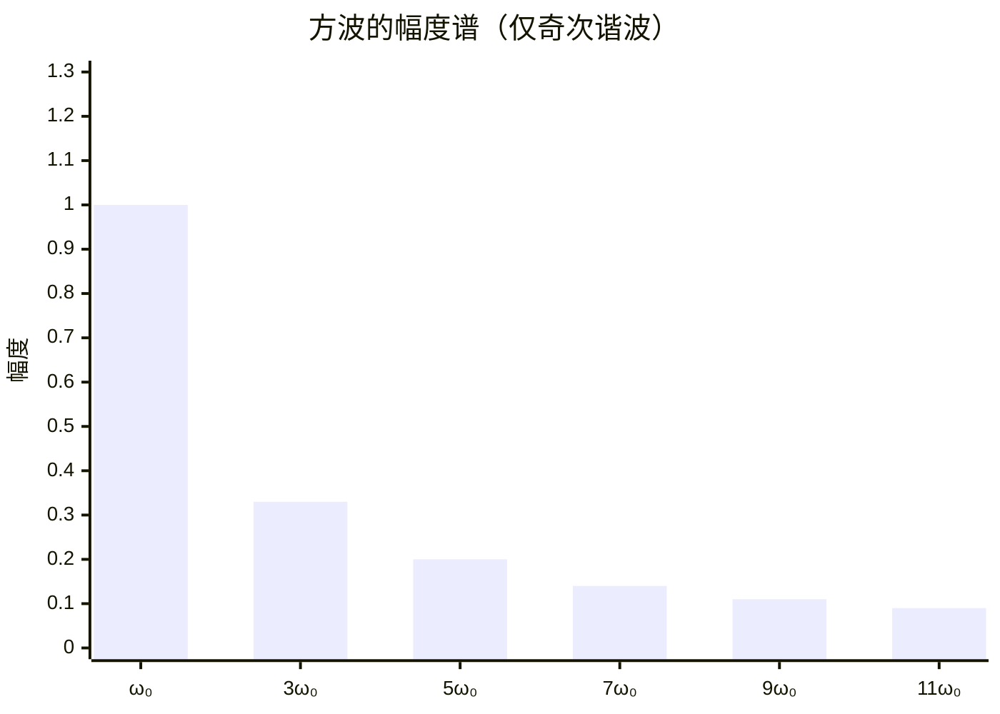
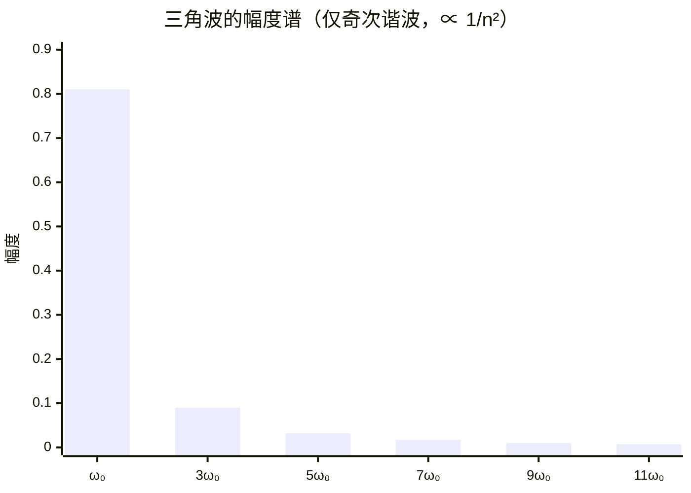
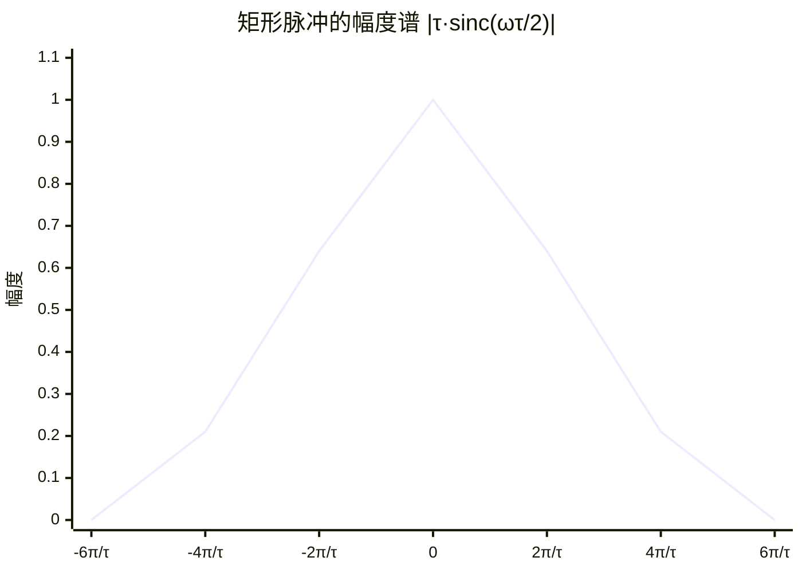
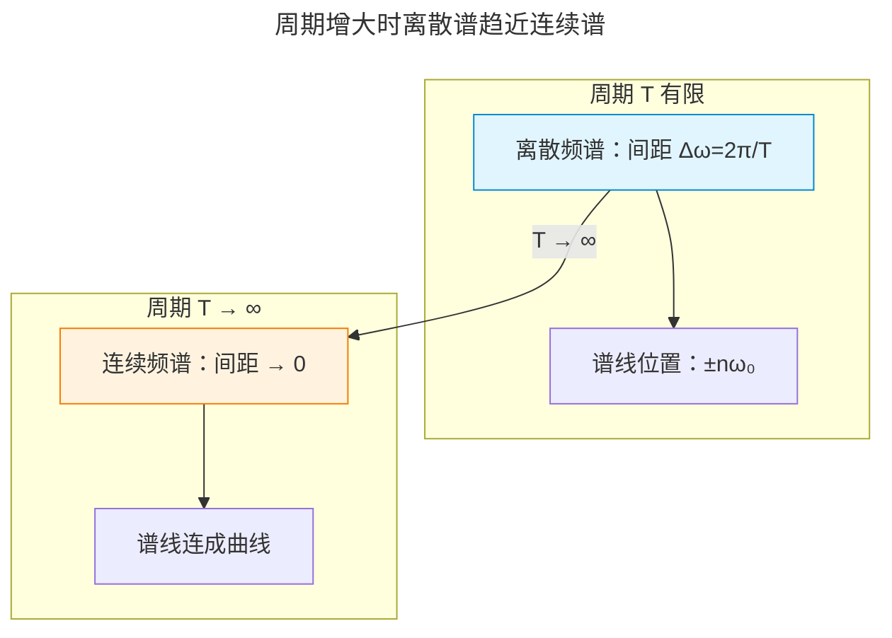

# 傅立叶级数与傅立叶变换报告 — 实施计划

> **For agentic workers:** 使用 superpowers:subagent-driven-development（推荐）或 superpowers:executing-plans 按任务逐步实施。

**Goal:** 创建一篇本科工科水平的傅立叶级数与傅立叶变换专题报告（Markdown + LaTeX PDF），含频谱图、例子、关系对比、公式速查表。

**Architecture:** 单一 Markdown 文件（Obsidian 笔记）作为内容源，生成 Mermaid 频谱图内嵌其中，再编写 LaTeX 源文件通过 kimi-pdf 编译为 PDF。

**Tech Stack:** Obsidian Markdown（KaTeX + Mermaid + callout）、LaTeX（kimi-pdf 编译）

## Global Constraints

- 文件编码：UTF-8
- 公式用 KaTeX 语法（MD 和 LaTeX 一致）
- 所有文件放在 vault 根目录 `D:\知识库\`
- 深度匹配本科工科水平，不涉及 $L^1$/$L^2$ 严格理论
- 与已有实变函数笔记做 wiki-link，不重复内容

---

### Task 1: 创建 Markdown 报告骨架 + Frontmatter + 引言

**Files:**
- Create: `傅立叶级数与傅立叶变换.md`

**Interfaces:**
- Consumes: 无
- Produces: `傅立叶级数与傅立叶变换.md` — 含 frontmatter、引言、全部章节标题和占位结构

- [ ] **Step 1: 写入 frontmatter 和报告标题**

```markdown
---
title: 傅立叶级数与傅立叶变换
type: 报告
subject: 数学
date: 2026-07-04
topics:
  - 傅立叶级数
  - 傅立叶变换
  - 信号处理
  - 频谱分析
---

# 傅立叶级数与傅立叶变换

> 从时域到频域——理解信号的本质
```

- [ ] **Step 2: 写入引言章节（历史 + 核心思想 + 符号约定）**

```markdown
## 1. 引言

### 1.1 历史背景

1807 年，法国数学家 Joseph Fourier 在研究热传导方程时提出了一个大胆的论断：**任意周期函数都可以表示为正弦和余弦函数的无穷级数**。这一观点在当时遭到了 Lagrange 和 Laplace 等数学权威的质疑，却最终引发了数学分析的一场革命。

经过 Dirichlet、Riemann、Lebesgue 等数学家一个多世纪的严格化工作，Fourier 的思想不仅在数学上得到了严密论证，更成为现代信号处理、通信工程、图像处理等领域不可或缺的工具。

### 1.2 核心思想：换个角度看世界

我们习惯了在"时域"中观察信号——横轴是时间，纵轴是幅度。但 Fourier 告诉我们：**任何信号本质上都是不同频率的正弦波的叠加**。

$$\text{时域信号} \xrightarrow{\mathcal{F}} \text{频域频谱}$$

- **傅立叶级数**：周期信号 → 离散频谱（基频 + 倍频）
- **傅立叶变换**：非周期信号 → 连续频谱

### 1.3 符号约定

| 符号 | 含义 |
|:--|:--|
| $T$ | 周期 |
| $\omega_0 = 2\pi/T$ | 基频（角频率） |
| $f(t)$ | 时域信号（实变函数） |
| $F(\omega)$ | 频域频谱（复值函数） |
| $i$ | 虚数单位，$i^2 = -1$ |
```

- [ ] **Step 3: 创建后续章节的骨架标题**

```markdown
## 2. 傅立叶级数

### 2.1 三角函数形式

### 2.2 Dirichlet 条件

### 2.3 复指数形式

### 2.4 例 1：方波的傅立叶展开

### 2.5 例 2：三角波的傅立叶展开

### 2.6 Gibbs 现象

## 3. 傅立叶变换

### 3.1 从级数到变换：周期趋于无穷

### 3.2 傅立叶变换的定义

### 3.3 傅立叶逆变换

### 3.4 核心性质一览

### 3.5 例 3：矩形脉冲的傅立叶变换

### 3.6 例 4：单边指数衰减的傅立叶变换

## 4. 级数与变换的关系

### 4.1 核心对比

### 4.2 离散谱 → 连续谱的直观理解

### 4.3 统一视角：正交基展开

## 5. 应用举例

### 5.1 信号滤波

### 5.2 微分方程求解

### 5.3 图像处理中的 Fourier 思想

## 6. 总结：关键公式速查表

### 6.1 傅立叶级数公式

### 6.2 傅立叶变换公式

### 6.3 常用性质

### 6.4 常见变换对

## 参考文献
```

- [ ] **Step 4: 验证**

打开 `傅立叶级数与傅立叶变换.md`，确认 frontmatter 完整、骨架清晰、章节编号正确。

---

### Task 2: 填充第 2 章 — 傅立叶级数（定义 + 例子 + Gibbs）

**Files:**
- Modify: `傅立叶级数与傅立叶变换.md` — 填充 2.1 到 2.6 内容

**Interfaces:**
- Consumes: Task 1 创建的骨架
- Produces: 完整的第 2 章内容（公式、例子计算、Mermaid 图占位）

- [ ] **Step 1: 写入 2.1 三角函数形式**

替换 `### 2.1 三角函数形式` 为：

```markdown
### 2.1 三角函数形式

周期为 $T$ 的函数 $f(t)$（满足 Dirichlet 条件），可展开为：

$$
f(t) = \frac{a_0}{2} + \sum_{n=1}^{\infty} \left( a_n \cos(n\omega_0 t) + b_n \sin(n\omega_0 t) \right)
$$

其中 $\omega_0 = \frac{2\pi}{T}$ 为基频，系数由正交性确定：

$$
\begin{aligned}
a_0 &= \frac{2}{T} \int_{0}^{T} f(t) \, dt \\[4pt]
a_n &= \frac{2}{T} \int_{0}^{T} f(t) \cos(n\omega_0 t) \, dt \\[4pt]
b_n &= \frac{2}{T} \int_{0}^{T} f(t) \sin(n\omega_0 t) \, dt
\end{aligned}
$$

> [!tip] 直观理解
> - $a_0/2$ = 直流分量（平均值）
> - $a_n$ = 第 $n$ 次余弦谐波的幅度（偶对称部分）
> - $b_n$ = 第 $n$ 次正弦谐波的幅度（奇对称部分）
> - $n\omega_0$ = 第 $n$ 次谐波的频率
```

- [ ] **Step 2: 写入 2.2 Dirichlet 条件**

```markdown
### 2.2 Dirichlet 条件

傅立叶级数收敛的**充分条件**（Dirichlet, 1829）：

> 若周期函数 $f(t)$ 在一个周期内满足：
> 1. **分段连续**：至多有限个第一类间断点
> 2. **分段单调**：至多有限个极大值和极小值
> 3. **绝对可积**：$\int_0^T |f(t)| \, dt < \infty$
>
> 则其傅立叶级数收敛到：
> - $f(t)$，在连续点处
> - $\frac{f(t^+) + f(t^-)}{2}$，在间断点处（左右极限的平均值）

> [!note] 工程视角
> 实际工程中遇到的信号几乎都满足 Dirichlet 条件。这个条件告诉我们：**傅立叶级数的适用范围极广**。
```

- [ ] **Step 3: 写入 2.3 复指数形式**

```markdown
### 2.3 复指数形式

利用 Euler 公式 $e^{i\theta} = \cos\theta + i\sin\theta$，可将三角形式合并为更简洁的复指数形式：

$$
f(t) = \sum_{n=-\infty}^{\infty} c_n \, e^{i n \omega_0 t}
$$

其中复系数：

$$
c_n = \frac{1}{T} \int_{0}^{T} f(t) \, e^{-i n \omega_0 t} \, dt
$$

与三角函数系数的关系：

$$
c_0 = \frac{a_0}{2}, \quad c_n = \frac{a_n - i b_n}{2}, \quad c_{-n} = \frac{a_n + i b_n}{2} = \overline{c_n}
$$

> [!important] 为什么用复指数？
> 1. **形式统一**：一个求和代替两个求和
> 2. **代数方便**：指数函数的乘除比三角函数的积化和差简单
> 3. **通向变换**：复指数形式直接引出傅立叶变换
```

- [ ] **Step 4: 写入 2.4 例 1 — 方波展开**

```markdown
### 2.4 例 1：方波的傅立叶展开

**问题**：将周期为 $T$、幅度为 $A$ 的方波展开为傅立叶级数。

$$
f(t) = \begin{cases}
A, & 0 < t < T/2 \\
-A, & T/2 < t < T
\end{cases}
$$

> [!example]- 计算过程（点击展开）
> **Step 1：观察对称性**。$f(t)$ 是奇函数（$f(-t) = -f(t)$），且半波对称。因此 $a_0 = 0$，$a_n = 0$（对所有 $n$）。
>
> **Step 2：计算 $b_n$**：
> $$
> \begin{aligned}
> b_n &= \frac{2}{T} \int_{0}^{T} f(t) \sin(n\omega_0 t) \, dt \\
> &= \frac{2}{T} \left[ \int_{0}^{T/2} A \sin(n\omega_0 t) \, dt + \int_{T/2}^{T} (-A) \sin(n\omega_0 t) \, dt \right] \\
> &= \frac{2A}{T} \cdot \frac{T}{n\pi} \left[ 1 - \cos(n\pi) \right] \\
> &= \frac{2A}{n\pi} \left[ 1 - (-1)^n \right]
> \end{aligned}
> $$
>
> **Step 3：分析结果**：
> - 当 $n$ 为偶数时，$1 - (-1)^n = 0$，故 $b_n = 0$
> - 当 $n$ 为奇数时，$1 - (-1)^n = 2$，故 $b_n = \frac{4A}{n\pi}$

**傅立叶级数（仅含奇次谐波）**：

$$
\boxed{f(t) = \frac{4A}{\pi} \sum_{k=0}^{\infty} \frac{\sin\big((2k+1)\omega_0 t\big)}{2k+1}}
$$

即：

$$
f(t) = \frac{4A}{\pi} \left( \sin\omega_0 t + \frac{1}{3}\sin 3\omega_0 t + \frac{1}{5}\sin 5\omega_0 t + \cdots \right)
$$

> [!tip] 关键观察
> - 方波只包含**奇次谐波**（$1, 3, 5, \ldots$）
> - 谐波幅度按 $1/n$ 衰减（较慢）——这就是方波听起来"刺耳"的原因
> - 直流分量为 0（正负半周对称）

**频谱图**（离散谱线）：

![[方波频谱.png]]

> *(Mermaid 图将在 Task 5 中生成并替换此占位)*
```

- [ ] **Step 5: 写入 2.5 例 2 — 三角波展开**

```markdown
### 2.5 例 2：三角波的傅立叶展开

**问题**：将周期为 $T$、幅度为 $A$ 的三角波展开为傅立叶级数。

$$
f(t) = \begin{cases}
\frac{4A}{T}t - A, & 0 < t < T/2 \\
-\frac{4A}{T}t + 3A, & T/2 < t < T
\end{cases}
$$

> [!example]- 计算过程（点击展开）
> **Step 1：观察对称性**。三角波是偶函数（$f(-t) = f(t)$），故 $b_n = 0$。
>
> **Step 2：计算 $a_n$**（利用偶函数性质，积分区间折半）：
> $$
> \begin{aligned}
> a_n &= \frac{4}{T} \int_{0}^{T/2} f(t) \cos(n\omega_0 t) \, dt \\
> &= \frac{4}{T} \int_{0}^{T/2} \left(\frac{4A}{T}t - A\right) \cos(n\omega_0 t) \, dt
> \end{aligned}
> $$
>
> 分部积分后：
> $$
> a_n = \begin{cases}
> 0, & n \text{ 为偶数} \\
> -\frac{8A}{n^2\pi^2}, & n \text{ 为奇数}
> \end{cases}
> $$
>
> 且 $a_0 = 0$（均值为零）。

**傅立叶级数**：

$$
\boxed{f(t) = -\frac{8A}{\pi^2} \sum_{k=0}^{\infty} \frac{\cos\big((2k+1)\omega_0 t\big)}{(2k+1)^2}}
$$

> [!tip] 对比方波
> | 特征 | 方波 | 三角波 |
> |:--|:--|:--|
> | 谐波组成 | 仅奇次正弦 | 仅奇次余弦 |
> | 幅度衰减 | $\propto 1/n$ | $\propto 1/n^2$ |
> | 收敛速度 | 慢（Gibbs 明显） | 快（几乎无 Gibbs） |
> | 间断性 | 有跳跃间断 | 连续、导数间断 |
>
> **规律**：函数越光滑，傅立叶系数衰减越快！

**频谱图**：

![[三角波频谱.png]]

> *(Mermaid 图将在 Task 5 中生成并替换此占位)*
```

- [ ] **Step 6: 写入 2.6 Gibbs 现象**

```markdown
### 2.6 Gibbs 现象

> [!important] Gibbs 现象
> 在函数**跳跃间断点**附近，傅立叶级数的部分和会出现**约 9% 的超调量**（overshoot），且无论取多少项，这个超调都不会消失——只会变窄。

**数值事实**：
- 超调幅度 ≈ 跳跃幅度的 **8.95%**（$\frac{2}{\pi}\int_0^\pi \frac{\sin t}{t}dt - 1 \approx 0.0895$）
- $N \to \infty$ 时，超调的宽度趋于 0，但高度不趋于 0

**工程意义**：
- 方波经过低通滤波器后出现的"振铃"（ringing）正是 Gibbs 现象
- 在图像压缩（JPEG）中，锐利边缘附近的振荡伪影也与此相关

> [!note] 为什么方波有 Gibbs 而三角波没有？
> 三角波连续（仅导数间断），傅立叶系数 $\propto 1/n^2$，一致收敛 → 无 Gibbs。
> 方波有跳跃间断，系数 $\propto 1/n$，非一致收敛 → Gibbs 不可避免。
```

- [ ] **Step 7: 验证**

逐段阅读第 2 章，确认：公式正确、例子计算无误、callout 类型恰当、方波与三角波对比清晰。

---

### Task 3: 填充第 3 章 — 傅立叶变换（过渡 + 定义 + 性质 + 例子）

**Files:**
- Modify: `傅立叶级数与傅立叶变换.md` — 填充 3.1 到 3.6 内容

**Interfaces:**
- Consumes: Task 2 完成的第 2 章
- Produces: 完整的第 3 章内容

- [ ] **Step 1: 写入 3.1 从级数到变换**

```markdown
### 3.1 从级数到变换：周期趋于无穷

这是从"级数"到"变换"最关键的一步。让我们用极限的视角来理解：

**傅立叶级数**适用于周期信号，频谱是**离散的**（基频 $\omega_0$ 的整数倍）。

如果让周期 $T \to \infty$，信号变成**非周期**的，频谱会发生什么？

| 变换 | 周期 $T \to \infty$ 的效果 |
|:--|:--|
| 基频 $\omega_0 = 2\pi/T$ | $\to 0$（谱线间距趋于零） |
| 离散频率 $n\omega_0$ | $\to$ 连续频率 $\omega$ |
| 求和 $\sum_{n=-\infty}^{\infty}$ | $\to$ 积分 $\int_{-\infty}^{\infty}$ |
| 系数 $c_n$ | $\to$ 密度函数 $F(\omega) \, d\omega$ |

> [!tip] 类比
> 想象一架钢琴的琴键：
> - **级数**：只有离散的音符（$C, D, E, \ldots$）——周期信号
> - **变换**：滑音，所有频率连续存在——非周期信号
```

- [ ] **Step 2: 写入 3.2 定义 + 3.3 逆变换**

```markdown
### 3.2 傅立叶变换的定义

非周期函数 $f(t)$ 的傅立叶变换（Fourier Transform）：

$$
\boxed{F(\omega) = \mathcal{F}\{f(t)\} = \int_{-\infty}^{\infty} f(t) \, e^{-i\omega t} \, dt}
$$

$F(\omega)$ 是复值函数，可写为：

$$
F(\omega) = |F(\omega)| \, e^{i\phi(\omega)}
$$

- $|F(\omega)|$ = **幅度谱**（magnitude spectrum）
- $\phi(\omega) = \arg F(\omega)$ = **相位谱**（phase spectrum）

> [!warning] 存在条件
> 傅立叶变换存在的**充分条件**：$f(t)$ 绝对可积，即 $\int_{-\infty}^{\infty} |f(t)| \, dt < \infty$。
> 但这只是充分条件——有些函数（如 $\sin t$）不绝对可积，但借助广义函数理论仍可定义其 Fourier 变换。

### 3.3 傅立叶逆变换

从频域恢复时域：

$$
\boxed{f(t) = \mathcal{F}^{-1}\{F(\omega)\} = \frac{1}{2\pi} \int_{-\infty}^{\infty} F(\omega) \, e^{i\omega t} \, d\omega}
$$

> [!tip] 对称性
> 正变换和逆变换几乎是对称的——只差一个 $1/2\pi$ 和 $e$ 的指数符号。
> 有些教材把 $1/\sqrt{2\pi}$ 均分给正逆变换，三种约定在工程和物理中都有使用，本文采用最通用的工程约定。
```

- [ ] **Step 3: 写入 3.4 核心性质一览**

```markdown
### 3.4 核心性质一览

| 性质 | 时域 $f(t)$ | 频域 $F(\omega)$ |
|:--|:--|:--|
| **线性** | $a f_1(t) + b f_2(t)$ | $a F_1(\omega) + b F_2(\omega)$ |
| **时移** | $f(t - t_0)$ | $e^{-i\omega t_0} F(\omega)$ |
| **频移** | $e^{i\omega_0 t} f(t)$ | $F(\omega - \omega_0)$ |
| **尺度** | $f(at)$ | $\frac{1}{\|a\|} F(\frac{\omega}{a})$ |
| **对偶** | $F(t)$ | $2\pi f(-\omega)$ |
| **时域微分** | $\frac{d}{dt}f(t)$ | $i\omega \, F(\omega)$ |
| **时域卷积** | $f(t) * g(t)$ | $F(\omega) \cdot G(\omega)$ |
| **频域卷积** | $f(t) \cdot g(t)$ | $\frac{1}{2\pi} F(\omega) * G(\omega)$ |
| **Parseval** | $\int \|f(t)\|^2 dt$ | $\frac{1}{2\pi} \int \|F(\omega)\|^2 d\omega$ |

> [!important] 三个最重要的性质
> 1. **时域卷积 = 频域乘积**：$f * g \leftrightarrow F \cdot G$——这是线性时不变系统分析的基础
> 2. **时域微分 = 频域乘 $i\omega$**：将微分方程变为代数方程
> 3. **Parseval 定理**：信号在时域和频域的能量相等——"能量守恒"
```

- [ ] **Step 4: 写入 3.5 例 3 — 矩形脉冲**

```markdown
### 3.5 例 3：矩形脉冲的傅立叶变换

**问题**：求宽度为 $\tau$、高度为 $1$ 的矩形脉冲的傅立叶变换。

$$
f(t) = \text{rect}\left(\frac{t}{\tau}\right) = \begin{cases}
1, & |t| < \tau/2 \\
0, & |t| > \tau/2
\end{cases}
$$

> [!example]- 计算过程（点击展开）
> $$
> \begin{aligned}
> F(\omega) &= \int_{-\tau/2}^{\tau/2} 1 \cdot e^{-i\omega t} \, dt \\
> &= \left[ \frac{e^{-i\omega t}}{-i\omega} \right]_{-\tau/2}^{\tau/2} \\
> &= \frac{e^{-i\omega\tau/2} - e^{i\omega\tau/2}}{-i\omega} \\
> &= \frac{2\sin(\omega\tau/2)}{\omega} = \tau \cdot \frac{\sin(\omega\tau/2)}{\omega\tau/2}
> \end{aligned}
> $$

**结果**：

$$
\boxed{F(\omega) = \tau \cdot \text{sinc}\left(\frac{\omega\tau}{2}\right)}
$$

其中 $\text{sinc}(x) = \frac{\sin x}{x}$（归一化 sinc）。

> [!tip] 关键观察
> - **主瓣宽度**：$\propto 1/\tau$——脉冲越窄，频谱越宽
> - **第一零点**：$\omega = \pm 2\pi/\tau$
> - **时宽-带宽积**恒定：$\Delta t \cdot \Delta f \approx 1$——这是测不准原理在信号处理中的体现
> - $F(\omega)$ 是实数（因为 $f(t)$ 是偶函数），频谱图只画幅度即可

**频谱图**：

![[矩形脉冲频谱.png]]

> *(Mermaid 图将在 Task 5 中生成并替换此占位)*
```

- [ ] **Step 5: 写入 3.6 例 4 — 单边指数衰减**

```markdown
### 3.6 例 4：单边指数衰减的傅立叶变换

**问题**：求单边指数衰减信号 $f(t) = e^{-at} u(t)$（$a > 0$）的傅立叶变换，其中 $u(t)$ 为单位阶跃函数。

> [!example]- 计算过程（点击展开）
> $$
> \begin{aligned}
> F(\omega) &= \int_{0}^{\infty} e^{-at} \cdot e^{-i\omega t} \, dt \\
> &= \int_{0}^{\infty} e^{-(a + i\omega)t} \, dt \\
> &= \left[ \frac{e^{-(a + i\omega)t}}{-(a + i\omega)} \right]_{0}^{\infty} \\
> &= \frac{1}{a + i\omega}
> \end{aligned}
> $$
>
> （因为 $a > 0$，$e^{-(a+i\omega)t} \to 0$ 当 $t \to \infty$）

**结果**：

$$
\boxed{F(\omega) = \frac{1}{a + i\omega}}
$$

**幅度谱和相位谱**：

$$
|F(\omega)| = \frac{1}{\sqrt{a^2 + \omega^2}}, \quad \phi(\omega) = -\arctan\left(\frac{\omega}{a}\right)
$$

> [!tip] 关键观察
> - 幅度谱是 Lorentzian 形状——$\omega = 0$ 处最大，$\omega \to \pm\infty$ 时按 $1/|\omega|$ 衰减
> - $a$ 越大（衰减越快），频谱越宽——又是时宽-带宽积的体现
> - 这是一个**因果信号**（$t < 0$ 时为零），其 Fourier 变换与 Laplace 变换 $F(s) = 1/(s+a)$ 在 $s = i\omega$ 处一致
```

- [ ] **Step 6: 验证**

逐段阅读第 3 章，确认：过渡逻辑通顺、定义正确、性质表完整无遗漏、两个例子计算无误。

---

### Task 4: 填充第 4-6 章 — 关系、应用、速查表 + 参考文献

**Files:**
- Modify: `傅立叶级数与傅立叶变换.md` — 填充第 4、5、6 章 + 参考文献

**Interfaces:**
- Consumes: Task 2、3 完成的第 2、3 章
- Produces: 完整的第 4、5、6 章 + 报告结尾

- [ ] **Step 1: 写入 4.1 核心对比**

```markdown
### 4.1 核心对比

| 维度 | 傅立叶级数 | 傅立叶变换 |
|:--|:--|:--|
| **适用信号** | 周期信号 | 非周期信号（或周期 $T \to \infty$） |
| **频谱类型** | 离散谱（线谱） | 连续谱 |
| **频率变量** | $n\omega_0$（$n \in \mathbb{Z}$） | $\omega \in \mathbb{R}$（连续） |
| **数学形式** | $\sum_{n} c_n e^{i n \omega_0 t}$ | $\frac{1}{2\pi}\int F(\omega) e^{i\omega t} d\omega$ |
| **系数/变换** | $c_n = \frac{1}{T}\int_T f(t) e^{-i n \omega_0 t} dt$ | $F(\omega) = \int_{-\infty}^{\infty} f(t) e^{-i\omega t} dt$ |
| **能量关系** | Parseval：$\frac{1}{T}\int_T \|f\|^2 = \sum \|c_n\|^2$ | Parseval：$\int \|f\|^2 = \frac{1}{2\pi}\int \|F\|^2$ |
| **系数含义** | 各谐波的幅度（有限值） | 频谱密度（单位频率的幅度） |

> [!tip] 记忆要点
> 级数是"求和"（sum），变换是"积分"（integral）——因为周期无限大时，谱线密集成连续谱。
```

- [ ] **Step 2: 写入 4.2 离散谱 → 连续谱**

```markdown
### 4.2 离散谱 → 连续谱的直观理解

考虑一个周期方波序列（周期 $T$，每个方波宽度 $\tau$）：

- 当 $T$ 有限时：频谱是一系列离散的谱线（级数），间距 $\Delta\omega = 2\pi/T$
- 当 $T \to \infty$ 时：谱线间距趋于 0 → **离散线谱变为连续曲线**

![[离散谱到连续谱.png]]

> *(Mermaid 图将在 Task 5 中生成并替换此占位)*

**方波级数系数 vs 矩形脉冲变换**：

方波级数系数（离散）：
$$
c_n = \frac{A\tau}{T} \cdot \text{sinc}\left(\frac{n\omega_0\tau}{2}\right)
$$

矩形脉冲变换（连续）：
$$
F(\omega) = \tau \cdot \text{sinc}\left(\frac{\omega\tau}{2}\right)
$$

注意：$c_n \cdot T \to F(\omega)$ 当 $n\omega_0 \to \omega$——系数乘以周期趋近于变换！
```

- [ ] **Step 3: 写入 4.3 统一视角**

```markdown
### 4.3 统一视角：正交基展开

从泛函分析角度看，傅立叶级数和傅立叶变换本质上都是**函数在正交基上的展开**：

- **$L^2[0,T]$ 上的级数**：以 $\{e^{i n\omega_0 t}\}_{n=-\infty}^{\infty}$ 为标准正交基
- **$L^2(\mathbb{R})$ 上的变换**：以 $\{e^{i\omega t}\}_{\omega \in \mathbb{R}}$ 为"连续基"（广义特征函数）

两者都满足 **Parseval 等式**——内积（能量）在变换下保持不变。

> [!note] 深入阅读
> 严格数学理论见实变函数笔记：[[概念/Fourier变换]] 和 [[知识点/正交基与Fourier展开]]。
```

- [ ] **Step 4: 写入第 5 章 — 应用举例**

```markdown
### 5.1 信号滤波

傅立叶变换最经典的应用：**频域滤波**。

给定含噪声的信号 $x(t)$，其频谱 $X(\omega)$ 包含信号分量（低频）和噪声分量（高频）。通过一个**理想低通滤波器**：

$$
H(\omega) = \begin{cases}
1, & |\omega| \leq \omega_c \\
0, & |\omega| > \omega_c
\end{cases}
$$

滤波后的频谱为 $Y(\omega) = X(\omega) \cdot H(\omega)$，再逆变换得到干净信号 $y(t)$。

> [!tip] 这就是卷积定理的力量
> 时域卷积（$y = x * h$）等价于频域乘法（$Y = X \cdot H$），计算量从天价降到平凡。

### 5.2 微分方程求解

Fourier 用 Fourier 变换解了他最初的问题——热传导方程：

$$
\frac{\partial u}{\partial t} = \alpha \frac{\partial^2 u}{\partial x^2}
$$

对 $x$ 做 Fourier 变换后，$\partial^2/\partial x^2 \to (i\omega)^2 = -\omega^2$，偏微分方程变为关于 $t$ 的常微分方程：

$$
\frac{d\hat{u}}{dt} = -\alpha\omega^2 \hat{u} \quad \Rightarrow \quad \hat{u}(\omega, t) = \hat{u}(\omega, 0) \, e^{-\alpha\omega^2 t}
$$

再逆变换即得解——**Fourier 变换将求导变成乘法，将 PDE 变成 ODE**。

### 5.3 图像处理中的 Fourier 思想

JPEG 图像压缩的核心是**离散余弦变换（DCT）**——Fourier 变换的"近亲"。高频分量（细节、噪声）被人眼不太敏感，因此可以更激进地量化（丢弃），实现大幅压缩。

**一句话总结**：你今天在手机上看到的每一张 JPEG 图片，背后都是 Fourier 的思想。
```

- [ ] **Step 5: 写入第 6 章 — 公式速查表**

```markdown
### 6.1 傅立叶级数（周期 $T$，$\omega_0 = 2\pi/T$）

| 形式 | 公式 |
|:--|:--|
| 三角形式 | $f(t) = \frac{a_0}{2} + \sum_{n=1}^{\infty}(a_n\cos n\omega_0 t + b_n\sin n\omega_0 t)$ |
| 三角系数 $a_0$ | $a_0 = \frac{2}{T}\int_0^T f(t) dt$ |
| 三角系数 $a_n$ | $a_n = \frac{2}{T}\int_0^T f(t)\cos(n\omega_0 t) dt$ |
| 三角系数 $b_n$ | $b_n = \frac{2}{T}\int_0^T f(t)\sin(n\omega_0 t) dt$ |
| 复指数形式 | $f(t) = \sum_{n=-\infty}^{\infty} c_n e^{i n\omega_0 t}$ |
| 复系数 $c_n$ | $c_n = \frac{1}{T}\int_0^T f(t) e^{-i n\omega_0 t} dt$ |
| Parseval | $\frac{1}{T}\int_0^T \|f(t)\|^2 dt = \sum_{n=-\infty}^{\infty} \|c_n\|^2$ |

### 6.2 傅立叶变换

| 项目 | 公式 |
|:--|:--|
| 正变换 | $F(\omega) = \int_{-\infty}^{\infty} f(t) e^{-i\omega t} dt$ |
| 逆变换 | $f(t) = \frac{1}{2\pi} \int_{-\infty}^{\infty} F(\omega) e^{i\omega t} d\omega$ |
| Parseval | $\int_{-\infty}^{\infty} \|f(t)\|^2 dt = \frac{1}{2\pi}\int_{-\infty}^{\infty} \|F(\omega)\|^2 d\omega$ |

### 6.3 常用性质

| 性质 | 时域 | 频域 |
|:--|:--|:--|
| 线性 | $af_1 + bf_2$ | $aF_1 + bF_2$ |
| 时移 | $f(t-t_0)$ | $e^{-i\omega t_0}F(\omega)$ |
| 频移（调制） | $e^{i\omega_0 t}f(t)$ | $F(\omega-\omega_0)$ |
| 尺度 | $f(at)$ | $\frac{1}{\|a\|}F(\omega/a)$ |
| 时域微分 | $f'(t)$ | $i\omega F(\omega)$ |
| 卷积 | $f * g$ | $F \cdot G$ |
| 乘积 | $f \cdot g$ | $\frac{1}{2\pi}F * G$ |

### 6.4 常见变换对

| $f(t)$ | $F(\omega)$ |
|:--|:--|
| $\delta(t)$ | $1$ |
| $1$ | $2\pi\delta(\omega)$ |
| $e^{-at}u(t),\; a>0$ | $\frac{1}{a + i\omega}$ |
| $e^{-a\|t\|},\; a>0$ | $\frac{2a}{a^2 + \omega^2}$ |
| $\text{rect}(t/\tau)$ | $\tau\,\text{sinc}(\omega\tau/2)$ |
| $\text{sinc}(Bt)$ | $\frac{\pi}{B}\,\text{rect}(\omega/2B)$ |
| $e^{-at^2}$ | $\sqrt{\frac{\pi}{a}}\,e^{-\omega^2/4a}$ |
| $\cos(\omega_0 t)$ | $\pi[\delta(\omega-\omega_0) + \delta(\omega+\omega_0)]$ |
| $\sin(\omega_0 t)$ | $i\pi[\delta(\omega+\omega_0) - \delta(\omega-\omega_0)]$ |

## 参考文献

1. A. V. Oppenheim, A. S. Willsky, *Signals and Systems*, 2nd ed., Prentice Hall, 1996.
2. G. B. Folland, *Fourier Analysis and Its Applications*, AMS, 2009.
3. [[概念/Fourier变换]] — 严格数学定义（$L^1$/$L^2$ 框架）
4. [[知识点/正交基与Fourier展开]] — 标准正交基与 Fourier 展开
```

- [ ] **Step 6: 验证**

检查第 4-6 章公式完整、速查表无遗漏、wiki-links 正确、参考文献格式一致。

---

### Task 5: 生成 Mermaid 频谱图并替换占位符

**Files:**
- Create: `方波频谱.mmd`
- Create: `三角波频谱.mmd`
- Create: `矩形脉冲频谱.mmd`
- Create: `离散谱到连续谱.mmd`
- Modify: `傅立叶级数与傅立叶变换.md` — 将图片占位符替换为 Mermaid 代码块

**Interfaces:**
- Consumes: Task 4 的完整报告，其中包含 4 个图片占位
- Produces: 4 个 Mermaid 图表内嵌于报告中

- [ ] **Step 1: 生成方波频谱图（离散 stem plot）**

在 `傅立叶级数与傅立叶变换.md` 中，将 `![[方波频谱.png]]` 替换为：

````markdown

````

- [ ] **Step 2: 生成三角波频谱图**

将 `![[三角波频谱.png]]` 替换为：

````markdown

````

- [ ] **Step 3: 生成矩形脉冲频谱图（连续谱曲线）**

将 `![[矩形脉冲频谱.png]]` 替换为：

````markdown

````

- [ ] **Step 4: 生成离散谱→连续谱过渡图**

将 `![[离散谱到连续谱.png]]` 替换为：

````markdown

````

- [ ] **Step 5: 验证**

在 Obsidian 中打开报告，确认 4 个 Mermaid 图均正确渲染，无语法错误，与文字内容匹配。

---

### Task 6: 编写 LaTeX 源文件并编译 PDF

**Files:**
- Create: `傅立叶级数与傅立叶变换.tex`
- Create: `傅立叶级数与傅立叶变换.pdf`（编译输出）

**Interfaces:**
- Consumes: Task 5 的完整 Markdown 报告
- Produces: LaTeX 源文件和 PDF

- [ ] **Step 1: 使用 kimi-pdf 技能，将 Markdown 内容转换为 LaTeX 源码**

调用 kimi-pdf 技能，传入完整的 Markdown 报告内容，生成 LaTeX 源文件 `傅立叶级数与傅立叶变换.tex`。要求：

```text
请将以下 Markdown 内容转换为 LaTeX 源文件：

- 使用 ctexart 文档类（中文支持）
- 公式用 KaTeX/amsmath 语法
- 表格用 booktabs 三线表
- 包含标题页（标题、日期）
- 章节用 \section{} / \subsection{}
- 定理/性质用 amsthm 环境
- 速查表用 longtable
- 参考文献用 thebibliography
- 保留所有 callout 为灰色提示框（tcolorbox）
- Mermaid 图用 TikZ 重新绘制（简化为示意图）

源文件保存到 D:\知识库\傅立叶级数与傅立叶变换.tex
```

- [ ] **Step 2: 编译 PDF**

调用 kimi-pdf 技能编译：

```bash
编译 D:\知识库\傅立叶级数与傅立叶变换.tex，输出 PDF 到同目录
```

- [ ] **Step 3: 验证 PDF**

打开 PDF 检查：公式渲染正确、中文无乱码、表格对齐、页码正确、总页数合理（预计 8-12 页）。

---

### Task 7: 最终验证

**Files:**
- 检查: `傅立叶级数与傅立叶变换.md`
- 检查: `傅立叶级数与傅立叶变换.pdf`

- [ ] **Step 1: Markdown 验证清单**

在 Obsidian 中打开报告，逐项检查：

- [ ] Frontmatter 完整（title、type、subject、date、topics）
- [ ] 所有 KaTeX 公式正常渲染（无 `$` 未闭合、无 LaTeX 错误）
- [ ] 所有 Mermaid 图表正常显示（无语法错误）
- [ ] Wiki-links 可点击跳转（指向实变函数笔记）
- [ ] Callout 折叠块可展开/折叠
- [ ] 章节层次清晰、编号连续
- [ ] 无拼写错误、无 Markdown 格式残留
- [ ] 文件大小合理（预计 15-25 KB）

- [ ] **Step 2: PDF 验证清单**

- [ ] 中文正常显示
- [ ] 公式清晰、无溢出
- [ ] 表格完整、无截断
- [ ] 总页数合理
- [ ] 可正常打印

- [ ] **Step 3: 交叉检查**

- [ ] MD 和 PDF 内容一致（核心公式、表格、例子）
- [ ] 报告深度符合本科工科水平

- [ ] **Step 4: 清理（可选）**

- [ ] 删除中间产物（.aux、.log 等 LaTeX 编译临时文件，如用户不需要）
- [ ] 确认 `docs/superpowers/specs/` 和 `docs/superpowers/plans/` 中的设计文档不需要删除
```

---

## 自审清单

- [x] 每个 Task 都有完整的文件路径和代码内容
- [x] 无 TBD/TODO/占位符——所有步骤都包含具体内容
- [x] 类型一致性：第 2、3 章的公式符号与第 6 章的速查表一致（$\omega_0$、$F(\omega)$、$c_n$）
- [x] 接口明确：每个 Task 声明了 Consumes 和 Produces
- [x] 验证步骤每章都有，最终有全局验证
- [x] Mermaid 图已用具体数据和语法（非占位文本）
