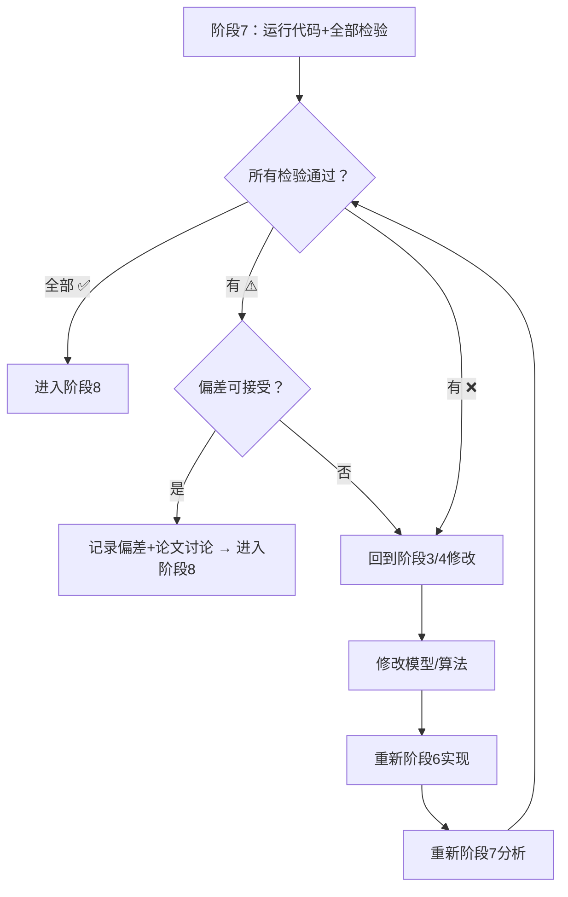

# 结果分析报告

## 概述

结果分析（阶段7）在代码实现（阶段6）之后、论文衔接（阶段8）之前进行。

**核心原则**：代码跑出数字不等于建模完成。必须对结果进行系统性分析——验证合理性、对比预期、检查自洽。不允许把"裸数字"直接放进论文。

本文档定义：
1. 结果分析报告模板
2. 预期范围对比规则
3. 偏差讨论规则（禁止自行合理化）
4. 文献对比
5. 自洽性检查
6. 检验方案执行记录

---

## 结果分析报告模板

```markdown
# 问题{X}结果分析报告

## 1. 数值结果汇总

### 问题{X}主要结果

| 输出项 | 符号 | 数值 | 单位 | 精度 |
|--------|------|------|------|------|
| | | | | |

### 所有子问题结果汇总（全部完成后填写）

| 问题 | 核心输出 | 数值结果 | 与预期一致？ |
|------|---------|---------|:----------:|
| 问题一 | N_min（单面最小星数） | | |
| 问题二 | N（实际部署星数/面） | | |
| 问题三 | S（总星数） | | |
| 问题四 | [改进后的结果] | | |

## 2. 与预期范围对比

| 输出项 | 实际值 | 预期范围（阶段4） | 预期来源 | 偏差 | 判定 |
|--------|--------|-----------------|---------|:---:|:----:|
| | | | 文献[1]/常识/WebSearch | X% | ✅/⚠️/❌ |

### 判定标准
- 偏差 ≤10% 或在预期范围内 → ✅
- 偏差 10-50% 但可解释 → ⚠️
- 偏差 >50% 或明显不合理 → ❌

## 3. 偏差讨论

> ⚠️ **禁止"自行合理化"**——不要为离谱的结果编造听起来合理的解释。
> 诚实分析可能原因，必要时回退修正模型/算法。

### 无偏差项（全部✅）
[快速通过，无需展开]

### ⚠️ 项（有偏差但可解释）

| 输出项 | 偏差 | 可能原因 | 是否需要修改 |
|--------|:---:|---------|:----------:|
| | | | |

### ❌ 项（偏差明显且无法解释）

| 输出项 | 偏差 | 排查方向 | 处理 |
|--------|:---:|---------|------|
| | | | 回到阶段[X]修改[具体内容] |

## 4. 与文献结果对比

| 本文结果 | 文献结果 | 文献来源 | 偏差 | 一致性判断 |
|---------|---------|---------|:---:|:---------:|
| | | [Author (Year)] | X% | 一致 / 合理偏差 / 矛盾 |

### 矛盾分析（如有）
[如本文结果与文献结果矛盾，必须分析原因]
- 本文假设 vs 文献假设的差异？
- 本文参数取值 vs 文献参数取值的差异？
- 场景差异（如目标区域不同）导致结果不同？

## 5. 自洽性检查

| 检查项 | 规则 | 实际值 | 判定 | 说明 |
|--------|------|--------|:--:|------|
| Q2每面N vs Q1每面N_min | Q2_N ≥ Q1_Nmin? | Q1: A, Q2: B | ✅/❌ | |
| Q3总星数 vs Q2×面数 | Q3_S ≈ Q2_M × Q2_N? | Q2: M×N, Q3: S | ✅/❌ | |
| [其他自洽性] | | | | |

### 🆕 强制自洽性规则

**规则1：单面星数的下界一致性**
```
Q1: N_min（单面最小星数） ≈ X
Q2: N_per_plane（优化后每面星数） ≈ Y
强制检查：Y ≥ X ?
```
- 若 Y ≥ X → ✅ 通过
- 若 Y < X → ❌ 必须解释多面协同为何降低了单面要求（如面间重叠降低了覆盖冗余需求），
  或退回阶段3修正模型（Q1的N_min计算可能有误，如未考虑最小仰角）

**规则2：总星数核算**
```
Q2: 总星数 = M面 × N每面 = S₂
Q3: 总星数 = S₃
强制检查：S₃ ≈ S₂ ?
```
- 若 S₃ ≈ S₂（偏差 < 5%）→ ✅ 通过
- 若 S₃ ≠ S₂ → ⚠️ Q3对星座进行了优化/调整，说明优化了什么、效果如何

## 6. 检验方案执行记录

| 检验编号 | 检验类型 | 执行函数 | 实际结果 | 预期结果 | 通过？ | 备注 |
|----------|---------|---------|---------|---------|:-----:|------|
| V1.1 | 灵敏度 | `sensitivity_h()` | h±20%时N_min变化8% | 变化<15% | ✅ | |
| V1.2 | 灵敏度 | `sensitivity_alpha()` | α±20%时N_min变化22% | 变化<15% | ❌ | α敏感，见偏差讨论3.2 |
| V1.3 | 极端退化 | `extreme_degen_h0()` | h→0时θ→0° | θ→0° | ✅ | |
| V2.5 | 对比验证 | `compare_ga_vs_grid()` | GA=14, Grid=14 | 差异<5% | ✅ | |
| C1 | 自洽性 | `check_q1_q2()` | Q1_Nmin=40, Q2_N=14 | Y≥X | ❌ | 见自洽性分析5.1 |

### 检验统计

| 统计项 | 数量 |
|--------|:--:|
| 总检验数 | |
| 通过 | |
| 不通过 | |
| 通过率 | % |

## 7. 图表生成状态

| 图表 | 状态 | 文件路径 | 备注 |
|------|:--:|------|------|
| Fig.1 | ✅ 已生成 | `图表/fig1_coverage_geometry.png` | |
| Fig.2 | ✅ 已生成 | `图表/fig2_theta_vs_h.png` | |
| Fig.3 | ⚠️ 待修改 | — | 需调整X轴范围 |
```

---

## 偏差讨论规则

### 禁止行为

| ❌ 禁止 | 示例 |
|--------|------|
| 自行合理化明显错误 | "S=98虽然比真实值S=714小了13倍，但可能是因为我们用的是2D近似..." ← 这不是近似的问题，是模型框架的问题 |
| 无视不一致 | 两个检验结果矛盾却不讨论 |
| 用"合理误差"搪塞 | "偏差30%在建模中属于合理范围" ← 30%偏差需要解释 |
| 只报喜不报忧 | 只展示通过的检验，隐藏不通过的 |

### 正确做法

1. **承认偏差**：明确说出"结果X与预期Y偏差Z%"
2. **分析原因**：从以下维度排查——
   - 模型假设是否过于简化？（如球形地球 vs 椭球）
   - 参数取值是否有误？（如使用了不合适的经验值）
   - 代码实现是否有bug？（如数值积分步长过大）
   - 预期范围本身是否不准确？（如WebSearch结果来自不可靠来源）
3. **提出行动**：回到阶段X修改Y，或补充Z检验
4. **记录在案**：所有偏差和处理方案写入结果分析报告

---

## 判定规则

### 整体判定

```
全部 ✅ → 进入阶段8（开始写论文）
有 ⚠️  → 分析后决定：偏差可接受→进入阶段8；需要更多分析→补充检验后进入阶段8
有 ❌  → 必须回到阶段3或4修改模型/算法，不允许带着明显偏差进论文
        → 修改后重新执行阶段6和7，直到全部 ✅ 或仅剩可接受的 ⚠️
```

### 判定流程



---

## 与阶段8（论文衔接）的关系

阶段7的输出直接供给阶段8：
- **数值结果汇总** → 论文的"结果"章节
- **偏差讨论** → 论文的"模型评价"或"讨论"章节
- **检验执行记录** → 论文的"模型检验"章节（灵敏度分析等）
- **图表生成状态** → 确认所有计划图表已生成，论文中标注位置
- **自洽性检查结果** → 论文中展示多问题结果的一致性
