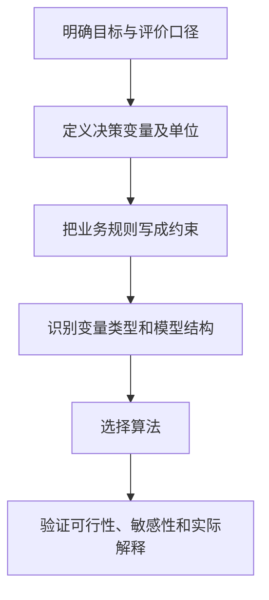

# 优化建模标准流程

## 适用场景

- 从现实问题建立可求解优化模型

## 核心公式/步骤

1. 明确目标与评价口径
2. 定义决策变量及单位
3. 把业务规则写成约束
4. 识别变量类型和模型结构
5. 选择算法
6. 验证可行性、敏感性和实际解释

## 流程图

## 典型例题

> [!example]- 示例
> 生产计划应先定义产量变量，再写利润目标、资源约束和非负或整数条件。

## 知识链接

- [[知识体系/知识点/优化建模与求解/最优化模型标准形式]]

## 习题链接

- [[源MD/讲稿--03-直接搜索法与蒙特卡罗法#1.7. 练习题]]
- [[源MD/遗传算法（Genetic Algorithm）教学讲稿#练习题5：综合应用]]
