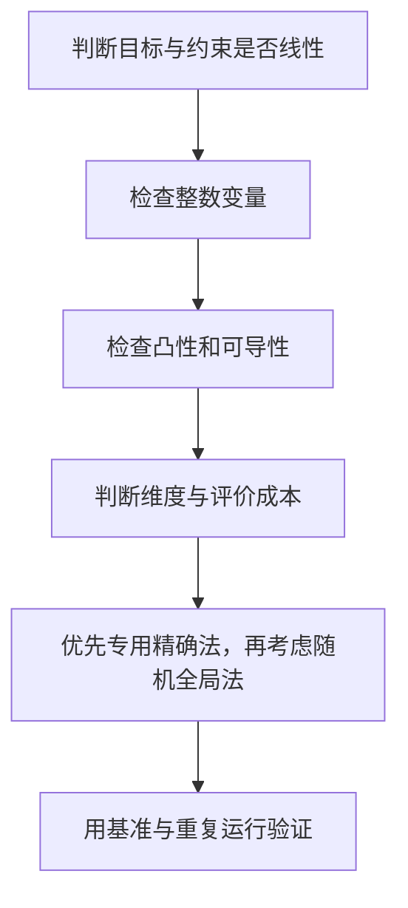

# 优化求解器选择流程

## 适用场景

- 已有优化模型，需要匹配算法

## 核心公式/步骤

1. 判断目标与约束是否线性
2. 检查整数变量
3. 检查凸性和可导性
4. 判断维度与评价成本
5. 优先专用精确法，再考虑随机全局法
6. 用基准与重复运行验证

## 流程图

## 典型例题

> [!example]- 示例
> 线性整数模型优先 intlinprog 或 MILP 求解器，不先用 GA。

## 知识链接

- [[知识体系/知识点/优化建模与求解/优化模型结构与算法匹配]]

## 习题链接

- [[源MD/讲稿--03-直接搜索法与蒙特卡罗法#1.7. 练习题]]
- [[源MD/遗传算法（Genetic Algorithm）教学讲稿#练习题5：综合应用]]
