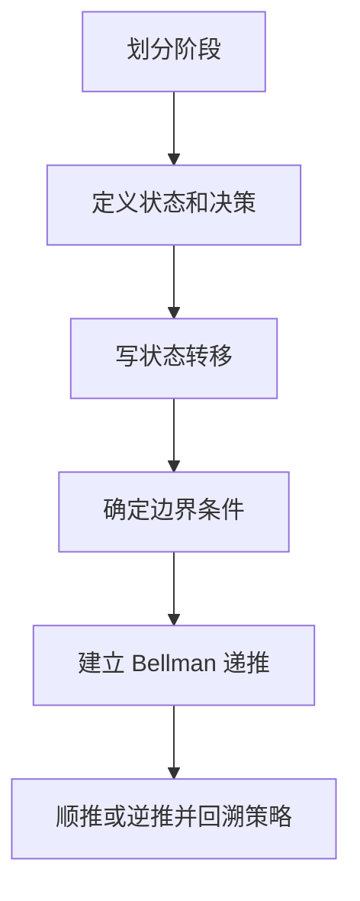

# 动态规划求解流程

## 适用场景

- 具有阶段、状态转移和最优子结构

## 核心公式/步骤

1. 划分阶段
2. 定义状态和决策
3. 写状态转移
4. 确定边界条件
5. 建立 Bellman 递推
6. 顺推或逆推并回溯策略

## 流程图

## 典型例题

> [!example]- 示例
> 资源分配问题用剩余资源作状态，可逐阶段递推最优收益。

## 知识链接

- [[知识体系/知识点/优化建模与求解/Bellman最优性原理]]

## 习题链接

- [[源MD/讲稿--03-直接搜索法与蒙特卡罗法#1.7. 练习题]]
- [[源MD/遗传算法（Genetic Algorithm）教学讲稿#练习题5：综合应用]]
