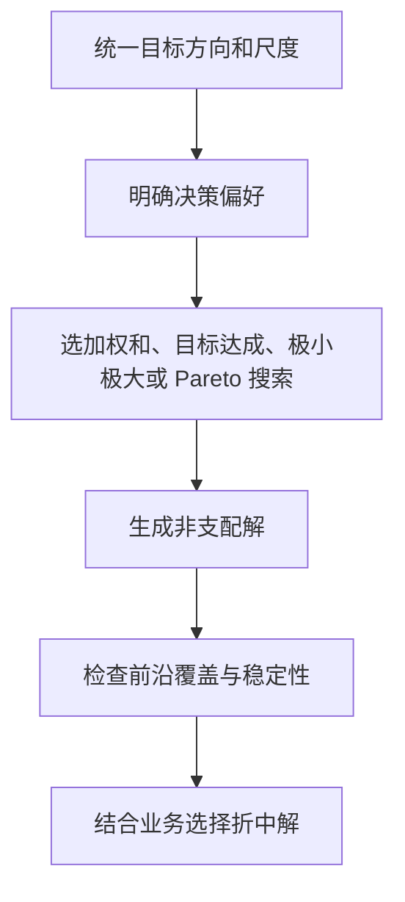

# 多目标优化求解流程

## 适用场景

- 存在两个及以上冲突目标

## 核心公式/步骤

1. 统一目标方向和尺度
2. 明确决策偏好
3. 选加权和、目标达成、极小极大或 Pareto 搜索
4. 生成非支配解
5. 检查前沿覆盖与稳定性
6. 结合业务选择折中解

## 流程图

## 典型例题

> [!example]- 示例
> 偏好明确可用 fgoalattain；需要整条前沿可用 gamultiobj 或 paretosearch。

## 知识链接

- [[知识体系/知识点/优化建模与求解/Pareto支配与多目标权衡]]

## 习题链接

- [[源MD/讲稿--03-直接搜索法与蒙特卡罗法#1.7. 练习题]]
- [[源MD/遗传算法（Genetic Algorithm）教学讲稿#练习题5：综合应用]]
