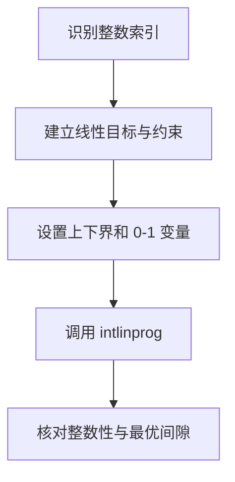

# 整数与混合整数规划求解流程

## 适用场景

- 变量含数量、开关、选择或指派

## 核心公式/步骤

1. 识别整数索引
2. 建立线性目标与约束
3. 设置上下界和 0-1 变量
4. 调用 intlinprog
5. 核对整数性与最优间隙

## 流程图

## 典型例题

> [!example]- 示例
> 是否建设工厂用 0-1 变量，产量可保留连续变量形成 MILP。

## 知识链接

- [[知识体系/知识点/优化建模与求解/优化模型结构与算法匹配]]

## 习题链接

- [[源MD/讲稿--03-直接搜索法与蒙特卡罗法#1.7. 练习题]]
- [[源MD/遗传算法（Genetic Algorithm）教学讲稿#练习题5：综合应用]]
