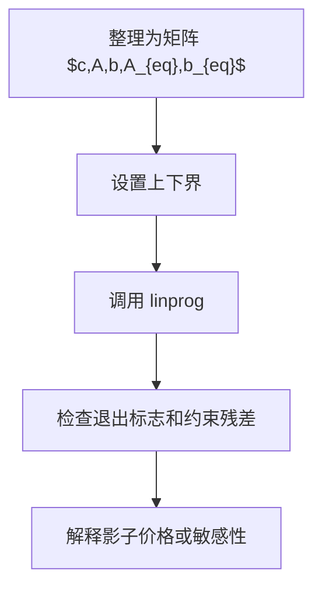

# 线性规划求解流程

## 适用场景

- 连续变量、线性目标和线性约束

## 核心公式/步骤

1. 整理为矩阵 $c,A,b,A_{eq},b_{eq}$
2. 设置上下界
3. 调用 linprog
4. 检查退出标志和约束残差
5. 解释影子价格或敏感性

## 流程图

## 典型例题

> [!example]- 示例
> 生产配比模型可写成资源矩阵不等式后交给 linprog。

## 知识链接

- [[知识体系/知识点/优化建模与求解/最优化模型标准形式]]

## 习题链接

- [[源MD/讲稿--03-直接搜索法与蒙特卡罗法#1.7. 练习题]]
- [[源MD/遗传算法（Genetic Algorithm）教学讲稿#练习题5：综合应用]]
