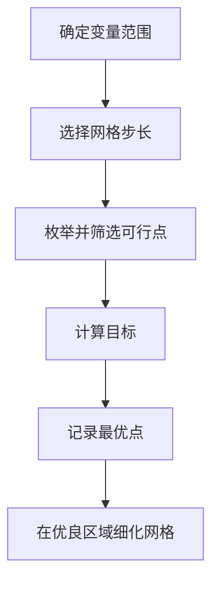

# 网格搜索流程

## 适用场景

- 低维有界黑盒问题或算法基准

## 核心公式/步骤

1. 确定变量范围
2. 选择网格步长
3. 枚举并筛选可行点
4. 计算目标
5. 记录最优点
6. 在优良区域细化网格

## 流程图

## 典型例题

> [!example]- 示例
> 二维问题可先粗网格定位，再局部加密降低总计算量。

## 知识链接

- [[知识体系/知识点/优化建模与求解/网格搜索精度与复杂度]]

## 习题链接

- [[源MD/讲稿--03-直接搜索法与蒙特卡罗法#1.7. 练习题]]
- [[源MD/遗传算法（Genetic Algorithm）教学讲稿#练习题5：综合应用]]
